# 机器学习 Chapter 1–2：从基本框架到线性模型

这三份课件分别是：

- **Chapter 1：机器学习概述**（65页）
- **Chapter 2：线性模型 I**（32页）
- **Chapter 2：线性模型 II**（22页）

它们实际上构成了机器学习入门的一条完整主线：**先理解机器学习如何从数据中学习规律，再研究如何用线性模型预测连续值，最后推广到分类问题。**

我会以课件为主，适当补充课件中省略的数学直觉和推导。你已经有微积分、线性代数和概率论基础，因此不需要从最基础的运算讲起，但会重点解释为什么要这样建立模型，以及不同方法之间的联系。

## 一、先建立整体知识框架

**Chapter 1：机器学习概述**

机器学习研究什么？如何从数据中选出一个能够预测的函数？

↓

**Chapter 2 I：线性回归（Linear Regression）**

用线性函数预测连续值，建立损失函数并求解最优参数

↓

**Chapter 2 II：逻辑回归与多分类**

保留线性结构，通过 Sigmoid / Softmax 将输出转换成类别概率

这三部分有一个共同的数学框架：

$$
\boxed{
\text{选择模型}
\longrightarrow
\text{定义损失}
\longrightarrow
\text{优化参数}
\longrightarrow
\text{预测新数据}
}
$$

其中最大的区别体现在模型输出和训练目标上。

| | 线性回归 | 逻辑回归 | Softmax 回归 |
|---|---|---|---|
| 任务 | 预测连续数值 | 二分类 | 多分类 |
| 输出 | 实数 | 类别1的概率 | 各类别的概率 |
| 模型 | $w^Tx+b$ | $\sigma(w^Tx+b)$ | Softmax |
| 损失 | 平方误差 | 二元交叉熵 | 多类交叉熵 |
| 训练 | 最小二乘等 | 极大似然 | 极大似然 |

学习时要特别注意：**模型、损失函数和优化算法是三个不同的概念**。比如线性回归是模型，均方误差是损失函数，最小二乘法是基于该损失进行参数估计的方法。

---

# 二、Chapter 1：机器学习概述

*对应课件第7–64页*

这一章的概念比较多，但真正需要掌握的是：机器学习的基本思想、完整学习流程、任务分类，以及泛化能力。

## 1. 机器学习究竟在做什么？

传统编程通常是：

$$
\text{数据}+\text{人为编写的规则}
\longrightarrow
\text{结果}
$$

而机器学习的思路是：

$$
\text{数据}+\text{学习算法}
\longrightarrow
\text{模型}
$$

我们不再要求程序员写出所有判断规则，而是让算法从已有数据中寻找规律。

例如，预测一名客户是否会违约。

已知客户的收入、负债和历史信用记录，我们希望建立函数：

$$
f(x_1,x_2,x_3)=
\text{客户违约的预测结果}
$$

其中 $x_1,x_2,x_3$ 是客户特征。

核心困难是：我们并不知道这个函数的真实形式，只能利用历史客户数据去估计它。

所以，机器学习在数学上可以看作：

**在某个候选函数集合中，利用训练数据找到一个尽可能合适的函数。**

课件采用 Tom Mitchell 的经典定义：学习算法通过经验 $E$，改善在任务 $T$ 上按指标 $P$ 衡量的表现。

这里：

- $E$（Experience）：经验，通常是训练数据。
- $T$（Task）：任务，例如预测客户违约。
- $P$（Performance）：性能指标，例如预测准确率。

这说明机器学习不仅要在已有数据上找到规律，更要改善对未知情况的预测。

## 2. 机器学习的数学框架

这是第一章最重要的部分，对应课件第35–38页。

### 第一步：确定假设空间（Hypothesis Space）

我们要找一个函数 $f$，首先必须决定允许它是什么形式。

例如预测家庭消费支出：

$$
f_1(x)=100+0.6x
$$

$$
f_2(x)=200+0.5x
$$

这两个函数都可能描述收入 $x$ 和消费支出之间的关系。

如果允许所有一次函数作为候选，就得到假设空间：

$$
\mathcal H=
\{f_{w,b}(x)=wx+b:w,b\in\mathbb R\}
$$

这里 $\mathcal H$ 是一个**函数集合**，每一组参数 $(w,b)$ 都对应一个具体函数。

机器学习的任务不是凭空发明函数，而是从 $\mathcal H$ 中选择合适的函数。

这也解释了为什么我们要学习不同模型：

- 线性模型：假设函数具有线性形式。
- 决策树：允许通过一系列判断规则建立函数。
- 神经网络：允许组合多个非线性变换，表示更加复杂的函数。

模型越复杂，不一定越好，因为复杂模型可能把训练数据中的偶然噪声也学进去。

### 第二步：评价函数好不好——损失函数（Loss Function）

现在假设有训练数据：

$$
D=\{(x_i,y_i)\}_{i=1}^{m}
$$

其中 $x_i$ 表示第 $i$ 个样本的特征，$y_i$ 表示真实结果。

对于候选函数 $f$，我们可以比较：

$$
\hat y_i=f(x_i)
$$

与真实值 $y_i$ 之间的差异。

例如，预测消费金额时常用平方误差：

$$
\ell(f(x_i),y_i)=(f(x_i)-y_i)^2
$$

把所有样本的损失平均起来：

$$
\hat R(f)=
\frac1m\sum_{i=1}^{m}\ell(f(x_i),y_i)
$$

称为经验风险（Empirical Risk）。

直观理解：**损失函数告诉机器什么叫预测得好，什么叫预测得差。**

不同任务需要不同损失函数。预测数值时，平方误差通常是合理的；预测类别概率时，后面会使用交叉熵（Cross-Entropy）。

### 第三步：寻找最优函数——优化（Optimization）

有了模型集合和损失函数，就可以寻找：

$$
\hat f=\arg\min_{f\in\mathcal H}\hat R(f)
$$

这一步才是真正的训练。

例如：

- 线性回归可以使用最小二乘法。
- 逻辑回归通常使用梯度下降等数值优化算法。
- 神经网络通常通过梯度和反向传播更新参数。

因此，你可以把几乎所有监督学习算法理解为：

$$
\boxed{
\text{假设空间}
+
\text{损失函数}
+
\text{优化方法}
}
$$

但是，这里存在一个重要问题：在训练数据上损失最小，并不意味着面对新的样本也表现最好。

这就引出下一节。

## 3. 为什么机器学习强调泛化能力？

假设我们只有10个训练样本。

模型A能够完全记住这10个样本，在训练集上的准确率达到100%。

模型B在训练集上的准确率是90%，但它学到了更稳定的规律，面对新数据时更准确。

那么通常应该选择模型B。

这涉及泛化（Generalization）：

**模型不仅需要拟合已经见过的数据，还需要对未见过的数据保持良好的预测能力。**

从统计学角度看，经验风险只是通过有限样本对真实风险进行估计。

真实风险可以写为：

$$
R(f)=
\mathbb E_{(X,Y)\sim P}
[\ell(f(X),Y)]
$$

其中 $P$ 是真实的数据分布。

我们真正希望最小化的是 $R(f)$，但真实分布往往未知，因此只能使用训练数据计算 $\hat R(f)$。

这就是机器学习的核心矛盾：

$$
\underbrace{\hat R(f)}_{\text{训练集上的表现}}
\quad\neq\quad
\underbrace{R(f)}_{\text{真实预测能力}}
$$

为了评估泛化能力，需要区分训练集和测试集。

- **训练集（Training Set）**：学习模型参数。
- **验证集（Validation Set）**：选择模型和超参数。
- **测试集（Test Set）**：评估最终模型面对未知数据的表现。

其中验证集是对课件基本框架的补充。

## 4. 机器学习有哪些任务？

课件第29–50页介绍了四类学习方式。

| 学习方式 | 数据或反馈形式 | 核心目的 |
|---|---|---|
| 监督学习（Supervised Learning） | 有标签 $(x,y)$ | 学习从特征到标签的映射 |
| 无监督学习（Unsupervised Learning） | 无标签 $x$ | 发现数据内部结构 |
| 半监督学习（Semi-supervised Learning） | 少量有标签、大量无标签数据 | 利用无标签数据辅助学习 |
| 强化学习（Reinforcement Learning） | 环境交互产生状态、动作和奖励 | 最大化长期累积回报 |

我们目前要学习的线性回归、逻辑回归都属于监督学习。

监督学习内部还有两个最基本的任务：

**回归（Regression）**：预测连续数值。

$$
f:\mathbb R^d\rightarrow\mathbb R
$$

例如预测房价、消费金额、气温。

**分类（Classification）**：预测离散类别。

$$
f:\mathbb R^d\rightarrow\{1,\ldots,K\}
$$

例如判断是否违约、识别猫狗图片、识别手写数字。

需要注意，回归和分类的核心区别是**输出变量的性质**，而不是模型名称。因此，逻辑回归虽然含有“回归”，实际解决的是分类问题。

## 5. 第一章后半部分：机器学习的局限与发展

课件第51–64页介绍了一些进一步发展的方向。这里不需要展开复杂算法，但要理解每个方向试图解决什么问题。

| 方向 | 核心问题 |
|---|---|
| 深度学习（Deep Learning） | 如何通过多层非线性变换学习复杂特征？ |
| 对抗攻击（Adversarial Attack） | 为什么很小的输入扰动可能使模型产生错误判断？ |
| 终身学习（Lifelong Learning） | 如何持续学习新任务，而不遗忘旧任务？ |
| 元学习（Meta-Learning） | 能不能学习一种适用于新任务的学习方法？ |
| 小样本与零样本学习（Few-shot / Zero-shot Learning） | 如何在很少甚至没有目标类别训练样本时完成任务？ |
| 领域自适应（Domain Adaptation） | 当训练数据与实际应用数据分布不同，该怎么办？ |

它们围绕两个基本问题展开：如何提高模型的学习能力，以及如何让模型面对真实世界中的复杂变化。

特别注意课件最后提出的假设：

$$
P_{\mathrm{train}}(X,Y)
=
P_{\mathrm{test}}(X,Y)
$$

经典监督学习通常依赖训练与测试数据同分布这一类假设。实际部署时，数据分布可能发生变化，导致泛化性能下降。这也是领域自适应等方法存在的原因。

**第一章小结：** 你最需要记住的不是大量术语，而是机器学习的统一框架——定义任务、选择函数集合、规定损失、训练模型，最后检查对未知数据的预测能力。

接下来进入这三份课件中数学内容最多、也是后续算法基础的部分：线性模型。

---

# 三、Chapter 2 I：线性回归（Linear Regression）

*对应《Chapter2_线性模型I》第6–32页*

本章的主线是：

$$
\boxed{
\begin{gathered}
\text{变量之间有统计关系}\\
\downarrow\\
\text{用线性函数描述这种关系}\\
\downarrow\\
\text{用平方误差衡量预测偏差}\\
\downarrow\\
\text{最小二乘法估计参数}\\
\downarrow\\
\text{评价模型并通过正则化改进}
\end{gathered}
}
$$

## 1. 回归分析究竟研究什么？

### 1.1 从确定性关系到统计关系

如果你知道商品单价 $p$ 和销售数量 $x$，那么销售额：

$$
y=px
$$

是一个确定性关系。

但如果研究家庭收入 $X$ 和消费金额 $Y$，情况就不同了。

两个家庭收入相同，消费支出也可能不一样，因为消费还受到储蓄习惯、家庭人数、消费偏好等因素的影响。

因此，我们无法简单认为：

$$
Y=f(X)
$$

就能精确预测每个家庭的消费。

更合理的思路是：

$$
Y=f(X)+\varepsilon
$$

这里：

- $f(X)$：可以利用收入解释的部分。
- $\varepsilon$：没有被模型解释的随机部分。

这就是回归模型（Regression Model）的基本思想。

### 1.2 回归预测的是条件均值

课件第11–12页有一个非常适合理解回归的例子。

假设我们研究60个家庭的月收入与月消费。

对于月收入1000元的家庭，课件记录了以下消费：

$$
650,\ 700,\ 740,\ 800,\ 850,\ 880
$$

这些家庭虽然收入相同，但消费并不相同。

我们计算平均值：

$$
\bar y_{X=1000}
=\frac{650+700+740+800+850+880}{6}
=770
$$

这个770元代表样本中收入为1000元的家庭的平均消费。

同样，课件给出的各收入组样本均值恰好落在：

$$
\hat f(x)=0.6x+170
$$

这条直线上。

因此，我们可以用这条直线描述收入和平均消费之间的关系。

注意：收入1000元并不意味着每个家庭都会消费770元，而是我们利用收入进行预测时，给出了一个代表性数值。

这背后真正重要的数学概念是**条件期望（Conditional Expectation）**：

$$
\boxed{f(x)=\mathbb E[Y\mid X=x]}
$$

它表示：当 $X=x$ 时，$Y$ 的平均水平是多少？

回归模型试图估计这个函数。

这里需要区分：

- $\mathbb E[Y\mid X=x]$：总体条件均值，是理论上的目标。
- $\bar y_{X=x}$：样本中对应收入组的平均值。
- $\hat f(x)$：由模型估计出的预测值。

三者相互联系，但并不完全等同。

### 1.3 随机误差是什么？

考虑模型：

$$
Y=w_*^TX+b_*+\varepsilon
$$

这里 $w_*,b_*$ 表示假定存在的真实参数，$\varepsilon$ 是随机误差。

如果我们希望：

$$
w_*^TX+b_*=\mathbb E[Y\mid X]
$$

那么通常需要假定：

$$
\boxed{\mathbb E[\varepsilon\mid X]=0}
$$

为什么？

因为在 $X$ 给定的条件下取期望：

$$
\begin{aligned}
\mathbb E[Y\mid X]
&=\mathbb E[w_*^TX+b_*+\varepsilon\mid X]\\
&=w_*^TX+b_*+\mathbb E[\varepsilon\mid X]\\
&=w_*^TX+b_*
\end{aligned}
$$

也就是说，模型能够描述条件均值，剩下的误差平均而言不会随着 $X$ 系统性偏正或偏负。

课件第13页提到误差期望为零。这里补充的条件 $\mathbb E[\varepsilon\mid X]=0$ 更强，也是将回归函数解释为条件均值时常用的条件。

你可以把回归理解为：**不要求知道每个样本为什么偏离直线，而是希望直线能正确描述给定特征下的平均规律。**

## 2. 为什么使用线性模型？

一般回归函数 $f(x)$ 可以非常复杂，我们不可能直接估计任意函数。

最简单的做法是限制它的形式：

$$
\boxed{f(x)=w^Tx+b}
$$

其中：

$$
x=
\begin{pmatrix}
x_1\\x_2\\\vdots\\x_d
\end{pmatrix},
\qquad
w=
\begin{pmatrix}
w_1\\w_2\\\vdots\\w_d
\end{pmatrix}
$$

展开就是：

$$
f(x)=w_1x_1+\cdots+w_dx_d+b
$$

这里：

- $x_j$：第 $j$ 个特征。
- $w_j$：该特征对应的系数。
- $b$：截距（Intercept）。

线性模型的优点是计算简单、参数含义相对清楚，而且是许多复杂模型的基础。

### 2.1 线性模型的几何意义

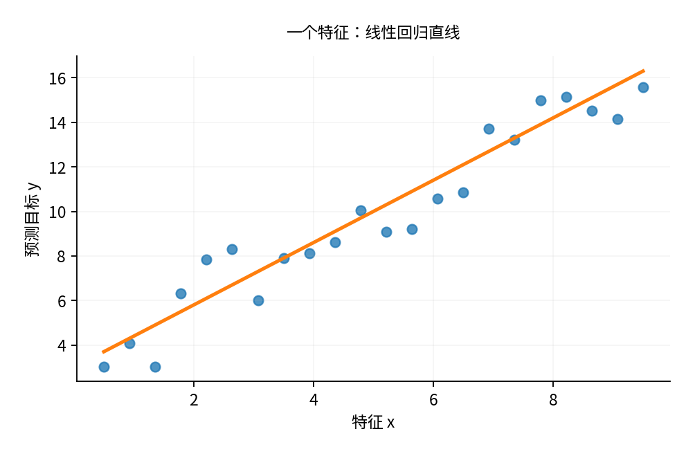

**一个特征**

$f(x)=wx+b$，对应二维平面中的直线

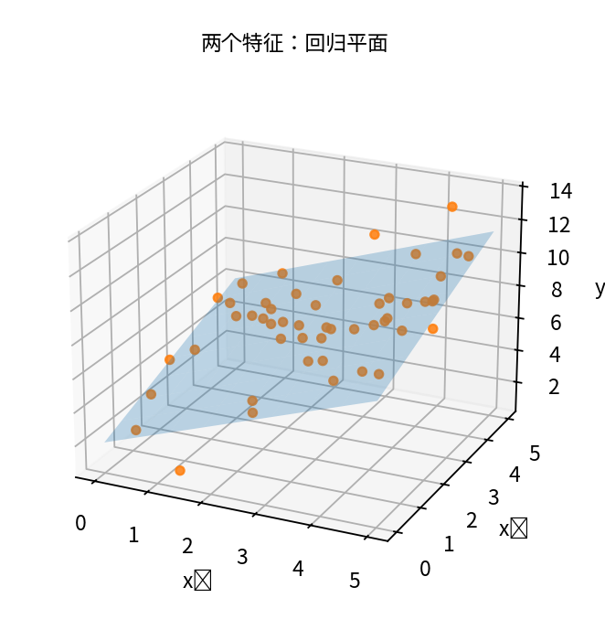

**两个特征**

$f(x_1,x_2)=w_1x_1+w_2x_2+b$，对应三维空间中的平面

特征更多时，对应高维空间中的超平面（Hyperplane）。

注意，“线性”主要是指模型对参数 $w$ 是线性的。

例如：

$$
f(x)=w_1x+w_2x^2+b
$$

虽然关于 $x$ 是弯曲的，但只要把 $x^2$ 看作一个新特征，它仍然是关于参数线性的模型。

所以课件中说线性模型不能处理非线性关系，准确理解应是：**如果只使用原始特征的线性组合，就无法直接描述复杂的非线性结构；引入合适的非线性特征可以扩展表达能力。**

## 3. 为什么选择平方误差？

我们有训练数据：

$$
D=\{(x_i,y_i)\}_{i=1}^{m}
$$

模型给出的预测为：

$$
\hat y_i=w^Tx_i+b
$$

现在的问题是：如何衡量模型的好坏？

一个自然的想法是计算预测值与真实值的差：

$$
e_i=y_i-\hat y_i
$$

但直接把差求和不合理，因为正负误差可能抵消。

因此，采用平方误差（Squared Error）：

$$
\ell_i=(y_i-\hat y_i)^2
$$

所有样本的总平方误差为：

$$
\boxed{
L(w,b)=\sum_{i=1}^{m}(y_i-w^Tx_i-b)^2
}
$$

这对应课件第20–21页。

平方误差有两个重要特点。

第一，它让正负误差都产生非负损失。

第二，大误差会受到更大的惩罚。例如，预测误差分别为2和10时，平方误差为4和100。

这使模型倾向于避免少数特别严重的预测偏差。

另外，平方误差还是一个光滑且容易优化的函数，所以在线性回归中非常常见。

从概率角度还有一个补充理解：如果假设误差独立且服从同方差正态分布，那么最大化数据的似然函数，恰好等价于最小化平方误差。因此，最小二乘法也可以得到概率模型的解释。

## 4. 最小二乘法（Ordinary Least Squares）

这部分是线性模型I中最重要的推导之一。

我们已经确定：

$$
L(w,b)=\sum_{i=1}^{m}(y_i-w^Tx_i-b)^2
$$

接下来就需要求：

$$
(\hat w,\hat b)=\arg\min_{w,b}L(w,b)
$$

最小二乘法（Least Squares）正是基于平方误差最小化的参数估计方法。

### 4.1 为什么要写成矩阵形式？

如果一个模型有100个特征，逐个对 $w_1,\ldots,w_{100},b$ 求导会非常繁琐。

但所有参数实际上都是同一种运算结构，因此可以利用线性代数一次性处理。

首先，把截距合并到参数向量中：

$$
\beta=
\begin{pmatrix}
w_1\\
\vdots\\
w_d\\
b
\end{pmatrix}
$$

构造设计矩阵（Design Matrix）：

$$
X=
\begin{pmatrix}
x_{11}&\cdots&x_{1d}&1\\
x_{21}&\cdots&x_{2d}&1\\
\vdots&&\vdots&\vdots\\
x_{m1}&\cdots&x_{md}&1
\end{pmatrix}
$$

以及输出向量：

$$
y=
\begin{pmatrix}
y_1\\
\vdots\\
y_m
\end{pmatrix}
$$

那么所有预测结果都可以表示为：

$$
\hat y=X\beta
$$

损失函数变为：

$$
\boxed{L(\beta)=(y-X\beta)^T(y-X\beta)}
$$

这一步把原来的求和转换成向量范数平方：

$$
L(\beta)=\|y-X\beta\|_2^2
$$

### 4.2 求导得到正规方程

将损失展开：

$$
\begin{aligned}
L(\beta)
&=(y-X\beta)^T(y-X\beta)\\
&=y^Ty-2\beta^TX^Ty+\beta^TX^TX\beta
\end{aligned}
$$

因为 $X^TX$ 是对称矩阵，对 $\beta$ 求梯度：

$$
\nabla_\beta L
=-2X^Ty+2X^TX\beta
$$

最优点处梯度为零：

$$
-2X^Ty+2X^TX\hat\beta=0
$$

整理得到：

$$
\boxed{X^TX\hat\beta=X^Ty}
$$

这称为正规方程（Normal Equation）。

如果 $X^TX$ 可逆，就可以两边左乘逆矩阵：

$$
\boxed{
\hat\beta=(X^TX)^{-1}X^Ty
}
$$

这就是课件第22页给出的最小二乘解析解。

为什么它对应最小值，而不只是驻点？

因为损失函数的 Hessian 矩阵为：

$$
\nabla_\beta^2L=2X^TX
$$

对于任意向量 $v$：

$$
v^TX^TXv=\|Xv\|_2^2\geq0
$$

因此平方误差关于参数是一个凸函数（Convex Function）。

如果 $X$ 列满秩，那么 $X^TX$ 正定，最小值还是唯一的。

### 4.3 用几何思想理解最小二乘法

有一个比公式更直观的理解。

所有可能的预测向量都形如：

$$
X\beta
$$

它们组成 $X$ 的列空间（Column Space）。

我们要找一个 $\hat y=X\hat\beta$，使它距离真实向量 $y$ 最近。

因此：

$$
\hat y=X\hat\beta
$$

就是将 $y$ 正交投影到 $X$ 的列空间上。

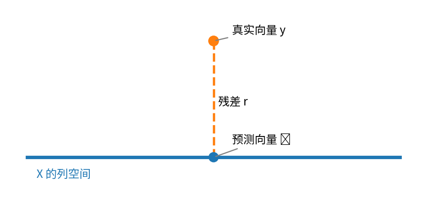

*示意图：最小二乘法让真实向量与预测向量之间的残差垂直于模型能够表示的预测空间。*

这个投影性质对应：

$$
X^T(y-X\hat\beta)=0
$$

即：

$$
\boxed{X^Tr=0}
$$

其中：

$$
r=y-\hat y
$$

是残差向量（Residual Vector）。

你会发现，这与刚才的正规方程完全一致。

所以最小二乘法可以从两个角度理解：

- 微积分角度：求导令梯度为零。
- 线性代数角度：把真实向量投影到模型能够表示的空间。

这两种理解指向同一个结果。

## 5. 如何评价线性回归的效果？——$R^2$

课件第23–25页介绍了线性回归的方差分析。

这里有三个重要的平方和。

### 5.1 总平方和 SST

假设我们完全不使用特征 $X$，只能用一个固定值预测所有样本。

在平方误差下，最优的常数预测是样本均值：

$$
\bar y=\frac1m\sum_{i=1}^{m}y_i
$$

于是：

$$
SST=\sum_{i=1}^{m}(y_i-\bar y)^2
$$

它衡量 $Y$ 原本的总波动。

### 5.2 残差平方和 SSE

使用回归模型后，预测结果为 $\hat y_i$。

$$
SSE=\sum_{i=1}^{m}(y_i-\hat y_i)^2
$$

这表示模型没有解释的波动。

### 5.3 回归平方和 SSReg

$$
SSReg=\sum_{i=1}^{m}(\hat y_i-\bar y)^2
$$

它描述模型预测结果相对于样本均值的波动。

对于包含截距的普通最小二乘训练拟合，由于残差与预测向量正交，可以推导：

$$
\boxed{SST=SSReg+SSE}
$$

于是定义决定系数：

$$
\boxed{
R^2=\frac{SSReg}{SST}
=1-\frac{SSE}{SST}
}
$$

举个例子：假设 $SST=100$，模型的 $SSE=30$，那么：

$$
R^2=1-\frac{30}{100}=0.7
$$

意味着模型在这组数据上解释了因变量相对于其样本均值的70%的平方和变异。

但这里有两个容易产生的误解。

第一，**$R^2=0.7$ 不代表模型70%的预测都正确，也不代表特征导致了70%的变化。** 回归拟合优度不能直接证明因果关系。

第二，课件给出的：

$$
0\leq R^2\leq1
$$

通常适用于含截距的普通最小二乘模型在训练数据上的结果。如果在测试集上计算 $R^2$，或者使用不带截距的模型，$R^2$ 完全可能是负数。

## 6. 为什么最小二乘法还需要改进？

前面推导出了：

$$
\hat\beta=(X^TX)^{-1}X^Ty
$$

但课件第26–27页指出一个问题：$X^TX$ 不一定可逆。

### 6.1 多重共线性（Multicollinearity）

假设预测房价时有两个特征：

$$
x_1=\text{面积（平方米）}
$$

$$
x_2=\text{面积（平方分米）}
$$

显然：

$$
x_2=100x_1
$$

模型为：

$$
\hat y=w_1x_1+w_2x_2+b
$$

代入后：

$$
\hat y=(w_1+100w_2)x_1+b
$$

你会发现：只要 $w_1+100w_2$ 不变，就会得到完全相同的预测结果。

因此，模型无法唯一确定 $w_1$ 和 $w_2$。

从矩阵角度看，$X$ 的列之间线性相关，导致 $X^TX$ 不可逆。

需要区分两种情况：

- **完全共线性**：列不满秩，前面的逆矩阵公式不能直接使用。
- **高度但不完全共线性**：可能仍然可逆，但数值计算不稳定，参数估计可能对数据扰动非常敏感。

即便 $X^TX$ 不可逆，最小二乘问题本身仍然存在最优解，只是可能不唯一。实际计算可以利用伪逆（Pseudoinverse）或其他数值方法。

另一个困难是过拟合（Overfitting）：为了让训练误差尽可能小，模型可能学出非常大的系数，从而对训练数据中的噪声过度敏感。

我们希望在拟合数据的同时，对模型的参数施加一定约束。

这就引出了正则化（Regularization）。

## 7. 正则化：Ridge、LASSO 和 Elastic Net

这是线性模型I后半章的核心内容。

首先要理解正则化在做什么。

普通最小二乘只关心：

$$
\text{预测误差是否足够小}
$$

而正则化还会考虑：

$$
\text{模型参数是否过于复杂}
$$

因此，训练目标可以写成：

$$
\boxed{
L(w,b)=
\underbrace{\sum_{i=1}^{m}(y_i-w^Tx_i-b)^2}_{\text{拟合误差}}
+
\underbrace{\lambda\Omega(w)}_{\text{复杂度惩罚}}
}
$$

其中 $\lambda\geq0$ 控制正则化强度。

### 7.1 岭回归（Ridge Regression）：L2 正则化

岭回归使用：

$$
\Omega(w)=\|w\|_2^2=\sum_{j=1}^{d}w_j^2
$$

因此：

$$
L_{\text{Ridge}}=
\sum_{i=1}^{m}(y_i-w^Tx_i-b)^2
+\lambda\sum_{j=1}^{d}w_j^2
$$

如果某个参数特别大，它的平方就会带来较大惩罚。

例如：

$$
w=(10,0.1)
$$

那么：

$$
\|w\|_2^2=10^2+0.1^2=100.01
$$

所以岭回归倾向于让参数不要过大。

几何上，L2 约束：

$$
w_1^2+w_2^2\leq t
$$

形成圆形区域。

### 7.2 LASSO：L1 正则化

LASSO 使用：

$$
\Omega(w)=\|w\|_1=\sum_{j=1}^{d}|w_j|
$$

训练目标为：

$$
L_{\text{LASSO}}=
\sum_{i=1}^{m}(y_i-w^Tx_i-b)^2
+\lambda\sum_{j=1}^{d}|w_j|
$$

它和岭回归最大的区别是：

**LASSO 不仅可以缩小参数，还能让部分参数恰好等于0。**

因此，LASSO 具有特征选择（Feature Selection）的作用。

为什么 L1 更容易得到0？

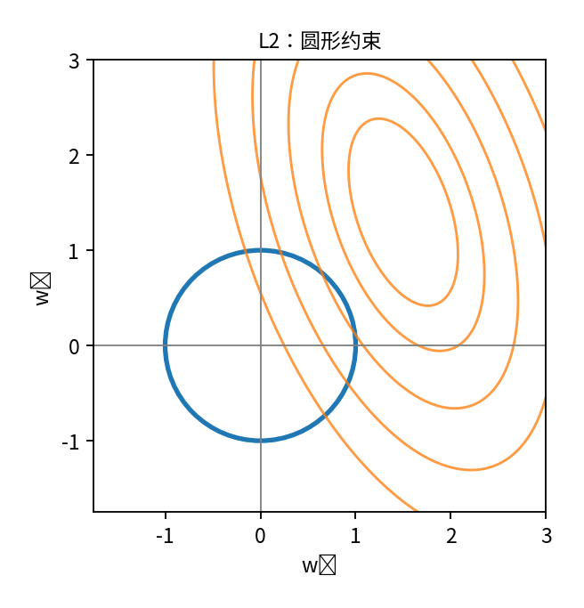

**L2：圆形约束**

约束边界光滑，通常产生缩小但非零的系数。

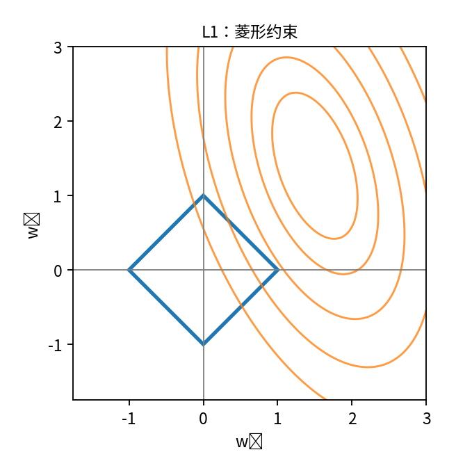

**L1：菱形约束**

约束存在尖角，最优解更容易落在某个系数为零的位置。

你可以想象平方误差的等高线不断向外扩张，直到第一次接触约束区域。

L2 的圆形边界比较光滑；L1 的菱形具有尖角，而尖角正好落在坐标轴上。

这解释了为什么 LASSO 更容易得到稀疏解（Sparse Solution）。

### 7.3 弹性网络（Elastic Net）

既然 Ridge 可以稳定地缩小参数，LASSO 可以进行特征选择，能不能结合两者？

这就是弹性网络：

$$
L=
\sum_{i=1}^{m}(y_i-w^Tx_i-b)^2
+\lambda\left[
\alpha\|w\|_1+
\frac{1-\alpha}{2}\|w\|_2^2
\right]
$$

其中：

$$
0\leq\alpha\leq1
$$

当 $\alpha=0$ 时是 Ridge；当 $\alpha=1$ 时是 LASSO。

一般情况下，两者兼有。

三种方法可以这样记：

| 方法 | 惩罚 | 主要作用 |
|---|---|---|
| Ridge | $\lambda\|w\|_2^2$ | 收缩系数，提高稳定性 |
| LASSO | $\lambda\|w\|_1$ | 收缩系数，产生稀疏解 |
| Elastic Net | L1 + L2 | 同时考虑稀疏性与稳定性 |

这些方法在实际应用中通常不惩罚截距 $b$，并且最好先对数值特征进行标准化，避免不同量纲影响正则化效果。

## 8. 广义线性模型：为逻辑回归作铺垫

课件最后一页介绍对数线性回归和广义线性模型。

为什么讲完线性回归，还要引入广义线性模型（Generalized Linear Model, GLM）？

因为：

$$
f(x)=w^Tx+b
$$

可以输出任何实数。

但有些预测任务的输出存在特定限制。

比如：

- 预测价格，通常希望结果为正。
- 预测概率，必须在0和1之间。
- 预测事件发生次数，应该是非负整数。

于是我们可以保留：

$$
z=w^Tx+b
$$

这个线性结构，再通过一个函数将它转换到合适的输出尺度。

课件将这种变换称为联系函数（Link Function）。

更标准的 GLM 表达是：

$$
\boxed{
g\big(\mathbb E[Y\mid X=x]\big)=w^Tx+b
}
$$

也可以写成：

$$
\mathbb E[Y\mid X=x]=g^{-1}(w^Tx+b)
$$

这里 $g$ 是联系函数。

你暂时不用深入广义线性模型的完整统计理论，只需要记住：

**线性部分负责描述特征如何组合，联系函数负责将线性预测量与响应变量的均值联系起来。**

例如使用指数函数：

$$
\mu(x)=e^{w^Tx+b}>0
$$

就能保证预测均值为正。

注意，课件中的对数线性关系 $\ln y=w^Tx+b$ 是一种变换形式；严格的概率建模还需要区分 $\ln Y$ 的条件均值与 $\ln\mathbb E[Y\mid X]$，两者一般并不相等。

这一节的真正作用是引出下一章：

**如果输出是类别0或1，能不能在保留线性结构的同时，把输出转换成概率？**

这正是逻辑回归要解决的问题。

---

# 四、Chapter 2 II：逻辑回归与多分类

*对应《Chapter2_线性模型II》第6–22页*

前面我们研究了：

$$
\hat y=w^Tx+b
$$

它可以预测连续数值。

但是现在我们想预测一个客户是否违约，输出只能是0或1。

于是遇到新的问题：

**能不能在保留线性模型优点的同时，让模型输出一个类别概率？**

这就是逻辑回归（Logistic Regression）的研究内容。

本章的主线可以整理为：

$$
\boxed{
\begin{gathered}
\text{线性回归不能直接输出合理的类别概率}\\
\downarrow\\
\text{Sigmoid 将线性预测量转化为概率}\\
\downarrow\\
\text{Bernoulli 模型描述分类结果}\\
\downarrow\\
\text{极大似然得到交叉熵损失}\\
\downarrow\\
\text{梯度下降训练参数}\\
\downarrow\\
\text{通过 OvR、OvO、Softmax 扩展到多分类}
\end{gathered}
}
$$

## 1. 为什么不能直接使用线性回归做分类？

假设：

$$
y=
\begin{cases}
1,&\text{客户违约}\\
0,&\text{客户不违约}
\end{cases}
$$

一个直观的想法是用线性回归：

$$
\hat y=w^Tx+b
$$

然后规定：

$$
\hat y\geq0.5\Rightarrow\text{预测违约}
$$

但有两个问题。

首先，线性函数的输出范围是整个实数域，可能出现：

$$
\hat y=-2,\qquad \hat y=3.5
$$

如果我们想把输出解释成概率，这显然不合理。

其次，分类问题真正关心的是类别，而不是连续数值之间的距离。平方误差并不是为类别概率建模专门设计的。

课件第9页尝试用阶跃函数把线性结果转换成0或1：

$$
z=w^Tx+b
$$

$$
f(z)=
\begin{cases}
0,&z<0\\
1,&z\geq0
\end{cases}
$$

这样确实能得到类别结果，但是阶跃函数不连续，在分界处不可导，其余位置导数为零，不利于直接使用基于梯度的方法训练。

所以我们需要一个更合适的函数。

## 2. Sigmoid 函数：把实数转化为概率

逻辑回归使用：

$$
\boxed{
\sigma(z)=\frac{1}{1+e^{-z}}
}
$$

它称为 Sigmoid 函数，也叫 Logistic Function。

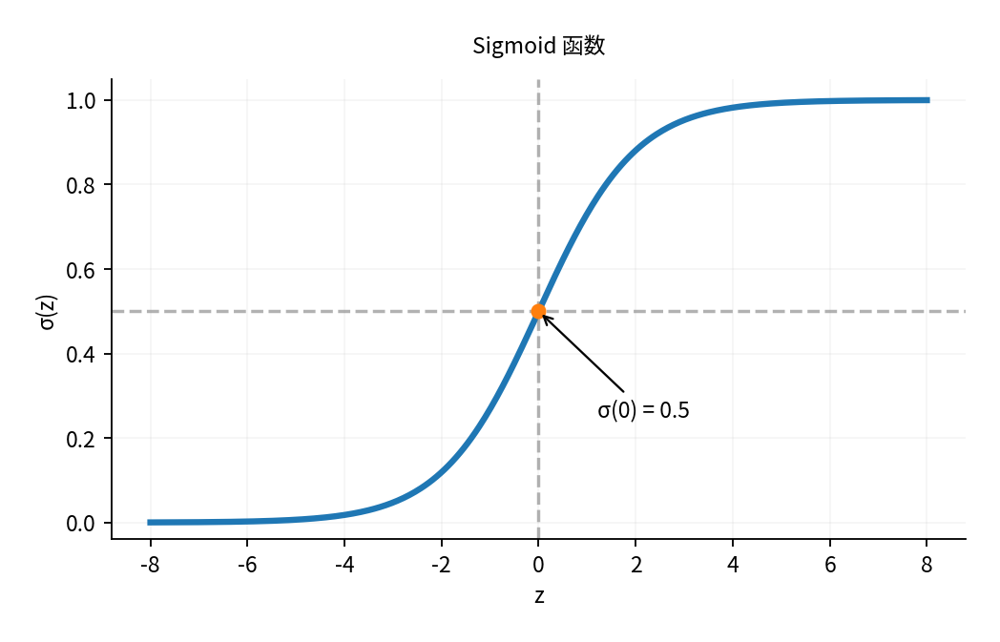

*Sigmoid 函数示意：输入可以是任意实数，输出始终在0和1之间。*

这个函数有三个特别重要的性质。

第一：

$$
0<\sigma(z)<1
$$

因此可以把它解释成概率。

第二：

$$
\sigma(0)=0.5
$$

这意味着 $z=0$ 恰好对应分类决策边界。

第三：

$$
\boxed{\sigma'(z)=\sigma(z)(1-\sigma(z))}
$$

这个导数形式非常简单，后面推导梯度时会用到。

### 为什么逻辑回归使用的恰好是 Sigmoid？

仅仅因为 Sigmoid 连续、可导还不够。更深层的原因来自对数几率（Log-Odds）。

设：

$$
p=P(Y=1\mid X=x)
$$

我们希望建立一个模型，使：

$$
\ln\frac{p}{1-p}=w^Tx+b
$$

这里：

$$
\frac{p}{1-p}
$$

称为几率（Odds），表示事件发生概率与不发生概率的比值。

例如：

$$
p=0.8
$$

则：

$$
\frac{p}{1-p}=\frac{0.8}{0.2}=4
$$

表示事件发生与不发生的几率之比为4:1。

接下来，将对数几率设为线性函数：

$$
\ln\frac{p}{1-p}=z
$$

两边取指数：

$$
\frac{p}{1-p}=e^z
$$

整理：

$$
p=e^z(1-p)
$$

$$
p+pe^z=e^z
$$

所以：

$$
p=\frac{e^z}{1+e^z}
=\frac1{1+e^{-z}}
$$

恰好得到：

$$
\boxed{p=\sigma(w^Tx+b)}
$$

这就是逻辑回归的核心：

**不是直接让类别概率与特征线性相关，而是假设类别概率的对数几率与特征呈线性关系。**

这也说明为什么它叫 Logistic Regression。

## 3. 逻辑回归的完整模型

现在我们可以写出：

$$
\boxed{
P(Y=1\mid X=x)=\sigma(w^Tx+b)
}
$$

同时：

$$
P(Y=0\mid X=x)=1-\sigma(w^Tx+b)
$$

注意两者相加为1。

假设某客户特征输入后得到：

$$
z=w^Tx+b=2
$$

那么：

$$
p=\sigma(2)\approx0.881
$$

模型输出的是：

$$
P(Y=1\mid x)\approx0.881
$$

通常我们可以使用0.5作为分类阈值：

$$
\hat y=
\begin{cases}
1,&p\geq0.5\\
0,&p<0.5
\end{cases}
$$

由于 Sigmoid 单调递增，而且：

$$
\sigma(0)=0.5
$$

所以：

$$
p\geq0.5
\iff
w^Tx+b\geq0
$$

因此逻辑回归的决策边界为：

$$
\boxed{w^Tx+b=0}
$$

这非常重要：

**逻辑回归虽然通过 Sigmoid 引入了非线性概率变换，但在原始特征空间中的决策边界仍然是线性的。**

此外，如果只改变某个特征 $x_j$ 一个单位，而其他特征不变，那么对数几率改变 $w_j$，几率乘以 $e^{w_j}$。这也是逻辑回归系数常见的统计解释。

## 4. 逻辑回归怎样训练？

我们已经建立了模型：

$$
p_i=\sigma(w^Tx_i+b)
$$

现在需要回答：应该怎样选择参数 $w,b$？

线性回归选择最小化平方误差。

而逻辑回归通常选择**极大似然估计（Maximum Likelihood Estimation, MLE）**。

### 4.1 为什么不直接最小化分类错误率？

假设真实标签为：

$$
y_i=1
$$

模型一开始预测概率为0.01，后来经过参数调整，预测概率提高到0.4。

虽然按照0.5的阈值，这两种预测都被判为类别0，都是分类错误，但第二个预测显然离正确答案更近。

如果只最小化分类错误率：

$$
L=\sum_{i=1}^{m}\mathbf1\{\hat y_i\ne y_i\}
$$

它无法很好地反映这种概率上的改善，因为只要没有跨过决策边界，错误数就不变。

于是我们选择直接评价模型给真实类别分配的概率。

这就是极大似然的思路。

### 4.2 伯努利分布如何描述二分类？

因为 $Y_i$ 只能取0或1，我们可以假设：

$$
Y_i\mid X_i=x_i\sim\operatorname{Bernoulli}(p_i)
$$

其中：

$$
p_i=\sigma(w^Tx_i+b)
$$

伯努利分布的概率质量函数是：

$$
P(Y_i=y_i\mid x_i)
=p_i^{y_i}(1-p_i)^{1-y_i}
$$

这个形式看起来有些奇怪，但只需要代入两种情况就能理解。

当 $y_i=1$ 时：

$$
p_i^1(1-p_i)^0=p_i
$$

当 $y_i=0$ 时：

$$
p_i^0(1-p_i)^1=1-p_i
$$

因此，这一个公式同时表达了两种类别的概率。

### 4.3 从似然函数推导交叉熵

假设在给定特征的条件下，不同样本的标签相互独立。

整个数据集的似然函数为：

$$
\mathcal L(w,b)
=\prod_{i=1}^{m}p_i^{y_i}(1-p_i)^{1-y_i}
$$

极大似然估计希望寻找：

$$
(\hat w,\hat b)=\arg\max_{w,b}\mathcal L(w,b)
$$

为了把乘积转换为更容易计算的求和，对似然取对数：

$$
\begin{aligned}
\log\mathcal L(w,b)
&=\log\prod_{i=1}^{m}p_i^{y_i}(1-p_i)^{1-y_i}\\
&=\sum_{i=1}^{m}
\left[
y_i\log p_i+(1-y_i)\log(1-p_i)
\right]
\end{aligned}
$$

最大化对数似然，等价于最小化其相反数：

$$
\boxed{
L(w,b)=-
\sum_{i=1}^{m}
\left[
y_i\log p_i+
(1-y_i)\log(1-p_i)
\right]
}
$$

这就是二元交叉熵损失（Binary Cross-Entropy, BCE）。

它不是凭空设计出来的，而是从二分类的伯努利概率模型与极大似然原则自然推导出来的。对应课件第13页。

### 4.4 交叉熵究竟在惩罚什么？

看两种情况：

当真实类别为1时：

$$
L_i=-\log p_i
$$

当真实类别为0时：

$$
L_i=-\log(1-p_i)
$$

因此，模型给真实类别的概率越高，损失越小。

例如，真实类别为1：

| 模型给类别1的概率 | 损失 |
|---|---|
| $p=0.9$ | $-\ln0.9\approx0.105$ |
| $p=0.5$ | $-\ln0.5\approx0.693$ |
| $p=0.01$ | $-\ln0.01\approx4.605$ |

你会发现：

模型如果很有把握却判断错误，就会遭受很大的惩罚。

这与分类概率预测的目标非常吻合。

## 5. 逻辑回归的梯度为什么这么简单？

课件第14页推导了逻辑回归的梯度更新。

这一部分可以拆成三个步骤。

设一个样本：

$$
z=w^Tx+b
$$

$$
p=\sigma(z)
$$

$$
L=-[y\log p+(1-y)\log(1-p)]
$$

我们希望求：

$$
\frac{\partial L}{\partial w}
$$

因为 $L$ 通过 $p$ 和 $z$ 间接依赖于 $w$，所以使用链式法则：

$$
\frac{\partial L}{\partial w}
=
\frac{\partial L}{\partial p}
\frac{\partial p}{\partial z}
\frac{\partial z}{\partial w}
$$

首先：

$$
\frac{\partial L}{\partial p}
=-\frac yp+\frac{1-y}{1-p}
$$

其次，因为 Sigmoid 的导数为：

$$
\frac{\partial p}{\partial z}=p(1-p)
$$

两项相乘：

$$
\begin{aligned}
\frac{\partial L}{\partial z}
&=\left(-\frac yp+\frac{1-y}{1-p}\right)p(1-p)\\
&=-y(1-p)+(1-y)p\\
&=p-y
\end{aligned}
$$

最后：

$$
\frac{\partial z}{\partial w}=x
$$

于是：

$$
\boxed{
\frac{\partial L}{\partial w}=(p-y)x
}
$$

同理：

$$
\boxed{
\frac{\partial L}{\partial b}=p-y
}
$$

对于整个训练集：

$$
\nabla_wL=
\sum_{i=1}^{m}(p_i-y_i)x_i
$$

因此梯度下降更新为：

$$
\boxed{
w\leftarrow
w-\eta\sum_{i=1}^{m}(p_i-y_i)x_i
}
$$

$$
\boxed{
b\leftarrow
b-\eta\sum_{i=1}^{m}(p_i-y_i)
}
$$

其中 $\eta$ 为学习率（Learning Rate）。如果损失采用平均而不是求和，梯度也相应除以 $m$。

课件中采用最大化对数似然的写法：

$$
w\leftarrow w+\eta(y-p)x
$$

它与最小化负对数似然完全等价，只是更新方向的符号不同。

### 梯度的直观含义

为什么会出现：

$$
p-y
$$

这个简单的结果？

因为它直接表示模型预测概率与真实标签之间的偏差。

当 $y=1$ 而 $p$ 很小时：

$$
p-y<0
$$

梯度下降会推动参数沿着提高该样本预测概率的方向变化。

当 $y=0$ 而 $p$ 很大时：

$$
p-y>0
$$

梯度下降会推动模型降低该样本的预测概率。

这就是交叉熵与 Sigmoid 组合起来非常方便的原因。

还有一个数学性质值得知道：**逻辑回归的负对数似然关于参数是凸的**。但这不等于 Sigmoid 本身是全局凸函数；Sigmoid 的曲率在0两侧会改变。这是课件相关表述中容易混淆的地方。

## 6. 逻辑回归如何扩展到多分类？

前面研究的是：

$$
Y\in\{0,1\}
$$

但如果要预测：

$$
Y\in\{\text{猫},\text{狗},\text{猴子}\}
$$

应该怎么办？

课件第17–21页介绍了三种方法。

### 方法一：一对其余（One-vs-Rest, OvR）

假设有3个类别：

$$
A,\ B,\ C
$$

我们训练3个二分类器：

- 分类器1：判断是不是A。
- 分类器2：判断是不是B。
- 分类器3：判断是不是C。

预测时可以比较分类器的输出分数或置信度，选出最合适的类别。

对于 $K$ 个类别，需要训练：

$$
\boxed{K\text{ 个二分类器}}
$$

OvR 简单直观，而且可以使用已有的二分类算法。

不过各个分类器独立训练，它们输出的概率一般不会恰好相加为1。

### 方法二：一对一（One-vs-One, OvO）

仍然以三个类别为例。

这次训练：

- A与B的分类器。
- A与C的分类器。
- B与C的分类器。

预测时，各个分类器进行投票，最终选择票数最多的类别。

对于 $K$ 个类别，需要训练：

$$
\boxed{\frac{K(K-1)}2\text{ 个二分类器}}
$$

例如4个类别需要6个分类器。

OvO 的特点是每个分类器只处理两个类别的数据，但类别数量增加时，分类器总数增长较快。

### 方法三：Softmax 回归

OvR 和 OvO 都是把多分类拆成多个二分类任务。

Softmax 则试图直接建立一个能够同时预测所有类别概率的模型。

假设共有 $K$ 个类别。

对于每个类别 $j$，建立线性得分：

$$
z_j=w_j^Tx+b_j
$$

问题是这些得分可能为负，而且总和不一定为1。

Softmax 使用：

$$
\boxed{
p_j=
\frac{e^{z_j}}
{\sum_{k=1}^{K}e^{z_k}}
}
$$

来生成类别概率。

为什么这种形式合理？

第一，因为指数函数始终为正，所以：

$$
p_j>0
$$

第二：

$$
\sum_{j=1}^{K}p_j=1
$$

第三，如果某个类别的得分 $z_j$ 相对更大，对应的概率也更大。

因此我们可以预测：

$$
\hat y=\arg\max_jp_j
$$

**Softmax 概率示例**

调整三个类别的线性得分 $z_1,z_2,z_3$，观察 Softmax 如何改变概率。

原交互演示中的初始设置：$z_1=2.0$，$z_2=1.0$，$z_3=0.0$。三类概率之和 = 100%。

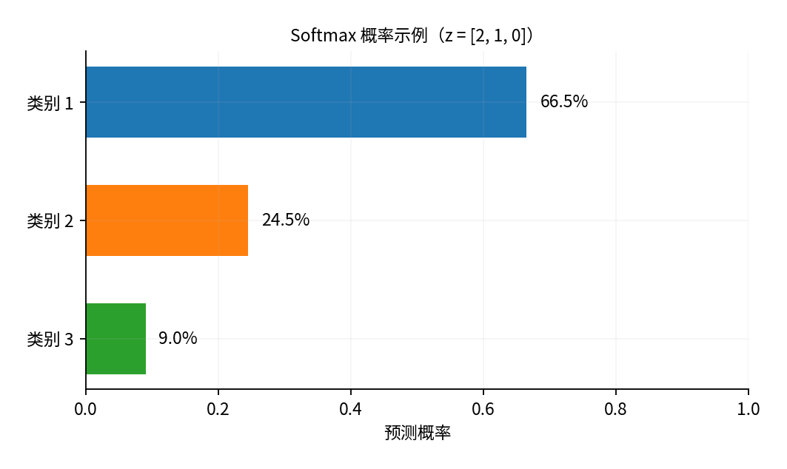

从这个例子可以发现：Softmax 的概率不仅由一个类别自身的得分决定，还取决于其他类别的得分。

这与分类任务很符合，因为多个互斥类别之间存在竞争关系。

### Softmax 与逻辑回归是什么关系？

实际上，Softmax 是逻辑回归向多类别情形的一种直接推广。

如果只有两个类别：

$$
p_1=\frac{e^{z_1}}{e^{z_1}+e^{z_2}}
$$

上下同时除以 $e^{z_1}$：

$$
p_1=\frac1{1+e^{-(z_1-z_2)}}
$$

所以：

$$
\boxed{p_1=\sigma(z_1-z_2)}
$$

这与逻辑回归完全相同，只不过线性预测量变成了两个类别得分之差。

所以二者不是完全无关的两种算法，而是同一类概率建模思想在不同类别数下的形式。

### Softmax 的损失函数

对于类别 $j$，令：

$$
y_{ij}=
\begin{cases}
1,&\text{第 }i\text{ 个样本属于类别 }j\\
0,&\text{否则}
\end{cases}
$$

那么多类交叉熵为：

$$
\boxed{
L=-\sum_{i=1}^{m}\sum_{j=1}^{K}
y_{ij}\log p_{ij}
}
$$

你会发现，它与二分类交叉熵非常类似。

并且如果对类别得分 $z_{ij}$ 求导，还会得到：

$$
\frac{\partial L_i}{\partial z_{ij}}=p_{ij}-y_{ij}
$$

与逻辑回归的 $p-y$ 结构一致。

因此，从逻辑回归到 Softmax，本质上是对同一思想的推广：**建立概率模型，然后通过极大似然训练参数。**

注意，标准 Softmax 适用于多个互斥类别中选一个类别的任务。如果一张图片可以同时具有多个标签，例如“海边”“日落”“人物”，那就是多标签分类（Multi-label Classification），通常需要不同的输出设计。

## 7. 类别不平衡（Class Imbalance）

这是课件最后一页的内容。

假设一个交易欺诈检测数据集有：

- 9900笔正常交易。
- 100笔欺诈交易。

如果模型把所有交易都预测成正常：

$$
\text{Accuracy}=\frac{9900}{10000}=99\%
$$

准确率很高，但模型一个欺诈事件都没有检测出来。

这说明：**当类别分布极不均衡时，不能只看准确率。**

课件介绍了三种主要思路。

### 7.1 过采样（Oversampling）

增加少数类在训练数据中的比例。

例如 SMOTE 通过在少数类样本之间插值，合成新的少数类样本。

好处是让模型获得更多关于少数类的训练信号。

但要注意避免合成不合理样本，过采样也应只在训练数据上进行，不能把测试集信息泄漏到训练过程。

### 7.2 欠采样（Undersampling）

减少多数类的训练样本。

这样可以降低数据不平衡程度，但可能丢失多数类的重要信息。

### 7.3 阈值移动（Threshold Moving）

这是一种非常重要而且容易理解的方法。

逻辑回归通常采用：

$$
p\geq0.5\Rightarrow\hat y=1
$$

但0.5并非永远是最优阈值。

假设漏判一笔欺诈交易的成本远高于误报一笔正常交易，那么我们可能愿意降低阈值，例如调整为0.2，以提高欺诈交易的召回率。

更一般地，如果概率预测准确校准，误报成本为 $C_{\mathrm{FP}}$，漏报成本为 $C_{\mathrm{FN}}$，并且只考虑这两种错误成本，那么预测为正类的条件是：

$$
\boxed{
p>\frac{C_{\mathrm{FP}}}
{C_{\mathrm{FP}}+C_{\mathrm{FN}}}
}
$$

可以看到：漏报成本越高，分类阈值越低。

课件还介绍了赔率再缩放：

$$
\frac{p'}{1-p'}=
\frac{p}{1-p}\frac{m^-}{m^+}
$$

其中 $m^+$ 和 $m^-$ 分别表示正类与负类的样本数量。这可以理解为在特定先验概率调整假设下，对原有概率赔率进行修正，并不是对所有类别不平衡问题都无条件适用的公式。

**本节的核心不是记住某一种采样技巧，而是知道分类目标与实际业务代价有关。** 训练模型得到概率之后，还可以根据任务需求调整最终决策规则。

---

# 五、把这三章真正串起来

学完这些内容之后，你应该能看到三章使用的是同一个基本框架，只是建模任务不同。

## 1. 从线性回归到逻辑回归，再到 Softmax

**共同起点：线性预测量**

$$
z=w^Tx+b
$$

**线性回归**

连续值预测

$$
\hat y=z
$$

平方误差

**逻辑回归**

二分类概率

$$
p=\sigma(z)
$$

二元交叉熵

**Softmax 回归**

多分类概率

$$
p_j=\frac{e^{z_j}}{\sum_ke^{z_k}}
$$

多类交叉熵

你可以从两个方向理解它们的联系。

**从模型结构看**，它们都使用线性特征组合，只是输出变换不同。

**从概率建模看**，线性回归常对应正态误差假设，逻辑回归对应伯努利分布，Softmax 回归对应分类分布。选择不同的概率模型，极大似然就会导出不同的损失函数。

这是非常重要的一层联系，它解释了为什么机器学习里的损失函数不是随意选择的。

## 2. 一张表区分模型中的各种符号

机器学习中经常同时出现真实变量、样本值、模型参数和估计量。它们需要区分清楚。

| 符号 | 含义 | 怎样理解 |
|---|---|---|
| $X,Y$ | 特征与标签随机变量 | 抽样前的随机对象 |
| $x_i,y_i$ | 第 $i$ 个样本的观测值 | 训练时已经得到的数据 |
| $w_*,b_*$ | 假定模型正确时的真实参数 | 固定但未知 |
| $\hat w,\hat b$ | 训练得到的参数估计量 | 依赖训练样本，因此抽样前是随机的 |
| $\hat y_i$ | 模型预测值 | 给定数据和拟合参数后可以计算 |
| $\varepsilon_i$ | 理论模型中的随机误差 | 通常不能直接观测 |
| $r_i=y_i-\hat y_i$ | 拟合残差 | 利用已有数据与模型计算得到 |

举例说明：同一个训练数据集已经观测到 $x_i,y_i$，在执行最小二乘时可以将这些数值视为固定，求出 $\hat w,\hat b$。

但如果重新抽取一份训练数据，就可能得到不同的 $\hat w,\hat b$。因此，从重复抽样的统计学角度，参数估计量又具有随机性。

这是理解机器学习的训练过程和统计推断之间关系的关键。

## 3. 三章的学习重点

如果你是第一次学习，并且希望既能理解原理又能完成后续作业，我建议按下面的优先级掌握。

| 知识点 | 建议程度 | 你需要达到的水平 |
|---|---|---|
| 机器学习统一框架 | 核心 | 能解释假设空间、损失与优化之间的联系 |
| 监督学习与泛化 | 核心 | 理解训练误差不等于泛化误差 |
| 线性回归模型与平方误差 | 核心 | 能从数据写出目标函数 |
| 最小二乘解析解 | 核心 | 能独立推导正规方程 |
| $R^2$ 和方差分解 | 核心 | 知道公式、适用条件和含义 |
| 共线性与正则化 | 核心 | 能解释为什么需要 Ridge、LASSO |
| 广义线性模型 | 理解 | 知道联系函数的作用 |
| Sigmoid 与 Log-Odds | 核心 | 能解释逻辑回归的概率模型 |
| 极大似然与交叉熵 | 核心 | 能从伯努利模型推导损失 |
| 逻辑回归梯度 | 核心 | 能推导 $p-y$ 的来源 |
| OvR、OvO 和 Softmax | 核心 | 能说明不同多分类方法的区别 |
| 类别不平衡 | 理解并会用 | 知道采样、阈值与代价的关系 |
| 第一章的前沿方向 | 了解 | 知道各自试图解决的问题 |

最后用三个问题检查一下理解程度：

1. 为什么线性回归要最小化平方误差，而逻辑回归通常使用交叉熵？——因为二者输出变量的性质和采用的概率模型不同。
2. 为什么 LASSO 能进行特征选择，而 Ridge 通常不能？——因为 L1 惩罚容易让系数恰好变为0，L2 主要产生连续收缩。
3. 为什么逻辑回归明明使用了非线性的 Sigmoid，却仍被称为线性分类器？——因为当分类阈值为0.5时，决策边界仍然由 $w^Tx+b=0$ 决定。

**掌握这三章最重要的成果，是能够独立解释一个机器学习模型从哪里来、为什么选择某种损失函数，以及如何利用数据把参数训练出来。** 后续学习 SVM、神经网络甚至更复杂的推荐模型时，依然会反复遇到这套思路。

---

# 机器学习 Chapter 3–4：模型评估与决策树

前面两章，我们学习了机器学习的基本框架，以及线性回归、逻辑回归和 Softmax 回归。

现在这两章解决两个新的问题：

- **Chapter 3：模型评估与选择（Model Evaluation and Selection）**——训练出了一个模型，怎样判断它是不是真的好？如果有多个模型，应该选哪个？
- **Chapter 4：决策树（Decision Tree）**——除了前面学习的线性模型，能不能通过一系列判断规则，构建一个可以处理非线性关系的模型？

这两章存在很强的联系：第三章建立评价模型的标准，第四章则介绍一种具体模型，以及如何利用这些标准控制它的复杂度。

## 整体知识框架

**Chapter 3：评价与选择模型**

模型为什么会过拟合？怎样评估泛化能力？

| 误差来源 | 评估方法 | 性能比较 |
|---|---|---|
| 过拟合、偏差与方差 | 留出法、交叉验证、自助法 | Accuracy、F1、AUC、假设检验 |

↓

**Chapter 4：构建决策树**

通过递归划分样本空间进行预测

| 如何划分？ | 如何防止过拟合？ | 如何处理真实数据？ |
|---|---|---|
| 信息增益、基尼指数、增益率 | 预剪枝、后剪枝 | 连续值、缺失值 |

---

# 一、Chapter 3：模型评估与选择

*对应课件第8–63页；第2–7页主要是对上一章逻辑回归和 Softmax 的回顾。*

这一章实际上围绕三个问题：

1. 为什么训练误差小，不代表模型好？
2. 如何利用有限的数据，估计模型对未知数据的预测能力？
3. 如何衡量两个模型的优劣，并判断差异是否可靠？

## 1. 经验误差、泛化误差与过拟合

### 1.1 为什么不能直接选择训练误差最小的模型？

假设我们正在利用房屋面积预测价格。

有两个模型：

- 模型A：一条直线，训练时存在一些预测误差。
- 模型B：一条非常复杂的曲线，几乎穿过全部训练样本。

如果只比较训练误差，模型B显然更好。

但训练数据除了包含真实规律，还包含噪声和偶然性。

模型B可能把这些噪声也记住了，导致面对新的房屋数据时预测不稳定。

这就是**过拟合（Overfitting）**。

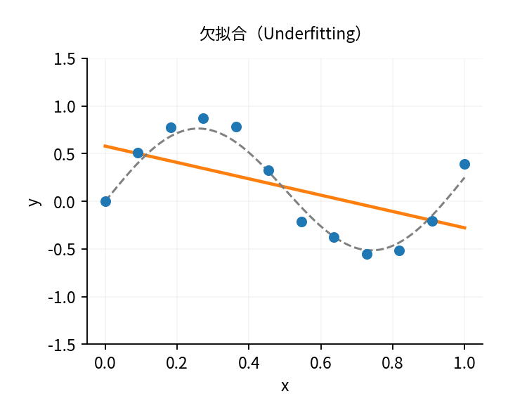

**欠拟合**

模型太简单，连主要规律都没有学会

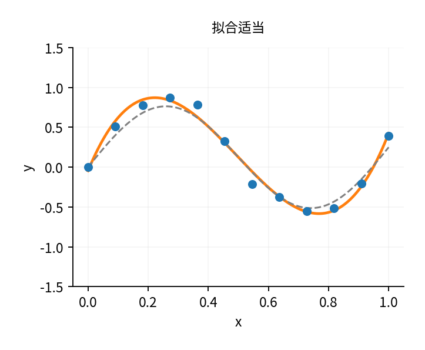

**拟合适当**

能够抓住主要规律，没有过度追逐噪声

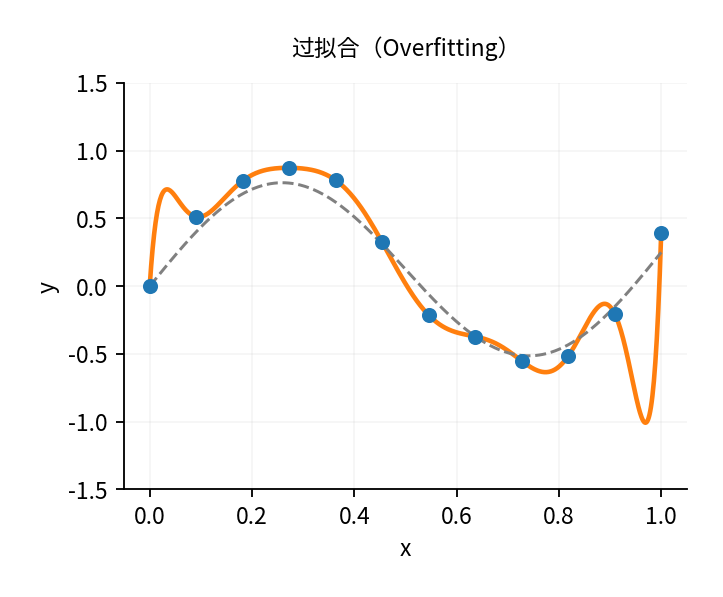

**过拟合**

曲线过于复杂，把偶然波动也学了进去

这里需要区分两个概念。

**经验误差（Empirical Error）**：在已有训练数据上的误差。

设训练集为：

$$
D=\{(x_i,y_i)\}_{i=1}^m
$$

那么经验风险为：

$$
\hat R_D(f)=\frac1m\sum_{i=1}^m
\ell(f(x_i),y_i)
$$

**泛化误差（Generalization Error）**：模型面对来自目标总体的新样本时的期望误差。

$$
R(f)=\mathbb E_{(X,Y)\sim P}
[\ell(f(X),Y)]
$$

机器学习真正希望最小化的是后者。

但是由于我们不知道真实数据分布 $P$，通常无法直接计算泛化误差。

这就产生一个核心问题：

$$
\boxed{
\text{训练误差可以计算，但泛化误差只能估计}
}
$$

第三章后面介绍的留出法、交叉验证和自助法，都是为了处理这个问题。

### 1.2 欠拟合和过拟合到底有什么不同？

| | 欠拟合（Underfitting） | 过拟合（Overfitting） |
|---|---|---|
| 本质 | 模型表达或学习能力不足 | 模型对训练数据过度适应 |
| 训练误差 | 通常较大 | 通常很小 |
| 新数据误差 | 较大 | 可能较大 |
| 常见原因 | 模型过于简单、训练不充分 | 模型过于复杂、数据不足、噪声较多 |
| 改进思路 | 增加表达能力或改善训练 | 正则化、早停、增加数据、控制复杂度 |

还有一个特别重要的现象。

随着模型复杂度增加，训练误差通常会不断下降，但泛化误差不一定会持续下降。

课件第17页的曲线描述了经典情况：最初随着复杂度增加，模型的泛化性能改善；超过某个程度后，模型开始学习噪声，泛化误差反而上升。

这也是为什么我们不应该无限增加多项式阶数、神经网络参数或者决策树深度。

## 2. 为什么会过拟合？——偏差与方差分解

这是第三章数学上最值得理解的部分，对应课件第21–23页。

课件给出了：

$$
\boxed{
E(f;D)=\operatorname{bias}^2(x)
+\operatorname{var}(x)+\varepsilon^2
}
$$

这个公式说明，模型的预测误差可以从三个来源理解：

- 偏差（Bias）：平均预测结果与真实规律的距离。
- 方差（Variance）：更换训练数据后，模型预测结果的波动程度。
- 噪声（Noise）：数据本身无法预测的随机性。

但为什么误差可以拆成这三部分？

### 2.1 先理解偏差和方差的含义

假设一个模型用于预测固定特征 $x$ 对应的房价。

现在我们重复进行很多次实验：每次都重新抽取一份训练数据，训练一个新的模型。

虽然学习算法完全相同，但因为训练数据不同，得到的模型也可能不同。

用 $f_D(x)$ 表示根据训练集 $D$ 得到的预测。

所有训练集下的平均预测为：

$$
\bar f(x)=\mathbb E_D[f_D(x)]
$$

假设真实的条件均值是：

$$
f^*(x)=\mathbb E[Y\mid X=x]
$$

那么偏差为：

$$
\operatorname{Bias}(x)=\bar f(x)-f^*(x)
$$

它衡量的是：如果重复训练很多次，模型的平均预测是否系统性偏离真实规律。

方差则是：

$$
\operatorname{Var}(x)
=\mathbb E_D[(f_D(x)-\bar f(x))^2]
$$

它衡量：不同训练集得到的模型，预测结果是否变化很大。

例如：

- 模型A每次预测都在100万元附近，但真实均值是150万元：低方差、高偏差。
- 模型B有时预测90万元，有时预测210万元，平均是150万元：低偏差、高方差。

注意，**方差不是预测误差本身，而是模型对训练数据变化的敏感程度**。

### 2.2 偏差—方差分解的推导

假设真实数据满足：

$$
Y=f^*(x)+\varepsilon
$$

并且：

$$
\mathbb E[\varepsilon\mid X=x]=0
$$

$$
\operatorname{Var}(\varepsilon\mid X=x)=\sigma^2(x)
$$

假设新样本中的噪声与训练集独立。

对固定 $x$，我们考察平方预测误差：

$$
\mathbb E_{D,Y}[(f_D(x)-Y)^2]
$$

代入真实模型：

$$
=\mathbb E_{D,\varepsilon}
[(f_D(x)-f^*(x)-\varepsilon)^2]
$$

为了把偏差和方差拆出来，在括号中加上、减去 $\bar f(x)$：

$$
\begin{aligned}
f_D(x)-Y
={}&[f_D(x)-\bar f(x)]\\
&+[\bar f(x)-f^*(x)]-\varepsilon
\end{aligned}
$$

平方展开后，交叉项的期望为零，因为：

$$
\mathbb E_D[f_D(x)-\bar f(x)]=0
$$

而噪声的条件期望也为零。

所以最后得到：

$$
\boxed{
\begin{aligned}
\mathbb E[(f_D(x)-Y)^2]
={}&\underbrace{(\bar f(x)-f^*(x))^2}_{\text{偏差平方}}\\
&+\underbrace{\mathbb E_D[(f_D(x)-\bar f(x))^2]}_{\text{方差}}\\
&+\underbrace{\sigma^2(x)}_{\text{不可约噪声}}
\end{aligned}
}
$$

这就是偏差—方差分解（Bias-Variance Decomposition）。

需要注意，它是在平方损失及相应随机误差假设下的分解，不是任何损失函数都能照搬的公式。

### 2.3 为什么偏差和方差往往相互矛盾？

考虑多项式回归：

$$
f(x)=w_0+w_1x+\cdots+w_dx^d
$$

当 $d=1$ 时，函数形式非常简单。

即使换不同的训练集，拟合出的直线可能也比较接近，但它无法描述复杂曲线。

所以通常表现为：

$$
\text{偏差较大，方差较小}
$$

随着 $d$ 增大，模型越来越灵活，能够更准确地贴合真实规律。

偏差可能下降。

但如果模型特别复杂，训练集中某个数据点稍有变化，就可能导致拟合曲线明显变化。

这时方差可能增大。

因此，我们希望找到一个平衡：

$$
\boxed{
\text{不能过于简单，也不能过度依赖训练数据}
}
$$

这称为偏差—方差权衡（Bias-Variance Tradeoff）。

### 2.4 怎样降低过拟合风险？

课件介绍了两个主要方法。

**正则化（Regularization）**：在原来的损失函数中增加复杂度惩罚。

$$
L_{\text{total}}=
L_{\text{training}}+\lambda\Omega(\theta)
$$

例如上一章的 Ridge 和 LASSO。

**早停（Early Stopping）**：在模型继续训练、训练误差不断下降的过程中，观察验证集表现。如果验证误差不再改善，就停止训练。

这里特别注意：实际操作中应该用**验证集而不是最终测试集**决定何时停止训练，否则测试集就参与了模型选择。

这两种方法形式不同，但目标一致：避免模型过度适应有限训练数据。

---

## 3. 如何评估模型的泛化能力？

前面已经解释：我们无法直接知道模型在未来未知数据上的真实误差。

因此需要使用一部分数据模拟模型面对新样本的情形。

对应课件第27–36页。

### 3.1 首先分清训练集、验证集和测试集

这三个概念很容易混淆。

**完整数据集（Dataset）**

| 训练集 | 验证集 | 测试集 |
|---|---|---|
| Training Set | Validation Set | Test Set |
| 学习模型参数 | 选择模型与超参数 | 最终评估泛化性能 |
| 例如 $w,b$ | 例如树的最大深度 | 不参与模型选择 |

举例来说，训练决策树时：

- 训练集决定选择哪个属性、在哪个阈值划分。
- 验证集可以决定树的最大深度以及是否剪枝。
- 测试集用于评价选定的决策树最终表现。

假如我们不断调整模型，直到测试集准确率最高，那么实际上已经在间接利用测试集进行训练决策。

最终得到的测试表现就可能过于乐观。

**测试集不是用来反复优化模型的，而是用来评估最终模型的。**

### 3.2 留出法（Hold-out）

这是最简单的方法。

把数据划分为互斥的两个集合：

$$
D=D_{\text{train}}\cup D_{\text{test}}
$$

$$
D_{\text{train}}\cap D_{\text{test}}=\varnothing
$$

例如80%作为训练集，20%作为测试集。

优点是简单、计算成本低。

但有一个问题：**划分结果本身可能影响评估结果。**

假设某个数据集只有100个样本。

如果随机抽出的20个测试样本恰好比较容易，准确率可能很高；如果恰好比较困难，准确率可能明显下降。

这意味着单次留出法的结果可能不够稳定。

课件因此强调两点：

- 尽量保持训练集和测试集的数据分布一致；对于分类任务，可以采用分层采样（Stratified Sampling），保持类别比例。
- 可以多次进行随机划分，观察结果的平均表现和波动。

但如果数据有时间顺序、同一用户的重复记录等结构，就不能不加区别地随机划分，否则可能产生数据泄漏。

### 3.3 K 折交叉验证（K-Fold Cross-Validation）

如果不想让评估结果过度依赖某一次数据划分，可以让不同样本轮流担任验证数据。

假设：

$$
K=5
$$

我们把数据分成5份：

$$
D_1,D_2,D_3,D_4,D_5
$$

每次选择其中一份评估，其他4份用于训练。

**5 折交叉验证示意**

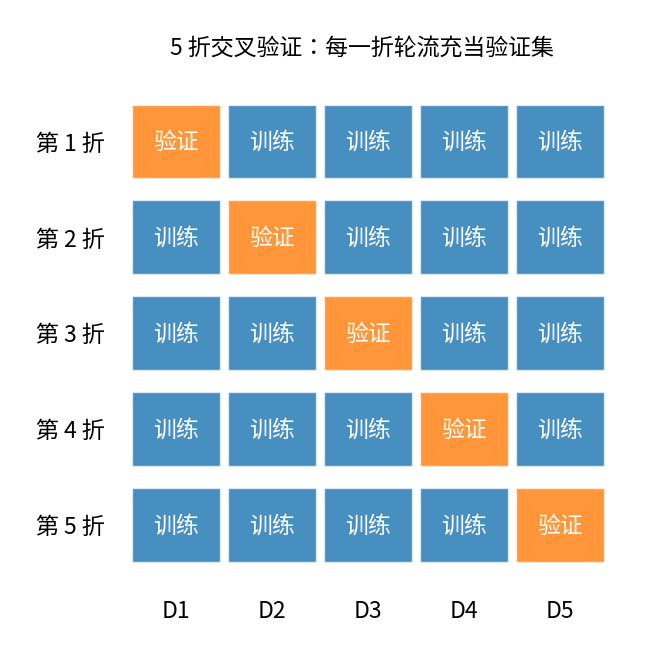

最后得到5个评估结果：

$$
E_1,E_2,E_3,E_4,E_5
$$

计算平均值：

$$
\boxed{
E_{\text{CV}}=\frac1K\sum_{k=1}^{K}E_k
}
$$

这里的 $E_k$ 可以是错误率、MSE等；如果指标越大越好，也可以类似地计算平均性能。

交叉验证的最大特点是：

**每个样本都能在某一轮充当验证样本，而不是永远只参与训练。**

常见的有5折和10折交叉验证。

特殊情况下，如果有 $m$ 个样本，令：

$$
K=m
$$

就得到留一法（Leave-One-Out, LOO）。

每次使用 $m-1$ 个样本训练，剩下1个样本测试。

LOO能充分利用训练数据，但需要训练 $m$ 次模型，计算开销可能很大。

### 3.4 自助法（Bootstrap）

前面两种方法都有一个共同特点：每一轮训练只能使用原数据的一部分。

对于非常小的数据集，这可能带来问题。

自助法采用**有放回抽样（Sampling With Replacement）**。

假设原数据集包含 $m$ 个样本。

每次从中随机取出一个样本，取完后放回，然后重复抽取，共抽取 $m$ 次。

这样得到的训练集有 $m$ 条记录，但其中可能有重复样本。

你可能会问：原数据集中有多少比例的样本从来没被抽到？

一个指定样本在一次抽取中未被选中的概率为：

$$
1-\frac1m
$$

连续 $m$ 次都没有被抽到的概率为：

$$
\left(1-\frac1m\right)^m
$$

当 $m$ 很大时：

$$
\boxed{
\left(1-\frac1m\right)^m\longrightarrow e^{-1}\approx0.368
}
$$

所以，在一次标准 Bootstrap 采样中，原始数据集平均约有36.8%的样本没有被抽中。

这些未被抽到的样本可以用于包外估计（Out-of-Bag Estimate, OOB）。

而被抽到的不同样本数量平均约占63.2%。

这是自助法里一个经典结论，也是课件第34页的重点。

但要注意，它虽然抽取了 $m$ 次，不等于使用了 $m$ 个不同样本。重复采样也改变了数据的经验分布，因此 Bootstrap 并非在所有问题上都优于交叉验证。

### 3.5 三种方法怎样选择？

| 方法 | 核心思想 | 主要特点 |
|---|---|---|
| 留出法 | 划分独立训练集和评估集 | 简单、计算快，但受划分影响 |
| K折交叉验证 | 轮流使用不同子集评估 | 更充分利用数据，适合模型选择 |
| Bootstrap | 有放回抽样构造训练集 | 适合小样本分析、评估不确定性和集成学习 |

还有一个概念需要区分：超参数（Hyperparameter）。

例如 Ridge 的正则化强度 $\lambda$、决策树的最大深度 `max_depth`，通常由我们在训练之前指定。

它们不同于模型参数，如线性回归的 $w,b$，后者是通过优化训练损失学习得到的。

通常可以使用网格搜索（Grid Search）结合交叉验证选择超参数，然后用选定的配置重新训练最终模型。

---

## 4. 如何衡量模型好坏？——性能度量

前面讲的留出法、交叉验证回答了：

**用哪些数据评估？**

但还没有回答：

**具体用什么指标评估？**

不同指标可能导致完全不同的模型选择结果。

### 4.1 回归任务：均方误差（MSE）

对于回归问题，课件主要介绍均方误差：

$$
\boxed{
MSE=\frac1m\sum_{i=1}^{m}(\hat y_i-y_i)^2
}
$$

它衡量预测数值偏离真实数值的程度。

MSE越小，预测的平方误差越小。

但由于进行了平方运算，它对较大的预测误差比较敏感。

上一章还学习了 $R^2$，它将模型残差平方和与使用样本均值预测时的平方和进行比较。

MSE和 $R^2$ 衡量的角度不完全相同：前者衡量预测误差的大小，后者衡量相对于均值基线的拟合改善程度。

### 4.2 分类任务：为什么 Accuracy 不一定够用？

假设一个数据集有1000位客户，其中：

- 950位正常客户。
- 50位违约客户。

一个模型直接把所有客户都预测为正常：

$$
Accuracy=\frac{950}{1000}=95\%
$$

但它完全没有识别出违约客户。

所以总体准确率（Accuracy）无法完整反映模型对重要类别的识别能力。

因此需要引入混淆矩阵（Confusion Matrix）。

### 4.3 混淆矩阵：分类评价的核心

**二分类混淆矩阵**

| | **预测正类** | **预测负类** |
|---|---|---|
| **真实正类** | **TP** 真正例，预测正确 | **FN** 假反例，漏判 |
| **真实负类** | **FP** 假正例，误报 | **TN** 真反例，预测正确 |

接下来所有二分类评价指标，几乎都可以从这四个数出发。

为了让含义更直观，假设在200位客户中，违约为正类，模型得到：

$$
TP=30,\quad FP=10,\quad FN=20,\quad TN=140
$$

我们来计算各个指标。

**准确率（Accuracy）**

衡量所有预测中有多少是正确的：

$$
Accuracy=\frac{TP+TN}{TP+FP+FN+TN}
$$

因此：

$$
Accuracy=\frac{30+140}{200}=0.85
$$

**查准率（Precision）**

在所有预测为正类的样本中，真正属于正类的比例：

$$
\boxed{
Precision=\frac{TP}{TP+FP}
}
$$

所以：

$$
P=\frac{30}{30+10}=0.75
$$

也就是：模型预测会违约的客户中，75%确实属于违约客户。

**查全率（Recall）**

在所有真正的正类样本中，模型成功识别出了多少：

$$
\boxed{
Recall=\frac{TP}{TP+FN}
}
$$

所以：

$$
R=\frac{30}{30+20}=0.60
$$

也就是：所有真实违约客户中，模型识别了60%。

这两个指标的区别一定要理解：

- Precision关心：**预测出来的正类有多可靠？**
- Recall关心：**真实的正类被找回了多少？**

例如垃圾邮件检测中，可能希望减少正常邮件被错误拦截，这时需要关注 Precision。

如果是高风险疾病筛查，可能更关注减少漏诊，这时 Recall 通常更加重要。

### 4.4 F1：为什么要综合 Precision 和 Recall？

Precision 和 Recall 经常存在取舍。

比如降低逻辑回归的分类阈值，可能找回更多正例，但也容易引入更多误报。

于是采用它们的调和平均：

$$
\boxed{
F_1=\frac{2PR}{P+R}
}
$$

代入刚才的例子：

$$
F_1=\frac{2\times0.75\times0.60}{0.75+0.60}
\approx0.667
$$

为什么不用普通算术平均？

因为调和平均对较小的值更加敏感。

如果：

$$
P=1,\quad R=0.1
$$

那么算术平均为0.55，但：

$$
F_1=\frac{2\times1\times0.1}{1+0.1}\approx0.182
$$

它清楚地反映出：即使Precision非常高，Recall太低也会让整体表现很差。

课件还介绍了：

$$
\boxed{
F_\beta=
\frac{(1+\beta^2)PR}{\beta^2P+R}
}
$$

其中：

- $\beta=1$：普通F1。
- $\beta>1$：更重视Recall。
- $\beta<1$：更重视Precision。

### 4.5 Macro 和 Micro：多分类时怎样综合指标？

假设有猫、狗、鸟三个类别。

我们可以将每个类别依次当作正类，分别计算它们的Precision、Recall和F1。

接下来就面临一个问题：如何把三组结果综合成一个指标？

**Macro-average（宏平均）**：先计算各类别的指标，再进行平均。

例如：

$$
Macro\text{-}P=\frac1K\sum_{k=1}^{K}P_k
$$

它把每个类别看得同样重要，不论该类别有多少样本。

**Micro-average（微平均）**：先汇总各类别的TP、FP、FN，再计算指标。

$$
Micro\text{-}P=
\frac{\sum_kTP_k}{\sum_k(TP_k+FP_k)}
$$

它更强调所有样本整体上的预测表现。

因此：

- 类别不均衡、希望重视少数类时，Macro指标很有参考价值。
- 希望衡量所有样本的总体表现时，Micro指标很有参考价值。

有一个定义上的细节：课件第45页采用先计算Macro-P、Macro-R，再取调和平均的方式得到Macro-F1；而在许多机器学习软件库中，标准的Macro-F1是直接对每个类别的F1取算术平均：

$$
Macro\text{-}F_1=\frac1K\sum_{k=1}^{K}F_{1,k}
$$

两种算法不一定给出相同结果。做课程题目时要看指定定义，实际使用 `sklearn` 时通常按后一种理解。

## 5. PR曲线、ROC曲线和AUC

前面的Precision、Recall和F1一般基于某一个固定分类阈值。

但我们上一章学习的逻辑回归可以输出概率：

$$
p(x)=P(Y=1\mid x)
$$

假设阈值为0.5：

$$
p(x)\geq0.5\Rightarrow\hat y=1
$$

问题是，为什么必须是0.5？

如果改变阈值，混淆矩阵也会变化，Precision和Recall随之变化。

因此，我们可以研究**模型在所有可能阈值下的表现**。

### 5.1 PR曲线（Precision-Recall Curve）

不断改变分类阈值，得到许多组：

$$
(P,R)
$$

以Recall为横轴、Precision为纵轴，画出PR曲线。

直观而言，阈值从高逐渐降低时：

- 越来越多样本被预测为正类。
- Recall通常逐渐提高。
- Precision可能下降，也可能局部波动。

一条PR曲线如果整体位于另一条曲线上方，通常代表它具有更好的Precision-Recall权衡。

课件第43页还介绍了平衡点（Break-Even Point, BEP），即：

$$
P=R
$$

时对应的指标值。

当PR曲线相互交叉时，BEP可以作为一种简单比较方式，但它只反映一个位置，不如同时考察整条曲线充分。

### 5.2 ROC曲线（Receiver Operating Characteristic Curve）

ROC也是通过改变分类阈值得到的，但它使用两个不同指标：

真正例率（True Positive Rate）：

$$
\boxed{
TPR=\frac{TP}{TP+FN}
}
$$

也就是Recall。

假正例率（False Positive Rate）：

$$
\boxed{
FPR=\frac{FP}{FP+TN}
}
$$

FPR表示：所有真实负类中，被错误预测为正类的比例。

ROC曲线：

- 横轴：FPR。
- 纵轴：TPR。

理想情况是：

$$
TPR=1,\quad FPR=0
$$

即所有正类都能识别出来，同时完全没有误报。

### 5.3 AUC究竟有什么含义？

AUC（Area Under the ROC Curve）就是ROC曲线下的面积。

$$
AUC=\int_0^1TPR(u)\,du
$$

这里 $u$ 表示FPR。

一般可以理解为：

- $AUC=1$：正负类排序完全正确。
- $AUC=0.5$：排序区分能力相当于随机。
- $AUC<0.5$：排序方向整体偏反。

但AUC还有一个更直观的概率解释：

$$
\boxed{
AUC=P(s(X^+)>s(X^-))
+\frac12P(s(X^+)=s(X^-))
}
$$

其中 $s(x)$ 是模型给出的正类得分。

这表示：随机抽取一个正类和一个负类，模型给正类的得分高于负类的概率，加上平分的并列情况。

课件第50页给出了一个AUC等于0.75的例子。其4个正例得分为：

$$
0.91,\ 0.77,\ 0.72,\ 0.48
$$

4个负例得分为：

$$
0.85,\ 0.61,\ 0.42,\ 0.33
$$

总共有：

$$
4\times4=16
$$

组正负样本配对。

检查每一个正例得分是否高于负例得分：

- 0.91高于4个负例。
- 0.77高于3个负例。
- 0.72高于3个负例。
- 0.48高于2个负例。

共12组排序正确，因此：

$$
\boxed{AUC=\frac{12}{16}=0.75}
$$

这比单纯记住“曲线下面积”更能帮助你理解AUC。

它主要衡量**排序区分能力**，并不直接衡量预测概率的校准程度，也不保证某个具体分类阈值下的效果。

### 5.4 PR与ROC有什么区别？

两者都反映不同分类阈值下的性能，但关注点不同。

ROC关注真正例率与假正例率之间的权衡。

PR关注查准率与查全率之间的权衡。

对于正例极为稀少的任务，例如欺诈检测，PR曲线往往尤其有用，因为它直接揭示预测为正类的样本中有多少是真正的正类。

## 6. 代价敏感学习：错误不一定同样严重

课件第51页指出，某些任务中：

$$
\text{误判正类的成本}\neq\text{漏判正类的成本}
$$

例如：

- 把正常交易误判成欺诈，会影响客户体验。
- 把欺诈交易误判成正常，可能产生直接经济损失。

因此，可以建立代价矩阵（Cost Matrix）。

假设：

- 假正例的成本为 $C_{\mathrm{FP}}$。
- 假反例的成本为 $C_{\mathrm{FN}}$。

则平均代价可以写成：

$$
\boxed{
Cost=
\frac{C_{\mathrm{FP}}FP+C_{\mathrm{FN}}FN}{m}
}
$$

此时“最好的模型”不一定是Accuracy最高的模型，而可能是**期望决策成本最低的模型**。

这和上一章类别不平衡时的阈值移动直接联系起来了。

---

## 7. 比较检验：A比B高1%，真的更好吗？

对应课件第54–62页。

假设两个模型在测试集上的准确率为：

$$
Accuracy_A=91\%
$$

$$
Accuracy_B=90\%
$$

能不能直接得出模型A更好？

不能。

因为测试集本身是抽样得到的。如果重新抽取测试数据，准确率就可能变化。

例如模型A在某一次实验中表现更好，但在另一次实验中反而不如模型B。

我们希望判断：观察到的性能差异，是否可能仅仅由随机波动造成？

这就引出了统计假设检验（Hypothesis Testing）。

### 7.1 t检验的基本思路

课件首先介绍单样本t检验。

假设某算法进行了 $k$ 次评估，得到错误率：

$$
e_1,e_2,\ldots,e_k
$$

要检验总体平均错误率是否等于某个指定值 $\varepsilon_0$。

建立假设：

$$
H_0:\mu=\varepsilon_0
$$

计算样本均值：

$$
\bar e=\frac1k\sum_{i=1}^{k}e_i
$$

样本标准差：

$$
s=\sqrt{\frac1{k-1}\sum_{i=1}^{k}(e_i-\bar e)^2}
$$

若观测值满足适当的独立性与分布条件，则统计量为：

$$
\boxed{
t=\frac{\bar e-\varepsilon_0}{s/\sqrt{k}}
}
$$

在原假设下，它服从自由度为 $k-1$ 的t分布（满足正态样本假设时）。

如果计算得到的 $|t|$ 超过相应显著性水平的临界值，我们就拒绝原假设。

课件第59页使用11个错误率进行示例，得到约2.30的t统计量，与0.05显著性水平的临界值2.262比较，从而拒绝假设。

### 7.2 比较两个模型：成对t检验

如果模型A和模型B在相同的数据划分下进行评估，最好利用它们的配对关系。

对于第 $i$ 次实验，计算错误率差：

$$
d_i=e_i^A-e_i^B
$$

检验：

$$
H_0:\mu_d=0
$$

再根据这些差值计算：

$$
\boxed{
t=\frac{\bar d}{s_d/\sqrt{k}}
}
$$

为什么这样做？

因为同一次划分可能特别容易或特别困难，对两个模型都会产生影响。

我们真正想知道的是：**在相同数据条件下，A是否持续比B更好？**

成对差值可以消除一部分共同的数据划分影响。

课件第61页的示例中，最终计算得到：

$$
t\approx1.88
$$

小于临界值2.262，所以没有足够证据认为两个学习器的平均错误率存在显著差异。

但这里要记住：

**没有拒绝“性能相同”的原假设，不代表证明两个模型完全一样。**

另外，交叉验证不同折之间的结果并不严格独立，普通t检验直接用于交叉验证错误率可能低估不确定性。课件后面提到的5×2交叉验证检验、McNemar检验，以及Friedman与Nemenyi检验，都是用于不同实验设计或模型比较情形的方法。

课件第55页还提到了PAC（Probably Approximately Correct）学习理论，主要传达一个思想：机器学习的泛化保证往往是概率性的，而不是保证对每个未来样本都绝对正确。本章不需要把它与t检验混为一谈。

## Chapter 3 小结

这一章最重要的逻辑是：

$$
\boxed{
\begin{gathered}
\text{训练误差不能代表泛化误差}\\
\downarrow\\
\text{使用留出法、交叉验证等进行估计}\\
\downarrow\\
\text{根据任务选择MSE、F1、AUC等指标}\\
\downarrow\\
\text{必要时通过统计检验比较模型}
\end{gathered}
}
$$

在实际机器学习中，你会反复使用这一整套流程。

接下来学习决策树时，会看到为什么同一个模型的训练准确率可以很高，但仍然需要限制树深度、设置叶节点最小样本量、进行剪枝。

这正是第三章泛化思想在一种具体模型中的应用。

---

# 二、Chapter 4：决策树（Decision Tree）

*对应课件第3–60页*

第三章解决了如何评价和选择模型的问题。

接下来进入一种新的机器学习模型：决策树。

前面学习的线性回归和逻辑回归，都以线性组合为基础：

$$
z=w^Tx+b
$$

但并不是所有问题都适合使用单一线性边界描述。

例如判断一个西瓜是否是好瓜，我们可能依据：

- 纹理是否清晰？
- 根蒂是否蜷缩？
- 敲击声音是否浑浊？

这些判断规则之间可能还存在依赖。

比如，只有纹理清晰时，我们才进一步检查根蒂。

决策树恰好可以用树形结构表达这样的条件判断过程。

这一章可以围绕四个核心问题展开：

1. **怎样建立一棵树？**——递归划分。
2. **每次应该根据什么属性划分？**——信息增益、基尼指数、增益率。
3. **怎样防止树过于复杂？**——预剪枝和后剪枝。
4. **如果属性是连续值或者存在缺失值怎么办？**——阈值划分与缺失值处理。

## 1. 决策树究竟是什么？

### 1.1 从一系列判断规则开始

假设我们建立一棵简单的西瓜分类树：

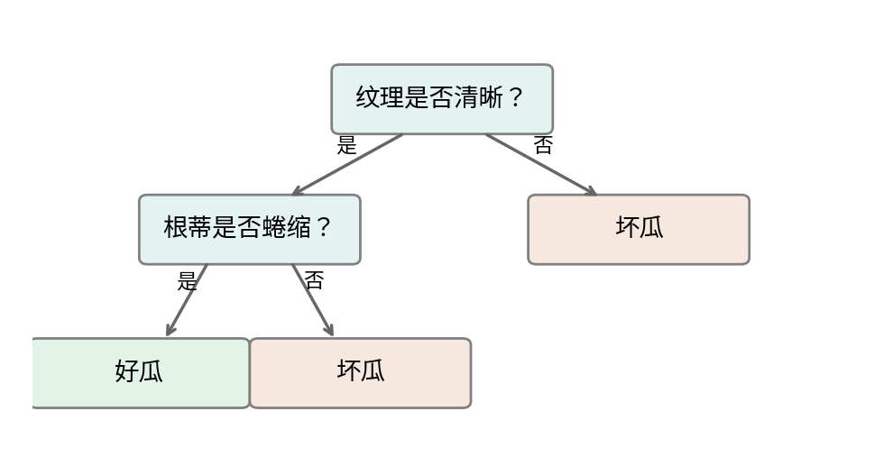

*用于说明决策流程的简化示例，非课件中完整训练得到的西瓜决策树。*

这棵树有三个组成部分：

- 根节点（Root Node）：最开始的判断问题。
- 内部节点（Internal Node）：后续的属性测试。
- 叶节点（Leaf Node）：最终分类结果。

一个新样本从根节点进入，根据属性取值沿分支移动，最终到达某个叶节点。

因此，决策树在预测阶段实际上是在执行一组 `if-else` 规则。

### 1.2 决策树与线性模型有什么不同？

逻辑回归使用：

$$
w^Tx+b=0
$$

作为决策边界，这是一个超平面。

而决策树可以反复使用：

$$
x_1\leq t_1
$$

$$
x_2\leq t_2
$$

之类的条件，把特征空间划分成不同区域。

每个区域内的样本最终被分配到某个叶节点。

课件第5页的图展示了这样的过程：先按一个坐标轴上的阈值切分，再在局部区域按另一个坐标轴上的阈值继续切分。

这样可以形成比单一直线更复杂的决策边界。

对常见的轴对齐决策树来说，每次连续特征的阈值测试相当于一条平行于坐标轴的切线；多次组合后，可以形成多个矩形区域。

因此，决策树能自然表示许多非线性分类规则。

## 2. 决策树怎样训练？——递归划分

课件第7–11页给出了基本算法。

核心思路只有四步：

$$
\boxed{
\text{选择属性}
\rightarrow
\text{划分样本}
\rightarrow
\text{对子节点继续划分}
\rightarrow
\text{满足条件后停止}
}
$$

这叫分而治之（Divide and Conquer）。

具体而言，假设当前节点有训练样本集合 $D$。

首先选择一个属性 $a$，根据这个属性的取值将 $D$ 划分成若干子集：

$$
D=D^1\cup D^2\cup\cdots\cup D^V
$$

然后对每个子集重复同样的过程。

### 2.1 什么时候停止划分？

课件介绍了几个条件。

**第一种：节点中的样本全部属于同一类别。**

这时节点已经完全纯净，没有必要继续划分。

**第二种：所有可用属性都用完了，或者当前样本在可用属性上无法再区分。**

这时可以把当前节点设为叶节点，用训练样本中的多数类别作为预测结果。

**第三种：某个分支没有训练样本。**

例如某个属性有一个可能取值，但当前节点中没有样本具有这个取值。

可以把该分支设为叶节点，类别由父节点的样本分布决定。

**第四种：达到预先设定的停止条件。**

例如：

- 最大深度（Maximum Depth）。
- 节点最小样本量（Minimum Samples）。
- 节点不纯度已足够小。

这类停止条件也是控制模型复杂度的手段。

### 2.2 训练一棵树最困难的是什么？

假设现在有三个候选属性：

$$
a_1=\text{色泽}
$$

$$
a_2=\text{根蒂}
$$

$$
a_3=\text{纹理}
$$

我们应该先按照哪个属性划分？

不能仅仅因为某个属性看起来重要就优先使用它。

我们希望在每一次划分之后，子节点中的样本尽可能属于同一类别。

这就引出了决策树最核心的概念：

**节点纯度（Purity）。**

例如：

- 节点A有10个样本，全部是好瓜。
- 节点B有10个样本，其中5个好瓜、5个坏瓜。

显然节点A更纯，分类结果更确定。

决策树希望每一次划分都尽可能提高节点纯度。

但“纯度”应该怎样用数学量化？

下面介绍三种划分标准。

---

## 3. 信息熵与信息增益（Entropy and Information Gain）

这一部分对应课件第16–21页，也是决策树最重要的公式内容。

### 3.1 为什么用信息熵衡量不确定性？

假设随机变量 $Y$ 表示一个样本的类别。

如果：

$$
P(Y=\text{好瓜})=1
$$

那么我们完全确定这个样本是好瓜，不存在不确定性。

但如果：

$$
P(Y=\text{好瓜})=0.5
$$

$$
P(Y=\text{坏瓜})=0.5
$$

那么预测就非常不确定。

信息熵（Entropy）就是用来衡量这种不确定性的。

对于节点 $D$，假设有 $K$ 个类别，第 $k$ 类所占的比例为 $p_k$。

定义：

$$
\boxed{
Ent(D)=-\sum_{k=1}^{K}p_k\log_2p_k
}
$$

约定：

$$
0\log_2 0=0
$$

为什么熵能够表示不确定性？

可以先理解其中的：

$$
-\log_2p_k
$$

如果某个事件概率很大，它发生时提供的信息量比较少；如果某个事件概率很小，它发生时就比较令人意外，信息量更大。

而熵：

$$
-\sum_kp_k\log_2p_k
$$

就是对不同事件的信息量进行概率加权平均。

所以它衡量的是类别标签的平均不确定性。

### 3.2 二分类的信息熵

假设好瓜比例为 $p$，坏瓜比例为 $1-p$。

则：

$$
\boxed{
H(p)=-p\log_2p-(1-p)\log_2(1-p)
}
$$

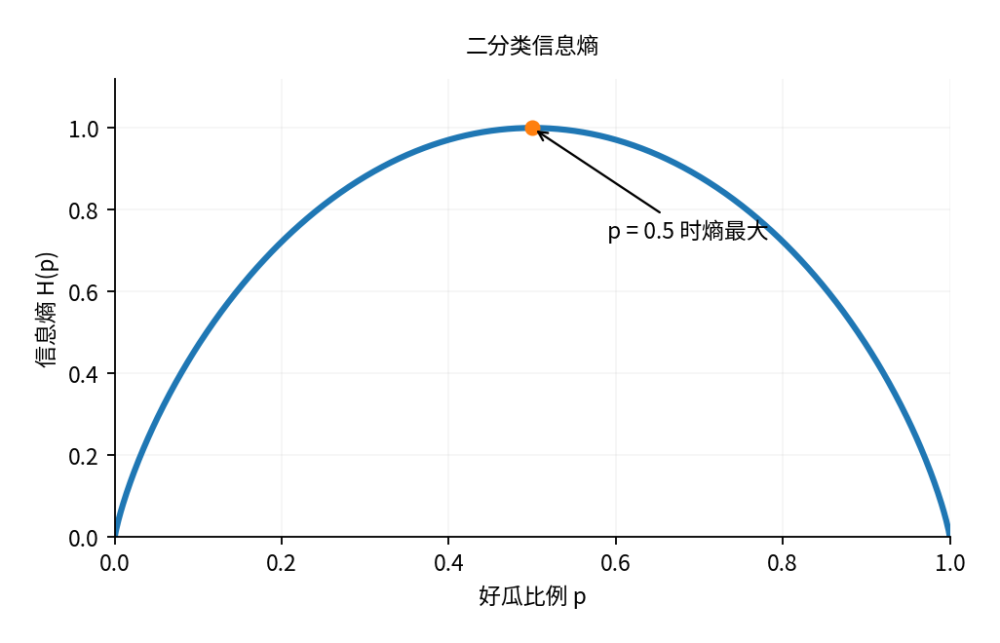

你可以发现：

- $p=0$ 或 $p=1$ 时，熵等于0。
- $p=0.5$ 时，熵达到最大值1。
- 类别比例越接近均匀，熵越大。

这完全符合我们关于分类不确定性的直觉。

对于 $K$ 类，信息熵的最大值为：

$$
\log_2K
$$

并且当各类别等概率时达到最大值。

### 3.3 信息增益：一次划分减少了多少不确定性？

现在假设我们用某个属性 $a$ 划分节点 $D$。

它可能产生 $V$ 个子节点：

$$
D^1,D^2,\ldots,D^V
$$

划分前的不确定性是：

$$
Ent(D)
$$

划分后，每个子节点都有自己的熵。

但是不能直接把所有子节点的熵相加，因为不同子节点的样本数量可能差别很大。

正确的方法是计算加权平均：

$$
\sum_{v=1}^{V}
\frac{|D^v|}{|D|}Ent(D^v)
$$

因此，信息增益定义为：

$$
\boxed{
Gain(D,a)=
Ent(D)-
\sum_{v=1}^{V}
\frac{|D^v|}{|D|}Ent(D^v)
}
$$

它衡量：

$$
\text{划分前的不确定性}
-
\text{划分后的平均不确定性}
$$

信息增益越大，说明属性 $a$ 对区分类别越有帮助。

从信息论角度，这个量也可以理解为类别变量与划分属性之间的经验互信息（Mutual Information）。

### 3.4 用课件的西瓜数据完整计算一次

课件第18–20页使用了17个西瓜样本，其中：

$$
8\text{个好瓜},\quad9\text{个坏瓜}
$$

因此根节点的熵是：

$$
\begin{aligned}
Ent(D)
&=-\frac8{17}\log_2\frac8{17}
-\frac9{17}\log_2\frac9{17}\\
&\approx0.998
\end{aligned}
$$

现在考虑属性“色泽”。

它有三个取值：

- 青绿：6个样本，3个好瓜、3个坏瓜。
- 乌黑：6个样本，4个好瓜、2个坏瓜。
- 浅白：5个样本，1个好瓜、4个坏瓜。

分别计算三组的熵。

青绿：

$$
Ent(D^1)=
-\frac36\log_2\frac36
-\frac36\log_2\frac36
=1
$$

乌黑：

$$
Ent(D^2)=
-\frac46\log_2\frac46
-\frac26\log_2\frac26
\approx0.918
$$

浅白：

$$
Ent(D^3)=
-\frac15\log_2\frac15
-\frac45\log_2\frac45
\approx0.722
$$

然后进行加权：

$$
\begin{aligned}
Gain(D,\text{色泽})
={}&0.998\\
&-\left(
\frac6{17}\times1
+\frac6{17}\times0.918
+\frac5{17}\times0.722
\right)\\
\approx{}&0.109
\end{aligned}
$$

也就是说，使用色泽划分后，类别不确定性平均减少了约0.109比特。

对于其他属性，也可以采用相同计算方式。

课件第20页给出的结果为：

| 属性 | 信息增益 |
|---|---:|
| 色泽 | 0.109 |
| 根蒂 | 0.143 |
| 敲声 | 0.141 |
| 纹理 | 0.381 |
| 脐部 | 0.289 |
| 触感 | 0.006 |

因此：

$$
\boxed{
a^*=\arg\max_a Gain(D,a)=\text{纹理}
}
$$

所以根节点选择“纹理”作为划分属性。

这就是 ID3 决策树的基本划分规则。

接下来，对纹理的不同取值分别形成子节点，再在每个子节点上重新计算可用属性的信息增益。

**注意：决策树不是一开始就确定整棵树的全部判断顺序，而是每个节点都根据当前数据重新选择划分属性。**

这也是它属于贪心算法（Greedy Algorithm）的原因：每一步优先选择当前看起来最好的划分，而不保证最终得到全局最优的整棵树。

---

## 4. 基尼指数（Gini Index）

信息熵可以衡量节点的不确定性，但计算时需要对数。

有没有另一种更简单的纯度指标？

课件第22页介绍了基尼值（Gini Impurity）。

### 4.1 基尼值的定义

假设节点共有 $K$ 个类别，类别比例为：

$$
p_1,p_2,\ldots,p_K
$$

定义：

$$
\boxed{
Gini(D)=1-\sum_{k=1}^{K}p_k^2
}
$$

它有什么直观含义？

假设我们按照节点中的类别比例，独立抽取两个类别标签。

两个标签相同的概率为：

$$
\sum_{k=1}^{K}p_k^2
$$

因此两个标签不同的概率为：

$$
1-\sum_{k=1}^{K}p_k^2
$$

这恰好就是基尼值。

所以可以把它理解为：**按照节点类别比例独立抽取两个标签时，它们不相同的概率。**

节点越纯，两个标签不同的可能性越低，基尼值也越小。

### 4.2 二分类的基尼值

假设正类比例为 $p$，负类比例为 $1-p$。

则：

$$
\begin{aligned}
Gini(D)
&=1-p^2-(1-p)^2\\
&=1-p^2-(1-2p+p^2)\\
&=2p(1-p)
\end{aligned}
$$

因此：

$$
\boxed{Gini(D)=2p(1-p)}
$$

例如：

- 当 $p=0.5$ 时，$Gini=0.5$，最不纯。
- 当 $p=0.9$ 时，$Gini=0.18$，较纯。
- 当 $p=1$ 时，$Gini=0$，完全纯净。

你会发现，基尼值与信息熵虽然公式不同，但都满足同样的基本规律：

**类别越均匀，不纯度越高；越集中，不纯度越低。**

### 4.3 CART如何使用基尼指数？

对于一个候选划分 $a$，计算划分后子节点的加权基尼值：

$$
\boxed{
GiniIndex(D,a)=
\sum_{v=1}^{V}
\frac{|D^v|}{|D|}Gini(D^v)
}
$$

然后选择：

$$
\boxed{
a^*=\arg\min_a GiniIndex(D,a)
}
$$

注意它与信息增益的方向区别：

- 信息增益：越大越好。
- 划分后的基尼指数：越小越好。

常见 CART（Classification and Regression Tree）分类树使用基尼准则，通常采用二叉划分；CART回归树则使用适合连续输出的误差准则，例如节点内平方误差。

---

## 5. 增益率：为什么信息增益也存在问题？

对应课件第23页。

前面我们使用：

$$
Gain(D,a)
$$

衡量划分属性的优劣。

但信息增益有一个问题：**它可能偏好取值特别多的属性。**

假设训练数据中有一个属性：

$$
a=\text{学号}
$$

每位学生的学号都不相同。

如果根据学号划分，那么每个子节点可能只包含一个样本。

此时每个子节点都完全纯净：

$$
Ent(D^v)=0
$$

所以：

$$
Gain(D,a)=Ent(D)
$$

信息增益非常高。

但问题是，按照学号划分根本没有发现真正有用的规律。

新来的学生有全新的学号，模型仍然不知道该怎样预测。

为了缓解这个问题，C4.5引入了增益率（Gain Ratio）。

### 5.1 先衡量属性本身的划分复杂程度

定义属性的固有值（Intrinsic Value）：

$$
\boxed{
IV(a)=
-\sum_{v=1}^{V}
\frac{|D^v|}{|D|}
\log_2\frac{|D^v|}{|D|}
}
$$

你会发现，这个公式与熵非常类似。

但二者衡量的对象不同。

- $Ent(D)$：类别标签的不确定性。
- $IV(a)$：根据属性 $a$ 划分时，各分支样本比例的不确定性。

如果一个属性有很多不同取值，并把样本分成大量规模相近的分支，那么 $IV(a)$ 就可能很大。

### 5.2 增益率的定义

$$
\boxed{
GainRatio(D,a)=
\frac{Gain(D,a)}{IV(a)}
}
$$

通过除以 $IV(a)$，可以对取值过多的属性施加一定惩罚。

当然，增益率也不是完美的，它可能偏好取值很少的属性。

因此课件介绍的 C4.5 方法是：先筛选信息增益高于平均水平的属性，再从其中选择增益率最高的属性。

对于无法有效划分、$IV(a)=0$ 的属性，不使用这个比值进行有效划分选择。

### 5.3 三种经典决策树如何区分？

| 决策树 | 主要划分标准 | 选择方向 | 核心特点 |
|---|---|---|---|
| ID3 | 信息增益（Information Gain） | 越大越好 | 倾向选择当前减少类别不确定性最多的属性 |
| C4.5 | 增益率（Gain Ratio） | 越大越好 | 缓解信息增益偏好多值属性的问题 |
| CART | 基尼指数（Gini Index） | 越小越好 | 通常使用二叉划分，也支持回归树 |

这三个方法不需要当作完全独立的三套算法来记忆。

它们共享决策树的核心框架：

$$
\text{选择划分}
\rightarrow
\text{建立分支}
\rightarrow
\text{递归生成子树}
$$

主要区别之一是：**如何判断某次划分的质量。**

---

## 6. 剪枝：为什么不能一直划分下去？

对应课件第24–41页。

前面我们已经知道如何建立决策树：

每次找到当前最好的属性，划分数据，再继续对各个子节点执行同样操作。

但这里出现了一个问题：

**如果不断划分，直到每个叶节点都只包含极少数样本，会发生什么？**

假设某个叶节点只有一个训练样本，而且它刚好是好瓜。

这个叶节点当然可以达到100%的训练准确率。

但是这不代表未来落入该区域的西瓜一定是好瓜。

它有可能只是训练样本中的偶然现象。

这正好对应第三章的过拟合：

$$
\text{模型过于复杂}
\longrightarrow
\text{学习到数据噪声}
\longrightarrow
\text{泛化性能下降}
$$

因此，我们需要控制决策树复杂度。

最主要的方法就是剪枝（Pruning）。

### 6.1 剪枝的核心思路

假设某个节点原本还可以继续分裂成很多子节点。

现在我们有两种选择：

- 保留这个分裂，让树更复杂。
- 把这个节点直接改成叶节点，让树更简单。

应该选择哪种？

关键是：**比较两种方案在验证集上的表现，而不是只看训练集。**

因为继续划分通常会降低训练误差，但不一定改善泛化性能。

根据剪枝发生的时间，可以区分为预剪枝和后剪枝。

### 6.2 预剪枝（Pre-pruning）

预剪枝的思想是：

**在决策树生长过程中，判断当前节点是否值得继续划分。**

假设当前节点还没有划分。

首先确定如果不划分，当前节点应该预测什么类别。

通常选择训练样本中的多数类别。

然后评估不划分时的验证集表现。

接下来，尝试根据当前最优属性划分，重新评估验证集表现。

如果划分带来明显改善，就允许继续生长；否则停止划分。

课件第28–30页提供了一个具体例子。

最初只有根节点时，预测所有样本都是好瓜，验证集准确率为：

$$
Accuracy_{\text{before}}=42.9\%
$$

根据属性“脐部”划分后，验证集准确率变为：

$$
Accuracy_{\text{after}}=71.4\%
$$

因为：

$$
71.4\%>42.9\%
$$

所以接受这次划分。

但是当继续尝试扩展某些子节点时，课件中的例子发现验证集准确率不再提升，甚至下降。

这时就停止相关分支的继续生长。

**预剪枝的优点**是能够提前阻止一些不必要的划分，减少模型训练和预测成本，也有利于降低过拟合风险。

但它有一个重要缺点：可能造成欠拟合。

为什么？

假设一次划分没有立即提高验证集准确率，但在该划分后再继续划分两层，可能得到更好的分类规则。

预剪枝由于采用局部判断，可能在第一步就停止，根本无法发现后面更好的结构。

这体现了它的贪心性质。

### 6.3 后剪枝（Post-pruning）

后剪枝采用另一种思路：

**先生成一棵相对完整的决策树，再从下向上判断哪些分支可以删除。**

具体过程是：

1. 先利用训练数据生成较完整的决策树。
2. 从最底层的内部节点开始。
3. 尝试把当前节点及其所有后代替换为一个叶节点。
4. 根据训练样本的多数类别确定这个叶节点的预测结果。
5. 在验证集上比较替换前后的性能。
6. 如果剪枝使验证性能不下降，或者满足指定的剪枝准则，就接受剪枝。

课件第32–39页展示了这个过程。

最初完整决策树的验证集准确率为：

$$
42.9\%
$$

首先考虑剪去节点⑥下方的分支。

将节点⑥替换成一个预测“好瓜”的叶节点后，验证集准确率提高到：

$$
57.1\%
$$

因此，接受这次剪枝。

随后继续自底向上检查其他内部节点，得到一棵更精简的树。

这个例子很好地说明：

**一棵树拥有更多分支，并不意味着它能够更好地预测未知样本。**

### 6.4 预剪枝和后剪枝比较

| | 预剪枝 | 后剪枝 |
|---|---|---|
| 执行时机 | 建树过程中 | 建树完成之后 |
| 核心思想 | 提前阻止无益划分 | 删除已经建立的分支 |
| 计算成本 | 通常较低 | 通常较高 |
| 过拟合风险 | 有助于降低 | 有助于降低 |
| 欠拟合风险 | 相对较高 | 相对较低 |
| 泛化性能 | 依赖停止条件 | 通常有机会得到更好的结果 |

课件指出，后剪枝通常比预剪枝有更好的泛化性能，但也需要更多计算。

这里不能理解为后剪枝必然更好，具体结果仍然取决于数据、剪枝准则和验证方式。

### 6.5 剪枝与前面学过的正则化有什么关系？

这里可以把第三章和第四章真正联系起来。

对于线性回归，我们可以通过：

$$
L(w)=L_{\text{training}}(w)+\lambda\|w\|_2^2
$$

约束参数大小。

而对于决策树，我们可以通过限制最大深度、节点数量和剪枝来控制模型复杂度。

虽然形式不同，但它们都在做相似的事情：

$$
\boxed{
\text{允许一定训练误差，换取更好的泛化能力}
}
$$

课件主要介绍的是基于验证集准确率的剪枝。除此之外，还有代价复杂度剪枝（Cost-Complexity Pruning）的思路，例如：

$$
R_\alpha(T)=R(T)+\alpha|T|
$$

其中：

- $R(T)$：决策树的训练损失。
- $|T|$：叶节点数量。
- $\alpha$：控制复杂度惩罚的参数。

它实际上将正则化思想直接应用到了决策树上。这是帮助理解两章联系的补充内容。

---

## 7. 连续值属性怎样划分？

对应课件第43–47页。

前面西瓜的属性大多是离散的，例如：

$$
\text{色泽}\in\{\text{青绿},\text{乌黑},\text{浅白}\}
$$

直接按不同取值创建分支即可。

但现实中的很多特征是连续的。

例如：

- 年龄。
- 收入。
- 西瓜密度。
- 贷款金额。

这些变量可能有非常多不同取值，不可能给每个可能的数值都建立一个分支。

那么决策树如何处理？

### 7.1 使用阈值进行二分

假设使用客户年龄 $x$ 分类。

可以设置某个阈值 $t$：

$$
x\leq t
$$

形成两条分支：

$$
D^-=\{(x_i,y_i):x_i\leq t\}
$$

$$
D^+=\{(x_i,y_i):x_i>t\}
$$

问题就转变成：

**应该选择什么阈值 $t$，才能使划分效果最好？**

### 7.2 为什么只需要考虑有限个候选阈值？

假设训练样本的某个属性取值为：

$$
1,\ 2,\ 4,\ 7
$$

所有可能的阈值有无穷多个。

但是阈值设为1.2还是1.8，得到的训练样本分组是一样的：

$$
\{1\}\quad\text{和}\quad\{2,4,7\}
$$

因此，这两个阈值在当前训练数据上的划分结果相同。

只需要考虑相邻不同属性值之间的中点：

$$
\frac{1+2}{2}=1.5
$$

$$
\frac{2+4}{2}=3
$$

$$
\frac{4+7}{2}=5.5
$$

就可以表示所有不同的二分结果。

一般而言，将 $n$ 个不同的取值从小到大排序：

$$
a^{(1)}<a^{(2)}<\cdots<a^{(n)}
$$

构建候选划分点集合：

$$
\boxed{
T_a=
\left\{
\frac{a^{(i)}+a^{(i+1)}}2:
i=1,\ldots,n-1
\right\}
}
$$

然后对每个候选阈值 $t$ 计算信息增益：

$$
Gain(D,a,t)=
Ent(D)
-\frac{|D^-|}{|D|}Ent(D^-)
-\frac{|D^+|}{|D|}Ent(D^+)
$$

最终选择：

$$
\boxed{
t^*=\arg\max_{t\in T_a}Gain(D,a,t)
}
$$

这样就把原来无穷多个可能阈值，缩减成最多 $n-1$ 个候选。

### 7.3 为什么连续属性能够在后续节点重复使用？

这一点很重要。

假设第一次划分：

$$
x\leq30
$$

对于进入 $x\leq30$ 分支的样本，仍然可以继续划分：

$$
x\leq20
$$

因为同一个连续特征的不同阈值可以继续区分样本。

所以不能简单认为“某个属性用过一次，以后就不能用了”。

这取决于具体的决策树算法和属性处理方式。

### 7.4 课件中的西瓜密度例子

课件第47页对属性“密度”计算了多个候选划分阈值的信息增益。

其中最优阈值为：

$$
t^*=0.381
$$

对应的信息增益约为：

$$
Gain(D,\text{密度},0.381)=0.262
$$

因此可以划分为：

$$
\text{密度}\leq0.381
$$

与：

$$
\text{密度}>0.381
$$

这就是连续值属性处理的基本方法。

---

## 8. 缺失值怎样处理？

对应课件第49–59页。

这是决策树中相对容易被忽略，但实际数据处理中非常重要的部分。

假设有一条客户记录：

| 年龄 | 收入 | 信用评分 | 是否违约 |
|---|---|---|---|
| 25 | 8000 | 720 | 否 |
| 30 | 缺失 | 650 | 是 |
| 35 | 12000 | 缺失 | 否 |

如果某个决策节点需要按收入划分，但第二个样本没有收入数据，该怎么办？

首先要了解数据为什么会缺失。

### 8.1 三种缺失机制

课件第51页介绍了三类缺失机制。

**完全随机缺失（Missing Completely at Random, MCAR）**

缺失是否发生，与观测变量和未观测值都没有关系。

例如数据采集设备发生独立的随机故障。

**随机缺失（Missing at Random, MAR）**

缺失可能与其他已经观测到的变量有关，但在给定这些观测信息后，不再依赖缺失值本身。

例如某些年龄组更不愿意填写收入，而年龄是已知的。

**非随机缺失（Missing Not at Random, MNAR）**

即使考虑其他观测信息，缺失是否发生仍然可能取决于缺失值本身。

例如收入特别高的人更倾向于不报告自己的收入。

这三种情况的区别在于：**缺失机制与什么变量有关。**

为什么需要区分？

因为如果缺失与某些变量系统性相关，直接删除缺失样本可能造成选择偏差。

### 8.2 简单缺失值处理方法

课件介绍了三大类思路。

| 方法 | 做法 | 主要问题 |
|---|---|---|
| 删除 | 删除包含缺失值的行或列 | 可能损失数据、造成偏差 |
| 插补（Imputation） | 用均值、众数或其他估计值补齐 | 可能引入误差，低估不确定性 |
| 由模型处理 | 使用能够直接处理缺失值的模型或算法 | 需要模型支持相应机制 |

例如数值特征可以用均值填充：

$$
x_{\text{missing}}\leftarrow\bar x
$$

离散特征可以用众数填充。

课件还介绍了多重插补（Multiple Imputation）。其基本思想不是简单认定某一个填充值是正确的，而是构造多份合理的完整数据集，分别分析，再综合分析结果，从而反映填补值的不确定性。

需要补充一个实际建模原则：**插补所需的均值、众数等参数必须从训练数据中学习**。在交叉验证时也应只利用对应训练折的信息，不能先用全数据计算均值再进行划分，否则会造成信息泄漏。

课件提出按决策类别进行条件均值填充的思路，但在实际预测阶段，待预测样本的真实标签通常未知，所以不能直接使用它的真实标签决定如何填充特征。

### 8.3 决策树能不能直接利用缺失样本？

这是课件第56–59页真正的重点。

如果仅仅删除缺失样本，会造成数据浪费。

因此，课件介绍了一个权重划分的思想，试图解决两个问题：

- Q1：选择划分属性时，如何考虑属性缺失？
- Q2：已经确定划分属性后，一个属性值缺失的样本应该进入哪个子节点？

#### 问题一：如何选择划分属性？

假设当前节点有17个样本。

其中属性“色泽”只有14个样本没有缺失值。

记无缺失样本集合为：

$$
\tilde D
$$

第一步，只使用这14个完整记录计算该属性的信息增益：

$$
Gain(\tilde D,a)
$$

第二步，考虑该属性有多少样本可用。

设：

$$
\rho=\frac{|\tilde D|}{|D|}
$$

在这里：

$$
\rho=\frac{14}{17}
$$

最终采用：

$$
\boxed{
Gain(D,a)=\rho\cdot Gain(\tilde D,a)
}
$$

为什么要乘这个系数？

因为同样的信息增益，如果一个属性对绝大多数样本都可用，它通常比一个缺失非常严重的属性更有实用价值。

课件中的具体计算为：

$$
Gain(\tilde D,\text{色泽})=0.306
$$

所以：

$$
\begin{aligned}
Gain(D,\text{色泽})
&=\frac{14}{17}\times0.306\\
&\approx0.252
\end{aligned}
$$

这相当于对完整样本得到的信息增益按照可观测比例进行折减。

如果每个样本还有不同权重，则上面的样本数量比例需要推广为样本权重和的比例。

#### 问题二：缺失样本究竟应该进入哪个分支？

课件第59页使用属性“纹理”划分西瓜。

假设在纹理非缺失的15个样本中：

- 清晰：7个。
- 稍糊：5个。
- 模糊：3个。

那么三种取值的相对比例为：

$$
\frac7{15},\quad\frac5{15},\quad\frac3{15}
$$

现在某个样本的纹理缺失。

一种处理方式是让它同时进入三个子节点，但分配不同的权重：

$$
\boxed{
w_{\text{清晰}}=\frac7{15},\quad
w_{\text{稍糊}}=\frac5{15},\quad
w_{\text{模糊}}=\frac3{15}
}
$$

为什么这样做？

因为我们不知道这个样本真实的纹理类别，但可以利用其他样本中观察到的类别比例，进行一种加权分配。

需要注意，这不是简单地把一个样本完整复制三次。

它在三个分支的权重之和仍然为：

$$
\frac7{15}+\frac5{15}+\frac3{15}=1
$$

因此，从权重意义上并没有凭空创造额外的样本总量。

这是一种利用可观测分布处理缺失值的方法，不表示真实缺失值已经被准确恢复。

它也不是所有决策树实现的统一做法。不同算法可以采用缺失值填补、替代划分或专门的缺失值分支等方案。

---

## 9. 决策树的特点与局限

课件第48页对决策树的性质进行了总结。

现在结合前面几节，可以更系统地理解它们。

### 9.1 决策树有哪些优势？

**第一，可解释性较好。**

一棵比较浅的决策树，可以直接转换成若干条件判断规则。

例如：

> 如果纹理清晰，而且根蒂蜷缩，则预测为好瓜。

这类规则容易理解和解释。

**第二，可以学习非线性的决策边界。**

线性分类器只能直接给出一个超平面，而决策树可以通过多次切分表达复杂的分类区域。

**第三，对数值型和类别型特征可以采用不同的划分方式。**

它通常不像基于欧氏距离的算法那样依赖特征的尺度，因此一般不要求为了树的阈值划分而先进行标准化。

**第四，可以进行一定程度的特征选择。**

如果两个属性高度相关，使用其中一个进行划分后，另一个属性可能就不再带来多少额外收益。

### 9.2 决策树有什么缺点？

最重要的还是过拟合。

决策树如果不断生长，可以把训练数据划分得非常细。

这有利于降低训练误差，但可能使预测对数据扰动过于敏感。

另一个问题是数据碎片化（Data Fragmentation）。

假设一棵树在经过许多次划分后，每个叶节点都只有两三个样本。

那么叶节点给出的类别判断就可能非常不稳定。

因此，需要限制树深度、叶节点样本量或者进行剪枝。

此外，决策树的训练通常采用贪心策略，不保证找到全局最优树；数据发生较小变化，也可能导致前面几层选择了不同的划分属性，从而产生明显不同的树结构。

---

# 三、两章之间最重要的联系

现在可以把两章放在一起理解了。

第三章提出：模型不能只追求训练误差小，还需要追求良好的泛化能力。

第四章的决策树恰好提供了一个完整例子。

**训练决策树**

利用信息增益、基尼指数等选择划分属性

↓

**控制模型复杂度**

限制树深度、叶节点样本量，进行预剪枝或后剪枝

↓

**通过验证集选择模型**

交叉验证选择树深度、最小样本量等超参数

↓

**最终测试**

使用Accuracy、F1、AUC等指标评估泛化表现

你还应该区分两个不同的优化目标。

**训练决策树时**，我们可能使用信息增益或基尼指数，决定局部节点怎样划分。

**选择最终模型时**，我们可能使用验证集F1或AUC等指标，决定哪一棵树更合适。

这两个过程解决的问题不一样，因此它们不需要使用相同的评价函数。

比如，在欺诈检测任务中，训练树时使用基尼指数进行节点划分，但在交叉验证中使用F1选择最大深度，是完全合理的。

---

# 四、最后梳理：哪些内容最值得掌握？

| 知识点 | 重要程度 | 需要掌握到什么程度 |
|---|---|---|
| 经验误差、泛化误差、过拟合 | 核心 | 能解释为什么训练准确率高不代表模型好 |
| 偏差—方差分解 | 核心 | 理解来源，能够解释三项及推导 |
| 留出法、K折交叉验证、Bootstrap | 核心 | 理解流程、区别与适用场景 |
| 训练集、验证集、测试集 | 核心 | 能正确设计模型训练与选择流程 |
| 混淆矩阵、Precision、Recall、F1 | 核心 | 能根据TP、FP、FN、TN直接计算 |
| ROC、AUC、PR | 核心 | 能解释阈值、排序能力及指标差异 |
| t检验、成对t检验 | 重点 | 理解检验假设、统计量和结论 |
| 决策树基本流程 | 核心 | 能解释递归划分和停止条件 |
| 信息熵、信息增益 | 核心 | 能独立计算一次划分的信息增益 |
| 基尼指数、增益率 | 核心 | 理解公式、动机及与信息增益的区别 |
| ID3、C4.5、CART | 核心 | 了解各自的划分标准 |
| 预剪枝、后剪枝 | 核心 | 能解释流程、过拟合与欠拟合的取舍 |
| 连续属性阈值选择 | 重点 | 能生成候选阈值并选择最佳划分点 |
| 缺失值处理 | 重点 | 理解缺失机制、插补和权重划分 |

最后用四个问题检查是否掌握了两章的核心思想：

1. **为什么模型训练误差不断降低，泛化能力却可能变差？** 因为模型可能开始学习训练样本中的噪声和偶然性，使对新数据的预测方差增大。

2. **为什么类别不平衡时，Accuracy可能误导模型选择？** 因为大量预测多数类就能取得较高准确率，即使完全没有识别重要的少数类。

3. **为什么信息增益最大的属性不一定最适合划分？** 因为具有大量不同取值的属性可能把训练样本切得非常细，使各个子节点熵很低，却不具有真正的泛化价值。

4. **为什么需要对决策树进行剪枝？** 因为不断划分通常会降低训练误差，但可能使叶节点样本太少、树对噪声过于敏感。剪枝通过牺牲部分训练拟合能力来改善泛化表现。

这两章最重要的学习成果是：**不仅知道如何训练一个机器学习模型，还能理解为什么某个模型值得相信、如何选择模型，以及怎样控制模型复杂度。** 后续学习SVM、集成学习和神经网络时，这些思想都会反复出现。

---

# Chapter 5：支持向量机（Support Vector Machine, SVM）

这一章是机器学习中非常重要的一部分。它与前面学过的逻辑回归一样，主要用于分类，但**它们选择分类边界的思路不同**。

逻辑回归通过建立类别概率模型、最小化交叉熵来学习分类边界；支持向量机则强调：**在正确区分类别的同时，让分类边界尽可能远离两类样本。**

这就是 SVM 最核心的思想——最大间隔（Maximum Margin）。

我会按照你提供的37页课件展开，以课件为主，补充必要的数学推导和直观解释。尤其会详细解释间隔为什么是 $2/\|w\|$、对偶问题为什么会出现，以及核函数究竟解决了什么问题。

## 一、先建立本章的知识主线

课件分成五部分，实际上是一条逐步解决新问题的逻辑链。

**1. 最大间隔思想（Maximum Margin）**

有很多条直线可以分开两类数据，应该选择哪一条？

↓

**2. 硬间隔 SVM（Hard-Margin SVM）**

在线性完全可分时，寻找间隔最大的超平面

↓

**3. 软间隔 SVM（Soft-Margin SVM）**

真实数据存在噪声，允许部分样本违反间隔要求

↓

**4. 核 SVM（Kernel SVM）**

原始空间中无法线性分开时，利用特征映射学习非线性边界

↓

**5. 支持向量回归（SVR）**

把间隔思想推广到预测连续数值

贯穿全章的三个核心概念是：

$$
\boxed{
\text{最大间隔}
\quad+\quad
\text{支持向量}
\quad+\quad
\text{核技巧}
}
$$

其中，拉格朗日对偶（Lagrangian Duality）是连接支持向量与核技巧的数学工具。

---

# 二、SVM为什么要最大化分类间隔？

*对应课件第4–12页*

## 1. 从线性分类开始

前面学习逻辑回归时，我们已经见过：

$$
f(x)=w^Tx+b
$$

然后根据 $f(x)$ 的正负判断类别。

在SVM中，我们沿用相同的线性决策函数：

$$
\boxed{
\hat y=\operatorname{sign}(w^Tx+b)
}
$$

但需要注意：SVM通常将标签设为：

$$
y_i\in\{-1,+1\}
$$

而不是逻辑回归常用的 $\{0,1\}$。

于是：

$$
\begin{cases}
w^Tx+b>0 &\Rightarrow \hat y=+1\\
w^Tx+b<0 &\Rightarrow \hat y=-1
\end{cases}
$$

分类边界是：

$$
\boxed{w^Tx+b=0}
$$

这称为超平面（Hyperplane）。

二维空间中，它是一条直线；三维空间中，它是一个平面；更高维空间中，统一称为超平面。

## 2. 为什么分类正确还不够？

假设两类数据是线性可分的（Linearly Separable）。

也就是说，存在至少一个超平面，能够把所有正类和负类样本完全分开。

但是问题来了：

这样的超平面一般不止一个。

课件第6–10页给出了三条候选分类线。它们都能将训练样本正确分类，但其中一条距离两类样本都比较远，另外两条更靠近某一类样本。

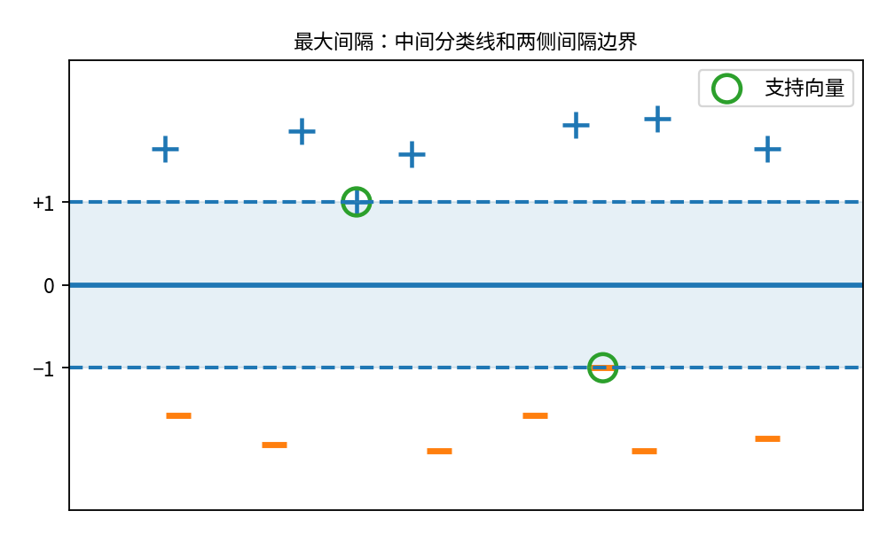

*最大间隔示意：中间实线是分类超平面，两条虚线是间隔边界。靠近边界且落在间隔线上的样本是支持向量。*

你可以把分类边界想象成在两组样本之间建立一道墙。

如果墙紧贴某一类样本，那么只要这个样本受到一点扰动，它就可能越过墙，被错误分类。

如果墙与两类样本都保持较大距离，那么小幅扰动通常不容易改变分类结果。

这就是最大间隔的直观动机：

**在保证训练样本正确分类的前提下，让分类边界与最近训练样本之间的最小距离尽可能大。**

注意，这并不是保证所有未来样本都分类正确，而是希望得到对局部扰动相对稳健的分类边界。

## 3. 什么是支持向量（Support Vector）？

假设某条分类线距离两类样本都很远。

真正限制我们进一步移动或旋转这条分类线的，通常是两类中那些最靠近它的样本。

这些关键样本称为支持向量。

可以这样理解：

一条分隔两类样本的直线，可能受到数百个训练样本的影响，但最终决定最大间隔位置的，往往只是边界附近的少数点。

如果把距离边界很远的某个训练点删除，最优分类面可能几乎不会改变。

但如果移动一个支持向量，最优分类面可能明显发生变化。

课件第9页用圆圈标出了靠近间隔边界的支持向量，第18页进一步通过数学条件解释为什么只有它们对最终模型产生直接贡献。

下面我们就把这种几何直觉变成数学优化问题。

---

# 三、硬间隔支持向量机（Hard-Margin SVM）

*对应课件第14–18页；本章最核心的数学部分。*

硬间隔SVM假设训练数据完全线性可分。

目标是：

$$
\text{所有样本分类正确}
\quad+\quad
\text{分类间隔最大}
$$

## 1. 第一步：计算样本到超平面的距离

设分类超平面为：

$$
w^Tx+b=0
$$

对于任意样本 $x_i$，它到该超平面的几何距离为：

$$
\boxed{
d_i=\frac{|w^Tx_i+b|}{\|w\|}
}
$$

为什么要除以 $\|w\|$？

因为 $w$ 是超平面的法向量（Normal Vector）。

$w^Tx+b$ 反映的是沿着法向量方向的未归一化位置；只有除以法向量的长度，才能得到实际几何距离。

可以进一步用向量投影推导。

假设 $x_0$ 是超平面上的任意点：

$$
w^Tx_0+b=0
$$

令单位法向量：

$$
n=\frac{w}{\|w\|}
$$

则点 $x_i$ 到超平面的距离是 $x_i-x_0$ 在 $n$ 上投影的绝对值：

$$
\begin{aligned}
d_i
&=|n^T(x_i-x_0)|\\
&=\frac{|w^Tx_i-w^Tx_0|}{\|w\|}\\
&=\frac{|w^Tx_i+b|}{\|w\|}
\end{aligned}
$$

这就得到了课件第14页的距离公式。

## 2. 第二步：用标签统一表示两类样本

前面定义：

$$
y_i\in\{-1,+1\}
$$

如果样本被正确分类，那么：

$$
y_i(w^Tx_i+b)>0
$$

你可以分别代入验证：

当 $y_i=+1$，正确分类意味着：

$$
w^Tx_i+b>0
$$

所以乘积为正。

当 $y_i=-1$，正确分类意味着：

$$
w^Tx_i+b<0
$$

两个负数相乘，结果仍然为正。

因此：

$$
\boxed{y_i(w^Tx_i+b)>0}
$$

可以用一个公式表示两类样本都被正确分类。

进一步，正确分类样本到超平面的几何距离为：

$$
\gamma_i=
\frac{y_i(w^Tx_i+b)}{\|w\|}
$$

它称为样本的几何间隔（Geometric Margin）。

我们真正关心的是所有样本中最小的间隔：

$$
\gamma=
\min_i\frac{y_i(w^Tx_i+b)}{\|w\|}
$$

因为离分类边界最近的样本，决定了模型能够承受的最小扰动程度。

于是SVM希望：

$$
\max_{w,b}\gamma
$$

## 3. 第三步：为什么可以规定 $y_i(w^Tx_i+b)\geq1$？

这是理解SVM公式的关键一步。

我们先观察：

$$
w^Tx+b=0
$$

如果把 $w,b$ 同时乘以某个正数 $c$：

$$
cw^Tx+cb=0
$$

得到的分类超平面没有发生任何变化。

例如：

$$
2x_1+x_2-3=0
$$

和：

$$
4x_1+2x_2-6=0
$$

表示的是同一条直线。

因此，参数 $w,b$ 的数值存在尺度上的冗余。

我们可以选择一个方便的归一化方式，使训练样本中最小的：

$$
y_i(w^Tx_i+b)
$$

恰好等于1。

于是，所有样本满足：

$$
\boxed{
y_i(w^Tx_i+b)\geq1
}
$$

这不是额外要求样本必须距离原点多少，而是利用参数可缩放的性质，把最小函数间隔（Functional Margin）规范化成1。

在这种规范化下，最靠近决策面的样本满足：

$$
y_i(w^Tx_i+b)=1
$$

也就是落在：

$$
w^Tx+b=+1
$$

或者：

$$
w^Tx+b=-1
$$

这两条间隔边界上。

## 4. 第四步：为什么分类间隔是 $2/\|w\|$？

现在我们有三条平行超平面：

$$
w^Tx+b=+1
$$

$$
w^Tx+b=0
$$

$$
w^Tx+b=-1
$$

根据点到超平面的距离公式，正类间隔边界到中间分类面的距离为：

$$
\frac1{\|w\|}
$$

负类间隔边界到中间分类面的距离同样为：

$$
\frac1{\|w\|}
$$

因此，两个间隔边界之间的总宽度为：

$$
\boxed{
\gamma_{\text{total}}=\frac2{\|w\|}
}
$$

课件第16页采用的就是这个总间隔宽度。

有些教材把从决策面到最近样本的距离 $1/\|w\|$ 称为几何间隔，有些则把两侧总宽度 $2/\|w\|$ 称为间隔。两种写法只是约定不同，优化结果一致。

## 5. 第五步：从最大间隔得到优化问题

我们希望最大化：

$$
\frac2{\|w\|}
$$

约束条件为：

$$
y_i(w^Tx_i+b)\geq1
$$

所以：

$$
\max_{w,b}\frac2{\|w\|}
$$

$$
\text{s.t.}\quad
y_i(w^Tx_i+b)\geq1,\quad i=1,\ldots,m
$$

由于：

$$
\frac2{\|w\|}
$$

随着 $\|w\|$ 增大而减小，因此最大化间隔等价于最小化 $\|w\|$。

为了求导和优化更加方便，我们使用平方形式：

$$
\boxed{
\begin{aligned}
\min_{w,b}\quad&
\frac12\|w\|^2\\
\text{s.t.}\quad&
y_i(w^Tx_i+b)\geq1,\quad i=1,\ldots,m
\end{aligned}
}
$$

这就是硬间隔SVM的原始优化问题（Primal Problem）。

为什么前面有一个 $\frac12$？

因为它不改变最优解，但求导时：

$$
\nabla_w\frac12\|w\|^2=w
$$

形式更简洁。

这里你应该看到一个重要联系：

前面线性回归的 Ridge 正则化也包含：

$$
\frac12\|w\|^2
$$

但它们的建模目标不同。

Ridge主要最小化预测平方误差，同时惩罚大参数；硬间隔SVM在全部样本满足间隔约束的前提下，最小化参数范数，也就是最大化间隔。

### 一个简单例子

假设只有一个特征，四个训练样本：

| $x_i$ | $y_i$ |
|---:|---:|
| -2 | -1 |
| -1 | -1 |
| 1 | +1 |
| 2 | +1 |

显然可以用：

$$
f(x)=x
$$

将它们全部正确分类。

此时：

$$
w=1,\qquad b=0
$$

并且全部满足：

$$
y_i(wx_i+b)\geq1
$$

最近的两个样本是：

$$
(-1,-1),\quad(1,+1)
$$

它们刚好满足：

$$
y_i(wx_i+b)=1
$$

因此是支持向量。

两侧间隔总宽度为：

$$
\gamma=\frac2{|w|}=2
$$

如果尝试让 $|w|$ 小于1，同时仍要求全部样本满足间隔约束，就会发现这两个最近样本施加的约束无法同时成立。

因此，这两个样本恰好决定了最大间隔解。

---

# 四、为什么要引入拉格朗日对偶问题？

*对应课件第17–18页*

这一部分比较抽象，但在SVM中非常重要。

因为它不仅是一种求解方法，还解释了：

**为什么最终模型只依赖支持向量，以及核函数为什么可以直接替换内积。**

## 1. 原始问题有什么困难？

我们已经得到：

$$
\begin{aligned}
\min_{w,b}\quad&
\frac12\|w\|^2\\
\text{s.t.}\quad&
1-y_i(w^Tx_i+b)\leq0
\end{aligned}
$$

这里存在 $m$ 个不等式约束。

我们希望将带约束优化问题转化成另一种更方便分析和求解的形式。

因此使用拉格朗日乘子法（Lagrange Multipliers）。

对于每个约束，引入一个乘子：

$$
\alpha_i\geq0
$$

构造拉格朗日函数：

$$
\boxed{
L(w,b,\alpha)=
\frac12\|w\|^2+
\sum_{i=1}^{m}
\alpha_i[1-y_i(w^Tx_i+b)]
}
$$

这里的 $\alpha_i$ 是与第 $i$ 个训练样本对应的乘子。

直观上，它反映这个样本对应的约束在最优解中有多重要。

## 2. 对 $w,b$ 求偏导

我们先求：

$$
\frac{\partial L}{\partial w}
$$

将有关 $w$ 的部分展开：

$$
L=
\frac12w^Tw+
\sum_i\alpha_i-
\sum_i\alpha_i y_iw^Tx_i-
b\sum_i\alpha_i y_i
$$

对 $w$ 求导：

$$
\frac{\partial L}{\partial w}
=w-\sum_i\alpha_i y_ix_i
$$

令其为0：

$$
\boxed{
w=\sum_{i=1}^{m}\alpha_i y_ix_i
}
$$

这条公式特别重要。

它说明最优参数向量 $w$ 可以表示成训练样本特征向量的加权线性组合。

再对 $b$ 求导：

$$
\frac{\partial L}{\partial b}
=-\sum_{i=1}^{m}\alpha_i y_i
$$

令其为0：

$$
\boxed{
\sum_{i=1}^{m}\alpha_i y_i=0
}
$$

因此，我们得到两个关键条件：

$$
w=\sum_i\alpha_i y_ix_i
$$

$$
\sum_i\alpha_i y_i=0
$$

## 3. 代回得到对偶问题

接下来，将这两个条件代入拉格朗日函数。

原式为：

$$
L=
\frac12w^Tw+
\sum_i\alpha_i-
w^T\sum_i\alpha_i y_ix_i-
b\sum_i\alpha_i y_i
$$

利用：

$$
\sum_i\alpha_i y_ix_i=w
$$

以及：

$$
\sum_i\alpha_i y_i=0
$$

得到：

$$
L=
\frac12\|w\|^2+
\sum_i\alpha_i-
\|w\|^2
$$

所以：

$$
L=\sum_i\alpha_i-\frac12\|w\|^2
$$

又因为：

$$
w=\sum_i\alpha_i y_ix_i
$$

因此：

$$
\begin{aligned}
\|w\|^2
&=\left(\sum_i\alpha_i y_ix_i\right)^T
\left(\sum_j\alpha_j y_jx_j\right)\\
&=\sum_i\sum_j
\alpha_i\alpha_jy_iy_jx_i^Tx_j
\end{aligned}
$$

最终得到：

$$
\boxed{
\begin{aligned}
\max_\alpha\quad&
\sum_{i=1}^{m}\alpha_i
-\frac12
\sum_{i=1}^{m}\sum_{j=1}^{m}
\alpha_i\alpha_jy_iy_jx_i^Tx_j\\
\text{s.t.}\quad&
\sum_{i=1}^{m}\alpha_i y_i=0\\
&\alpha_i\geq0
\end{aligned}
}
$$

这就是硬间隔SVM的拉格朗日对偶问题（Dual Problem），对应课件第17页。

为什么可以用对偶问题求原问题的最优解？

硬间隔SVM的目标函数是凸的，约束也是凸优化中的仿射不等式约束。在线性严格可分时，可以满足Slater条件，因此具有强对偶性（Strong Duality），即原问题与对偶问题的最优目标值相同，并且可以从对偶最优解恢复原问题的解。

因此，我们求出最优 $\alpha_i$ 后，就能计算：

$$
w=\sum_i\alpha_i y_ix_i
$$

以及相应的 $b$。

## 4. 对偶问题为什么有价值？

观察对偶问题的目标函数：

$$
\sum_i\alpha_i-
\frac12\sum_i\sum_j
\alpha_i\alpha_jy_iy_j
\underbrace{x_i^Tx_j}_{\text{样本内积}}
$$

你会发现：

**原始特征向量只以两个样本之间的内积 $x_i^Tx_j$ 的形式出现。**

这就是后面核技巧最关键的数学基础。

如果我们想把特征向量转换到更复杂的特征空间，只需要能够计算变换后的内积，而不一定要真正构造全部高维特征。

稍后讲核SVM时，会用到这个结论。

## 5. 为什么只有支持向量决定最终模型？

现在解释SVM的另一个重要性质：解的稀疏性（Sparsity）。

这是课件第18页的内容。

根据KKT条件（Karush-Kuhn-Tucker Conditions），在最优解处满足：

$$
\alpha_i\geq0
$$

$$
y_i(w^Tx_i+b)\geq1
$$

以及互补松弛条件：

$$
\boxed{
\alpha_i[y_i(w^Tx_i+b)-1]=0
}
$$

这个乘积为零意味着：

$$
\alpha_i=0
$$

或者：

$$
y_i(w^Tx_i+b)=1
$$

具体来说：

如果一个样本距离分类边界比较远，满足：

$$
y_i(w^Tx_i+b)>1
$$

那么必然有：

$$
\alpha_i=0
$$

如果：

$$
\alpha_i>0
$$

那么必然有：

$$
y_i(w^Tx_i+b)=1
$$

它就是落在间隔边界上的支持向量。严格说，在退化情况下，边界上的某些样本也可能有 $\alpha_i=0$，但具有非零乘子的样本一定是支持向量。

最终模型：

$$
f(x)=w^Tx+b
$$

代入：

$$
w=\sum_i\alpha_i y_ix_i
$$

得到：

$$
\boxed{
f(x)=
\sum_{i=1}^{m}
\alpha_i y_i x_i^Tx+b
}
$$

由于大量样本的 $\alpha_i=0$，真正对这个求和有贡献的只有乘子非零的训练样本。

这就解释了为什么最终模型通常主要由少量支持向量决定。

对于满足 $\alpha_s>0$ 的硬间隔支持向量，还可以利用：

$$
y_s(w^Tx_s+b)=1
$$

得到：

$$
\boxed{
b=y_s-w^Tx_s
}
$$

所以知道支持向量及其对偶乘子后，就可以恢复整个分类模型。

**这里要掌握的主线是：**

$$
\boxed{
\begin{gathered}
\text{原始最大间隔问题}\\
\downarrow\\
\text{拉格朗日对偶}\\
\downarrow\\
w=\sum_i\alpha_i y_ix_i\\
\downarrow\\
\text{KKT条件使大量 }\alpha_i=0\\
\downarrow\\
\text{最终模型主要由支持向量决定}
\end{gathered}
}
$$

---

# 五、软间隔支持向量机（Soft-Margin SVM）

*对应课件第20–26页*

前面我们假设训练样本完全线性可分：

$$
y_i(w^Tx_i+b)\geq1
$$

但是现实中的数据经常无法完全线性分开。

例如大部分正常客户与违约客户可以根据收入、负债等特征区分，但总有一些特殊客户，其特征与另一类客户非常接近。

如果强行要求每个训练样本都正确分类，可能导致两种问题：

一是原始硬间隔优化问题根本没有可行解；二是即使数据勉强可分，也可能为了照顾个别异常样本，得到泛化能力较差的决策边界。

因此，需要适当放松约束。

## 1. 核心思路：允许部分样本违反间隔要求

硬间隔要求：

$$
y_i(w^Tx_i+b)\geq1
$$

软间隔则允许：

$$
y_i(w^Tx_i+b)<1
$$

但并不是完全不加限制。

我们希望：

**大多数样本尽量满足间隔要求，同时对违反要求的样本进行惩罚。**

这实际上变成两个目标之间的权衡：

$$
\boxed{
\text{尽可能扩大间隔}
\quad+\quad
\text{尽可能减少间隔违背}
}
$$

这与第三章学到的正则化思想非常相似。

## 2. 如何衡量一个样本违反间隔要求的程度？

定义：

$$
z_i=y_i(w^Tx_i+b)
$$

它叫作函数间隔，也可以理解为带符号的分类得分。

为什么这样定义？

因为它把真实类别信息和预测结果结合起来了。

当：

$$
z_i>0
$$

说明样本位于正确的分类一侧。

当：

$$
z_i<0
$$

说明样本被错误分类。

但SVM不仅要求分类正确，还希望：

$$
z_i\geq1
$$

因此，我们可以把样本分成下面几种情况。

| $z_i$ 的范围 | 代表什么？ | 是否违反间隔要求？ |
|---|---|---|
| $z_i\geq1$ | 正确分类，位于间隔之外或边界上 | 否 |
| $0<z_i<1$ | 正确分类，但距离决策边界较近 | 是 |
| $z_i=0$ | 位于分类决策边界 | 是 |
| $z_i<0$ | 被错误分类 | 是 |

注意第二种情况非常重要：

**一个样本虽然分类正确，也可能因为离决策边界太近而受到惩罚。**

这正是SVM与单纯最小化分类错误率的重要区别。

## 3. Hinge Loss为什么是这样的形式？

为了对间隔不足的样本进行惩罚，SVM采用合页损失（Hinge Loss）：

$$
\boxed{
\ell_{\text{hinge}}(z)=\max(0,1-z)
}
$$

为什么使用这个公式？

我们希望满足两个条件。

第一，如果：

$$
z\geq1
$$

样本已经正确分类，而且达到要求的间隔，就没有必要继续惩罚。

所以：

$$
\ell_{\text{hinge}}(z)=0
$$

第二，如果：

$$
z<1
$$

样本没有达到要求的间隔，那么它距离要求还差：

$$
1-z
$$

因此损失就是：

$$
\ell_{\text{hinge}}(z)=1-z
$$

把两种情况合起来：

$$
\ell_{\text{hinge}}(z)=
\begin{cases}
0,&z\geq1\\
1-z,&z<1
\end{cases}
$$

也就是：

$$
\ell_{\text{hinge}}(z)=\max(0,1-z)
$$

它是一个凸函数。虽然在 $z=1$ 处不可导，但可以使用次梯度（Subgradient）等方法优化。

### 交互观察：Hinge Loss怎样惩罚样本？

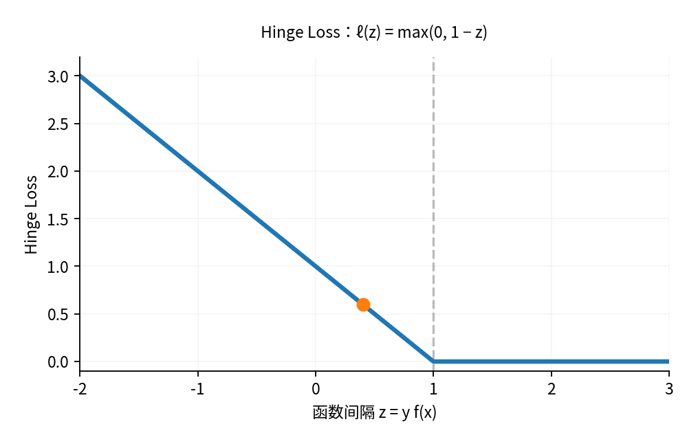

| 函数间隔 $z=yf(x)$ | Hinge Loss | 分类状态 |
|---:|---:|---|
| -1 | 2 | 分类错误 |
| 0 | 1 | 位于分类边界 |
| 0.4 | 0.6 | 正确但间隔不足 |
| 1 | 0 | 满足间隔要求 |
| 2 | 0 | 满足间隔要求 |

例如：

当 $z=2$ 时：

$$
\ell_{\text{hinge}}(2)=0
$$

当 $z=0.4$ 时：

$$
\ell_{\text{hinge}}(0.4)=0.6
$$

样本虽然分类正确，但离分类边界较近，仍然产生损失。

当 $z=-1$ 时：

$$
\ell_{\text{hinge}}(-1)=2
$$

此时样本已经错误分类，因此损失更大。

## 4. 为什么不直接使用0-1损失？

分类任务最直接的损失其实是：

$$
\ell_{0/1}(z)=
\begin{cases}
1,&z<0\\
0,&z\geq0
\end{cases}
$$

它只关心有没有分错。

但0-1损失是一个不连续的阶跃型函数，不方便直接进行凸优化。

因此，我们使用一个更容易优化的替代损失（Surrogate Loss）。

课件第24–25页比较了三种常见损失函数：

| 损失 | 公式 | 主要特点 |
|---|---|---|
| Hinge Loss | $\max(0,1-z)$ | 满足间隔后损失为0 |
| Exponential Loss | $e^{-z}$ | 对严重错误分类的惩罚增长很快 |
| Logistic Loss | $\ln(1+e^{-z})$ | 光滑、可导，可从概率似然推导 |

你应该注意到最后一个：

$$
\ln(1+e^{-z})
$$

正是逻辑回归在使用 $y\in\{-1,+1\}$ 标签时对应的单样本交叉熵损失。

因此，逻辑回归和SVM之间存在非常直接的联系：

**它们可以使用类似的线性得分函数，主要区别在于训练损失与优化目标。**

Hinge Loss在函数间隔达到1后停止惩罚；Logistic Loss则仍然会随着真实类别得分提高而逐渐下降，只是下降幅度越来越小。

## 5. 引入松弛变量（Slack Variable）

课件第26页还给出了软间隔SVM的另一种等价形式。

对于每个样本引入：

$$
\xi_i\geq0
$$

将约束改为：

$$
\boxed{
y_i(w^Tx_i+b)\geq1-\xi_i
}
$$

这里 $\xi_i$ 表示样本允许违反间隔条件的程度。

- $\xi_i=0$：满足硬间隔要求。
- $0<\xi_i<1$：正确分类但间隔不足。
- $\xi_i=1$：达到分类边界。
- $\xi_i>1$：样本位于错误分类的一侧。

于是得到优化问题：

$$
\boxed{
\begin{aligned}
\min_{w,b,\xi}\quad&
\frac12\|w\|^2+C\sum_{i=1}^{m}\xi_i\\
\text{s.t.}\quad&
y_i(w^Tx_i+b)\geq1-\xi_i\\
&\xi_i\geq0
\end{aligned}
}
$$

其中：

$$
C>0
$$

称为惩罚参数。

### 为什么它与Hinge Loss形式等价？

观察约束：

$$
y_i(w^Tx_i+b)\geq1-\xi_i
$$

移项得：

$$
\xi_i\geq1-y_i(w^Tx_i+b)
$$

同时：

$$
\xi_i\geq0
$$

因此 $\xi_i$ 至少需要满足：

$$
\xi_i\geq
\max(0,1-y_i(w^Tx_i+b))
$$

因为目标函数会惩罚正的 $\xi_i$，在最优解中必然选择满足约束的最小 $\xi_i$：

$$
\xi_i=
\max(0,1-y_i(w^Tx_i+b))
$$

代回目标函数：

$$
\boxed{
\min_{w,b}
\frac12\|w\|^2+
C\sum_{i=1}^{m}
\max(0,1-y_i(w^Tx_i+b))
}
$$

这正是Hinge Loss形式的软间隔SVM。

也就是说：

**松弛变量形式和Hinge Loss形式，不是两种不同算法，而是同一个优化问题的两种表达。**

## 6. 惩罚参数C有什么作用？

这是实际训练SVM时最重要的超参数之一。

观察：

$$
L(w,b)=
\underbrace{\frac12\|w\|^2}_{\text{希望间隔大}}
+
\underbrace{C\sum_i\xi_i}_{\text{希望违反间隔的程度小}}
$$

当 $C$ 较大时，模型会更重视减小训练样本的间隔违背。

这可能使训练误差降低，但也可能更容易受到异常样本的影响。

当 $C$ 较小时，模型可以容忍更多违反间隔要求的样本，从而更重视参数范数与较大间隔。

因此：

| C的取值 | 优化倾向 | 潜在风险 |
|---|---|---|
| 较大 | 更强调拟合训练数据、减少间隔违背 | 可能更容易过拟合 |
| 较小 | 更强调平滑、宽间隔与容忍违背 | 可能欠拟合 |

注意，这只是通常的趋势，不是对每个数据集都成立的严格结论。

还可以发现，C与Ridge回归中的正则化系数 $\lambda$ 方向不同。

在常见的目标函数约定下：

- Ridge的 $\lambda$ 越大，正则化越强。
- SVM的 $C$ 越小，正则化相对越强。

## 7. 软间隔SVM还保留支持向量的性质吗？

保留，但支持向量不再只限于恰好落在两条间隔边界上的样本。

对软间隔问题进行拉格朗日对偶推导，仍然可以得到：

$$
w=\sum_i\alpha_i y_ix_i
$$

但约束变为：

$$
\boxed{0\leq\alpha_i\leq C}
$$

其中上界 $C$ 来自松弛变量的约束。

于是通常可以理解为：

- $\alpha_i=0$：该样本通常在间隔之外，不直接贡献于最终模型。
- $0<\alpha_i<C$：通常恰好位于间隔边界。
- $\alpha_i=C$：可能位于间隔内部或被错误分类，也可能处于边界的特殊情况。

因此软间隔SVM依然具有由支持向量构建最终决策函数的性质，只是支持向量可能包括违反间隔约束的样本。

---

# 六、核支持向量机（Kernel SVM）

*对应课件第28–34页*

前面解决的是：当数据无法被一个完全正确的线性分类面分开时，怎样允许部分分类错误。

但还有另一类问题：

**有些数据的真实分类规律本身就是非线性的。**

这时，即使允许软间隔，原始空间中的线性模型也可能很难得到理想的分类效果。

## 1. 为什么需要非线性分类边界？

考虑二维空间中的数据：

- 圆形区域内部是正类。
- 圆形区域外部是负类。

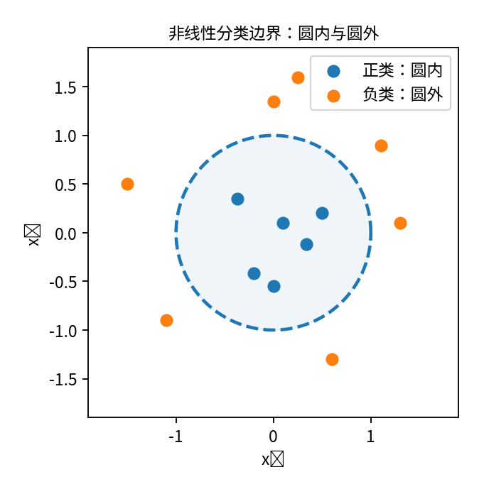

*圆形边界示意：正类位于圆内，负类位于圆外。单一直线无法将这类分布正确分开。*

在原来的二维空间中，不可能找到一条直线，把圆形内部与外部完全分开。

但我们可以构造新特征：

$$
z=x_1^2+x_2^2
$$

如果真实决策边界是：

$$
x_1^2+x_2^2=r^2
$$

那么原来的非线性分类问题就可以转变成：

$$
z=r^2
$$

在新特征 $z$ 上，这只是一个简单的线性阈值分类问题。

这说明一个重要思想：

**原始空间中非线性的分类边界，在适当的特征空间中可能变成线性的。**

## 2. 特征映射（Feature Mapping）

假设原始特征为：

$$
x\in\mathbb R^d
$$

我们构造映射：

$$
\phi(x)
$$

将它转换到新的特征空间。

例如：

$$
\phi(x)=
\begin{pmatrix}
x_1^2\\
x_2^2\\
x_1x_2
\end{pmatrix}
$$

那么在新空间中建立线性分类器：

$$
\boxed{
f(x)=w^T\phi(x)+b
}
$$

虽然它对 $\phi(x)$ 是线性的，但对原始输入 $x$ 可以是非线性的。

于是，核SVM的基本思路就出现了：

$$
\boxed{
x
\xrightarrow{\ \phi\ }
\phi(x)
\xrightarrow{\text{线性SVM}}
\text{类别}
}
$$

不过，这里存在一个问题。

如果我们构造了非常高维的特征空间，那么直接计算：

$$
\phi(x)
$$

可能代价非常高。

有没有可能不显式构造高维特征，仍然在高维空间中训练SVM？

这正是核技巧（Kernel Trick）解决的问题。

## 3. 核技巧为什么能够成立？

回顾硬间隔SVM的对偶问题：

$$
\max_\alpha
\sum_i\alpha_i-
\frac12\sum_i\sum_j
\alpha_i\alpha_jy_iy_jx_i^Tx_j
$$

你会发现，训练过程中只涉及样本之间的内积：

$$
x_i^Tx_j
$$

如果我们先把样本映射到高维空间，原来的内积就变为：

$$
\phi(x_i)^T\phi(x_j)
$$

于是，我们只需要定义一个函数：

$$
\boxed{
\kappa(x_i,x_j)=
\phi(x_i)^T\phi(x_j)
}
$$

它称为核函数（Kernel Function）。

核函数的核心意义是：

**直接计算两个样本在特征空间中的内积，而不必显式构造完整的高维特征向量。**

这样，SVM的对偶问题就可以改写成：

$$
\boxed{
\begin{aligned}
\max_\alpha\quad&
\sum_i\alpha_i-
\frac12\sum_i\sum_j
\alpha_i\alpha_jy_iy_j\kappa(x_i,x_j)\\
\text{s.t.}\quad&
\sum_i\alpha_i y_i=0,\quad \alpha_i\geq0
\end{aligned}
}
$$

这是课件第30–31页介绍的核心方法。

需要注意，上面仍是硬间隔形式。对于软间隔核SVM，还需要加上：

$$
\alpha_i\leq C
$$

## 4. 为什么核函数可以避免显式计算高维特征？

用课件第31页的二次多项式核来说明。

假设：

$$
x=(x_1,x_2)^T
$$

$$
z=(z_1,z_2)^T
$$

定义核函数：

$$
\boxed{
\kappa(x,z)=(x^Tz)^2
}
$$

直接展开：

$$
\begin{aligned}
\kappa(x,z)
&=(x_1z_1+x_2z_2)^2\\
&=x_1^2z_1^2+2x_1x_2z_1z_2+x_2^2z_2^2
\end{aligned}
$$

现在我们定义特征映射：

$$
\phi(x)=
\begin{pmatrix}
x_1^2\\
\sqrt2x_1x_2\\
x_2^2
\end{pmatrix}
$$

同理：

$$
\phi(z)=
\begin{pmatrix}
z_1^2\\
\sqrt2z_1z_2\\
z_2^2
\end{pmatrix}
$$

计算高维内积：

$$
\begin{aligned}
\phi(x)^T\phi(z)
={}&x_1^2z_1^2\\
&+2x_1x_2z_1z_2\\
&+x_2^2z_2^2
\end{aligned}
$$

因此：

$$
\boxed{
\phi(x)^T\phi(z)=(x^Tz)^2
}
$$

这说明：

如果我们想计算三维特征空间中的内积，可以直接计算原始二维空间中的：

$$
(x^Tz)^2
$$

不必真的构造 $\phi(x)$。

虽然这个例子只从二维映射到三维，但更高阶的多项式核可以对应非常高维的特征空间，有些核甚至对应无限维特征空间。

**核技巧不是简单地把数据升维，而是利用核函数隐式完成特征空间中的内积计算。**

## 5. 使用核函数后的最终分类器

前面已经推导：

$$
w=\sum_i\alpha_i y_i\phi(x_i)
$$

因此：

$$
\begin{aligned}
f(x)
&=w^T\phi(x)+b\\
&=\sum_i\alpha_i y_i\phi(x_i)^T\phi(x)+b
\end{aligned}
$$

使用：

$$
\kappa(x_i,x)=\phi(x_i)^T\phi(x)
$$

得到：

$$
\boxed{
f(x)=
\sum_{i=1}^{m}\alpha_i y_i\kappa(x_i,x)+b
}
$$

最终分类：

$$
\boxed{
\hat y=\operatorname{sign}
\left(
\sum_i\alpha_i y_i\kappa(x_i,x)+b
\right)
}
$$

其中只有非零 $\alpha_i$ 对预测结果有贡献。

这就是核SVM最终的形式。

它与原来线性SVM的区别只是：

$$
x_i^Tx
\quad\longrightarrow\quad
\kappa(x_i,x)
$$

但这个看似简单的替换，使模型能够表达复杂的非线性决策边界。

## 6. 什么样的函数才能作为核函数？

课件第32页介绍了核矩阵（Gram Matrix）。

对于训练样本：

$$
x_1,\ldots,x_m
$$

构造：

$$
K=
\begin{pmatrix}
\kappa(x_1,x_1)&\cdots&\kappa(x_1,x_m)\\
\vdots&\ddots&\vdots\\
\kappa(x_m,x_1)&\cdots&\kappa(x_m,x_m)
\end{pmatrix}
$$

如果：

$$
\kappa(x_i,x_j)=\phi(x_i)^T\phi(x_j)
$$

那么对任意向量 $c\in\mathbb R^m$：

$$
\begin{aligned}
c^TKc
&=\sum_i\sum_jc_ic_j\phi(x_i)^T\phi(x_j)\\
&=\left\|\sum_ic_i\phi(x_i)\right\|^2\\
&\geq0
\end{aligned}
$$

因此，核矩阵必须是半正定的（Positive Semidefinite, PSD）。

对于定义在整个输入域上的实对称核函数，要求任意有限样本集合对应的核矩阵均半正定，是它能够表示某个特征空间内积的关键条件。

课件还提到了再生核希尔伯特空间（Reproducing Kernel Hilbert Space, RKHS）。

你目前不需要深入这个理论。只需要知道：它为核函数所对应的函数空间提供严格数学基础。

## 7. 常见核函数怎样选择？

课件第33页列举了几种常见核函数。

| 核函数 | 形式 | 主要理解 |
|---|---|---|
| 线性核（Linear） | $x^Tz$ | 不引入额外的非线性映射 |
| 多项式核（Polynomial） | $(\gamma x^Tz+c)^d$ | 引入多项式特征及特征交互 |
| 高斯核/RBF核 | $e^{-\gamma\|x-z\|^2}$ | 根据样本距离建立非线性相似性 |
| Sigmoid核 | $\tanh(\gamma x^Tz+c)$ | 具有神经网络激活函数形式 |

需要注意，Sigmoid形式并不是任意参数下都满足半正定核条件，因此不是所有参数设置都能保证它是有效的核函数。

### 高斯核（Gaussian Kernel / RBF Kernel）

最常使用的非线性核之一是：

$$
\boxed{
\kappa(x,z)=
\exp\left(-\frac{\|x-z\|^2}{2\sigma^2}\right)
}
$$

也经常写成：

$$
\kappa(x,z)=e^{-\gamma\|x-z\|^2}
$$

其中：

$$
\gamma=\frac1{2\sigma^2}
$$

它的直观含义是：

如果两个样本距离很近：

$$
\|x-z\|^2\approx0
$$

那么：

$$
\kappa(x,z)\approx1
$$

如果两个样本距离很远：

$$
\kappa(x,z)\approx0
$$

所以高斯核实际上是在衡量两个样本的局部相似程度。

参数 $\gamma$ 控制这种相似性随距离衰减的速度。

- $\gamma$ 较大：相似性随距离衰减得快，模型可能形成更加局部、复杂的决策边界。
- $\gamma$ 较小：相似性变化较慢，决策函数通常更加平滑。

因此，$\gamma$ 和 $C$ 都可能影响模型的复杂度与泛化能力。

课件第34页提出的经验是：文本等高维稀疏数据经常使用线性核，而需要非线性建模时可以尝试高斯核。

不过，实际应用仍应通过交叉验证选择，而不是认为高斯核一定优于线性核。

此外，核映射本身并不保证任意训练数据都能够完全线性可分。例如相同特征对应矛盾标签时，任何确定性特征映射都无法同时完美分类。核SVM仍然需要考虑软间隔与正则化。

---

# 七、支持向量回归（Support Vector Regression, SVR）

*对应课件第36–37页*

前面讨论的SVM主要用于分类。

但支持向量方法也可以用于回归问题，这就是SVR。

## 1. SVR与普通线性回归有什么区别？

回顾线性回归：

$$
f(x)=w^Tx+b
$$

使用平方误差：

$$
L_{\text{MSE}}=
\sum_i(f(x_i)-y_i)^2
$$

这意味着，只要预测值与真实值存在偏差，就会产生损失。

但SVR采取了不同的思路：

**允许预测值和真实值之间存在一定误差，只要误差处于容忍范围内，就不计算损失。**

假设这个容忍范围是：

$$
\varepsilon>0
$$

如果：

$$
|f(x_i)-y_i|\leq\varepsilon
$$

就认为这个样本的预测足够准确。

这形成了回归函数周围的一条间隔带（$\varepsilon$-Tube）。

课件第36页的图展示了两条边界：

$$
f(x)+\varepsilon
$$

$$
f(x)-\varepsilon
$$

它们之间的竖直宽度为：

$$
2\varepsilon
$$

落在间隔带中的样本不产生损失。

## 2. ε不敏感损失（ε-Insensitive Loss）

设预测误差为：

$$
e=f(x)-y
$$

定义：

$$
\boxed{
\ell_\varepsilon(e)=
\begin{cases}
0,&|e|\leq\varepsilon\\
|e|-\varepsilon,&|e|>\varepsilon
\end{cases}
}
$$

也可以写成：

$$
\boxed{
\ell_\varepsilon(e)=\max(0,|e|-\varepsilon)
}
$$

例如：

$$
\varepsilon=0.5
$$

那么：

| 预测误差 $|e|$ | SVR损失 |
|---:|---:|
| 0.2 | 0 |
| 0.4 | 0 |
| 0.9 | 0.4 |
| 1.5 | 1.0 |

为什么要这样设计？

因为在一些回归任务中，极小的误差没有实际意义。

例如预测价格，允许误差在一定范围内，而把注意力集中到误差明显超出容忍范围的样本上，是一种合理建模思路。

当然，这里的 $\varepsilon$ 是模型设定的容忍参数，不代表任何任务中小于该误差就一定没有经济或业务代价。

## 3. SVR的优化目标

SVR依然希望控制参数范数：

$$
\frac12\|w\|^2
$$

同时最小化超出间隔带的预测误差：

$$
\boxed{
\min_{w,b}
\frac12\|w\|^2+
C\sum_{i=1}^{m}
\ell_\varepsilon(f(x_i)-y_i)
}
$$

这与软间隔SVM非常相似。

区别是：

分类SVM主要关注：

$$
y_i f(x_i)
$$

是否达到分类间隔要求。

SVR则主要关注：

$$
|f(x_i)-y_i|
$$

是否超过允许的回归误差。

## 4. 为什么SVR需要两个松弛变量？

课件第37页给出了以下形式：

$$
\boxed{
\begin{aligned}
\min_{w,b,\xi,\hat\xi}\quad&
\frac12\|w\|^2+
C\sum_{i=1}^{m}(\xi_i+\hat\xi_i)\\
\text{s.t.}\quad&
f(x_i)-y_i\leq\varepsilon+\xi_i\\
&y_i-f(x_i)\leq\varepsilon+\hat\xi_i\\
&\xi_i,\hat\xi_i\geq0
\end{aligned}
}
$$

为什么不是只需要一个松弛变量？

因为回归误差有两个方向：

- 预测值比真实值高太多。
- 预测值比真实值低太多。

第一条约束控制：

$$
f(x_i)-y_i
$$

即高估的程度。

第二条约束控制：

$$
y_i-f(x_i)
$$

即低估的程度。

因此，用两个非负松弛变量分别表示两个方向超过容忍范围的误差。

事实上，如果把这两个方向的损失合并起来，就重新得到：

$$
\max(0,|f(x_i)-y_i|-\varepsilon)
$$

所以这仍然是相同优化思想的不同表达。

## 5. SVR与SVM的联系

| | 分类SVM | SVR |
|---|---|---|
| 预测目标 | 离散类别 | 连续数值 |
| 核心思想 | 分类间隔尽可能大 | 允许一定预测误差的间隔带 |
| 主要损失 | Hinge Loss | ε-Insensitive Loss |
| 超参数 | $C$、核函数参数 | $C$、$\varepsilon$、核函数参数 |
| 是否可以使用核技巧 | 可以 | 可以 |

SVR也可以通过核技巧建立非线性回归函数。

因此，虽然分类SVM和SVR解决不同的预测任务，但在模型结构、正则化思想和核方法上有紧密联系。

---

# 八、把SVM与前面几章串起来

现在我们已经学习过线性回归、逻辑回归、决策树和SVM。

理解它们之间的区别，比孤立记忆每种算法的公式更有价值。

## 1. 逻辑回归和SVM究竟有什么不同？

这是最值得比较的一组模型。

假设二者都采用线性决策函数：

$$
f(x)=w^Tx+b
$$

它们的差别不是是否使用线性函数，而是**如何学习参数**。

| | 逻辑回归（Logistic Regression） | SVM |
|---|---|---|
| 基本任务 | 分类 | 分类 |
| 输出 | 类别概率模型 | 分类得分与类别 |
| 学习原则 | 极大似然估计 | 最大间隔 |
| 典型损失 | Logistic Loss | Hinge Loss |
| 分类边界 | $w^Tx+b=0$ | $w^Tx+b=0$ |
| 非线性扩展 | 非线性特征等 | 核技巧等 |
| 模型特点 | 具有概率建模解释 | 强调间隔与支持向量 |

两者都可以使用正则化，都能够求解凸优化问题，也都能通过适当的特征变换建立非线性分类器。

SVM的原始决策得分不是天然经过概率校准的输出。如果任务需要违约概率等概率预测，通常还要考虑额外的概率校准方法。

因此，不能简单认为SVM一定优于逻辑回归，或者逻辑回归一定更容易泛化。

真正应该由数据、任务目标以及交叉验证结果决定。

## 2. SVM与决策树又有什么区别？

上一章的决策树通过逐步划分特征空间来进行预测。

SVM则通过优化一个全局的分类边界来区分类别。

决策树能够用一系列条件判断表达非线性规律；核SVM则通过隐式特征映射，在特征空间中寻找最大间隔分类面。

它们的建模思路不同，但都需要控制模型复杂度：

- 决策树通过树深度、节点样本数和剪枝控制复杂度。
- SVM通过 $C$ 和核函数参数等控制复杂度。

你会发现，第三章关于过拟合与泛化的思想贯穿了后面所有模型。

## 3. 实际使用SVM时，最需要关注的参数

| 参数 | 作用 | 直观影响 |
|---|---|---|
| $C$ | 违反间隔的惩罚强度 | 大C通常更强调训练样本的拟合 |
| `kernel` | 核函数选择 | 决定使用线性还是非线性特征关系 |
| $\gamma$ | RBF核的尺度参数 | 较大时模型可能更局部、更复杂 |
| $d$ | 多项式核的次数 | 控制多项式特征的复杂度 |
| $\varepsilon$ | SVR允许的预测误差 | 控制不敏感间隔带的宽度 |

还有一个实际操作中十分重要的细节：

**SVM通常需要对数值特征进行标准化（Standardization）。**

因为SVM使用特征内积或距离。

假设有两个特征：

$$
x_1=\text{年龄，范围18—80}
$$

$$
x_2=\text{年收入，范围10000—1000000}
$$

如果直接计算欧氏距离，收入这个数值尺度更大的特征就可能主导距离结果。

因此，使用RBF核等方法之前，通常要进行特征标准化。

并且像第三章介绍的一样，标准化参数只能从训练集拟合，不能利用测试集的信息。

---

# 九、本章最终复习总结

学习SVM时，不需要把它理解为五种互不相关的模型。

实际上，它是一套不断扩展的思想：

$$
\boxed{
\begin{gathered}
\text{希望分类正确，而且边界尽可能稳健}\\
\downarrow\\
\text{最大间隔原理}\\
\downarrow\\
\min\frac12\|w\|^2
\quad\text{s.t. }y_i(w^Tx_i+b)\geq1\\
\downarrow\\
\text{允许一定程度的间隔违背}\\
\downarrow\\
\frac12\|w\|^2+
C\sum_i\max(0,1-y_if(x_i))\\
\downarrow\\
\text{引入核技巧学习非线性关系}\\
\downarrow\\
f(x)=\sum_i\alpha_i y_i\kappa(x_i,x)+b
\end{gathered}
}
$$

SVR则沿用了其中的正则化与核方法思想，将分类间隔改为回归中的 $\varepsilon$-不敏感间隔带。

## 学习重点与要求

| 知识点 | 重要程度 | 要达到的理解程度 |
|---|---|---|
| 最大间隔思想 | 核心 | 理解为什么不能只追求分类正确 |
| 点到超平面的距离 | 核心 | 能推导并解释 $\frac{|w^Tx+b|}{\|w\|}$ |
| 硬间隔原始问题 | 核心 | 能从间隔最大化推导目标函数与约束 |
| 拉格朗日对偶 | 核心 | 能理解推导步骤和内积形式的来源 |
| KKT与支持向量 | 核心 | 能解释为什么大量 $\alpha_i=0$ |
| Hinge Loss | 核心 | 能理解其公式、图像及与分类错误率的区别 |
| 软间隔与松弛变量 | 核心 | 能解释两种等价的优化形式 |
| 核技巧 | 核心 | 理解为什么可以用核函数替换高维内积 |
| 多项式核与RBF核 | 重点 | 理解基本原理及主要参数的作用 |
| 核矩阵与RKHS | 理解 | 知道半正定条件，RKHS暂不需要深入 |
| SVR与ε不敏感损失 | 重点 | 理解间隔带、损失与两个松弛变量 |

## 检查是否真正理解

这四个问题最能检验本章的核心内容：

1. **为什么SVM不是只要求样本分类正确，还要最大化间隔？** 因为间隔较大的边界通常能够对训练样本的局部扰动保持更大容忍度，而分类正确本身无法区分不同分离超平面的稳定性。

2. **为什么硬间隔SVM最终变成最小化 $\frac12\|w\|^2$？** 因为通过参数缩放将最近样本的函数间隔规范化为1后，两侧的总几何间隔是 $2/\|w\|$，最大化它就等价于最小化参数范数。

3. **为什么软间隔SVM可以允许分类错误？** 因为它将原来的硬约束放宽为 $y_if(x_i)\geq1-\xi_i$，并通过Hinge Loss或松弛变量对违反间隔要求的程度进行惩罚。

4. **为什么核函数能够让SVM学习非线性关系，而不必显式升维？** 因为SVM的对偶问题只依赖样本之间的内积。核函数可以直接计算隐式特征空间里的内积，从而避免显式构造高维特征。

**本章真正需要掌握的三条联系是：最大间隔如何转化为优化问题；对偶与KKT如何揭示支持向量的作用；核函数为什么能够自然接入对偶问题。** 理解这三条主线，再学习软间隔、不同核函数和SVR，就不会觉得它们是一堆缺乏联系的公式。
