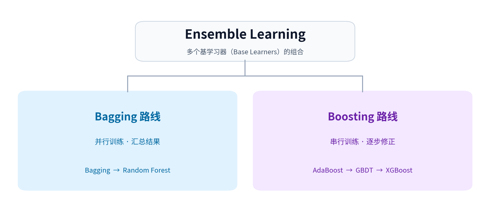
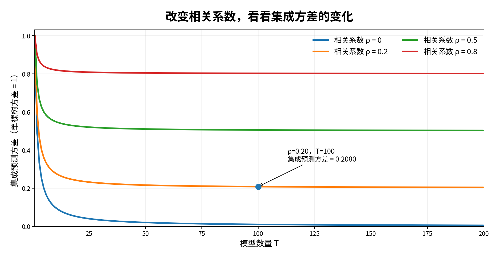
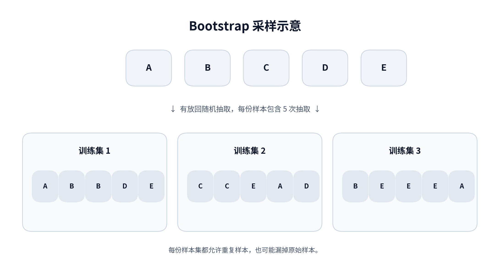
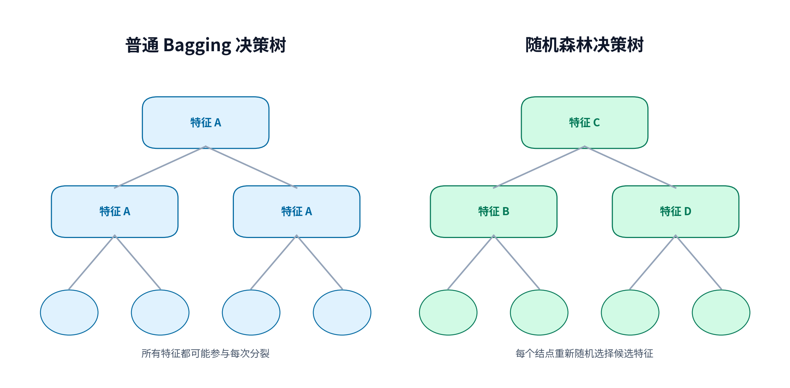
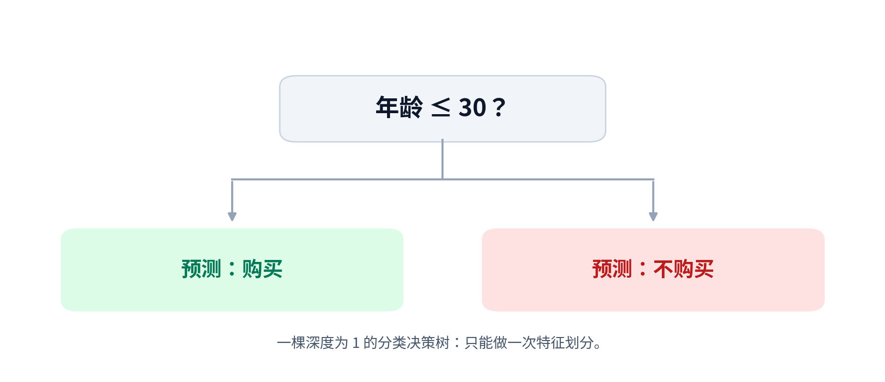
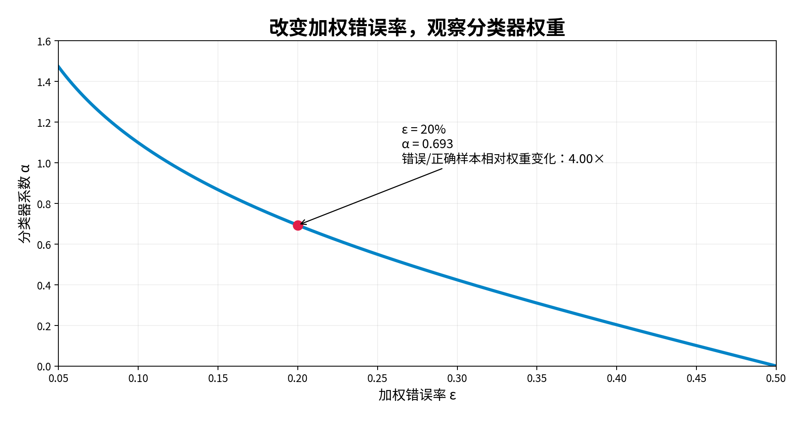
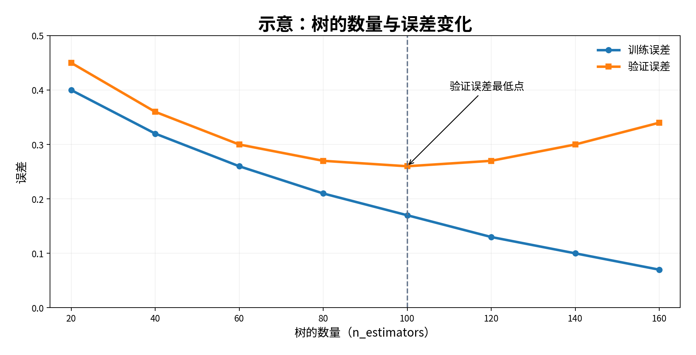
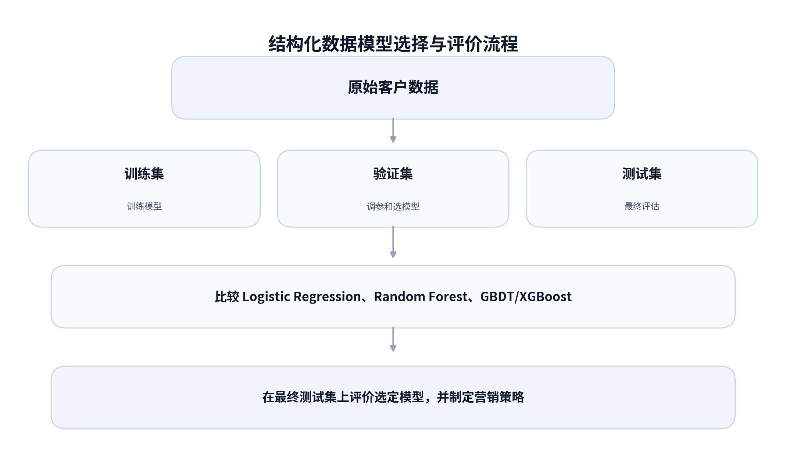

# 第六章：集成学习（Ensemble Learning）

**学习目标：理解模型为什么有效、不同模型之间有什么联系，以及实际项目中应该如何选择。**

这次不按照 PPT 一页一页复述，而是以 PPT 的知识结构为主线，把分散的内容组织成一套完整的知识体系。重点解释模型的设计动机、工作原理和应用方式；数学公式保留到能够帮助你理解算法的程度，不追求复杂证明。

## 一、先建立全章的知识框架

集成学习研究的核心问题是：

**既然一个机器学习模型的预测能力有限，能不能把多个模型组合起来，得到一个更好的模型？**

答案是可以，但关键不是简单地增加模型数量，而是研究三个问题：

1. 如何产生多个有用、但又不完全相同的模型？
2. 如何把这些模型的预测结果组合起来？
3. 组合之后，为什么预测能力可能提高？

这三个问题，引出了本章的几种方法。



**Ensemble Learning**

多个基学习器（Base Learners）的组合

| Bagging 路线 | Boosting 路线 |
|---|---|
| 并行训练 · 汇总结果 | 串行训练 · 逐步修正 |
| **Bagging**：通过有放回采样，训练多个模型，然后投票或平均。 | **AdaBoost**：前一轮分错的样本，下一轮给予更多关注。 |
| **Random Forest**：在 Bagging 决策树的基础上，再加入随机特征选择。 | **GBDT**：下一棵树学习当前模型还没有预测好的部分。 |
| | **XGBoost**：在梯度提升树基础上改进优化目标、训练算法和工程效率。 |

全章最核心的区别，就是两种不同的集成思想：

| | Bagging | Boosting |
|---|---|---|
| 基本思想 | 多个模型独立学习，综合判断 | 多个模型依次学习，逐步改进 |
| 训练方式 | 可以并行 | 通常需要串行 |
| 主要改善方向 | 降低方差（Variance） | 降低偏差（Bias） |
| 典型基学习器 | 较深的决策树 | 较浅的决策树 |
| 代表方法 | 随机森林 | AdaBoost、GBDT、XGBoost |

注意：这里说的降低方差和偏差是**典型作用机制，而不是严格的排他性结论**。Boosting 也会改变方差，Bagging 也可能影响偏差。

你的 PPT 第 2 页列出了 Bagging、Random Forest 和 AdaBoost，后半部分继续介绍了 GBDT 与 XGBoost。我们就沿着这条主线学习。

---

## 二、集成学习为什么有效？

*对应 PPT 第 3–10 页｜引言*

### 2.1 首先理解：集成学习不是简单地把模型堆起来

假设我们要预测一个人是否会购买某种商品。

现在有三个分类器：

- 模型 A：逻辑回归（Logistic Regression）
- 模型 B：决策树（Decision Tree）
- 模型 C：支持向量机（SVM）

它们分别预测：

| 模型 | 预测 |
|---|---|
| A | 会购买 |
| B | 不会购买 |
| C | 会购买 |

采用多数投票（Majority Voting），最终预测就是“会购买”。

但你应该进一步思考：

**为什么三个模型投票，可能比单个模型更准确？**

因为每个模型有不同的学习方式，可能犯不同的错误。

例如，逻辑回归更擅长描述线性关系，而决策树可以捕捉特征之间的非线性交互。

当一个模型判断错误时，其他模型可能判断正确。

不过，假如三个模型总是在同一批样本上犯错，那么投票就没有太大意义。

这就是 PPT 第 6 页强调的一句话：

**集成个体：好而不同。**

- **好（Accuracy）**：每个模型应该具有一定的预测能力。
- **不同（Diversity）**：模型之间的预测错误不能高度一致。

### 2.2 一个简单的概率例子

假设三个分类器的准确率都为 60%，而且对于同一个测试样本，它们是否预测正确相互独立。

采用多数投票，三个模型只要至少两个正确，集成就正确。

因此：

$$
\begin{aligned}
P(\text{集成正确})
&=P(\text{恰好两个正确})\\
&\quad+P(\text{三个都正确})\\
&=\binom32(0.6)^2(0.4)+(0.6)^3\\
&=0.648.
\end{aligned}
$$

我们得到：

- 单个分类器：60%
- 三个分类器投票：64.8%

如果继续增加相互独立、准确率高于 50% 的分类器，在满足相应条件时，多数投票的错误概率会逐渐下降。

PPT 第 7–8 页使用 Hoeffding 不等式进一步说明了这一现象。

但是，这里面有一个非常强的假设：

**分类器的错误相互独立。**

真实的机器学习模型通常使用同一份数据、处理同一个任务，因此它们的错误不可能完全独立。

这就引出了集成学习的关键技术问题：如何主动制造模型之间的差异？

### 2.3 为什么模型之间的相关性如此重要？——CS229 补充

这里补充一段非常值得掌握的 CS229 内容，它能够解释 Bagging 和随机森林的本质。

假设我们有 $T$ 个回归模型，对固定输入 $x$ 的预测分别为：

$$
\hat f_1(x),\hat f_2(x),\ldots,\hat f_T(x).
$$

将它们取平均：

$$
\bar f(x)=\frac1T\sum_{t=1}^T\hat f_t(x).
$$

假设每个模型的预测方差都为 $\sigma^2$，任意两个不同模型预测值之间的相关系数都为 $\rho$。

由于

$$
\operatorname{Var}\left(\sum_t X_t\right)
=\sum_t\operatorname{Var}(X_t)
+2\sum_{i<j}\operatorname{Cov}(X_i,X_j),
$$

并且

$$
\operatorname{Cov}(\hat f_i,\hat f_j)=\rho\sigma^2,
$$

我们可以得到：

$$
\boxed{
\operatorname{Var}(\bar f(x))
=
\sigma^2\left(\rho+\frac{1-\rho}{T}\right)
}
$$

这个公式非常重要。

它告诉我们，降低集成预测方差有两个方向：

**第一，增加模型数量 $T$。**

模型数量越多，第二项越小。

**第二，降低模型之间的相关性 $\rho$。**

这直接决定了大量模型集成之后的方差下限。

例如，令每个基模型的方差 $\sigma^2=1$，模型数量 $T=100$。

**改变相关系数，看看集成方差的变化**



- 模型相关系数 ρ：0.20
- 模型数量 T：100
- 集成后的预测方差：0.2080

单个模型方差 = 1。这里假设各基模型具有相同方差和两两相关系数。

你可以尝试把 $T$ 调到 200，再把 $\rho$ 从 0.2 调到 0.8。

你会发现：当模型高度相关时，哪怕增加很多模型，方差也很难继续降低。

这正是随机森林要解决的问题。

### 2.4 把集成学习和偏差—方差联系起来

你之前学习过：

$$
\text{期望测试误差}
=
\text{Bias}^2+\text{Variance}
+\text{不可约误差}
$$

这是平方损失回归情形下的经典分解。

其中：

- **偏差（Bias）**：模型系统性地偏离真实关系。模型太简单时容易出现。
- **方差（Variance）**：训练数据稍有变化，模型就出现很大的变化。模型太复杂时容易出现。

以决策树为例：

一棵很深的决策树，可能把训练数据拟合得很好，但训练集只改变几个样本，树的划分结构就发生明显变化。

这种模型往往具有低偏差、高方差的特征。

因此，一个自然的想法是：

**保留深树较强的拟合能力，同时通过多个树的平均来降低预测波动。**

这就是 Bagging 的出发点。

---

## 三、Bagging：让多个模型独立训练，再取平均

*对应 PPT 第 12–21 页*

### 3.1 Bagging 想解决什么问题？

Bagging 是 Bootstrap Aggregating 的缩写。

先想象一个问题：

你有一份 1000 人的训练数据，用它训练出一棵决策树。

但是你担心这棵树过度依赖这 1000 人中的某些特殊样本。

怎么办？

一个直接的想法是：如果有另外 100 份来自同一总体的训练数据，我们就可以分别训练 100 棵决策树，再把它们的预测平均。

这样，各棵树对偶然噪声的依赖就可能相互抵消。

可惜，我们通常只有一份训练数据。

于是 Bagging 采用了一个统计学方法：**自助采样（Bootstrap Sampling）**。

### 3.2 Bootstrap：什么叫有放回采样？

假设训练集只有 5 个样本：

$$
D=\{A,B,C,D,E\}
$$

我们从里面随机抽取 5 次，每次抽取后都把样本放回去。

例如：

**Bootstrap 采样示意**



注意：

1. 每份新训练集的抽样次数可以与原训练集相同。
2. 同一个样本可能被抽中多次。
3. 某些样本可能一次都没有被抽中。

正是这些差异，使得不同决策树能够学到不同的划分规则。

### 3.3 Bagging 的完整训练过程

设原始训练集为：

$$
D=\{(x_i,y_i)\}_{i=1}^n.
$$

训练 $T$ 个基模型。

**第一步：生成不同的训练集。**

通过 Bootstrap 得到：

$$
D_1,D_2,\ldots,D_T.
$$

**第二步：分别训练基学习器。**

$$
h_t=\mathcal A(D_t),\qquad t=1,\ldots,T.
$$

其中 $\mathcal A$ 可以是决策树等机器学习算法。

这些模型不依赖前一轮训练结果，因此可以并行训练。

**第三步：集成预测。**

对于回归问题，通常使用平均：

$$
\boxed{
\hat f(x)=\frac1T\sum_{t=1}^T h_t(x)
}
$$

对于分类问题，可以使用多数投票：

$$
\boxed{
H(x)=\arg\max_{c}
\sum_{t=1}^T I(h_t(x)=c)
}
$$

实际实现也可以平均各分类器输出的类别概率。

这就是 Bagging 的核心机制。

### 3.4 为什么 Bagging 特别适合决策树？

回顾决策树的训练过程。

一棵树会不断选择一个特征及分裂阈值，使当前结点的数据尽可能纯净。

例如，第一层可能选择：

$$
\text{收入}\le 8000?
$$

稍微改变训练样本后，最佳分裂点可能变为：

$$
\text{年龄}\le 30?
$$

一旦根结点发生变化，整个子树都可能改变。

这意味着，决策树通常是一个对训练数据比较敏感的模型。

我们把这种模型称为**不稳定学习器（Unstable Learner）**。

Bagging 可以让不同决策树的偶然性相互抵消。

但如果采用一个本身就很稳定的学习器，例如某些设置下的 KNN，不同 Bootstrap 数据集训练出来的模型可能非常接近，集成带来的收益就较小。

因此你应该记住：

**Bagging 最主要的价值不是提高单个模型的拟合能力，而是通过平均，降低不稳定模型的预测方差。**

### 3.5 一个很重要的概念：包外估计 OOB

PPT 第 19 页专门介绍了 Out-of-Bag Estimate（包外估计）。

它是 Bagging 和随机森林中的一个非常实用的技术。

首先来看一个有趣的问题：

如果训练集有 $n$ 个样本，Bootstrap 有放回抽取 $n$ 次，平均有多少比例的原始样本没有被抽到？

对于某个指定样本 $x_i$，一次抽样没有抽到它的概率为：

$$
1-\frac1n.
$$

抽取 $n$ 次都没有抽到的概率为：

$$
P(x_i\text{ 未被抽到})
=\left(1-\frac1n\right)^n.
$$

当 $n$ 较大：

$$
\left(1-\frac1n\right)^n
\approx e^{-1}
\approx 0.368.
$$

也就是说，在这种经典 Bootstrap 设置下：

| 63.2% | 36.8% |
|---|---|
| **至少出现一次的样本** | **未被抽中的样本** |
| 用于训练该模型 | 可用于包外评价 |

对一棵树而言，没有被它抽中的原始训练样本，就是该树的 OOB 样本。

对某个训练样本 $x_i$，我们可以只使用**那些训练时没见过它的树**进行预测。

再把这些预测与真实标签比较，就能估计模型的泛化误差。

这样，我们在没有额外划分独立验证集的情况下，也可以获得一种内部性能估计。

你可以把它理解为：

> 对每个样本，都找出一组没有用它训练的模型，让这些模型来评价它。

不过，OOB 并不等于真正独立的最终测试集。尤其是时间序列、用户之间存在依赖，或者有明显分布漂移时，仍然需要合适的数据划分策略。

### 3.6 Bagging 的优势与局限

| 优势 | 局限 |
|---|---|
| 可以并行训练 | 多个模型带来内存和计算成本 |
| 通常能够显著降低方差 | 对稳定学习器提升可能很小 |
| 能利用 OOB 估计 | 不能解决所有高偏差问题 |
| 对高方差决策树尤其有效 | 集成后丧失单棵树的直观可解释性 |

到这里，我们已经能够理解 Bagging。

但还有一个问题：

**即使训练数据不同，如果所有决策树都喜欢使用同一个关键特征，它们会不会仍然非常相似？**

会。

随机森林就是为了解决这个问题，在 Bagging 的基础上再加入一层随机性。

---

## 四、随机森林（Random Forest）：Bagging 为什么还不够？

*对应 PPT 第 23–25 页*

### 4.1 随机森林不是一个完全独立的新算法

先记住它和 Bagging 的关系：

$$
\boxed{
\text{Random Forest}
\approx
\text{Bagging}
+\text{Decision Trees}
+\text{Random Feature Selection}
}
$$

随机森林本质上仍然在训练很多棵决策树，然后组合预测。

它与普通 Bagging 决策树的主要区别，是在每个结点划分时，**不让决策树看到全部特征，而是随机选一部分特征，再从中寻找最佳划分。**

为什么还要加入这层随机性？

### 4.2 为什么仅仅使用不同的训练样本还不够？

假设我们要预测银行客户是否会购买理财产品。

有 20 个特征，包括：

- 收入
- 年龄
- 职业
- 存款金额
- 历史购买记录
- 联系次数
- 联系方式等

假设“历史购买记录”是一个非常强的预测变量。

即使我们使用不同的 Bootstrap 训练集，每棵决策树仍然很可能在根结点选择这个特征。

于是出现一个问题：

虽然训练数据不同，但很多决策树的结构还是很相似。

模型预测之间的相关性仍然很高。

回忆前面 CS229 的公式：

$$
\operatorname{Var}(\bar f)
=
\sigma^2\left(\rho+\frac{1-\rho}{T}\right)
$$

如果 $\rho$ 很大，增加树的数量也无法充分降低方差。

随机森林因此提出：

**既然所有树都偏爱同一个强特征，那就让每次划分只能随机看到部分特征，迫使不同的树学习不同的规律。**

### 4.3 随机森林到底增加了哪种随机性？

随机森林中有两种随机性。

**第一种：样本随机性（Sample Randomness）**

使用 Bootstrap，从原始数据中生成不同的训练集。

这是从 Bagging 继承来的。

**第二种：特征随机性（Feature Randomness）**

假设一共有 $p=20$ 个特征。

在某个树结点进行划分时，不直接比较全部 20 个特征，而是随机选取 $k=5$ 个特征。

然后只在这 5 个特征中寻找最好的分裂方式。

注意两个细节：

1. 特征子集不是整棵树只选一次，而是**每个结点通常都会重新随机选择**。
2. 随机的是候选特征集合，候选集合确定后，仍然根据划分准则选择较优的分裂。

例如：



**普通 Bagging 决策树**

每个结点都可以考虑全部特征，强特征更容易反复被选择

**随机森林决策树**

每个结点的候选特征不同，使不同树更容易产生多样性

简化示意图，A、B、C、D 代表不同特征；实际树不会要求某个特征不能重复使用。

### 4.4 随机森林的核心权衡

随机森林的设计其实包含一个很有价值的机器学习思想：

**允许单个模型略微变弱，换取模型之间更低的相关性，从而提高整体性能。**

因为每个结点只看部分特征，最佳划分特征有时恰好没有被抽中。

于是单棵树可能不如使用全部特征的决策树准确。

但不同树的差异更大了。

只要降低相关性带来的好处超过单棵树预测能力下降带来的损失，最终的随机森林就会更好。

这也解释了随机森林的重要超参数 `max_features`：

| `max_features` 设置 | 可能带来的效果 |
|---|---|
| 较大 | 单棵树更强，但树之间可能更相似 |
| 较小 | 树之间相关性更低，但单棵树可能更弱 |
| 全部特征 | 更接近普通的 Bagging 决策树 |

对于分类任务，随机考虑约 $\sqrt p$ 个特征是一种经典的经验设置，但不是必须采用的最优值。

### 4.5 随机森林适合什么任务？

随机森林对于**结构化表格数据（Tabular Data）**是一个很有价值的基准模型。

例如：

- 银行客户购买预测
- 信用违约风险预测
- 商品销量预测
- 客户流失预测
- 某种疾病的辅助风险预测

它的主要优势是：

1. 能够建模非线性关系和特征之间的交互。
2. 不依赖特征标准化来决定树的分裂。
3. 对单棵决策树的过拟合有明显缓解作用。
4. 通常不需要像神经网络那样复杂的训练过程。
5. 可以计算特征重要性（Feature Importance）。

不过，有几个常见误区需要避免。

**误区一：随机森林的树越多，效果就一定越好。**

增加树的数量通常能减少预测的随机波动，但性能会逐渐趋于稳定，而且训练与预测成本增加。泛化误差并不保证严格单调下降。

**误区二：随机森林不用做任何数据预处理。**

树模型一般不需要标准化，但是特征编码、缺失值、数据泄漏等问题仍然需要处理。缺失值的原生支持取决于具体实现及其设置。

**误区三：随机森林能够告诉我们哪些特征导致了结果。**

它可以提供特征重要性，但重要性不等于因果效应。

例如，一个特征被频繁用于划分，不代表改变这个特征就一定会改变客户行为。

而且，基于节点不纯度下降的特征重要性可能偏向取值较多的特征。实践中可以结合置换重要性（Permutation Importance）分析。

### 4.6 随机森林与决策树的关系总结

| 对比 | 单棵决策树 | 随机森林 |
|---|---|---|
| 模型结构 | 一棵树 | 多棵树 |
| 非线性拟合能力 | 有 | 有 |
| 预测稳定性 | 相对较差 | 通常更好 |
| 过拟合风险 | 深树容易过拟合 | 平均机制能缓解 |
| 可解释性 | 可以直接查看决策规则 | 需要借助特征重要性等工具 |
| 训练成本 | 较低 | 较高，但可并行 |

PPT 第 25 页比较了 Bagging 和随机森林的测试误差曲线。你应该从中理解的是：**增加特征随机性，有机会让集成模型收敛到更低的测试误差，而不是随机森林在每个任务上都必然优于 Bagging。**

到这里，并行集成的主要思想已经学完。

接下来我们转换思路。

既然多棵树独立地训练再平均是一种办法，那么能不能让后一棵树专门去解决前一棵树尚未解决的问题？

这就是 Boosting。

---
## 五、Boosting：从独立学习转向逐步纠错

*对应 PPT 第 27–29 页*

### 5.1 Boosting 和 Bagging 的思路有什么本质不同？

假设我们安排三位学生做同一套数学试卷。

**Bagging 的方式：**

三个人分别独立解题，最后综合三个人的答案。

**Boosting 的方式：**

第一个人先尝试解题；第二个人重点处理第一人没解决好的地方；第三个人再针对前两个人的不足做补充。

最后把三个人的贡献组合起来。

两者的区别是：

- Bagging 的各个基学习器相对独立。
- Boosting 的后续基学习器依赖前面已经训练出来的模型。

因此，Boosting 通常是一种**串行加法模型（Sequential Additive Model）**。

数学上可以统一写成：

$$
\boxed{
F_T(x)=F_0(x)+\sum_{t=1}^T\alpha_t h_t(x)
}
$$

其中：

- $F_0(x)$：初始预测模型，可以是零函数或常数模型。
- $h_t(x)$：第 $t$ 轮新增的基学习器。
- $\alpha_t$：第 $t$ 轮基学习器的贡献系数。

每一轮的核心工作是找到一个新的 $h_t$，使整体模型有所改善。

### 5.2 什么叫弱学习器（Weak Learner）？

Boosting 往往从较简单的基学习器开始。

一个典型例子是决策树桩（Decision Stump）。



一棵深度为 1 的分类决策树：只能做一次特征划分。

这样的分类器显然很简单，不可能独自解决所有复杂分类问题。

但是，如果每次训练一个新的树桩，并让后面的树桩补充前面的不足，那么多个树桩组合起来，就可能形成复杂的决策边界。

所以 Boosting 的思路是：

**不必要求每个基模型都很强，而是通过一系列有针对性的模型更新，逐渐建立一个强模型。**

这里的“弱”在经典二分类 Boosting 理论中，通常与加权错误率优于随机猜测的条件有关，并不意味着随便一个很差的模型都能提升整体效果。

### 5.3 Boosting 这个家族最需要区分的两条路线

| 方法 | 后一个模型重点学习什么？ |
|---|---|
| AdaBoost | 前面被赋予较高权重、尤其是被错误分类的样本 |
| Gradient Boosting | 当前整体模型对应损失函数的负梯度 |

它们都属于 Boosting，但改进模型的具体机制不同。

接下来先学习 AdaBoost，因为它最直观，也能帮助你建立串行集成的概念。

---

## 六、AdaBoost：把更多注意力放在分错的样本上

*对应 PPT 第 30–43 页*

AdaBoost 全称是 Adaptive Boosting，即自适应提升。

### 6.1 AdaBoost 的核心思想

考虑一个二分类问题。

第一轮训练一个简单分类器，得到：

- 80% 的训练样本预测正确。
- 20% 的训练样本预测错误。

下一轮训练新分类器时，我们不希望它继续忽略这 20% 的样本。

因此 AdaBoost 会：

- 增加错误分类样本的权重。
- 减小正确分类样本的权重。

这样，下一轮分类器就会更加重视此前的错误。

然后继续重复这个过程。

最后，每一轮分类器按照自身的可靠程度参与加权投票。

### 6.2 AdaBoost 的三个核心机制

整个算法只需要理解三个关键问题：

1. 当前分类器的错误率是多少？
2. 当前分类器在最终投票中应该占多大权重？
3. 下一轮如何调整训练样本的权重？

我们逐一解释。

#### 第一：计算加权错误率

设共有 $n$ 个样本，样本 $i$ 在第 $t$ 轮的权重为 $w_i^{(t)}$。

设真实标签为 $y_i\in\{-1,+1\}$，分类器预测为 $h_t(x_i)$。

标准做法是先将权重归一化：

$$
\sum_{i=1}^n w_i^{(t)}=1.
$$

于是第 $t$ 轮的加权错误率为：

$$
\boxed{
\epsilon_t
=
\sum_{i=1}^n
w_i^{(t)}I\big(h_t(x_i)\ne y_i\big)
}
$$

与普通错误率不同，这里每个样本的贡献并不一定相同。

假设两个分类器都预测错了 10 个样本：

- 分类器 A 错的是权重很低的样本。
- 分类器 B 错的是权重很高的样本。

那么 A 的加权错误率可能明显低于 B。

这说明 AdaBoost 不只是关注错误数量，还关注**当前被赋予更高权重的样本是否得到了正确预测**。

#### 第二：确定分类器的重要性

AdaBoost 使用：

$$
\boxed{
\alpha_t
=
\frac12\ln\left(
\frac{1-\epsilon_t}{\epsilon_t}
\right)
}
$$

来确定当前分类器的贡献系数。

你不必死记这个公式，但应该理解它为什么合理。

**改变加权错误率，观察分类器权重**



| 指标 | 数值 |
|---|---:|
| 加权错误率 ε | 20% |
| 对应分类器系数 α | 0.693 |
| 错误样本相对权重倍率 | 4.00× |

这里的倍率，是下一轮错误样本与正确样本的相对权重变化倍数，而不是最终归一化权重本身。

可以观察到：

- $\epsilon_t$ 越小，$\alpha_t$ 越大。
- $\epsilon_t=0.5$，则 $\alpha_t=0$。
- 当加权错误率高于 0.5 时，经典二分类 AdaBoost 的弱学习条件不满足，需要采取相应处理。

因此，这个公式的本质是：

**预测能力越强的分类器，在最终集成中拥有越大的话语权。**

#### 第三：更新样本权重

得到分类器系数后，更新样本权重：

$$
\boxed{
w_i^{(t+1)}
=
\frac{
w_i^{(t)}
\exp\left(-\alpha_t y_i h_t(x_i)\right)
}{Z_t}
}
$$

其中 $Z_t$ 是归一化常数，保证所有权重加起来等于 1。

因为 $y_i,h_t(x_i)\in\{-1,+1\}$，所以只有两种情况。

**情况一：分类正确**

$$
y_i h_t(x_i)=1
$$

于是：

$$
w_i^{(t+1)}\propto w_i^{(t)}e^{-\alpha_t}.
$$

权重减小。

**情况二：分类错误**

$$
y_i h_t(x_i)=-1
$$

于是：

$$
w_i^{(t+1)}\propto w_i^{(t)}e^{\alpha_t}.
$$

权重增大。

这就是 AdaBoost 最核心的自适应机制。

### 6.3 用一个具体例子理解整个算法

假设有 10 个训练样本。

初始权重完全相同：

$$
w_i^{(1)}=0.1.
$$

第一轮分类器分错了 2 个样本。

因此：

$$
\epsilon_1=0.2.
$$

分类器的重要性：

$$
\alpha_1
=\frac12\ln\frac{0.8}{0.2}
=\frac12\ln4
\approx0.693.
$$

下一轮：

- 正确样本原始权重乘以 $e^{-0.693}=0.5$。
- 错误样本原始权重乘以 $e^{0.693}=2$。

归一化后得到：

| 样本 | 数量 | 每个样本的新权重 | 组内总权重 |
|---|---:|---:|---:|
| 上一轮正确 | 8 | 0.0625 | 0.5 |
| 上一轮错误 | 2 | 0.25 | 0.5 |

注意这个结果：

最开始 2 个错误样本的总权重只有 0.2，现在却占了 0.5。

下一轮分类器如果继续忽视它们，就会承担很高的加权错误率。

因此，新分类器不得不更加关注这些样本。

PPT 第 39–42 页用三轮树桩的图形展示了这一过程，第一轮、第二轮、第三轮的加权错误率分别约为 0.30、0.21、0.14，最终把三个简单的分类边界组合起来。

### 6.4 最后怎么组合多个分类器？

训练 $T$ 轮之后，最终分类器为：

$$
\boxed{
H(x)
=
\operatorname{sign}
\left(
\sum_{t=1}^T\alpha_t h_t(x)
\right)
}
$$

也就是说，它使用的是**加权投票（Weighted Voting）**。

这与随机森林的平均或投票不同。

随机森林中，基学习器通常以相同的系数参与平均。

AdaBoost 中，不同学习器拥有根据表现计算得到的不同系数。

### 6.5 为什么 AdaBoost 会使用这样的公式？

这一部分对应 PPT 第 31–37 页的数学推导。

如果你的目标是会理解、会使用，我建议掌握其中一条核心逻辑即可，不必记忆全部证明。

AdaBoost 可以从指数损失（Exponential Loss）理解：

$$
L(y,F(x))=e^{-yF(x)}.
$$

这里：

$$
y\in\{-1,+1\},
$$

而 $F(x)$ 是尚未经过 sign 处理的连续预测分数。

注意 $yF(x)$ 的意义：

- $yF(x)>0$：预测方向正确。
- $yF(x)<0$：预测方向错误。
- $|F(x)|$ 越大：分类分数距离决策边界越远。

我们把 $yF(x)$ 称为分类间隔（Margin）的一种表达。

对于指数损失：

$$
e^{-yF(x)}
$$

分类正确而且间隔较大的样本，损失很小。

分类错误而且间隔很大的样本，损失很大。

因此，指数损失天然会高度关注错误分类或低间隔的样本。

在第 $t$ 轮，固定选好的基分类器，优化其系数 $\alpha$，相应的加权损失可以写为：

$$
L(\alpha)
=
(1-\epsilon_t)e^{-\alpha}
+\epsilon_t e^\alpha.
$$

这里第一项来自正确样本，第二项来自错误样本。

为了求最优系数，对 $\alpha$ 求导：

$$
\frac{dL}{d\alpha}
=
-(1-\epsilon_t)e^{-\alpha}
+\epsilon_t e^\alpha.
$$

令导数等于零：

$$
\epsilon_t e^\alpha
=(1-\epsilon_t)e^{-\alpha}.
$$

因此：

$$
e^{2\alpha}=\frac{1-\epsilon_t}{\epsilon_t}.
$$

最终：

$$
\boxed{
\alpha_t=\frac12\ln\frac{1-\epsilon_t}{\epsilon_t}
}
$$

现在你就知道这个公式并不是人为规定的。

它来自：**在已有模型基础上，选择一个新的基学习器及其权重，以降低指数损失。**

这也是 CS229 使用前向分步加法建模（Forward Stagewise Additive Modeling）解释 AdaBoost 的核心视角。

### 6.6 AdaBoost 的实际局限

AdaBoost 的思想很有价值，但它存在一个明显的问题：

**它可能无法区分真正困难的样本和错误标注的样本。**

例如，某个客户实际上没有购买，却在数据中被错误标注为购买。

模型持续预测他不会购买，但由于标签有误，AdaBoost 会不断增加这个样本的权重。

最终模型可能花费大量能力拟合噪声。

因此，在存在明显标签噪声、异常样本或极端类别不平衡的情况下，AdaBoost 需要谨慎使用。

你需要记住的应用结论是：

AdaBoost 适合用来理解和使用基于样本加权的串行集成；但在现代结构化数据建模中，也应该比较随机森林和梯度提升树，不能默认 AdaBoost 一定更好。

---

## 七、GBDT：为什么下一棵树要学习残差？

*对应 PPT 第 46–68 页｜本章最重要的部分之一*

现在开始学习 GBDT（Gradient Boosting Decision Trees，梯度提升决策树）。

我建议你把这部分作为本章的重点，因为它不仅是一个重要模型，还涉及机器学习中非常值得掌握的几个思想：

- 加法模型（Additive Model）
- 残差学习（Residual Learning）
- 损失函数优化（Loss Minimization）
- 梯度下降（Gradient Descent）
- 函数空间优化（Function Space Optimization）

理解了 GBDT，你就更容易理解后面的 XGBoost、LightGBM 等模型。

### 7.1 GBDT 首先想解决什么问题？

我们先不考虑分类，研究一个回归任务。

假设要根据房屋面积、地段、楼龄等特征预测房价。

我们先训练一棵简单决策树：

$$
F_1(x)=h_1(x).
$$

假设对于某套房子：

$$
y=200,\qquad F_1(x)=160.
$$

其中 $y$ 是真实房价，单位可以理解为万元。

这棵树预测得不够好，少预测了 40 万元。

于是我们想：

**能不能再训练一棵树，让它专门学习第一棵树还没预测好的部分？**

首先定义残差（Residual）：

$$
r_i=y_i-F_1(x_i).
$$

然后训练第二棵树：

$$
h_2(x)\approx r.
$$

如果第二棵树预测出这套房子的残差约为 35 万元，那么组合预测就变成：

$$
F_2(x)=F_1(x)+h_2(x)=160+35=195.
$$

原来误差为 40，现在误差只剩 5。

当然，一棵新树不一定能完美预测每个样本的残差，但只要它能捕捉一部分尚未学习到的规律，整体模型就可能得到改善。

这就是 GBDT 最直观的想法：

**每一轮训练一棵新树，去改善当前整体模型的预测误差。**

### 7.2 用一个完整的数值例子理解残差学习

假设我们有三个训练样本：

| $x$ | 真实值 $y$ |
|---:|---:|
| 1 | 10 |
| 2 | 12 |
| 3 | 20 |

为了简单，我们从一个常数预测模型开始。

对于平方损失，最优常数预测就是样本均值：

$$
F_0(x)=\bar y=\frac{10+12+20}{3}=14.
$$

因此，第一轮的残差为：

$$
r_i^{(1)}=y_i-F_0(x_i).
$$

| $x$ | 真实值 | 当前预测 | 残差 |
|---:|---:|---:|---:|
| 1 | 10 | 14 | -4 |
| 2 | 12 | 14 | -2 |
| 3 | 20 | 14 | +6 |

现在我们训练一棵深度为 1 的回归树来拟合残差。

假设树把数据分成两组：

$$
h_1(x)=
\begin{cases}
-3,&x<2.5,\\
6,&x\ge 2.5.
\end{cases}
$$

这里的 -3 是前两个样本残差的均值。

如果直接加上这棵树的输出，我们可以改善预测。

但在真实的梯度提升算法中，通常不会一次性使用全部修正量，而是乘以学习率（Learning Rate）。

设：

$$
\eta=0.5.
$$

更新模型：

$$
\boxed{
F_1(x)=F_0(x)+\eta h_1(x)
}
$$

得到：

| $x$ | 更新前 | 新树预测残差 | 更新后 $F_1(x)$ | 新残差 |
|---:|---:|---:|---:|---:|
| 1 | 14 | -3 | 12.5 | -2.5 |
| 2 | 14 | -3 | 12.5 | -0.5 |
| 3 | 14 | +6 | 17 | +3 |

第一棵树已经帮助模型拟合了部分原始数据规律。

然后我们继续：

1. 根据新模型计算新的残差。
2. 再训练一棵回归树去拟合这些残差。
3. 把新树乘以学习率加入整体模型。
4. 持续迭代，直到满足停止条件。

这正是你的 PPT 第 48–56 页通过连续图形演示的过程。

### 7.3 GBDT 的完整模型结构

设有 $T$ 轮提升，每一轮得到一棵回归树 $h_t(x)$。

整体模型为：

$$
\boxed{
F_T(x)=F_0(x)+\eta\sum_{t=1}^T h_t(x)
}
$$

在这个简化形式中，所有树使用相同的学习率 $\eta$；更一般的梯度提升可以有轮次相关的缩放或叶结点优化系数。

最核心的是，每一轮都有：

$$
\boxed{
F_t(x)=F_{t-1}(x)+\eta h_t(x)
}
$$

而 $h_t$ 根据当前模型尚未解决的问题进行训练。

我们可以这样比较三种决策树模型：

| | 决策树 | 随机森林 | GBDT |
|---|---|---|---|
| 树的数量 | 1 | 多棵 | 多棵 |
| 树之间是否依赖 | 不涉及 | 基本独立 | 强依赖 |
| 每棵树学习什么 | 原始目标 | 原始目标 | 当前损失的负梯度 |
| 最终预测 | 单棵树 | 多棵树的平均 | 多棵树的加法累积 |
| 常见树结构 | 受剪枝等参数控制 | 相对较深 | 相对较浅 |

这张表非常重要。

你应该真正理解：

**随机森林中的每棵树都尝试完成整个预测任务；GBDT 中的每棵新树则试图改善已经构建好的整体预测函数。**

---

### 7.4 为什么叫 Gradient Boosting，而不是 Residual Boosting？

这是这一部分最值得深入理解的地方。

到目前为止，我们学习的都是：

$$
r_i=y_i-F_{t-1}(x_i).
$$

然后拟合残差。

但问题来了：

**如果我们的任务不是预测房价，而是分类呢？如果损失函数不是平方损失，残差还应该这样定义吗？**

答案是：不一定。

GBDT 真正通用的思想不是简单拟合 $y-\hat y$，而是**拟合当前损失函数对模型输出的负梯度（Negative Gradient）**。

下面解释为什么。

#### 第一步：回忆普通梯度下降

我们之前学过梯度下降。

假设一个模型参数为：

$$
\theta=(\theta_1,\ldots,\theta_p).
$$

损失函数为：

$$
L(\theta).
$$

梯度下降的更新规则是：

$$
\boxed{
\theta_{t+1}
=
\theta_t-\eta\nabla_\theta L(\theta_t)
}
$$

因为梯度方向对应局部增长最快的方向，所以负梯度方向是局部下降最快的方向。

这里优化的是模型参数 $\theta$。

但是 GBDT 有一个不同之处。

#### 第二步：GBDT 优化的是预测函数

GBDT 的模型是：

$$
F(x)=F_0(x)+\sum_t\eta h_t(x).
$$

每新增一棵树，就相当于对整个预测函数 $F(x)$ 进行一次修改。

因此，它可以被理解成：

**不是直接在固定维度的参数向量空间里更新，而是在预测函数空间里不断增加新的函数。**

这一点也是 PPT 第 62–64 页的核心。

为了理解这个区别，假设我们使用：

$$
L(F)=\frac12\sum_{i=1}^n(y_i-F(x_i))^2.
$$

对于某个样本的当前预测 $F(x_i)$，求偏导：

$$
\frac{\partial L}{\partial F(x_i)}
=
F(x_i)-y_i.
$$

所以：

$$
-\frac{\partial L}{\partial F(x_i)}
=
y_i-F(x_i).
$$

注意右边：

$$
\boxed{
-\frac{\partial L}{\partial F(x_i)}
=
r_i
}
$$

它恰好就是残差。

因此我们得到了一个非常重要的结论：

**在平方损失下，拟合残差就是拟合负梯度。**

这就是前面残差学习方法能够用梯度下降解释的原因。

#### 第三步：为什么还需要训练一棵树？

普通梯度下降可以直接更新参数。

但在这里，假如我们直接把每一个训练样本的预测值向真实值移动：

$$
F(x_i)\leftarrow F(x_i)+\eta r_i,
$$

那么我们只是修改了训练集中这些点的预测数值。

它并没有告诉我们：

**遇到一个新的输入 $x_{\mathrm{new}}$，应该怎样计算预测结果？**

所以，GBDT 需要训练一棵新树：

$$
h_t(x_i)\approx r_i.
$$

这棵树能够把特征 $x$ 映射到相应的修正量。

于是模型更新为：

$$
F_t(x)=F_{t-1}(x)+\eta h_t(x).
$$

这与直接修改每个训练点的预测值有本质区别：

我们学到的是一个可以对新数据进行预测的函数 $h_t(x)$。

**因此，GBDT 可以看作一种函数空间中的梯度下降：用新训练的弱学习器去近似负梯度方向。**

### 7.5 换成分类任务，GBDT 又是怎么工作的？

这一步对于理解 GBDT 的应用非常关键。

刚才我们讨论的是回归任务。

但实际上，GBDT 也可以处理分类问题。

例如银行客户购买预测，标签为：

$$
y_i\in\{0,1\}.
$$

假设我们选择二分类交叉熵损失（Binary Cross-Entropy / Log Loss）。

GBDT 首先维护一个连续预测分数 $F(x)$，再通过 Sigmoid 得到购买概率：

$$
p(x)=\sigma(F(x))
=\frac{1}{1+e^{-F(x)}}.
$$

交叉熵损失可以写成：

$$
L(y,F)
=
-y\ln p-(1-y)\ln(1-p).
$$

由于：

$$
p=\sigma(F),
$$

经过求导可以得到：

$$
\frac{\partial L}{\partial F}=p-y.
$$

因此负梯度是：

$$
\boxed{
-\frac{\partial L}{\partial F}
=y-p
}
$$

于是，分类 GBDT 的训练流程是：

1. 当前整体模型预测客户购买概率 $p_i$。
2. 计算当前样本的负梯度，例如 $y_i-p_i$。
3. 训练一棵回归树去近似这些负梯度。
4. 使用新树更新连续预测分数 $F(x)$。
5. 重新计算概率，继续训练。

注意一个容易误解的地方：

**即使 GBDT 的最终任务是分类，每轮用于拟合负梯度的树，通常仍然是回归树。**

因为它预测的是连续修正量，而不是简单的类别标签。

具体算法还可能对回归树的叶结点输出进行优化，不一定原封不动地使用拟合出的梯度平均值。

### 7.6 一个例子：为什么分类 GBDT 不只是纠正错误样本？

假设有三个正类样本：

$$
y_1=y_2=y_3=1.
$$

当前模型预测的正类概率分别为：

$$
p_1=0.95,\qquad p_2=0.60,\qquad p_3=0.10.
$$

它们的负梯度：

$$
r_i=y_i-p_i
$$

分别为：

| 样本 | 真实标签 | 预测概率 | 负梯度 |
|---|---:|---:|---:|
| 1 | 1 | 0.95 | 0.05 |
| 2 | 1 | 0.60 | 0.40 |
| 3 | 1 | 0.10 | 0.90 |

模型对第一个样本已经有较高的正类置信度，因而修正需求较小。

第二个样本虽然也被预测为正类，但它的预测概率只有 0.60，仍然存在明显的修正空间。

第三个样本则被严重低估，需要更大的正方向修正。

所以 GBDT 并不是简单地把样本划分为“预测正确”和“预测错误”，而是依据损失函数计算更连续、更细致的优化信号。

你现在应该能够理解 AdaBoost 和 GBDT 之间的一个重要区别：

- AdaBoost 的经典算法主要依据加权分类错误率和样本权重来调整训练。
- GBDT 则依据选定损失函数的负梯度来确定下一轮学习方向。

---

### 7.7 学习率为什么非常重要？

PPT 第 65–68 页介绍了 Learning Rate。

GBDT 每轮的更新是：

$$
F_t(x)=F_{t-1}(x)+\eta h_t(x).
$$

其中 $\eta$ 是学习率，也叫 Shrinkage 参数。

你可以把它理解成：

**每次允许新树对整个模型进行多大程度的修正。**

#### 学习率较大

例如：

$$
\eta=1.
$$

新树的输出几乎全部加入现有模型。

好处是模型可能很快降低训练误差。

风险是每次更新幅度过大，可能拟合噪声，也可能错过更好的泛化状态。

#### 学习率较小

例如：

$$
\eta=0.05.
$$

每棵树只进行小幅度修正。

通常需要更多轮训练，但有机会获得更好的泛化性能。

这就涉及一个重要关系：

$$
\boxed{
\text{learning rate}
\quad\longleftrightarrow\quad
\text{n\_estimators}
}
$$

学习率越小，往往需要越多棵树。

但并不是树越多越好，因此需要借助验证集选择合适的停止轮次。

### 7.8 Early Stopping：为什么不能只看训练误差？

假设我们训练 GBDT，每训练 10 棵树评估一次。



下图是教学用示意数据，不是你上传实验的实际结果。

观察两条曲线：

- 训练误差持续下降。
- 验证误差先下降，之后又开始上升。

这说明新增的树正在越来越多地拟合训练数据中的特殊性和噪声。

**Early Stopping（提前停止）**就是监控验证集上的性能，当连续若干轮没有足够改善时停止训练，并采用表现较好的迭代轮次。

你上传的 Notebook 中有一个非常好的例子：

```python
gbrt_best = GradientBoostingRegressor(
    max_depth=2,
    learning_rate=0.05,
    n_estimators=500,
    n_iter_no_change=10,
    random_state=42
)
gbrt_best.fit(X, y)
```

这里：

- `max_depth=2`：每棵树较浅。
- `learning_rate=0.05`：每次小幅修正。
- `n_estimators=500`：最多训练 500 棵树。
- `n_iter_no_change=10`：启用提前停止，监控内部验证指标的改善情况。

Notebook 保存的实际运行结果是：

$$
\texttt{gbrt\_best.n\_estimators\_}=92.
$$

也就是说，虽然最多允许 500 棵树，但这个实验最终只保留了 92 轮。

这体现了一个很重要的项目原则：

**模型容量的上限可以设置得较大，但实际采用多复杂的模型，应当由验证表现来决定。**

对于存在时间顺序的数据，要额外注意：普通随机内部验证划分未必合适，应使用时间上合理的验证方案。

### 7.9 GBDT 最重要的几个超参数

| 超参数 | 控制什么 | 如何理解 |
|---|---|---|
| `n_estimators` | 树的数量 | 决定累积多少轮修正 |
| `learning_rate` | 每轮贡献大小 | 控制学习步长 |
| `max_depth` / `max_leaf_nodes` | 单棵树复杂度 | 控制每轮能学到多复杂的规律 |
| `min_samples_leaf` | 叶结点最小样本数 | 防止树过度拟合少数样本 |
| `subsample` | 每轮训练样本比例 | 引入随机性，缓解过拟合 |
| Early stopping | 何时结束训练 | 用验证性能控制模型复杂度 |

这里有一个经常容易混淆的问题：

为什么随机森林通常使用较深的树，而 GBDT 经常使用较浅的树？

因为两种模型让树承担的任务不同。

随机森林希望每棵树尽可能充分地学习原始问题，然后通过平均缓解过拟合。

GBDT 的每棵树只负责新增一次局部修正，因此通常可以用比较浅的树逐步累积复杂性。

如果每次修正都使用一棵非常深的树，可能会过度拟合当前残差，降低泛化能力。

---

## 八、XGBoost：在 GBDT 基础上做了什么改进？

*对应 PPT 第 69 页｜结合官方技术资料补充*

PPT 对 XGBoost 的介绍只有一页，所以这里适当补充。

### 8.1 XGBoost 与 GBDT 是什么关系？

首先纠正一个常见理解：

XGBoost 不是与 GBDT 完全并列的一套无关模型。

XGBoost 全称是 eXtreme Gradient Boosting。

它是一个可扩展的梯度提升框架，最常用的形式就是**经过优化的梯度提升树模型**。

二者的主要关系可以理解为：

$$
\boxed{
\text{XGBoost}
=
\text{Gradient Boosted Trees}
+
\text{更丰富的正则化与优化机制}
}
$$

当然，XGBoost 软件框架还提供其他模型与功能；这里讨论的是它最典型的树模型。

### 8.2 XGBoost 的主要改进方向

可以归纳为三个值得理解的方面。

**第一：在目标函数中加入模型复杂度惩罚。**

普通 GBDT 的基本目标是通过逐步加入新树来降低预测损失。

XGBoost 则显式考虑：

$$
\boxed{
\text{Objective}
=
\text{Training Loss}
+
\text{Regularization}
}
$$

直观地说：

即使一棵新树能够进一步降低训练误差，如果它带来的收益很小，却让模型变得非常复杂，那么我们不一定应该加入这些复杂结构。

这与你学习过的 Ridge、Lasso 正则化具有相似的设计思想：

**不能只追求训练拟合效果，也要控制模型复杂度。**

XGBoost 的树正则化可以包含叶结点数量惩罚和叶结点权重惩罚。

例如常见的树复杂度形式：

$$
\Omega(f)
=
\gamma J+\frac{\lambda}{2}\sum_{j=1}^{J}w_j^2
$$

其中：

- $J$：叶结点数量。
- $w_j$：第 $j$ 个叶结点的预测分数。
- $\gamma$：增加叶结点结构所付出的代价。
- $\lambda$：对叶结点分数大小的惩罚。

**第二：利用损失函数的二阶信息。**

普通梯度提升的直观理解是使用一阶梯度：

$$
g_i=\frac{\partial L}{\partial F(x_i)}.
$$

XGBoost 的经典树优化同时利用：

$$
h_i=\frac{\partial^2L}{\partial F(x_i)^2}.
$$

也就是一阶导数和二阶导数（Hessian 信息）。

你可以把它理解成：

- 一阶导数告诉我们应该往哪个方向修改预测。
- 二阶导数进一步描述当前损失函数在该位置的局部曲率。

借助这些信息，XGBoost 可以更有效地估计新树分裂与叶结点输出可能带来的优化收益。

**第三：提高训练效率。**

XGBoost 还提供高效的树构建算法，以及针对数据规模、稀疏输入、计算资源等场景的工程优化。

所以你可以这样理解它的价值：

**GBDT 告诉我们应该怎样通过逐步添加树来改善模型；XGBoost 则进一步研究如何让这套方法具备更好的正则化控制和计算效率。**

### 8.3 为什么做机器学习项目时经常会用 XGBoost？

主要因为它适用于很多非线性的结构化表格任务。

尤其是特征包含多种数值变量、类别变量、缺失情况和复杂交互关系时，经过合理处理与调参的提升树往往是很有竞争力的候选模型。

它也有局限：

- 训练具有串行依赖，虽然树构建过程可以并行优化，但整体提升轮次不完全独立。
- 超参数较多，需要合理验证。
- 对数据泄漏、错误的训练验证划分仍然敏感。
- 与深度学习相比，通常不是原始图像、音频、长文本等非结构化数据的首选建模架构。

这里顺便认识另外两个常见名字：

- **LightGBM**：另一个高效的梯度提升树框架，特别注重计算效率和大规模数据训练。
- **CatBoost**：梯度提升树框架，对类别特征处理提供了专门机制。

现阶段你不需要把这些框架的底层实现都学完。

先把 GBDT 的原理学透，再学习它们的工程差异，会更加高效。

---
## 九、把所有模型放到一起：它们究竟有什么区别？

前面我们分别学习了 Bagging、随机森林、AdaBoost、GBDT、XGBoost。

现在需要从单个模型的学习，转向整体知识体系的建立。

### 9.1 五种方法的核心对照

| 方法 | 核心机制 | 典型基学习器 | 主要特点 |
|---|---|---|---|
| Bagging | 不同数据集训练，再平均 | 决策树等 | 降低方差 |
| Random Forest | Bootstrap + 随机特征选择 | 决策树 | 进一步降低树之间的相关性 |
| AdaBoost | 调整样本权重，关注错误样本 | 树桩 | 自适应加权纠错 |
| GBDT | 每轮拟合损失的负梯度 | 回归树 | 在函数空间逐步优化损失 |
| XGBoost | 正则化的梯度提升树及高效优化 | 回归树 | 兼顾拟合能力、复杂度与效率 |

这里要特别区分两个容易混淆的概念：

**Bagging 与 Boosting 是集成策略。**

它们不限定只能使用决策树。

**Random Forest 与 GBDT 则是以决策树为主要基学习器的具体集成模型。**

所以不要把这五个名字理解成完全独立、处于同一层级的模型。

### 9.2 随机森林和 GBDT，到底哪个更好？

这是实际项目中非常常见的问题。

我的建议是先理解两者不同的归纳偏好（Inductive Bias），而不是记住一个固定的优劣排名。

随机森林倾向于：

- 训练多棵较强的树。
- 通过随机性减少树之间的相关性。
- 通过平均提高预测稳定性。

GBDT 倾向于：

- 每次训练一棵相对简单的树。
- 逐步降低选定的损失函数。
- 通过学习率、树复杂度和提前停止控制拟合过程。

因此：

| 数据或任务特点 | 值得优先尝试 |
|---|---|
| 深决策树明显过拟合，预测不稳定 | Random Forest |
| 单个简单模型明显欠拟合 | GBDT / XGBoost |
| 标签噪声较多，希望有稳健基准 | Random Forest |
| 常见的中大型结构化表格预测任务 | GBDT / XGBoost / LightGBM |
| 想快速获得一个效果较好的非线性基准 | Random Forest |
| 需要高预测精度，并且愿意仔细调参 | GBDT / XGBoost |

这些是建模的**起点**，不是选择模型的硬性规则。最终应该通过合适的验证方案，比较实际泛化性能、推理速度和资源成本。

### 9.3 为什么 Boosting 常被称为降低偏差的方法？

PPT 最后一页总结：

- Bagging、Random Forest：并行，降低方差。
- AdaBoost、Gradient Boosting：串行，降低偏差。

现在你应该可以从模型架构解释这个结论。

对于随机森林来说，多棵树分别拟合原始预测任务，然后取平均。它主要缓解的是由于训练集随机性导致的模型波动。

对于 Boosting 来说，一开始可能只有一个非常简单的模型，之后不断加入新的基学习器。

随着基学习器不断增加，整体函数可以表达更复杂的关系，从而降低由于模型过于简单造成的系统性误差。

但是，你也要知道：

**Boosting 降低偏差的同时，也可能提高方差。**

如果增加过多复杂的树，它就可能拟合训练数据中的噪声。

因此 GBDT 才需要学习率、树复杂度控制和提前停止。

---

## 十、你上传的 Jupyter Notebook 应该怎么学习？

你上传的 `6.ensemble_learning_and_random_forests.ipynb` 包含了《Hands-On Machine Learning》中集成学习的多个实验。

相比课程 PPT，它还包含了 Voting、Pasting、Extra-Trees 和 Stacking 等方法。

这些内容很有价值，但我建议将它们作为对主线的补充，而不要一开始全部混在一起。

### 10.1 Voting：最直接的模型集成

Notebook 开头使用了三个不同的分类器：

```python
voting_clf = VotingClassifier(
    estimators=[
        ('lr', LogisticRegression(random_state=42)),
        ('rf', RandomForestClassifier(random_state=42)),
        ('svc', SVC(random_state=42))
    ]
)
```

它实际上做了这样一件事：

把逻辑回归、随机森林和 SVM 组合成一个新的分类器。

这与随机森林有一个明显区别：

随机森林组合的是多棵同类型决策树，而这个 Voting 模型组合的是不同种类的模型。

Voting 又分两种方式。

**Hard Voting（硬投票）**

每个模型直接投出预测类别。

例如：

$$
(1,1,0)\longrightarrow1.
$$

**Soft Voting（软投票）**

每个模型先输出类别概率，再对概率进行平均或加权平均。

例如：

| 模型 | 预测正类概率 |
|---|---:|
| 逻辑回归 | 0.80 |
| 随机森林 | 0.55 |
| SVM | 0.30 |

如果采用等权平均：

$$
\hat p=\frac{0.80+0.55+0.30}{3}=0.55.
$$

最后预测为正类。

Soft Voting 利用了概率大小的信息，而不仅仅是最终类别。

不过它也要求模型能够输出有意义、可比较的概率。必要时还应进行概率校准（Probability Calibration）。

你上传的 Notebook 在双月形数据集上的保存结果为：

| 分类器 | 测试准确率 |
|---|---:|
| Logistic Regression | 86.4% |
| Random Forest | 89.6% |
| SVM | 89.6% |
| Hard Voting | 91.2% |
| Soft Voting | 92.0% |

这个实验说明了不同模型的组合可能超过单个模型。

但请注意：这个测试集只有 125 个样本，准确率相差 0.8 个百分点，实际上只对应一个测试样本。不能因为这次实验中 Soft Voting 更好，就认为它总是优于 Hard Voting。

### 10.2 Pasting 和 Extra-Trees

Notebook 还涉及两个概念，可以简单掌握。

**Pasting**

与 Bagging 很相似，但抽样通常是无放回的。

- Bagging：有放回抽样。
- Pasting：无放回抽样。

两者都利用不同训练子集制造模型多样性。

**Extra-Trees（Extremely Randomized Trees）**

它与随机森林很接近，但在选择分裂阈值时进一步增加随机性。

普通随机森林通常在随机选出的候选特征中寻找较优划分点。

Extra-Trees 可以进一步随机产生候选分裂阈值，再从中选择。

因此，它通常能够引入更大的模型差异。

你不需要深入学习 Extra-Trees 的实现细节，知道它属于随机化决策树集成即可。

### 10.3 Stacking：让另一个模型来学习如何组合预测

这是集成学习中另一种很重要的思路。

Voting 使用事先确定的规则组合预测。

那么，我们能不能训练一个新模型，让它自己学习如何组合多个模型的输出？

这就是 Stacking（堆叠集成）。

例如，我们训练三个基模型：

$$
h_1(x),\quad h_2(x),\quad h_3(x).
$$

将它们的预测作为新的输入特征：

$$
z(x)=
\begin{bmatrix}
h_1(x)\\
h_2(x)\\
h_3(x)
\end{bmatrix}.
$$

然后训练一个元学习器（Meta-Learner）：

$$
\boxed{
F(x)=g(z(x))
}
$$

例如，$g$ 可以是一种逻辑回归模型。

它学到的是：

什么情况下应该更相信第一个模型，什么情况下其他模型的结果更有价值。

这里需要特别注意训练方式。

**不能简单地用基模型在自身训练样本上的预测，作为元学习器的训练输入。**

否则元学习器可能看到过于乐观的基模型预测，造成信息泄漏和过拟合。

标准 Stacking 通常借助交叉验证生成 Out-of-Fold（折外）预测，再用它们训练元学习器。

Notebook 使用了：

```python
StackingClassifier(
    estimators=[
        ('lr', LogisticRegression(random_state=42)),
        ('rf', RandomForestClassifier(random_state=42)),
        ('svc', SVC(probability=True, random_state=42))
    ],
    final_estimator=RandomForestClassifier(random_state=43),
    cv=5
)
```

它的核心不是那些 API 名字，而是：

- 第一层：三个基分类器负责预测。
- 第二层：随机森林作为元学习器，负责学习如何组合第一层的结果。
- `cv=5`：利用五折交叉验证构造元学习器的训练信息。

在 Notebook 的双月形实验中，Stacking 的保存测试准确率为 92.8%，但这仍然只是一个具体实验结果，并不能保证 Stacking 总能优于 Voting。

---

## 十一、从理解模型到实际做项目：怎样选择和使用？

这一部分是我认为你现阶段非常值得重视的内容。

你不需要把每一个算法的 API 全部背下来。

但你应该能够根据实际任务，判断模型是否合适、训练流程是否合理，以及 AI 生成的代码有没有逻辑错误。

### 11.1 举一个完整例子：银行客户营销预测

假设银行提供了 10 万名客户的数据，希望预测谁更可能购买某种金融产品。

特征可能包括：

- 年龄、职业、收入等客户属性。
- 账户余额、交易频率等行为特征。
- 历史营销接触记录。
- 历史产品购买情况。

目标变量为：

$$
Y=
\begin{cases}
1,&\text{购买},\\
0,&\text{未购买}.
\end{cases}
$$

#### 第一步：先判断是什么机器学习问题

这是典型的结构化数据二分类问题。

因此可以优先考虑：

$$
\text{Logistic Regression}
\rightarrow
\text{Random Forest}
\rightarrow
\text{GBDT/XGBoost}
$$

这里箭头表示建议的建模与比较顺序，不代表前一个模型在数学上演变为后一个模型。

为什么不直接上 XGBoost？

因为逻辑回归是一个解释性较强、训练成本较低的基准。

如果逻辑回归表现已经很好，说明特征中可能存在较强的线性预测信号。

如果逻辑回归效果一般，而随机森林明显提升，就说明非线性关系或特征交互可能比较重要。

如果 GBDT 又进一步提升，那么逐步拟合复杂规律的方式可能更适合这个任务。

这样你不仅获得了最终模型，还能理解数据的特点。

#### 第二步：确定评价指标

假设客户购买率只有 8%。

如果模型把所有客户预测为“不购买”，准确率可以达到：

$$
\text{Accuracy}=92\%.
$$

但这个模型对营销人员几乎没有价值。

因此，不能只比较 Accuracy。

如果银行只能联系预测概率最高的 20% 客户，那么应该重点考虑排序表现。

例如：

$$
\text{Precision@20\%}
=
\frac{\text{前20\%客户中的真实购买人数}}
{\text{前20\%客户总人数}}
$$

以及：

$$
\text{Recall@20\%}
=
\frac{\text{前20\%客户中的真实购买人数}}
{\text{全部真实购买人数}}.
$$

还可以使用 Lift：

$$
\text{Lift@20\%}
=
\frac{\text{Precision@20\%}}
{\text{总体购买率}}.
$$

假设模型选出的前 20% 客户中，购买率是 20%，而总体购买率为 8%。

那么：

$$
\text{Lift@20\%}
=\frac{0.20}{0.08}=2.5.
$$

这说明所选客户群的购买率是总体购买率的 2.5 倍。

注意，这只是说明营销资源被更加集中地分配到了高购买概率人群中，并不能直接证明营销行为产生了同等程度的增量效果。

#### 第三步：使用合理的验证方法

建议建立如下流程：



如果这是实际业务中的时间预测任务，应优先考虑按时间划分训练集、验证集和测试集，保证模型评价符合未来部署时的数据环境。

同一客户的多条记录、特征生成时点、历史营销记录等也可能带来数据泄漏。

### 11.2 模型效果不好时，应该怎么思考？

你应该学会根据训练误差和验证误差分析模型问题，而不是盲目增加树的数量。

| 现象 | 可能原因 | 可以尝试的方向 |
|---|---|---|
| 训练和验证误差都很高 | 高偏差、特征不足 | 提高模型表达能力，尝试 GBDT |
| 训练误差很低，验证误差高 | 高方差、过拟合 | 限制树复杂度、增加正则化 |
| 随机森林性能不再改善 | 模型数量已足够，误差相关性仍高 | 检查特征与模型设置，比较 Boosting |
| GBDT 训练越来越好，但验证变差 | 过拟合 | Early Stopping、减小树深度 |
| 不同验证划分结果波动很大 | 样本量不足或分布不稳定 | 交叉验证、检查数据划分 |
| 训练成绩异常地接近完美 | 可能发生数据泄漏 | 审查特征来源和训练流程 |

你可以把模型选型看成一个不断提出假设、利用实验验证假设的过程。

而不是：

“听说 XGBoost 很强，所以所有表格任务都用 XGBoost。”

### 11.3 不是所有任务都应该使用树模型

虽然本章主要讲树集成，但你最终需要具备更广泛的模型选择能力。

| 任务 | 可以考虑的主要模型 |
|---|---|
| 结构化表格分类、回归 | Logistic/Linear Regression、RF、GBDT/XGBoost |
| 高维稀疏文本分类 | TF-IDF + Logistic Regression / Linear SVM |
| 图像识别 | CNN、Vision Transformer 等 |
| 自然语言理解与生成 | Transformer 等预训练模型 |
| 时间序列预测 | 统计模型、基于滞后特征的树模型、时序神经网络 |
| 推荐系统中的排序 | 线性排序模型、GBDT 排序模型、深度排序模型等 |

例如，GBDT 在表格数据上往往有竞争力，但如果你的任务是直接处理大量原始文本，线性模型或预训练语言模型可能更合适。

选择模型时，要从**数据结构、任务目标、样本规模、评价指标和部署成本**出发，而不是只比较算法名气。

---

## 十二、以后 AI Agent 帮你写模型代码，你应该检查什么？

这是我建议你特别培养的能力。

你不需要记住所有函数名和参数名，但至少要能够审查以下几个层面。

| 检查维度 | 关键问题 |
|---|---|
| 模型选择 | 为什么选择 RF 或 GBDT？是否与数据类型、任务目标匹配？ |
| 数据划分 | 是否出现训练集与验证集、测试集之间的信息泄漏？ |
| 预处理 | 编码、缺失值处理等操作是否只在训练数据上拟合？ |
| 目标函数 | 模型在优化什么？分类任务是否选择了合适的损失？ |
| 模型复杂度 | 是否合理控制树的深度、叶结点数量等？ |
| 训练策略 | Boosting 是否使用适当的学习率和停止策略？ |
| 性能评价 | 是否选用了真正符合业务目标的指标？ |
| 结果可信度 | 是否做了合理的基准比较和验证？ |

结合你的 Notebook，有三个值得特别指出的细节。

**第一：不要把示例 Notebook 的测试集使用方式直接复制到正式项目。**

Notebook 在演示 Voting、Bagging、Stacking 的过程中，多次查看测试集表现。

作为教学演示可以帮助理解，但正式项目如果反复根据测试集结果修改模型，就会逐渐对测试集过拟合。

标准做法是用验证集或交叉验证进行模型选择，最后再使用测试集评价。

**第二：Bootstrap 的 63.2% 结论有适用条件。**

Notebook 中有一段：

```python
BaggingClassifier(
    DecisionTreeClassifier(),
    n_estimators=500,
    max_samples=100
)
```

这里 `max_samples=100` 表示每棵树抽样 100 次，而不一定等于原始训练集的样本数量。

因此，实际的 OOB 比例要根据抽样次数和原始样本数计算，不能一律套用 36.8%。

对于有放回抽样 $m$ 次、原始训练集有 $n$ 个样本的情况：

$$
P(\text{指定样本未被抽中})
=
\left(1-\frac1n\right)^m.
$$

**第三：注意课件公式中有时会省略常数。**

例如 PPT 第 62 页把 MSE 定义为：

$$
\operatorname{MSE}
=\frac1N\sum_{i=1}^N(y_i-\hat y_i)^2.
$$

严格按这个定义，对预测向量求梯度应该是：

$$
\boxed{
\nabla_{\hat{\boldsymbol y}}\operatorname{MSE}
=
-\frac2N
\begin{bmatrix}
y_1-\hat y_1\\
\vdots\\
y_N-\hat y_N
\end{bmatrix}
}
$$

课件的示意推导省略了 $1/N$。这个常数不影响负梯度方向，也可以吸收到学习率中，但你应该能够识别这种省略。

这正是理解数学原理的价值：不需要背下所有证明，也能判断算法与代码是否符合原理。

---

## 十三、最后用五个问题检验你是否真正理解

我建议你不要只背定义，而是尝试自己解释这些问题。

<details>
<summary>1. 为什么 Bagging 中的基学习器最好具有一定的不稳定性？</summary>

因为 Bagging 主要依靠平均来降低模型预测方差。如果训练数据略有改变，基模型预测几乎不变，那么多次 Bootstrap 训练出来的模型也会很相似，集成收益往往有限。

</details>

<details>
<summary>2. 随机森林为什么在 Bagging 基础上还要随机选择特征？</summary>

因为仅改变训练样本不一定足以降低树之间的相关性。随机候选特征可以使不同树形成不同的划分，进一步增加模型多样性。

</details>

<details>
<summary>3. AdaBoost 和 GBDT 都会纠错，二者究竟有什么区别？</summary>

AdaBoost 通过更新样本权重，让后续分类器更关注当前高权重样本；GBDT 根据损失函数的负梯度训练新树，学习如何修正整体预测函数。平方损失下，负梯度就是残差。

</details>

<details>
<summary>4. 为什么 GBDT 用于分类时，内部仍然可以训练回归树？</summary>

因为新树学习的是连续的损失负梯度或相应修正量，而不是直接预测类别。所有树的输出相加后，再根据损失函数的设定映射到类别概率或类别。

</details>

<details>
<summary>5. 如果 GBDT 的训练误差一直下降，是否应该继续增加树？</summary>

不一定。新增树也可能开始拟合噪声，使验证误差上升。应通过验证集、提前停止和正则化控制模型的复杂度。

</details>

## 本章最终应该形成的知识体系

学完这一章，我希望你真正建立的是以下认识。

**第一，集成学习的基本目的，是利用多个学习器之间的互补性来改善预测。**

基学习器不仅要具有一定的预测能力，而且需要足够不同。

**第二，Bagging 和 Boosting 代表两种不同的建模策略。**

Bagging 通过重复抽样和平均降低不稳定模型的预测方差；Boosting 通过不断增加新的学习器，逐步改善当前模型。

**第三，随机森林和 GBDT 是这两条路线最值得掌握的代表模型。**

随机森林的关键是样本随机性、特征随机性和平均；GBDT 的关键是加法模型、损失负梯度和逐步更新。

**第四，XGBoost 等模型应当建立在对 GBDT 的理解上。**

先掌握梯度提升树为什么有效，再理解二阶优化、正则化和高效训练，会比直接背诵 XGBoost 的几十个参数更有价值。

**第五，实际项目里，选模型和评价模型是一个整体。**

知道模型的原理只是第一步。你还需要根据业务任务，选择恰当的模型、损失函数、验证策略和评价指标，最后根据实验结果作出判断。

对于你现在的学习目标，我建议把本章的掌握程度分成三个层次：

| 知识 | 建议掌握程度 |
|---|---|
| Bagging、Random Forest 的基本机制 | 能完整解释，并能根据数据特点选择 |
| AdaBoost 的训练过程和样本加权 | 能解释三个关键公式及其作用 |
| GBDT 的残差与负梯度学习 | **深入掌握，能从平方损失推导到一般分类损失** |
| XGBoost 的核心架构与改进方向 | 理解设计思想和主要超参数 |
| Voting、Stacking、Extra-Trees | 理解机制、适用场景和关键陷阱 |
| 复杂理论证明、底层实现 | 暂时不需要作为重点 |

最值得你反复理解的一句话是：

**随机森林通过让许多模型的错误相互抵消来改善预测；GBDT 通过让后续模型逐步修正当前整体模型来改善预测。**

当你真正理解这两种策略，再接触其他集成算法时，就能够从其训练机制出发判断它属于什么思路、为什么可能有效，以及在项目中如何使用。
