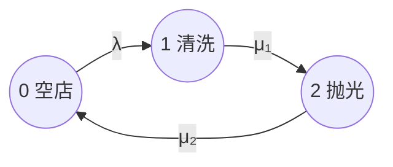
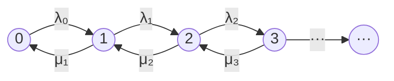
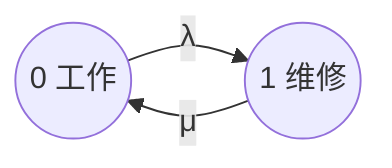

# 第六章连续时间马尔可夫链：主线式复习讲义（§6.1–6.9）

> **教材依据**：Ross, *Introduction to Probability Models*, 13th Edition, Chapter 6, §6.1–6.9。  
> **目标**：看完以后能回答三件事：**怎样建模、有限时间怎样变化、长期怎样稳定**；遇到英文题目能判断该列什么方程。  
> **取舍**：保留可迁移的推导及典型题型；复杂但用途专门的 Yule 分布推导、随机抽球的泊松化、复杂维修优先级、反向串联系统的完整代数等不作为主线。

## 0. 先看全章知识地图：从局部变化到整体规律

连续时间马尔可夫链（**Continuous-Time Markov Chain, CTMC**）研究：系统的状态在连续时间中随机改变，我们怎样从**当前状态及跳转机制**预测之后会发生什么？

其研究顺序不是简单地依次记忆九个小节，而是：

```mermaid
flowchart TB
    A[§6.1–6.2：定义状态 X(t)，建立马尔可夫性] --> B[确定停留速率 v_i、下一跳概率 P_ij]
    B --> C[瞬时转移速率 q_ij 与生成矩阵 R]
    C --> D[§6.3：特殊结构——生灭过程]
    C --> E[§6.4：有限时间转移概率 P_ij(t)]
    C --> F[§6.5：长期概率 P_j]
    D --> G[首次到达时间 / 期望状态]
    D --> F
    E --> H[§6.8–6.9：均匀化 / 矩阵指数]
    F --> I[§6.6：时间可逆性]
    I --> J[§6.7：反向链]
```

整章最值得记住的**两个方向**是：

| 研究目标 | 所求数学量 | 对应工具 | 章节 |
|---|---|---|---|
| **有限时间**：现在在 $i$，经过 $t$ 到 $j$ 的概率？ | $P_{ij}(t)$ | Chapman–Kolmogorov、前向/后向方程、$P(t)=e^{Rt}$、均匀化 | §6.4、§6.8–6.9 |
| **长期行为**：运行足够久，处于 $j$ 的时间比例？ | $P_j$ | 全局平衡、相邻流量平衡、详细平衡与反向链 | §6.5–6.7 |
| **首次到达**：从 $i$ 第一次进入某状态要等多久？ | $E_i[T]$ | 第一次跳转分析（First-Step Analysis）与递推 | §6.3 |

> **全章统一思想**：先由实际机制给出各状态之间的**瞬时转移速率** $q_{ij}$。对于有限状态的时间齐次 CTMC，把它们构成生成矩阵 $R$ 后，有限时间研究 $P(t)=e^{Rt}$，长期研究 $\boldsymbol pR=\boldsymbol0$，其中 $\boldsymbol p$ 是长期概率行向量。研究对象不同，但模型来源是同一个 $R$。

---

## 1. §6.1–6.2：怎样把一个真实系统建成 CTMC？

### 1.1 马尔可夫性究竟要求什么？

定义 $X(t)$ 为时刻 $t$ 的系统状态（**State**）。马尔可夫性（**Markov Property**）表示：

$$
\boxed{P\{X(s+t)=j\mid X(s)=i,\text{过去的历史}\}
=P\{X(s+t)=j\mid X(s)=i\}.}
$$

这不是“未来与过去无条件独立”，而是**已知现在以后，过去不再提供额外预测信息**。

例如，单服务台排队中，顾客按泊松过程到达，服务时间独立服从指数分布。只知道当前系统有几个人，就能确定下一次到达和完成服务的速率；即使服务已经进行了很久，指数分布的无记忆性也保证剩余服务时间的分布不变。

但若服务时间固定为 10 分钟，当前“有 3 个人”仍不足以预测下一位何时离开：我们还要知道正在服务的人的**已服务时间或剩余服务时间**。因此人数过程一般不再单独满足马尔可夫性。

**识别题型**：若英文题要求 *Define an appropriate state space* 或 *Is this process Markovian?*，第一件事不是计算，而是判断你定义的状态是否已经包含预测未来所需的信息。

本章还假设转移概率**时间齐次（Time-Homogeneous）**，即：

$$
P\{X(s+t)=j\mid X(s)=i\}=P_{ij}(t)
$$

只依赖时间间隔 $t$，不依赖起始时刻 $s$。**时间齐次不等于系统已处于稳态**。

### 1.2 为什么状态停留时间是指数分布？

设 $T_i$ 是一次进入状态 $i$ 后直到**真正离开该状态**的时间（**Holding / Sojourn Time**）。如果已经在 $i$ 停留 $s$ 时间，马尔可夫性说明接下来的等待规律不依赖已等待的时长，于是：

$$
P(T_i>s+t\mid T_i>s)=P(T_i>t).
$$

这是第五章的**无记忆性（Memoryless Property）**。在教材考虑的非退化连续等待时间模型下：

$$
\boxed{T_i\sim\operatorname{Exp}(v_i),\qquad
P(T_i>t)=e^{-v_it},\qquad E[T_i]=\frac1{v_i}.}
$$

$v_i$ 是离开状态 $i$ 的总速率（**Leaving Rate**），量纲为“每单位时间”。$v_i$ 越大，停留时间越短。如果 $v_i=0$，该状态为吸收状态（**Absorbing State**），不会离开。

### 1.3 CTMC 最容易混淆的三个概率、两个速率

在能离开的状态 $i$，教材设 $P_{ij}$ 为实际发生下一次状态变化后，**下一跳**到 $j$ 的概率（**Jump Probability**）。

$$
P_{ii}=0,\qquad \sum_jP_{ij}=1.
$$

于是：

$$
\boxed{q_{ij}=v_iP_{ij},\qquad i\ne j.}
$$

$q_{ij}$ 称为**瞬时转移速率（Instantaneous Transition Rate）**。它不是概率，而是“从 $i$ 直接跳向 $j$”的速率。对极短时间 $h\downarrow0$：

$$
\boxed{P_{ij}(h)=q_{ij}h+o(h)\ (i\ne j),\qquad
P_{ii}(h)=1-v_ih+o(h).}
$$

其中 $o(h)/h\to0$。注意后两个带括号的 $P_{ij}(h)$ 指**经过 $h$ 时间后所处的状态**，并非“下一次实际跳转”的概率：

| 符号 | 含义 | 典型问题 |
|---|---|---|
| $v_i$ | 从 $i$ 真正离开的总速率 | 当前状态平均还能持续多久？ |
| $P_{ij}$ | 从 $i$ 离开以后，下一跳进入 $j$ 的概率 | 下一次会去哪里？ |
| $q_{ij}=v_iP_{ij}$ | 从 $i$ 直接跳到 $j$ 的速率 | 短时间内发生何种改变？ |
| $P_{ij}(t)$ | 从 $i$ 出发经过 $t$ 后处于 $j$ 的概率 | $t$ 小时后是什么状态？ |
| $P_j=\lim_{t\to\infty}P_{ij}(t)$ | 长期处于 $j$ 的概率（存在且与初态无关时） | 长期有多少比例的时间在 $j$？ |

**记忆要点**：$P_{ii}=0$ 与 $P_{ii}(t)>0$ 不矛盾——下一次实际跳转不能还在 $i$，但经过一段时间可能从未跳过，或者已经跳走又跳回来。

### 1.4 典型模型：两工位擦鞋店（教材 Example 6.1）

**题意完整复述**：一家擦鞋店有两个先后使用的座椅。顾客先在座椅 1 清洗、上鞋油，服务时间独立服从 $\operatorname{Exp}(\mu_1)$；然后移至座椅 2 抛光，服务时间独立服从 $\operatorname{Exp}(\mu_2)$。潜在顾客按速率 $\lambda$ 的泊松过程到达；**仅当两个座椅均空时才接待**，否则该潜在顾客直接离开。要求建立 CTMC 的状态空间、离开速率和跳转规律。

**先想状态是否充分**：系统中最多一个顾客，所以仅按人数分 $0$、$1$ 不够。一个人在座椅 1 与在座椅 2 时，后续变化不同。应定义：

$$
0=\text{空店},\qquad1=\text{在座椅 1},\qquad2=\text{在座椅 2}.
$$



于是：

$$
\boxed{v_0=\lambda,\quad v_1=\mu_1,\quad v_2=\mu_2,\qquad
P_{01}=P_{12}=P_{20}=1.}
$$

**最容易做错的地方**：当店内已有顾客，另一个潜在顾客到达不会改变状态；因此 $v_1$ 和 $v_2$ 都不加 $\lambda$。这一例题的通用价值是：**选对状态、只数真正改变状态的事件**。后面求长期概率时，还会再用到它。

---

## 2. §6.3：生灭过程——最重要的 CTMC 特殊模型

### 2.1 从指数竞争推导生灭率

生灭过程（**Birth and Death Process**）的状态为 $0,1,2,\ldots$（或有限的一段），每次实际跳转只能：

$$
n\xrightarrow{\lambda_n}n+1\quad\text{（Birth）},\qquad
n\xrightarrow{\mu_n}n-1\quad\text{（Death）},
$$

一般令 $\mu_0=0$，不允许进入负状态。

为什么它的离开速率不是 $\lambda_n$ 或 $\mu_n$，而是二者之和？

设从状态 $n$ 出发，下次出生和下次死亡的独立候选等待时间分别为

$$
T_B\sim\operatorname{Exp}(\lambda_n),\qquad
T_D\sim\operatorname{Exp}(\mu_n).
$$

下一次状态变化发生在 $\min(T_B,T_D)$。由第五章独立指数随机变量竞争：

$$
\boxed{v_n=\lambda_n+\mu_n,\qquad
P_{n,n+1}=\frac{\lambda_n}{\lambda_n+\mu_n},\qquad
P_{n,n-1}=\frac{\mu_n}{\lambda_n+\mu_n}.}
$$

因此其瞬时转移速率**直接等于**出生率和死亡率：$q_{n,n+1}=\lambda_n$，$q_{n,n-1}=\mu_n$。这里假设分母非零；若两者均为 0，则该状态吸收。



### 2.2 常见模型：主要学会“速率怎么数”

| 模型 | 状态与机制 | $\lambda_n$ | $\mu_n$ |
|---|---|---|---|
| **Poisson Process** | 已发生的总事件数，只增不减 | $\lambda$ | $0$ |
| **Yule Process** | $n$ 个个体各自独立以速率 $\lambda$ 生育，无死亡 | $n\lambda$ | $0$ |
| **Linear Growth with Immigration** | 生育、移民、死亡 | $n\lambda+\theta$ | $n\mu$ |
| **M/M/1 Queue** | 一个服务员、Poisson 到达、指数服务 | $\lambda$ | $\mu$（$n\ge1$） |
| **M/M/s Queue** | $s$ 个服务员，每位服务率 $\mu$ | $\lambda$ | $\min(n,s)\mu$ |
| **$M$ 台机器＋一个维修工** | $n$ 台坏掉，尚能工作 $M-n$ 台 | $(M-n)\lambda$ | $\mu$（$1\le n\le M$） |

三个最容易混淆的地方：

- **Poisson 与 Yule** 都是纯生过程（**Pure Birth Process**），但泊松过程速率恒为 $\lambda$，Yule 过程速率是 $n\lambda$：现有个体越多，生育时钟越多。
- **M/M/1 与 M/M/s**：前者无论排队多长，同时只能服务一人，故总完成服务速率始终为 $\mu$；后者同时有 $\min(n,s)$ 个人接受服务，故总速率为 $\min(n,s)\mu$。
- **有限容量或有限机器数**：到达的潜在事件如果被阻止、拒绝，**不算状态跳转**。例如 $M$ 台机器都坏了时，新故障速率 $\lambda_M=0$。

> **英文题型识别**：*Determine the birth and death rates*。解题时先写出“处于 $n$ 时谁会触发增加、谁会触发减少”，数清楚独立指数时钟，再写 $\lambda_n,\mu_n$。不要从某个背熟的模型名称倒推速率。

### 2.3 最重要的通用递推：首次到达时间（First Passage Time）

**问题**：从状态 $i$ 首次到达 $i+1$ 的时间期望是多少？注意过程可能先降到 $i-1$，再反复返回 $i$，所以它不一定只是等一次出生的时间。

定义（本节暂用教材的记法；注意教材不同小节复用了 $T_i$，这里指首次到达时间，**不是** §1.2 的单次状态停留时间）：

$$
T_i=\text{从状态 }i\text{ 首次到达 }i+1\text{ 的时间},\qquad m_i=E[T_i].
$$

从 0 出发，只能通过出生到 1，故：

$$m_0=\frac1{\lambda_0}.$$

从 $i\ge1$ 出发，按照**第一次跳转（First-Step Analysis）**分类。第一次等待时间的期望为 $1/(\lambda_i+\mu_i)$；之后：

- 概率 $\lambda_i/(\lambda_i+\mu_i)$ 首次跳到 $i+1$，结束。
- 概率 $\mu_i/(\lambda_i+\mu_i)$ 首次跳到 $i-1$，先花平均 $m_{i-1}$ 返回 $i$，再花平均 $m_i$ 到达 $i+1$。

因此：

$$
\begin{aligned}
m_i&=\frac1{\lambda_i+\mu_i}
+\frac{\mu_i}{\lambda_i+\mu_i}(m_{i-1}+m_i),\\
(\lambda_i+\mu_i)m_i&=1+\mu_i m_{i-1}+\mu_i m_i,\\
\boxed{m_i=\frac1{\lambda_i}+\frac{\mu_i}{\lambda_i}m_{i-1}.}
\end{aligned}
$$

这条递推的重要性在于**不必枚举可能发生多少次向下跳转**：这些反复折返都被 $m_i$ 本身吸收到了方程中。

如果目标更高，从 $k$ 首次到 $j>k$ 必须依次经过中间状态，因此：

$$
\boxed{E_k[T_j]=\sum_{i=k}^{j-1}m_i.}
$$

**典型题（教材 Example 6.7：固定出生率、死亡率的排队系统）**：顾客以速率 $\lambda$ 到达，单名服务员以速率 $\mu$ 完成服务，状态为系统顾客人数。求从 $i$ 人首次达到 $i+1$ 人的平均时间，以及从 $k$ 人首次达到 $j$ 人的平均时间。

代入 $\lambda_i=\lambda$、$\mu_i=\mu$（$i\ge1$）：

$$
\boxed{m_i=\frac1\lambda\left[1+\frac\mu\lambda+\cdots+
\left(\frac\mu\lambda\right)^i\right]},\qquad
E_k[T_j]=\sum_{i=k}^{j-1}m_i.
$$

当 $\lambda=\mu$ 时，$m_i=(i+1)/\lambda$。当 $\lambda\ne\mu$ 时，可再对等比级数求和。对考试而言，**理解递推与逐段求和比背闭式结果更通用**。

> 如果题目还问方差（**Variance**），可在相同的第一次跳转分类上使用全方差公式 $\operatorname{Var}(T)=E[\operatorname{Var}(T\mid I)]+\operatorname{Var}(E[T\mid I])$ 建立递推。教材推导较长，复习时先掌握它为什么仍需按第一次跳转分类，不必孤立记忆复杂长公式。

### 2.4 另一个通用方法：先求期望变化，再建立微分方程

**典型题（教材 Example 6.4：人口增长与移民）**：某人口中，每个个体独立以速率 $\lambda$ 生育、以速率 $\mu$ 死亡，外部移民还以固定速率 $\theta$ 进入。初始人口 $X(0)=i$。求 $M(t)=E[X(t)]$。

系统处于 $n$ 时，$\lambda_n=n\lambda+\theta$，$\mu_n=n\mu$。给定 $X(t)=n$，在很小的 $h$ 内平均人口变化为：

$$
E[X(t+h)-X(t)\mid X(t)=n]
=[n\lambda+\theta-n\mu]h+o(h).
$$

再使用全期望公式，并令 $h\to0$：

$$
\boxed{M'(t)=(\lambda-\mu)M(t)+\theta,\qquad M(0)=i.}
$$

由一阶线性微分方程解得：

$$
\boxed{M(t)=
\begin{cases}
ie^{(\lambda-\mu)t}+\dfrac{\theta}{\lambda-\mu}
(e^{(\lambda-\mu)t}-1),&\lambda\ne\mu,\\[6pt]
i+\theta t,&\lambda=\mu.
\end{cases}}
$$

**方法本质**：求期望时不一定先求完整状态分布；可以先计算短时间的**条件平均变化速率（Drift）**，再对当前随机状态取期望。此例之所以闭合成一个关于 $M(t)$ 的方程，是因为 $n\lambda+\theta-n\mu$ 恰好是 $n$ 的线性函数。一般非线性速率下，期望方程不一定能单独闭合。

---

## 3. §6.4（联系 §6.9）：怎样求有限时间的转移概率？

现在转向第二类问题：**已经知道从各状态以多快的速率跳转，怎样预测经过某一段时间以后的状态？**

### 3.1 转移概率与 Chapman–Kolmogorov 方程

对时间齐次 CTMC，定义**转移概率函数（Transition Probability Function）**：

$$
\boxed{P_{ij}(t)=P\{X(s+t)=j\mid X(s)=i\}.}
$$

这里 $P_{ij}(t)$ 容许 $t$ 时间内发生 $0,1,2,\ldots$ 次实际跳转，不等于下一跳概率 $P_{ij}$。初始条件为：

$$
P_{ij}(0)=\begin{cases}1,&i=j,\\0,&i\ne j.\end{cases}
$$

设总时间为 $t+s$。在第 $t$ 时刻，系统必然位于某个中间状态 $k$。按中间状态分类，利用全概率公式与马尔可夫性：

$$
\begin{aligned}
P_{ij}(t+s)
&=\sum_k P\{X(t)=k\mid X(0)=i\}
P\{X(t+s)=j\mid X(t)=k\}\\
&=\boxed{\sum_kP_{ik}(t)P_{kj}(s).}
\end{aligned}
$$

这就是 **Chapman–Kolmogorov Equations**。核心是**把一段时间拆成两段，在中间状态上求和**。它与第四章离散时间链的多步转移公式一脉相承。

### 3.2 同一个方程，产生“后向”和“前向”两套微分方程

将总时间拆成“极短时间 $h$ + 剩余时间 $t$”有两种观察方向。

**后向方程（Kolmogorov's Backward Equations）：先看第一小段。**

$$
P_{ij}(t+h)=\sum_kP_{ik}(h)P_{kj}(t).
$$

在 $h\downarrow0$ 时：

$$
P_{ii}(h)=1-v_ih+o(h),\qquad P_{ik}(h)=q_{ik}h+o(h)\ (k\ne i).
$$

代入、减去 $P_{ij}(t)$、除以 $h$ 再取极限：

$$
\boxed{P_{ij}'(t)=\sum_{k\ne i}q_{ik}P_{kj}(t)-v_iP_{ij}(t).}
$$

下标强调**初始状态 $i$**：第一小段先从 $i$ 跳向哪里，再从那里继续运行剩余时间。

**前向方程（Kolmogorov's Forward Equations）：再看最后一小段。**

$$
P_{ij}(t+h)=\sum_kP_{ik}(t)P_{kj}(h).
$$

同样利用短时间转移概率：

$$
\boxed{P_{ij}'(t)=\sum_{k\ne j}P_{ik}(t)q_{kj}-v_jP_{ij}(t).}
$$

这次下标强调**最终状态 $j$**。它的直觉尤其重要：

$$
\boxed{\text{状态 }j\text{ 的概率变化率}
=\text{流入 }j\text{ 的概率速率}-\text{流出 }j\text{ 的概率速率}.}
$$

对生灭过程，前向方程为：

$$
\boxed{P_{ij}'(t)=
\lambda_{j-1}P_{i,j-1}(t)+\mu_{j+1}P_{i,j+1}(t)
-(\lambda_j+\mu_j)P_{ij}(t),\quad j\ge1,}
$$

边界 $j=0$ 时：$P_{i0}'(t)=\mu_1P_{i1}(t)-\lambda_0P_{i0}(t)$。

后向方程则为：

$$
P_{ij}'(t)=\lambda_iP_{i+1,j}(t)+\mu_iP_{i-1,j}(t)
-(\lambda_i+\mu_i)P_{ij}(t),\quad i\ge1,
$$

边界 $i=0$ 时：$P_{0j}'(t)=\lambda_0[P_{1j}(t)-P_{0j}(t)]$。

| 比较 | Backward（后向） | Forward（前向） |
|---|---|---|
| 时间上先观察哪里？ | 最初的短时间 $h$ | 最后的短时间 $h$ |
| 关键下标 | 初始状态 $i$ | 终点状态 $j$ |
| 思维方式 | 第一次会跳向哪儿？ | 最后一刻如何流入/流出 $j$？ |
| 生灭过程中的入项 | $\lambda_i P_{i+1,j}+\mu_iP_{i-1,j}$ | $\lambda_{j-1}P_{i,j-1}+\mu_{j+1}P_{i,j+1}$ |

**考试诀窍**：忘了具体公式时，重新从 Chapman–Kolmogorov 方程中的**哪一段时间取 $h$**推导即可。教材对无限状态链的前向方程附有正则条件；本章所有有限状态模型和所研究的生灭过程均可使用。

### 3.3 贯穿全章的核心例题：机器故障与维修（教材 Example 6.11）

**题意完整复述**：一台机器正常工作一段时间后会故障。每次连续工作的时长独立服从参数为 $\lambda$ 的指数分布；发生故障后马上进行维修，每次维修时长独立服从参数为 $\mu$ 的指数分布。修好以后重新工作，之后仍可能故障。已知初始时刻机器正常工作。求**经过 10 个时间单位后，机器正常工作的概率**。

定义 $0=$ 正常工作（Working），$1=$ 故障维修（Under Repair）：



其瞬时转移速率 $q_{01}=\lambda,q_{10}=\mu$。目标是 $P_{00}(10)$，**不是**“这 10 个时间单位内从未坏过”的概率。因为机器可能经历 $0\to1\to0$ 后在时刻 10 正常工作。

**方法：用前向方程。** 令 $p(t)=P_{00}(t)$。因只有两个状态：

$$
P_{01}(t)=1-p(t).
$$

状态 0 的概率因机器**修好**而流入，因机器**故障**而流出：

$$
\begin{aligned}
p'(t)&=\mu P_{01}(t)-\lambda P_{00}(t)\\
&=\mu[1-p(t)]-\lambda p(t)\\
&=\boxed{\mu-(\lambda+\mu)p(t)},\qquad p(0)=1.
\end{aligned}
$$

先求该一阶线性微分方程的常数平衡解 $p_*=\mu/(\lambda+\mu)$。令 $y(t)=p(t)-p_*$，则

$$
y'(t)=-(\lambda+\mu)y(t),\qquad
p(t)=\frac\mu{\lambda+\mu}+Ce^{-(\lambda+\mu)t}.
$$

由 $p(0)=1$，得到 $C=\lambda/(\lambda+\mu)$。因此：

$$
\boxed{P_{00}(t)=\frac\mu{\lambda+\mu}
+\frac\lambda{\lambda+\mu}e^{-(\lambda+\mu)t}.}
$$

最终：

$$
\boxed{P_{00}(10)=\frac\mu{\lambda+\mu}
+\frac\lambda{\lambda+\mu}e^{-10(\lambda+\mu)}.}
$$

**检查两端极限**：$t=0$ 时概率为 1，符合初始状态；$t\to\infty$ 时，概率趋于 $\mu/(\lambda+\mu)$，这是后面 §6.5 要求的长期正常工作比例。

**题型价值**：状态设计、前向方程、初始条件、微分方程解法和长期极限被同一道题串起来。下文讨论均匀化时，我们还会用另一种方法计算**同一个** $P_{00}(t)$，不再引入新的复杂背景。

### 3.4 纯生过程的转移概率：保留能迁移的通用关系

对于纯生过程（**Pure Birth Process**），从 $n$ 只可能跳到 $n+1$，停留时间为 $\operatorname{Exp}(\lambda_n)$。

- 从 $i$ 出发直到 $t$ 仍在 $i$，必须一次也没有跳：$\boxed{P_{ii}(t)=e^{-\lambda_it}}$。
- 从 $i$ 首次到达 $j>i$ 的时间等于之前各状态停留时间之和：$\tau_j=\sum_{k=i}^{j-1}T_k$。
- 在时刻 $t$ 恰好处于 $j$，意味着**已经到达 $j$，却还没有到达 $j+1$**：

$$
\boxed{P_{ij}(t)=P(\tau_{j+1}>t)-P(\tau_j>t).}
$$

或者直接使用纯生过程的前向方程：

$$
P_{ij}'(t)=\lambda_{j-1}P_{i,j-1}(t)-\lambda_jP_{ij}(t).
$$

通过积分因子可写成递推积分式：

$$
\boxed{P_{ij}(t)=\lambda_{j-1}e^{-\lambda_jt}
\int_0^t e^{\lambda_js}P_{i,j-1}(s)\,ds,\qquad j>i.}
$$

**选学结论（教材 Example 6.8）**：如果最初一个个体，每个个体都独立以速率 $\lambda$ 生出新个体而不死亡（Yule 过程），则 $\lambda_n=n\lambda$，并有

$$
P\{X(t)=j\mid X(0)=1\}
=e^{-\lambda t}(1-e^{-\lambda t})^{j-1},\quad j\ge1.
$$

所以 $X(t)$ 服从从 1 开始计数的几何分布（**Geometric Distribution**），均值为 $e^{\lambda t}$。这一具体分布是特殊模型的结果，**不必替代上面的一般纯生过程方法去记忆**。

### 3.5 §6.9：生成矩阵把所有前向、后向方程统一起来

定义**生成矩阵（Generator Matrix）** $R=(r_{ij})$，这也是教材 §6.9 的符号（有些教材用 $Q$）：

$$
\boxed{r_{ij}=\begin{cases}q_{ij},&i\ne j,\\-v_i,&i=j.\end{cases}}
$$

因为 $v_i=\sum_{j\ne i}q_{ij}$，所以 $R$ 每一行之和为 0。

例如机器模型：

$$
R=\begin{pmatrix}-\lambda&\lambda\\\mu&-\mu\end{pmatrix}.
$$

把所有转移概率 $P_{ij}(t)$ 组成矩阵 $P(t)$，则：

$$
\boxed{P'(t)=RP(t)\quad\text{（Backward）}},\qquad
\boxed{P'(t)=P(t)R\quad\text{（Forward）}}.
$$

对于**有限状态、时间齐次** CTMC，$P(0)=I$，这两个矩阵微分方程有同一个解：

$$
\boxed{P(t)=e^{Rt}
=I+Rt+\frac{R^2t^2}{2!}+\frac{R^3t^3}{3!}+\cdots.}
$$

这里 $e^{Rt}$ 是**矩阵指数（Matrix Exponential）**，$R^2$ 是矩阵乘法，**不是对各元素分别取指数**。

为什么它确实是解？对右边的幂级数逐项求导即可得到

$$
\frac{d}{dt}e^{Rt}=Re^{Rt}=e^{Rt}R,\qquad e^{R\cdot0}=I.
$$

这样就把整章的“局部速率 $q_{ij}$”与“有限时间概率 $P_{ij}(t)$”正式连接起来了。直接用矩阵指数的无穷级数并不总是数值高效，§6.8 的均匀化以及 §6.9 的近似方法会解决计算问题。

---

## 4. §6.5：长期概率——不求整个 $P(t)$，也能回答长期问题

### 4.1 为什么长期可以直接列平衡方程？

前面求 $P_{ij}(t)$ 是研究**一段给定时间以后**的状态。现在问：“系统一直运行下去，各个状态各占多大比例？”

教材把可能存在的长期概率（**Limiting Probabilities**）记为：

$$
\boxed{P_j=\lim_{t\to\infty}P_{ij}(t),}
$$

这里需假设该极限存在，而且不依赖于初始状态 $i$。对于有限、不可约 CTMC，这个极限存在且唯一；对无限状态模型，需要进一步检查正常返等条件。

长期稳定意味着对于状态 $j$，**总流入概率速率和总流出概率速率相等**。从前向方程的长期形式，或直接用概率流量守恒，可写出**全局平衡方程（Global Balance Equations）**：

$$
\boxed{v_jP_j=\sum_{k\ne j}P_kq_{kj}\qquad(\forall j),\qquad
\sum_jP_j=1.}
$$

解释左边 $P_jv_j$：长期 $P_j$ 的时间在状态 $j$，而在该状态时每单位时间以速率 $v_j$ 离开，故乘积是**长期流出频率**。右边 $P_kq_{kj}$ 是从 $k$ 直接跳入 $j$ 的长期频率，对所有 $k$ 求和即总流入。

使用生成矩阵，这整组方程简写为：

$$
\boxed{\boldsymbol pR=\boldsymbol0,\qquad
\boldsymbol p\boldsymbol1=1,\qquad p_j\ge0.}
$$

这里 $\boldsymbol p=(P_0,P_1,\ldots)$ 是**行向量**，不要写成 $R\boldsymbol p=0$（那会把方向弄错）。对有限不可约 CTMC，可以解这个线性方程组。

**区分两个概念**：平稳分布（**Stationary Distribution**）是使 $\boldsymbol pP(t)=\boldsymbol p$ 对所有 $t$ 成立的分布；极限分布（**Limiting Distribution**）是 $P_{ij}(t)$ 随时间收敛得到的分布。在本章常见的不可约正常返模型中两者重合，但“时间齐次”完全不等于“处于平稳分布”。

### 4.2 生灭过程的局部平衡：为什么有更短的公式？

生灭过程的状态排成直线，每次只能向上或向下跳一格。把状态划分为 $\{0,1,\ldots,n\}$ 和 $\{n+1,n+2,\ldots\}$，**两部分之间只有一条边**。长期跨过这条边向右和向左的总流量必须相等：

$$
\boxed{\lambda_nP_n=\mu_{n+1}P_{n+1}.}
$$

因此：

$$
P_1=\frac{\lambda_0}{\mu_1}P_0,\qquad
P_2=\frac{\lambda_0\lambda_1}{\mu_1\mu_2}P_0,
$$

一般地：

$$
\boxed{P_n=a_nP_0,\qquad
a_0=1,\quad a_n=\prod_{k=0}^{n-1}\frac{\lambda_k}{\mu_{k+1}}.}
$$

用归一化条件 $\sum_nP_n=1$，得到**生灭过程的长期概率通用公式**：

$$
\boxed{P_0=\frac1{\sum_{n\ge0}a_n},\qquad
P_n=\frac{a_n}{\sum_{k\ge0}a_k}.}
$$

对无限状态、不可约且相邻生灭率均为正的常见模型，若 $\sum_{n\ge0}a_n<\infty$，上述权重可归一化，得到平稳分布；否则不能把这组相对权重变成概率分布。有限状态时求有限和即可。

这条公式是整个第六章最值得熟练应用的公式之一：**先列出 $\lambda_n,\mu_n$，再递推 $a_n$，最后归一化**。

### 4.3 核心例题：M/M/1 排队的长期人数分布（教材 Example 6.14）

**题意完整复述**：一家服务站只有 1 名服务员。顾客按速率 $\lambda$ 的泊松过程到达；如果服务员正在忙，后来的顾客进入队列等待。各次服务时间独立服从 $\operatorname{Exp}(\mu)$，服务完成后顾客离开。系统没有容量上限。求长期有 $n$ 名顾客的概率，以及系统长期空闲和平均顾客人数。

令 $X(t)$ 为系统顾客数。无论多少人，潜在顾客都可以进入，所以

$$
\lambda_n=\lambda\quad(n\ge0),\qquad \mu_n=\mu\quad(n\ge1).
$$

对相邻状态使用平衡：

$$
\lambda P_n=\mu P_{n+1}
\quad\Longrightarrow\quad
P_n=\left(\frac\lambda\mu\right)^nP_0.
$$

令 $\rho=\lambda/\mu$（**Traffic Intensity / Utilization**），再归一化：

$$
1=P_0\sum_{n=0}^{\infty}\rho^n.
$$

只有 $\rho<1$，即 $\boxed{\lambda<\mu}$ 时，该几何级数收敛，故：

$$
\boxed{P_n=(1-\rho)\rho^n,\quad n=0,1,\ldots,\qquad \rho=\frac\lambda\mu<1.}
$$

**解读问题要求**：

$$
P(\text{系统空闲})=P_0=1-\rho,
\qquad P(\text{服务员繁忙})=1-P_0=\rho.
$$

长期平均顾客人数：

$$
\boxed{E[X]=\sum_{n\ge0}n(1-\rho)\rho^n
=\frac{\rho}{1-\rho}.}
$$

$\rho\to1^-$ 时平均人数迅速增大：**稳定**（存在长期分布）不代表**不拥堵**。如果 $\lambda\ge\mu$，无限容量模型没有上述长期平稳分布；这不是因为某条平衡方程写错了，而是概率权重之和无法归一化。

### 4.4 两个重要模型变体：速率随状态变化、容量有限

**（a）多服务员排队（M/M/s，教材 Example 6.6 的延伸）。** 仍按速率 $\lambda$ 到达，$s$ 名服务员各以速率 $\mu$ 完成服务，人数为 $n$ 时：

$$
\lambda_n=\lambda,\qquad
\mu_n=\min(n,s)\mu.
$$

代入上面的 $a_n$ 公式即可。若设 $a=\lambda/\mu$，则

$$
a_n=\begin{cases}
\dfrac{a^n}{n!},&0\le n\le s,\\[6pt]
\dfrac{a^n}{s!\,s^{n-s}},&n>s.
\end{cases}
$$

后半段类似几何级数，长期稳定条件为 $\boxed{\lambda<s\mu}$。要点是 $n>s$ 时忙碌服务员的数量最多为 $s$，死亡率**不再**随 $n$ 增长。

**（b）机器维修（教材 Example 6.13）。** $M$ 台机器，每台正常工作的机器以速率 $\lambda$ 故障；一个维修工以速率 $\mu$ 修好机器。令 $X(t)=n$ 表示坏掉的机器数，则

$$
\lambda_n=(M-n)\lambda\quad(0\le n<M),\qquad
\mu_n=\mu\quad(1\le n\le M).
$$

于是

$$
P_n\propto\frac{M!}{(M-n)!}\left(\frac\lambda\mu\right)^n,
\quad n=0,1,\ldots,M.
$$

将这些权重归一化即可；长期平均坏机器数为 $E[X]=\sum_{n=0}^{M}nP_n$，由于机器对称，单台机器长期正常工作的比例是 $1-E[X]/M$。该例的重点仍是**状态设计和速率计数**，不需要把这个特殊乘积公式单独背成另一个定理。

### 4.5 不是生灭过程怎么办？再次用擦鞋店（教材 Example 6.15）

回到 §1.4 的擦鞋店：

$$
0\xrightarrow{\lambda}1\xrightarrow{\mu_1}2\xrightarrow{\mu_2}0.
$$

这个模型允许 $2\to0$，不属于生灭过程，**不能直接套相邻生灭率公式**。但是可以直接使用全局平衡：

$$
\lambda P_0=\mu_1P_1=\mu_2P_2.
$$

再利用 $P_0+P_1+P_2=1$：

$$
\boxed{P_0=\frac1{1+\lambda/\mu_1+\lambda/\mu_2},\qquad
P_1=\frac\lambda{\mu_1}P_0,\qquad
P_2=\frac\lambda{\mu_2}P_0.}
$$

这道题还为下一节提供了一个重要反例：**它虽然有平稳分布，却不是时间可逆的**。

---

## 5. §6.6–6.7：时间可逆性与反向链——长期行为的进一步结构

### 5.1 先区分全局平衡与详细平衡

§6.5 的**全局平衡（Global Balance）**要求每个状态的**总**流入等于**总**流出：

$$
\sum_{k\ne j}P_kq_{kj}=P_j\sum_{k\ne j}q_{jk}.
$$

而**详细平衡（Detailed Balance）**要求每一对状态之间的双向流量分别相等：

$$
\boxed{P_iq_{ij}=P_jq_{ji}\qquad\text{对所有 }i\ne j.}
$$

详细平衡为何更强？若对固定的 $i$ 把所有 $j\ne i$ 的详细平衡式相加，自动得到全局平衡；反过来却未必成立。

**时间可逆性（Time Reversibility）**的含义是：把已经处于稳态的 CTMC 倒着观察，倒放后的随机过程与正向过程具有相同的概率规律。对本章研究的遍历 CTMC，详细平衡是时间可逆性的判别条件。

**为什么生灭过程天然可逆？** 因为 §4.2 已经证明：

$$P_n\lambda_n=P_{n+1}\mu_{n+1}.$$

这恰好就是相邻状态 $n\leftrightarrow n+1$ 的详细平衡。对于非相邻状态，两方向的速率均为 0。所以：

$$
\boxed{\text{遍历的生灭过程是时间可逆的。}}
$$

**为什么擦鞋店不可逆？** 正向过程可从空店 $0$ 到工位 1 状态 $1$：$q_{01}=\lambda>0$；却不允许 $1\to0$ 直接跳转：$q_{10}=0$。其稳态概率 $P_0,P_1>0$，所以：

$$
P_0q_{01}=\lambda P_0>0,
\qquad P_1q_{10}=0.
$$

详细平衡失败，因而不可逆。这说明：**有长期分布并不意味着时间可逆**；仅仅每个状态的总流量平衡也不够。

> **英文题型识别**：*Show that the chain is time reversible* 或 *Write the detailed balance equations*。先给出候选平稳概率 $P_i$，验证所有直接相连状态对的 $P_iq_{ij}=P_jq_{ji}$，必要时再检查 $\sum_iP_i=1$。

### 5.2 反向链（Reversed Chain）不等于可逆链

即使原过程不可逆，也可以构造**反向链（Reversed Chain）**：它描述将稳态轨迹沿时间倒放以后得到的跳转规律。

记正向跳转速率为 $q_{ij}$，反向速率为 $q_{ij}^*$。若在正向时间里从 $j$ 跳到 $i$，倒放以后就相当于从 $i$ 跳到 $j$。因此相应的长期流量必须相等：

$$
P_iq_{ij}^*=P_jq_{ji}.
$$

得到**反向链的核心公式**：

$$
\boxed{q_{ij}^*=\frac{P_jq_{ji}}{P_i},\qquad i\ne j,\quad P_i>0.}
$$

再对 $j\ne i$ 求和，利用正向链的全局平衡：

$$
\begin{aligned}
v_i^*&=\sum_{j\ne i}q_{ij}^*
=\frac1{P_i}\sum_{j\ne i}P_jq_{ji}\\
&=\frac{P_iv_i}{P_i}=v_i.
\end{aligned}
$$

**结论**：正向链和反向链有相同的长期状态概率、相同的各状态总离开速率，但**下一跳方向的概率可能不同**。

当 $q_{ij}^*=q_{ij}$ 对所有状态对成立时，反向链与原链相同，这就等价于上一节的详细平衡条件。因此：

- **Time Reversibility**：问的是“倒放后是否与原过程相同”。
- **Reversed Chain**：问的是“不论是否相同，倒放后的速率具体是什么”。

### 5.3 用同一个擦鞋店模型理解反向链，而不另学复杂背景

原过程的状态转移为：

$$0\xrightarrow{\lambda}1\xrightarrow{\mu_1}2\xrightarrow{\mu_2}0.$$

我们在 §4.5 得到其稳态关系：

$$\lambda P_0=\mu_1P_1=\mu_2P_2.$$

例如，反向过程的 $1\to0$ 跳转速率为：

$$
q_{10}^*=\frac{P_0q_{01}}{P_1}
=\frac{P_0\lambda}{P_1}=\mu_1.
$$

同样：

$$
q_{21}^*=\frac{P_1q_{12}}{P_2}=\mu_2,
\qquad
q_{02}^*=\frac{P_2q_{20}}{P_0}=\lambda.
$$

故反向链沿相反方向运行：

$$
\boxed{0\xrightarrow[\text{反向}]{\lambda}2
\xrightarrow[\text{反向}]{\mu_2}1
\xrightarrow[\text{反向}]{\mu_1}0.}
$$

正向与倒放的方向不同，所以它并不可逆；但是**反向链仍然完全可以计算**。这个三状态例子已经足以说明 §6.7 最关键的机制，不一定要优先掌握教材中复杂的无限状态反向链或串联排队系统的完整代数运算。

### 5.4 三个相关结论：理解用途，不孤立背专题公式

**（1）嵌入链（Embedded Chain）与时间比例。** 如果只记 CTMC 实际跳过的状态、不记每次停留多久，就得到离散时间嵌入链。教材用 $\pi_i$ 表示嵌入链长期**访问次数**的比例，$P_i$ 表示 CTMC 的长期**停留时间**比例。由于每次到 $i$ 平均停留 $1/v_i$，两者关系为：

$$
\boxed{P_i=\frac{\pi_i/v_i}{\sum_j\pi_j/v_j}.}
$$

访问频率相同的两个状态，若一个状态平均停留时间更长，那么它占据的总时间比例就更大。这里的 $\pi_i$ 仅表示嵌入链的访问比例，别与 $P_i$ 混淆。

**（2）稳态 M/M/s 的输出过程。** 教材推论 6.6：当 $\lambda<s\mu$ 且 M/M/s 排队系统处于稳态时，顾客的**离开时刻形成速率为 $\lambda$ 的泊松过程**（Poisson Departure Process）。直觉是：正向人数的向上跳转就是泊松到达；稳态下生灭过程可逆，正向的向下跳转（顾客离开）对应反向的向上跳转，也具有同样的泊松规律。这一结论不能推广到所有排队模型。

**（3）截断（Truncation）与有限容量排队。** 若原 CTMC 可逆，并把它限制在状态集合 $A$ 内，禁止离开 $A$ 的跳转且保留内部速率，截断后仍不可约时，新平稳概率只需重新归一化：

$$
\boxed{P_j^{(A)}=\frac{P_j}{\sum_{k\in A}P_k},\qquad j\in A.}
$$

**教材 Example 6.19 的完整背景**：M/M/1 的潜在顾客仍按 $\lambda$ 泊松到达、服务率仍为 $\mu$，但系统最多容纳 $N$ 人；已有 $N$ 人时新顾客被拒绝。状态限制为 $A=\{0,1,\ldots,N\}$。相邻流量平衡仍有 $P_n\propto\rho^n$，其中 $\rho=\lambda/\mu$，于是：

$$
\boxed{P_n=\frac{\rho^n}{\sum_{k=0}^N\rho^k},\qquad0\le n\le N.}
$$

该式对 $\rho>0$ 的有限容量模型均成立，**不需要 $\rho<1$**；当 $\rho=1$ 时，$P_n=1/(N+1)$。注意用“无限容量稳态分布截断”的论证要先满足原模型有稳态这一前提；若 $\lambda\ge\mu$，则直接用有限状态的局部平衡推导。

**串联排队（教材 Example 6.22，选读）**：顾客按泊松速率 $\lambda$ 进入服务台 1（服务率 $\mu_1$），结束后进入服务台 2（服务率 $\mu_2$），再离开系统，两台各有一名服务员，且 $\lambda<\mu_1,\mu_2$。令 $(n,m)$ 表示两站顾客数。教材通过猜测并验证反向链的速率，得到稳态联合人数的**乘积形式（Product Form）**：

$$
P_{n,m}=(1-\rho_1)\rho_1^n(1-\rho_2)\rho_2^m,
\quad\rho_i=\frac\lambda{\mu_i}.
$$

它意味着**同一稳态时刻**两站人数相互独立，并不意味着两个站的整个状态过程独立。这个结果是反向链方法的高级应用，初轮复习以理解它为什么值得用反向链求解为主。

---

## 6. §6.8–6.9：如何高效计算 $P_{ij}(t)$？

前向方程能求解有限时间转移概率，但状态一多，直接解微分方程可能很困难。**均匀化（Uniformization）**把它转化为“泊松计数 + 离散时间马尔可夫链”，是本章与第五章的重要联系。

### 6.1 如果每个状态离开速率相同，就能用泊松过程

假设 $v_i=v$ 对所有状态都成立。每次实际跳转前都等待一个独立 $\operatorname{Exp}(v)$ 时间，因此到时刻 $t$ 的实际跳转次数 $N(t)$ 服从：

$$N(t)\sim\operatorname{Poisson}(vt).$$

若已发生 $n$ 次跳转，最终从 $i$ 到 $j$ 的概率是嵌入离散链的 $n$ 步转移概率 $P_{ij}^{(n)}$。使用全概率公式：

$$
\boxed{P_{ij}(t)=\sum_{n=0}^{\infty}P_{ij}^{(n)}e^{-vt}\frac{(vt)^n}{n!}.}
$$

**公式的两层含义**：先问“$t$ 时间里发生了几次跳转？”——泊松分布；再问“发生 $n$ 次后到哪里？”——离散链 $n$ 步转移概率。

### 6.2 不同状态的离开速率不一样，为什么可以“虚构跳转”？

现实中通常 $v_i$ 不相同。例如两状态机器 $v_0=\lambda$、$v_1=\mu$。若 $\lambda\ne\mu$，真实跳转次数通常不再是同一参数的泊松过程。

教材的办法是选一个统一速率 $v$，满足

$$v\ge\sup_i v_i.$$

不论当前在何状态，都让一个速率为 $v$ 的泊松时钟响起；处于 $i$ 时：

- 以概率 $v_i/v$ 发生一次**真实跳转**；
- 以概率 $1-v_i/v$ 发生一次**虚拟跳转（Fictitious Transition）**，状态保持不变。

这不会改变真实过程，因为真实离开速率仍是 $v\times(v_i/v)=v_i$。相应的**均匀化转移矩阵（Uniformized Transition Matrix）**为：

$$
\boxed{\widetilde P_{ij}=
\begin{cases}
1-\dfrac{v_i}{v},&j=i,\\[6pt]
\dfrac{q_{ij}}{v},&j\ne i.
\end{cases}}
$$

与普通的下一跳矩阵不同，$\widetilde P$ 允许 $i\to i$ 的**自环（Self-Loop）**；那代表一次没有改变状态的虚拟事件。

现在**全部时钟响起次数**（包含虚拟事件）$N_v(t)\sim\operatorname{Poisson}(vt)$。给定时钟响了 $n$ 次，系统按 $\widetilde P$ 走了 $n$ 步。因此：

$$
\boxed{P_{ij}(t)=\sum_{n=0}^{\infty}
 e^{-vt}\frac{(vt)^n}{n!}(\widetilde P^n)_{ij}.}
$$

这个方法尤其适合矩阵规模较大、希望通过截断有限项进行计算的情形。

### 6.3 再用机器故障题看一次均匀化（教材 Example 6.23）

**题意完整复述**：仍是 §3.3 的机器模型，机器从工作状态 0 以速率 $\lambda$ 故障进入状态 1，维修完成以速率 $\mu$ 回到状态 0；初始机器正常工作。求经过 $t$ 后仍在状态 0 的概率，但这次**不用微分方程，改用均匀化**。

取 $v=\lambda+\mu$，则

$$
\widetilde P=
\begin{pmatrix}
1-\frac\lambda{\lambda+\mu}&\frac\lambda{\lambda+\mu}\\
\frac\mu{\lambda+\mu}&1-\frac\mu{\lambda+\mu}
\end{pmatrix}
=\boxed{\begin{pmatrix}
\frac\mu{\lambda+\mu}&\frac\lambda{\lambda+\mu}\\
\frac\mu{\lambda+\mu}&\frac\lambda{\lambda+\mu}
\end{pmatrix}}.
$$

这个矩阵的**两行恰好相同**。所以只要泊松时钟至少响了一次，最终位于状态 0 的概率就是 $\mu/(\lambda+\mu)$；若一次都没响，初始处于 0 的机器一定还在 0。

因此：

$$
\begin{aligned}
P_{00}(t)
&=P\{N_v(t)=0\}+\frac\mu{\lambda+\mu}P\{N_v(t)\ge1\}\\
&=e^{-(\lambda+\mu)t}
+\frac\mu{\lambda+\mu}(1-e^{-(\lambda+\mu)t})\\
&=\boxed{\frac\mu{\lambda+\mu}
+\frac\lambda{\lambda+\mu}e^{-(\lambda+\mu)t}}.
\end{aligned}
$$

这与 §3.3 的前向方程解完全相同。重点不是第二次记忆结果，而是认识**同一 CTMC 的同一转移概率，可以用不同技术求得**。

### 6.4 均匀化为什么和矩阵指数是同一回事？

根据 §3.5，生成矩阵的非对角元为 $q_{ij}$、对角元为 $-v_i$。于是均匀化矩阵正好满足：

$$
\boxed{\widetilde P=I+\frac Rv,
\qquad R=v(\widetilde P-I).}
$$

带回 §3.5 的矩阵指数：

$$
\begin{aligned}
P(t)&=e^{Rt}=e^{vt(\widetilde P-I)}\\
&=e^{-vt}e^{vt\widetilde P}\\
&=\boxed{\sum_{n=0}^{\infty}
e^{-vt}\frac{(vt)^n}{n!}\widetilde P^n}.
\end{aligned}
$$

所以 **Uniformization 是计算 Matrix Exponential 的一种带有概率解释的方法**。把右侧截断到 $n\le K$ 时，因为 $0\le(\widetilde P^n)_{ij}\le1$，单个转移概率的截断误差不超过泊松尾概率 $P\{N_v(t)>K\}$。

### 6.5 §6.9 的两种矩阵近似，理解原则即可

教材给出两种常用的近似 $e^{Rt}$ 的办法：

$$
\boxed{e^{Rt}\approx\left(I+\frac{Rt}{n}\right)^n}
\qquad\text{（Approximation Method 1）},
$$

以及

$$
\boxed{e^{Rt}\approx\left[\left(I-\frac{Rt}{n}\right)^{-1}\right]^n}
\qquad\text{（Approximation Method 2）}.
$$

它们分别来自普通指数极限 $e^x=\lim_{n\to\infty}(1+x/n)^n$ 的矩阵版本和相应的逆矩阵形式。教材建议取 $n=2^k$，因为矩阵的 $n$ 次幂可以通过**重复平方（Repeated Squaring）**仅用 $k$ 次矩阵乘法得到。

主要理解两点即可：

1. 这些是**计算** $P(t)=e^{Rt}$ 的近似方法，而不是新的随机过程模型。
2. 直接对 $I+Rt+R^2t^2/2!+\cdots$ 求和可能产生正负项抵消与舍入误差（**Round-Off Error**）；因此数值算法希望控制误差与计算成本。

### 6.6 一个很通用的延伸：期望占用时间（Occupation Time）

**教材 Example 6.24 的题意**：在两状态机器模型中，机器初始正常工作。令 $O(t)$ 表示它在 $[0,t]$ 内**累计处于状态 0（正常工作）的时间**。求 $E[O(t)]$。

定义指示函数 $I(s)=I\{X(s)=0\}$，则

$$O(t)=\int_0^tI\{X(s)=0\}\,ds.$$

由非负性可交换积分和期望，且 $E[I\{X(s)=0\}]=P_{00}(s)$，故：

$$
\boxed{E[O(t)]=\int_0^tP_{00}(s)\,ds.}
$$

代入机器模型的 $P_{00}(s)$：

$$
\boxed{E[O(t)]=\frac{\mu t}{\lambda+\mu}
+\frac{\lambda}{(\lambda+\mu)^2}
\bigl(1-e^{-(\lambda+\mu)t}\bigr).}
$$

一般地，从状态 $i$ 出发，累计处于状态 $j$ 的时间 $O_j(t)$ 满足：

$$
\boxed{E_i[O_j(t)]=\int_0^tP_{ij}(s)\,ds.}
$$

这是**“一个时刻处于某状态的概率”积分成“整段时间的期望占用”**，可直接迁移到机器累计工作时长、服务台累计忙碌时长等问题。

---

## 7. 全章最后的整理：知识如何串起来，题目如何识别？

### 7.1 五个你必须能解释的关系

**关系 A：马尔可夫性 → 指数等待 → 瞬时速率。** 由于当前状态足以预测未来，本章时间齐次模型的状态停留时间是无记忆的指数分布；$v_i$ 决定总离开速率，$P_{ij}$ 决定下一跳方向，二者共同给出 $q_{ij}=v_iP_{ij}$。

**关系 B：局部速率 → 有限时间概率。** 把时间拆成两段得到 Chapman–Kolmogorov 方程；把其中一小段缩到 0 得到前向、后向方程；合并成矩阵形式便是 $P(t)=e^{Rt}$。

**关系 C：局部速率 → 长期概率。** 对长期状态统计，总流入等于总流出，得到 $\boldsymbol pR=\boldsymbol0$。生灭过程因只能相邻跳转，还能化为 $\lambda_nP_n=\mu_{n+1}P_{n+1}$。

**关系 D：长期平衡 → 时间反转。** 全局平衡保证每个状态总流量平衡；详细平衡更强，保证每对状态双向流量相等。满足详细平衡时正反时间规律相同；一般情况下也可用 $q_{ij}^*=P_jq_{ji}/P_i$ 构造反向链。

**关系 E：泊松过程 → 均匀化 → 矩阵指数。** 给 CTMC 增加不改变状态的虚拟跳转，使所有状态共享速率为 $v$ 的泊松时钟；再对时钟次数做条件化，得到 $P(t)=\sum_n e^{-vt}(vt)^n\widetilde P^n/n!=e^{Rt}$。

### 7.2 一张表判断题型，不要见到 CTMC 就套长期平衡

| 英文题干关键词 | 首先确定什么 | 最主要的工具 |
|---|---|---|
| *Define the states / Specify the infinitesimal rates* | 状态是否包含预测未来的全部信息；哪些事件改变状态 | 画箭头，写 $v_i,P_{ij},q_{ij}$ 或 $\lambda_n,\mu_n$ |
| *Expected time to reach ... for the first time* | 首次到达目标状态；第一次跳转可能上下哪个方向 | First-Step Analysis，求 $m_i$ 递推 |
| *Expected population / mean number at time t* | 短时间内状态的平均变化量 | 条件期望 → 微分方程 |
| *Probability of being in state j after time t* | 初始状态与观察时间 | Forward / Backward Equations，或 $e^{Rt}$、Uniformization |
| *Limiting probability / Long-run proportion of time* | 是否有长期分布，状态流入流出速率 | Global Balance；若生灭过程用 Local Balance |
| *Time reversible / Detailed balance* | 成对状态的双向流量是否分别相等 | $P_iq_{ij}=P_jq_{ji}$ |
| *Reversed chain / Reverse transition rates* | 原链稳态概率和正向速率 | $q_{ij}^*=P_jq_{ji}/P_i$ |
| *Expected occupation time* | 某状态累计停留的时长 | $\int_0^tP_{ij}(s)ds$ |

### 7.3 英文考试高频术语

| 英文 | 中文 | 最容易联想到什么 |
|---|---|---|
| Continuous-Time Markov Chain (CTMC) | 连续时间马尔可夫链 | 连续时间的状态变化 |
| Markov Property | 马尔可夫性 | 给定现在，过去无额外信息 |
| Time-Homogeneous | 时间齐次 | 转移只依赖时间间隔 |
| State Space | 状态空间 | 怎样定义 $X(t)$ |
| Holding / Sojourn Time | 状态停留时间 | 指数分布 $\operatorname{Exp}(v_i)$ |
| Jump Probability | 下一跳概率 | $P_{ij}$ |
| Instantaneous Transition Rate | 瞬时转移速率 | $q_{ij}$ |
| Generator Matrix | 生成矩阵 | $R$，每行和为 0 |
| Birth and Death Process | 生灭过程 | 相邻状态 $\lambda_n,\mu_n$ |
| Pure Birth / Yule Process | 纯生／Yule 过程 | 只向上跳；速率可为 $n\lambda$ |
| First Passage Time | 首次到达时间 | 第一次跳转条件化 |
| Chapman–Kolmogorov Equations | Chapman–Kolmogorov 方程 | 时间分段、对中间状态求和 |
| Kolmogorov Forward / Backward Equations | 前向／后向方程 | 末段流量／最初跳转 |
| Limiting / Stationary Distribution | 极限／平稳分布 | 长期概率，适用条件要区分 |
| Positive Recurrent | 正常返 | 长期分布存在的重要条件 |
| Global Balance | 全局平衡 | 单个状态总流入＝总流出 |
| Detailed Balance | 详细平衡 | 每对状态双向流量分别相等 |
| Time Reversibility | 时间可逆性 | 正反过程规律相同 |
| Reversed Chain | 反向链 | $q_{ij}^*=P_jq_{ji}/P_i$ |
| Embedded Chain | 嵌入链 | 仅保留实际访问的状态顺序 |
| Uniformization | 均匀化 | 泊松时钟＋虚拟自环 |
| Truncation | 截断 | 限制状态集合、重新归一化 |
| Occupation Time | 占用时间 | 指示函数积分 |
| Matrix Exponential | 矩阵指数 | $e^{Rt}$ |

### 7.4 最后自测：会解释这些“为什么”，比背公式更重要

1. **为什么 M/M/1 的 $\mu_n=\mu$，而 M/M/s 的 $\mu_n=\min(n,s)\mu$？**（考速率建模。）
2. **为什么首次从 $i$ 到 $i+1$ 不能只写 $1/\lambda_i$？**（考第一次跳转及可能折返。）
3. **为什么 $P_{ii}=0$，但 $P_{ii}(t)$ 可以大于 0？**（考下一跳与固定时刻的区别。）
4. **为什么前向方程的速率下标与终点 $j$ 有关，后向方程却与起点 $i$ 有关？**（考时间如何拆分。）
5. **为什么平衡方程未必意味着时间可逆？**（考 Global 与 Detailed 的区别，可用擦鞋店举反例。）
6. **为什么均匀化增加了自环，却没有改变真实 CTMC 的概率规律？**（考虚拟跳转与真实速率。）

**复习建议**：第一轮先掌握“状态＋速率—前向/后向—长期平衡”三条主干，以及机器故障、M/M/1 这两道贯穿性题型；第二轮再学习首次到达时间、时间可逆性与反向链；最后把均匀化和矩阵指数作为同一套有限时间计算方法来理解。教材特定应用的复杂闭式概率分布可以按课程实际要求选择性复习，而不要冲淡核心框架。
