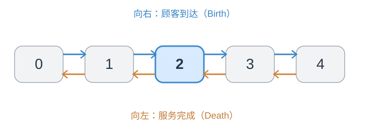
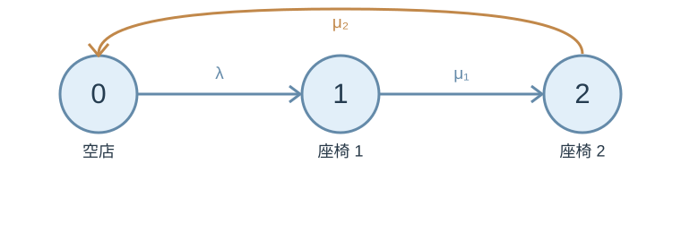
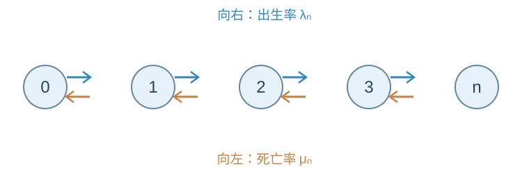
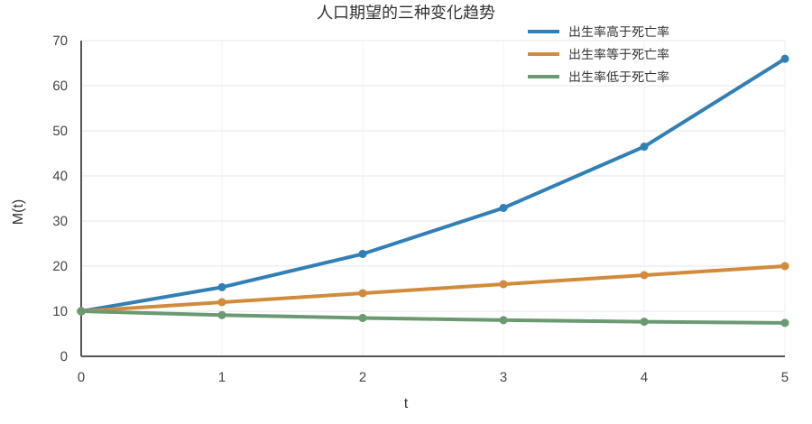
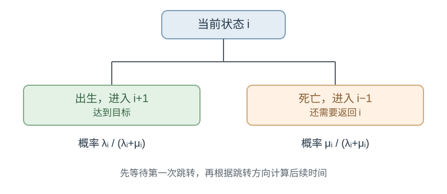

# 第六章：连续时间马尔可夫链（Continuous-Time Markov Chains）

教材：Ross, *Introduction to Probability Models*, 13th
Edition，§6.1--6.4。

这一章与你刚学完的第五章"指数分布与泊松过程"联系非常紧密。你可以把它理解为：第五章研究随机事件何时发生，第六章进一步研究随机事件如何让一个系统在不同状态之间变化。

我先帮你建立整个章节的知识框架，再按照教材的顺序展开概念、公式和典型例题。重点讲清楚为什么要这样建模、每个公式从哪里来，以及考试时如何识别和处理问题。

## 一、先从宏观理解：连续时间马尔可夫链到底研究什么？

### 1.1 我们要研究的是一个不断变化的系统

想象一家只有一名服务员的银行。顾客会随机到达，也会在完成服务后离开。

我们用

$$
X(t)=\text{时刻 }t\text{ 银行系统中的顾客人数}
$$

描述系统。

假如现在有两名顾客，那么未来可能发生两种事情：

-   新顾客到达，人数从 2 变成 3。
-   某位顾客完成服务并离开，人数从 2 变成 1。

而且，下一次变化何时发生，也是不确定的。



研究这种系统时，我们自然关心以下问题：

| 研究问题                                  | 对应的数学概念                     |
|:----------------------------------|:----------------------------------|
| 系统现在处于什么情况？                    | 状态（State）                      |
| 当前状态会持续多久？                      | 停留时间（Holding Time）           |
| 下一次会变成什么状态？                    | 状态转移（State Transition）       |
| 经过 $t$ 时间后，处于某状态的概率是多少？ | 转移概率（Transition Probability） |
| 第一次达到某个目标状态需要多久？          | 首次到达时间（First Passage Time） |

连续时间马尔可夫链（Continuous-Time Markov Chain，简称
**CTMC**）就是研究这些问题的一类随机过程模型。

### 1.2 和离散时间马尔可夫链有什么区别？

你可以回忆第四章的离散时间马尔可夫链（Discrete-Time Markov
Chain，DTMC）。

在 DTMC 中，状态在离散时刻 $0,1,2,\ldots$ 更新，通常研究：

$$
P_{ij}=P(X_{n+1}=j\mid X_n=i)
$$

它告诉我们：**从状态 $i$ 出发，下一步到达状态 $j$ 的概率。**

但是银行顾客不会恰好每隔一分钟到达或离开。状态可能在第 1.3
分钟改变，也可能在第 5.7 分钟改变。

因此，CTMC 需要同时描述两个方面：

|              | 问题一                                    | 问题二                                        |
|--------------------|:----------------------|:---------------------------|
| 要研究什么？ | **什么时候跳？** 当前状态会保持多长时间？ | **跳到哪里？** 离开当前状态后，进入哪个状态？ |
| 用什么描述？ | 指数分布（Exponential Distribution）      | 转移概率（Transition Probability）            |

这就是本章最核心的建模思想：

**CTMC = 指数停留时间 + 状态之间的随机跳转。**

准确地说，这是教材在时间齐次情形下、考虑实际状态跳转时使用的构造方式。停留时间与下一状态还需要满足独立性。

### 1.3 第六章 §6.1--6.4 的完整知识地图

``` text
§6.1–6.2 基本模型：CTMC
    马尔可夫性 → 指数停留时间 → 转移速率与跳转概率
                         ↓
§6.3 特殊且重要的模型：生灭过程
    状态只允许增加 1 或减少 1
    建立排队、人口增长模型；求期望与首次到达时间
                         ↓
§6.4 一般求解方法：转移概率
    Chapman–Kolmogorov 方程
    → 后向方程与前向方程（Backward / Forward Equations）
```

这三个部分是递进的：

首先，我们需要知道什么样的随机过程能称为
CTMC；接着，研究容易建模且应用广泛的生灭过程；最后，用微分方程计算经过任意时间
$t$ 后系统处于各种状态的概率。

其中：

-   **§6.2 的关键是建模**：如何选择状态、确定停留速率和下一状态概率。
-   **§6.3 的关键是分析过程**：根据出生率和死亡率，求期望、等待时间等。
-   **§6.4
    的关键是求分布**：由局部转移规律推导整个系统随时间演化的概率。

这也对应教材从 §6.1 到 §6.4 的安排。

------------------------------------------------------------------------

## 二、§6.2 CTMC 的基本原理：状态、停留时间与跳转

这一节是后面所有模型的基础。你只需要抓住一条线：

**马尔可夫性 → 无记忆性 → 指数停留时间 → 下一状态的转移概率。**

### 2.1 什么是马尔可夫性（Markov Property）？

马尔可夫性最核心的思想是：

> 在已知当前状态的条件下，预测未来不再需要知道更早的历史。

数学表达为：

$$
\begin{aligned}
&P\{X(s+t)=j\mid X(s)=i,\text{过去的历史}\}\\
&\qquad=P\{X(s+t)=j\mid X(s)=i\}.
\end{aligned}
$$

这个条件并不是说未来与过去完全独立，而是说：**当前状态已经包含了预测未来所需的信息。**

举个例子，假设银行只有一名服务员，顾客按照泊松过程到达，服务时间独立服从指数分布。

如果你知道现在银行有 3 名顾客，那么：

-   之前有多少人来过银行，不影响接下来到达的顾客数。
-   正在服务的顾客已经接受了多久的服务，也不影响其剩余服务时间的分布，因为指数分布具有无记忆性。

因此，只用当前顾客人数作为状态，就足以描述未来的人数变化。

反过来，如果服务时间是确定的 10 分钟，那么只知道当前有 3
人就不够了。正在服务的人究竟已经服务了 1 分钟还是 9
分钟，会显著影响下一次离开发生的时间。

这时，如果仍然只用人数作为状态，通常就不是马尔可夫链。

**所以建模时最关键的问题是：状态是否包含足够的信息？**

### 2.2 为什么 CTMC 的停留时间必须是指数分布？

这是第六章与第五章最重要的连接。

假设系统刚刚进入状态 $i$，定义：

$$
T_i=\text{系统进入状态 }i\text{ 后，直到离开该状态的时间}.
$$

我们先假设 CTMC
是时间齐次的（Time-Homogeneous），也就是状态转移规律不依赖日历时刻。

假如系统已经在状态 $i$ 停留了 $s$ 时间，仍然没有离开。

现在再问：它还会继续停留至少 $t$ 时间的概率是多少？

由于马尔可夫性，系统只需要知道现在仍处于状态
$i$，过去等了多久不影响未来。因此：

$$
P(T_i>s+t\mid T_i>s)=P(T_i>t).
$$

你应该认出，这恰好就是第五章的**无记忆性（Memoryless Property）**。

而第五章已经证明，在通常的非退化连续等待时间模型下，具有无记忆性的分布就是指数分布。

所以：

$$
\boxed{T_i\sim\operatorname{Exp}(v_i)}
$$

其中 $v_i$ 表示系统离开状态 $i$ 的速率（Transition Rate / Leaving
Rate）。

因此：

$$
P(T_i>t)=e^{-v_i t}, \qquad E[T_i]=\frac{1}{v_i}.
$$

这说明：

**当前状态决定离开的速率，指数分布决定何时离开。**

注意，若 $v_i=0$，状态 $i$ 可以是吸收状态（Absorbing
State），系统进入后永不离开，这时不使用有限均值的指数分布描述其停留时间。

### 2.3 离开以后，会跳转到哪个状态？

系统离开状态 $i$ 后，可以进入不同的状态。

教材定义：

$$
P_{ij}=P(\text{下一次跳转进入状态 }j\mid\text{当前在 }i).
$$

这里 $P_{ij}$ 是**下一跳的概率**，并不是经过任意时间 $t$ 后处于状态 $j$
的概率。

在教材中：

$$
P_{ii}=0,\qquad \sum_jP_{ij}=1
$$

其中默认讨论的是可以离开的状态，并且一次实际跳转必须改变状态。

我们把两个概念放在一起看：

| 参数      | 决定什么       | 数学描述                                         |
|:----------|:---------------|:-------------------------------------------------|
| $v_i$     | 何时离开 $i$   | $T_i\sim\operatorname{Exp}(v_i)$ |
| $P_{ij}$ | 离开后进入哪里 | 下一状态 $j$ 的概率                              |

在教材的 CTMC
构造中，**离开当前状态的等待时间，与下一次进入哪个状态相互独立**。

因此，即使给定"下一次会进入 $j$"，也不会改变离开状态 $i$
的指数等待分布。

你可以将 CTMC
想象成一个不断重复的过程：进入一个状态，随机等待一段指数时间，再随机选择下一个状态，然后重新开始。

这相当于在离散时间马尔可夫链的每次跳转之间，插入随机的指数停留时间。

### 2.4 教材例 6.1：擦鞋店（A Shoe Shine Shop）

先完整介绍题目。

一家擦鞋店有两个座椅。顾客必须先到座椅 1 清洁并上鞋油，然后转移到座椅 2
抛光。

已知条件：

-   座椅 1 的服务时间服从速率为 $\mu_1$ 的指数分布。
-   座椅 2 的服务时间服从速率为 $\mu_2$ 的指数分布。
-   潜在顾客按照速率为 $\lambda$ 的泊松过程到达。
-   只有两个座椅都空着，顾客才会进入店内；否则直接拒绝。

问题是：**如何把这个系统建模为 CTMC，确定状态和转移规律？**

**第一步：设计状态。**

因为同一时间最多只有一位顾客，所以容易想到只用人数 $0,1$ 表示状态。

但这样有问题。

如果现在有一位顾客，他可能正在座椅 1，也可能正在座椅
2。两种情况下，下一次系统变化完全不同：在座椅 1 完成后转移到座椅
2；在座椅 2 完成后直接离店。

所以必须把这两种情况区分开。

定义：

$$
\begin{cases}
0:&\text{店内没人},\\
1:&\text{顾客正在座椅 1},\\
2:&\text{顾客正在座椅 2}.
\end{cases}
$$



**第二步：确定可能的跳转。**

三种跳转分别是：

$$
0\xrightarrow{\lambda}1,\qquad
1\xrightarrow{\mu_1}2,\qquad
2\xrightarrow{\mu_2}0.
$$

于是：

$$
v_0=\lambda,\qquad v_1=\mu_1,\qquad v_2=\mu_2.
$$

而每个状态离开后只有一个可能的下一状态，所以：

$$
P_{01}=P_{12}=P_{20}=1.
$$

这里有一个容易忽略的细节：**店内已有顾客时，潜在新顾客即使到达，也不会让系统状态发生变化。**

因此，状态 1 和状态 2 的离开速率不需要再加上 $\lambda$。

这道题最重要的不是计算，而是让你理解：**建模首先要判断需要多少状态，而不是马上套公式。**

### 2.5 瞬时转移速率（Instantaneous Transition Rate）

假如状态 $i$ 可以跳转到多个状态，那么我们除了知道总离开速率
$v_i$，还希望知道分别以多快的速率跳向各状态。

教材定义：

$$
\boxed{q_{ij}=v_iP_{ij},\qquad i\ne j.}
$$

其含义是：

$$
\underbrace{q_{ij}}_{\text{跳向 }j\text{ 的速率}}
=
\underbrace{v_i}_{\text{离开 }i\text{ 的总速率}}
\underbrace{P_{ij}}_{\text{下一跳选 }j\text{ 的概率}}.
$$

例如当前离开状态 $i$ 的速率为 5，而下一次有 40% 的可能进入 $j$，那么：

$$
q_{ij}=5\times0.4=2.
$$

在很小的时间间隔 $h$ 内：

$$
P_{ij}(h)=q_{ij}h+o(h),\qquad i\ne j.
$$

这里先把 $P_{ij}(h)$ 理解为"当前从 $i$ 出发，经过 $h$ 后位于 $j$
的概率"，后面会严格定义。

同样，短时间内仍处于 $i$ 的概率为：

$$
P_{ii}(h)=1-v_i h+o(h).
$$

其中 $o(h)/h\to0$。它表示与 $h$ 相比可以忽略的高阶小量。

注意，$q_{ij}$ 是速率，不是概率。只有乘上足够小的时间间隔
$h$，才近似得到一次跳转的概率。

这个参数 $q_{ij}$ 是 §6.4 前向、后向方程的核心，因此需要真正理解。

------------------------------------------------------------------------

## 三、§6.3 生灭过程：最重要的一类 CTMC

有了基本模型以后，为什么还要特别引入生灭过程（Birth and Death
Process）？

因为很多实际系统都可以用一个整数表示状态，而且每次变化只会让这个整数增加
1 或减少 1。

例如，银行顾客人数、系统中正在运行的机器数、某种生物种群数量。

这时我们没有必要研究任意复杂的状态跳转，可以利用更简单的结构得到具体结果。

### 3.1 生灭过程的定义

设 $X(t)=n$ 表示当前系统处于状态 $n$。

只允许两种实际跳转：

$$
n\longrightarrow n+1
$$

称为出生（Birth），速率记作 $\lambda_n$。

$$
n\longrightarrow n-1
$$

称为死亡（Death），速率记作 $\mu_n$。

其中：

-   $\lambda_n$：状态 $n$ 下的出生率（Birth Rate）。
-   $\mu_n$：状态 $n$ 下的死亡率（Death Rate）。

对从 0 开始的状态空间，通常取
$\mu_0=0$，因为不允许人数下降到负数。

### 3.2 为什么离开状态 $n$ 的速率是 $\lambda_n+\mu_n$？

这一步直接利用第五章的**指数竞争（Exponential Race）**。

当系统处于 $n$ 时，设：

$$
T_B\sim\operatorname{Exp}(\lambda_n)
$$

是等待下一次出生的时间，

$$
T_D\sim\operatorname{Exp}(\mu_n)
$$

是等待下一次死亡的时间。

两者独立。

系统的下一次状态改变，取决于哪个事件先发生。所以等待时间为：

$$
T_n=\min(T_B,T_D).
$$

第五章已经证明：

$$
\min(T_B,T_D)\sim
\operatorname{Exp}(\lambda_n+\mu_n).
$$

因此：

$$
\boxed{v_n=\lambda_n+\mu_n.}
$$

与此同时：

$$
\boxed{
P_{n,n+1}=\frac{\lambda_n}{\lambda_n+\mu_n}
}
$$

$$
\boxed{
P_{n,n-1}=\frac{\mu_n}{\lambda_n+\mu_n}
}
$$

这里假设
$\lambda_n+\mu_n>0$，零速率的事件可理解为不会触发。

把它们与上一节的关系连起来，就得到：

$$
q_{n,n+1}=v_nP_{n,n+1}=\lambda_n,
$$

$$
q_{n,n-1}=v_nP_{n,n-1}=\mu_n.
$$

可见，生灭过程中的 $\lambda_n,\mu_n$
本身就是两个方向的瞬时转移速率。

### 3.3 教材中的几种典型生灭模型



| 模型                                       | 出生率 $\lambda_n$   | 死亡率 $\mu_n$    | 关键机制         |
| :--------------------------------------- | :---------------- | :------------- | :----------- |
| 泊松过程（Poisson Process）                    | $\lambda$         | 0              | 只有新增事件，速率恒定  |
| Yule 过程（Yule Process）                    | $n\lambda$        | 0              | 每个现有个体都能独立繁殖 |
| 带移民的线性增长（Linear Growth with Immigration） | $n\lambda+\theta$ | $n\mu$         | 个体繁殖、死亡与外部移民 |
| M/M/1 排队系统                               | $\lambda$         | $\mu$,$n\ge1$  | 一名服务员        |
| M/M/s 排队系统                               | $\lambda$         | $\min(n,s)\mu$ | $s$ 名服务员     |


我们重点理解其中几个容易混淆的地方。

**第一，泊松过程为什么是纯生过程（Pure Birth Process）？**

在第五章，泊松过程 $N(t)$ 表示到时刻 $t$ 已经发生的事件总数。

每次新事件只让计数增加 1，不会减少。

而每次等待都是独立的
$\operatorname{Exp}(\lambda)$，因此：

$$
\lambda_n=\lambda,\qquad \mu_n=0.
$$

所以泊松过程其实就是 CTMC 的一个特殊例子。

**第二，Yule 过程为什么有 $n\lambda$，而不是
$\lambda$？**

教材例 6.3 假设某种群的每个个体独立繁殖，每个个体都以速率
$\lambda$ 生出一个新个体，且没有死亡。

假设当前有 5 个个体，就相当于有 5 个独立的指数时钟同时运行。

其中任何一个时钟先响，种群都会增加一个个体。

所以总出生速率为：

$$
5\lambda.
$$

一般情况下：

$$
\lambda_n=n\lambda.
$$

这与普通泊松过程最大的区别是：**出生率会随着当前人数增加而增大。**

如果最初没有个体，而且没有外来移民，那么
$\lambda_0=0$，种群就会永远停留在 0。

**第三，为什么 M/M/1 的死亡率是 $\mu$，而 M/M/s 是
$\min(n,s)\mu$？**

教材例 6.5 和例 6.6 都研究顾客按速率 $\lambda$
的泊松过程到达的排队系统，每个服务员的服务时间独立服从速率为
$\mu$ 的指数分布。

M/M/1 只有一个服务员。无论系统有 2 人还是 20
人，同时都只有一人在接受服务。

因此，只要系统非空：

$$
\mu_n=\mu.
$$

但 M/M/s 有 $s$ 个服务员。

假设有 3 个顾客、2 个服务员，实际上只有 2
个人正在服务，第三个人在排队。因此下一次服务完成的总速率是：

$$
2\mu,
$$

而不是 $3\mu$。

一般来说：

$$
\boxed{\mu_n=\min(n,s)\mu.}
$$

你可以看到，本质上始终都是第五章的"独立指数时钟竞争"。需要数清楚的不是系统里有多少人，而是**当前有多少个能够触发相应事件的时钟**。

### 3.4 教材例 6.4：人口增长模型，为什么可以建立微分方程？

这道题很有代表性，因为它告诉我们：**不一定要先求出完整概率分布，才能计算随机过程的期望。**

先复述题目。

某地区人口会由于三个原因发生变化：

人口中每个人独立以速率 $\lambda$ 生育，每个人独立以速率
$\mu$ 死亡，另外还有外部移民以总速率 $\theta$ 进入。

设 $X(t)$ 为时刻 $t$ 的总人口，初始人口 $X(0)=i$。

要求：

$$
M(t)=E[X(t)].
$$

**第一步：根据当前状态确定变化速率。**

如果当前人口数是 $n$，那么：

$$
\lambda_n=n\lambda+\theta, \qquad
\mu_n=n\mu.
$$

因为：

-   $n\lambda$ 是现有个体产生新生儿的总速率。
-   $\theta$ 是外来移民的速率。
-   $n\mu$ 是现有个体死亡的总速率。

**第二步：研究一个极短时间 $h$ 中的人口变化。**

已知 $X(t)=n$。

在 $(t,t+h]$ 内，一次出生或移民使人口增加 1，概率为：

$$
(n\lambda+\theta)h+o(h).
$$

一次死亡使人口减少 1，概率为：

$$
n\mu h+o(h).
$$

其余情况下，人口保持不变；多次跳转的影响是更小阶的。

因此：

$$
\begin{aligned}
E[X(t+h)\mid X(t)=n]
&=n+(n\lambda+\theta)h-n\mu h+o(h)\\
&=n+[(\lambda-\mu)n+\theta]h+o(h).
\end{aligned}
$$

为什么这样算？

因为我们求的是人口的期望变化量。每次出生贡献 $+1$，每次死亡贡献
$-1$，只要分别乘上发生概率即可。

**第三步：对当前人口的随机性取期望。**

刚才是固定 $X(t)=n$ 的结果。但 $X(t)$ 本身也是随机的。

使用全期望公式（Law of Total Expectation）：

$$
E[X(t+h)] =E[E[X(t+h)\mid X(t)]].
$$

得到：

$$
M(t+h)=M(t)+[(\lambda-\mu)M(t)+\theta]h+o(h).
$$

两边减去 $M(t)$，再除以 $h$：

$$
\frac{M(t+h)-M(t)}{h}
=(\lambda-\mu)M(t)+\theta+\frac{o(h)}h.
$$

令 $h\to0$，便得到：

$$
\boxed{M'(t)=(\lambda-\mu)M(t)+\theta.}
$$

这是一个一阶线性微分方程（First-Order Linear Differential Equation）。

它的含义非常直观：

$$
\underbrace{M'(t)}_{\text{平均人口变化速度}} =
\underbrace{\lambda M(t)}_{\text{平均出生贡献}} -
\underbrace{\mu M(t)}_{\text{平均死亡贡献}} +
\underbrace{\theta}_{\text{外部移民贡献}}.
$$

**第四步：解微分方程。**

当 $\lambda\ne\mu$ 时，使用初始条件
$M(0)=i$，得到：

$$
\boxed{
M(t)=
ie^{(\lambda-\mu)t}
+\frac{\theta}{\lambda-\mu}
\left(e^{(\lambda-\mu)t}-1\right).
}
$$

如果 $\lambda=\mu$，则：

$$
\boxed{M(t)=i+\theta t.}
$$

这两个结果分别对应不同的人口变化机制。



当 $\lambda>\mu$，平均人口呈指数增长；当
$\lambda=\mu$，平均人口由移民带动线性增长；当
$\lambda<\mu$ 且
$\theta>0$，平均人口最终趋向：

$$
\lim_{t\to\infty}M(t)=\frac{\theta}{\mu-\lambda}.
$$

注意，这里只是求出了**人口的期望**，没有得到 $X(t)$
的完整概率分布，也没有证明整个过程一定存在平稳分布。

这道题最值得掌握的通用方法是：

**先给定当前状态，分析短时间内有哪些变化，再取期望，最后让时间间隔趋于零。**

### 3.5 首次到达时间（First Passage Time）：为什么不能简单取速率倒数？

接下来教材研究一种很重要的题型：系统第一次达到目标状态，需要多长时间？

例如，一家银行现在有 2 名顾客，我们想知道第一次达到 3 名顾客需要多久。

假设当前有 2
人，下一次变化未必是新顾客到达，也可能是有人离开，导致人数变成 1。

所以：

**从状态 2 第一次达到状态 3，通常不只是等待一次出生事件。**

我们需要考虑过程中可能出现的反复下降与上升。

教材定义：

$$
T_i=\text{从状态 }i\text{ 出发，首次进入状态 }i+1\text{ 的时间}.
$$

注意这里的 $T_i$
是首次到达时间，不再是前面表示单次停留时间的符号。教材在不同小节局部复用了
$T_i$，必须结合定义判断。

设：

$$
m_i=E[T_i].
$$

从状态 0 出发，只能通过出生进入状态 1，因此：

$$
m_0=\frac{1}{\lambda_0}.
$$

对于 $i\ge1$，先看第一次跳转：



无论哪种跳转先发生，都要先等待：

$$
E[\text{第一次跳转时间}]
=\frac{1}{\lambda_i+\mu_i}.
$$

如果第一次是出生，直接到达目标，任务完成。

如果第一次是死亡，系统从 $i$ 下降到 $i-1$，则必须先返回 $i$，再从 $i$
到达 $i+1$。

利用马尔可夫性，后两段的期望分别为 $m_{i-1}$ 和 $m_i$。

因此：

$$
m_i= \frac{1}{\lambda_i+\mu_i}
+\frac{\mu_i}{\lambda_i+\mu_i}(m_{i-1}+m_i).
$$

这就是**首次事件分析（First-Step
Analysis）**，与第五章排队放弃题中的递推方法本质相同。

整理方程：

$$
(\lambda_i+\mu_i)m_i =1+\mu_i
m_{i-1}+\mu_i m_i.
$$

移项得到：

$$
\lambda_i m_i=1+\mu_i m_{i-1}.
$$

所以：

$$
\boxed{
m_i=\frac1{\lambda_i}
+\frac{\mu_i}{\lambda_i}m_{i-1}.
}
$$

这条递推非常值得掌握。

它有一个很清楚的解释：

$$
\underbrace{\frac1{\lambda_i}}_{\text{只考虑出生的基础时间}} +
\underbrace{\frac{\mu_i}{\lambda_i}m_{i-1}}_{\text{向下跳转导致的额外延迟}}.
$$

死亡率越大，达到更高状态就越困难，所以期望时间自然会增加。

**教材例 6.7：M/M/1 系统首次达到更高顾客人数。**

题目假设顾客按固定速率 $\lambda$ 到达，一名服务员以速率
$\mu$ 提供指数服务。要求从当前顾客人数 $i$ 首次达到 $i+1$
的平均时间。

因为：

$$
\lambda_i=\lambda,\qquad\mu_i=\mu\quad(i\ge1),
$$

于是：

$$
m_i=\frac1\lambda+\frac\mu\lambda m_{i-1},
\qquad m_0=\frac1\lambda.
$$

逐次代入：

$$
m_1=\frac1\lambda\left(1+\frac\mu\lambda\right),
$$

$$
m_2=\frac1\lambda\left[1+\frac\mu\lambda+
\left(\frac\mu\lambda\right)^2\right].
$$

所以：

$$
\boxed{
m_i=\frac1\lambda\sum_{r=0}^{i}
\left(\frac\mu\lambda\right)^r.
}
$$

如果 $\lambda=\mu$，则：

$$
m_i=\frac{i+1}{\lambda}.
$$

假设要从状态 $k$ 到达状态
$j>k$，由于生灭过程每次只能上升一格，必然依次经过：

$$
k\rightarrow k+1\rightarrow\cdots\rightarrow j.
$$

由期望的可加性：

$$
\boxed{
E[\text{从 }k\text{ 首次到达 }j\text{ 的时间}]
=\sum_{i=k}^{j-1}m_i.
}
$$

这比直接研究从 $k$ 到 $j$ 的复杂路径容易得多。

教材还进一步求首次到达时间的方差（Variance）。方法仍是先根据第一次出生或死亡条件化，再使用全方差公式：

$$
\operatorname{Var}(T_i)
=E[\operatorname{Var}(T_i\mid I_i)]
+\operatorname{Var}(E[T_i\mid I_i]),
$$

其中 $I_i=1$ 表示第一次跳转为出生，$I_i=0$ 表示死亡。

由此得到递推：

$$
\begin{aligned}
\operatorname{Var}(T_i)
={}&\frac1{\lambda_i(\lambda_i+\mu_i)}
+\frac{\mu_i}{\lambda_i}\operatorname{Var}(T_{i-1})\\
&+\frac{\mu_i}{\lambda_i+\mu_i}(m_{i-1}+m_i)^2.
\end{aligned}
$$

初值为
$\operatorname{Var}(T_0)=1/\lambda_0^2$。这一分支比期望递推更繁琐，复习时建议先掌握"条件于第一次跳转
→ 全方差 → 递推"的思路，不要只背最终长公式。

到这里，§6.3 的两类主要任务可以清楚地区分：

| 任务                     | 首先研究什么           | 主要方法                   |
|:------------------------|:----------------------|:----------------------|
| 求时刻 $t$ 的平均状态    | 短时间的期望变化量     | 全期望 + 微分方程          |
| 求首次达到目标状态的时间 | 第一次跳转后的不同分支 | First-Step Analysis + 递推 |

它们处理的是不同问题，不能因为都是生灭过程，就机械套同一个公式。

------------------------------------------------------------------------

## 四、§6.4 转移概率：怎样求任意时刻的状态分布？

现在我们已经知道了 CTMC 如何运行，也知道了生灭过程怎样建模。

但是还有一个重要问题没有解决：

**如果现在处于状态 $i$，那么经过 $t$ 时间以后，系统处于状态 $j$
的概率是多少？**

例如，一台机器现在正常工作，经过 10 小时后它仍然正常工作的概率是多少？

这就是 §6.4 要解决的问题。

### 4.1 首先分清两个非常相似的符号

教材定义连续时间转移概率函数（Transition Probability Function）：

$$
\boxed{
P_{ij}(t)=P\{X(s+t)=j\mid X(s)=i\}.
}
$$

由于假设是时间齐次 CTMC，概率不依赖起始时刻 $s$，只依赖经过的时长 $t$。

这里需要特别注意：

| 符号         | 含义                                                |
|:-------------|:----------------------------------------------------|
| $P_{ij}$    | 离开状态 $i$ 后，**下一跳**进入状态 $j$ 的概率      |
| $P_{ij}(t)$ | 从状态 $i$ 出发，**经过 $t$ 时间**后处于 $j$ 的概率 |

二者不是同一回事。

例如，对于前面擦鞋店的状态 0：

$$
P_{00}=0
$$

因为店里空着时，如果真的发生状态跳转，下一状态必然是 1，不可能又跳回 0。

但：

$$
P_{00}(t)>0
$$

因为经过 $t$
时间以后，店里可能一直没有顾客进入，也可能有顾客进入、完成全部服务后离开，重新变成空店。

这也说明：

**$P_{ij}(t)$ 允许在这段时间里发生零次、一次或多次跳转。**

CTMC 的初始条件为：

$$
P_{ij}(0)=
\begin{cases}
1,&i=j,\\
0,&i\ne j.
\end{cases}
$$

并且固定初始状态 $i$，各个终点状态互斥且穷尽，因此：

$$
\sum_jP_{ij}(t)=1.
$$

这些条件将在求解微分方程时发挥作用。

### 4.2 Chapman--Kolmogorov 方程：把一段时间拆成两段

这是建立前向和后向方程的基础，也是第四章与第六章的直接联系。

我们想求：

$$
P_{ij}(t+s).
$$

即从状态 $i$ 出发，经过总共 $t+s$ 时间以后，处于状态 $j$ 的概率。

我们可以先在中间时刻 $t$ 观察系统。

此时系统可能位于任意状态 $k$。

若中间状态为 $k$，则从 $i$ 到 $j$ 的完整过程可以拆成：

$$
i\xrightarrow{\ t\ }k\xrightarrow{\ s\ }j.
$$

第一段的概率是 $P_{ik}(t)$，第二段在给定状态 $k$ 后，由马尔可夫性得到
$P_{kj}(s)$。

再对所有可能的中间状态 $k$ 求和：

$$
\boxed{
P_{ij}(t+s)=\sum_kP_{ik}(t)P_{kj}(s).
}
$$

这就是 Chapman--Kolmogorov 方程（Chapman--Kolmogorov Equations）。

它的数学依据是全概率公式（Law of Total Probability）和马尔可夫性。

**它的意义在于：只要知道各个状态之间短时间如何变化，就可以逐渐推导更长时间的转移规律。**

而下面的两套微分方程，就是让其中一段时间无限缩短所得到的。

### 4.3 后向方程（Kolmogorov's Backward Equations）

我们先研究后向方程。

它的核心思路是：

**从初始状态 $i$ 出发，先观察极短时间 $h$ 内发生了什么，再计算剩余的 $t$
时间。**

将 Chapman--Kolmogorov 方程写成：

$$
P_{ij}(t+h) =\sum_kP_{ik}(h)P_{kj}(t).
$$

由于 $h$ 很小，可以近似认为这段时间内最多发生一次跳转。

我们已经知道：

$$
P_{ii}(h)=1-v_i h+o(h),
$$

以及对于 $k\ne i$：

$$
P_{ik}(h)=q_{ik}h+o(h).
$$

代入得到：

$$
\begin{aligned}
P_{ij}(t+h)
={}&(1-v_i h)P_{ij}(t)\\
&+\sum_{k\ne i}q_{ik}hP_{kj}(t)+o(h).
\end{aligned}
$$

这里第一项表示"最初没有离开 $i$，剩余时间仍从 $i$ 开始"。

求和项表示"最初先跳到某个状态 $k$，然后从 $k$ 继续演化"。

两边减去 $P_{ij}(t)$：

$$
\begin{aligned}
P_{ij}(t+h)-P_{ij}(t)
={}&-v_i hP_{ij}(t)\\
&+\sum_{k\ne i}q_{ik}hP_{kj}(t)+o(h).
\end{aligned}
$$

再除以 $h$，让 $h\to0$，得到：

$$
\boxed{
P_{ij}'(t)
=\sum_{k\ne i}q_{ik}P_{kj}(t)-v_iP_{ij}(t).
}
$$

这就是 Kolmogorov 后向方程。

你不用机械记忆，可以直接理解它的结构：

$$
\text{从 }i\text{ 先跳往其他状态的贡献} -
\text{从 }i\text{ 离开的贡献}.
$$

它首先关注的是**初始状态 $i$**，所以第一项中是 $q_{ik}$，而最后一项是
$v_i$。

对于生灭过程，只能先去 $i+1$ 或 $i-1$，因此：

$$
\boxed{
\begin{aligned}
P_{ij}'(t)
={}&\lambda_iP_{i+1,j}(t)
+\mu_iP_{i-1,j}(t)\\
&-(\lambda_i+\mu_i)P_{ij}(t),
\qquad i\ge1.
\end{aligned}
}
$$

边界状态 0 则为：

$$
P_{0j}'(t) =\lambda_0[P_{1j}(t)-P_{0j}(t)].
$$

把每一项理解成：从初始状态 $i$
出发，第一步可能向上或向下，之后都要在剩余时间内到达 $j$。

### 4.4 前向方程（Kolmogorov's Forward Equations）

现在换一个角度。

刚才是观察**开始的极短时间**，这次我们观察**结束前的极短时间**。

使用：

$$
P_{ij}(t+h) =\sum_kP_{ik}(t)P_{kj}(h).
$$

这意味着：

先经过长时间 $t$，到达某个状态 $k$，再在最后的 $h$ 时间内进入最终状态
$j$。

因此，能够在最后一小段时间进入 $j$ 的路径，必须从其他状态 $k$ 跳转过来。

经过同样的短时间展开，得到：

$$
\boxed{
P_{ij}'(t)
=\sum_{k\ne j}q_{kj}P_{ik}(t)-v_jP_{ij}(t).
}
$$

这就是 Kolmogorov 前向方程。

它的含义更像一个**概率流入与流出平衡（Probability Flow Balance）**：

$$
\boxed{
\text{状态 }j\text{ 的概率变化率}
=
\text{流入 }j\text{ 的概率速率}
-
\text{流出 }j\text{ 的概率速率}.
}
$$

注意这里的关键词是**概率**。

系统的状态虽然是整数，但 $P_{ij}(t)$
是概率，随时间连续变化，所以我们可以对它求导。

对于生灭过程，只有相邻状态能够进入 $j$。

因此当 $j\ge1$ 时：

$$
\boxed{
\begin{aligned}
P_{ij}'(t)
={}&\lambda_{j-1}P_{i,j-1}(t)
+\mu_{j+1}P_{i,j+1}(t)\\
&-(\lambda_j+\mu_j)P_{ij}(t).
\end{aligned}
}
$$

对状态 0：

$$
P_{i0}'(t) =\mu_1P_{i1}(t)-\lambda_0P_{i0}(t).
$$

这个式子很值得从实际意义上理解。

假设我们研究"系统当前恰好有 2 名顾客"的概率。

那么这个概率为什么会增加？

因为系统原来有 1 人，新来了 1 人；或者原来有 3 人，有 1 人离开。

这个概率为什么会减少？

因为当前有 2 人时，新顾客到达会变成 3，顾客离开会变成 1。

所以：

$$
\begin{aligned}
\frac{d}{dt}P_{i2}(t)
={}&\underbrace{\lambda_1P_{i1}(t)}_{\text{从状态 1 流入}}\\
&+\underbrace{\mu_3P_{i3}(t)}_{\text{从状态 3 流入}}\\
&-\underbrace{(\lambda_2+\mu_2)P_{i2}(t)}_{\text{从状态 2 流出}}.
\end{aligned}
$$

这就是前向方程最直观的本质。

### 4.5 前向和后向方程究竟有什么区别？

这是这一节最容易混淆的地方。

它们不是两个不同的模型，也不是两个互相矛盾的结论，而是**对同一个转移概率
$P_{ij}(t)$ 采用两种不同的时间分解方式**。

| 对比     | 后向方程（Backward） | 前向方程（Forward）    |
|:---------|:---------------------|:-----------------------|
| 观察位置 | 最开始的极短时间     | 最后面的极短时间       |
| 主要关注 | 从起点 $i$ 如何离开  | 如何流入或流出终点 $j$ |
| 速率下标 | $q_{ik}$、$v_i$     | $q_{kj}$、$v_j$       |
| 解题直觉 | 第一次跳转分析       | 概率流入 − 概率流出    |
| 特点     | 按初始状态分解       | 按终点状态分解         |

你可以用一句话记住：

**后向方程看"从哪里走"，前向方程看"到哪里来"。**

如果已经会推导这两种思路，考试时即使忘记公式，也能重新列出来。

### 4.6 教材例 6.11：机器故障与修复（Machine Breakdown and Repair）

这是 §6.4
我最建议你完整掌握的例题，因为它同时包含状态设计、指数停留时间、前向和后向方程，以及求解微分方程。

**题目完整复述：**

一台机器正常工作的持续时间服从速率为 $\lambda$
的指数分布，即平均工作 $1/\lambda$ 时间后发生故障。

发生故障以后，机器需要维修，维修时间服从速率为 $\mu$
的指数分布，即平均维修时间为 $1/\mu$。

每次工作时间和维修时间相互独立，且维修完成后机器重新正常工作，可以再次发生故障。

已知机器在 $t=0$ 时正常工作。

求：**经过 10 个时间单位以后，机器仍处于正常工作状态的概率。**

**第一步：建立状态。**

定义：

$$
\begin{cases}
0:&\text{机器正常工作（Working）},\\
1:&\text{机器正在维修（Under Repair）}.
\end{cases}
$$

状态转移为：

$$
0\xrightarrow{\lambda}1, \qquad
1\xrightarrow{\mu}0.
$$

**第二步：明确所求对象。**

因为最初处于状态 0，而我们关心 10 时间单位后是否处于状态 0：

$$
\text{所求}=P_{00}(10).
$$

注意这不是"10 时间单位内完全不发生故障"的概率。

机器完全可能经历：

$$
0\to1\to0
$$

甚至更多次故障与维修，在观察时刻仍然处于状态 0。

**第三步：建立前向方程。**

令：

$$
p(t)=P_{00}(t).
$$

因为机器只有两个状态，从状态 0 出发：

$$
P_{01}(t)=1-P_{00}(t)=1-p(t).
$$

观察正常工作状态 0 的概率如何变化。

它会因为正常机器发生故障而减少，也会因为故障机器修好而增加。

因此：

$$
p'(t)=\mu P_{01}(t)-\lambda P_{00}(t).
$$

代入 $P_{01}(t)=1-p(t)$：

$$
p'(t)=\mu[1-p(t)]-\lambda p(t).
$$

整理：

$$
\boxed{
p'(t)=\mu-(\lambda+\mu)p(t).
}
$$

初始条件：

$$
p(0)=1.
$$

**第四步：求解微分方程。**

这是标准的一阶线性微分方程。

先把常数项对应的平衡值找出来：

$$
p_{\ast}=\frac{\mu}{\lambda+\mu}.
$$

令：

$$
y(t)=p(t)-p_{\ast}.
$$

于是：

$$
\begin{aligned}
y'(t)
&=\mu-(\lambda+\mu)[y(t)+p_{\ast}]\\
&=-(\lambda+\mu)y(t).
\end{aligned}
$$

解得：

$$
y(t)=Ce^{-(\lambda+\mu)t}.
$$

因此：

$$
p(t)=\frac{\mu}{\lambda+\mu}
+Ce^{-(\lambda+\mu)t}.
$$

利用 $p(0)=1$：

$$
C=1-\frac{\mu}{\lambda+\mu}
=\frac{\lambda}{\lambda+\mu}.
$$

最终得到：

$$
\boxed{
P_{00}(t)=
\frac{\mu}{\lambda+\mu}
+\frac{\lambda}{\lambda+\mu}e^{-(\lambda+\mu)t}.
}
$$

代入 $t=10$：

$$
\boxed{
P_{00}(10)=
\frac{\mu}{\lambda+\mu}
+\frac{\lambda}{\lambda+\mu}e^{-10(\lambda+\mu)}.
}
$$

这里的 10 必须与 $\lambda,\mu$ 的时间单位相匹配。

**第五步：解释结果，检查是否合理。**

当 $t=0$：

$$
P_{00}(0)=1,
$$

符合机器最初正在工作的条件。

当 $t\to\infty$：

$$
P_{00}(t)\longrightarrow \frac{\mu}{\lambda+\mu}.
$$

这说明随着时间增加，初始状态的影响逐渐衰减；长期来看，正常工作的概率趋向一个由故障率和维修率共同决定的值。

故障率越高，正常工作的长期比例越低；维修率越高，正常工作的长期比例越高。

在后面的 §6.5 中，教材会系统研究这类长期概率（Limiting
Probabilities）。目前我们先把它理解为这个两状态模型求解后的性质即可。

需要说明，教材例 6.11 原本使用**后向方程**求解。它列出：

$$
\begin{cases}
P_{00}'(t)=\lambda[P_{10}(t)-P_{00}(t)],\\
P_{10}'(t)=\mu[P_{00}(t)-P_{10}(t)].
\end{cases}
$$

再联立求解，最终得到与我们使用前向方程完全相同的 $P_{00}(t)$。

我先用前向方程讲，是因为"正常状态的概率流入与流出"更容易直观理解。掌握后也应该能看懂教材的后向解法。

### 4.7 纯生过程怎样求转移概率？

教材还专门研究了纯生过程（Pure Birth Process）。

因为只有状态增加，不会下降，所以它的转移概率比一般 CTMC 更容易计算。

假设当前状态为 $i$，每次从状态 $k$ 到达 $k+1$ 的速率为
$\lambda_k$。

如果只关心经过 $t$ 时间后仍处于状态 $i$：

因为只要发生一次出生，就永远不会回到 $i$，所以必须一直没有发生出生。

因此：

$$
\boxed{P_{ii}(t)=e^{-\lambda_i t}.}
$$

但如果要恰好到达 $i+1$，就必须在 $t$
之前发生一次出生，并且之后没有发生第二次出生。

利用前向方程：

$$
P_{i,i+1}'(t) =\lambda_i P_{ii}(t)
-\lambda_{i+1}P_{i,i+1}(t).
$$

代入刚才的结果：

$$
P_{i,i+1}'(t)+\lambda_{i+1}P_{i,i+1}(t) =\lambda_i
e^{-\lambda_i t}.
$$

使用积分因子（Integrating
Factor）$e^{\lambda_{i+1}t}$，以及初始条件
$P_{i,i+1}(0)=0$，得到：

$$
P_{i,i+1}(t) = \lambda_i e^{-\lambda_{i+1}t}
\int_0^t e^{(\lambda_{i+1}-\lambda_i)s}\,ds.
$$

当 $\lambda_{i+1}\ne\lambda_i$ 时：

$$
\boxed{
P_{i,i+1}(t)=
\frac{\lambda_i}{\lambda_{i+1}-\lambda_i}
\left(e^{-\lambda_i t}-e^{-\lambda_{i+1}t}\right).
}
$$

若这两个速率相等，均为 $\lambda$，则直接对积分计算：

$$
P_{i,i+1}(t)=\lambda t e^{-\lambda t}.
$$

你应该发现，它正好就是：

$$
P\{\operatorname{Poisson}(\lambda t)=1\}.
$$

这再次把第六章的纯生过程与第五章的泊松过程连接起来了。

更一般地，假设首次到达状态 $j$ 的时间为：

$$
\tau_j=\sum_{k=i}^{j-1}T_k,
\qquad T_k\sim\operatorname{Exp}(\lambda_k),
$$

其中各段停留时间独立。

那么恰好在时刻 $t$ 位于状态 $j$，就等价于：

$$
\tau_j\le t<\tau_{j+1}.
$$

所以：

$$
\boxed{
P_{ij}(t)=P(\tau_{j+1}>t)-P(\tau_j>t),
\qquad j>i.
}
$$

教材利用第五章"不同速率指数随机变量之和（Hypoexponential
Distribution）"的结果，将其展开成显式乘积求和公式。

但初学时最值得掌握的是：

**到达某状态的时间 = 之前各个状态的指数停留时间之和；处于该状态 =
已经到达它，但尚未到达下一状态。**

这比直接记忆一串复杂乘积更有迁移价值。

### 4.8 教材例 6.8：Yule 过程为什么会得到几何分布？

先复述题目。

某种群最初只有一个个体，每个现有个体独立以速率 $\lambda$
生出新个体，没有死亡，也没有外来移民。

设 $X(t)$ 表示时刻 $t$ 的个体数，求：

$$
P_{1j}(t)=P(X(t)=j\mid X(0)=1).
$$

根据前面已经建立的模型：

$$
\lambda_n=n\lambda,\qquad\mu_n=0.
$$

从一名个体开始，初始时刻只能有：

$$
P_{11}(0)=1.
$$

由纯生过程的前向方程：

$$
P_{11}'(t)=-\lambda P_{11}(t),
$$

所以：

$$
P_{11}(t)=e^{-\lambda t}.
$$

对于状态 2：

$$
P_{12}'(t)=\lambda P_{11}(t)-2\lambda P_{12}(t).
$$

解得：

$$
P_{12}(t)=e^{-\lambda t}(1-e^{-\lambda t}).
$$

继续使用相同的前向递推，可得到：

$$
\boxed{
P_{1j}(t)
=e^{-\lambda t}(1-e^{-\lambda t})^{j-1},
\quad j=1,2,\ldots
}
$$

这就是定义在 $1,2,\ldots$ 上的几何分布（Geometric
Distribution），成功概率参数为：

$$
p=e^{-\lambda t}.
$$

所以：

$$
E[X(t)\mid X(0)=1]=\frac{1}{p}=e^{\lambda t}.
$$

为什么平均人口是指数增长？

因为每个新出生的个体都会继续繁殖。人口越多，未来出生率越高，因此形成不断增强的增长机制。

这也与前面人口期望方程：

$$
M'(t)=(\lambda-\mu)M(t)+\theta
$$

在 $\mu=\theta=0$、$M(0)=1$ 时的解完全一致。

如果最初有 $i$ 个个体，可以把它们看作 $i$ 个独立繁殖的家族。总人口就是
$i$ 个独立几何随机变量之和，因此：

$$
\boxed{
P_{ij}(t)=
\binom{j-1}{i-1}
e^{-i\lambda t}
(1-e^{-\lambda t})^{j-i},
\quad j\ge i\ge1.
}
$$

这是负二项分布（Negative Binomial Distribution）形式。

这道题的价值在于展示：**生灭模型先给出变化机制，而前向方程可以进一步推出完整分布；算出完整分布以后，就能再求期望等其他量。**

教材接下来的例 6.9 则把 Yule
过程应用到一个抽球模型中：袋子起初各有一个两种类型的球，每轮随机抽球，并按类型对应的成功概率决定是否增加同类型新球。通过给每个球设置独立泊松时钟，可以把抽球过程转化为两个
Yule
增长过程，再对固定抽球轮数后的平均球数进行近似。它属于泊松化（Poissonization）的进一步应用，不是理解
§6.4 前向、后向方程的必要前提。

------------------------------------------------------------------------

## 五、把这一章真正串起来：哪些知识最重要？

前面讲了不少内容，现在回到全章主线。

我希望你最终形成的认识是：

**CTMC
的建模是从局部开始的，但我们的目标往往是研究系统经过较长时间以后的整体规律。**

### 5.1 从局部机制到整体概率

这一章的知识实际上可以压缩成以下四步：

1.  **第一步：确定状态（State Space）**

    判断哪些信息足以预测未来，从而满足马尔可夫性。

2.  **第二步：确定跳转机制（Transition Mechanism）**

    确定从状态 $i$ 出发，等待多久离开，以及以多大概率进入各个状态，即
    $v_i,P_{ij}$ 或 $q_{ij}$。

3.  **第三步：根据问题选方法**

    如果问首次到达时间，使用第一次跳转分析；如果问平均状态，考虑期望变化；如果问时刻 $t$
    的状态概率，使用前向或后向方程。

4.  **第四步：求解并检查**

    使用初始条件、概率和为 1、极端时间与参数等条件，检查结果是否合理。

### 5.2 用线性代数进一步统一前向与后向方程

这部分是帮助你建立更高层次的理解，教材 §6.4 主要使用的是逐项展开的方程。

对于有限状态 CTMC，我们可以定义生成矩阵（Generator Matrix）$Q$：

$$
Q_{ij}=
\begin{cases}
q_{ij},&i\ne j,\\
-v_i,&i=j.
\end{cases}
$$

注意这里的大写 $Q_{ij}$ 是矩阵元素，区别于教材定义的非对角瞬时速率
$q_{ij}$。

例如，两状态机器模型对应：

$$
Q=
\begin{pmatrix}
-\lambda&\lambda\\
\mu&-\mu
\end{pmatrix}
.
$$

再将所有 $P_{ij}(t)$ 组成转移概率矩阵：

$$
P(t)=\big(P_{ij}(t)\big).
$$

这时：

$$
\underbrace{P'(t)=QP(t)}_{\text{后向方程}},
\qquad
\underbrace{P'(t)=P(t)Q}_{\text{前向方程}}.
$$

对于有限状态、时间齐次 CTMC：

$$
P(t)=e^{Qt}.
$$

这里 $e^{Qt}$ 是矩阵指数（Matrix Exponential）。

这告诉我们：**前向方程和后向方程实际上是在描述同一个矩阵的时间演化，只是矩阵乘法的观察方向不同。**

它也说明了为什么第六章要使用微分方程与线性代数，而不只是计算单个指数分布。

### 5.3 最后要分清的几个概念

| 容易混淆的概念                      | 正确理解                                               |
|:---------------------------|:------------------------------------------|
| 马尔可夫性（Markov Property）       | 给定当前状态，未来不再依赖过去历史                     |
| 时间齐次（Time-Homogeneous）        | 转移规律只与经过多久有关，不依赖从哪个日历时刻开始     |
| 平稳分布（Stationary Distribution） | 状态的边缘分布随时间保持不变，**不是**时间齐次的同义词 |
| $P_{ij}$                           | 下一次实际跳转的目标状态概率                           |
| $P_{ij}(t)$                        | 经过 $t$ 时间后处于某状态的概率，期间可有多次跳转      |
| $v_i$                               | 离开状态 $i$ 的总速率                                  |
| $q_{ij}$                           | 从状态 $i$ 跳向 $j$ 的瞬时速率                         |
| 首次到达时间（First Passage Time）  | 第一次达到目标状态的时间，可能包含很多次中间跳转       |

尤其注意：**时间齐次不意味着状态分布不随时间变化。**
例如机器最初一定正常工作，但 $P_{00}(t)$ 会随 $t$
变化，虽然它仍是时间齐次 CTMC。

## 六、英文考试中需要熟悉的术语

| 英文                                | 中文                     | 识别题目的重点                                |
|:----------------------|:----------------------|:-----------------------|
| Continuous-Time Markov Chain (CTMC) | 连续时间马尔可夫链       | 状态在连续时间随机变化                        |
| Markov Property                     | 马尔可夫性               | Given the present state                       |
| Holding Time / Sojourn Time         | 状态停留时间             | Time spent in state $i$                       |
| Transition Rate                     | 转移速率                 | Rate of leaving or moving between states      |
| Birth and Death Process             | 生灭过程                 | Transitions to neighboring states             |
| Pure Birth Process                  | 纯生过程                 | Only upward transitions                       |
| First Passage Time                  | 首次到达时间             | Time to reach a state for the first time      |
| Transition Probability Function     | 转移概率函数             | Probability of being in state $j$ at time $t$ |
| Chapman--Kolmogorov Equations       | Chapman--Kolmogorov 方程 | 分段计算转移概率                              |
| Kolmogorov Forward Equations        | 前向方程                 | Probability flow into and out of a state      |
| Kolmogorov Backward Equations       | 后向方程                 | Condition on the first transition             |

## 七、应该怎样判断自己是否真正理解？

现在你不必立即记下所有公式。先检验自己能否回答以下几个问题：

1.  为什么 CTMC 中的停留时间与指数分布有关？它和马尔可夫性是什么关系？
2.  为什么 M/M/1 的死亡率是 $\mu$，而不是 $n\mu$？
3.  为什么求首次到达时间，要考虑第一次跳转后可能还会下降？
4.  为什么 $P_{ii}=0$，但 $P_{ii}(t)$ 可以大于零？
5.  前向方程和后向方程都来自 Chapman--Kolmogorov
    方程，为什么它们的下标不同？

如果能独立解释这些问题，说明你已经掌握了 §6.1--6.4 的主要思想。

**现阶段我建议把学习重点放在三个地方：状态如何定义、生灭过程如何利用第一次跳转进行分析、前向与后向方程为什么成立。**
其中前两个决定你能不能把实际题目转化为正确的随机过程模型，最后一个决定你能不能从模型进一步求出状态概率。

这三部分掌握以后，后面 §6.5 的长期概率（Limiting
Probabilities）就会自然很多，因为它研究的仍然是同一套状态转移机制，只是把观察时间推向长期。
