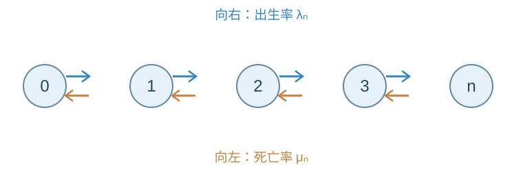
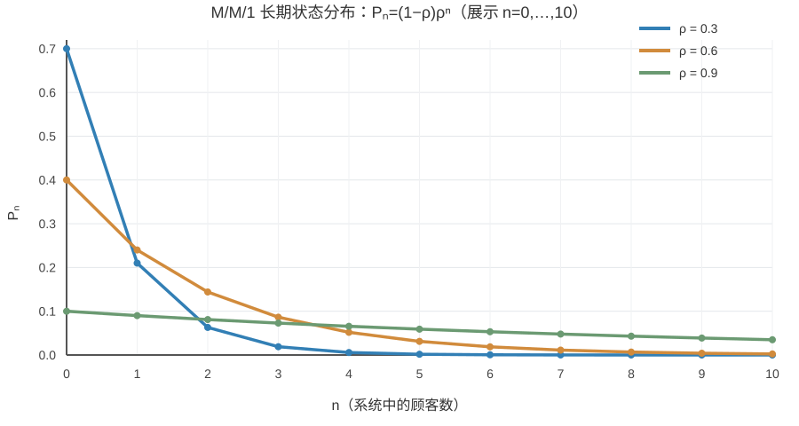

# 第六章（下）：连续时间马尔可夫链 §6.5--6.9

教材：Ross, *Introduction to Probability Models*, 13th Edition。

这一部分承接我们之前学习的 §6.1--6.4。前面已经知道如何建立连续时间马尔可夫链（Continuous-Time Markov Chain，CTMC），以及如何用前向、后向方程研究系统的状态转移。

**现在的核心问题变成：一个系统长期运行会有什么规律？如果需要计算有限时间内的状态概率，又有哪些更方便的方法？**

## 一、先建立全章后半部分的知识主线

我们先回忆前半章最重要的三个对象：

-   $v_i$：系统在状态 $i$ 的离开速率（Leaving Rate）。
-   $q_{ij}$：从状态 $i$ 跳向状态 $j$ 的瞬时转移速率（Instantaneous Transition Rate）。
-   $P_{ij}(t)$：从状态 $i$ 出发，经过 $t$ 时间后位于状态 $j$ 的转移概率（Transition Probability）。

其中：

$$
q_{ij}=v_iP_{ij},\qquad i\ne j.
$$

前面的 §6.4 已经给出了前向方程（Forward Equations）：

$$
P_{ij}'(t)= \sum _{k\ne j}P_{ik}(t)q_{kj} -v_jP_{ij}(t).
$$

但是如果题目问：

> 一家银行长期运营以后，有多少比例的时间恰好有 3 位顾客？

我们真的需要把所有 $P_{ij}(t)$ 求出来，再让 $t\to \infty$ 吗？

实际上往往不需要。

这就是 §6.5 开始研究的问题。

### §6.5--6.9 的整体框架

``` text
已知 CTMC 的状态与转移速率 qᵢⱼ
                 │
       ┌─────────┴─────────┐
       │                   │
  方向 A：长期行为      方向 B：有限时间
       │                   │
  §6.5 长期概率         §6.8 均匀化
  用流入与流出平衡      泊松过程 + 离散链
       │                   │
  §6.6 时间可逆性       §6.9 数值计算
  正向与倒放是否相同    生成矩阵 + 矩阵指数
       │
  §6.7 反向链
  倒放后的转移速率
```

注意这两条主线是**并列的**，而不是后面每一节都必须依赖前一节。

| 教材章节                                | 主要问题                           | 最核心的方法             |
|:-------------------|:-------------------------------|:-------------------|
| §6.5 Limiting Probabilities             | 长期处于各状态的概率是多少？       | Balance Equations        |
| §6.6 Time Reversibility                 | 系统在时间上倒放后是否不变？       | Detailed Balance         |
| §6.7 The Reversed Chain                 | 怎样构造倒放后的 CTMC？            | Reverse Transition Rates |
| §6.8 Uniformization                     | 怎样将 CTMC 转成更容易计算的形式？ | Poissonization           |
| §6.9 Computing Transition Probabilities | 怎样数值计算有限时间的转移概率？   | Matrix Exponential       |

学习时，我建议首先彻底掌握 §6.5。它是后面时间可逆性和反向链的基础，也是这一部分中最容易形成通用解题方法的内容。

------------------------------------------------------------------------

## 二、§6.5 长期概率（Limiting Probabilities）

### 2.1 为什么要研究长期概率？

以银行排队系统为例。

假设顾客按照速率 $\lambda$ 的泊松过程到达，只有一名服务员，服务时间服从速率 $\mu$ 的指数分布。

定义：

$$
X(t)=\text{时刻 }t\text{ 银行中的顾客人数}.
$$

这就是前面学过的 M/M/1 排队模型。

假设银行刚开门，里面没有顾客：

$$
X(0)=0.
$$

那么刚开门时：

$$
P(X(0)=0)=1.
$$

但运行一段时间后，可能有 0、1、2、3、......名顾客。

在满足稳定性条件时，运行足够长时间以后，初始状态的影响逐渐消失，系统处于各状态的概率趋于固定值。

教材把这个极限记为：

$$
\boxed{ P_j=\lim_{t\to\infty}P_{ij}(t). }
$$

这里假设极限存在，而且与初始状态 $i$ 无关。

例如：

$$
P_0=0.3
$$

表示在长期稳定运行的情况下，随机选取一个很晚的时刻，系统处于状态 0 的概率为 0.3。

在遍历性（Ergodicity）条件下，还可以理解为：

**系统长期运行的总时间中，约 30% 的时间处于状态 0。**

注意，长期稳定不意味着系统不再变化。系统仍然不停地跳转，只是各个状态的概率比例趋于稳定。

教材给出的一个充分条件是：所有状态互相连通（Communicating），并且链是正常返的（Positive Recurrent），即返回状态的平均时间有限。

### 2.2 如何求长期概率？从前向方程出发

我们已经知道：

$$
P_{ij}'(t)= \sum _{k\ne j}P_{ik}(t)q_{kj} -v_jP_{ij}(t).
$$

现在考虑 $t\to \infty$。

如果系统最终达到稳定的长期概率：

$$
P_{ij}(t)\longrightarrow P_j,
$$

而且满足相应的极限交换条件，那么概率不再随时间持续增加或减少，于是：

$$
P_{ij}'(t)\longrightarrow0.
$$

代入前向方程：

$$
0=\sum _{k\ne j}P_kq_{kj}-v_jP_j.
$$

移项：

$$
\boxed{ v_jP_j=\sum_{k\ne j}P_kq_{kj}. }
$$

这就是**平衡方程（Balance Equations）**。

同时，所有长期状态概率必须满足：

$$
\boxed{\sum_jP_j=1.}
$$

为什么仅靠这两个条件就能求长期概率？

因为我们已经不需要了解每一时刻如何变化，只需要找出一个满足长期流量平衡的概率分布。

### 2.3 平衡方程真正的含义：流入 = 流出

这里可以借助一个非常直观的类比。

假设每个状态是一个水池，概率像水一样在状态之间流动。

当系统处于状态 $j$ 时，它以速率 $v_j$ 离开。

但系统并不是总处于 $j$，只有长期 $P_j$ 比例的时间位于 $j$。

所以长期平均流出速率为：

$$
\underbrace{P_jv_j}_{\text{从状态 }j\text{ 流出}}.
$$

另一方面，从其他状态 $k$ 跳到 $j$ 的长期平均速率为：

$$
P_kq_{kj}.
$$

把所有来源加起来：

$$
\underbrace{\sum_{k\ne j}P_kq_{kj}}_{\text{流入状态 }j}.
$$

如果长期流入量一直大于流出量，那么状态 $j$ 的概率就会不断增加，不可能稳定。

反过来，如果流出一直大于流入，概率就会不断减少。

因此平衡时必须满足：

$$
\boxed{\text{流入状态 }j\text{ 的速率}=\text{流出状态 }j\text{ 的速率}.}
$$

这和第四章离散时间马尔可夫链的平稳分布方程非常相似，只不过这里平衡的是**每单位时间的概率流量**，而非每一步的转移概率。

### 2.4 生灭过程：平衡方程为什么能进一步简化？

对于一般 CTMC，每个状态可能跳向很多其他状态。

但生灭过程（Birth and Death Process）只允许：

$$
n\xrightarrow{\lambda_n}n+1, \qquad  n\xrightarrow{\mu_n}n-1.
$$



考虑状态 0。

进入状态 0 的唯一方式是从状态 1 发生一次死亡，速率为 $\mu _1$。

离开状态 0 的唯一方式是发生一次出生，速率为 $\lambda _0$。

所以：

$$
\lambda _0P_0=\mu _1P_1.
$$

考虑状态 1。

流出速率为：

$$
(\lambda _1+\mu _1)P_1.
$$

流入速率为：

$$
\lambda _0P_0+\mu _2P_2.
$$

于是：

$$
(\lambda _1+\mu _1)P_1 =\lambda _0P_0+\mu _2P_2.
$$

利用前一个方程：

$$
\lambda _0P_0=\mu _1P_1,
$$

代入后得到：

$$
\lambda _1P_1=\mu _2P_2.
$$

类似地：

$$
\lambda _2P_2=\mu _3P_3.
$$

因此，对于生灭过程：

$$
\boxed{ \lambda_nP_n=\mu_{n+1}P_{n+1}. }
$$

这个式子有更强的含义：**不仅每个状态整体流入等于流出，相邻两个状态之间的双向流量也分别相等。**

为什么能够这样？

因为如果把状态划分为：

$$
\{0,1,\ldots,n\} \quad\text{和}\quad \{n+1,n+2,\ldots\},
$$

两部分之间只有一条边。

跨越这条边向右的流量，长期必须等于跨越这条边向左的流量。

因此可以直接写：

$$
P_n\lambda _n=P_{n+1}\mu _{n+1}.
$$

这是生灭过程特别容易求长期概率的根本原因。

### 2.5 生灭过程长期概率的通用公式

由：

$$
\lambda _nP_n=\mu _{n+1}P_{n+1},
$$

我们可以依次求出：

$$
P_1=\frac{\lambda_0}{\mu_1}P_0,
$$

$$
P_2=\frac{\lambda_1}{\mu_2}P_1 =\frac{\lambda_0\lambda_1}{\mu_1\mu_2}P_0,
$$

$$
P_3=\frac{\lambda_2}{\mu_3}P_2 =\frac{\lambda_0\lambda_1\lambda_2}{\mu_1\mu_2\mu_3}P_0.
$$

因此：

$$
\boxed{ P_n= \frac{\lambda_0\lambda_1\cdots\lambda_{n-1}} {\mu_1\mu_2\cdots\mu_n}P_0. }
$$

现在只剩下 $P_0$ 未知。

定义：

$$
a_0=1,\qquad  a_n=\prod _{k=0}^{n-1}\frac{\lambda_k}{\mu_{k+1}}.
$$

那么：

$$
P_n=a_nP_0.
$$

再利用归一化条件（Normalization）：

$$
\sum _{n=0}^{\infty }P_n=1,
$$

得到：

$$
P_0\sum _{n=0}^{\infty }a_n=1.
$$

所以：

$$
\boxed{ P_0=\frac1{\displaystyle\sum_{n=0}^{\infty}a_n}, \qquad P_n=\frac{a_n}{\displaystyle\sum_{k=0}^{\infty}a_k}. }
$$

这就是教材公式 (6.20) 的简洁表达。

但需要注意：对于无限状态、生灭率为正的常见不可约模型，必须检查：

$$
\boxed{\sum_{n=0}^{\infty}a_n<\infty.}
$$

如果这个级数发散，就无法把这些相对权重归一化成总和为 1 的概率分布。

对于有限状态模型，则只需对实际存在的状态求有限和。

### 2.6 教材例 6.14：M/M/1 排队系统的长期概率

先完整复述题目。

一家银行只有一名服务员，顾客按速率 $\lambda$ 的泊松过程到达，每位顾客的服务时间独立服从速率为 $\mu$ 的指数分布。

如果服务员正忙，新顾客就加入队伍等待；服务完成后，顾客离开系统。

设：

$$
X(t)=\text{时刻 }t\text{ 系统中顾客总人数}.
$$

求系统长期运行后，恰好有 $n$ 名顾客的概率。

**第一步：建立生灭率。**

到达率不随系统人数改变：

$$
\lambda _n=\lambda ,\qquad n\ge0.
$$

只有一名服务员，所以只要系统非空，离开率就是：

$$
\mu _n=\mu ,\qquad n\ge1.
$$

**第二步：利用相邻状态流量平衡。**

$$
\lambda P_n=\mu P_{n+1}.
$$

所以：

$$
P_{n+1}=\frac{\lambda}{\mu}P_n.
$$

令：

$$
\rho =\frac{\lambda}{\mu}.
$$

这里 $\rho$ 称为交通强度（Traffic Intensity）或服务台利用率（Utilization）。

于是：

$$
P_n=\rho ^nP_0.
$$

**第三步：利用概率总和为 1。**

$$
1=\sum _{n=0}^{\infty }P_n =P_0\sum _{n=0}^{\infty }\rho ^n.
$$

这是一个几何级数。

只有：

$$
\rho <1
$$

时才收敛。

因此需要：

$$
\boxed{\lambda<\mu.}
$$

也就是平均到达速率必须小于平均服务速率，系统才能具有正常的长期稳定分布。

此时：

$$
\sum _{n=0}^{\infty }\rho ^n =\frac1{1-\rho}.
$$

所以：

$$
P_0=1-\rho .
$$

最终得到：

$$
\boxed{ P_n=(1-\rho)\rho^n,\qquad n\ge0. }
$$

这是定义在 $0,1,2,\ldots$ 上的几何分布（Geometric Distribution）。

例如：

$$
P_0=1-\rho
$$

表示长期空闲的概率。

而：

$$
P(X\ge1)=1-P_0=\rho
$$

表示服务员长期忙碌的时间比例。

进一步，长期平均顾客数为：

$$
E[X]=\sum _{n=0}^{\infty }n(1-\rho )\rho ^n =\boxed{\frac{\rho}{1-\rho}}.
$$

当 $\rho$ 接近 1 时，即使仍满足 $\lambda <\mu$，系统平均顾客人数也会急剧增加。

这说明：

**"系统能够稳定运行"不意味着"系统不会严重拥堵"。**



不同 $\rho$ 的分布形状在图中对比。随着 $\rho$ 增大，分布尾部变得更厚，顾客积压的概率增加。

教材例 6.14 的最重要意义，是展示从生灭率出发，如何不求 $P_{ij}(t)$，直接求出长期状态分布。

### 2.7 教材例 6.13：多台机器与一个维修工

这道题与 M/M/1 很像，但有一个关键差别：系统的状态数量是有限的，而且故障速率依赖当前还有多少台机器正在工作。

先复述题目。

某车间共有 $M$ 台机器和一名维修工。

每台正常机器的工作寿命独立服从速率 $\lambda$ 的指数分布，机器故障后停止使用，等待维修工修理。

维修工一次只能修理一台机器，维修时间服从速率为 $\mu$ 的指数分布。

要求：

1.  长期平均有多少台机器停止使用？
2.  任意一台机器长期有多大比例的时间正在工作？

**第一步：选择状态。**

定义：

$$
X(t)=\text{时刻 }t\text{ 停止使用的机器数量}.
$$

状态空间：

$$
\{0,1,\ldots,M\}.
$$

注意，我们将"机器故障"看作出生，使状态增加 1；将"修好机器"看作死亡，使状态减少 1。

所以 Birth 和 Death 只是数学上的状态增加与减少，不一定真的对应生物出生和死亡。

**第二步：求出生率与死亡率。**

当 $n$ 台机器停止使用时，还有 $M-n$ 台机器正常运行。

每台正常机器独立以速率 $\lambda$ 故障，所以总故障速率为：

$$
\boxed{\lambda_n=(M-n)\lambda.}
$$

如果至少有一台机器故障，维修工就在修理一台机器，所以：

$$
\boxed{\mu_n=\mu,\qquad n\ge1.}
$$

当全部机器都停止使用时，已经没有新的正常机器会故障，因此：

$$
\lambda _M=0.
$$

**第三步：利用生灭过程长期概率公式。**

$$
P_n =\frac{\lambda_0\lambda_1\cdots\lambda_{n-1}} {\mu _1\mu _2\cdots \mu _n}P_0.
$$

代入：

$$
P_n =\frac{M\lambda(M-1)\lambda\cdots(M-n+1)\lambda} {\mu ^n}P_0.
$$

整理：

$$
P_n=\frac{M!}{(M-n)!} \left (\frac{\lambda}{\mu}\right )^nP_0.
$$

由 $\sum _{n=0}^{M}P_n=1$：

$$
P_0= \left[ \sum_{n=0}^{M} \frac{M!}{(M-n)!} \left(\frac{\lambda}{\mu}\right)^n \right]^{-1}.
$$

所以：

$$
\boxed{ P_n= \frac{ \frac{M!}{(M-n)!}(\lambda/\mu)^n }{ \displaystyle\sum_{k=0}^{M} \frac{M!}{(M-k)!}(\lambda/\mu)^k }. }
$$

**第四步：回答题目。**

长期平均停止使用的机器数量：

$$
\boxed{ E[X]=\sum_{n=0}^{M}nP_n. }
$$

如果有 $n$ 台机器停止使用，那么正常工作的机器有 $M-n$ 台。

由于所有机器在模型中具有对称性，任意一台机器长期正常工作的概率为：

$$
\sum _{n=0}^{M}\frac{M-n}{M}P_n.
$$

整理：

$$
\boxed{ P(\text{某台机器正在工作}) =1-\frac{E[X]}{M}. }
$$

这道题说明：**建立生灭过程时，最关键的是准确理解系统处于状态 $n$ 时，有多少个独立时钟会导致状态变化。**

### 2.8 不属于生灭过程，也可以求长期概率

教材例 6.15 又回到前面学过的擦鞋店。

题目背景是：擦鞋店有两个工位。顾客按速率 $\lambda$ 到达，只有店内没有顾客时才进入。进入以后先在工位 1 接受速率为 $\mu _1$ 的指数服务，再转到工位 2 接受速率为 $\mu _2$ 的指数服务，最后离开。

状态为：

$$
0=\text{空店},\quad 1=\text{工位 1},\quad 2=\text{工位 2}.
$$

转移结构：

$$
0\to1\to2\to0.
$$

由于有 $2\to0$ 的跳转，这不是生灭过程。

但可以直接列全局平衡方程：

$$
\begin{cases}
\lambda P_0=\mu_2P_2,\\
\mu_1P_1=\lambda P_0,\\
\mu_2P_2=\mu_1P_1.
\end{cases}
$$

于是：

$$
P_1=\frac{\lambda}{\mu_1}P_0,\qquad  P_2=\frac{\lambda}{\mu_2}P_0.
$$

归一化得到：

$$
\boxed{ P_0=\frac1{1+\lambda/\mu_1+\lambda/\mu_2}. }
$$

其余概率由上面两式求出。

这里要保留一个重要认识：

-   对一般 CTMC，使用**全局平衡（Global Balance）**。
-   对生灭过程，可以进一步使用相邻状态的**局部平衡（Local Balance）**。

这一区别正好引出下一节的时间可逆性。

------------------------------------------------------------------------

## 三、§6.6 时间可逆性（Time Reversibility）

这一节一开始可能比较抽象，因为"时间倒放"听起来像一个物理概念。

但它的数学思想并不复杂：**如果我们把一个处于长期稳定状态的随机过程录下来，再把录像倒着播放，倒放后的状态变化规律是否与原来完全一样？**

### 3.1 首先理解：什么叫时间可逆？

考虑一个不断在两个状态之间变化的机器：

$$
0\overset{\lambda}{\underset{\mu}{\rightleftharpoons}}1.
$$

其中：

-   0 表示机器正常工作。
-   1 表示机器发生故障、正在维修。
-   $0\to1$ 的速率为 $\lambda$。
-   $1\to0$ 的速率为 $\mu$。

如果我们只看一段状态变化记录：

$$
0\to1\to0\to1\to0,
$$

倒放之后仍然是同样类型的状态交替。

当然，实际的时间可逆性要求比"状态顺序看起来相似"更严格：**倒放后的停留时间分布和状态转移规律，也必须与原来相同。**

所以我们需要数学条件，而不能只凭直觉判断。

### 3.2 详细平衡方程（Detailed Balance Equations）

教材给出了时间可逆性的核心条件：

$$
\boxed{ P_iq_{ij}=P_jq_{ji}, \qquad \forall i\ne j. }
$$

其中 $P_i,P_j$ 是长期状态概率。

你可以这样理解两边：

$$
\underbrace{P_iq_{ij}}_{\text{长期从 }i\text{ 跳向 }j\text{ 的流量}} = \underbrace{P_jq_{ji}}_{\text{长期从 }j\text{ 跳向 }i\text{ 的流量}}.
$$

为什么这个条件能够表示时间可逆？

因为正向过程中 $i\to j$ 的跳转，在倒放时会变成 $j\to i$。

如果正向和倒放的概率规律完全一样，那么两个方向上对应的长期跳转流量必须相等。

对于本节讨论的遍历 CTMC，详细平衡条件也是时间可逆性的判别条件。

**这里有一个非常重要的区别：**

-   全局平衡（Global Balance）：对于每个状态，总流入 = 总流出。
-   详细平衡（Detailed Balance）：对于每一对状态，正向流量 = 反向流量。

详细平衡比全局平衡更强。

### 3.3 为什么生灭过程一定是时间可逆的？

回忆上一节，我们已经得到生灭过程的长期概率关系：

$$
\lambda _nP_n=\mu _{n+1}P_{n+1}.
$$

对于两个相邻状态：

$$
q_{n,n+1}=\lambda _n, \qquad  q_{n+1,n}=\mu _{n+1}.
$$

于是：

$$
P_nq_{n,n+1} =P_{n+1}q_{n+1,n}.
$$

由于生灭过程只可能在相邻状态之间跳转，其他状态对的转移速率都是 0。

因此，所有状态对都满足详细平衡。

所以教材命题 6.5 得到：

$$
\boxed{\text{遍历的生灭过程具有时间可逆性。}}
$$

注意教材明确要求遍历性（Ergodicity），因为这里的时间可逆性是针对长期稳定状态讨论的。

相比之下，刚才的擦鞋店模型：

$$
0\to1\to2\to0
$$

虽然存在长期概率，而且每个状态的总流入等于总流出，但它并不具有时间可逆性。

为什么？

因为正向过程允许：

$$
0\to1
$$

却不允许：

$$
1\to0.
$$

因此：

$$
P_0q_{01}>0, \qquad  P_1q_{10}=0.
$$

不满足详细平衡。

这个例子充分说明：

**存在平稳分布，不等于过程具有时间可逆性。**

### 3.4 与离散时间马尔可夫链的联系：按停留时间加权

教材 §6.6 还引入一个值得理解的关系。

设我们忽略 CTMC 在每个状态中停留了多久，只记录连续访问的状态：

$$
i_0,i_1,i_2,\ldots
$$

那么得到一个离散时间马尔可夫链，称为嵌入链（Embedded Chain）。

其转移概率正是之前的：

$$
P_{ij}.
$$

假设嵌入链的平稳概率为 $\pi _i$，即在长期跳转序列中，有 $\pi _i$ 比例的访问落在状态 $i$。

而 CTMC 的长期概率 $P_i$ 表示**时间比例**。

两者有什么关系？

显然，访问次数多的状态，通常占据更多时间。但我们还必须考虑，每次访问会在这个状态停留多久。

在状态 $i$ 的平均停留时间为：

$$
E[T_i]=\frac1{v_i}.
$$

因此：

$$
\boxed{ P_i= \frac{\pi_i/v_i} {\displaystyle\sum_j\pi_j/v_j}. }
$$

这就是教材公式 (6.25)。

例如，某两个状态在长期跳转序列中各占一半：

$$
\pi _1=\pi _2=\frac12.
$$

但状态 1 的离开速率为 2，状态 2 的离开速率为 1。

那么平均停留时间分别是：

$$
\frac12,\qquad1.
$$

所以状态 2 每次访问都停留得更久，最终：

$$
P_1=\frac13,\qquad  P_2=\frac23.
$$

这再次提醒我们：

**CTMC 的长期概率是时间比例，不是各状态被访问的次数比例。**

### 3.5 时间可逆性的重要应用：M/M/s 的输出过程

教材推论 6.6 给出了一个很有用、但不太直观的结论。

考虑一个 M/M/s 排队系统：

-   顾客按速率 $\lambda$ 的泊松过程到达。
-   有 $s$ 名服务员。
-   每位服务员的服务时间独立服从速率为 $\mu$ 的指数分布。
-   顾客等待并依次接受服务。

假设：

$$
\lambda <s\mu ,
$$

系统处于稳态（Steady State）。

那么：

$$
\boxed{ \text{顾客离开系统的过程也是速率为 }\lambda \text{ 的泊松过程。} }
$$

为什么？

在正向时间里：

$$
\text{人数增加 1} \iff  \text{有顾客到达}.
$$

这些人数向上的跳转发生时刻构成速率为 $\lambda$ 的泊松过程。

而时间倒放以后：

$$
\text{正向人数减少 1} \iff  \text{反向人数增加 1}.
$$

由于稳态下的 M/M/s 生灭过程具有时间可逆性，所以反向过程中人数向上跳转的发生规律，与正向过程相同。

于是正向时间中的顾客离开时刻，也构成速率为 $\lambda$ 的泊松过程。

这个结论很有意思：虽然服务员忙碌程度会随人数改变，长期稳定时，整个系统的输出仍然是泊松过程。

但不能把它推广到任意排队模型，也不能忽略 $\lambda <s\mu$ 和稳态条件。

### 3.6 教材例 6.17：为什么已知顾客总停留时间后，人数服从泊松分布？

这是时间可逆性的一个非常典型的应用。

**题目完整复述：**

考虑一个稳定运行的 M/M/1 排队系统。

顾客以速率 $\lambda$ 到达，服务时间独立服从速率为 $\mu$ 的指数分布，且：

$$
\lambda <\mu .
$$

顾客按照先来先服务（First Come First Served，FCFS）的顺序接受服务。

某位顾客 C 从进入系统到最终离开，总共经历了 $t$ 时间。

求：**在顾客 C 到达时，系统中已有多少位其他顾客的条件概率分布？**

设：

$$
K=\text{C 到达时系统中已有的顾客数}.
$$

题目要求：

$$
P(K=n\mid T=t),
$$

其中 $T$ 表示顾客 C 在系统中的总停留时间（Sojourn Time）。

**第一步：从正常时间方向分析。**

由于先来先服务，如果 C 到达时前面已有 $n$ 位顾客，那么这些顾客都会在 C 离开之前完成服务并离开。

所以：

$$
K=\text{C 到达后、C 离开前其他顾客的离开次数}.
$$

**第二步：把过程倒放。**

在倒放的 M/M/1 系统中，正向的离开事件对应反向的到达事件。

而根据刚才的推论，稳态下反向到达过程是速率为 $\lambda$ 的泊松过程。

教材利用这一点，得到：

$$
\boxed{ K\mid T=t\sim\operatorname{Poisson}(\lambda t). }
$$

因此：

$$
\boxed{ P(K=n\mid T=t)= e^{-\lambda t}\frac{(\lambda t)^n}{n!}, \quad n=0,1,2,\ldots }
$$

这个结论并不显然，因为给定顾客 C 的停留时间，确实会改变我们对于他到达时排队人数的认识。

**补充验证：使用 Bayes 公式。**

如果你觉得倒放的论证有些抽象，也可以从条件分布理解这个结果。

稳态 M/M/1 中，泊松到达的顾客看到的系统人数服从几何分布：

$$
P(K=n)=(1-\rho )\rho ^n, \qquad \rho =\frac{\lambda}{\mu}.
$$

这个性质称为 PASTA（Poisson Arrivals See Time Averages），即泊松到达观察到的状态分布等于长期时间分布。

若 C 到达时前面有 $n$ 人，则他需要等待这些人完成服务，再完成自己的服务。

由指数分布无记忆性：

$$
T\mid K=n\sim \operatorname{Gamma}(n+1,\mu ).
$$

于是：

$$
f_{T\mid K=n}(t) =\frac{\mu^{n+1}t^ne^{-\mu t}}{n!}.
$$

利用 Bayes 公式：

$$
P(K=n\mid T=t) =\frac{P(K=n)f_{T\mid K=n}(t)} {\sum _{k=0}^{\infty }P(K=k)f_{T\mid K=k}(t)}.
$$

分子为：

$$
(1-\rho )\mu e^{-\mu t} \frac{(\lambda t)^n}{n!}.
$$

分母将上述表达式对所有 $n$ 求和：

$$
(1-\rho )\mu e^{-\mu t}e^{\lambda t}.
$$

因此：

$$
P(K=n\mid T=t) =e^{-\lambda t}\frac{(\lambda t)^n}{n!}.
$$

与时间可逆性得到的结论一致。

从这个例子你可以体会到，时间可逆性并不只是一个抽象性质，它经常可以把一个很难分析的**过去发生了什么**的问题，转化成容易计算的泊松到达问题。

### 3.7 时间可逆性的另一种应用：截断（Truncation）

考虑一个系统，原本可以进入很多状态，但现在人为规定它不能离开某个状态集合 $A$。

例如原来的银行可以容纳无限多名顾客，现在规定系统最多只能有 $N$ 名顾客。

这种做法称为截断（Truncation）。

教材命题 6.8 说明：

如果原 CTMC 时间可逆，且将其截断到状态集合 $A$ 后仍保持不可约，那么截断后的过程仍然时间可逆。

其平稳分布为：

$$
\boxed{ P_j^{A}= \frac{P_j}{\displaystyle\sum_{k\in A}P_k}, \qquad j\in A. }
$$

为什么只需要重新归一化？

原过程满足：

$$
P_iq_{ij}=P_jq_{ji}.
$$

对保留的状态，截断并没有改变它们之间的转移速率。

因此，只要把所有保留状态的概率同时乘上同一个常数，详细平衡关系仍成立。

再通过归一化使概率和为 1，就得到新的长期分布。

**教材例 6.19：容量有限的 M/M/1。**

题目是：顾客仍按速率 $\lambda$ 到达，服务率为 $\mu$，但如果到达时系统已有 $N$ 人，新顾客就不能进入。求长期人数分布。

定义：

$$
\rho =\frac{\lambda}{\mu}.
$$

由相邻状态平衡：

$$
P_n^A=\rho ^nP_0^A.
$$

再利用：

$$
\sum _{n=0}^NP_n^A=1,
$$

得：

$$
\boxed{ P_n^A=\frac{\rho^n} {\displaystyle\sum_{k=0}^{N}\rho^k}, \qquad n=0,\ldots,N. }
$$

当 $\rho \ne1$ 时：

$$
P_n^A= \frac{(1-\rho)\rho^n}{1-\rho^{N+1}}.
$$

而当 $\rho=1$ 时：

$$
P_n^A=\frac1{N+1}.
$$

这里有一个与无限容量 M/M/1 不同的地方：

**有限容量系统即使 $\lambda \ge \mu$，也可以存在长期概率分布。**

因为人数不可能无限增长。系统满员后，新顾客被拒绝，而不是继续进入队伍。

不过教材在例 6.19 中，是从已经稳定的无限容量 M/M/1 通过截断推出公式；上面 $\rho \ge1$ 的情形，则是直接使用有限状态生灭平衡方程的自然扩展。

------------------------------------------------------------------------

## 四、§6.7 反向链（The Reversed Chain）

学完时间可逆性，你可能会问：

**如果一个 CTMC 不可逆，那还可以研究它倒放后的规律吗？**

当然可以。

这就是 §6.7 的主题。

### 4.1 时间可逆性与反向链不是一回事

这两个概念必须分清：

-   反向链（Reversed Chain）：把一个处于稳态的 CTMC 倒着观察，得到的新 CTMC。
-   时间可逆（Time Reversible）：反向链恰好与原来的 CTMC 具有相同的概率规律。

所以：

**反向链始终是研究对象，而时间可逆性是原过程与反向链是否相同的性质。**

例如前面擦鞋店的正向转移：

$$
0\to1\to2\to0.
$$

它的反向链会沿相反方向跳转：

$$
0\to2\to1\to0.
$$

反向链可以构造出来，但显然不等于原来的链。

### 4.2 怎样推导反向链的转移速率？

假设原 CTMC 存在正的长期概率 $P_i$，正向瞬时转移速率为 $q_{ij}$。

定义反向链的瞬时转移速率为：

$$
q_{ij}^*.
$$

注意这里星号表示**反向链**，不是最优参数或真实参数。

考虑正向过程中：

$$
j\longrightarrow i.
$$

其长期发生速率为：

$$
P_jq_{ji}.
$$

这些跳转倒放以后，就变成：

$$
i\longrightarrow j.
$$

而反向链中这类跳转的长期发生速率是：

$$
P_iq_{ij}^*.
$$

既然对应同一批跳转，只是观察方向相反，那么：

$$
P_iq_{ij}^*=P_jq_{ji}.
$$

于是：

$$
\boxed{ q_{ij}^*=\frac{P_jq_{ji}}{P_i}, \qquad i\ne j. }
$$

这就是 §6.7 最重要的公式。

它告诉我们：

**反向链的 $i\to j$ 转移速率，需要由正向链的 $j\to i$ 转移速率，以及两个状态的长期概率来确定。**

### 4.3 反向链有哪些性质？

教材命题 6.10 说明，反向链与正向链具有相同的长期概率：

$$
P_i^*=P_i.
$$

而且，从某个状态离开的总速率也相同：

$$
\boxed{v_i^*=v_i.}
$$

为什么总离开速率相同？

把反向链的速率相加：

$$
\begin{aligned}
v_i^*
&=\sum_{j\ne i}q_{ij}^*\\
&=\frac1{P_i}\sum_{j\ne i}P_jq_{ji}.
\end{aligned}
$$

由正向链的全局平衡方程：

$$
\sum _{j\ne i}P_jq_{ji}=P_iv_i.
$$

所以：

$$
v_i^*=\frac{P_iv_i}{P_i}=v_i.
$$

这说明倒放并不会改变每个状态的指数停留时间分布，只可能改变下一次跳往哪个状态。

如果进一步满足：

$$
q_{ij}^*=q_{ij},
$$

那么原链与反向链相同。

由反向速率公式可知，此时：

$$
P_iq_{ij}=P_jq_{ji}.
$$

你应该发现，**这恰好就是上一节的详细平衡条件**。

因此，§6.6 与 §6.7 的关系非常紧密：

-   §6.6 研究原链何时与反向链相同。
-   §6.7 研究一般情况下反向链究竟是什么。

### 4.4 教材例 6.22：串联排队系统（Sequential Queueing System）

这一题比较复杂，但很值得理解，因为它展示了反向链真正的价值：**一些直接求长期概率很麻烦的系统，倒放以后反而能够找到简单的概率结构。**

先完整复述题目。

一个排队系统有两个串联的服务台：

顾客首先按速率 $\lambda$ 的泊松过程到达服务台 1。

服务台 1 的服务时间独立服从速率为 $\mu _1$ 的指数分布。完成后，顾客进入服务台 2。

服务台 2 的服务时间独立服从速率为 $\mu _2$ 的指数分布。

完成第二阶段服务以后，顾客才真正离开整个系统。

每个服务台各有一名服务员，顾客可以等待。

假设：

$$
\lambda <\mu _1,\qquad \lambda <\mu _2.
$$

要求两个服务台长期同时具有 $n,m$ 名顾客的概率。

**第一步：建立二维状态。**

定义：

$$
X(t)=(N_1(t),N_2(t)).
$$

状态 $(n,m)$ 表示服务台 1 有 $n$ 名顾客，服务台 2 有 $m$ 名顾客，其中包含正在接受服务的人。

系统共有三类状态变化：

$$
\begin{aligned}
(n,m)&\xrightarrow{\lambda}(n+1,m),\\
(n,m)&\xrightarrow{\mu_1}(n-1,m+1),\quad n>0,\\
(n,m)&\xrightarrow{\mu_2}(n,m-1),\quad m>0.
\end{aligned}
$$

第一类是顾客进入系统。

第二类是顾客从服务台 1 转移到服务台 2。

第三类是顾客完成全部服务后离开。

注意，这已经不是一维生灭过程，所以无法直接使用之前的生灭过程 $P_n$ 乘积公式。

**第二步：构造反向链。**

如果倒放过程，那么顾客应该：

先从服务台 2 进入，再经过服务台 1，最后离开。

因此我们猜测反向链的转移为：

$$
\begin{aligned}
(n,m)&\xrightarrow{\lambda}(n,m+1),\\
(n,m)&\xrightarrow{\mu_2}(n+1,m-1),\quad m>0,\\
(n,m)&\xrightarrow{\mu_1}(n-1,m),\quad n>0.
\end{aligned}
$$

这是一个猜测，不能只凭直觉宣布正确。

教材接下来验证：反向链在每个状态的总离开速率，确实与正向链相同。

两者均为：

$$
v_{n,m} =\lambda +\mu _1I(n>0)+\mu _2I(m>0).
$$

其中 $I(\cdot )$ 表示指示函数（Indicator Function）。

**第三步：利用反向链平衡关系。**

设长期概率为：

$$
P_{n,m}.
$$

比较正向和反向对应的跳转，教材得到：

$$
P_{n,m}=\frac{\lambda}{\mu_1}P_{n-1,m}, \qquad n>0,
$$

以及：

$$
P_{n,m}=\frac{\lambda}{\mu_2}P_{n,m-1}, \qquad m>0.
$$

这意味着增加一个服务台 1 的顾客，会让概率乘上 $\lambda /\mu _1$；增加一个服务台 2 的顾客，会让概率乘上 $\lambda /\mu _2$。

因此：

$$
P_{n,m} =\left (\frac{\lambda}{\mu_1}\right )^n \left (\frac{\lambda}{\mu_2}\right )^mP_{0,0}.
$$

**第四步：归一化。**

令：

$$
\rho _1=\frac{\lambda}{\mu_1}, \qquad  \rho _2=\frac{\lambda}{\mu_2}.
$$

因为两者都小于 1：

$$
\begin{aligned}
1
&=\sum_{n=0}^{\infty}\sum_{m=0}^{\infty}P_{n,m}\\
&=P_{0,0}
\left(\sum_{n=0}^{\infty}\rho_1^n\right)
\left(\sum_{m=0}^{\infty}\rho_2^m\right).
\end{aligned}
$$

所以：

$$
P_{0,0}=(1-\rho _1)(1-\rho _2).
$$

最终：

$$
\boxed{ P_{n,m} =(1-\rho_1)\rho_1^n (1-\rho_2)\rho_2^m. }
$$

教材还验证了猜测的反向速率与这一概率分布满足全部反向链方程，因此结果成立。

**第五步：这个结果有什么意义？**

观察：

$$
P_{n,m} = \underbrace{(1-\rho_1)\rho_1^n}_{P(N_1=n)} \underbrace{(1-\rho_2)\rho_2^m}_{P(N_2=m)}.
$$

它竟然能分解成两个几何分布概率的乘积！

因此：

$$
\boxed{ N_1(t)\text{ 与 }N_2(t) \text{ 在稳态固定时刻相互独立。} }
$$

这是一个乘积形式的平稳分布（Product-Form Stationary Distribution）。

这很不直观，因为服务台 2 的顾客都来自服务台 1，显然两个服务台在运行机制上存在联系。

但由于泊松到达、独立指数服务与稳态条件，两个服务台在同一固定时刻的顾客人数却可以相互独立。

要特别注意：这并不意味着两个服务台的整个随机过程相互独立，只是说稳态下的联合人数分布具有独立的乘积形式。

你需要从这道题掌握的不是死记最后的公式，而是：

**建立二维 CTMC → 猜测反向过程 → 写反向速率关系 → 得到长期概率 → 验证。**

------------------------------------------------------------------------

## 五、§6.8 均匀化（Uniformization）

这一节从长期概率回到另一个问题：

**如何计算经过有限时间 $t$ 后，系统处于状态 $j$ 的概率 $P_{ij}(t)$？**

前面 §6.4 已经学习了前向、后向微分方程。但当状态数量较多时，直接求解这些微分方程可能很麻烦。

均匀化提供了一种很巧妙的方法：

> 利用第五章的泊松过程（Poisson Process），把连续时间马尔可夫链转换成离散时间马尔可夫链的计算问题。

### 5.1 先考虑最简单的情况：每个状态的离开速率相同

假设：

$$
v_i=v,\qquad \forall i.
$$

这意味着无论当前处于哪个状态，每次跳转前的停留时间都独立服从：

$$
\operatorname{Exp}(v).
$$

你应该立刻联想到第五章：

**如果相邻事件之间的时间独立同分布为 $\operatorname{Exp}(v)$，那么事件构成速率为 $v$ 的泊松过程。**

因此，设 $N(t)$ 表示到时间 $t$ 为止的状态跳转次数，那么：

$$
N(t)\sim \operatorname{Poisson}(vt).
$$

现在我们想求：

$$
P_{ij}(t)=P(X(t)=j\mid X(0)=i).
$$

先给定 $N(t)=n$。

既然已经发生了 $n$ 次状态跳转，那么从 $i$ 到 $j$ 的概率，就是嵌入离散时间马尔可夫链的 $n$ 步转移概率。

记作：

$$
P_{ij}^{(n)}.
$$

这里的上标 $(n)$ 表示跳转步数，不是 $n$ 次幂作用于单个概率。

利用全概率公式：

$$
P_{ij}(t)= \sum _{n=0}^{\infty } P_{ij}^{(n)}P(N(t)=n).
$$

代入泊松概率：

$$
\boxed{ P_{ij}(t)= \sum_{n=0}^{\infty} P_{ij}^{(n)} e^{-vt}\frac{(vt)^n}{n!}. }
$$

这就是教材公式 (6.36)。

这个公式有什么直观意义？

我们把一个复杂的连续时间问题拆成两层：

1.  **在 $t$ 时间内发生了多少次跳转？** 用泊松分布。
2.  **如果发生了 $n$ 次跳转，最后会处于哪里？** 用离散时间马尔可夫链。

然后对所有可能的 $n$ 加权平均。

这与你之前学习混合泊松过程、复合泊松过程时使用的"先固定一层随机性，再解除条件"的方法具有相似的数学思路。

### 5.2 但实际模型的离开速率通常不同，怎么办？

例如，机器故障与维修模型中：

$$
v_0=\lambda ,\qquad v_1=\mu .
$$

一般而言：

$$
\lambda \ne \mu .
$$

这时，相邻跳转间隔不再独立同分布为同一个指数分布，不能直接说真实跳转次数服从参数为 $vt$ 的泊松分布。

教材给出的解决办法非常巧妙：

**人为引入虚拟跳转（Fictitious Transitions），让每个状态都以相同速率进行一次"跳转尝试"。**

假设存在常数 $v$，满足：

$$
\boxed{v\ge\sup_i v_i.}
$$

也就是 $v$ 不小于任何状态的真实离开速率。

现在规定：无论系统处于哪个状态，都以速率 $v$ 产生一次跳转机会。

当系统处于状态 $i$ 时：

-   以概率 $v_i/v$ 发生一次真实跳转。
-   以概率 $1-v_i/v$ 发生一次虚拟跳转，状态保持不变。

这样，真实离开速率依然为：

$$
v\cdot \frac{v_i}{v}=v_i.
$$

所以我们并没有改变原系统的真实状态变化规律。

我们只是额外插入了一些不改变状态的虚拟事件。

### 5.3 均匀化以后，新的转移概率是什么？

设均匀化后的离散时间转移概率矩阵为 $\widetilde P$。

对于 $j\ne i$：

$$
\widetilde P_{ij} =\frac{v_i}{v}P_{ij} =\frac{q_{ij}}v.
$$

对于 $j=i$：

$$
\widetilde P_{ii}=1-\frac{v_i}{v}.
$$

因此：

$$
\boxed{ \widetilde P_{ij}= \begin{cases} 1-\dfrac{v_i}{v},&j=i,\\[6pt] \dfrac{q_{ij}}v,&j\ne i. \end{cases} }
$$

注意这里出现了自环（Self-Loop）：

$$
i\to i.
$$

这并不表示原 CTMC 存在一次真正的状态变化，而是均匀化人为加入的虚拟跳转。

由此可以重新使用泊松过程：

$$
\boxed{ P_{ij}(t)= \sum_{n=0}^{\infty} e^{-vt}\frac{(vt)^n}{n!} (\widetilde P^n)_{ij}. }
$$

其中 $\widetilde P^n$ 是矩阵的 $n$ 次幂。

这就是均匀化的最终公式。

你可以将它理解为：

**一个统一速率的泊松时钟 + 每次时钟响起时按照离散转移矩阵选择状态。**

只要原 CTMC 的离开速率有统一上界，就可以采用这种构造。

### 5.4 教材例 6.23：再次计算机器正常工作的概率

**题目完整复述：**

考虑前面学过的两状态机器模型。

状态 0 表示正常工作，状态 1 表示正在维修。

机器从正常工作到故障的速率为 $\lambda$，从维修到恢复正常的速率为 $\mu$。

已知机器初始处于状态 0，求经过 $t$ 时间后仍正常工作的概率：

$$
P_{00}(t).
$$

之前 §6.4 已经使用微分方程求解过。这次教材使用均匀化。

**第一步：选择统一速率。**

教材取：

$$
v=\lambda +\mu .
$$

显然：

$$
v\ge \lambda ,\qquad v\ge \mu .
$$

**第二步：构造均匀化矩阵。**

原过程状态转移为：

$$
0\overset{\lambda}{\underset{\mu}{\rightleftharpoons}}1.
$$

因此：

$$
\widetilde P=

\begin{pmatrix}
1-\dfrac{\lambda}{\lambda+\mu}
&
\dfrac{\lambda}{\lambda+\mu}\\[6pt]
\dfrac{\mu}{\lambda+\mu}
&
1-\dfrac{\mu}{\lambda+\mu}
\end{pmatrix}
.
$$

整理得到：

$$
\boxed{ \widetilde P= \begin{pmatrix} \dfrac{\mu}{\lambda+\mu} & \dfrac{\lambda}{\lambda+\mu}\\[6pt] \dfrac{\mu}{\lambda+\mu} & \dfrac{\lambda}{\lambda+\mu} \end{pmatrix}. }
$$

观察这个矩阵，有一个非常特殊的性质：

**两行完全相同。**

也就是说，无论当前处于状态 0 还是状态 1，一次均匀化跳转机会以后，下一状态为 0 的概率都是：

$$
\frac{\mu}{\lambda+\mu}.
$$

因此，对任何 $n\ge1$：

$$
(\widetilde P^n)_{00} =\frac{\mu}{\lambda+\mu}.
$$

**第三步：根据泊松时钟的跳转次数条件化。**

设 $N_v(t)$ 表示均匀化时钟在 $(0,t]$ 内响起的次数，则：

$$
N_v(t)\sim \operatorname{Poisson}((\lambda +\mu )t).
$$

这里一定要注意：$N_v(t)$ 包含虚拟跳转，不一定等于真实状态改变的次数。

从状态 0 出发：

-   如果一次时钟都没有响起，机器一定仍处于 0。
-   如果至少响起一次，最终处于 0 的概率为 $\mu /(\lambda +\mu )$。

所以：

$$
\begin{aligned}
P_{00}(t)
={}&P(N_v(t)=0)\\
&+\frac{\mu}{\lambda+\mu}P(N_v(t)\ge1).
\end{aligned}
$$

代入泊松概率：

$$
P_{00}(t)= e^{-(\lambda +\mu )t} +\frac{\mu}{\lambda+\mu} \left (1-e^{-(\lambda +\mu )t}\right ).
$$

最终：

$$
\boxed{ P_{00}(t)= \frac{\mu}{\lambda+\mu} +\frac{\lambda}{\lambda+\mu}e^{-(\lambda+\mu)t}. }
$$

你应该发现，它与 §6.4 使用微分方程得到的结果完全一样。

这说明：

**前向、后向方程和均匀化，是计算同一个转移概率函数的不同方法。**

均匀化的优势在于，它把连续时间的复杂性集中到泊松分布上，其余部分交给离散时间转移矩阵计算。

### 5.5 教材例 6.24：占用时间（Occupation Time）

这是一个十分值得掌握的通用题型。

题目仍然考虑刚才的两状态机器，初始处于状态 0。

定义：

$$
O(t)=\text{在区间 }(0,t)\text{ 内，机器处于状态 0 的总时间}.
$$

求：

$$
E[O(t)].
$$

注意，这道题不再是问时刻 $t$ 是否处于状态 0，而是问**整个区间内累计有多少时间处于状态 0**。

最自然的方法是引入指示函数：

$$
I(s)=

\begin{cases}
1,&X(s)=0,\\
0,&X(s)=1.
\end{cases}
$$

因为只有机器处于状态 0 时才累计时间，所以：

$$
O(t)=\int _0^tI(s)\,ds.
$$

取期望：

$$
E[O(t)] =E\left[\int_0^tI(s)\,ds\right].
$$

交换期望与积分（由非负性可保证）：

$$
E[O(t)] =\int _0^tE[I(s)]\,ds.
$$

由于指示函数的期望等于对应事件的概率：

$$
E[I(s)]=P(X(s)=0)=P_{00}(s).
$$

因此得到一个很重要的通用关系：

$$
\boxed{ E[O(t)]=\int_0^tP_{00}(s)\,ds. }
$$

代入刚才的结果：

$$
\begin{aligned}
E[O(t)]
&=\int_0^t\left[
\frac{\mu}{\lambda+\mu}
+\frac{\lambda}{\lambda+\mu}
e^{-(\lambda+\mu)s}
\right]ds\\
&=\boxed{
\frac{\mu t}{\lambda+\mu}
+\frac{\lambda}{(\lambda+\mu)^2}
(1-e^{-(\lambda+\mu)t})
}.
\end{aligned}
$$

这里也可以看到两个层次：

-   $P_{00}(t)$：一个时刻处于状态 0 的概率。
-   $E[O(t)]$：把整个区间的状态概率积分起来，得到期望累计时间。

这与第五章"每次到达事件贡献多少，总贡献再如何累计"的思路相似，只不过现在是对连续时间上的状态指示函数进行积分。

更一般地，若 $X(0)=i$，那么系统在状态 $j$ 的期望占用时间满足：

$$
\boxed{ E_i[O_j(t)]=\int_0^tP_{ij}(s)\,ds. }
$$

这个公式在遇到"某机器累计工作时长""系统累计忙碌时长"等题型时非常有用。

------------------------------------------------------------------------

## 六、§6.9 转移概率的矩阵计算（Computing the Transition Probabilities）

这是这一章最后一个部分。

前面已经知道 CTMC 的转移概率可以通过微分方程、纯生过程公式和均匀化求解。

现在教材进一步使用**线性代数**，将整个问题写成矩阵形式。

这一节的数学思想很统一：既然很多转移概率满足相互关联的线性微分方程，我们就把它们合并成一个矩阵微分方程。

### 6.1 生成矩阵（Generator Matrix）

教材定义矩阵 $R$，其元素为：

$$
\boxed{ r_{ij}= \begin{cases} q_{ij},&i\ne j,\\ -v_i,&i=j. \end{cases} }
$$

这个矩阵称为生成矩阵（Generator Matrix）。在其他教材中，经常用 $Q$ 表示；Ross 在这里使用 $R$。

为什么对角线要设置为负数？

因为对于状态 $i$，总离开速率为：

$$
v_i=\sum _{j\ne i}q_{ij}.
$$

于是：

$$
r_{ii}=-\sum _{j\ne i}q_{ij}.
$$

这样就保证每一行元素的总和为 0：

$$
\boxed{\sum_jr_{ij}=0.}
$$

例如，机器故障与维修模型对应：

$$
\boxed{ R= \begin{pmatrix} -\lambda&\lambda\\ \mu&-\mu \end{pmatrix}. }
$$

这个矩阵实际上已经完整描述了 CTMC 的局部转移规律。

### 6.2 前向、后向方程的矩阵形式

将所有转移概率组成矩阵：

$$
P(t)=\big (P_{ij}(t)\big ).
$$

回忆后向方程：

$$
P_{ij}'(t) =\sum _{k\ne i}q_{ik}P_{kj}(t)-v_iP_{ij}(t).
$$

根据 $R$ 的定义，可以将右边统一写成：

$$
\sum _kr_{ik}P_{kj}(t).
$$

它恰好是矩阵 $RP(t)$ 的第 $i$ 行、第 $j$ 列元素。

所以：

$$
\boxed{P'(t)=RP(t).}
$$

同理，前向方程：

$$
P_{ij}'(t) =\sum _{k\ne j}P_{ik}(t)q_{kj}-v_jP_{ij}(t)
$$

对应：

$$
\boxed{P'(t)=P(t)R.}
$$

你可以把这两个式子与前面的内容对应起来：

|          | 后向方程                          | 前向方程                         |
|----------|:----------------------------------|:---------------------------------|
| 标量表达 | $\sum _k r_{ik}P_{kj}(t)$ | $\sum _kP_{ik}(t)r_{kj}$ |
| 矩阵表达 | $RP(t)$                           | $P(t)R$                          |
| 核心方向 | 从起点看最初的跳转                | 从终点看最后的跳转               |

### 6.3 为什么解是矩阵指数 $e^{Rt}$？

回忆一个熟悉的微分方程：

$$
y'(t)=ay(t).
$$

在初始条件 $y(0)=1$ 下，它的解为：

$$
y(t)=e^{at}.
$$

现在我们有矩阵微分方程：

$$
P'(t)=RP(t).
$$

初始条件：

$$
P(0)=I,
$$

其中 $I$ 是单位矩阵（Identity Matrix）。

那么对应的解就是：

$$
\boxed{ P(t)=e^{Rt}. }
$$

但需要注意：这里的 $e^{Rt}$ 不是将矩阵的每个元素分别取指数。

矩阵指数（Matrix Exponential）的定义是：

$$
\boxed{ e^{Rt} =\sum_{n=0}^{\infty}\frac{(Rt)^n}{n!} =I+Rt+\frac{R^2t^2}{2!} +\frac{R^3t^3}{3!}+\cdots. }
$$

其中 $R^2,R^3$ 都是矩阵乘法。

你可以把它理解为把普通指数函数的泰勒展开推广到矩阵。

为什么它确实是解？

在有限维情况下，对矩阵指数求导：

$$
\begin{aligned}
\frac{d}{dt}e^{Rt}
&=\frac{d}{dt}
\sum_{n=0}^{\infty}\frac{R^nt^n}{n!}\\
&=\sum_{n=1}^{\infty}
\frac{R^nt^{n-1}}{(n-1)!}\\
&=R\sum_{m=0}^{\infty}\frac{R^mt^m}{m!}\\
&=Re^{Rt}.
\end{aligned}
$$

同时：

$$
e^{R\cdot0}=I.
$$

所以它满足矩阵微分方程与初始条件。

**因此，对于有限状态、时间齐次 CTMC，只要知道生成矩阵 $R$，理论上就能确定所有转移概率 $P_{ij}(t)$。**

### 6.4 但为什么不直接用泰勒展开计算？

虽然：

$$
P(t)=I+Rt+\frac{R^2t^2}{2!}+\cdots
$$

形式很简洁，直接计算却不一定高效。

教材指出两个主要问题：

第一，生成矩阵包含正数和负数。不同项可能发生大量抵消，从而导致数值舍入误差（Round-Off Error）。

第二，为了达到足够高的精度，可能需要计算大量矩阵幂。

因此，教材介绍了两种间接近似方法（Approximation Methods）。

### 6.5 方法一：矩阵指数的极限形式

普通指数函数有：

$$
e^x=\lim _{n\to \infty }\left (1+\frac xn\right )^n.
$$

推广到矩阵：

$$
e^{Rt} =\lim _{n\to \infty } \left (I+\frac{Rt}{n}\right )^n.
$$

因此可以使用：

$$
\boxed{ P(t)\approx \left(I+\frac{Rt}{n}\right)^n. }
$$

这里 $n$ 越大，通常近似越精确。

教材建议取：

$$
n=2^k.
$$

为什么？

因为我们可以通过重复平方（Repeated Squaring）来计算矩阵的高次幂：

$$
M=I+\frac{Rt}{n},
$$

先计算 $M^2$，再计算 $M^4$，然后 $M^8$，不断平方。

计算 $M^{2^k}$ 只需要 $k$ 次矩阵乘法，而不是直接连乘 $2^k$ 次。

此外，当 $n$ 足够大，例如：

$$
\frac{t}{n}\max _i v_i\le1,
$$

矩阵 $I+Rt/n$ 的元素就都是非负的，而且行和为 1，可以把它看成一个离散时间转移概率矩阵。

### 6.6 方法二：先求逆，再做矩阵乘方

教材使用另一个极限：

$$
e^{-Rt}=\lim _{n\to \infty } \left (I-\frac{Rt}{n}\right )^n.
$$

于是：

$$
e^{Rt}\approx  \left (I-\frac{Rt}{n}\right )^{-n}.
$$

也就是：

$$
\boxed{ P(t)\approx \left[ \left(I-\frac{Rt}{n}\right)^{-1} \right]^n. }
$$

它与方法一的区别是：

先求矩阵逆，再计算矩阵乘方。

对于教材讨论的生成矩阵，在相应条件下，逆矩阵中的元素非负，这有利于计算结果保持合理的概率结构。

从数值分析角度，这两种近似也可以分别联系到显式欧拉法（Explicit Euler Method）与隐式欧拉法（Implicit Euler Method），不过这不是本章的主要考查目标。

### 6.7 均匀化与矩阵指数有什么联系？

现在我们可以把 §6.8 和 §6.9 联系起来。

在 §6.8 中，我们构造：

$$
\widetilde P_{ij}=

\begin{cases}
1-\dfrac{v_i}{v},&i=j,\\[6pt]
\dfrac{q_{ij}}v,&i\ne j.
\end{cases}
$$

利用生成矩阵 $R$，这恰好可以写成：

$$
\boxed{ \widetilde P=I+\frac Rv. }
$$

因此：

$$
R=v(\widetilde P-I).
$$

代入矩阵指数：

$$
P(t)=e^{Rt} =e^{vt(\widetilde P-I)}.
$$

由于 $I$ 与 $\widetilde P$ 可交换：

$$
\begin{aligned}
P(t)
&=e^{-vt}e^{vt\widetilde P}\\
&=e^{-vt}\sum_{n=0}^{\infty}
\frac{(vt)^n}{n!}\widetilde P^n.
\end{aligned}
$$

于是：

$$
\boxed{ P(t)= \sum_{n=0}^{\infty} e^{-vt}\frac{(vt)^n}{n!}\widetilde P^n. }
$$

这正是 §6.8 的均匀化公式！

因此你可以理解为：

**均匀化是计算矩阵指数的一种具有概率解释的方法。**

它与 §6.9 的矩阵方法并不矛盾，而是从两个不同角度描述同一个转移概率矩阵。

对于实际数值计算，均匀化还有一个直观的优点：展开式中的各项都是非负概率权重乘以转移概率矩阵，不需要对大量正负项做抵消。

若把无穷和截断到第 $K$ 项，其单个转移概率的截断误差不超过：

$$
P\{\operatorname{Poisson}(vt)>K\}.
$$

所以误差也能借助泊松分布的尾概率进行控制。

------------------------------------------------------------------------

## 七、补充：教材中其余较复杂的例题应该怎样看？

§6.5--6.9 中还有一些较复杂的应用。为了避免大量边缘例题打散主线，我建议先抓它们的建模特点。

| 教材例题 | 研究背景                                                     | 最重要的知识点                         |
|:---------|:-------------------------------------|:-----------------------|
| 6.16     | 多个零件共用维修工，最新故障优先维修且可以抢占原维修任务     | 状态必须包含故障顺序，否则信息不足     |
| 6.18     | 多台机器共用一个维修设施，维修能力在故障机器之间平均分配     | 利用详细平衡求复杂状态空间的长期概率   |
| 6.20     | 多个独立零件分别故障和修复；正常工作的零件不足时系统暂时停机 | 独立可逆 CTMC 的组合，以及状态空间截断 |
| 6.21     | 状态 0 随机跳到某个较高状态，再逐级下降回 0                  | 通过倒放路径直接猜测反向链的结构       |

这几道题虽然形式不同，但不需要单独记忆全部长公式。

真正通用的方法是：先判断状态需要包含哪些信息，写出所有合法的瞬时转移速率，再决定用全局平衡、详细平衡还是反向链方程求解。

其中例 6.16 是很好的状态设计提醒：**如果不同的故障顺序会影响下一个获得维修的机器，那么只用"坏了几台"作为状态并不够。**

------------------------------------------------------------------------

## 八、全章后半部分总结：应该记住什么？

### 8.1 把五节内容放进一张对照表

| 知识点       | 核心公式                                                 | 主要用途                                   |
|:---------|:----------------------------------|:--------------------------|
| 长期概率     | $P_j=\lim _{t\to \infty }P_{ij}(t)$ | 研究长期状态占比                           |
| 全局平衡     | $v_jP_j=\sum _{k\ne j}P_kq_{kj}$           | 求一般 CTMC 平稳分布                       |
| 生灭局部平衡 | $\lambda _nP_n=\mu _{n+1}P_{n+1}$         | 快速求生灭过程长期分布                     |
| 时间可逆性   | $P_iq_{ij}=P_jq_{ji}$                                  | 判断正向、倒放规律是否相同                 |
| 反向链       | $q_{ij}^*=\dfrac{P_jq_{ji}}{P_i}$             | 构造倒放后的转移速率                       |
| 均匀化       | $\widetilde P=I+R/v$                              | 将连续时间问题转化为泊松加权的离散步数问题 |
| 转移矩阵     | $P(t)=e^{Rt}$                                           | 统一计算全部有限时间转移概率               |
| 期望占用时间 | $E_i[O_j(t)]=\int _0^tP_{ij}(s)\,ds$            | 求累计工作、忙碌或停留时长                 |

### 8.2 考试时，应该如何判断使用哪种方法？

**根据英文题干选择解题方法：**

| 英文题干                                   | 优先方法           | 解题思路                                         |
|:----------------|:----------------|:-----------------------------------|
| Long-run proportion / limiting probability | §6.5               | 平衡方程；生灭过程使用局部平衡                   |
| Time reversible / reversed process         | §6.6--6.7          | 可逆性用详细平衡；一般反向链用反向速率           |
| Probability of state $j$ after time $t$    | §6.4、§6.8 或 §6.9 | 解微分方程、均匀化或矩阵指数                     |
| Expected occupation time                   | 指示函数积分       | 写成 $\int _0^t I\{X(s)=j\}\,ds$，再取期望 |

这里还有一个很关键的区别：

-   求 $P_{ij}(t)$ 是研究**有限时间**的动态行为。
-   求 $P_j$ 是研究**长期极限**。
-   求 $E[O_j(t)]$ 是研究整个时间区间里的**累计占用时间**。

这三个对象不能混淆。

### 8.3 英文考试需要熟悉的关键词

| 英文                        | 中文               |
|:----------------------------|:-------------------|
| Limiting Probability        | 极限概率／长期概率 |
| Stationary Probability      | 平稳概率           |
| Steady State                | 稳态               |
| Ergodic / Ergodicity        | 遍历的／遍历性     |
| Positive Recurrent          | 正常返的           |
| Balance Equations           | 平衡方程           |
| Global Balance              | 全局平衡           |
| Detailed Balance            | 详细平衡           |
| Time Reversibility          | 时间可逆性         |
| Reversed Chain              | 反向链             |
| Embedded Chain              | 嵌入链             |
| Truncation                  | 截断               |
| Uniformization              | 均匀化             |
| Fictitious Transition       | 虚拟跳转           |
| Occupation Time             | 占用时间           |
| Generator Matrix            | 生成矩阵           |
| Matrix Exponential          | 矩阵指数           |
| Long-run Proportion of Time | 长期时间比例       |
| Transition Probability      | 转移概率           |

## 九、我建议你的复习顺序

如果你已经学习过 §6.1--6.4，这次不用把全部例题平均用力。

**第一优先级：§6.5 长期概率。** 要能够独立写出平衡方程，并从 $\lambda _n,\mu _n$ 推导生灭过程的长期分布。重点掌握 M/M/1 和多台机器共用维修工这两类模型。

**第二优先级：§6.6--6.7 时间可逆性与反向链。** 要分清全局平衡与详细平衡，理解为什么生灭过程可逆，以及反向链公式中的两个下标为什么交换。串联排队系统属于较综合的应用。

**第三优先级：§6.8--6.9 计算方法。** 核心是理解均匀化为什么能够引入虚拟跳转，以及生成矩阵为什么能够用 $P(t)=e^{Rt}$ 求转移概率。较长的矩阵数值计算公式可以在理解之后再记忆。

最后，用四个问题检验自己是否真正学会：

1.  为什么 M/M/1 要求 $\lambda <\mu$，才能得到无限容量系统的长期概率？
2.  为什么满足全局平衡，还不一定具有时间可逆性？
3.  为什么反向链的 $q_{ij}^*$ 要用正向的 $q_{ji}$ 来计算？
4.  均匀化加入了虚拟跳转，为什么没有改变原来 CTMC 的真实变化规律？

如果你能把这些问题解释清楚，而不仅仅是背出对应公式，那么就已经掌握了 §6.5--6.9 最重要的知识主线。

**将整个第六章连起来，就是：先用状态和速率建立 CTMC，再用微分方程研究有限时间行为，用平衡方程研究长期行为，最后利用时间反转和矩阵方法简化分析与计算。**
