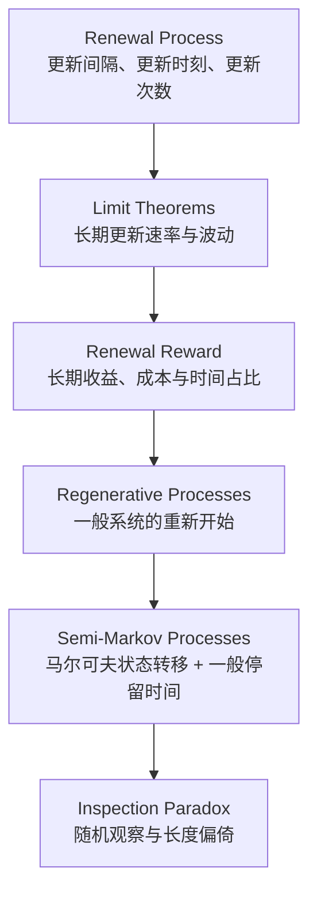
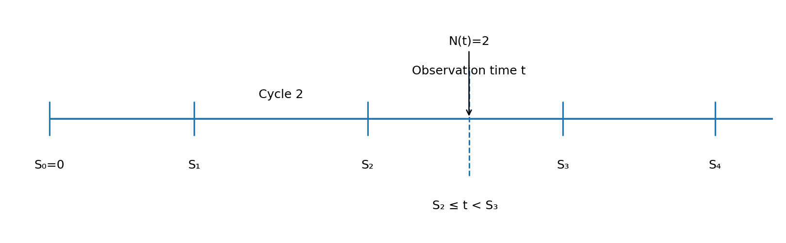

---
cssclasses:
- wide-page
stage: 5
tags:
- random-process
- renewal-theory
- probability
textbook: Ross, Introduction to Probability Models, 13th Edition
title: 第五阶段：更新理论（Ch7）
---

# 随机过程第七章：更新理论（Renewal Theory and Its Applications）

教材：Ross, *Introduction to Probability Models*, 13th Edition，Chapter
7。

这一章可以说是第五章泊松过程（Poisson
Process）和第六章马尔可夫链（Markov
Chain）之后，一种非常重要的研究方法。

**第七章最核心的思想是：当一个随机系统会不断重复某种运行周期时，我们可以不研究它在每个时刻的复杂状态，而是通过分析一个典型周期，推导系统长期运行的规律。**

这也是更新理论（Renewal Theory）和更新报酬理论（Renewal Reward
Theory）的精髓。

## 一、宏观理解：第七章到底在研究什么？

### 1.1 从第五、六章自然过渡到第七章

先回顾你之前学习的内容。

**第五章：泊松过程**

研究随机事件何时发生。如果相邻事件的等待时间独立同分布：

$$ X_1,X_2,\ldots\overset{\mathrm{i.i.d.}}{\sim}\operatorname{Exp}(\lambda) $$

那么事件的累计发生次数构成泊松过程，满足：

$$ N(t)\sim\operatorname{Poisson}(\lambda t). $$

但现实中的事件间隔并不总是指数分布。

例如，一台机器每次维修后都像新的一样，其工作寿命可能服从均匀分布、Gamma
分布或其他分布。

**第七章首先做的，就是放宽泊松过程的指数分布假设。**

只要求每次等待时间独立同分布，但允许采用一般分布
$F$。这样就得到更新过程（Renewal Process）。

**第六章：连续时间马尔可夫链**

研究系统在不同状态之间如何变化，核心是瞬时转移速率
$q_{ij}$，并利用平衡方程求长期状态比例。

但是如果机器的工作时间不是指数分布，仅使用"工作"和"维修"作为状态，通常就不再满足马尔可夫性。

此时第七章提供了另一条道路：

**不一定要求每个时刻都满足马尔可夫性，只要系统会在某些时刻重新开始，就可以利用周期分析长期行为。**

这就是再生过程（Regenerative Process）的思想。

### 1.2 用一个例子理解全章

假设一台机器不断重复：

-   正常工作一段随机时间；
-   发生故障；
-   维修一段随机时间；
-   修好后恢复到与新机器相同的状态。

我们自然关心：

1.  机器每小时平均故障多少次？
2.  长期有多少比例的时间在正常工作？
3.  如果每次维修需要付费，长期平均维修成本是多少？
4.  工作时间与维修时间不服从指数分布，还能不能分析？
5.  随机选一个时刻观察，为什么更容易碰到寿命很长的机器？

你会发现，这五个问题正好对应本章的几个核心知识点。

### 1.3 全章知识地图

**① Renewal Process（§7.1--7.2）**

定义重复发生的更新事件

更新间隔 $X_n$、更新时刻 $S_n$、更新次数 $N(t)$

**② Limit Theorems（§7.3）**

研究长期更新次数及其波动

强大数定律、基本更新定理、中心极限定理、Wald 等式

**③ Renewal Reward（§7.4）**

从更新次数推广到长期收益、成本和时间占比

$$ \frac{E[\text{一个周期的报酬}]}{E[\text{一个周期的长度}]} $$

**④ Regenerative（§7.5）**

将"重新开始"的思想推广到更一般的随机系统

**⑤ Semi-Markov（§7.6）**

状态按马尔可夫规则转移，但停留时间允许一般分布

**⑥ Inspection Paradox（§7.7）**

随机时刻观察为何更容易看到较长周期？

年龄（Age）、剩余寿命（Excess Life）、长度偏倚（Length Bias）

§7.8--7.10：更新函数数值计算、模式出现问题、保险破产问题（概念了解）

这一章最重要的逻辑关系可以概括为：

$$ \boxed{ \text{找到重复周期} \longrightarrow \text{求周期的统计规律} \longrightarrow \text{推导长期平均行为} } $$

你应当把 §7.3、§7.4 当作整章的核心。§7.5--7.7
则是在这个基础上进一步推广和应用。

## 二、§7.1--7.2：更新过程的基本概念与分布

### 2.1 什么是更新过程（Renewal Process）？

想象你有一盏灯泡。

灯泡坏掉后，立即换上一盏全新的灯泡。每盏灯泡的寿命都是随机的，并且相互独立、服从相同分布
$F$。

例如：

$$ X_n\overset{\mathrm{i.i.d.}}{\sim}U(30,60). $$

这表示每盏灯泡的寿命独立服从 30 至 60 小时的均匀分布。

我们定义：

$$ X_n=\text{第 }n\text{ 次与第 }n-1\text{ 次更新之间的时间}. $$

每当灯泡坏掉并被替换时，系统就发生一次**更新（Renewal）**。

Ross 的定义是：

> 如果相邻事件之间的非负等待时间独立同分布，那么对应的计数过程就是更新过程。

也就是说，更新过程的关键是：

$$ \boxed{X_1,X_2,\ldots\overset{\mathrm{i.i.d.}}{\sim}F.} $$

其中 $F$ 不必是指数分布。通常假定
$P(X=0)<1$，排除所有更新都挤在零时刻的退化情况。

> 教材来源：随机过程13版英文_Ch7.1-7.4.pdf \### 2.2
> 第七章三个最基本的随机变量 和第五章一样，我们仍然使用：

  ---------------------------------------------------------------------
  符号       英文                     含义
  ---------- ------------------------ ---------------------------------
  $X_n$      Interarrival Time        第 $n-1$ 次到第 $n$
                                      次更新的时间间隔

  $S_n$      Renewal Epoch            第 $n$ 次更新发生的时刻

  $N(t)$     Renewal Counting Process 截至时刻 $t$ 已经发生的更新次数
  ---------------------------------------------------------------------

它们之间有两个核心关系：

$$ \boxed{S_n=\sum_{i=1}^{n}X_i,\qquad S_0=0} $$

$$ \boxed{N(t)=\max\{n:S_n\le t\}} $$

用时间轴直观理解：

这里，第 1 次更新发生在 $S_1$，第 2 次发生在 $S_2$，而第 3 次尚未发生。

所以：

$$ S_2\le t<S_3 \quad\Longleftrightarrow\quad N(t)=2. $$

一般地：

$$ \boxed{N(t)\ge n\iff S_n\le t.} $$

**这是计算更新过程概率分布最重要的关系。**

为什么重要？

因为直接研究"到时刻 $t$ 发生多少次更新"比较复杂，但 $S_n$ 是 $n$
个独立同分布随机变量之和，我们有办法求它的分布。

### 2.3 如何计算 **$N(t)$** 的分布？

假设 $X_i$ 的共同分布函数是 $F$。

由于：

$$ N(t)\ge n\iff S_n\le t, $$

因此：

$$ \begin{aligned} P(N(t)=n) &=P(N(t)\ge n)-P(N(t)\ge n+1)\\ &=P(S_n\le t)-P(S_{n+1}\le t). \end{aligned} $$

因为：

$$ S_n=X_1+\cdots+X_n, $$

其分布函数是 $F$ 的 $n$ 重卷积（$n$-fold Convolution），记为 $F^{*n}$。

所以：

$$ \boxed{ P(N(t)=n)=F^{*n}(t)-F^{*(n+1)}(t). } $$

对 $n=0$，约定 $F^{*0}(t)=1$（$t\ge0$）。

这就是教材 §7.2 的核心结果。

> 教材来源：随机过程13版英文_Ch7.1-7.4.pdf
> **为什么泊松过程是更新过程的特殊情况？**

当：

$$ X_i\sim\operatorname{Exp}(\lambda), $$

就有：

$$ S_n\sim\operatorname{Gamma}(n,\lambda). $$

将 Gamma 分布代入上面的差分公式，便得到：

$$ P(N(t)=n)=e^{-\lambda t}\frac{(\lambda t)^n}{n!}. $$

也就是说：

$$ \boxed{ \text{Poisson Process} \subset \text{Renewal Process} } $$

普通更新过程不要求指数等待时间，因此一般不具有泊松过程的独立增量、平稳增量性质。

这点在考试中非常容易混淆：**相邻更新间隔独立同分布，并不意味着不重叠时间区间内的更新次数也独立。**

### 2.4 更新函数（Renewal Function）

既然 $N(t)$ 表示到时刻 $t$ 的更新次数，那么自然想知道：

$$ E[N(t)] $$

是多少。

教材定义更新函数（Renewal Function）：

$$ \boxed{m(t)=E[N(t)].} $$

利用非负整数随机变量的尾概率求期望公式：

$$ E[N(t)]=\sum_{n=1}^{\infty}P(N(t)\ge n), $$

可以得到：

$$ \boxed{ m(t)=\sum_{n=1}^{\infty}F^{*n}(t). } $$

这个公式是精确的，但一般不容易直接计算，因为需要不断求卷积。

因此教材又引入了**更新方程（Renewal Equation）**。

先根据第一次更新的时间 $X_1$ 分类。

如果 $X_1>t$，那么到 $t$ 时刻还没有发生更新，贡献为零。

如果 $X_1=x\le t$，那么第一次更新已经发生，贡献
1；而且从这次更新以后，系统重新开始，在剩余 $t-x$ 时间内平均还会发生
$m(t-x)$ 次更新。

因此：

$$ E[N(t)\mid X_1=x]= \begin{cases} 0,&x>t,\\ 1+m(t-x),&x\le t. \end{cases} $$

再利用全期望公式：

$$ m(t)=\int_0^t[1+m(t-x)]\,dF(x). $$

整理得到：

$$ \boxed{ m(t)=F(t)+\int_0^t m(t-x)\,dF(x). } $$

若 $F$ 有密度 $f$，则：

$$ \boxed{ m(t)=F(t)+\int_0^t m(t-x)f(x)\,dx. } $$

这个方程的本质仍然是：

**先分析第一次更新，再利用更新以后重新开始的性质。**

你可以将它和第六章的 First-Step Analysis
联系起来。两个方法都是按第一次事件分类，只不过这里的状态重新开始以后，剩余时间是
$t-X_1$，因此出现了积分形式的递推。

这一节重点掌握定义和推导即可，不必优先练习复杂的卷积积分方程求解。

## 三、§7.3 极限定理（Limit Theorems）------本章第一个核心重点

这一节要解决的问题是：

**虽然一般更新过程的 **$N(t)$\*\* 很难求出精确分布，但当时间 **$t$**
很大时，我们能否知道平均更新多少次，以及更新次数会如何波动？\*\*

答案是可以的。

本节有三个关键结论，研究的问题分别不同：

  ---------------------------------------------------------------------------------------------
  定理                            核心公式                     研究什么
  ------------------------------- ---------------------------- --------------------------------
  更新过程的强大数定律（Strong    $\frac{N(t)}t\to\frac1\mu$   一条实际运行轨迹的长期更新速率
  Law）                                                        

  基本更新定理（Elementary        $\frac{m(t)}t\to\frac1\mu$   期望更新次数的长期增长速率
  Renewal Theorem）                                            

  更新过程中心极限定理（Renewal   $N(t)$ 近似正态分布          更新次数围绕平均值如何波动
  CLT）                                                        
  ---------------------------------------------------------------------------------------------

下面分别解释。

### 3.1 最重要的定理：长期更新速率

令相邻更新间隔满足：

$$ X_1,X_2,\ldots\overset{\mathrm{i.i.d.}}{\sim}F, \qquad \mu=E[X]. $$

假设：

$$ 0<\mu<\infty. $$

教材命题 7.1 给出：

$$ \boxed{ \lim_{t\to\infty}\frac{N(t)}t=\frac1\mu \quad\text{a.s.} } $$

其中 a.s. 是 almost surely，意为**几乎必然收敛（Almost Sure
Convergence）**。

直观理解很简单：

假设每次更新平均需要 5 小时。

那么每小时长期平均更新次数自然应该是：

$$ \frac15=0.2. $$

但要注意，**这里没有说任何 5 小时内都会恰好发生一次更新**。

它表达的是：随着观察时间越来越长，实际更新次数除以观察时间，会越来越接近
$1/\mu$。

### 3.2 这个定理为什么成立？完整理解证明

这里的证明很值得掌握，因为它把你学过的**强大数定律（Strong Law of Large
Numbers, SLLN）**直接应用到了更新过程。

**第一步：观察 **$N(t)$\*\* 与 **$S_n$** 的关系。\*\*

如果时刻 $t$ 已发生 $N(t)$ 次更新，那么最后一次更新不晚于
$t$，下一次更新晚于 $t$。

因此：

$$ \boxed{ S_{N(t)}\le t<S_{N(t)+1}. } $$

这个不等式是整个证明的关键。

**第二步：利用强大数定律。**

因为：

$$ S_n=\sum_{i=1}^nX_i, $$

所以根据强大数定律：

$$ \frac{S_n}{n} =\frac1n\sum_{i=1}^nX_i \xrightarrow{\mathrm{a.s.}}\mu. $$

这表示前 $n$ 个更新周期的平均长度，最终趋近真实平均长度 $\mu$。

当 $t\to\infty$ 时，$N(t)\to\infty$ 几乎必然成立，因此也有：

$$ \frac{S_{N(t)}}{N(t)} \xrightarrow{\mathrm{a.s.}}\mu. $$

同样：

$$ \frac{S_{N(t)+1}}{N(t)+1} \xrightarrow{\mathrm{a.s.}}\mu. $$

**第三步：使用夹逼定理。**

将第一步的不等式除以 $N(t)$，对于足够大、$N(t)>0$ 的时刻：

$$ \frac{S_{N(t)}}{N(t)} \le\frac t{N(t)} < \frac{S_{N(t)+1}}{N(t)}. $$

左边已经趋近于 $\mu$。

右边可以改写为：

$$ \frac{S_{N(t)+1}}{N(t)} = \frac{S_{N(t)+1}}{N(t)+1} \frac{N(t)+1}{N(t)}. $$

其中：

$$ \frac{S_{N(t)+1}}{N(t)+1}\to\mu, \qquad \frac{N(t)+1}{N(t)}\to1. $$

所以右边也趋近于 $\mu$。

由夹逼定理：

$$ \frac t{N(t)}\to\mu. $$

取倒数：

$$ \boxed{\frac{N(t)}t\to\frac1\mu.} $$

证明完成。

> 教材来源：随机过程13版英文_Ch7.1-7.4.pdf 这个证明的本质是：

$$ \text{每次平均要用 }\mu\text{ 时间} \quad\Longrightarrow\quad \text{每单位时间平均完成 }\frac1\mu\text{ 次}. $$

### 3.3 教材例 7.4：更换电池的长期频率

**题目完整复述：**

Beverly
有一台收音机，每次只使用一块电池。电池用完后，她立即更换一块新电池。各块电池的寿命相互独立，都服从
30 至 60 小时之间的均匀分布。

要求：长期来看，她平均每小时需要更换多少次电池？

**解题思路：**

每次电池更换都代表一次 Renewal。

相邻更换时间：

$$ X_i\sim U(30,60). $$

其均值：

$$ \mu=E[X_i]=\frac{30+60}{2}=45. $$

直接应用更新过程的长期速率定理：

$$ \boxed{ \lim_{t\to\infty}\frac{N(t)}t =\frac1{45}. } $$

因此长期平均每 45 小时更换一块电池。

**注意，这道题并不需要求 **$N(t)$\*\*
的分布，也不需要计算均匀分布的卷积。\*\*

这正是极限定理的价值：对于长期平均问题，只需要更新间隔的期望。

### 3.4 教材例 7.6：银行拒绝顾客，为什么也能用更新过程？

这道题非常值得保留，因为它能检验你是否真正学会**寻找更新周期**。

**题目完整复述：**

一家银行只有一名服务员。潜在顾客按照速率为 $\lambda$ 的泊松过程到达。

如果顾客到达时服务员空闲，就进入银行并接受服务；如果服务员正在忙，这位顾客直接离开，不进入系统。

顾客的服务时间相互独立，服从任意分布 $G$，平均服务时间为：

$$ \mu_G=E[S]. $$

要求：

1.  长期平均每单位时间有多少位顾客真正进入银行？
2.  所有潜在顾客中，长期有多大比例能够进入银行？

**第一步：先寻找更新时刻。**

注意，不是每次潜在顾客到达都算一次更新。

我们把**成功进入银行的顾客的到达时刻**看作更新时刻。

为什么可以这样定义？

因为每当一位顾客进入银行，服务员一定是空闲的，并立即开始新的一次服务。

从这一刻开始，未来服务时间是新的独立随机变量；未来潜在顾客的泊松到达也不依赖过去。

因此，系统在这些时刻具有相同的概率运行规律。

**第二步：确定两个更新时刻之间的长度。**

假设一位顾客刚刚进入。

下一位能够进入的顾客，必须等两件事都完成：

1.  当前顾客完成服务。
2.  服务员空闲以后，等待下一位潜在顾客到达。

因此一个完整周期的长度是：

$$ X=S+W, $$

其中：

$$ E[S]=\mu_G, \qquad W\sim\operatorname{Exp}(\lambda). $$

由于泊松过程的独立增量和指数等待的无记忆性，服务结束后等待下一次潜在到达的平均时间为
$1/\lambda$。

所以：

$$ E[X]=\mu_G+\frac1\lambda. $$

**第三步：求真正进入银行的长期速率。**

由更新定理：

$$ \text{进入银行的长期速率} =\frac1{E[X]}. $$

因此：

$$ \boxed{ \lambda_{\mathrm{accepted}} =\frac1{\mu_G+1/\lambda} =\frac{\lambda}{1+\lambda\mu_G}. } $$

**第四步：计算能够进入的比例。**

所有潜在顾客的到达速率为 $\lambda$。

其中真正进入的速率是：

$$ \frac{\lambda}{1+\lambda\mu_G}. $$

所以长期接纳比例为：

$$ \boxed{ \frac{\lambda_{\mathrm{accepted}}}{\lambda} =\frac1{1+\lambda\mu_G}. } $$

例如教材取 $\lambda=2,\mu_G=2$，则：

$$ \frac1{1+2\times2}=\frac15. $$

也就是说，长期来看只有约 20% 的潜在顾客能够进入。

**这道题最重要的地方：**

服务时间完全不必是指数分布。只要服务周期能够重新开始，我们仍然可以利用更新理论求长期平均结果。

这正体现了第七章相比第六章更一般的适用范围。

### 3.5 基本更新定理（Elementary Renewal Theorem）

刚才证明了：

$$ \frac{N(t)}t\to\frac1\mu \quad\text{a.s.} $$

那么，是否也有：

$$ \frac{E[N(t)]}t\to\frac1\mu? $$

教材定理 7.1 给出的答案是肯定的：

$$ \boxed{ \lim_{t\to\infty}\frac{m(t)}t =\frac1\mu. } $$

这称为**基本更新定理（Elementary Renewal Theorem）**。如果
$\mu=\infty$，则将 $1/\mu$ 理解为 0。

> 教材来源：随机过程13版英文_Ch7.1-7.4.pdf
> 它与上一条结论看起来非常相似，但数学含义不同：

-   $N(t)/t\to1/\mu$：随机的长期更新速率收敛。
-   $E[N(t)]/t\to1/\mu$：期望更新次数的增长速率收敛。

**为什么不能直接对第一个结论两边取期望？**

因为随机变量的几乎必然收敛，一般不保证期望也收敛。

例如，令 $U\sim U(0,1)$，定义：

$$ Y_n= \begin{cases} n,&U\le1/n,\\ 0,&U>1/n. \end{cases} $$

当 $n\to\infty$ 时：

$$ Y_n\to0\quad\text{a.s.} $$

因为对于几乎所有 $U>0$，最终都会有 $1/n<U$。

但：

$$ E[Y_n]=n\cdot\frac1n=1. $$

所以：

$$ Y_n\to0\quad\text{a.s.} \quad\not\Longrightarrow\quad E[Y_n]\to0. $$

这就是为什么教材要将基本更新定理单独证明，而不是把它当作强大数定律的直接推论。

### 3.6 Wald 等式（Wald's Equation）------本节重要工具

教材在证明基本更新定理时，还专门介绍了 Wald 等式。

这个公式本身也非常重要，建议你掌握。

**先研究一个新问题：**

我们有独立同分布的随机变量：

$$ X_1,X_2,\ldots, \qquad E[X_i]=\mu. $$

但是求和次数不是固定的 $n$，而是一个随机变量 $T$：

$$ S_T=X_1+\cdots+X_T. $$

那么：

$$ E[S_T] $$

能不能等于：

$$ E[T]\mu? $$

在满足适当条件时，可以。

Wald 等式给出：

$$ \boxed{ E\left[\sum_{i=1}^{T}X_i\right] =E[T]E[X]. } $$

教材要求 $X_i$ 独立同分布且有有限期望，$T$
为期望有限的停止时刻（Stopping Time）。

#### 什么是停止时刻（Stopping Time）？

直观上：

> 只根据已经观察到的信息，就能判断是否停止，而不需要偷看未来。

例如不断抛硬币，直到第一次出现正面就停止。

定义：

$$ T=\min\{n:X_n=1\}. $$

是否在第 $n$ 次停止，只需要查看前 $n$ 次结果，不需要知道第 $n+1$
次会是什么。

因此 $T$ 是停止时刻。

但一定注意：**Wald 等式不能随便用于任何随机求和次数。**

随机停止时刻可能与已经观察到的 $X_i$ 有关，所以不能未经证明就写：

$$ E\left[\sum_{i=1}^T X_i\mid T=n\right] =nE[X]. $$

这个条件期望一般并不成立。

#### Wald 等式为什么成立？

定义：

$$ I_i=\mathbf1_{\{T\ge i\}}. $$

它表示是否会把第 $i$ 个随机变量纳入求和。

于是：

$$ \sum_{i=1}^{T}X_i =\sum_{i=1}^{\infty}X_iI_i. $$

注意：

$$ I_i=1\iff T\ge i. $$

也就是说，在观察 $X_i$ 之前，我们就已经知道自己是否会继续到第 $i$ 次。

由于 $T$ 是停止时刻，$I_i$ 只依赖之前已经观察的信息，因此与新的 $X_i$
独立。

所以：

$$ E[X_iI_i]=E[X_i]E[I_i] =\mu P(T\ge i). $$

先对非负 $X_i$ 求和：

$$ \begin{aligned} E\left[\sum_{i=1}^{T}X_i\right] &=\sum_{i=1}^{\infty}E[X_iI_i]\\ &=\mu\sum_{i=1}^{\infty}P(T\ge i)\\ &=\mu E[T]. \end{aligned} $$

最后一步使用非负整数随机变量的尾概率求期望公式。可积的有符号变量还可以分解正负部分证明。

所以：

$$ \boxed{E[S_T]=E[T]\mu.} $$

这一步的关键是：**停止决定不依赖尚未观察的下一项。**

#### Wald 等式如何用于更新理论？

对于更新过程，令：

$$ T=N(t)+1. $$

这表示第一次超过时刻 $t$ 的更新，其序号是多少。

它是一个停止时刻：只需要逐个观察 $X_1,X_2,\ldots$，直到累计时间首次超过
$t$。

因此：

$$ \begin{aligned} E[S_{N(t)+1}] &=E\left[\sum_{i=1}^{N(t)+1}X_i\right]\\ &=\mu E[N(t)+1]\\ &=\boxed{\mu[m(t)+1]}. \end{aligned} $$

注意这里使用的是 $N(t)+1$，而**不是直接对 **$N(t)$\*\* 使用 Wald
等式\*\*。这是因为判断"到 $t$ 时一共只有 $n$ 次更新"，还需要知道第 $n+1$
个间隔会不会超过剩余时间。

定义从 $t$ 到下一次更新的剩余时间（Excess Life）：

$$ Y(t)=S_{N(t)+1}-t. $$

因此：

$$ S_{N(t)+1}=t+Y(t). $$

取期望：

$$ \boxed{ \mu[m(t)+1]=t+E[Y(t)]. } $$

这就是教材式 (7.9)，也是证明基本更新定理的关键恒等式。

当更新间隔有统一上界时，$Y(t)$ 也有上界，利用这个恒等式除以 $t$ 就能证明
$m(t)/t\to1/\mu$。对一般无界间隔，教材进一步通过截断间隔 $X_i$
进行比较，得到相同结论。

对于你的复习，我建议**掌握 Wald
等式本身、证明思路和这个更新过程应用**，复杂的截断证明可以不作为第一优先级。

### 3.7 更新过程的中心极限定理（Renewal Central Limit Theorem）

前两个定理只告诉我们平均每单位时间更新多少次。

但当 $t$ 很大时，实际更新次数仍然有随机波动。

例如：

$$ E[X]=5, $$

那么 1,000 小时大约会发生 200 次更新。

但究竟是 195 次、203 次还是 210 次？

这就需要研究更新次数的近似分布。

设：

$$ E[X]=\mu,\qquad \operatorname{Var}(X)=\sigma^2, $$

其中 $0<\mu<\infty$、$0<\sigma^2<\infty$。

教材定理 7.3 给出：

$$ \boxed{ \frac{N(t)-t/\mu} {\sqrt{t\sigma^2/\mu^3}} \xrightarrow{d}N(0,1). } $$

因此，对足够大的 $t$：

$$ \boxed{ N(t)\ \overset{\mathrm{approx.}}{\sim}\ N\left(\frac t\mu,\frac{t\sigma^2}{\mu^3}\right). } $$

这里第二个参数是方差（Variance），而不是标准差（Standard Deviation）。

教材还说明：

$$ \lim_{t\to\infty} \frac{\operatorname{Var}(N(t))}{t} =\frac{\sigma^2}{\mu^3}. $$

依据：教材 Theorem 7.3 与其后对正态近似的解释。

> 教材来源：随机过程13版英文_Ch7.1-7.4.pdf \#### 为什么方差是
> **$t\sigma^2/\mu^3$**？
> 这个公式乍看并不直观，我们从已经熟悉的中心极限定理出发理解。

对于固定的 $n$：

$$ S_n=X_1+\cdots+X_n. $$

当 $n$ 很大时：

$$ S_n\approx N(n\mu,n\sigma^2). $$

因此可以近似写成：

$$ S_n\approx n\mu+\sigma\sqrt n\,Z, \qquad Z\sim N(0,1). $$

但更新过程的 $N(t)$ 问的是：固定总时间 $t$，最多能完成多少个周期。

所以我们需要把上面的关系反过来。

粗略令：

$$ t\approx n\mu+\sigma\sqrt n\,Z. $$

长期情况下 $n\approx t/\mu$，因此随机误差里的 $\sqrt n$ 可近似替换为
$\sqrt{t/\mu}$。

于是：

$$ t\approx n\mu+ \sigma\sqrt{\frac t\mu}\,Z. $$

整理得：

$$ n\approx\frac t\mu -\frac{\sigma\sqrt t}{\mu^{3/2}}Z. $$

所以 $N(t)$ 围绕 $t/\mu$ 波动，其近似标准差为：

$$ \frac{\sigma\sqrt t}{\mu^{3/2}}. $$

平方后就是：

$$ \boxed{\operatorname{Var}(N(t)) \approx\frac{t\sigma^2}{\mu^3}.} $$

这不是严格证明，但解释了方差公式的三个因素：

-   观察时间 $t$ 越长，绝对波动通常越大。
-   更新间隔方差 $\sigma^2$ 越大，更新次数越不稳定。
-   平均间隔 $\mu$ 越大，相同时间里完成的周期越少。

#### 典型例题：两台机器的累计产量（教材 Example 7.13）

**完整题目：**

有两台机器，始终保持工作，每完成一件产品就立即开始下一件。

机器 1 每件产品的加工时间独立服从 Gamma 分布，形状参数为 4，速率参数为
2：

$$ X_1\sim\operatorname{Gamma}(4,2). $$

机器 2 的加工时间独立服从：

$$ X_2\sim U(0,4). $$

两台机器的加工过程相互独立。

问题：在 100 个时间单位内，两台机器合计至少完成 90
件产品的概率约为多少？

**第一步：将两台机器分别视为更新过程。**

定义：

$$ N_1(100),N_2(100) $$

分别为两台机器在前 100 个时间单位内完成的产品数量。

每完成一件就是一次更新。

**第二步：计算加工时间的均值和方差。**

机器 1：

$$ \mu_1=\frac42=2, \qquad \sigma_1^2=\frac4{2^2}=1. $$

机器 2：

$$ \mu_2=\frac{0+4}{2}=2, \qquad \sigma_2^2=\frac{(4-0)^2}{12}=\frac43. $$

**第三步：分别使用更新过程中心极限定理。**

机器 1：

$$ N_1(100)\approx N\left(50,\frac{100}{8}\right). $$

机器 2：

$$ N_2(100)\approx N\left(50,\frac{100(4/3)}{2^3}\right) =N\left(50,\frac{100}{6}\right). $$

**第四步：合并两个独立正态近似。**

令：

$$ N_{\mathrm{total}}=N_1(100)+N_2(100). $$

两个过程独立，因此均值相加、方差相加：

$$ E[N_{\mathrm{total}}]\approx100, $$

$$ \operatorname{Var}(N_{\mathrm{total}}) \approx\frac{100}{8}+\frac{100}{6} =\frac{175}{6}. $$

所以：

$$ N_{\mathrm{total}} \approx N\left(100,\frac{175}{6}\right). $$

**第五步：标准化求概率。**

因为完成件数是整数：

$$ P(N_{\mathrm{total}}\ge90) =P(N_{\mathrm{total}}>89.5). $$

利用连续性修正（Continuity Correction）：

$$ \begin{aligned} P(N_{\mathrm{total}}\ge90) &\approx P\left( Z>\frac{89.5-100}{\sqrt{175/6}} \right)\\ &=\Phi\left(\frac{10.5}{\sqrt{175/6}}\right)\\ &\approx\Phi(1.944)\\ &\approx\boxed{0.9741}. \end{aligned} $$

这道题非常具有代表性。

以后碰到"不同机器在一段时间内一共完成多少任务""两个独立更新过程的总事件数"等问题，都可以考虑：

**分别用 Renewal CLT 近似 → 合并均值和方差 → 标准化。**

## 四、§7.4 更新报酬过程（Renewal Reward Processes）------整章最重要的应用方法

前面三个极限定理研究的是：

**在很长一段时间里，平均发生多少次更新？**

但实际问题往往不仅关心事件发生次数。

例如：

-   每更换一次机器，都有一笔维修成本。
-   每完成一轮生产，都获得一定收益。
-   系统在正常工作时不断创造收入。
-   顾客等待时间越长，产生的等待成本越高。

这就需要将更新过程与**报酬（Reward）**结合起来。

### 4.1 更新报酬过程研究什么？

假设系统不断经历独立同分布的更新周期。

定义：

$$ X_n=\text{第 }n\text{ 个周期的长度}, $$

$$ R_n=\text{第 }n\text{ 个周期产生的报酬}. $$

一般假设各周期的二元随机向量：

$$ (X_1,R_1),(X_2,R_2),\ldots $$

独立同分布。

但需要注意：

**同一个周期的长度 **$X_n$\*\* 和报酬 **$R_n$** 可以相关。\*\*

例如，机器工作时间越长，累计创造的收入就越高，因此周期长度与收入完全可能存在依赖关系。

这不会妨碍更新报酬定理的应用。

若报酬在各次更新完成时计入，那么到时刻 $t$ 已累计的总报酬为：

$$ R(t)=\sum_{n=1}^{N(t)}R_n. $$

我们最关心的是：

$$ \frac{R(t)}t. $$

也就是单位时间的平均收益或成本。

### 4.2 更新报酬定理（Renewal Reward Theorem）

教材命题 7.3 给出：

$$ \boxed{ \lim_{t\to\infty}\frac{R(t)}t =\frac{E[R]}{E[X]} \quad\text{a.s.} } $$

假设周期平均长度有限且为正，报酬具有有限期望，并满足教材的独立同分布周期设置。

教材还给出相应的期望报酬率极限。

这个定理可以用一句话记住：

$$ \boxed{ \text{长期单位时间平均报酬} = \frac{\text{平均每周期报酬}} {\text{平均每周期长度}} } $$

这是这一章我最建议你熟练掌握的公式。

> 教材来源：随机过程13版英文_Ch7.1-7.4.pdf \### 4.3
> 为什么是两个期望的比值？ 这个问题特别重要。

为什么不是：

$$ E\left[\frac{R}{X}\right]? $$

而是：

$$ \frac{E[R]}{E[X]}? $$

我们从长期平均的定义出发推导。

到时刻 $t$，已经完成 $N(t)$ 个周期，累计报酬为：

$$ R(t)=R_1+\cdots+R_{N(t)}. $$

因此：

$$ \frac{R(t)}t = \frac{R_1+\cdots+R_{N(t)}}{t}. $$

在分子与分母之间引入 $N(t)$：

$$ \frac{R(t)}t = \underbrace{ \frac{R_1+\cdots+R_{N(t)}}{N(t)} }_{\text{每个周期的平均报酬}} \cdot \underbrace{ \frac{N(t)}t }_{\text{每单位时间的周期数}}. $$

对于第一项，强大数定律给出：

$$ \frac{R_1+\cdots+R_{N(t)}}{N(t)} \to E[R]. $$

对于第二项，§7.3 的更新过程极限定理给出：

$$ \frac{N(t)}t\to\frac1{E[X]}. $$

两者相乘：

$$ \boxed{ \frac{R(t)}t \longrightarrow E[R]\cdot\frac1{E[X]} =\frac{E[R]}{E[X]}. } $$

**你应该发现，Renewal Reward Theorem
本质上就是更新过程强大数定律的推广。**

这是第一条：

$$ \frac{N(t)}t\to\frac1{E[X]}. $$

让每次更新获得一个随机报酬之后，就得到：

$$ \frac{R(t)}t\to\frac{E[R]}{E[X]}. $$

甚至可以认为，更新次数定理就是每次更新的报酬恒等于 1 时的特殊情况：

$$ R_n\equiv1. $$

### 4.4 典型例题：汽车预防性更换策略（教材 Example 7.14）

这是一道非常有代表性的长期平均成本（Long-Run Average Cost）题目。

**题目完整复述：**

某人购买并持续使用汽车。每辆汽车的寿命为随机变量 $X$，分布函数为
$H$，概率密度为 $h$。

他的策略是：

-   如果汽车在使用满 $T$ 年之前发生故障，就立即更换新车；
-   如果汽车一直未发生故障，但使用时间达到 $T$ 年，也主动更换新车。

每次购买新车需要支付
$C_1$；如果汽车是因为故障而被迫更换，还需要支付额外费用
$C_2$。旧车没有残值。

要求：给定更换年限 $T$，求长期平均每年花费多少；进一步可以怎样选择最佳
$T$？

**第一步：寻找更新周期。**

我们将**每次购买一辆新车**视为一个新周期的开始。

因为每次换车后，又得到一辆独立寿命服从 $H$ 的新车。

一个周期结束于汽车故障或达到规定年限 $T$，哪个先发生就采用哪个。

所以周期长度为：

$$ \boxed{L=\min(X,T).} $$

**第二步：计算一个周期的期望成本。**

每个周期必然购买一辆新车，所以固定支付 $C_1$。

如果汽车在 $T$ 年之内故障，还额外支付 $C_2$。

因此单周期成本为：

$$ C=C_1+C_2\mathbf1_{\{X\le T\}}. $$

取期望：

$$ \begin{aligned} E[C] &=C_1+C_2P(X\le T)\\ &=\boxed{C_1+C_2H(T)}. \end{aligned} $$

**第三步：计算一个周期的期望长度。**

$$ E[L]=E[\min(X,T)]. $$

可以利用非负随机变量的尾积分公式：

$$ E[Y]=\int_0^\infty P(Y>x)\,dx. $$

因此：

$$ \begin{aligned} E[\min(X,T)] &=\int_0^\infty P(\min(X,T)>x)\,dx\\ &=\int_0^T P(X>x)\,dx\\ &=\boxed{\int_0^T[1-H(x)]\,dx}. \end{aligned} $$

为什么积分上限是 $T$？

因为一个周期最多持续 $T$ 年，不可能超过规定更换年限。

**第四步：应用更新报酬定理。**

长期平均成本为：

$$ \boxed{ g(T)= \frac{C_1+C_2H(T)} {\displaystyle\int_0^T[1-H(x)]\,dx}. } $$

这个式子比针对某个特定分布求出的复杂最优年限公式更值得掌握。

如果题目要求最优策略（Optimal Replacement
Policy），那么可以在给定寿命分布 $H$ 后，对 $g(T)$ 求导，并结合允许的
$T$ 范围、边界和可能的驻点确定最小值。

**这道题的通用模板是：**

先定义一个周期，明确每个周期持续多久、成本由哪些事件触发，再求：

$$ \frac{E[\text{Cost per cycle}]} {E[\text{Cycle length}]}. $$

这一方法可以迁移到设备维护、车辆更新、库存补货等很多长期成本优化问题。

### 4.5 报酬不一定是周期结束时一次性获得

这是更新报酬理论的一个重要推广。

前面假设第 $n$ 次更新完成时，获得报酬 $R_n$。

但实际生活中，报酬常常是连续累积的。

例如机器处于工作状态时，每小时获得收入；处于维修状态时，不获得收入。

这时可以定义一个**瞬时报酬率（Reward Rate）** $r(t)$。

某个周期 $[0,X]$ 内的总报酬为：

$$ R=\int_0^Xr(s)\,ds. $$

只要更新周期满足相应的独立、可积条件，长期平均报酬率仍然是：

$$ \boxed{ \frac{E\left[\int_0^Xr(s)\,ds\right]}{E[X]}. } $$

这个推广非常重要，因为接下来我们会利用它求：

-   系统长期处于某状态的比例；
-   更新过程的平均年龄；
-   平均剩余寿命；
-   排队系统中平均有多少顾客正在等待。

### 4.6 典型例题：公交车与乘客等待时间（教材 Example 7.20）

这道题是 §7.4 非常值得掌握的题型，而且直接联系后面的检验悖论（Inspection
Paradox）。

**题目完整复述：**

公交车到达站点的时间间隔独立同分布，服从一般分布
$F$，因此公交车到达构成更新过程。

设相邻两辆公交车的间隔为随机变量 $T$。

乘客按速率为 $\lambda$
的泊松过程到达站点，并且乘客到达过程与公交车到达过程相互独立。

每当公交车到站，都会接走当前所有等待的乘客。

要求：

1.  长期来看，任意时刻站点平均有多少位乘客在等待？
2.  长期来看，每位乘客的平均等待时间是多少？

注意，这里公交车的到达间隔不一定服从指数分布。

**第一步：选择更新周期。**

以相邻两辆公交车的到达时刻为周期边界。

因为一辆公交车到达后，站点所有等待乘客都会被接走，此时站点重新变为空站。

下一段公交车间隔具有与之前相同的分布，乘客的未来泊松到达也与过去独立。

所以周期长度就是：

$$ T. $$

**第二步：设计报酬。**

我们想求平均等待人数。

可以想象每位正在等待的乘客，每等待一个单位时间，就产生 1 单位报酬。

假设时刻 $s$ 正在等待的人数为 $Q(s)$，那么报酬率为：

$$ r(s)=Q(s). $$

因此一个周期内的总报酬为：

$$ R=\int_0^TQ(s)\,ds. $$

这个积分还有一个重要解释：

**它等于本周期所有乘客等待时间的总和。**

因为每个人等待一分钟，就对累计报酬贡献一分钟。

**第三步：给定公交车间隔 **$T=t$**，计算期望总等待时间。**

先假设本次公交车间隔恰好为 $t$。

乘客按照速率 $\lambda$ 的泊松过程到达。

在周期内第 $s$ 时刻到达的乘客，需要等待：

$$ t-s. $$

而长度为 $ds$ 的小时间段内，平均有 $\lambda ds$ 位乘客到达。

所以：

$$ \begin{aligned} E[R\mid T=t] &=\int_0^t\lambda(t-s)\,ds\\ &=\lambda\left[ts-\frac{s^2}{2}\right]_0^t\\ &=\boxed{\frac{\lambda t^2}{2}}. \end{aligned} $$

这里也可以利用第五章的结论：给定区间内到达 $n$
位乘客，其无序到达时刻可视作 $n$ 个独立的 $U(0,t)$
随机变量，每位乘客平均等待 $t/2$ 时间。

**第四步：解除条件，求单周期期望报酬。**

对 $T$ 取期望：

$$ E[R] =E[E[R\mid T]] =\boxed{\frac{\lambda E[T^2]}2}. $$

注意，出现的是：

$$ E[T^2], $$

而不是：

$$ (E[T])^2. $$

这是因为当公交车间隔越长，周期内到达的乘客通常越多，而且每位乘客的平均等待时间也越长。

两种影响叠加，导致总等待时间与 $T^2$ 有关。

**第五步：计算长期平均等待人数。**

由更新报酬定理：

$$ \text{长期平均等待人数} =\frac{E[R]}{E[T]}. $$

所以：

$$ \boxed{ L=\frac{\lambda E[T^2]}{2E[T]}. } $$

这里要求相应矩存在，特别是需要 $E[T^2]<\infty$
才能得到有限的平均等待人数。

**第六步：求平均每位乘客的等待时间。**

每单位时间平均到达乘客数为：

$$ \lambda. $$

每单位时间累计的总等待时间为：

$$ L. $$

因此，每位乘客平均等待：

$$ \begin{aligned} W &=\frac{L}{\lambda}\\ &=\boxed{\frac{E[T^2]}{2E[T]}}. \end{aligned} $$

最终答案：

$$ \boxed{ \begin{aligned} \text{Average Number Waiting} &=\frac{\lambda E[T^2]}{2E[T]},\\[4pt] \text{Average Waiting Time} &=\frac{E[T^2]}{2E[T]}. \end{aligned} } $$

为什么这道题很有价值？

因为它将**泊松过程、条件期望、更新报酬定理和随机观察时刻的剩余等待时间**串在一起了。

特别需要注意：

$$ W\ne\frac{E[T]}2 $$

一般不成立。

只有在特殊条件下才能这样简化。

例如公交车严格每 10 分钟来一次，那么平均等待时间是 5
分钟；但如果间隔具有随机波动，平均等待时间通常会变得更长。

这一现象就是后面 Inspection Paradox 的重要表现。

## 五、§7.4.1 更新报酬理论在马尔可夫链中的应用

这一小节是你特别标出的重点，必须把它与第六章的长期概率（Limiting /
Stationary Probabilities）联系起来。

### 5.1 马尔可夫链为什么也可以看成更新过程？

考虑一个不可约且正常返的离散时间马尔可夫链（Discrete-Time Markov
Chain）：

$$ X_0,X_1,X_2,\ldots $$

任选一个状态 $j$。

我们把**每次重新进入状态 **$j$ 看成一次更新。

为什么？

因为马尔可夫性保证：只要系统进入状态 $j$，未来的变化规律就只由当前状态
$j$ 决定，与过去如何到达这里无关。

根据强马尔可夫性（Strong Markov Property），连续两次返回状态 $j$
之间形成独立同分布的周期。

设：

$$ T_j^+=\min\{n\ge1:X_n=j\mid X_0=j\} $$

为从状态 $j$ 出发第一次返回 $j$ 的时间。

其期望记作：

$$ m_{jj}=E_j[T_j^+]. $$

### 5.2 为什么平稳概率等于平均返回时间的倒数？

这是教材 §7.4.1 一个非常重要的结论：

$$ \boxed{ \pi_j=\frac1{m_{jj}}. } $$

其中 $\pi_j$ 是状态 $j$ 的长期时间比例，也就是对应的平稳概率（Stationary
Probability）。

为什么成立？

以每次返回 $j$ 作为一个周期。

一个周期的长度为：

$$ T_j^+. $$

平均长度为：

$$ E_j[T_j^+]=m_{jj}. $$

接下来定义报酬：

$$ R=\text{一个返回周期中处于状态 }j\text{ 的时刻数}. $$

如果把周期定义为从一次访问 $j$ 开始，到下一次访问 $j$
之前结束，那么周期内恰好有一次对状态 $j$ 的访问。

因此：

$$ R=1,\qquad E[R]=1. $$

由更新报酬定理：

$$ \text{长期处于状态 }j\text{ 的比例} =\frac{E[R]}{E[T_j^+]} =\frac1{m_{jj}}. $$

即：

$$ \boxed{\pi_j=\frac1{E_j[T_j^+]}}. $$

这就把马尔可夫链的平稳概率与首次返回时间联系起来了。

注意：即使离散时间链存在周期性，长期访问比例仍可以这样计算；它不要求每一步的转移概率都收敛到
$\pi_j$。

### 5.3 用一道简单例题理解这个结果

考虑一个只有状态 0 和 1 的离散时间马尔可夫链：

$$ P= \begin{pmatrix} 0.8&0.2\\ 0.5&0.5 \end{pmatrix}. $$

题目要求求长期处于状态 0 的比例。

这表示：

-   当前在状态 0，下一步仍在 0 的概率为 0.8，跳到 1 的概率为 0.2。
-   当前在状态 1，下一步返回 0 的概率为 0.5，留在 1 的概率为 0.5。

**第一步：求从状态 0 出发的平均返回时间。**

设：

$$ m_{00}=E_0[T_0^+]. $$

先进行一步跳转：

-   以概率 0.8 直接返回 0，共需一步。
-   以概率 0.2 进入状态 1，之后还需要等待返回 0。

从状态 1 返回 0 的等待步数服从成功概率为 0.5
的几何分布，所以平均还需要：

$$ \frac1{0.5}=2 $$

步。

因此：

$$ \begin{aligned} m_{00} &=0.8\times1+0.2\times(1+2)\\ &=0.8+0.6\\ &=1.4. \end{aligned} $$

**第二步：求平稳概率。**

由更新理论：

$$ \pi_0=\frac1{1.4}=\boxed{\frac57}. $$

因为只有两个状态：

$$ \pi_1=1-\pi_0=\boxed{\frac27}. $$

这与直接解：

$$ \boldsymbol\pi P=\boldsymbol\pi $$

得到的结果一致。

所以你现在知道：

**第四章中用线性方程求的平稳概率，也可以从第七章的"平均返回周期"理解。**

### 5.4 更一般的马尔可夫链周期报酬公式

假设我们不再只关心返回状态 $j$
的次数，而是想知道长期有多少比例的时间处于另一状态 $k$。

我们可以选择一个参考状态 $i$，将每次返回 $i$ 看作一个周期。

定义：

$$ T_i^+=\text{从 }i\text{ 出发的首次返回时间}, $$

以及：

$$ V_k=\text{一个 }i\to i\text{ 周期中访问状态 }k\text{ 的次数}. $$

那么：

$$ \boxed{ \pi_k= \frac{E_i[V_k]}{E_i[T_i^+]}. } $$

也就是说：

$$ \boxed{ \text{状态 }k\text{ 的长期访问比例} = \frac{\text{一个周期中平均访问 }k\text{ 的次数}} {\text{一个周期的平均步数}}. } $$

它还可以用于证明平稳方程。

令 $V_{ab}$ 为一个返回周期中从状态 $a$ 跳到状态 $b$
的次数。根据马尔可夫性：

$$ E[V_{ab}]=E[V_a]P_{ab}. $$

又因为每次进入状态 $b$ 都对应某次转移进入 $b$，在完整周期内有：

$$ E[V_b]=\sum_a E[V_{ab}]. $$

因此：

$$ E[V_b]=\sum_aE[V_a]P_{ab}. $$

两边除以平均周期长度 $E[T_i^+]$：

$$ \boxed{ \pi_b=\sum_a\pi_aP_{ab}. } $$

这正是离散时间马尔可夫链的平稳方程。

由此你应该形成一种更深入的理解：

**平稳分布既可以从转移概率矩阵出发，通过流量平衡求解；也可以从再生周期出发，通过长期访问比例求解。**

前者强调状态之间的转移，后者强调完整周期的平均行为。

这也是为什么 §7.4.1
不只是第七章的一个独立知识点，而是对第四章马尔可夫链理论的进一步解释。

> 教材来源：随机过程13版英文_Ch7.1-7.4.pdf \## 六、§7.5
> 再生过程（Regenerative Processes） 现在我们已经掌握了更新报酬定理。

下一步的问题是：

**如果一个随机系统不是简单的更新计数过程，但会周期性地回到某种"重新开始"的状态，能不能使用同样的分析方法？**

这就是再生过程。

### 6.1 什么是再生过程？

考虑一台机器。

它在运行中可能经历工作、故障、维修等复杂状态。但每次维修完成以后，都恢复到与新机器相同的状态。

此时，我们可以将每次维修完成视为一个**再生时刻（Regeneration Epoch）**。

再生过程的核心性质是：

> 从某个再生时刻开始，系统未来的随机运行规律，与一个全新的系统开始运行时相同，并且与之前的运行历史独立。

设这些再生时刻为：

$$ 0=T_0<T_1<T_2<\cdots. $$

那么相邻再生时刻之间的长度：

$$ C_n=T_n-T_{n-1} $$

构成独立同分布的更新间隔。

每个区间称为一个**再生周期（Regenerative Cycle）**。

因此：

**再生过程的关键不是每次状态变化都满足马尔可夫性，而是整个系统能够在某些时刻重新开始。**

教材给出了更新过程、返回指定状态的马尔可夫链等再生过程实例。

> 教材来源：随机过程13版英文_Ch7.5-7.8.pdf \### 6.2
> 再生过程怎样求长期状态比例？ 我们想求系统长期有多少比例的时间处于状态
> $j$。

定义：

$$ C=\text{一个再生周期的长度}, $$

$$ R_j=\text{一个再生周期中处于状态 }j\text{ 的累计时间}. $$

现在令系统处于 $j$ 时每单位时间获得 1 单位报酬，其他时间不获得报酬。

因此：

$$ R_j=\int_0^C\mathbf1_{\{X(s)=j\}}\,ds. $$

由更新报酬定理：

$$ \boxed{ P_j= \frac{E[R_j]}{E[C]}. } $$

也就是：

$$ \boxed{ \text{长期处于状态 }j\text{ 的时间比例} = \frac{\text{一个周期中处于 }j\text{ 的平均时间}} {\text{平均周期长度}}. } $$

这就是教材 Proposition 7.4。

注意我们求的是长期**时间比例（Long-Run Proportion of
Time）**。在教材给出的连续周期分布等适当条件下，它还等于：

$$ \lim_{t\to\infty}P(X(t)=j). $$

但在存在周期性等情况下，长期时间比例可以存在，而固定时刻的状态概率未必收敛。这两个概念仍然需要区分。

### 6.3 最典型的再生过程：交替更新过程（Alternating Renewal Process）

这是 §7.5 最值得掌握的模型。

教材 §7.5.1 研究一个系统，它不断在两种状态之间交替：

$$ \text{On}\to\text{Off}\to\text{On}\to\text{Off}\to\cdots $$

例如机器正常工作和维修交替发生。

定义：

$$ Z_n=\text{第 }n\text{ 次正常工作的持续时间}, $$

$$ Y_n=\text{第 }n\text{ 次维修的持续时间}. $$

假设每个周期的 $(Z_n,Y_n)$
独立同分布，但同一周期内部的工作时长与维修时长可以相关。

一个周期包括：

$$ \text{正常工作}+\text{维修}. $$

因此：

$$ C_n=Z_n+Y_n. $$

一个周期中处于 On 的时间就是：

$$ R_n=Z_n. $$

由更新报酬定理：

$$ \boxed{ P_{\mathrm{on}} =\frac{E[Z]}{E[Z]+E[Y]}. } $$

类似地：

$$ \boxed{ P_{\mathrm{off}} =\frac{E[Y]}{E[Z]+E[Y]}. } $$

这是教材公式 (7.17)。

#### 教材例 7.24：生产设备的运行比例

**题目背景：**

一台生产设备正常工作一段随机时间后发生故障，随后进入维修状态。维修完成后，设备像新的一样重新运行。各个工作---维修周期具有相同的概率规律。

要求确定设备长期处于工作状态和维修状态的时间比例。

直接将每次维修完成到下一次维修完成视为一个再生周期，就得到上面的两个公式。

例如，如果平均正常工作 8 小时、平均维修 2 小时，则：

$$ P_{\mathrm{on}}=\frac8{8+2}=0.8. $$

即长期约 80% 的时间在正常运行。

这个比例也叫设备可用度（Availability）。

注意：

$$ \frac{E[Z]}{E[Z]+E[Y]} $$

一般不等于：

$$ E\left[\frac{Z}{Z+Y}\right]. $$

因为长期时间比例是将**所有周期的工作时间相加，再除以所有周期的总长度**，而不是先计算每个周期的工作占比，再简单平均。

这和 Renewal Reward Theorem 的"两个期望的比值"是完全一致的。

### 6.4 与第六章 CTMC 的联系

假设一台机器：

$$ 0\xrightarrow{\lambda}1,\qquad 1\xrightarrow{\mu}0, $$

其中 0 表示正常工作，1 表示维修中。

这是第六章的两状态 CTMC。

正常工作的平均时间：

$$ E[Z]=\frac1\lambda. $$

维修的平均时间：

$$ E[Y]=\frac1\mu. $$

使用交替更新过程：

$$ \begin{aligned} P_{\mathrm{on}} &=\frac{1/\lambda}{1/\lambda+1/\mu}\\ &=\boxed{\frac{\mu}{\lambda+\mu}}. \end{aligned} $$

这与你在第六章利用平衡方程求出的：

$$ P_0=\frac{\mu}{\lambda+\mu} $$

完全相同。

这个联系非常重要：

**当状态停留时间服从指数分布时，我们可以用 CTMC
求长期概率；当状态停留时间不服从指数分布，但系统存在再生周期时，仍然可以使用更新报酬理论。**

所以更新理论并不是替代马尔可夫链，而是提供了一种更广泛的长期平均分析方法。

## 七、§7.6 半马尔可夫过程（Semi-Markov Processes）

这一节是第七章与第四章、第六章联系最紧密的内容之一。

我们先把问题说清楚。

在离散时间马尔可夫链中，每一步只考虑状态转移概率：

$$ P_{ij}=P(X_{n+1}=j\mid X_n=i). $$

在连续时间马尔可夫链中，我们进一步要求每个状态的停留时间服从指数分布。

但现实中很多系统的状态转移规律符合马尔可夫链，**状态停留时间却不服从指数分布**。

半马尔可夫过程就是对这类系统的推广。

### 7.1 它与 CTMC 的本质区别

假设系统有状态：

$$ 1,2,\ldots,N. $$

每次进入状态 $i$：

1.  在这里停留一段随机时间，平均长度为 $\mu_i$；
2.  然后按照概率 $P_{ij}$ 选择下一个状态 $j$。

这里 $\mu_i$ 是状态 $i$ 的**平均停留时间（Mean Holding
Time）**，不是本章前面更新间隔的共同均值 $\mu$。

在教材的基本半马尔可夫模型中，停留时间可以服从一般分布，而不必是指数分布。

  ----------------------------------------------------------------------
  模型          状态怎样转移      每个状态的停留时间
  ------------- ----------------- --------------------------------------
  DTMC          按 $P_{ij}$       每一步取固定单位时间

  CTMC          按 $P_{ij}$       指数分布 $\operatorname{Exp}(v_i)$

  Semi-Markov   按 $P_{ij}$       一般随机分布，平均为 $\mu_i$
  ----------------------------------------------------------------------

严格来说，更一般的半马尔可夫模型甚至可以允许停留时间分布依赖于下一状态。当前教材主要使用进入状态
$i$ 后具有平均停留时间 $\mu_i$ 的版本。

### 7.2 为什么不能直接用嵌入链的平稳概率？

假设我们只记录每次状态跳转后进入哪里，而忽略中间等待时间。

得到一个离散时间嵌入链（Embedded Markov Chain）。

令：

$$ \pi_i=\text{长期跳转中，进入状态 }i\text{ 的比例}. $$

则：

$$ \boxed{\boldsymbol\pi P=\boldsymbol\pi,\qquad \sum_i\pi_i=1.} $$

但这里的 $\pi_i$
仅表示**访问次数比例**，并不直接等于半马尔可夫过程的**时间占比**。

为什么？

因为不同状态可能停留的时间完全不同。

例如：

-   状态 1 访问了 100 次，每次平均停留 1 小时；
-   状态 2 也访问了 100 次，每次平均停留 10 小时。

两个状态访问次数相同，但累计停留时间分别约为 100 和 1000 小时。

显然状态 2 占据的总时间远远更多。

所以必须将访问频率和平均停留时间结合起来。

### 7.3 半马尔可夫过程的长期比例公式

假设嵌入链长期访问状态 $i$ 的比例为：

$$ \pi_i. $$

每次访问状态 $i$ 平均停留：

$$ \mu_i. $$

那么在大量跳转中，分配给状态 $i$ 的平均时间贡献与：

$$ \pi_i\mu_i $$

成正比。

因此长期时间占比为：

$$ \boxed{ P_i= \frac{\pi_i\mu_i} {\displaystyle\sum_{j=1}^N\pi_j\mu_j}. } $$

这是教材公式 (7.25)。

> 教材来源：随机过程13版英文_Ch7.5-7.8.pdf 你可以把它理解成：

$$ \boxed{ \text{时间占比} \propto \text{访问频率}\times\text{每次访问的平均停留时间}. } $$

这就是 Semi-Markov Process 最重要的公式。

### 7.4 教材例 7.30：三状态机器模型

这道例题建议掌握，因为它把第四章的离散时间马尔可夫链与第七章的时间占比结合起来。

**题目完整复述：**

一台机器有三种状态：

-   状态 1：工作状态良好（Good Condition）；
-   状态 2：工作状态一般（Fair Condition）；
-   状态 3：发生故障（Broken Down）。

机器每次进入状态 1，平均保持 $\mu_1$ 时间，然后以概率 $3/4$ 进入状态
2，以概率 $1/4$ 直接发生故障进入状态 3。

机器进入状态 2 后，平均保持 $\mu_2$ 时间，之后一定进入状态 3。

机器进入状态 3 后需要维修，平均维修时间为 $\mu_3$。维修完成后，以概率
$2/3$ 恢复到状态 1，以概率 $1/3$ 恢复到状态 2。

要求：机器长期处于三个状态的时间比例。

**第一步：先建立嵌入链的转移矩阵。**

$$ P= \begin{pmatrix} 0&3/4&1/4\\ 0&0&1\\ 2/3&1/3&0 \end{pmatrix}. $$

**第二步：求嵌入链的平稳概率。**

令：

$$ \boldsymbol\pi=(\pi_1,\pi_2,\pi_3). $$

由：

$$ \boldsymbol\pi P=\boldsymbol\pi $$

得到：

$$ \begin{cases} \pi_1=\dfrac23\pi_3,\\[4pt] \pi_2=\dfrac34\pi_1+\dfrac13\pi_3,\\[4pt] \pi_3=\dfrac14\pi_1+\pi_2,\\[4pt] \pi_1+\pi_2+\pi_3=1. \end{cases} $$

解得：

$$ \boxed{ \pi_1=\frac4{15},\qquad \pi_2=\frac5{15},\qquad \pi_3=\frac6{15}. } $$

这说明从长期访问次数看，大约有 $4/15$ 的跳转进入状态 1、$5/15$ 进入状态
2、$6/15$ 进入状态 3。

但还不是题目的最终答案。

**第三步：考虑各状态平均停留时间。**

利用半马尔可夫过程公式：

$$ P_i=\frac{\pi_i\mu_i}{\sum_j\pi_j\mu_j}. $$

得到：

$$ \boxed{ \begin{aligned} P_1&=\frac{4\mu_1}{4\mu_1+5\mu_2+6\mu_3},\\[4pt] P_2&=\frac{5\mu_2}{4\mu_1+5\mu_2+6\mu_3},\\[4pt] P_3&=\frac{6\mu_3}{4\mu_1+5\mu_2+6\mu_3}. \end{aligned} } $$

如果教材给定：

$$ \mu_1=5,\qquad\mu_2=2,\qquad\mu_3=1, $$

则：

$$ \begin{aligned} P_1&=\frac{20}{36}=\frac59,\\ P_2&=\frac{10}{36}=\frac5{18},\\ P_3&=\frac6{36}=\frac16. \end{aligned} $$

所以机器长期约有 $5/9$ 的时间处于良好状态、$5/18$
的时间处于一般状态、$1/6$ 的时间处于故障状态。

这道题的核心步骤非常通用：

$$ \boxed{ \text{先求嵌入链平稳分布 }\boldsymbol\pi \longrightarrow \text{按 }\mu_i\text{ 加权} \longrightarrow \text{得到时间占比 }P_i } $$

这个公式也可以反过来帮助理解第六章 CTMC。

如果每次状态 $i$ 的停留时间服从：

$$ \operatorname{Exp}(v_i), $$

那么：

$$ \mu_i=\frac1{v_i}. $$

于是：

$$ P_i= \frac{\pi_i/v_i}{\sum_j\pi_j/v_j}. $$

恰好就是第六章中嵌入链与 CTMC 长期概率的关系。

**因此，Semi-Markov Process 可以看作将 CTMC
的指数停留时间推广为一般停留时间以后，仍然可以利用嵌入链和更新报酬理论研究长期比例的模型。**

## 八、§7.7 检验悖论（Inspection Paradox）

这一节我建议你重点理解现象、直觉和几个基本公式，不必深入教材中所有条件概率推导。

### 8.1 什么是 Inspection Paradox？

假设一个灯泡坏掉后立即换新，所有灯泡的寿命独立同分布。

你想估计灯泡的平均寿命，有两种抽样方法：

**方法 A：** 随机抽取一批完整使用过的灯泡，统计它们从安装到损坏的寿命。

**方法 B：** 在随机时刻去观察正在工作的灯泡，记录这些灯泡最终的总寿命。

这两种方法得到的寿命分布一样吗？

**一般不一样。方法 B 更容易观察到寿命较长的灯泡。**

原因是：

> 寿命长的灯泡会在系统中存在更长时间，因此被随机观察时刻碰到的机会也更大。

这就是检验悖论（Inspection
Paradox），更一般地也叫长度偏倚（Length-Biased Sampling）。

### 8.2 用一个简单例子直观理解

假设灯泡的寿命分布如下：

  寿命      概率
  --------- ------
  1 小时    90%
  10 小时   10%

普通随机抽一块灯泡，抽到寿命为 10 小时的概率只有：

$$ 0.1. $$

但在长期运行过程中，那些寿命为 10 小时的灯泡，每块会贡献 10
小时的运行时间；寿命为 1 小时的灯泡只贡献 1 小时。

因此，从长期总时间中随机选择一个时刻，观察到长寿命灯泡的概率为：

$$ \begin{aligned} P(\text{观察到 10 小时灯泡}) &=\frac{0.1\times10}{0.9\times1+0.1\times10}\\ &=\frac1{1.9}\\ &\approx\boxed{0.5263}. \end{aligned} $$

随机抽取一块灯泡

# 10%

抽到寿命 10 小时的灯泡

随机选择长期运行中的一个时刻

# 52.63%

观察到寿命 10 小时的灯泡

差别非常大。

这并不矛盾，因为两种抽样方法对应的概率权重不同。

### 8.3 长度偏倚的数学公式

设一般更新间隔为 $X$，其均值为：

$$ \mu=E[X]. $$

假设我们从长期运行时间中随机选择一个时刻，记该时刻所在的完整更新间隔长度为
$L$。

一个原始间隔的长度为 $x$ 时，它在长期时间抽样中被观察到的权重与 $x$
成正比。

所以若 $X$ 具有密度 $f_X(x)$，则长期观察到的区间长度 $L$ 具有密度：

$$ \boxed{ f_L(x)=\frac{xf_X(x)}{E[X]}. } $$

为什么分母是 $E[X]$？

因为需要保证概率密度积分为 1：

$$ \int_0^\infty\frac{xf_X(x)}{E[X]}\,dx =\frac{E[X]}{E[X]}=1. $$

由此可得：

$$ \begin{aligned} E[L] &=\int_0^\infty x\cdot\frac{xf_X(x)}{E[X]}\,dx\\ &=\boxed{\frac{E[X^2]}{E[X]}}. \end{aligned} $$

而普通更新间隔的平均长度仅为：

$$ E[X]. $$

两者的差是：

$$ \begin{aligned} E[L]-E[X] &=\frac{E[X^2]}{E[X]}-E[X]\\ &=\boxed{\frac{\operatorname{Var}(X)}{E[X]}}. \end{aligned} $$

因此，只要更新间隔具有非零方差，随机时刻所处完整区间的平均长度就大于普通区间的平均长度。

这正是检验悖论的数学解释。

### 8.4 年龄（Age）与剩余寿命（Excess Life）

教材还研究了两个与检验悖论密切相关的随机变量。

假设：

$$ S_{N(t)}\le t<S_{N(t)+1}. $$

也就是时刻 $t$ 位于相邻两次更新之间。

定义：

$$ \boxed{ A(t)=t-S_{N(t)} } $$

称为年龄（Age），表示距离上一次更新已经过去多久。

定义：

$$ \boxed{ Y(t)=S_{N(t)+1}-t } $$

称为剩余寿命（Excess Life / Residual
Life），表示距离下一次更新还需要多久。

因此：

$$ \boxed{ L(t)=A(t)+Y(t). } $$

### 8.5 为什么平均年龄与平均剩余寿命相同？

这是教材 Example 7.18 和 7.19 的重要结果，也可以直接利用 Renewal Reward
Theory 推导。

**先研究平均年龄。**

考虑一个更新间隔，长度为 $X$。

在这个周期开始时，年龄是 0；之后随时间以斜率 1 增加，直到周期结束时达到
$X$。

因此一个周期内年龄曲线下的面积是：

$$ R_A=\int_0^X s\,ds=\frac{X^2}{2}. $$

把"年龄"当作瞬时报酬率，则长期平均年龄为：

$$ \boxed{ \overline A =\frac{E[X^2]}{2E[X]}. } $$

**再研究平均剩余寿命。**

同一个周期内，剩余寿命从 $X$ 开始，随时间逐渐下降到 0。

所以累计面积为：

$$ R_Y=\int_0^X(X-s)\,ds=\frac{X^2}{2}. $$

因此：

$$ \boxed{ \overline Y =\frac{E[X^2]}{2E[X]}. } $$

最终：

$$ \boxed{ \overline A=\overline Y =\frac{E[X^2]}{2E[X]}. } $$

这里的横线代表长期时间平均；在适当的非算术、连续分布等条件下，也对应固定时刻的极限均值。

为什么两个平均值相同？

因为在每个完整周期内，年龄曲线和剩余寿命曲线都是面积为 $X^2/2$
的三角形，只是一个从 0 上升，一个从 $X$ 下降。

**这也是 Renewal Reward Theory 很巧妙的一点：即使难以直接求
**$A(t)$**、**$Y(t)$\*\*
在某个时刻的完整分布，我们依然可以通过一个周期内的面积求长期平均。\*\*

### 8.6 平衡分布（Equilibrium Distribution）

教材 §7.5.1 还给出了年龄与剩余寿命长期分布的表达。

如果更新间隔分布为 $F$，均值为：

$$ \mu=E[X], $$

则定义：

$$ \boxed{ F_e(x)=\frac1\mu\int_0^x[1-F(y)]\,dy. } $$

称为平衡分布（Equilibrium Distribution）。

在适当的极限条件下：

$$ P(A(t)\le x)\to F_e(x), $$

$$ P(Y(t)\le x)\to F_e(x). $$

为什么出现积分？

因为对一个长度为 $X$ 的周期，年龄小于 $x$ 的时间最多是：

$$ \min(X,x). $$

利用更新报酬理论：

$$ \begin{aligned} \text{长期年龄不超过 }x\text{ 的比例} &=\frac{E[\min(X,x)]}{E[X]}\\ &=\frac{\int_0^xP(X>y)\,dy}{E[X]}\\ &=\boxed{\frac1\mu\int_0^x[1-F(y)]\,dy}. \end{aligned} $$

这就是 $F_e(x)$ 的来源。

**你应该把这部分知识联系起来记忆：**

$$ \begin{aligned} \text{普通间隔：}&\quad F(x),\\ \text{长期年龄／剩余寿命：}&\quad F_e(x),\\ \text{随机时刻所处完整间隔：}&\quad f_L(x)=\frac{xf_X(x)}\mu. \end{aligned} $$

这是三个不同的随机对象，不能把它们当作同一种分布。

### 8.7 回到公交车等待时间

前面教材 Example 7.20 得到：

$$ \boxed{ W=\frac{E[T^2]}{2E[T]}. } $$

你现在应该能解释为什么。

乘客在随机时刻到达站点，等的是：

$$ \text{当前公交车更新周期的剩余时间}. $$

由于乘客独立按泊松过程到达，他们所观察到的剩余等待时间的平均值，与长期时间平均剩余寿命一致。

所以：

$$ W=\overline Y =\frac{E[T^2]}{2E[T]}. $$

这也是泊松到达看到时间平均状态（PASTA, Poisson Arrivals See Time
Averages）的一个例子。

为了进一步理解，令：

$$ \mu=E[T],\qquad \sigma_T^2=\operatorname{Var}(T). $$

因为：

$$ E[T^2]=\mu^2+\sigma_T^2, $$

所以：

$$ \begin{aligned} W &=\frac{\mu^2+\sigma_T^2}{2\mu}\\ &=\boxed{\frac\mu2+\frac{\sigma_T^2}{2\mu}}. \end{aligned} $$

这条公式非常直观：

$$ \underbrace{\frac\mu2}_{\text{平均间隔的一半}} + \underbrace{\frac{\sigma_T^2}{2\mu}}_{\text{间隔随机波动带来的额外等待}}. $$

因此，在平均到站间隔相同的情况下，公交车越不规律，乘客的长期平均等待时间越长。

这一点比机械记忆 $E[T^2]/(2E[T])$ 更值得理解。

## 九、§7.8--7.10：B/C 级内容，理解概念即可

按照你的复习安排，这部分不展开复杂证明和专门例题。

### 9.1 §7.8 Computing the Renewal Function

本节研究如何数值计算：

$$ m(t)=E[N(t)]. $$

虽然：

$$ m(t)=\sum_{n=1}^{\infty}F^{*n}(t) $$

理论上正确，但对一般分布 $F$，计算多重卷积比较麻烦。

教材的思路是引入一个独立的随机观察时间：

$$ Y\sim\operatorname{Exp}(\lambda), $$

先研究 $E[N(Y)]$。

由于指数分布的无记忆性，可以建立更容易处理的递推关系。

进一步使用独立指数变量之和：

$$ Y_1+\cdots+Y_n, $$

并令每个 $Y_i$ 的均值为 $t/n$。

那么：

$$ E[Y_1+\cdots+Y_n]=t, $$

$$ \operatorname{Var}(Y_1+\cdots+Y_n)=\frac{t^2}{n}. $$

随着 $n$ 增大，这个随机时间越来越集中在 $t$ 附近。

因此可以利用：

$$ E[N(Y_1+\cdots+Y_n)] $$

近似 $m(t)$。

**只需要理解：通过引入随机观察时间，利用指数分布和泊松过程的性质，将难算的确定时间问题转成更容易计算的递推问题。**

### 9.2 §7.9 Applications to Patterns

这一节研究随机序列中某种模式（Pattern）何时出现。

例如不断抛硬币，等待：

$$ H,T,H,T $$

这样的指定序列首次出现。

相关问题包括：

-   模式平均多久出现一次？
-   不同模式谁先出现？
-   模式之间可以重叠（Overlap），会怎样影响等待时间？

核心思想是把模式出现看作更新事件，必要时使用延迟更新过程（Delayed
Renewal Process）和更新报酬理论。

不过，指定模式是否能够与前一次模式重叠，会影响具体分析。

这一节的组合计算比较专门。按照你的 B/C
级要求，**认识到更新理论可以用于模式等待时间问题即可，不需要练习复杂的重叠模式方差推导**。

### 9.3 §7.10 The Insurance Ruin Problem

这一节研究保险公司的破产概率（Ruin Probability）。

假设保险公司：

-   初始资本为 $u$；
-   每单位时间获得固定保费收入 $c$；
-   理赔事件按照速率 $\lambda$ 的泊松过程发生；
-   每次理赔金额为独立同分布的随机变量 $Y_i$。

则时刻 $t$ 的资本为：

$$ U(t)=u+ct-\sum_{i=1}^{N(t)}Y_i. $$

破产事件是存在某个时刻，使得：

$$ U(t)<0. $$

教材定义：

$$ \boxed{ R(u)=P\left(\inf_{t\ge0}U(t)<0\right). } $$

由于理赔到达率为 $\lambda$，平均每次理赔金额为
$E[Y]$，所以长期平均理赔支出速率是：

$$ \lambda E[Y]. $$

与保费收入速率 $c$ 比较，可以定义：

$$ \rho=\frac{\lambda E[Y]}c. $$

如果 $\rho\ge1$，在教材的经典模型条件下，最终破产概率为 1；当
$\rho<1$，则可以进一步借助更新理论研究破产概率。

你现在只需要理解：

**保险公司资本是持续积累的收入减去随机发生的理赔支出，更新理论能够用来分析这一长期随机风险问题。**

不需要继续学习本节的积分方程和破产概率显式解。

## 十、全章最后总结：真正需要掌握哪些知识？

### 10.1 核心公式总表

这张表建议你在复习完整章后再看一次。

  ---------------------------------------------------------------------------------------------------------------------
  知识点         核心公式                                                                  适用目标
  -------------- ------------------------------------------------------------------------- ----------------------------
  Renewal        $S_n=\sum_{i=1}^nX_i$                                                     定义更新时刻
  Process                                                                                  

  Renewal Count  $N(t)=\max\{n:S_n\le t\}$                                                 定义更新次数

  Renewal        $P(N(t)=n)=F^{*n}(t)-F^{*(n+1)}(t)$                                       精确更新次数分布
  Distribution                                                                             

  Renewal        $m(t)=E[N(t)]$                                                            更新次数的期望
  Function                                                                                 

  Strong Law     $\frac{N(t)}t\to\frac1\mu$ a.s.                                           长期实际更新速率

  Elementary     $\frac{m(t)}t\to\frac1\mu$                                                长期期望更新速率
  Renewal                                                                                  
  Theorem                                                                                  

  Wald's         $E[\sum_{i=1}^TX_i]=E[T]E[X]$                                             随机停止求和
  Equation                                                                                 

  Renewal CLT    $N(t)\approx N(t/\mu,t\sigma^2/\mu^3)$                                    大时间近似概率

  Renewal Reward $\frac{E[R]}{E[X]}$                                                       长期收益或成本

  Markov Chain   $\pi_j=1/E_j[T_j^+]$                                                      长期访问比例
  Applications                                                                             

  Regenerative   $P_j=\frac{E[\text{time in }j\text{ per cycle}]}{E[\text{cycle time}]}$   长期状态时间占比
  Process                                                                                  

  Alternating    $P_{\mathrm{on}}=\frac{E[Z]}{E[Z]+E[Y]}$                                  长期工作时间比例
  Renewal                                                                                  

  Semi-Markov    $P_i=\frac{\pi_i\mu_i}{\sum_j\pi_j\mu_j}$                                 按停留时间加权

  Inspection     $E[L]=\frac{E[X^2]}{E[X]}$                                                随机时刻观察的完整周期长度
  Paradox                                                                                  

  Age / Excess   $\overline A=\overline Y=\frac{E[X^2]}{2E[X]}$                            长期平均年龄和剩余寿命
  ---------------------------------------------------------------------------------------------------------------------

### 10.2 英文考试题型识别

  ---------------------------------------------------------------------
  英文题干关键词                        你应当联想到的方法
  ------------------------------------- -------------------------------
  *Number of renewals by time t*        $N(t)$ 与 $S_n$ 的关系

  *Long-run rate of renewals*           Renewal Strong Law

  *Expected number of renewals*         Renewal Function、Elementary
                                        Renewal Theorem

  *Approximate the probability of at    Renewal CLT
  least n renewals*                     

  *Expected sum until a stopping time*  Wald's Equation

  *Long-run average cost / reward*      Renewal Reward Theorem

  *Mean return time to state j*         $\pi_j=1/E_j[T_j^+]$

  *Long-run proportion of time in state Regenerative Reward
  j*                                    

  *Fraction of time a machine is        Alternating Renewal
  working*                              

  *Embedded Markov Chain / Mean holding Semi-Markov Process
  time*                                 

  *Age / Excess Life / Residual Life*   平衡分布与更新报酬

  *Inspection Paradox*                  Length-Biased Sampling
  ---------------------------------------------------------------------

### 10.3 我建议你重点检验是否理解了以下六个问题

1\. 为什么泊松过程是更新过程的特殊情况？

更新过程只要求相邻间隔
i.i.d.；泊松过程进一步要求这些间隔服从指数分布。因此 Poisson 是 Renewal
的特殊情况。

2\. 为什么 N(t)/t 和 m(t)/t 是两个不同的极限定理？

前者研究实际随机轨迹的长期更新速率，是几乎必然收敛；后者研究期望更新次数的增长率。随机变量收敛通常不能直接推出期望收敛。

3\. 为什么长期平均报酬是 E\[R\]/E\[X\]，不是 E\[R/X\]？

长期总报酬率是所有周期报酬之和除以所有周期长度之和。大数定律让两种总量分别按周期数趋近相应期望，因此得到两个期望的比值。

4\. 为什么马尔可夫链的平稳概率等于平均返回时间的倒数？

5\. 半马尔可夫过程为什么要用 πᵢμᵢ 加权？

6\. 为什么随机时刻观察到的更新间隔通常更长？

长间隔占据更大的时间比例，因此更容易覆盖一个随机观察时刻。观察到长度 x
的权重与 x 成正比，产生长度偏倚。

### 10.4 复习优先级

结合你标记的 S / A / B-C 深度，我建议：

S

**首先熟练掌握 §7.1--7.4**

Renewal Process 的定义、三个极限定理、Wald 等式，以及 Renewal Reward
Theorem。特别要能独立完成银行拒绝顾客、机器更新成本、公交等待时间这三种通用题型。

A

**其次掌握 §7.4.1、§7.5--7.7**

理解马尔可夫链返回周期、再生周期的长期状态比例、半马尔可夫过程的时间加权，以及
Inspection Paradox。复杂再生系统不必逐个练习。

B/C

**最后浏览 §7.8--7.10**

了解更新函数数值计算、模式出现问题和保险破产模型在研究什么即可，不必展开专门推导。

**最终要在脑中建立的整章主线是：**

第五章的泊松过程让你学会研究随机事件何时发生；第七章的更新过程将指数等待推广到一般等待分布；极限定理告诉你长期事件发生速率；更新报酬定理进一步让你分析收益、成本和时间比例；再生过程把这种方法推广到更一般的系统；半马尔可夫过程结合了马尔可夫状态转移与一般停留时间；检验悖论则揭示了在这些长期运行系统中，随机时刻观察与随机抽取周期之间的本质差别。

**最核心的公式始终是：**

$$ \boxed{ \text{长期平均表现} = \frac{\text{一个典型周期的期望总表现}} {\text{一个典型周期的期望长度}} } $$

如果你真正理解了这条公式为什么成立、怎样找到正确的更新周期，以及怎样设计一个周期内的
Reward，那么第七章的大部分重要题型就有了一套统一的解题方法。
