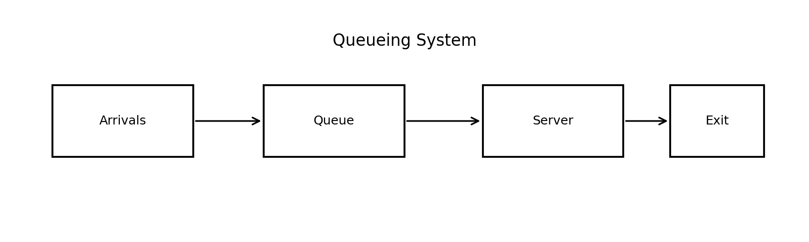
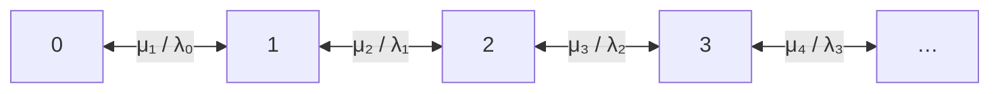
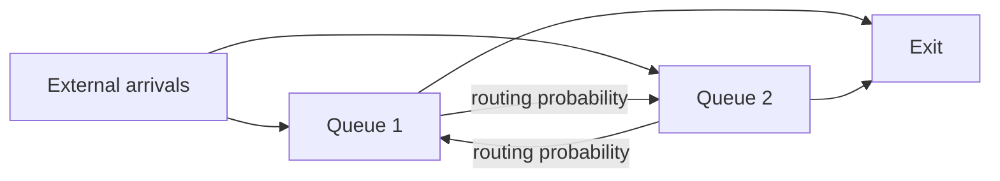
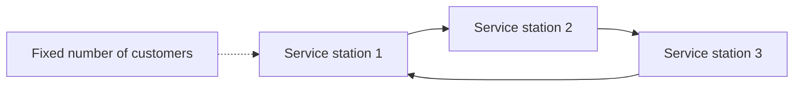
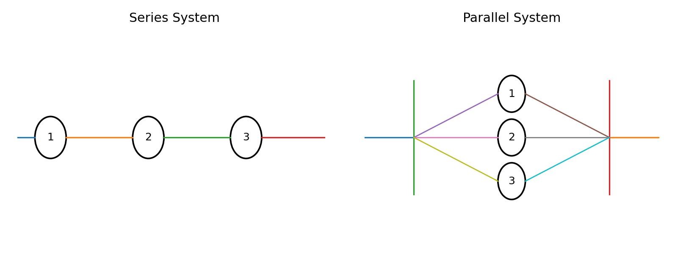
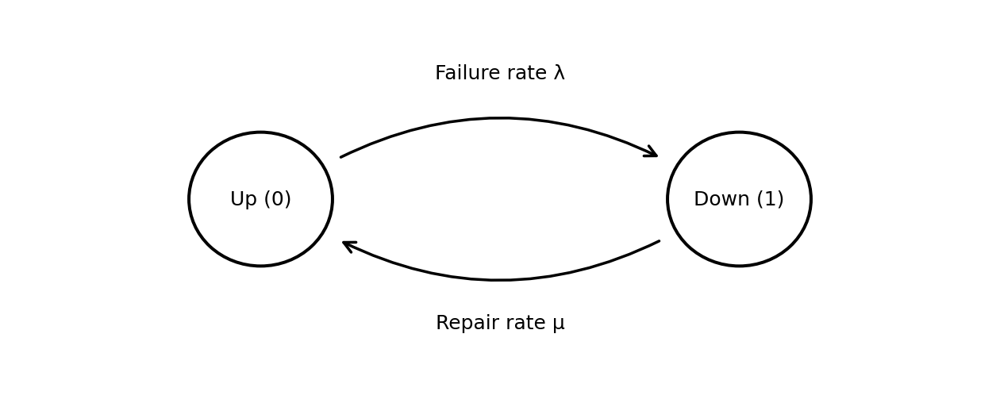

---
cssclasses:
- wide-page
stage: 6
tags:
- random-process
- queueing-theory
- reliability
textbook: Ross, Introduction to Probability Models, 13th Edition
title: 第六阶段：排队论与可靠性理论（Ch8--Ch9）
---

# 随机过程第六阶段：排队论与可靠性理论

教材：Ross, *Introduction to Probability Models*, 13th Edition。

本阶段包括第八章 **Queueing Theory（排队论）** 和第九章 **Reliability
Theory（可靠性理论）**。

按照你的复习要求，我会把重点放在：

-   **Ch8.2--8.4：** 排队论基本指标、M/M/1、出生死亡模型、排队网络。
-   **Ch8.5--8.9：** 了解主要模型和适用场景，不展开复杂推导。
-   **Ch9.2--9.3：** 系统结构函数、最小路径集、最小割集、系统可靠度。
-   **Ch9.7：** 有维修条件下的系统可用度。

# 第一部分：第八章 排队论（Queueing Theory）

## 一、宏观理解：排队论研究什么？

### 1.1 一个最简单的现实场景

假设学校有一个食堂窗口：

-   学生按照一定规律到达；
-   如果窗口空闲，学生直接接受服务；
-   如果窗口正在服务其他学生，学生就排队；
-   服务结束后，学生离开，下一个学生开始接受服务。

这就是一个典型的排队系统（Queueing System）。

**排队系统的基本流程**

**Customers Arrive**

顾客随机到达

**Queue**

等待队列（Queue）

**Service Facility**

服务台（Server）进行服务

**Departure**

服务完成，顾客离开系统

排队论主要研究：

1.  平均有多少顾客正在排队？
2.  平均有多少顾客在整个系统中？
3.  一个顾客平均需要等待多久？
4.  服务台有多大比例的时间处于忙碌状态？
5.  如果增加服务台，系统效率会如何变化？

你可以发现，它和前面学过的随机过程有很大联系。

**第六章
CTMC（连续时间马尔可夫链）研究状态随时间变化；第八章则把排队系统中的顾客数量作为状态，研究顾客到达和服务完成所形成的随机变化。**

### 1.2 本章知识地图

**§8.2 Preliminaries**

排队论的通用公式：Little's Law、PASTA、成本恒等式

**§8.3 Exponential Models**

指数到达、指数服务 → CTMC → 稳态概率

-   M/M/1
-   有限容量 M/M/1
-   Birth--Death Queueing

**§8.4 Network of Queues**

顾客在多个服务台之间移动

-   Open Networks
-   Closed Networks

**§8.5--8.9 Extensions**

一般服务分布、多种顾客、有限来源、多服务台等

本章的主线是：

$$ \boxed{ \text{到达规律} +\text{服务规律} \longrightarrow \text{稳态概率} \longrightarrow \text{排队指标} } $$

## 二、§8.2 Preliminaries：排队论的基础知识

这一节虽然名字叫预备知识，但其实非常重要。

因为后面很多模型的计算，最终都会回到这里的几个公式。

### 2.1 四个最基本的指标

先定义四个变量：

  符号    英文                            含义
  ------- ------------------------------- ------------------------
  $L$     Average Number in System        系统内平均顾客数
  $L_Q$   Average Number in Queue         排队等待的平均顾客数
  $W$     Average Time in System          顾客在系统内的平均时间
  $W_Q$   Average Waiting Time in Queue   顾客平均排队等待时间

注意区分：

-   System 包括排队和正在接受服务的顾客。
-   Queue 只包括等待服务的顾客。

因此：

$$ \boxed{L=L_Q+\text{平均服务中的顾客数}} $$

$$ \boxed{W=W_Q+E[S]} $$

其中 $S$ 是服务时间（Service Time）。

如果只有一个服务台，那么平均服务中的顾客数为：

$$ \lambda_a E[S]. $$

这里 $\lambda_a$ 是实际进入系统的顾客到达率（Effective Arrival Rate）。

### 2.2 Little's Law（利特尔法则）------必须掌握

这是整个排队论最重要、适用范围最广的公式。

$$ \boxed{L=\lambda_a W} $$

对应地：

$$ \boxed{L_Q=\lambda_a W_Q} $$

其中：

-   $L$：系统平均人数；
-   $\lambda_a$：实际进入系统的平均到达率；
-   $W$：顾客在系统内的平均停留时间。

**这个公式是什么意思？**

假设一家餐厅平均每小时进入 10 位顾客，每位顾客平均在餐厅停留 30 分钟。

那么：

$$ L=10\times0.5=5. $$

即餐厅内平均有 5 位顾客。

反过来，如果知道餐厅平均有 5 位顾客，每小时进入 10 位，那么：

$$ W=\frac5{10}=0.5\text{小时}. $$

### 为什么 Little's Law 成立？

想象一个很长的时间区间 $T$。

假设这段时间内有 $N$ 位顾客进入系统，每个人的停留时间分别为：

$$ W_1,W_2,\ldots,W_N. $$

那么这些顾客在系统内累计贡献的总时间为：

$$ \sum_{i=1}^N W_i. $$

另一方面，如果 $X(t)$ 表示时刻 $t$
系统内的顾客数，那么所有顾客累计在系统内的时间，也等于：

$$ \int_0^T X(t)\,dt. $$

因此：

$$ \frac1T\int_0^T X(t)\,dt = \frac NT\cdot\frac1N\sum_{i=1}^N W_i. $$

令 $T\to\infty$，左边趋近于 $L$，右边分别趋近于：

$$ \lambda_a,\qquad W. $$

于是：

$$ \boxed{L=\lambda_a W.} $$

**特别注意：Little's Law
不要求到达过程是泊松过程，也不要求服务时间服从指数分布。**

只要系统满足相应的长期稳定和平均值存在条件，就可以使用。

这也是它与后面 M/M/1 公式的一个重要区别：Little's Law
是通用恒等式，M/M/1 的具体公式则依赖指数模型。

### 2.3 PASTA：Poisson Arrivals See Time Averages

这是 §8.2 的另一个重点。

PASTA 的全称是：

**Poisson Arrivals See Time Averages（泊松到达看到时间平均状态）**。

它表达的是：

如果顾客按照泊松过程到达，那么长期来看，顾客到达时看到系统处于状态 $n$
的比例，等于系统处于状态 $n$ 的时间比例。

设：

$$ P_n=\text{系统处于状态 }n\text{ 的长期时间比例}, $$

$$ a_n=\text{到达顾客看到系统中有 }n\text{ 人的比例}. $$

那么对于泊松到达：

$$ \boxed{a_n=P_n.} $$

**为什么？**

泊松过程具有独立增量（Independent Increments）。

知道一个顾客在时刻 $t$ 到达，并不会改变我们对 $t$
之前系统状态的概率判断。

因此，泊松到达相当于在时间轴上进行随机观察，长期观察到各状态的概率就是时间平均比例。

这与第七章的 Inspection
Paradox（检验悖论）形成一个很有意思的联系：随机观察某个周期时，可能产生长度偏倚；而泊松到达在观察系统状态方面具有
PASTA 性质。

### 2.4 到达看到的状态不一定等于时间平均状态

教材 Example 8.1 是理解这一点的好例子。

**题目完整复述：**

考虑一个单服务台系统：

-   每位顾客的服务时间恒定为 1 个时间单位；
-   相邻顾客的到达间隔始终大于 1，例如服从 $U(1,2)$；
-   顾客到达时，如果系统为空就立即接受服务。

问：到达顾客看到系统为空的比例，以及系统在时间平均意义下为空的比例是否相同？

**解答：**

因为每个顾客服务时间为 1，而顾客间隔始终大于 1。

所以每一位顾客到达时，上一位顾客都已经完成服务。

因此：

$$ a_0=1. $$

每位顾客完成服务离开时，系统也为空：

$$ d_0=1. $$

但是：

$$ P_0\ne1. $$

为什么？

因为每次顾客接受服务之后，系统会有一段时间处于非空状态。

所以：

$$ \boxed{a_0=d_0=1,\qquad P_0<1.} $$

这道题说明：

**一般到达过程下，到达看到的状态分布不一定等于时间平均状态分布。**

不过教材 Proposition 8.1 还给出了另一个重要结果：

对于每次只发生一个顾客到达或离开的系统：

$$ \boxed{a_n=d_n.} $$

也就是长期来看，到达时看到 $n$ 位顾客的比例，等于离开时留下 $n$
位顾客的比例。

而 PASTA 则进一步说明：当到达是泊松过程时：

$$ \boxed{a_n=d_n=P_n.} $$

教材依据：§8.2.1--8.2.2，印刷页码 520--524。

> 教材来源：随机过程13版英文_Ch08(1).pdf \## 三、§8.3 Exponential
> Models：指数排队模型 现在进入本章的核心。

为什么这里要假设指数分布？

因为指数分布具有无记忆性（Memoryless Property）：

$$ P(X>s+t\mid X>s)=P(X>t). $$

这意味着：

一个顾客已经接受了多长时间的服务，不会影响他接下来还需要等待多久的概率分布。

因此，我们只需要知道当前有多少顾客，就可以预测系统下一步的状态变化。

这就使排队系统成为连续时间马尔可夫链（CTMC）。

### 3.1 M/M/1 模型到底是什么意思？

M/M/1 是排队论中最基础、最重要的模型。

三个符号分别表示：

  符号       含义
  ---------- ----------------------------------------------------
  第一个 M   Markovian Arrivals：泊松到达过程，间隔服从指数分布
  第二个 M   Markovian Service：服务时间服从指数分布
  1          Single Server：只有一个服务台

因此 M/M/1 模型具有以下假设：

1.  顾客按照速率为 $\lambda$ 的泊松过程到达。
2.  服务时间独立同分布，服从速率为 $\mu$ 的指数分布。
3.  只有一个服务台。
4.  等待空间无限。
5.  顾客按照先到先服务（FIFO）接受服务。
6.  服务完成后顾客离开系统。

这里：

$$ E[\text{Interarrival Time}]=\frac1\lambda, $$

$$ E[\text{Service Time}]=\frac1\mu. $$

注意：$\lambda,\mu$ 都是单位时间内的速率，而不是平均时间。

### 3.2 M/M/1 的状态转移图

定义：

$$ X(t)=\text{时刻 }t\text{ 系统中的顾客总数}. $$

那么状态空间为：

$$ S=\{0,1,2,\ldots\}. $$

-   有顾客到达，状态增加 1；
-   有顾客完成服务，状态减少 1。

M/M/1 Birth--Death Diagram

你可以看到，这是一个典型的出生死亡过程（Birth--Death Process）。

在这里：

-   Birth（出生）就是顾客到达；
-   Death（死亡）就是顾客完成服务离开。

### 3.3 推导稳态概率（Steady-State Probabilities）

这是 M/M/1 最重要的数学推导。

令：

$$ P_n=\lim_{t\to\infty}P(X(t)=n). $$

即系统长期处于状态 $n$ 的概率。

**第一步：写状态平衡方程（Balance Equations）。**

对于状态 0：

-   离开状态 0：只能有顾客到达，速率为 $\lambda$；
-   进入状态 0：只能由状态 1 的顾客完成服务，速率为 $\mu$。

考虑系统处于各状态的长期时间比例：

$$ \lambda P_0=\mu P_1. $$

对于状态 $n\ge1$：

-   离开状态 $n$：到达或服务完成，合计速率 $\lambda+\mu$；
-   进入状态 $n$：从 $n-1$ 到达，或从 $n+1$ 服务完成。

因此：

$$ \boxed{ (\lambda+\mu)P_n =\lambda P_{n-1}+\mu P_{n+1}. } $$

**第二步：利用相邻状态之间的流量平衡。**

对于出生死亡过程，可以进一步得到：

$$ \boxed{\lambda P_n=\mu P_{n+1}.} $$

所以：

$$ P_{n+1}=\frac{\lambda}{\mu}P_n. $$

定义：

$$ \boxed{\rho=\frac{\lambda}{\mu}.} $$

称为交通强度（Traffic Intensity），也称服务利用率（Utilization）。

于是：

$$ P_1=\rho P_0, $$

$$ P_2=\rho P_1=\rho^2P_0, $$

$$ P_3=\rho^3P_0. $$

一般地：

$$ \boxed{P_n=\rho^nP_0.} $$

**第三步：利用概率归一化。**

因为所有状态的概率之和必须等于 1：

$$ \sum_{n=0}^{\infty}P_n=1. $$

所以：

$$ P_0\sum_{n=0}^{\infty}\rho^n=1. $$

利用几何级数：

$$ \sum_{n=0}^{\infty}\rho^n=\frac1{1-\rho}, \qquad |\rho|<1. $$

因此：

$$ P_0=1-\rho. $$

最终：

M/M/1 核心结论

$$ \boxed{P_n=(1-\rho)\rho^n,\quad n\ge0} $$

其中：

$$ \boxed{\rho=\frac{\lambda}{\mu}<1.} $$

教材公式 (8.6)，印刷页码 526--527。

> 教材来源：随机过程13版英文_Ch08(1).pdf \### 3.4 为什么必须要求
> **$\lambda<\mu$**？ 这是一个非常重要的直觉问题。

假设：

$$ \lambda=10,\qquad \mu=8. $$

那么每小时平均有 10 位顾客到达，但服务台最多平均完成 8 位顾客的服务。

因此，顾客数量会不断积累。

长期来看：

$$ \text{到达速率}>\text{服务速率}. $$

队列无法稳定，顾客数量会持续增大。

所以必须要求：

$$ \boxed{\lambda<\mu.} $$

如果：

$$ \rho=\frac{\lambda}{\mu}\ge1, $$

那么几何级数无法归一化，也就不存在正常的稳态概率分布。

**考试记忆：M/M/1 稳定条件是 arrival rate 小于 service rate。**

### 3.5 M/M/1 的四个核心指标

现在我们已经有了：

$$ P_n=(1-\rho)\rho^n. $$

可以进一步计算平均顾客数量：

$$ L=E[X] =\sum_{n=0}^{\infty}nP_n. $$

代入：

$$ L=(1-\rho)\sum_{n=1}^{\infty}n\rho^n. $$

利用几何级数求导：

$$ \sum_{n=1}^{\infty}n\rho^n =\frac{\rho}{(1-\rho)^2}. $$

因此：

$$ \boxed{L=\frac{\rho}{1-\rho} =\frac{\lambda}{\mu-\lambda}.} $$

再利用 Little's Law：

$$ L=\lambda W. $$

得到：

$$ \boxed{W=\frac1{\mu-\lambda}.} $$

因为每位顾客平均接受服务的时间是：

$$ E[S]=\frac1\mu, $$

所以：

$$ W_Q=W-\frac1\mu. $$

即：

$$ \boxed{ W_Q=\frac{\lambda}{\mu(\mu-\lambda)}. } $$

再使用：

$$ L_Q=\lambda W_Q, $$

得到：

$$ \boxed{ L_Q=\frac{\lambda^2}{\mu(\mu-\lambda)}. } $$

> \[!important\] 必须掌握

**M/M/1 公式汇总**

  指标           公式
  -------------- ------------------------------------
  稳态概率       $P_n=(1-\rho)\rho^n$
  利用率         $\rho=\lambda/\mu$
  系统平均人数   $L=\lambda/(\mu-\lambda)$
  排队平均人数   $L_Q=\lambda^2/[\mu(\mu-\lambda)]$
  系统平均时间   $W=1/(\mu-\lambda)$
  平均排队时间   $W_Q=\lambda/[\mu(\mu-\lambda)]$

还要记住：

$$ W=W_Q+\frac1\mu,\qquad L=L_Q+\rho. $$

### 3.6 最重要例题：教材 Example 8.3

**题目完整复述：**

某服务系统中：

-   顾客按照泊松过程到达，平均每 12 分钟到达一位；
-   服务时间服从指数分布，平均每 8 分钟完成一位顾客的服务。

求：

1.  系统内平均有多少位顾客？
2.  一位顾客平均在系统中停留多久？

进一步，假设顾客到达率增加 20%，重新计算以上两个指标。

**第一步：确定参数。**

平均到达间隔为 12 分钟：

$$ \lambda=\frac1{12}. $$

平均服务时间为 8 分钟：

$$ \mu=\frac18. $$

这里所有速率的单位都是每分钟。

**第二步：计算利用率。**

$$ \rho=\frac{\lambda}{\mu} =\frac{1/12}{1/8} =\frac23. $$

满足：

$$ \rho<1. $$

所以系统稳定。

**第三步：计算平均人数。**

$$ L=\frac{\rho}{1-\rho} =\frac{2/3}{1/3} =\boxed2. $$

**第四步：计算平均停留时间。**

$$ W=\frac1{\mu-\lambda} =\frac1{1/8-1/12} =\boxed{24\text{分钟}}. $$

所以：

-   系统内平均有 2 位顾客；
-   每位顾客平均停留 24 分钟。

**第五步：到达率增加 20%。**

新的到达率：

$$ \lambda'=1.2\lambda=\frac1{10}. $$

新的利用率：

$$ \rho'=\frac{1/10}{1/8}=0.8. $$

新的平均人数：

$$ L'=\frac{0.8}{1-0.8}=\boxed4. $$

新的平均时间：

$$ W'=\frac1{1/8-1/10}=\boxed{40\text{分钟}}. $$

**这道题最值得理解的结论：**

到达率仅仅增加了 20%，但是：

-   平均顾客数量从 2 增加到 4；
-   平均停留时间从 24 分钟增加到 40 分钟。

为什么？

因为原来：

$$ \rho=\frac23, $$

已经比较接近系统的最大服务能力。

当 $\rho\to1$ 时：

$$ L=\frac{\rho}{1-\rho}\to\infty, $$

$$ W=\frac1{\mu(1-\rho)}\to\infty. $$

所以排队系统在接近满负荷运行时，对到达率变化非常敏感。

这是排队系统设计中非常重要的现象：**不能仅仅让平均服务能力略大于平均到达需求，还需要保留一定的服务余量。**

教材 Example 8.3，印刷页码 528--529。

> 教材来源：随机过程13版英文_Ch08(1).pdf \## 四、§8.3.3 Birth--Death
> Queueing Models（出生死亡排队模型） 这一节是 M/M/1 的推广，非常重要。

### 4.1 为什么要推广 M/M/1？

在 M/M/1 中，我们假设：

-   不论系统里有多少顾客，到达率始终是 $\lambda$；
-   只要系统不为空，服务率始终是 $\mu$。

但现实中不一定如此。

例如：

-   如果系统里已经有很多顾客，新顾客可能不愿意加入；
-   多个服务台同时工作，顾客越多，整体服务能力越强；
-   系统容量有限，满员时新顾客不能进入。

这时就需要出生死亡排队模型。

### 4.2 一般 Birth--Death Model 的定义

定义：

$$ \lambda_n=\text{系统处于状态 }n\text{ 时的到达率}, $$

$$ \mu_n=\text{系统处于状态 }n\text{ 时的离开率}. $$

注意：

$$ \mu_0=0, $$

因为系统为空时不可能发生服务完成。

状态转移：

$$ n\xrightarrow{\lambda_n}n+1, $$

$$ n\xrightarrow{\mu_n}n-1. $$

其转移图就是：

相邻状态之间只发生 +1 或 −1 的变化。

### 4.3 一般出生死亡过程的稳态概率

和 M/M/1 一样，利用相邻状态之间的流量平衡：

$$ \boxed{\lambda_nP_n=\mu_{n+1}P_{n+1}.} $$

所以：

$$ P_{n+1}=\frac{\lambda_n}{\mu_{n+1}}P_n. $$

逐步展开：

$$ P_1=\frac{\lambda_0}{\mu_1}P_0, $$

$$ P_2=\frac{\lambda_0\lambda_1}{\mu_1\mu_2}P_0, $$

$$ P_3=\frac{\lambda_0\lambda_1\lambda_2} {\mu_1\mu_2\mu_3}P_0. $$

一般地：

$$ \boxed{ P_n= \frac{\lambda_0\lambda_1\cdots\lambda_{n-1}} {\mu_1\mu_2\cdots\mu_n}P_0. } $$

再利用：

$$ \sum_{n=0}^{\infty}P_n=1 $$

确定 $P_0$。

对于无限状态空间，还需要检查：

$$ \boxed{ 1+\sum_{n=1}^{\infty} \frac{\lambda_0\cdots\lambda_{n-1}} {\mu_1\cdots\mu_n}<\infty. } $$

这就是一般出生死亡排队模型的通用解法。

### 4.4 三种重要的特殊模型

教材 §8.3.3 给出了三种典型应用。

**（1）M/M/1**

$$ \lambda_n=\lambda,\qquad \mu_n=\mu,\quad n\ge1. $$

代入通用公式，就回到了：

$$ P_n=(1-\rho)\rho^n. $$

**（2）M/M/1 with Balking（顾客放弃加入）**

假设顾客到达时，发现系统里已经有 $n$ 位顾客，那么他只以概率 $\alpha_n$
愿意加入。

这里：

$$ 0\le\alpha_n\le1. $$

实际到达率变成：

$$ \boxed{\lambda_n=\lambda\alpha_n.} $$

而服务率仍然是：

$$ \mu_n=\mu,\quad n\ge1. $$

这就是 Balking（顾客看到队伍太长而不加入）。

**（3）M/M/k（多个服务台）**

假设有 $k$ 个服务台，每个服务台的服务速率均为 $\mu$。

那么：

-   当 $n<k$ 时，所有顾客都能立即接受服务；
-   当 $n\ge k$ 时，只有 $k$ 位顾客正在接受服务。

因此：

$$ \boxed{ \lambda_n=\lambda } $$

$$ \boxed{ \mu_n= \begin{cases} n\mu,&1\le n\le k,\\ k\mu,&n\ge k. \end{cases} } $$

注意这里的 $\mu_n$ 是整个系统的总服务完成率，不是单个服务台的服务率。

例如有 3 个服务台，每个服务台每小时完成 5 位顾客的服务：

-   系统内有 1 人：总服务率为 5；
-   系统内有 2 人：总服务率为 10；
-   系统内有 3 人及以上：总服务率为 15。

所以稳定条件是：

$$ \boxed{\lambda<k\mu.} $$

因为系统最多可以同时提供 $k\mu$ 的服务能力。

**本节考试重点：**

如果题目给你一个到达率和服务率随人数变化的排队系统，不要急着套 M/M/1。

先写出：

$$ \lambda_n,\quad \mu_n, $$

再使用：

$$ \lambda_nP_n=\mu_{n+1}P_{n+1}. $$

这就是最通用的思路。

> 教材来源：随机过程13版英文_Ch08(1).pdf \## 五、§8.4 Network of
> Queues（排队网络） 这是你指定的另一个重点。

前面 M/M/1 和 Birth--Death 都是在研究一个服务台。

但现实中，顾客可能需要经过多个服务台。

例如，一件商品在工厂中需要：

1.  先经过加工部门；
2.  再经过质检部门；
3.  最后进入包装部门。

顾客在多个服务台之间移动，就形成了排队网络（Network of Queues）。

### 5.1 两种排队网络

教材分为两类。

**Open System（开放系统）**

-   顾客可以从外部进入；
-   顾客可以在不同服务台之间移动；
-   顾客最终可以离开整个网络。

**Closed System（封闭系统）**

-   系统中的顾客总数固定；
-   不存在外部新顾客进入；
-   也不存在顾客彻底离开系统；
-   顾客只是在不同服务台之间循环移动。

**Open Network**

外部到达 → 多个服务站 → 离开系统

**Closed Network**

固定顾客数量，在各服务站之间循环

### 5.2 Open Network：开放排队网络

这是本节最重要的模型。

假设有 $k$ 个服务台。

定义：

$$ r_j=\text{从外部直接进入服务台 }j\text{ 的到达率}. $$

$$ P_{ij}=\text{顾客完成服务台 }i\text{ 的服务后，前往 }j\text{ 的概率}. $$

这里的 $P_{ij}$ 是路由概率（Routing Probability）。

定义：

$$ \lambda_j=\text{服务台 }j\text{ 的总到达率}. $$

那么，服务台 $j$ 的顾客来源有两种：

1.  从外部直接进入；
2.  从其他服务台服务完成后转入。

因此：

$$ \boxed{ \lambda_j=r_j+\sum_{i=1}^k\lambda_iP_{ij}. } $$

这称为**流量平衡方程（Traffic Equations）**。

注意：这里的 $\lambda_j$
不只是外部到达率，还包括其他服务台转过来的顾客。

如果写成向量形式：

$$ \boldsymbol\lambda =\boldsymbol r+\boldsymbol\lambda P. $$

所以：

$$ \boxed{ \boldsymbol\lambda =\boldsymbol r(I-P)^{-1} } $$

前提是矩阵 $I-P$ 可逆，且系统能够稳定运行。

### 5.3 为什么算出每个服务台的到达率就很重要？

因为教材证明，在满足相应的开放 Jackson
网络条件时，每个服务台的顾客数量具有与一个独立 M/M/1
系统相同的边际分布。

设服务台 $j$ 的服务速率为 $\mu_j$，则：

$$ \boxed{ P(N_j=n) = \left(\frac{\lambda_j}{\mu_j}\right)^n \left(1-\frac{\lambda_j}{\mu_j}\right). } $$

这里必须满足：

$$ \boxed{\lambda_j<\mu_j,\quad j=1,\ldots,k.} $$

而且整个网络的联合稳态分布为：

$$ \boxed{ P(N_1=n_1,\ldots,N_k=n_k) = \prod_{j=1}^k (1-\rho_j)\rho_j^{n_j} } $$

其中：

$$ \rho_j=\frac{\lambda_j}{\mu_j}. $$

这意味着在教材的开放网络模型中，各服务台的顾客数量在稳态下相互独立。

这是一项非常重要的结果。

它说明：

**复杂的多服务台网络，可以先通过流量方程求每个节点的到达率，再分别使用
M/M/1 的结果。**

### 5.4 教材 Example 8.12：两个服务台之间存在反馈

这是我认为 §8.4 最值得掌握的例题。

**题目完整复述：**

一个排队网络包含两个服务台。

-   外部顾客以速率 4 到达服务台 1；
-   外部顾客以速率 5 到达服务台 2；
-   服务台 1 的服务速率为 8；
-   服务台 2 的服务速率为 10。

顾客完成服务后：

-   在服务台 1 完成服务的顾客，有 $1/2$ 的概率转到服务台 2，有 $1/2$
    的概率离开系统；
-   在服务台 2 完成服务的顾客，有 $1/4$ 的概率转到服务台 1，有 $3/4$
    的概率离开系统。

求：

1.  两个服务台的总到达率；
2.  系统内顾客数量的联合稳态分布；
3.  系统内的平均顾客总数；
4.  一个外部顾客在整个网络中的平均停留时间。

**第一步：写流量平衡方程。**

设：

$$ \lambda_1=\text{服务台1的总到达率}, $$

$$ \lambda_2=\text{服务台2的总到达率}. $$

服务台 1 的顾客来源：

-   外部到达率 4；
-   从服务台 2 转过来的顾客，速率为 $\frac14\lambda_2$。

因此：

$$ \lambda_1=4+\frac14\lambda_2. $$

服务台 2 的顾客来源：

-   外部到达率 5；
-   从服务台 1 转过来的顾客，速率为 $\frac12\lambda_1$。

因此：

$$ \lambda_2=5+\frac12\lambda_1. $$

**第二步：解方程。**

代入：

$$ \lambda_1 =4+\frac14\left(5+\frac12\lambda_1\right). $$

得到：

$$ \frac78\lambda_1=\frac{21}{4}. $$

所以：

$$ \boxed{\lambda_1=6,\qquad\lambda_2=8.} $$

检查稳定性：

$$ 6<8,\qquad 8<10. $$

两个服务台均稳定。

**第三步：求联合稳态分布。**

利用开放排队网络的乘积形式：

$$ P(N_1=n,N_2=m) =P(N_1=n)P(N_2=m). $$

因此：

$$ \boxed{ P(N_1=n,N_2=m) = \frac14\left(\frac34\right)^n \cdot \frac15\left(\frac45\right)^m. } $$

这里：

$$ \rho_1=\frac68=\frac34, \qquad \rho_2=\frac8{10}=\frac45. $$

**第四步：求系统内平均人数。**

两个服务台的平均人数相加：

$$ L=L_1+L_2. $$

所以：

$$ \begin{aligned} L &=\frac{\lambda_1}{\mu_1-\lambda_1} +\frac{\lambda_2}{\mu_2-\lambda_2}\\ &=\frac6{8-6}+\frac8{10-8}\\ &=3+4\\ &=\boxed7. \end{aligned} $$

**第五步：求平均停留时间。**

注意，这里使用的是外部进入网络的总速率：

$$ \lambda_a=4+5=9. $$

而不是：

$$ \lambda_1+\lambda_2=14. $$

因为同一个顾客可能在网络内部转移多次，不能把每次访问服务台都当作一个新的外部顾客。

使用 Little's Law：

$$ W=\frac L{\lambda_a}. $$

所以：

$$ \boxed{W=\frac79.} $$

即一个外部顾客平均在整个网络中停留 $7/9$ 个时间单位。

教材 Example 8.12，印刷页码 556。

> 教材来源：随机过程13版英文_Ch08(1).pdf \### 5.5 Closed
> Network：封闭排队网络 这一部分你只需要理解基本思想。

假设有 10 位计算机用户，他们不断在几个服务器之间提交任务。

用户总数始终为 10：

-   某位用户离开一个服务台后，会去另一个服务台；
-   不会产生新的外部用户；
-   也不会有人永久离开整个系统。

这就是封闭网络。

教材的核心工具是：

**Arrival Theorem（到达定理）** 和 **Mean Value
Analysis（平均值分析）**。

到达定理的思想是：

> 在一个有 $m$ 个顾客的封闭网络中，一个顾客到达某个服务台时，其他 $m-1$
> 个顾客的分布，等于这个网络只有 $m-1$ 个顾客时的稳态分布。

由此可以建立递推公式，逐渐求出：

-   每个服务台的平均顾客数；
-   顾客在每个服务台的平均停留时间；
-   整个网络的吞吐率（Throughput）。

这一部分涉及递推和组合状态空间，你暂时不需要掌握完整计算过程。

教材 §8.4.2，印刷页码 557--561。

> 教材来源：随机过程13版英文_Ch08(1).pdf \##
> 六、§8.5--8.9：其他排队模型快速了解 这部分按照 B/C
> 级要求，不展开复杂证明，但需要认识模型、假设以及最重要的结论。

### 6.1 §8.5 M/G/1：一般服务时间的单服务台

前面的 M/M/1 要求：

-   到达间隔服从指数分布；
-   服务时间服从指数分布。

M/G/1 则放宽了第二个条件。

  记号   含义
  ------ ---------------------------
  M      泊松到达
  G      General：一般服务时间分布
  1      一个服务台

也就是说：

$$ \text{Arrival}\sim\operatorname{Poisson}(\lambda), $$

但：

$$ S\sim G $$

可以服从任意具有相应有限矩的分布。

教材通过 Work（工作量）推导出一个著名公式：

**Pollaczek--Khinchine Formula（波拉切克--欣钦公式）**

$$ \boxed{ W_Q= \frac{\lambda E[S^2]} {2(1-\lambda E[S])}. } $$

其中：

$$ \rho=\lambda E[S]<1. $$

其他指标可以继续使用：

$$ L_Q=\lambda W_Q, $$

$$ W=W_Q+E[S], $$

$$ L=\lambda W. $$

这个公式最值得理解的是：

$$ E[S^2]=\operatorname{Var}(S)+(E[S])^2. $$

因此，在平均服务时间不变时，服务时间方差越大，平均排队时间越长。

这反映了一个重要现象：

**单服务台排队系统通常不喜欢过大的服务时间波动。**

### 6.2 §8.6 M/G/1 的扩展

主要包括三类：

-   Bulk Arrivals：批量到达，例如一辆公交车一次带来多位顾客；
-   Priority Queues：优先级排队，例如 VIP 顾客优先接受服务；
-   Server Breakdown：服务台故障，例如机器运行中断后需要维修。

你只需要知道这些变化会改变系统的状态或顾客等待时间计算方法。

### 6.3 §8.7 G/M/1

这里将 M/M/1 的到达过程放宽为一般分布：

-   到达间隔服从一般分布 $G$；
-   服务时间仍服从指数分布。

由于一般到达间隔没有无记忆性，仅知道当前顾客数量通常不足以构成连续时间马尔可夫状态。

教材改为只观察顾客到达时刻，构造嵌入马尔可夫链（Embedded Markov
Chain）。

最终稳态到达观察概率具有几何形式：

$$ P(X_n=k)=(1-\beta)\beta^k, $$

其中 $0<\beta<1$ 满足：

$$ \boxed{ \beta=\int_0^\infty e^{-\mu t(1-\beta)}\,dG(t). } $$

不要求你手工求解这个积分方程，认识模型思想即可。

### 6.4 §8.8 Finite Source Model（有限来源模型）

例如一家工厂有 $m$ 台机器。

-   正常工作的机器可能发生故障；
-   故障机器进入维修队列；
-   维修完成后重新投入生产。

这里顾客来源不是无限的，而是固定的 $m$ 台机器。

因此，机器故障率会随着正在工作的机器数量变化。

教材利用维修完成时刻构造离散时间马尔可夫链，分析故障机器数量、维修队列和平均停机时间。

### 6.5 §8.9 Multiserver Queues（多服务台排队）

主要分为：

  模型         含义
  ------------ ------------------------------------------
  M/M/k Loss   $k$ 个服务台，不允许排队，满员则拒绝顾客
  M/M/k        $k$ 个服务台，允许排队
  G/M/k        一般到达间隔，指数服务
  M/G/k        泊松到达，一般服务时间

其中有一个很有名的公式：

**Erlang's Loss Formula（厄兰损失公式）**

当有 $k$
个服务台，顾客到达服从泊松过程，服务时间服从一般分布，且满员后不允许排队时：

$$ \boxed{ P_i= \frac{(\lambda E[S])^i/i!} {\displaystyle\sum_{j=0}^{k}(\lambda E[S])^j/j!}, \quad i=0,\ldots,k. } $$

其中 $P_k$ 就是系统满员、到达顾客被拒绝的概率。

这一公式比较特殊：即使服务时间不是指数分布，在教材模型条件下仍然成立。

**第八章的 B/C 级部分，你目前掌握这些模型的区别、适用场景和公式即可。**

教材 §8.5--8.9，印刷页码 562--591。

> 教材来源：随机过程13版英文_Ch08(1).pdf
> 教材来源：随机过程13版英文_Ch08(1).pdf \# 第二部分：第九章
> 可靠性理论（Reliability Theory） \##
> 七、宏观理解：可靠性理论研究什么？ 排队论研究的是：

**随机到达的顾客如何在服务系统中等待和接受服务。**

可靠性理论研究的是：

**由多个零部件组成的系统，究竟有多大概率能够正常运行？**

例如：

-   一架飞机有多个发动机和控制系统；
-   一台计算机有 CPU、内存、电源；
-   一个通信网络有多个通信线路；
-   一个生产系统由多个独立设备组成。

一个零部件发生故障，不一定意味着整个系统立即失效。

这取决于零部件之间的连接结构。

因此，第九章的核心逻辑是：

$$ \boxed{ \text{组件是否正常} \longrightarrow \text{系统结构} \longrightarrow \text{系统是否正常} \longrightarrow \text{系统可靠度} } $$

这一章还进一步研究：如果组件可以维修，系统长期有多少时间处于正常运行状态。

## 八、§9.2 Structure Functions：结构函数

### 8.1 如何描述组件状态？

假设一个系统由 $n$ 个组件构成。

定义：

$$ x_i= \begin{cases} 1,&\text{第 }i\text{ 个组件正常工作},\\ 0,&\text{第 }i\text{ 个组件发生故障}. \end{cases} $$

那么：

$$ \boldsymbol x=(x_1,x_2,\ldots,x_n) $$

称为状态向量（State Vector）。

整个系统是否正常工作，由一个函数决定：

$$ \boxed{ \phi(\boldsymbol x)= \begin{cases} 1,&\text{系统正常工作},\\ 0,&\text{系统失效}. \end{cases} } $$

这个函数称为结构函数（Structure Function）。

注意：它不是概率函数，而是一个确定性的 0-1 函数。

给定各组件的状态，就能确定整个系统是否正常。

### 8.2 三种最基本的系统结构

**（1）Series System：串联系统**

[slideserve.com](https://www.slideserve.com/vern/what-is-this-chapter-about-powerpoint-ppt-presentation?utm_source=chatgpt.com)

串联系统要求所有组件都正常，系统才能工作。

例如：一条生产线需要依次经过三个设备，任何一个设备故障，整个生产线都无法正常工作。

因此：

$$ \boxed{ \phi(\boldsymbol x)=\prod_{i=1}^n x_i. } $$

只有：

$$ x_1=x_2=\cdots=x_n=1 $$

时，系统才能工作。

**（2）Parallel System：并联系统**

[slideserve.com](https://www.slideserve.com/prudence-bender/reliability-overview?utm_source=chatgpt.com)

并联系统只需要至少一个组件正常，系统就可以工作。

例如：两个备用电源，只要有一个能够正常供电，系统就能继续运行。

因此：

$$ \boxed{ \phi(\boldsymbol x)=\max(x_1,\ldots,x_n). } $$

利用 0-1 变量的性质，也可以写成：

$$ \boxed{ \phi(\boldsymbol x) =1-\prod_{i=1}^n(1-x_i). } $$

**（3）k-out-of-n System：n 中取 k 系统**

[slideserve.com](https://www.slideserve.com/loyal/system-reliability-modeling-and-analysis-r-out-of-n-and-standby-configurations?utm_source=chatgpt.com)

这种结构要求 $n$ 个组件中至少有 $k$ 个正常，系统才能工作。

例如：

一个系统由 5 个组件组成，只要其中至少 3 个正常，就可以工作。

因此：

$$ \boxed{ \phi(\boldsymbol x) = \mathbf1\left\{ \sum_{i=1}^n x_i\ge k \right\}. } $$

其中 $\mathbf1\{\cdot\}$ 是指示函数（Indicator Function）。

三个结构的关系：

-   串联系统：$n$-out-of-$n$；
-   并联系统：1-out-of-$n$；
-   k-out-of-n：两者的推广。

## 九、§9.2.1 Minimal Path and Minimal Cut Sets

这是第九章最值得掌握的知识点之一。

### 9.1 Minimal Path Sets（最小路径集）

先理解什么是 Path。

一个状态向量 $\boldsymbol x$ 如果使：

$$ \phi(\boldsymbol x)=1, $$

那么它就是一个路径向量（Path Vector）。

但如果我们希望找到：

**系统正常工作所必需的最小组件集合。**

就需要最小路径集（Minimal Path Set）。

定义：

> 一个最小路径集是指一组最少的正常组件，只要这些组件全部正常，整个系统就一定正常。

例如：

一个系统由 4 个组件组成：

-   组件 1 和组件 2 必须同时正常；
-   组件 3 和组件 4 至少有一个正常。

那么：

$$ \boxed{ \phi(\boldsymbol x)=x_1x_2\max(x_3,x_4). } $$

系统有两个最小路径集：

$$ \boxed{ A_1=\{1,2,3\},\qquad A_2=\{1,2,4\}. } $$

为什么？

-   只要组件 1、2、3 全部正常，系统就能工作；
-   只要组件 1、2、4 全部正常，系统也能工作。

而且去掉任意一个组件，都不能保证系统正常。

一般地，设最小路径集为：

$$ A_1,A_2,\ldots,A_s. $$

那么：

$$ \boxed{ \phi(\boldsymbol x) = \max_{1\le j\le s} \left(\prod_{i\in A_j}x_i\right). } $$

这意味着：

**系统正常，当且仅当至少一个最小路径集中的所有组件都正常。**

### 9.2 Minimal Cut Sets（最小割集）

现在反过来思考：

**哪些组件一旦同时发生故障，就一定会导致整个系统失效？**

这就是最小割集（Minimal Cut Set）。

定义：

> 最小割集是指一组最少的故障组件，只要这些组件全部失效，整个系统就一定失效。

还是刚才的四组件系统：

$$ \phi(\boldsymbol x)=x_1x_2\max(x_3,x_4). $$

系统失效有三种最小情况：

1.  组件 1 失效；
2.  组件 2 失效；
3.  组件 3 和组件 4 同时失效。

因此最小割集为：

$$ \boxed{ C_1=\{1\},\quad C_2=\{2\},\quad C_3=\{3,4\}. } $$

一般地，如果最小割集为：

$$ C_1,C_2,\ldots,C_k, $$

那么：

$$ \boxed{ \phi(\boldsymbol x) = \prod_{j=1}^k \left(\max_{i\in C_j}x_i\right). } $$

为什么？

如果某个最小割集中的组件全部失效，那么：

$$ \max_{i\in C_j}x_i=0. $$

于是整个乘积为 0，系统失效。

### 9.3 最小路径集与最小割集的区别

  ------------------------------------------------------------------------
  比较       Minimal Path Set               Minimal Cut Set
  ---------- ------------------------------ ------------------------------
  中文       最小路径集                     最小割集

  研究对象   正常组件                       故障组件

  核心问题   哪些组件正常能保证系统工作？   哪些组件失效会导致系统失效？

  系统逻辑   至少一个路径集全部正常         至少一个割集全部失效
  ------------------------------------------------------------------------

你可以这样记：

-   Path：寻找能够让系统工作的最小组合。
-   Cut：寻找能够让系统失效的最小组合。

### 9.4 考试中如何寻找最小路径集和最小割集？

如果给你一张系统结构图，我建议按照以下步骤：

**第一步：先识别系统整体结构。**

判断哪些组件必须同时工作，哪些组件只需要至少一个工作。

**第二步：寻找所有能够保证系统工作的最小组件组合。**

每一个这样的组合就是一个最小路径集。

**第三步：寻找所有能够导致系统失效的最小故障组合。**

每一个这样的组合就是一个最小割集。

**第四步：检查最小性。**

如果一个集合中去掉某个组件，仍然能保证原来的功能，那么它就不是最小集合。

教材 §9.2--9.2.1，印刷页码 604--609，尤其是 Example 9.4--9.9。

> 教材来源：随机过程13版英文_Ch09(1).pdf \## 十、§9.3 Reliability of
> Systems of Independent Components 这一节研究的是：

**已知每个组件正常工作的概率，如何计算整个系统正常工作的概率？**

这是可靠性理论最重要的计算问题。

### 10.1 组件可靠度与系统可靠度

定义：

$$ p_i=P(X_i=1). $$

也就是第 $i$ 个组件正常工作的概率，称为组件可靠度（Component
Reliability）。

如果所有组件相互独立（Independent Components），那么：

$$ \boxed{ r(\boldsymbol p)=P(\phi(\boldsymbol X)=1) =E[\phi(\boldsymbol X)]. } $$

其中：

$$ r(\boldsymbol p) $$

称为系统可靠度函数（System Reliability Function）。

注意：

-   $p_i$：单个组件的可靠度；
-   $r(\boldsymbol p)$：整个系统的可靠度。

两者不是同一个概念。

### 10.2 三种基本系统的可靠度公式

**（1）串联系统**

系统必须所有组件都正常：

$$ r(\boldsymbol p) =P(X_1=1,\ldots,X_n=1). $$

因为组件独立：

$$ \boxed{ r_{\mathrm{series}}(\boldsymbol p) =\prod_{i=1}^np_i. } $$

例如，三个组件的可靠度分别为：

$$ p_1=0.9,\quad p_2=0.8,\quad p_3=0.95. $$

则：

$$ r=0.9\times0.8\times0.95 =\boxed{0.684}. $$

可以看出，串联系统中任何一个组件的可靠度较低，都会拉低整个系统的可靠度。

**（2）并联系统**

系统只需要至少一个组件正常：

$$ r=P(\text{至少一个组件正常}). $$

使用对立事件：

$$ r=1-P(\text{所有组件都失效}). $$

所以：

$$ \boxed{ r_{\mathrm{parallel}}(\boldsymbol p) =1-\prod_{i=1}^n(1-p_i). } $$

例如两个组件的可靠度分别为 0.9 和 0.8：

$$ r=1-(1-0.9)(1-0.8) =\boxed{0.98}. $$

你会发现，并联结构可以通过冗余（Redundancy）显著提高系统可靠度。

**（3）k-out-of-n 系统**

如果所有组件独立且具有相同可靠度：

$$ p_i=p, $$

那么正常工作的组件数量服从二项分布：

$$ \sum_{i=1}^nX_i\sim\operatorname{Binomial}(n,p). $$

系统可靠度就是：

$$ \boxed{ r(p)= \sum_{i=k}^n \binom ni p^i(1-p)^{n-i}. } $$

这个公式本质上就是二项分布的右尾概率。

### 10.3 最重要例题：Two-out-of-Three System

这是教材 Example 9.13。

**题目完整复述：**

一个系统由三个相互独立的组件组成。

只要三个组件中至少有两个正常工作，整个系统就能正常工作。

三个组件的可靠度分别为：

$$ p_1,\quad p_2,\quad p_3. $$

求系统的可靠度函数。

**第一步：列举所有使系统正常的状态。**

系统至少有两个组件正常，因此有以下四种情况：

$$ (1,1,1), $$

$$ (1,1,0), $$

$$ (1,0,1), $$

$$ (0,1,1). $$

**第二步：计算每种情况的概率。**

因为组件相互独立：

$$ \begin{aligned} r(\boldsymbol p) ={}&p_1p_2p_3\\ &+p_1p_2(1-p_3)\\ &+p_1(1-p_2)p_3\\ &+(1-p_1)p_2p_3. \end{aligned} $$

**第三步：整理。**

展开后：

$$ \begin{aligned} r(\boldsymbol p) ={}&p_1p_2p_3+p_1p_2-p_1p_2p_3\\ &+p_1p_3-p_1p_2p_3\\ &+p_2p_3-p_1p_2p_3. \end{aligned} $$

所以：

$$ \boxed{ r(\boldsymbol p) =p_1p_2+p_1p_3+p_2p_3 -2p_1p_2p_3. } $$

如果三个组件的可靠度相同：

$$ p_1=p_2=p_3=p, $$

那么：

$$ \boxed{r(p)=3p^2-2p^3.} $$

例如：

$$ p=0.9. $$

则：

$$ r(0.9)=3(0.9)^2-2(0.9)^3 =\boxed{0.972}. $$

这说明三个可靠度均为 90% 的独立组件组成一个 2-out-of-3
系统，整体可靠度可以提高到 97.2%。

**考试中遇到 k-out-of-n
系统，优先考虑二项分布；如果各组件可靠度不同，则通过枚举状态或者结构函数计算。**

### 10.4 结构函数和可靠度函数之间的关系

这一部分把 §9.2 和 §9.3 联系起来。

前面我们已经知道：

$$ \phi(\boldsymbol X)\in\{0,1\}. $$

因此：

$$ E[\phi(\boldsymbol X)] =P(\phi(\boldsymbol X)=1). $$

所以：

$$ \boxed{r(\boldsymbol p)=E[\phi(\boldsymbol X)].} $$

例如前面四组件系统：

$$ \phi(\boldsymbol x)=x_1x_2\max(x_3,x_4). $$

利用：

$$ \max(x_3,x_4)=1-(1-x_3)(1-x_4), $$

得到：

$$ \begin{aligned} r(\boldsymbol p) &=E[X_1X_2(1-(1-X_3)(1-X_4))]\\ &=p_1p_2[1-(1-p_3)(1-p_4)]. \end{aligned} $$

最终：

$$ \boxed{ r(\boldsymbol p)=p_1p_2(p_3+p_4-p_3p_4). } $$

这就是教材 Example 9.15、9.16 的基本思路。

**你需要掌握的核心是：先建立结构函数，再利用独立性把期望拆开。**

如果系统结构复杂，最小路径集之间可能存在重叠，不能直接把各条路径的可靠度相加。教材
§9.4
使用容斥原理（Inclusion--Exclusion）建立上下界，主要是为了处理这类复杂系统，你目前了解即可。

教材 §9.3--9.4，印刷页码 609--617。

> 教材来源：随机过程13版英文_Ch09(1).pdf
> 教材来源：随机过程13版英文_Ch09(1).pdf \##
> 十一、§9.5--9.6：系统寿命与期望寿命，快速了解
> 这两节主要研究：如果每个组件都有自己的随机寿命，那么整个系统能够运行多久？

### 11.1 System Lifetime（系统寿命）

设：

$$ T_i=\text{第 }i\text{ 个组件的寿命}. $$

如果组件失效后不再维修，那么系统寿命由组件寿命和系统结构共同决定。

定义：

$$ \overline F_i(t)=P(T_i>t). $$

它表示组件 $i$ 能够正常运行超过 $t$ 时间的概率。

那么系统寿命超过 $t$ 的概率为：

$$ \boxed{ P(T_{\mathrm{sys}}>t) =r(\overline F_1(t),\ldots,\overline F_n(t)). } $$

例如：

-   串联系统寿命是所有组件寿命的最小值；
-   并联系统寿命是所有组件寿命的最大值。

### 11.2 Expected System Lifetime（期望系统寿命）

对非负随机变量：

$$ E[T]=\int_0^\infty P(T>t)\,dt. $$

所以：

$$ \boxed{ E[T_{\mathrm{sys}}] = \int_0^\infty r(\overline F_1(t),\ldots,\overline F_n(t))\,dt. } $$

这是教材公式 (9.21)。

你不需要掌握本节所有积分计算，但要知道：

**系统平均寿命可以通过系统可靠度函数对时间积分得到。**

教材 §9.5--9.6，印刷页码 624--637。

> 教材来源：随机过程13版英文_Ch09(1).pdf
> 教材来源：随机过程13版英文_Ch09(1).pdf \## 十二、§9.7 Systems with
> Repair（有维修的系统） 这是你指定的重点。

前面 §9.2--9.6 主要研究组件失效后不再恢复的系统。

但现实中，设备坏了可以维修。

例如：

-   计算机服务器发生故障后可以重启；
-   生产设备发生故障后可以维修；
-   通信线路中断后可以修复；
-   备用电源可以在故障后恢复。

因此，系统的状态不再是只能从正常变成失效，而是：

$$ \text{正常}\longrightarrow\text{故障} \longrightarrow\text{维修} \longrightarrow\text{正常}. $$

### 12.1 Reliability 与 Availability 的区别

这是第九章非常重要的概念区别。

  -----------------------------------------------------------------------
  概念           Reliability                     Availability
  -------------- ------------------------------- ------------------------
  中文           可靠度                          可用度

  研究问题       在时间 $t$                      时刻 $t$ 系统是否正常？
                 之前是否一直没有失效？          

  是否考虑维修   通常不考虑                      考虑

  故障后         保持失效                        可以维修恢复
  -----------------------------------------------------------------------

例如：

某服务器的可靠度为：

$$ R(100)=0.9. $$

意味着它从初始正常状态开始，连续运行 100 小时不发生故障的概率为 90%。

而：

$$ A(100)=0.95 $$

表示运行到第 100 小时这个时刻，服务器处于正常状态的概率为 95%。

为什么可用度可能更高？

因为服务器即使在之前发生过故障，也可能已经修好并恢复正常。

**一定不要把 Reliability 和 Availability 混为一谈。**

### 12.2 单个组件的维修模型

教材假设：

-   组件正常工作时间服从指数分布，失效率为 $\lambda_i$；
-   组件维修时间服从指数分布，维修率为 $\mu_i$；
-   组件之间相互独立。

注意这里的 $\mu_i$ 是维修率（Repair Rate），不是第八章的服务率。

定义两个状态：

$$ 0=\text{正常工作（Up）}, $$

$$ 1=\text{故障维修（Down）}. $$

那么组件状态构成一个两状态 CTMC：

对应的转移速率：

$$ 0\xrightarrow{\lambda_i}1, $$

$$ 1\xrightarrow{\mu_i}0. $$

设：

$$ A_i(t)=P(\text{组件 }i\text{ 在时刻 }t\text{ 正常}). $$

教材假设组件初始时刻都正常，因此：

$$ A_i(0)=1. $$

利用第六章两状态 CTMC 的结果：

$$ \boxed{ A_i(t)= \frac{\mu_i}{\lambda_i+\mu_i} + \frac{\lambda_i}{\lambda_i+\mu_i} e^{-(\lambda_i+\mu_i)t}. } $$

随着时间增加：

$$ e^{-(\lambda_i+\mu_i)t}\to0. $$

所以长期可用度为：

$$ \boxed{ A_i= \lim_{t\to\infty}A_i(t) =\frac{\mu_i}{\lambda_i+\mu_i}. } $$

这也可以通过长期平衡方程直接得到：

$$ \lambda_i A_i=\mu_i(1-A_i). $$

整理：

$$ A_i(\lambda_i+\mu_i)=\mu_i. $$

所以：

$$ \boxed{A_i=\frac{\mu_i}{\lambda_i+\mu_i}.} $$

### 12.3 多组件系统的长期可用度

现在假设一个系统有 $n$ 个独立组件，系统结构函数为：

$$ \phi(\boldsymbol x). $$

每个组件的长期可用度为：

$$ A_i=\frac{\mu_i}{\lambda_i+\mu_i}. $$

因为组件相互独立，系统的长期可用度（System
Availability）就等于原来的可靠度函数，将每个组件的可靠度参数替换为组件的可用度：

$$ \boxed{ A=r\left( \frac{\mu_1}{\lambda_1+\mu_1}, \ldots, \frac{\mu_n}{\lambda_n+\mu_n} \right). } $$

这就是教材 §9.7 的核心结论。

教材公式 (9.27) 及其后的长期可用度公式，印刷页码 638--639。

> 教材来源：随机过程13版英文_Ch09(1).pdf \### 12.4 两种最重要的特殊情况
> **（1）串联系统**

串联系统必须所有组件正常：

$$ r(p)=\prod_{i=1}^np_i. $$

因此：

$$ \boxed{ A_{\mathrm{series}} =\prod_{i=1}^n \frac{\mu_i}{\lambda_i+\mu_i}. } $$

**（2）并联系统**

并联系统只需要一个组件正常：

$$ r(p)=1-\prod_{i=1}^n(1-p_i). $$

因此：

$$ \boxed{ A_{\mathrm{parallel}} = 1-\prod_{i=1}^n \frac{\lambda_i}{\lambda_i+\mu_i}. } $$

注意：

$$ 1-A_i=\frac{\lambda_i}{\lambda_i+\mu_i} $$

就是组件长期处于故障状态的比例。

### 12.5 典型计算例题

**题目：**

某系统由两个独立组件组成，每个组件都可以在发生故障后维修。

-   组件 1 的失效率为 $\lambda_1=0.01$，维修率为 $\mu_1=0.09$；
-   组件 2 的失效率为 $\lambda_2=0.02$，维修率为 $\mu_2=0.18$。

假设维修完成后组件立即恢复正常，求：

1.  两个组件各自的长期可用度；
2.  如果系统是串联系统，其长期可用度是多少？
3.  如果系统是并联系统，其长期可用度是多少？

**第一步：计算组件可用度。**

组件 1：

$$ A_1=\frac{0.09}{0.01+0.09} =\boxed{0.9}. $$

组件 2：

$$ A_2=\frac{0.18}{0.02+0.18} =\boxed{0.9}. $$

**第二步：计算串联系统可用度。**

两个组件必须同时正常：

$$ A_{\mathrm{series}}=A_1A_2. $$

所以：

$$ \boxed{A_{\mathrm{series}}=0.81.} $$

**第三步：计算并联系统可用度。**

至少有一个组件正常：

$$ \begin{aligned} A_{\mathrm{parallel}} &=1-(1-A_1)(1-A_2)\\ &=1-0.1\times0.1\\ &=\boxed{0.99}. \end{aligned} $$

这道题说明：

即使两个组件的单独可用度都只有
90%，合理使用冗余结构，就可以让整个系统的可用度达到 99%。

### 12.6 一个值得注意的推广：维修时间不一定服从指数分布

教材 §9.7 的 Remark 还给出了一个重要推广。

即使组件的正常工作时间和维修时间都不服从指数分布，只要：

$$ E[\text{工作时间}]=\frac1{\lambda_i}, $$

$$ E[\text{维修时间}]=\frac1{\mu_i}, $$

并且组件不断独立地交替经历工作与维修，就可以使用第七章的交替更新过程（Alternating
Renewal Process）。

长期可用度依然为：

$$ \boxed{ A_i=\frac{E[\text{工作时间}]} {E[\text{工作时间}]+E[\text{维修时间}]} =\frac{\mu_i}{\lambda_i+\mu_i}. } $$

这里的 $\lambda_i,\mu_i$
只是两个平均时间的倒数，不再一定是指数分布的速率参数。

这正好把你之前学习的 Ch7 Renewal Reward Theory 用到了可靠性问题中：

$$ \text{长期工作时间比例} = \frac{\text{平均每周期工作时间}} {\text{平均周期长度}}. $$

**因此，Ch9.7 实际上是 CTMC、更新理论和可靠性理论的结合。**

## 十三、最后总结：这两个章节考试应该掌握什么？

### 13.1 第八章核心公式总表

  -----------------------------------------------------------------------
  知识点              必须记住的公式
  ------------------- ---------------------------------------------------
  Little's Law        $L=\lambda_aW$

  Queue Little's Law  $L_Q=\lambda_aW_Q$

  PASTA               $a_n=P_n$

  M/M/1 稳态概率      $P_n=(1-\rho)\rho^n$

  Traffic Intensity   $\rho=\lambda/\mu$

  M/M/1 平均人数      $L=\lambda/(\mu-\lambda)$

  M/M/1 平均排队人数  $L_Q=\lambda^2/[\mu(\mu-\lambda)]$

  M/M/1 平均时间      $W=1/(\mu-\lambda)$

  M/M/1 平均等待时间  $W_Q=\lambda/[\mu(\mu-\lambda)]$

  Birth--Death        $\lambda_nP_n=\mu_{n+1}P_{n+1}$
  Balance             

  Open Network        $\lambda_j=r_j+\sum_i\lambda_iP_{ij}$
  Traffic             

  Jackson Network     $P(n_1,\ldots,n_k)=\prod_j(1-\rho_j)\rho_j^{n_j}$

  M/G/1               $W_Q=\lambda E[S^2]/[2(1-\lambda E[S])]$
  -----------------------------------------------------------------------

### 13.2 第九章核心公式总表

  -------------------------------------------------------------------------------
  知识点           必须记住的公式
  ---------------- --------------------------------------------------------------
  Structure        $\phi(\boldsymbol x)\in\{0,1\}$
  Function         

  Series Structure $\phi(\boldsymbol x)=\prod_i x_i$

  Parallel         $\phi(\boldsymbol x)=1-\prod_i(1-x_i)$
  Structure        

  k-out-of-n       $\phi(\boldsymbol x)=\mathbf1\{\sum_i x_i\ge k\}$

  Reliability      $r(\boldsymbol p)=E[\phi(\boldsymbol X)]$
  Function         

  Series           $r=\prod_i p_i$
  Reliability      

  Parallel         $r=1-\prod_i(1-p_i)$
  Reliability      

  k-out-of-n       $r=\sum_{i=k}^n\binom ni p^i(1-p)^{n-i}$
  Reliability      

  System Lifetime  $\overline F(t)=r(\overline F_1(t),\ldots,\overline F_n(t))$

  Expected System  $E[T]=\int_0^\infty r(\overline{\boldsymbol F}(t))dt$
  Life             

  Component        $A_i=\mu_i/(\lambda_i+\mu_i)$
  Availability     

  System           $A=r(A_1,\ldots,A_n)$
  Availability     
  -------------------------------------------------------------------------------

## 十四、英文考试关键词与题型识别

下面这些词汇建议你重点记忆。排队论和可靠性理论的英文题干通常会通过这些词提示你使用什么模型。

### Queueing Theory

  ------------------------------------------------------------------------
  英文关键词               中文           联想到的知识
  ------------------------ -------------- --------------------------------
  Arrival Rate             到达率         $\lambda$

  Service Rate             服务率         $\mu$

  Interarrival Time        到达间隔       $1/\lambda$

  Service Time             服务时间       $1/\mu$

  Queue Length             排队人数       $L_Q$

  Number in System         系统人数       $L$

  Waiting Time             等待时间       $W_Q$ 或 $W$，看题目语境

  Steady-State Probability 稳态概率       $P_n$

  Traffic Intensity        交通强度       $\rho$

  Balance Equations        平衡方程       流入率 = 流出率

  Balking                  顾客放弃加入   $\lambda_n=\lambda\alpha_n$

  Birth--Death Process     出生死亡过程   $\lambda_n,\mu_n$

  Open Network             开放网络       流量平衡方程

  Closed Network           封闭网络       固定顾客数量

  Throughput               吞吐率         单位时间完成的服务量
  ------------------------------------------------------------------------

### Reliability Theory

  ----------------------------------------------------------------------
  英文关键词                 中文         联想到的知识
  -------------------------- ------------ ------------------------------
  Component                  组件         $X_i$

  State Vector               状态向量     $\boldsymbol x$

  Structure Function         结构函数     $\phi(\boldsymbol x)$

  Series System              串联系统     所有组件正常

  Parallel System            并联系统     至少一个组件正常

  k-out-of-n System          n 中取 k     至少 k 个正常
                             系统         

  Minimal Path Set           最小路径集   最小正常组件组合

  Minimal Cut Set            最小割集     最小故障组件组合

  Component Reliability      组件可靠度   $p_i$

  System Reliability         系统可靠度   $r(\boldsymbol p)$

  Failure Rate               失效率       $\lambda_i$

  Repair Rate                维修率       $\mu_i$

  Availability               可用度       $A$

  System Lifetime            系统寿命     $T_{\mathrm{sys}}$
  ----------------------------------------------------------------------

## 十五、复习优先级：我建议你这样安排

结合你对本阶段的 S/A/B/C 级要求，我建议按照下面的顺序复习。

**第一优先级：Ch8.2--8.3.3**

> \[!important\] 重点掌握

-   Little's Law 的含义和应用。
-   PASTA 与时间平均的区别。
-   M/M/1 的稳态概率推导。
-   M/M/1 的 $L,L_Q,W,W_Q$ 四个公式。
-   Birth--Death 的通用平衡方程。
-   M/M/k 的总服务率和稳定条件。

**第二优先级：Ch8.4**

> \[!important\] 重点掌握

-   Open Network 的流量平衡方程。
-   计算各节点的总到达率。
-   利用乘积形式求联合稳态分布。
-   区分外部到达率和节点总到达率。
-   Closed Network 理解 Arrival Theorem 和 Mean Value Analysis。

**第三优先级：Ch9.2--9.3**

> \[!important\] 重点掌握

-   根据系统结构写出 Structure Function。
-   求 Minimal Path Sets 和 Minimal Cut Sets。
-   串联、并联、k-out-of-n 的可靠度。
-   独立组件的可靠度计算。
-   Two-out-of-Three 的公式推导。

**第四优先级：Ch9.7**

> \[!important\] 重点掌握

-   Reliability 和 Availability 的区别。
-   两状态 CTMC 的长期可用度。
-   串联、并联系统的长期可用度。
-   与 Alternating Renewal Process 的联系。

**第五优先级：其他章节**

> \[!important\] 了解即可

-   Ch8.5--8.9：认识 M/G/1、G/M/1、M/M/k、Erlang Loss。
-   Ch9.4--9.6：了解可靠度上下界、系统寿命和期望寿命。

## 十六、最后提醒：两个容易混淆的地方

**1. 第八章与第九章的 **$\lambda,\mu$\*\* 含义不同。\*\*

  章节         $\lambda$    $\mu$
  ------------ ------------ ------------
  Ch8 排队论   顾客到达率   服务率
  Ch9 可靠性   组件失效率   组件维修率

不要因为符号相同就把它们混用。

**2. Reliability 与 Availability 不一样。**

-   Reliability：系统从开始到现在是否一直没有发生故障？
-   Availability：系统现在是否处于正常工作状态？

前者通常不考虑维修，后者允许维修后重新恢复。

**整阶段最值得记住的两条主线：**

第八章：

$$ \boxed{ \text{建立排队模型} \rightarrow \text{求稳态概率} \rightarrow \text{求平均人数和等待时间} } $$

第九章：

$$ \boxed{ \text{建立系统结构} \rightarrow \text{求系统可靠度} \rightarrow \text{考虑维修后的长期可用度} } $$

另外，这一阶段其实和你刚学过的第七章联系很紧密：

-   Ch8 的 Little's Law 和 Renewal Reward Theory
    都可以从长期累计量出发理解。
-   Ch9.7 的系统可用度，本质上就是交替更新过程的长期工作时间比例。
-   Ch8 的 CTMC 和 Ch9 的维修模型，都在使用指数分布的无记忆性。

如果把这些联系理解清楚，这一阶段就不是一堆互不相关的公式，而是概率论、更新理论、马尔可夫链在实际系统中的应用。
