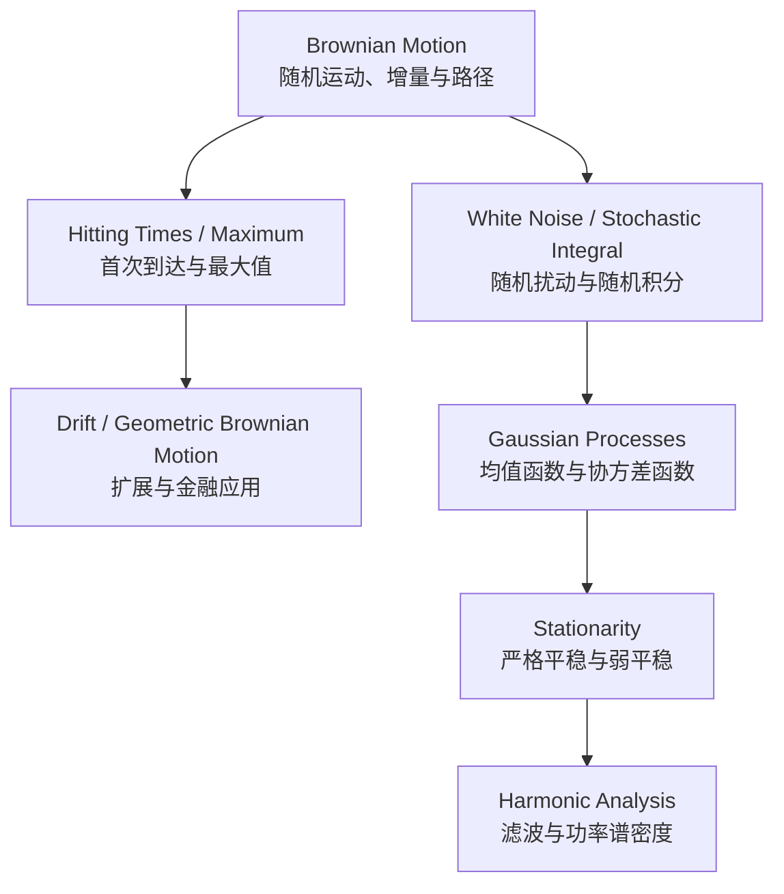
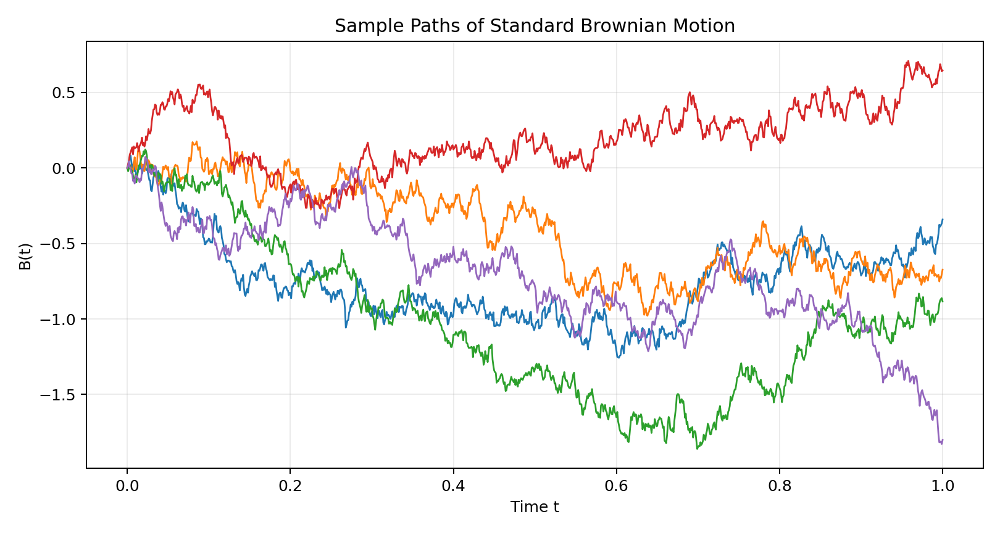
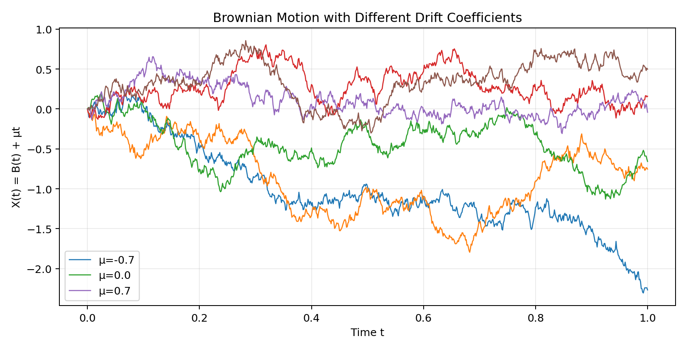
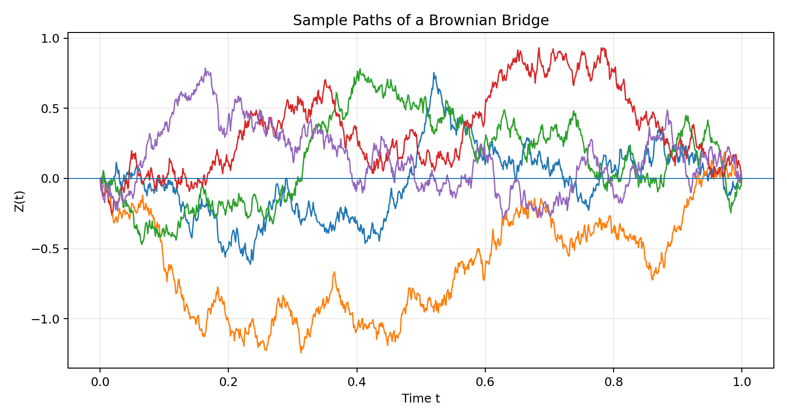
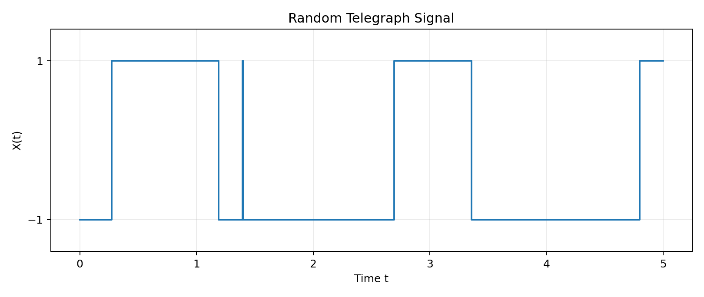

---
cssclasses:
- wide-page
stage: 7
tags:
- random-process
- brownian-motion
- stationary-process
textbook: Ross, Introduction to Probability Models, 13th Edition
title: 第七阶段：布朗运动与平稳过程（Ch10）
---

# 随机过程第七阶段：布朗运动与平稳过程

教材：Ross, *Introduction to Probability Models*, 13th Edition，Chapter
10。

这一章非常重要。它和前面几章的区别在于：之前主要研究离散状态的随机过程、计数过程、马尔可夫链和更新过程；这一章开始研究**连续状态、连续时间的随机过程**，并进一步研究随机过程的统计结构与频率特征。

按照你的 S/A/B/C 分级，我建议这样学习：

  -------------------------------------------------------------------------------------
  章节                              重点   学习目标
  --------------------------------- ------ --------------------------------------------
  10.1 Brownian Motion              S      深入理解定义、性质、分布与条件分布

  10.2 Hitting Times / Maximum /    S      掌握首次到达时间、最大值分布、边界命中概率
  Gambler's Ruin                           

  10.3 Brownian Motion with Drift   C/B    理解漂移项的含义

  10.3 Geometric Brownian Motion    C/B    理解指数布朗运动及其应用

  10.4 Option Pricing               C/B    理解无套利定价的基本思想

  10.5 Maximum with Drift           C/B    认识最大值分布公式

  10.6 White Noise                  A      理解白噪声、随机积分及其性质

  10.7 Gaussian Processes           A      掌握高斯过程、均值函数和协方差函数

  10.8 Stationary Processes         A      深入理解严格平稳、弱平稳及典型模型

  10.9 Harmonic Analysis            A      理解线性滤波、功率谱密度及傅里叶变换
  -------------------------------------------------------------------------------------

这章的核心逻辑可以概括为：

**10.1--10.2 Brownian Motion**

随机运动、首次到达时间、最大值

**10.3--10.5 Variations and Applications**

漂移、几何布朗运动、金融期权

**10.6--10.7 White Noise and Gaussian Processes**

随机积分、噪声、联合正态随机过程

**10.8--10.9 Stationarity and Harmonic Analysis**

平稳性、协方差结构、频域分析

# 第一部分：10.1 Brownian Motion（布朗运动）

> \[!important\] S 级重点

## 一、先理解：布朗运动到底是什么？

### 1.1 从对称随机游走开始

你之前学过随机游走（Random Walk）。

假设一个粒子在一条直线上运动，每隔一个时间单位，就以相同概率：

-   向右移动 1 个单位；
-   向左移动 1 个单位。

定义每一步的随机变量：

$$ X_i= \begin{cases} +1,&P=1/2,\\ -1,&P=1/2. \end{cases} $$

那么经过 $n$ 步后，粒子的位置为：

$$ S_n=X_1+X_2+\cdots+X_n. $$

根据独立性：

$$ E[S_n]=0, $$

$$ \operatorname{Var}(S_n)=n. $$

这是一个离散时间、离散空间的随机过程。

现在我们做一个极限操作：

1.  时间间隔越来越短；
2.  每次移动的距离越来越小；
3.  但不能让粒子的总体波动消失。

假设每隔 $\Delta t$ 时间移动一次，每次移动距离为：

$$ \Delta x=\sigma\sqrt{\Delta t}. $$

那么：

$$ X(t)=\Delta x \left(X_1+\cdots+X_{\lfloor t/\Delta t\rfloor}\right). $$

这里的关键是：

$$ \operatorname{Var}(X(t)) =(\Delta x)^2\frac{t}{\Delta t}. $$

代入：

$$ \operatorname{Var}(X(t)) =\sigma^2\Delta t\frac{t}{\Delta t} =\sigma^2t. $$

当：

$$ \Delta t\to0 $$

时，虽然每一步都趋近于 0，但是总的波动不会消失。

结合中心极限定理（Central Limit
Theorem），最终得到一个连续时间的极限随机过程：

**Brownian Motion（布朗运动）**。

这就是教材 10.1 开头的核心思想。

### 1.2 Brownian Motion 的正式定义

设随机过程：

$$ \{X(t),t\geq0\}. $$

如果满足以下三个条件，就称其为布朗运动过程：

**条件一：初始位置为零。**

$$ \boxed{X(0)=0} $$

**条件二：具有独立增量和稳定增量。**

这里有两个重要概念：

-   Independent Increments：独立增量。
-   Stationary Increments：平稳增量。

独立增量：

对于：

$$ 0\leq t_1<t_2<\cdots<t_n, $$

以下随机变量相互独立：

$$ X(t_1), $$

$$ X(t_2)-X(t_1), $$

$$ \cdots, $$

$$ X(t_n)-X(t_{n-1}). $$

通俗理解：

不同时间段内新增的随机变化互不影响。

例如：

$$ X(2)-X(1) $$

与：

$$ X(4)-X(3) $$

相互独立。

注意：这里是增量独立，不是不同时间点的过程取值相互独立。

平稳增量：

对于任意 $s,t\geq0$，增量：

$$ X(t+s)-X(t) $$

的分布只取决于 $s$，而不取决于起始时间 $t$。

例如：

$$ X(5)-X(3) $$

和：

$$ X(10)-X(8) $$

服从相同的分布，因为两个时间区间的长度都是 2。

**条件三：任意时刻的过程值服从正态分布。**

$$ \boxed{X(t)\sim N(0,\sigma^2t).} $$

因此：

$$ E[X(t)]=0, $$

$$ \operatorname{Var}(X(t))=\sigma^2t. $$

当：

$$ \sigma=1 $$

时，称为标准布朗运动（Standard Brownian Motion），通常记为：

$$ \boxed{B(t).} $$

此时：

$$ \boxed{B(t)\sim N(0,t).} $$

以后教材没有特别说明时，我们默认讨论标准布朗运动。

教材 Definition 10.1，印刷页码 653--655。

> 教材来源：随机过程13版英文_Ch10(1).pdf \##
> 二、布朗运动最重要的几个数学性质 这一部分是 10.1 的核心。

### 2.1 增量的分布

对于标准布朗运动：

$$ B(t)-B(s),\qquad 0\leq s<t. $$

由于平稳增量：

$$ B(t)-B(s)\overset{d}=B(t-s). $$

因此：

$$ \boxed{ B(t)-B(s)\sim N(0,t-s). } $$

这是一个必须掌握的公式。

例如：

$$ B(5)-B(2)\sim N(0,3). $$

所以：

$$ E[B(5)-B(2)]=0, $$

$$ \operatorname{Var}(B(5)-B(2))=3. $$

注意：这里的 $t-s$ 是时间区间长度，而不是时间点 $t$。

### 2.2 不同时间点的协方差

这是一个特别重要的公式：

$$ \boxed{ \operatorname{Cov}(B(s),B(t)) =\min(s,t). } $$

为什么？

假设：

$$ s\leq t. $$

那么：

$$ B(t)=B(s)+[B(t)-B(s)]. $$

于是：

$$ \begin{aligned} \operatorname{Cov}(B(s),B(t)) ={}&\operatorname{Cov}(B(s),B(s))\\ &+\operatorname{Cov}(B(s),B(t)-B(s)). \end{aligned} $$

因为布朗运动具有独立增量：

$$ \operatorname{Cov}(B(s),B(t)-B(s))=0. $$

所以：

$$ \operatorname{Cov}(B(s),B(t)) =\operatorname{Var}(B(s)) =s. $$

由于 $s\leq t$，所以：

$$ \operatorname{Cov}(B(s),B(t))=\min(s,t). $$

**布朗运动的重要公式**

$$ \boxed{ \begin{aligned} E[B(t)]&=0,\\ \operatorname{Var}(B(t))&=t,\\ \operatorname{Cov}(B(s),B(t))&=\min(s,t). \end{aligned} } $$

进一步：

$$ \operatorname{Var}(B(t)-B(s))=t-s. $$

这里有一个非常值得注意的地方：

虽然：

$$ B(s),B(t) $$

都是正态随机变量，但它们通常不独立。

因为：

$$ \operatorname{Cov}(B(s),B(t))=s>0. $$

只有不重叠时间区间的增量才独立。

### 2.3 布朗运动的路径连续，但处处不可导

这是布朗运动非常有特点的性质。

**性质一：路径连续（Continuous Sample Paths）。**

对于几乎所有样本路径：

$$ \lim_{h\to0}[B(t+h)-B(t)]=0. $$

也就是说，布朗运动的轨迹不会突然跳跃。

**性质二：处处不可导（Nowhere Differentiable）。**

我们来看差商：

$$ \frac{B(t+h)-B(t)}h. $$

因为：

$$ B(t+h)-B(t)\sim N(0,h), $$

所以：

$$ \operatorname{Var} \left( \frac{B(t+h)-B(t)}h \right) =\frac{h}{h^2} =\frac1h. $$

当：

$$ h\to0 $$

时：

$$ \frac1h\to\infty. $$

这意味着差商的波动越来越大，不会像普通可导函数一样趋于一个有限的导数。

所以布朗运动虽然连续，却几乎处处不可导。

6

这个性质对后面的 10.6 非常重要：

既然布朗运动没有普通意义上的导数，那么：

$$ B'(t) $$

就不能作为普通函数来处理。

这也是为什么我们需要引入 White Noise（白噪声）和随机积分（Stochastic
Integral）。

## 三、条件分布：Brownian Bridge 的基础

这一部分非常重要，也是教材 Example 10.1 的理论基础。

假设：

$$ 0<s<t. $$

我们已经知道：

$$ B(s)\sim N(0,s), $$

$$ B(t)\sim N(0,t), $$

$$ \operatorname{Cov}(B(s),B(t))=s. $$

现在我们想研究：

**如果已经知道终点 **$B(t)=b$**，那么中间时刻 **$B(s)$\*\*
的分布是什么？\*\*

由于布朗运动是高斯过程（后面 10.7
会正式学习），可以直接使用二维正态分布的条件分布公式。

对于联合正态随机变量 $X,Y$：

$$ X\mid Y=y $$

服从正态分布，均值为：

$$ E[X\mid Y=y] = E[X]+\frac{\operatorname{Cov}(X,Y)} {\operatorname{Var}(Y)}(y-E[Y]). $$

条件方差为：

$$ \operatorname{Var}(X\mid Y) = \operatorname{Var}(X) -\frac{\operatorname{Cov}(X,Y)^2} {\operatorname{Var}(Y)}. $$

现在代入：

$$ X=B(s),\qquad Y=B(t). $$

得到条件均值：

$$ E[B(s)\mid B(t)=b] =\frac{s}{t}b. $$

条件方差：

$$ \begin{aligned} \operatorname{Var}(B(s)\mid B(t)=b) &=s-\frac{s^2}{t}\\ &=\frac{s(t-s)}t. \end{aligned} $$

最终：

$$ \boxed{ B(s)\mid B(t)=b \sim N\left( \frac{sb}{t}, \frac{s(t-s)}t \right). } $$

### 这个公式的直观含义

假设：

-   初始位置是 0；
-   $t=10$；
-   已知终点 $B(10)=20$。

那么：

在 $s=5$ 时：

$$ E[B(5)\mid B(10)=20] =\frac5{10}\times20=10. $$

条件方差：

$$ \operatorname{Var}(B(5)\mid B(10)=20) =\frac{5(10-5)}{10}=2.5. $$

所以：

$$ \boxed{B(5)\mid B(10)=20\sim N(10,2.5).} $$

为什么条件均值是 10？

因为如果知道粒子从 0 出发，最终到达 20，那么在中间时刻 5，平均位置自然是
10。

但实际位置不一定是 10，因为布朗运动仍然具有随机波动。

这就是 Brownian
Bridge（布朗桥）的基本思想：路径的两个端点受到约束，中间仍然存在随机性。

### 3.1 教材 Example 10.1：自行车比赛

**题目完整复述：**

两位自行车选手比赛，定义：

$$ Y(t)=\text{比赛进行到 }100t\%\text{ 时，内侧选手领先的秒数}. $$

假设：

$$ Y(t) $$

可以用方差参数为 $\sigma^2$ 的布朗运动描述。

（a）如果比赛进行到一半时，内侧选手领先 $\sigma$
秒，求她最终获胜的概率。

（b）如果内侧选手最终领先 $\sigma$
秒获胜，求她在比赛中点时已经领先的概率。

**第一问：**

已知：

$$ Y(1/2)=\sigma. $$

最终获胜要求：

$$ Y(1)>0. $$

所以：

$$ \begin{aligned} P(Y(1)>0\mid Y(1/2)=\sigma) &=P(Y(1)-Y(1/2)>-\sigma). \end{aligned} $$

利用独立增量：

$$ Y(1)-Y(1/2)\sim N(0,\sigma^2/2). $$

标准化：

$$ \begin{aligned} P(Y(1)>0\mid Y(1/2)=\sigma) &=\Phi\left(\frac{\sigma}{\sigma/\sqrt2}\right)\\ &=\Phi(\sqrt2)\\ &=\boxed{0.9213}. \end{aligned} $$

**第二问：**

现在已知：

$$ Y(1)=\sigma. $$

要求：

$$ P(Y(1/2)>0\mid Y(1)=\sigma). $$

利用刚才的条件分布公式：

$$ Y(1/2)\mid Y(1)=\sigma \sim N\left(\frac{\sigma}{2},\frac{\sigma^2}{4}\right). $$

因此：

$$ \begin{aligned} P(Y(1/2)>0\mid Y(1)=\sigma) &=\Phi\left( \frac{\sigma/2}{\sigma/2} \right)\\ &=\boxed{\Phi(1)=0.8413}. \end{aligned} $$

**这道题的关键：**

-   已知中点，研究终点：使用独立增量。
-   已知终点，研究中间时刻：使用条件正态分布。

这是 10.1 非常值得掌握的题型。

教材公式 (10.4)、Example 10.1，印刷页码 655--657。

> 教材来源：随机过程13版英文_Ch10(1).pdf \# 第二部分：10.2 Hitting
> Times、Maximum 和 Gambler's Ruin \[!important\] S 级重点

这一节主要研究三个问题：

1.  布朗运动第一次到达某个位置需要多久？
2.  在一段时间内，布朗运动可能达到的最大位置是多少？
3.  布朗运动先碰到上边界还是下边界？

## 四、Hitting Time（首次到达时间）

### 4.1 定义

假设我们关注布朗运动第一次到达位置 $a$ 的时刻。

定义：

$$ \boxed{ T_a=\inf\{t\geq0:B(t)=a\}. } $$

这里的 $\inf$ 表示最早的时间。

例如：

-   粒子从 0 出发；
-   不断随机向上、向下运动；
-   第一次到达位置 3 的时刻就是 $T_3$。

注意：

$$ T_a $$

本身是一个随机变量。

因为不同的样本路径到达 $a$ 所需要的时间不同。

### 4.2 首次到达时间的分布

教材使用了一个非常重要的思想：

**Reflection Principle（反射原理）。**

假设：

$$ a>0. $$

我们想求：

$$ P(T_a\leq t). $$

这表示布朗运动在时间 $t$ 之前至少到达过一次 $a$。

考虑事件：

$$ B(t)\geq a. $$

如果最终时刻的位置已经大于等于
$a$，那么由于布朗运动路径连续，它之前一定经过了 $a$。

因此：

$$ \{B(t)\geq a\}\subseteq\{T_a\leq t\}. $$

进一步，利用布朗运动的对称性：

在已经到达 $a$ 的条件下，最终时刻位于 $a$ 上方和下方的概率相等。

因此：

$$ P(B(t)\geq a\mid T_a\leq t)=\frac12. $$

于是：

$$ P(B(t)\geq a) =\frac12P(T_a\leq t). $$

得到：

$$ P(T_a\leq t)=2P(B(t)\geq a). $$

又因为：

$$ B(t)\sim N(0,t), $$

所以：

$$ \boxed{ P(T_a\leq t) =2\left[1-\Phi\left(\frac a{\sqrt t}\right)\right], \quad a>0. } $$

这里：

$$ \Phi(x)=P(Z\leq x),\quad Z\sim N(0,1). $$

如果 $a<0$，利用对称性：

$$ \boxed{ P(T_a\leq t) =2\left[1-\Phi\left(\frac{|a|}{\sqrt t}\right)\right]. } $$

**首次到达时间分布**

$$ \boxed{ P(T_a\leq t) =2\overline\Phi\left(\frac{|a|}{\sqrt t}\right) } $$

其中：

$$ \overline\Phi(x)=1-\Phi(x). $$

### 4.3 典型例题

**题目：**

标准布朗运动从 0 出发，求它在时间 $t=4$ 之前至少一次到达位置 2 的概率。

首先：

$$ a=2,\qquad t=4. $$

代入：

$$ \begin{aligned} P(T_2\leq4) &=2\left[1-\Phi\left(\frac2{\sqrt4}\right)\right]\\ &=2[1-\Phi(1)]\\ &=2(1-0.8413)\\ &=\boxed{0.3174}. \end{aligned} $$

这里特别注意：

不能直接使用：

$$ P(B(4)\geq2). $$

因为题目问的是**曾经到达过 2**，而不是最后时刻是否在 2 以上。

这两个事件不一样。

例如粒子可能先到达 2，随后又下降到 0。

这正是 Reflection Principle 的价值。

## 五、Maximum Variable（最大值随机变量）

### 5.1 定义

定义：

$$ \boxed{ M(t)=\max_{0\leq s\leq t}B(s). } $$

它表示：

从 0 到 $t$ 这段时间内，布朗运动曾经达到过的最高位置。

例如：

粒子的运动轨迹可能是：

-   先上升到 2；
-   再下降到 -1；
-   然后上升到 3；
-   最后下降到 1。

那么：

$$ M(t)=3. $$

注意：

$$ M(t)\ne B(t). $$

一个是整个区间内的最大值，一个只是最终时刻的位置。

### 5.2 最大值的分布

由于布朗运动路径连续：

$$ \{M(t)\geq a\} $$

等价于：

$$ \{T_a\leq t\}. $$

因此：

$$ P(M(t)\geq a)=P(T_a\leq t). $$

利用刚才得到的首次到达时间公式：

$$ \boxed{ P(M(t)\geq a) =2\left[1-\Phi\left(\frac a{\sqrt t}\right)\right], \quad a>0. } $$

如果要求最大值的分布函数：

$$ F_{M(t)}(a)=P(M(t)\leq a), $$

那么：

$$ \boxed{ F_{M(t)}(a)= \begin{cases} 0,&a<0,\\[2mm] 2\Phi\left(\dfrac a{\sqrt t}\right)-1,&a\geq0. \end{cases} } $$

这是 10.2 的核心公式。

### 5.3 一个重要结论

比较：

$$ M(t)=\max_{0\leq s\leq t}B(s) $$

与：

$$ |B(t)|. $$

虽然二者并不是同一个随机变量，但它们具有相同的分布。

因为对于 $a\geq0$：

$$ P(M(t)\leq a) =2\Phi\left(\frac a{\sqrt t}\right)-1. $$

而：

$$ P(|B(t)|\leq a) =P(-a\leq B(t)\leq a) =2\Phi\left(\frac a{\sqrt t}\right)-1. $$

所以：

$$ \boxed{M(t)\overset d=|B(t)|.} $$

这里的 $\overset d=$ 表示同分布，不代表两个随机变量相等。

## 六、Gambler's Ruin（赌徒破产问题）

这一部分将布朗运动和第四章的随机游走联系起来。

### 6.1 问题背景

假设一个粒子从 0 出发，沿着实数轴随机运动。

我们设置两个边界：

-   上边界 $A>0$；
-   下边界 $-B<0$。

定义：

$$ T_A=\text{第一次到达 }A\text{ 的时间}, $$

$$ T_{-B}=\text{第一次到达 }-B\text{ 的时间}. $$

现在想求：

$$ P(T_A<T_{-B}). $$

也就是：

**布朗运动先到达上边界，而不是下边界的概率。**

### 6.2 公式推导

教材利用对称随机游走的 Gambler's Ruin 结果。

对于对称随机游走，向上和向下的概率均为 $1/2$。

从 0 出发，先到达 $A$ 而不是 $-B$ 的概率为：

$$ \frac B{A+B}. $$

将随机游走的步长不断缩小，取极限，就得到布朗运动的结果：

$$ \boxed{ P(T_A<T_{-B})=\frac B{A+B}. } $$

注意分子是下边界的距离 $B$，不是上边界的距离 $A$。

### 6.3 为什么是这个结果？

可以用直觉理解：

-   如果上边界距离很近，下边界距离很远，那么先到上边界的概率应该比较大；
-   如果上边界距离很远，下边界距离很近，那么先到上边界的概率应该比较小。

例如：

$$ A=2,\qquad B=3. $$

那么：

$$ P(T_2<T_{-3}) =\frac3{2+3} =\boxed{0.6}. $$

虽然上边界距离是 2，下边界距离是 3，但是先到达上边界的概率反而是 0.6。

原因是：粒子距离下边界越远，越不容易先碰到下边界。

教材 §10.2，公式 (10.6)、(10.7) 及 Gambler's Ruin 结果，印刷页码
657--658。

> 教材来源：随机过程13版英文_Ch10(1).pdf \### 6.4 10.2 的题型总结 \|
> 题目关键词 \| 使用方法 \| \| ------------------------------- \|
> -------------------- \| \| First time hitting $a$ \| $T_a$
> 首次到达时间 \| \| Hit $a$ before time $t$ \| Reflection Principle \|
> \| Maximum up to time $t$ \| $M(t)$ 最大值分布 \| \| Hit $A$ before
> $-B$ \| $B/(A+B)$ \|

这四个知识点要熟练掌握。

# 第三部分：10.3--10.5 布朗运动的扩展与应用

C/B 级：了解为主

这三节有一定的金融数学背景，你目前理解模型思想和基本公式即可。

## 七、10.3 Brownian Motion with Drift（带漂移的布朗运动）

### 7.1 为什么需要 Drift？

标准布朗运动：

$$ E[B(t)]=0. $$

意味着粒子虽然随机运动，但平均位置始终为 0。

然而现实中的很多随机过程并不具有零均值变化。

例如：

-   股票价格可能存在长期增长趋势；
-   某个粒子可能受到恒定外力；
-   某个经济变量可能存在长期增长或下降趋势。

因此，我们引入一个确定性的线性趋势：

$$ \boxed{ X(t)=\sigma B(t)+\mu t. } $$

其中：

-   $\mu$：Drift Coefficient，漂移系数；
-   $\sigma^2$：Variance Parameter，方差参数。

于是：

$$ \boxed{E[X(t)]=\mu t} $$

$$ \boxed{\operatorname{Var}(X(t))=\sigma^2t.} $$

增量：

$$ \boxed{ X(t)-X(s)\sim N(\mu(t-s),\sigma^2(t-s)). } $$

### 7.2 如何理解两个参数？

-   $\mu$ 控制长期趋势；
-   $\sigma$ 控制随机波动幅度。

如果：

$$ \mu>0, $$

整体有向上的趋势。

如果：

$$ \mu<0, $$

整体有向下的趋势。

如果：

$$ \mu=0, $$

就退化为普通布朗运动（带方差参数 $\sigma^2$）。

## 八、10.3.2 Geometric Brownian Motion（几何布朗运动）

这是一个很重要的应用模型。

### 8.1 为什么需要几何布朗运动？

普通布朗运动：

$$ X(t)=\sigma B(t)+\mu t $$

可能取负值。

但是股票价格不能为负数。

因此，我们希望构造一个始终为正的随机过程。

教材定义：

$$ \boxed{ X(t)=e^{Y(t)} } $$

其中 $Y(t)$ 是带漂移的布朗运动。

如果考虑初始价格 $x_0$，则：

$$ \boxed{ X(t)=x_0e^{Y(t)}. } $$

这就是 Geometric Brownian Motion（GBM）。

因为指数函数始终为正：

$$ \boxed{X(t)>0.} $$

### 8.2 它有什么重要性质？

由于：

$$ Y(t)\sim N(\mu t,\sigma^2t), $$

所以：

$$ \ln\frac{X(t)}{x_0} \sim N(\mu t,\sigma^2t). $$

因此：

$$ \boxed{X(t)\text{ 服从对数正态分布（Lognormal Distribution）}.} $$

注意：

-   普通布朗运动：随机变量本身服从正态分布；
-   几何布朗运动：随机变量的对数服从正态分布。

教材还推导了一个重要的条件期望：

$$ \boxed{ E[X(t)\mid X(u),0\leq u\leq s] =X(s)e^{(t-s)(\mu+\sigma^2/2)}. } $$

这里有一个值得注意的地方：

指数正态分布的期望并不是简单的：

$$ e^{E[Y(t)]}. $$

而是：

$$ E[e^{Y(t)}] =e^{E[Y(t)]+\operatorname{Var}(Y(t))/2}. $$

所以公式中出现了：

$$ \mu+\frac{\sigma^2}{2}. $$

这也是后面 Black--Scholes 公式中一个非常重要的数学来源。

教材 §10.3，公式 (10.8)，印刷页码 658--659。

> 教材来源：随机过程13版英文_Ch10(1).pdf \## 九、10.4 Option
> Pricing（期权定价）
> 这一节主要介绍金融数学中的无套利定价（Arbitrage-Free Pricing）。

你只需要理解核心思想：

**如果某种金融产品的价格不合理，就可能通过同时买入和卖出不同资产，构造出一个无论未来发生什么都能获利的组合。**

这种情况叫套利（Arbitrage）。

### 9.1 教材的两种可能价格例题

假设：

-   股票当前价格为 100；
-   一段时间后股票价格可能变成 200 或 50；
-   你可以购买一个期权，未来以 150 的价格购买股票；
-   每份期权现在的价格为 $c$。

如果未来股票价格是 200：

期权收益：

$$ 200-150=50. $$

如果未来股票价格是 50：

期权没有价值：

$$ 0. $$

现在考虑：

-   买入 $x$ 股股票；
-   买入 $y$ 份期权。

为了消除未来价格变化带来的不确定性，要求：

$$ 200x+50y=50x. $$

整理：

$$ \boxed{y=-3x.} $$

也就是说，如果买入 1 股股票，就同时卖出 3 份期权。

初始成本：

$$ 100x-3xc. $$

未来收益：

$$ 50x. $$

所以最终利润：

$$ \begin{aligned} \text{Profit} &=50x-(100x-3xc)\\ &=x(3c-50). \end{aligned} $$

如果：

$$ c\ne\frac{50}{3}, $$

就可以选择适当的 $x$，使得无论未来股价上涨还是下跌，都能获得正收益。

因此，唯一不存在套利的价格是：

$$ \boxed{c=\frac{50}{3}.} $$

这道题的价值不在于记住 $50/3$，而在于理解：

**期权价格可以通过构造无风险组合来确定，而不是简单地计算未来收益的普通期望。**

### 9.2 Black--Scholes 公式

教材进一步利用几何布朗运动推导了著名的 Black--Scholes 期权定价公式。

对于欧式看涨期权（European Call Option）：

$$ \boxed{ c=x_0\Phi(d_1)-Ke^{-\alpha T}\Phi(d_2) } $$

其中：

$$ d_1= \frac{\ln(x_0/K)+(\alpha+\sigma^2/2)T} {\sigma\sqrt T}, $$

$$ d_2= \frac{\ln(x_0/K)+(\alpha-\sigma^2/2)T} {\sigma\sqrt T}. $$

参数含义：

  符号         含义
  ------------ ------------------------
  $x_0$        股票当前价格
  $K$          期权执行价格
  $T$          到期时间
  $\alpha$     连续复利无风险利率
  $\sigma^2$   股票对数价格的方差参数
  $\Phi$       标准正态分布函数

这里有一个重要结论：

**在 Black--Scholes 定价公式中，股票价格的实际漂移参数 **$\mu$\*\*
最终消失了，定价依赖的是无风险利率和波动率，而不是股票实际预期增长率。\*\*

这是无套利定价思想的一个重要结果。

你目前不需要推导 Black--Scholes
公式，只需要认识几何布朗运动与金融期权之间的关系。

教材 §10.4，Example 10.1--10.3 及公式 (10.12)，印刷页码 660--668。

> 教材来源：随机过程13版英文_Ch10(1).pdf
> 教材来源：随机过程13版英文_Ch10(1).pdf \## 十、10.5 Maximum of
> Brownian Motion with Drift 这一节是 10.2 最大值分布的推广。

之前研究：

$$ B(t) $$

没有漂移。

现在研究：

$$ X(t)=\sigma B(t)+\mu t. $$

定义：

$$ M(t)=\max_{0\leq s\leq t}X(s). $$

教材推导得到：

$$ \boxed{ \begin{aligned} P(M(t)\geq y) ={}&e^{2\mu y/\sigma^2} \overline\Phi\left( \frac{\mu t+y}{\sigma\sqrt t} \right)\\ &+\overline\Phi\left( \frac{y-\mu t}{\sigma\sqrt t} \right), \qquad y\geq0. \end{aligned} } $$

你不需要记住这个公式的完整推导。

只需要理解：

-   当 $\mu=0$ 时，退化为普通布朗运动的最大值分布；
-   当 $\mu>0$ 时，过程有向上的趋势，最大值通常更大；
-   当 $\mu<0$ 时，过程有向下的趋势，达到较高位置的概率会降低。

特别地，当：

$$ \mu=0 $$

时：

$$ P(M(t)\geq y) =2\overline\Phi\left(\frac y{\sigma\sqrt t}\right). $$

这就回到了 10.2 的公式。

教材 §10.5，Corollary 10.1，印刷页码 670--674。

> 教材来源：随机过程13版英文_Ch10(1).pdf \# 第四部分：10.6 White
> Noise（白噪声） \[!important\] A 级重点

这是本章一个新的数学工具。

## 十一、为什么需要 White Noise？

我们刚才已经知道：

布朗运动：

-   路径连续；
-   处处不可导。

因此，不能把：

$$ B'(t) $$

当作普通函数。

但是在很多实际模型中，我们希望描述一种持续发生的随机扰动。

例如：

-   粒子在液体中受到分子碰撞；
-   物理系统受到随机外力；
-   某个信号受到连续随机噪声影响。

于是引入 White Noise（白噪声）。

### 11.1 白噪声的直观理解

可以把布朗运动理解为：

**随机噪声随时间不断累积之后形成的运动轨迹。**

如果：

$$ B(t) $$

是布朗运动，那么：

$$ dB(t) $$

可以直观理解为一个极短时间内的随机扰动。

通常会把：

$$ \frac{dB(t)}{dt} $$

非正式地写成白噪声，但必须注意：

这不是普通意义上的导数，而是广义随机过程。

## 十二、Stochastic Integral（随机积分）

这是 10.6 真正要学习的内容。

### 12.1 普通积分与随机积分有什么区别？

普通积分：

$$ \int_a^b f(t)\,dt. $$

它是对一个确定性函数进行积分。

随机积分：

$$ \boxed{ \int_a^b f(t)\,dB(t). } $$

这里：

-   $f(t)$：确定性的权重函数；
-   $B(t)$：标准布朗运动；
-   $dB(t)$：布朗运动在极短时间内的随机增量。

教材将其定义为：

$$ \boxed{ \int_a^b f(t)\,dB(t) = \lim_{n\to\infty} \sum_{i=1}^n f(t_{i-1}) [B(t_i)-B(t_{i-1})]. } $$

其中：

$$ a=t_0<t_1<\cdots<t_n=b. $$

当最大分割长度趋近于 0 时，求和收敛到随机积分。

你可以把它理解为：

每一个很短的时间段内，布朗运动产生一个随机增量，再乘上对应的权重，最后把所有时间段累加起来。

这就是随机积分的基本思想。

### 12.2 随机积分的期望

教材证明：

$$ \boxed{ E\left[\int_a^b f(t)\,dB(t)\right]=0. } $$

为什么？

从定义出发：

$$ \sum_{i=1}^n f(t_{i-1})[B(t_i)-B(t_{i-1})]. $$

因为：

$$ E[B(t_i)-B(t_{i-1})]=0, $$

所以：

$$ E\left[ \sum_{i=1}^n f(t_{i-1})\Delta B_i \right]=0. $$

取极限后，期望仍然为 0。

### 12.3 随机积分的方差

这是必须掌握的公式：

$$ \boxed{ \operatorname{Var} \left(\int_a^b f(t)\,dB(t)\right) = \int_a^b f^2(t)\,dt. } $$

推导思路：

由于布朗运动具有独立增量：

$$ \Delta B_i=B(t_i)-B(t_{i-1}) $$

相互独立。

而且：

$$ \operatorname{Var}(\Delta B_i) =t_i-t_{i-1}. $$

所以：

$$ \begin{aligned} \operatorname{Var} \left(\sum_i f(t_{i-1})\Delta B_i\right) &=\sum_i f^2(t_{i-1}) \operatorname{Var}(\Delta B_i)\\ &=\sum_i f^2(t_{i-1})(t_i-t_{i-1}). \end{aligned} $$

取极限，就得到：

$$ \boxed{ \operatorname{Var} \left(\int_a^b f(t)\,dB(t)\right) =\int_a^b f^2(t)\,dt. } $$

这实际上就是普通黎曼积分的极限。

### 12.4 最重要例题：计算随机积分的均值与方差

**题目：**

设：

$$ Z=\int_0^1 t\,dB(t). $$

求：

$$ E[Z],\qquad \operatorname{Var}(Z). $$

**第一步：计算期望。**

$$ E[Z]=0. $$

**第二步：计算方差。**

使用随机积分方差公式：

$$ \begin{aligned} \operatorname{Var}(Z) &=\int_0^1t^2dt\\ &=\left.\frac{t^3}{3}\right|_0^1\\ &=\frac13. \end{aligned} $$

所以：

$$ \boxed{ E[Z]=0,\qquad \operatorname{Var}(Z)=\frac13. } $$

实际上，由于确定性函数与布朗运动构成的随机积分是正态随机变量，因此：

$$ \boxed{ Z\sim N\left(0,\frac13\right). } $$

这类题目是 10.6 最典型、最值得掌握的计算题。

### 12.5 另一个重要公式：随机积分分部积分

教材给出了：

$$ \boxed{ \int_a^b f(t)\,dB(t) = f(b)B(b)-f(a)B(a) -\int_a^b B(t)f'(t)\,dt. } $$

注意：

这里的 $f(t)$ 是确定性且可微的函数。

这是教材在当前章节使用的积分分部公式，不需要你现在学习更复杂的 Itô
公式。

教材 §10.6，公式 (10.15)、(10.16)，印刷页码 675--676。

> 教材来源：随机过程13版英文_Ch10(1).pdf \# 第五部分：10.7 Gaussian
> Processes（高斯过程） \[!important\] A 级重点

这一节非常重要，因为它为后面的平稳过程建立了基础。

## 十三、什么是 Gaussian Process？

之前学习布朗运动时，我们知道：

$$ B(t)\sim N(0,t). $$

即每一个固定时刻的布朗运动取值都服从正态分布。

但这还不足以定义高斯过程。

高斯过程要求：

**任意有限多个时刻的过程取值，都服从多元正态分布。**

正式定义：

如果对任意：

$$ t_1,t_2,\ldots,t_n, $$

随机向量：

$$ (X(t_1),X(t_2),\ldots,X(t_n)) $$

服从多元正态分布（Multivariate Normal Distribution），那么：

$$ \boxed{\{X(t),t\geq0\}} $$

称为高斯过程。

### 13.1 为什么这一定义很重要？

你之前学过：

单个正态随机变量：

$$ X\sim N(\mu,\sigma^2). $$

多元正态随机向量：

$$ \boldsymbol X\sim N(\boldsymbol\mu,\Sigma). $$

对于多元正态分布，只需要知道：

1.  均值向量；
2.  协方差矩阵。

就能完全确定其联合分布。

高斯过程其实是这个思想在随机过程中的推广。

只不过原来我们研究有限个随机变量，现在研究任意多个时间点的随机变量。

因此：

**一个高斯过程完全由均值函数和协方差函数决定。**

定义：

$$ m(t)=E[X(t)], $$

$$ C(s,t)=\operatorname{Cov}(X(s),X(t)). $$

那么只要知道：

$$ \boxed{m(t),\qquad C(s,t)} $$

就能确定整个高斯过程的有限维分布。

## 十四、布朗运动本身就是一个高斯过程

这是一个重要结论。

前面已经得到：

$$ E[B(t)]=0, $$

$$ \operatorname{Cov}(B(s),B(t))=\min(s,t). $$

所以标准布朗运动可以定义为：

一个均值函数为 0、协方差函数为：

$$ \boxed{C(s,t)=\min(s,t)} $$

的高斯过程。

注意：

高斯过程不一定具有独立增量，但布朗运动具有独立增量。

布朗运动是高斯过程中的一个特殊类型。

## 十五、Brownian Bridge（布朗桥）

这是教材 10.7 最重要的例子。

前面我们已经学习过：

$$ B(s)\mid B(1)=0. $$

现在考虑：

$$ \{B(t),0\leq t\leq1\mid B(1)=0\}. $$

它表示：

布朗运动从 0 出发，并且最终被要求在时间 1 回到 0。

这种过程称为 Brownian Bridge。

### 15.1 它的直观含义

[stochastic.readthedocs.io](https://stochastic.readthedocs.io/en/stable/continuous.html?utm_source=chatgpt.com)

普通布朗运动：

-   从 0 出发；
-   随机运动；
-   最终位置不确定。

布朗桥：

-   从 0 出发；
-   随机运动；
-   最终被固定在 0。

所以它的轨迹像一座桥，两端被固定，中间随机波动。

### 15.2 布朗桥的均值函数

利用条件分布公式：

$$ E[B(s)\mid B(1)=0] =\frac{s}{1}\times0=0. $$

因此：

$$ \boxed{m(s)=0.} $$

### 15.3 布朗桥的协方差函数

对于：

$$ s<t<1, $$

教材推导得到：

$$ \boxed{ \operatorname{Cov}(B(s),B(t)\mid B(1)=0) =s(1-t). } $$

更一般地：

$$ \boxed{ C(s,t)=\min(s,t)-st. } $$

### 15.4 一个重要构造公式

教材 Proposition 10.1 给出：

如果 $B(t)$ 是标准布朗运动，那么定义：

$$ \boxed{ Z(t)=B(t)-tB(1),\quad 0\leq t\leq1. } $$

那么：

$$ Z(t) $$

就是一个 Brownian Bridge。

为什么？

首先：

$$ Z(0)=B(0)=0. $$

其次：

$$ Z(1)=B(1)-B(1)=0. $$

而且它仍然是高斯过程。

它的均值：

$$ E[Z(t)]=0. $$

它的协方差：

$$ \begin{aligned} \operatorname{Cov}(Z(s),Z(t)) ={}&\operatorname{Cov}(B(s)-sB(1),\\ & B(t)-tB(1))\\ ={}&s-st-st+st\\ ={}&s-st. \end{aligned} $$

所以：

$$ \boxed{C(s,t)=s(1-t),\quad s\leq t.} $$

这与前面的条件分布结果一致。

### 15.5 Integrated Brownian Motion（积分布朗运动）

教材还介绍了：

$$ \boxed{ Z(t)=\int_0^tB(s)\,ds. } $$

它表示对布朗运动本身进行普通时间积分。

例如：

-   $B(t)$ 可以表示某个粒子的随机速度；
-   $Z(t)$ 就可以表示粒子累计的位移。

它仍然是一个高斯过程。

教材给出的协方差为：

对于 $s\leq t$：

$$ \boxed{ \operatorname{Cov}(Z(s),Z(t)) =\frac{s^2t}{2}-\frac{s^3}{6}. } $$

你不需要记忆这个积分过程的推导，但需要知道：

**高斯过程经过适当的线性变换或积分，仍然可以得到高斯过程。**

教材 §10.7，Definition 10.2、Proposition 10.1，印刷页码 677--679。

> 教材来源：随机过程13版英文_Ch10(1).pdf \# 第六部分：10.8 Stationary
> and Weakly Stationary Processes \[!important\] A 级重点

这一节是我认为整章中最需要真正理解的部分。

因为它涉及两个非常容易混淆的概念：

-   Strictly Stationary Process（严格平稳过程）
-   Weakly Stationary Process（弱平稳过程，也叫二阶平稳过程）

## 十六、为什么需要研究平稳过程？

假设我们研究某个城市的每小时交通流量：

$$ X(t)=\text{时刻 }t\text{ 的交通流量}. $$

如果我们发现：

-   早上和晚上交通流量的分布差异很大；
-   随着时间推移，平均交通流量不断增加；
-   方差也随着时间不断变化。

那么这个随机过程就不具有平稳性。

反过来，如果我们认为：

-   平均交通流量保持不变；
-   两个时刻之间的相关性只取决于时间间隔；
-   不取决于具体观察的日期或时刻。

那么就可以考虑使用平稳过程模型。

核心思想是：

**平稳过程的统计规律不会因为观察时间整体向后平移而发生变化。**

## 十七、Strictly Stationary Process（严格平稳过程）

### 17.1 正式定义

如果对任意：

$$ n,\quad t_1,\ldots,t_n,\quad s, $$

随机向量：

$$ (X(t_1),\ldots,X(t_n)) $$

与：

$$ (X(t_1+s),\ldots,X(t_n+s)) $$

具有相同的联合分布，那么：

$$ \boxed{\{X(t)\}} $$

称为严格平稳过程。

也就是说：

$$ \boxed{ (X(t_1),\ldots,X(t_n)) \overset d= (X(t_1+s),\ldots,X(t_n+s)). } $$

### 17.2 直观理解

假设你在：

-   周一上午 10 点观察一个随机过程；
-   周二上午 10 点再次观察同一个随机过程。

如果整个随机过程的统计规律不随观察时间整体平移而改变，那么它就是严格平稳的。

注意：

严格平稳要求所有有限维联合分布都不变。

不只是均值、方差不变。

## 十八、Weakly Stationary Process（弱平稳过程）

严格平稳的要求比较高。

因此，我们引入一个较弱的条件，只要求前两阶统计特征保持不变。

### 18.1 正式定义

如果随机过程满足：

**条件一：均值恒定。**

$$ \boxed{E[X(t)]=c.} $$

**条件二：协方差只取决于时间间隔。**

$$ \boxed{ \operatorname{Cov}(X(t),X(t+s)) =R(s). } $$

那么称该过程为二阶平稳过程（Second-Order Stationary
Process），也就是弱平稳过程。

注意：

这里的协方差不能依赖具体时间 $t$，只能依赖时间差 $s$。

### 18.2 严格平稳与弱平稳的区别

  比较           严格平稳         弱平稳
  -------------- ---------------- --------------
  均值           恒定（若存在）   必须恒定
  方差           恒定（若存在）   恒定
  协方差         随时间平移不变   只依赖时间差
  高阶联合分布   必须不变         不要求
  要求           更严格           较宽松

这里有一个重要定理：

$$ \boxed{ \text{弱平稳高斯过程} \Longrightarrow \text{严格平稳高斯过程}. } $$

为什么？

因为高斯过程的有限维联合分布完全由均值和协方差决定。

既然弱平稳已经保证了均值和协方差不随时间平移变化，那么整个联合分布也不会变化。

但是：

**一般情况下，弱平稳不一定意味着严格平稳。**

## 十九、最重要的区别：Stationary Increments 与 Stationary Process

这个地方非常容易混淆，尤其是刚学完布朗运动时。

标准布朗运动满足：

$$ B(t)-B(s)\sim N(0,t-s). $$

因此它具有平稳增量。

但是：

$$ B(t)\sim N(0,t). $$

它的方差为：

$$ \operatorname{Var}(B(t))=t. $$

显然方差随时间变化。

所以布朗运动不是平稳过程。

**必须区分这两个概念**

  概念                    要求
  ----------------------- ------------------------------------
  Stationary Increments   增量的分布只取决于区间长度
  Stationary Process      整个过程的联合分布不随时间平移改变

$$ \boxed{ \text{Brownian Motion：平稳增量，但不平稳。} } $$

这句话建议记下来。

## 二十、教材中的几个重要平稳过程

这一部分我重点讲三个模型。

### 20.1 Random Telegraph Signal Process（随机电报信号过程）

假设：

$$ N(t) $$

是速率为 $\lambda$ 的泊松过程。

另外，定义：

$$ X_0= \begin{cases} +1,&P=1/2,\\ -1,&P=1/2. \end{cases} $$

并且 $X_0$ 与泊松过程独立。

定义：

$$ \boxed{ X(t)=X_0(-1)^{N(t)}. } $$

它表示：

-   初始信号为 +1 或 -1；
-   每发生一次泊松事件，信号就反转一次；
-   信号始终在 +1 和 -1 之间跳动。

[physics.stackexchange.com](https://physics.stackexchange.com/questions/296997/poisson-exponentially-distributed-jumps-random-telegraph-and-power-spectrum?utm_source=chatgpt.com)

教材证明：

$$ E[X(t)]=0. $$

协方差函数为：

$$ \boxed{ R(s)=e^{-2\lambda s},\quad s\geq0. } $$

对于任意时间差，也可以写成：

$$ R(s)=e^{-2\lambda|s|}. $$

为什么？

因为：

$$ \begin{aligned} X(t)X(t+s) &=X_0^2(-1)^{N(t)+N(t+s)}\\ &=(-1)^{N(t+s)-N(t)}. \end{aligned} $$

这里使用：

$$ X_0^2=1. $$

而：

$$ N(t+s)-N(t)\sim\operatorname{Poisson}(\lambda s). $$

所以：

$$ \begin{aligned} R(s) &=E[(-1)^{N(s)}]\\ &=\sum_{n=0}^{\infty}(-1)^n e^{-\lambda s}\frac{(\lambda s)^n}{n!}\\ &=e^{-2\lambda s}. \end{aligned} $$

由于均值恒定、协方差只依赖时间差，所以这是弱平稳过程。

教材还证明了它是严格平稳的。

这个例子说明：

**随机过程即使不断发生随机跳变，也可以具有平稳性。**

### 20.2 Ornstein--Uhlenbeck Process（奥恩斯坦--乌伦贝克过程）

这是一个很有名的连续时间平稳高斯过程。

教材使用以下构造：

$$ \boxed{ V(t)=e^{-\alpha t/2}B(e^{\alpha t}), \qquad \alpha>0. } $$

其中 $B(t)$ 是标准布朗运动。

教材推导：

$$ E[V(t)]=0. $$

对于 $s\geq0$：

$$ \boxed{ \operatorname{Cov}(V(t),V(t+s)) =e^{-\alpha s/2}. } $$

注意：

-   均值始终为 0；
-   协方差只依赖于时间间隔 $s$。

因此它是弱平稳过程。

而由于它是高斯过程：

$$ \boxed{ V(t)\text{ 也是严格平稳过程}. } $$

**它的直观含义是什么？**

从协方差函数看：

$$ R(s)=e^{-\alpha s/2}. $$

当两个时刻相距很近时：

$$ s\approx0, $$

则：

$$ R(s)\approx1. $$

说明相近时刻的过程值具有较强的相关性。

当：

$$ s\to\infty, $$

则：

$$ R(s)\to0. $$

说明相距很远的两个时刻，相关性逐渐减弱。

所以它可以用来描述具有短期记忆、长期相关性逐渐衰减的随机过程。

### 20.3 AR(1) Process（一阶自回归过程）

这个模型和时间序列分析（Time Series Analysis）直接相关。

定义：

$$ \boxed{ X_n=\lambda X_{n-1}+Z_n. } $$

其中：

-   $\lambda$：自回归系数；
-   $Z_n$：随机误差项（Noise）。

它表示：

当前时刻的取值由上一时刻的取值和新的随机扰动共同决定。

例如：

$$ X_1=\lambda X_0+Z_1, $$

$$ X_2=\lambda X_1+Z_2. $$

不断展开：

$$ X_n =\lambda^nX_0 +\lambda^{n-1}Z_1 +\cdots+Z_n. $$

当：

$$ |\lambda|<1 $$

并且按照教材给定的初始方差和噪声方差设置时，可以得到弱平稳过程。

其均值为：

$$ E[X_n]=0. $$

协方差函数：

$$ \boxed{ \operatorname{Cov}(X_n,X_{n+m}) =\frac{\sigma^2\lambda^m}{1-\lambda^2}, \qquad m\geq0. } $$

你可以看到：

协方差只依赖于时间间隔 $m$，不依赖于具体的 $n$。

这就是弱平稳。

**这个模型非常值得认识，因为它是后续时间序列分析中的基础模型。**

教材 §10.8，Example 10.5--10.7，印刷页码 679--683。

> 教材来源：随机过程13版英文_Ch10(1).pdf \# 第七部分：10.9 Harmonic
> Analysis of Weakly Stationary Processes \[!important\] A 级重点

这一节相对抽象，但其实只要理解一个核心思想就可以：

**把一个随机过程从时间域转换到频率域，研究它在不同频率上的波动特征。**

## 二十一、为什么需要 Harmonic Analysis？

前面研究平稳过程时，我们主要研究：

$$ E[X(t)] $$

和：

$$ R_X(s)=\operatorname{Cov}(X(t),X(t+s)). $$

这些都是时间域（Time Domain）的统计特征。

但是在实际信号分析中，我们往往还想知道：

-   随机信号主要包含哪些频率？
-   高频成分多不多？
-   低频成分多不多？
-   一个系统会如何改变输入信号的频率结构？

这就需要 Harmonic Analysis（调和分析）。

它的核心工具是傅里叶变换（Fourier Transform）。

## 二十二、Linear Filter（线性滤波器）

### 22.1 输入过程与输出过程

教材假设有一个随机过程：

$$ X(t) $$

经过某个系统之后，产生另一个随机过程：

$$ Y(t). $$

其中：

-   $X(t)$：Input Process，输入过程；
-   $Y(t)$：Output Process，输出过程；
-   $h(s)$：Impulse Response Function，脉冲响应函数。

它们满足：

$$ \boxed{ Y(t)=\int_{-\infty}^{\infty}X(t-s)h(s)\,ds. } $$

这就是线性滤波（Linear Filtering）的基本公式。

### 22.2 如何理解这个公式？

假设你正在处理一段声音信号。

现在时刻 $t$ 的输出，不一定只取决于输入信号当前的值。

它可能受到过去一段时间内所有输入信号的影响。

例如：

-   过去 1 秒的输入信号；
-   过去 0.5 秒的输入信号；
-   过去 0.1 秒的输入信号。

不同时间之前的输入，可能具有不同的影响权重。

而：

$$ h(s) $$

就表示相隔 $s$ 时间的输入对当前输出的影响权重。

如果：

$$ h(s)=0,\quad s<0, $$

那么输出只依赖于当前和过去的输入，不依赖于未来的输入。

这时 $h(s)$ 也称为 Weighting Function（权重函数）。

[keyboard-lover.tistory.com](https://keyboard-lover.tistory.com/18?utm_source=chatgpt.com)

### 22.3 为什么叫线性、时不变？

**线性（Linear）**

如果：

$$ X_1(t)\longrightarrow Y_1(t), $$

$$ X_2(t)\longrightarrow Y_2(t), $$

那么：

$$ aX_1(t)+bX_2(t) $$

对应的输出就是：

$$ aY_1(t)+bY_2(t). $$

即满足叠加性和齐次性。

**时不变（Time Invariant）**

如果输入信号整体向后移动一段时间，那么输出也整体向后移动相同的时间。

也就是说，系统本身的规则不随着观察时间发生变化。

## 二十三、平稳输入经过线性滤波后，输出仍然弱平稳

这是教材 10.9 的第一个重要结论。

假设：

$$ X(t) $$

是一个均值为 0 的弱平稳过程，协方差函数为：

$$ R_X(s)=\operatorname{Cov}(X(t),X(t+s)). $$

经过线性滤波后：

$$ Y(t)=\int X(t-s)h(s)\,ds. $$

### 23.1 输出的期望

$$ \begin{aligned} E[Y(t)] &=E\left[\int X(t-s)h(s)\,ds\right]\\ &=\int E[X(t-s)]h(s)\,ds\\ &=0. \end{aligned} $$

所以：

$$ \boxed{E[Y(t)]=0.} $$

### 23.2 输出的协方差

教材得到：

$$ \boxed{ \begin{aligned} R_Y(t_2-t_1) ={}&\int\int R_X(t_2-t_1-s_2+s_1)\\ &\qquad\cdot h(s_1)h(s_2) \,ds_1ds_2. \end{aligned} } $$

这个公式看起来比较复杂，但不需要死记推导。

重点是：

右边只依赖：

$$ t_2-t_1. $$

而不依赖 $t_1,t_2$ 各自的具体值。

因此：

$$ \boxed{ \text{弱平稳输入} +\text{线性时不变滤波} \longrightarrow \text{弱平稳输出}. } $$

## 二十四、Power Spectral Density（功率谱密度）

这是整个 10.9 最重要的概念。

### 24.1 什么是功率谱密度？

对于弱平稳过程，定义协方差函数：

$$ R_X(s)=\operatorname{Cov}(X(t),X(t+s)). $$

它描述的是两个相隔 $s$ 时间的随机变量之间的相关程度。

现在对协方差函数做傅里叶变换：

$$ \boxed{ \widetilde R_X(\omega) =\int_{-\infty}^{\infty} e^{-i\omega s}R_X(s)\,ds. } $$

这就是 Power Spectral Density（PSD），功率谱密度。

这里：

$$ \omega $$

表示角频率。

它把原本在时间域描述的协方差结构，转换成频率域的表示。

### 24.2 频率域到底有什么意义？

假设一个信号：

$$ X(t) $$

包含：

-   低频波动；
-   中频波动；
-   高频波动。

功率谱密度可以告诉我们：

**随机过程的波动能量主要集中在哪些频率范围。**

例如：

-   低频部分较强：信号存在较缓慢的长期变化；
-   高频部分较强：信号存在较快的短期波动。

所以 PSD 可以理解为随机过程在不同频率上的波动强度分布。

### 24.3 线性滤波前后的功率谱关系

教材通过傅里叶变换证明：

$$ \boxed{ \widetilde R_Y(\omega) = \widetilde R_X(\omega) |\widetilde h(\omega)|^2. } $$

其中：

$$ \widetilde h(\omega) =\int_{-\infty}^{\infty} e^{-i\omega s}h(s)\,ds. $$

这是本节最重要的公式。

它表达的是：

$$ \boxed{ \text{输出功率谱} = \text{输入功率谱} \times \text{滤波器频率响应的模平方}. } $$

为什么是模平方？

因为：

$$ \widetilde h(\omega)\widetilde h(-\omega) =|\widetilde h(\omega)|^2. $$

对于实值滤波函数 $h$，正负频率的傅里叶变换互为共轭。

### 24.4 最后用一个直观例子理解

假设：

-   输入信号是一个包含高频和低频随机波动的过程；
-   现在经过一个低通滤波器（Low-pass Filter）。

低通滤波器的作用是：

-   保留低频成分；
-   减弱高频成分。

那么：

$$ |\widetilde h(\omega)|^2 $$

在低频部分较大，在高频部分较小。

因此：

$$ \widetilde R_Y(\omega) = \widetilde R_X(\omega)|\widetilde h(\omega)|^2 $$

就表示输出信号中的高频波动被削弱了。

这就是频域分析的实际意义。

教材 §10.9，公式 (10.21)--(10.23)，印刷页码 684--686。

> 教材来源：随机过程13版英文_Ch10(1).pdf \# 第八部分：本章核心公式总整理
> 下面我按照考试重要程度整理，不需要所有公式都背下来，但 S 和 A
> 级部分应该熟悉。

## 二十五、10.1--10.2 Brownian Motion

> \[!important\] 必须掌握

  知识点         公式
  -------------- ------------------------------------------------
  布朗运动取值   $B(t)\sim N(0,t)$
  增量分布       $B(t)-B(s)\sim N(0,t-s)$
  均值           $E[B(t)]=0$
  方差           $\operatorname{Var}(B(t))=t$
  协方差         $\operatorname{Cov}(B(s),B(t))=\min(s,t)$
  条件均值       $E[B(s)\mid B(t)=b]=sb/t$
  条件方差       $\operatorname{Var}(B(s)\mid B(t)=b)=s(t-s)/t$
  首次到达时间   $P(T_a\leq t)=2\bar\Phi(\|a\|/\sqrt t)$
  最大值分布     $P(M(t)\geq a)=2\bar\Phi(a/\sqrt t)$
  赌徒破产       $P(T_A<T_{-B})=B/(A+B)$

## 二十六、10.6--10.7 White Noise & Gaussian Processes

> \[!important\] 必须掌握

  -----------------------------------------------------------------------
  知识点           公式
  ---------------- ------------------------------------------------------
  随机积分期望     $E[\int f(t)dB(t)]=0$

  随机积分方差     $\operatorname{Var}(\int f(t)dB(t))=\int f^2(t)dt$

  随机积分分部     $\int f\,dB=fB\|_a^b-\int Bf'dt$

  高斯过程         任意有限维向量服从多元正态

  布朗运动协方差   $C(s,t)=\min(s,t)$

  布朗桥           $Z(t)=B(t)-tB(1)$

  布朗桥协方差     $C(s,t)=\min(s,t)-st$
  -----------------------------------------------------------------------

## 二十七、10.8--10.9 Stationary & Harmonic Analysis

> \[!important\] 必须掌握

  ---------------------------------------------------------------------
  知识点            公式
  ----------------- ---------------------------------------------------
  弱平稳均值        $E[X(t)]=c$

  弱平稳协方差      $\operatorname{Cov}(X(t),X(t+s))=R(s)$

  Telegraph Process $R(s)=e^{-2\lambda\|s\|}$

  OU Process        $R(s)=e^{-\alpha\|s\|/2}$

  AR(1)             $X_n=\lambda X_{n-1}+Z_n$

  输入输出关系      $Y(t)=\int X(t-s)h(s)ds$

  功率谱密度        $\widetilde R_X(\omega)=\mathcal F[R_X]\(\omega)$

  滤波后的 PSD      $\widetilde R_Y=\widetilde R_X\|\widetilde h\|^2$
  ---------------------------------------------------------------------

# 第九部分：本章复习重点与最重要题型

结合你的学习目标，我不建议把时间花在本章所有复杂的金融推导和高阶积分上。

我建议按照以下顺序掌握。

**第一优先级：10.1 Brownian Motion**

S

-   理解随机游走如何通过极限得到布朗运动。
-   掌握独立增量和平稳增量。
-   熟练计算增量分布、均值、方差和协方差。
-   掌握条件正态分布公式。
-   理解 Brownian Bridge。
-   能完成教材 Example 10.1。

**第二优先级：10.2 Hitting Times / Maximum**

S

-   掌握首次到达时间定义。
-   理解 Reflection Principle。
-   熟练计算首次到达概率。
-   熟练计算最大值分布。
-   掌握 Gambler's Ruin 公式。

**第三优先级：10.6 White Noise**

A

-   理解随机积分的定义。
-   熟练计算随机积分的期望与方差。
-   掌握随机积分分部积分公式。
-   能处理简单的随机积分计算题。

**第四优先级：10.7 Gaussian Processes**

A

-   掌握高斯过程的定义。
-   理解均值函数与协方差函数。
-   理解布朗运动是高斯过程。
-   掌握 Brownian Bridge 的构造和协方差。
-   了解 Integrated Brownian Motion。

**第五优先级：10.8 Stationary Processes**

A

-   严格平稳与弱平稳的区别。
-   平稳增量与平稳过程的区别。
-   理解高斯过程弱平稳意味着严格平稳。
-   理解 Telegraph Process、OU Process、AR(1)。

**第六优先级：10.9 Harmonic Analysis**

A

-   理解输入过程与输出过程。
-   理解线性时不变滤波器。
-   掌握协方差函数的傅里叶变换。
-   理解 PSD 的含义。
-   掌握输出功率谱公式。

**快速了解：10.3--10.5**

C/B

-   Brownian Motion with Drift。
-   Geometric Brownian Motion。
-   无套利定价。
-   Black--Scholes 公式。
-   带漂移的最大值分布。

## 二十八、几个特别容易混淆的概念

这是我建议你在复习结束时重点检查的部分。

  --------------------------------------------------------------------------------
  概念 A             概念 B             核心区别
  ------------------ ------------------ ------------------------------------------
  Independent        Independent Values 独立增量不代表不同时间点的取值独立
  Increments                            

  Stationary         Stationary Process 前者只要求增量分布不变
  Increments                            

  Brownian Motion    Gaussian Process   布朗运动是高斯过程的特殊情况

  Brownian Motion    Brownian Bridge    布朗桥的终点被固定

  Reliability        White Noise        一个是系统可靠性概念，一个是随机扰动概念

  Strict             Weak Stationarity  前者要求所有联合分布不变
  Stationarity                          

  Covariance         Power Spectral     后者是前者的傅里叶变换
  Function           Density            

  Input Process      Output Process     输入经过滤波器得到输出
  --------------------------------------------------------------------------------

## 二十九、最后建立本章的整体知识框架

这一章最重要的不是记住某个孤立的公式，而是理解几个概念之间的联系。

**第一条主线：布朗运动**

$$ \text{Random Walk} \longrightarrow \text{Brownian Motion} $$

$$ \longrightarrow \text{Hitting Time / Maximum} $$

从离散随机游走出发，得到连续时间随机运动，再研究首次到达时间和最大值。

**第二条主线：随机扰动与高斯过程**

$$ \text{Brownian Motion} \longrightarrow \text{White Noise} $$

$$ \longrightarrow \text{Stochastic Integral} \longrightarrow \text{Gaussian Process} $$

从布朗运动的随机增量出发，构造随机积分，并进一步研究具有多元正态分布结构的随机过程。

**第三条主线：平稳性与频域分析**

$$ \text{Gaussian Process} \longrightarrow \text{Stationary Process} $$

$$ \longrightarrow \text{Covariance Function} \longrightarrow \text{Power Spectral Density} $$

从均值和协方差研究过程的统计稳定性，再通过傅里叶变换研究过程在不同频率上的波动。

**我特别建议你记住三个关键认识：**

1.  布朗运动是一个连续时间的随机游走极限，它具有独立增量、平稳增量，但自身并不平稳。
2.  高斯过程的全部有限维分布由均值函数和协方差函数决定，这是理解 10.7 和
    10.8 的基础。
3.  平稳过程可以从时间域和频率域两个角度研究：时间域看协方差函数，频率域看功率谱密度。

这三点理解之后，Ch10 的知识就能串联起来了。

如果按照你之前学习 Ch6 的 CTMC 和 Ch7
的更新理论的方式继续复习，我建议下一步重点做
**10.1、10.2、10.6、10.7、10.8、10.9
的典型例题**，尤其是条件正态分布、Reflection
Principle、随机积分方差、平稳性判断和 PSD 公式应用。
