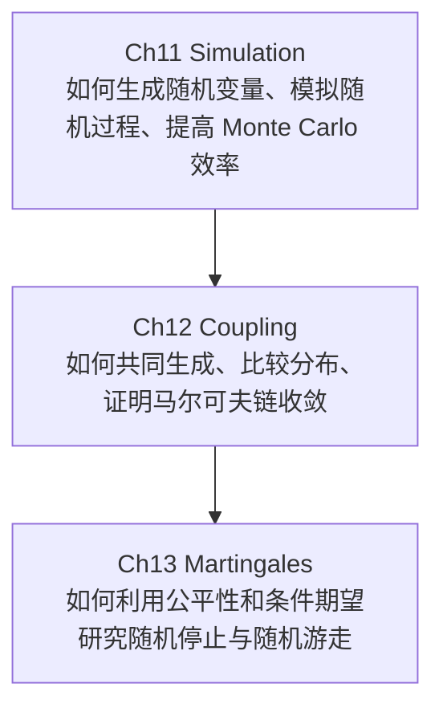
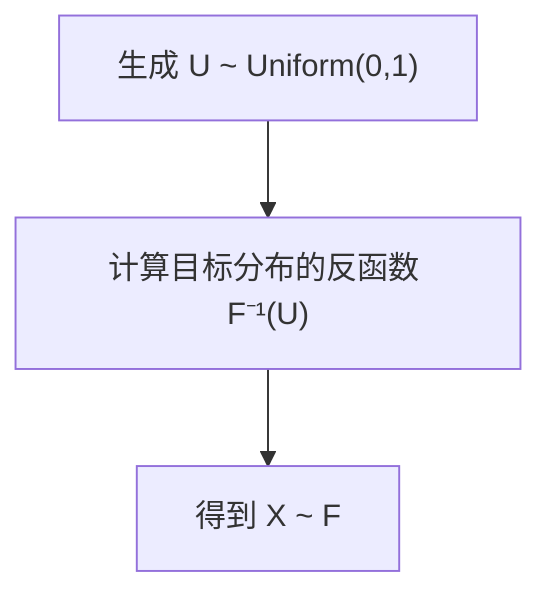
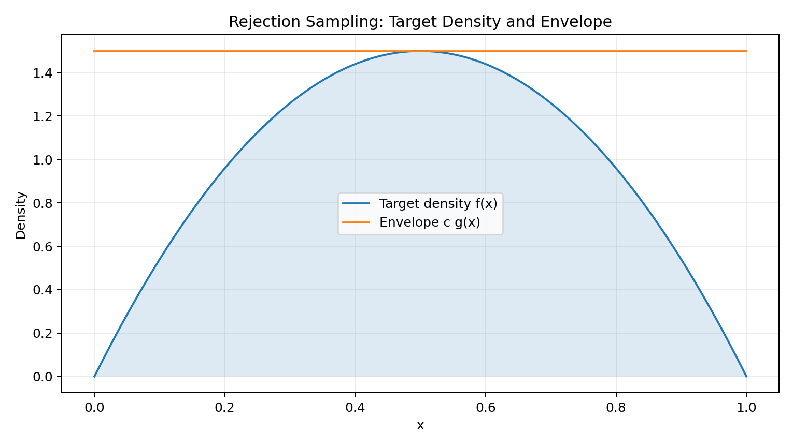
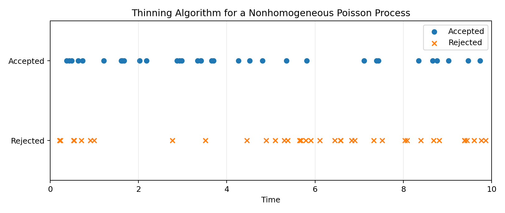
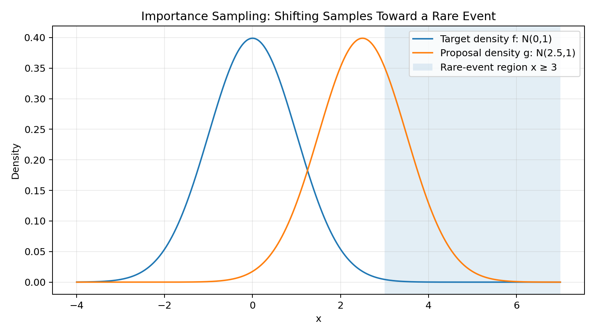
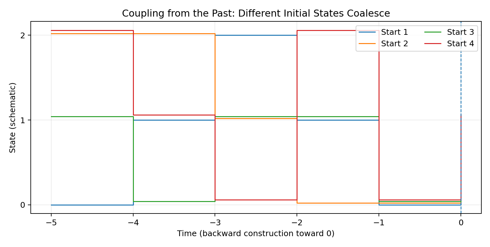
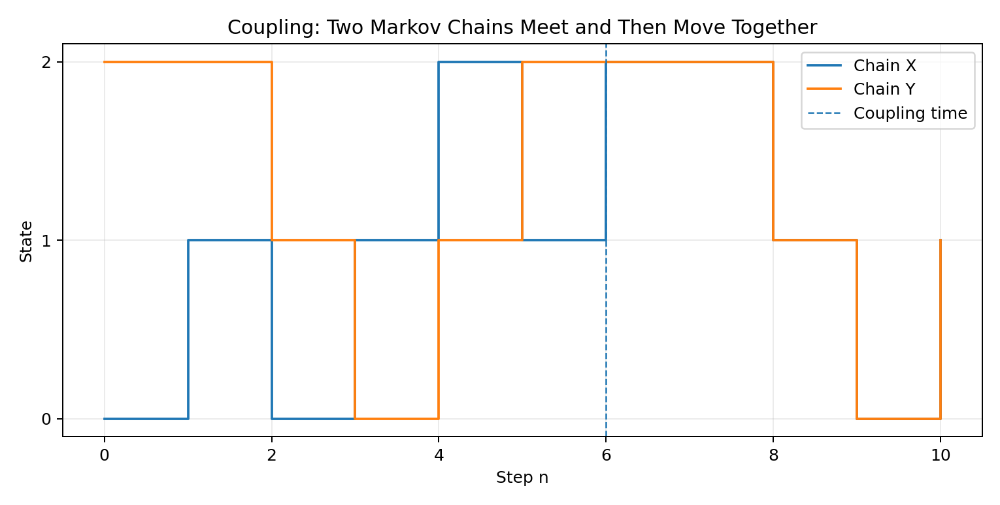
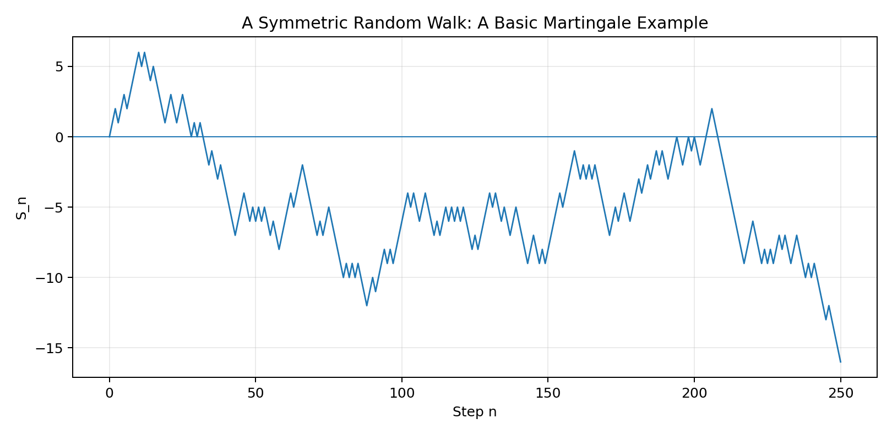

---
cssclasses:
- wide-page
stage: 8
tags:
- random-process
- simulation
- coupling
- martingales
- probability
textbook: Ross, Introduction to Probability Models, 13th Edition
title: 第八阶段：Simulation、Coupling 与 Martingales（Ch11--Ch13）
---

# 随机过程第八阶段：Simulation、Coupling 与 Martingales

教材：Ross, *Introduction to Probability Models*, 13th Edition，Chapter
11--13。

这三个章节的性质不太一样：

-   **Ch11 Simulation（模拟）：**
    研究如何利用计算机生成随机变量、模拟随机过程，以及提高模拟估计的效率。
-   **Ch12 Coupling（耦合）：**
    研究如何把两个随机变量或随机过程放在同一个概率空间中，从而比较它们的大小、分布距离和收敛速度。
-   **Ch13 Martingales（鞅）：**
    研究一种具有公平性特征的随机过程，并利用它解决随机停止时间、随机游走、等待时间等问题。

我建议这三章采用不同的学习方式：

  章节               深度   学习要求
  ------------------ ------ ----------------------------------------
  Ch11 Simulation    A/B    掌握核心算法，理解重要性采样
  Ch12 Coupling      B/C    理解概念、定理和应用，不深入复杂证明
  Ch13 Martingales   S/A    重点掌握定义、条件期望、停止定理及应用

整体逻辑：

------------------------------------------------------------------------

# 第一部分：Ch11 Simulation（随机模拟）

> \[!important\] A/B 级

## 一、11.1 Introduction：Simulation 到底在做什么？

先理解一个问题：

假设我们有一个随机变量：

$$
X\sim f(x)
$$

现在想计算：

$$
\theta=E[g(X)].
$$

根据期望的定义：

$$
\theta=\int g(x)f(x)\,dx.
$$

如果这个积分很复杂，甚至没有解析解，怎么办？

一个非常自然的想法是：

**既然无法直接计算期望，那就不断生成随机变量，计算函数值，再取平均。**

具体来说：

1.  生成 $X_1\sim f$；
2.  生成 $X_2\sim f$；
3.  不断重复，得到 $X_1,\ldots,X_n$；
4.  计算 $g(X_1),\ldots,g(X_n)$；
5.  取样本均值。

定义：

$$
\boxed{
\hat\theta_n=
\frac1n\sum_{i=1}^n g(X_i).
}
$$

根据大数定律（Law of Large Numbers）：

$$
\boxed{
\hat\theta_n\xrightarrow{a.s.}E[g(X)].
}
$$

这就是 Monte Carlo Simulation（蒙特卡洛模拟）。

### 1.1 为什么它能够估计期望？

因为：

$$
E[\hat\theta_n]
=\frac1n\sum_{i=1}^n E[g(X_i)]
=E[g(X)].
$$

所以它是一个无偏估计量（Unbiased Estimator）。

如果各次模拟相互独立：

$$
\boxed{
\operatorname{Var}(\hat\theta_n)
=\frac{\operatorname{Var}(g(X))}{n}.
}
$$

这意味着：

-   模拟次数越多，估计方差越小；
-   模拟次数增加到原来的 4 倍，标准误差缩小到原来的 $1/2$；
-   模拟次数增加到原来的 100 倍，标准误差缩小到原来的 $1/10$。

这也解释了为什么 Monte Carlo 模拟有时需要大量计算。

### 1.2 一个非常重要的认识

Simulation 的核心不是简单地生成随机数，而是：

$$
\boxed{
\text{设计合理的随机生成机制}
+
\text{构造有效的估计量}
}
$$

后面 11.2--11.5 主要研究如何生成随机变量和随机过程。

11.6 则进一步研究如何降低估计量的方差。

## 二、11.2 General Techniques：连续随机变量的模拟

> \[!important\] 重点掌握

本节有三种方法：

1.  Inverse Transformation Method（逆变换法）
2.  Rejection Method（拒绝采样）
3.  Hazard Rate Method（风险率法）

前两种最重要，第三种了解即可。

### 2.1 Inverse Transformation Method（逆变换法）

这是整个 Simulation 章节最基础的方法。

#### 核心思想

计算机最容易生成的是：

$$
U\sim Uniform(0,1).
$$

那么能不能利用均匀分布，生成其他任意分布？

答案是可以。

假设我们希望生成一个随机变量：

$$
X\sim F(x).
$$

如果知道它的分布函数的反函数：

$$
F^{-1}(u),
$$

那么直接令：

$$
\boxed{X=F^{-1}(U)}
$$

就可以得到服从 $F$ 的随机变量。

#### 为什么？

我们来推导。

已知：

$$
X=F^{-1}(U).
$$

那么：

$$
\begin{aligned}
P(X\leq x)
&=P(F^{-1}(U)\leq x)\\
&=P(U\leq F(x)).
\end{aligned}
$$

因为：

$$
U\sim Uniform(0,1),
$$

所以：

$$
P(U\leq F(x))=F(x).
$$

因此：

$$
\boxed{F_X(x)=F(x).}
$$

这就证明了逆变换法正确。

#### 例题：生成指数分布

假设：

$$
X\sim Exp(\lambda).
$$

其分布函数：

$$
F(x)=1-e^{-\lambda x},\qquad x\geq0.
$$

令：

$$
u=1-e^{-\lambda x}.
$$

解出：

$$
e^{-\lambda x}=1-u.
$$

取对数：

$$
-\lambda x=\ln(1-u).
$$

因此：

$$
\boxed{
X=-\frac1\lambda\ln(1-U).
}
$$

因为 $1-U$ 仍然服从 $Uniform(0,1)$，所以还可以写成：

$$
\boxed{
X=-\frac1\lambda\ln U.
}
$$

这样，只需要生成一个均匀随机数，就可以得到一个指数分布随机变量。

#### 你需要记住什么？

逆变换法的流程：

**适用条件：** 目标分布的分布函数容易求逆，或者可以数值求逆。

如果分布函数没有容易计算的反函数，就可以考虑拒绝采样。

> 教材 Proposition 11.1、Example 11.3，印刷页码 697--698。

### 2.2 Rejection Sampling（拒绝采样）

> \[!important\] 重点掌握

#### 核心思想

假设我们想生成：

$$
X\sim f(x).
$$

但是直接从 $f(x)$ 生成随机变量比较困难。

不过，我们很容易生成另一个分布：

$$
Y\sim g(x).
$$

能不能利用 $g(x)$ 来生成 $f(x)$？

可以。

只要我们适当接受或拒绝从 $g$ 中生成的样本，就能最终得到目标分布 $f$。

#### 第一步：找到一个包络常数

要求存在一个常数 $c$，使得：

$$
\boxed{
f(x)\leq cg(x),\quad \forall x.
}
$$

也就是说：

$$
c\geq\sup_x\frac{f(x)}{g(x)}.
$$

从图像上理解：

把目标密度 $f(x)$ 放在上面，用 $cg(x)$ 从上方覆盖它。

#### 第二步：生成候选样本

先生成：

$$
Y\sim g(x).
$$

然后再生成：

$$
U\sim Uniform(0,1).
$$

#### 第三步：决定是否接受

如果：

$$
\boxed{
U\leq\frac{f(Y)}{cg(Y)}
}
$$

就接受：

$$
X=Y.
$$

否则拒绝，重新生成 $Y$ 和 $U$。

#### 为什么接受之后就服从目标分布？

核心是：

对于一个很小的区间 $dy$，候选样本落在 $y$ 附近的概率密度是：

$$
g(y).
$$

在这个位置被接受的概率是：

$$
\frac{f(y)}{cg(y)}.
$$

所以：

$$
\text{被接受的样本在 }y\text{ 附近的密度}
\propto
g(y)\frac{f(y)}{cg(y)}.
$$

约去 $g(y)$：

$$
\propto f(y).
$$

归一化之后，得到的正是目标密度 $f(y)$。

因此，接受的样本服从：

$$
\boxed{X\sim f(x).}
$$

#### 第四步：接受率是多少？

教材证明：

$$
P(\text{Accept})=\frac1c.
$$

因此：

$$
\boxed{
E[N]=c,
}
$$

其中 $N$ 是获得一个被接受样本所需要的尝试次数。

这意味着：

-   $c$ 越小，接受率越高；
-   $c$ 越大，拒绝次数越多；
-   选择合适的 proposal distribution $g$ 非常重要。

#### 逆变换法和拒绝采样的区别

  比较               Inverse Transformation   Rejection Sampling
  ------------------ ------------------------ ----------------------
  核心               反函数变换               候选样本接受或拒绝
  是否需要候选分布   不需要                   需要 $g$
  是否可能浪费样本   通常不会                 会拒绝样本
  关键条件           $F^{-1}$ 可计算          存在有限包络常数 $c$
  主要问题           反函数难求               接受率可能很低

**记忆：逆变换是变换随机数，拒绝采样是筛选随机数。**

> 教材 Proposition 11.2、Example 11.4，印刷页码 698--700。

### 2.3 11.2.3 Hazard Rate Method（风险率法）

这部分不用深入推导，但建议知道它和之前更新过程、非齐次泊松过程的联系。

假设某个随机变量 $X$ 表示设备的寿命，其风险率（Hazard Rate）为：

$$
\boxed{
\lambda(t)=\frac{f(t)}{1-F(t)}.
}
$$

它表示：

**在设备已经存活到时间 $t$
的条件下，接下来一个极短时间内发生故障的瞬时强度。**

教材利用一个重要思想：

如果：

$$
\lambda(t)\leq\bar\lambda,
$$

那么可以先生成一个速率为 $\bar\lambda$ 的齐次泊松过程，再按照概率：

$$
\boxed{\frac{\lambda(t)}{\bar\lambda}}
$$

接受发生在时刻 $t$ 的事件。

这就是 Thinning（稀疏化、筛选）思想。

后面 11.5 模拟非齐次泊松过程时，还会用到完全相同的方法。

## 三、11.4 Discrete Simulation（离散随机变量模拟）

> \[!important\] 重点掌握

前面 11.2 研究连续随机变量。

现在考虑离散随机变量：

$$
P(X=x_j)=p_j,\qquad j=1,2,\ldots
$$

其中：

$$
\sum_jp_j=1.
$$

### 3.1 离散逆变换法

这是连续逆变换法的直接推广。

定义累积分布概率：

$$
F_j=\sum_{i=1}^jp_i.
$$

生成：

$$
U\sim Uniform(0,1).
$$

然后：

$$
\boxed{
X=x_j
\quad\text{当}\quad
F_{j-1}<U\leq F_j.
}
$$

#### 举个简单例子

假设：

$$
P(X=1)=0.2,
$$

$$
P(X=2)=0.5,
$$

$$
P(X=3)=0.3.
$$

那么累计概率：

  取值     概率   累计概率
  ------ ------ ----------
  1         0.2        0.2
  2         0.5        0.7
  3         0.3        1.0

生成一个均匀随机数 $U$。

-   如果 $0<U\leq0.2$，取 1；
-   如果 $0.2<U\leq0.7$，取 2；
-   如果 $0.7<U<1$，取 3。

这就是离散随机变量模拟。

### 3.2 几个常见分布的模拟

教材还介绍了几个常见分布的特殊方法。

**Bernoulli Distribution：**

$$
X=
\begin{cases}
1,&U<p,\\
0,&U\geq p.
\end{cases}
$$

**Binomial Distribution：**

因为：

$$
X\sim Binomial(n,p)
$$

可以写成：

$$
X=X_1+\cdots+X_n,
$$

其中：

$$
X_i\overset{i.i.d.}{\sim}Bernoulli(p).
$$

所以可以分别模拟 $n$ 个 Bernoulli 随机变量，然后求和。

**Poisson Distribution：**

教材给出一个很有意思的方法：

生成独立均匀随机数：

$$
U_1,U_2,\ldots
$$

直到：

$$
\prod_{i=1}^n U_i<e^{-\lambda}.
$$

利用：

$$
-\ln U_i\sim Exp(1),
$$

可以把它转化成泊松过程的到达次数问题。

最终生成的随机变量服从：

$$
\boxed{N\sim Poisson(\lambda).}
$$

这里的关键是：

泊松分布可以看作单位速率泊松过程中时间 $\lambda$ 内的事件数。

### 3.3 Alias Method（别名采样法）

这部分建议了解，因为它是离散模拟中的一种高效算法。

假设有一个离散分布：

$$
P(X=i)=p_i,\qquad i=1,\ldots,n.
$$

如果直接使用累计概率，每次生成都需要寻找对应的区间。

如果 $n$ 很大，查找可能比较耗时。

Alias Method 的思想是：

**提前把复杂的离散分布拆成若干个简单的两点分布，之后每次只需要进行很少的随机选择。**

教材给出一种表示：

$$
\boxed{
P=\frac1{n-1}\sum_{k=1}^{n-1}Q^{(k)}
}
$$

其中每个 $Q^{(k)}$ 最多只有两个取值具有正概率。

于是：

1.  等概率选择一个 $Q^{(k)}$；
2.  在这个两点分布中生成一个随机值；
3.  输出该随机值。

这样就能还原原来的分布。

这里不需要掌握构造过程，只需要知道：

-   Alias Method 需要一定的预处理；
-   预处理后，每次抽样非常快；
-   特别适合反复从同一个大规模离散分布中抽样。

例如推荐系统中，某个用户有几十万甚至几百万个候选
item，需要反复根据指定概率分布抽取负样本，就可能考虑 Alias Method。

> 教材 §11.4、Example 11.7--11.10，印刷页码 713--719。

## 四、11.5 Stochastic Processes Simulation（随机过程模拟）

> \[!important\] 重点掌握

前面模拟的是一个随机变量：

$$
X.
$$

现在我们要模拟的是一整个随机过程：

$$
\{X(t),t\geq0\}.
$$

例如：

-   泊松过程；
-   更新过程；
-   非齐次泊松过程；
-   二维泊松点过程。

核心思想：

**一个随机过程由一系列随机变量构成，所以可以通过模拟这些随机变量来构造整个过程的样本路径。**

### 4.1 Renewal Process（更新过程）

假设更新间隔：

$$
X_1,X_2,\ldots
$$

独立同分布，分布为 $F$。

定义到达时间：

$$
S_n=X_1+\cdots+X_n.
$$

如果要模拟时间区间：

$$
[0,T],
$$

只需要：

1.  生成 $X_1$；
2.  计算 $S_1=X_1$；
3.  生成 $X_2$；
4.  计算 $S_2=X_1+X_2$；
5.  一直进行，直到 $S_n>T$。

那么：

$$
\boxed{
N(T)=\max\{n:S_n\leq T\}.
}
$$

这就得到了更新过程在时间 $T$ 内的全部到达次数和到达时刻。

### 4.2 Poisson Process（泊松过程）

对于速率为 $\lambda$ 的齐次泊松过程，有两种模拟思路。

**方法一：模拟到达间隔。**

因为泊松过程的相邻到达间隔服从：

$$
X_i\overset{i.i.d.}{\sim}Exp(\lambda).
$$

所以直接累加指数随机变量即可。

**方法二：先模拟总次数，再模拟到达时间。**

首先：

$$
N(T)\sim Poisson(\lambda T).
$$

然后利用一个重要性质：

给定：

$$
N(T)=n,
$$

这 $n$ 个事件时刻相当于 $n$ 个独立的：

$$
Uniform(0,T)
$$

随机变量排序后的结果。

因此：

1.  生成 $N(T)\sim Poisson(\lambda T)$；
2.  生成 $n$ 个独立均匀随机数；
3.  乘以 $T$；
4.  排序，得到到达时刻。

这两种方法生成的都是同一个泊松过程。

### 4.3 Nonhomogeneous Poisson Process（非齐次泊松过程）

> \[!important\] 值得掌握

这个方法与你之前学的 Poisson Thinning 有直接关系。

普通泊松过程：

$$
\lambda(t)=\lambda.
$$

到达率不随时间变化。

但是现实中：

-   早高峰到达率高；
-   深夜到达率低；
-   某些时间段业务请求量特别大。

因此我们需要：

$$
\boxed{\lambda=\lambda(t).}
$$

即非齐次泊松过程。

#### 方法一：Thinning Algorithm（稀疏化算法）

假设：

$$
\lambda(t)\leq\bar\lambda.
$$

首先模拟一个速率为：

$$
\bar\lambda
$$

的齐次泊松过程。

然后对于每一个候选到达事件 $t$，生成一个均匀随机数：

$$
U\sim Uniform(0,1).
$$

如果：

$$
\boxed{
U\leq\frac{\lambda(t)}{\bar\lambda}
}
$$

就保留这个事件，否则丢弃。

为什么正确？

原始候选事件的发生强度为：

$$
\bar\lambda.
$$

每个事件以概率：

$$
\frac{\lambda(t)}{\bar\lambda}
$$

被接受。

所以保留下来的事件强度为：

$$
\bar\lambda\times
\frac{\lambda(t)}{\bar\lambda}
=\lambda(t).
$$

这就得到了目标非齐次泊松过程。

#### 方法二：Conditional Distribution

教材还给出另一种方法：

先生成：

$$
N(T)\sim Poisson\left(
\int_0^T\lambda(s)\,ds
\right).
$$

然后给定 $N(T)=n$，生成 $n$ 个独立随机变量，其密度为：

$$
\boxed{
f(t)=
\frac{\lambda(t)}
{\int_0^T\lambda(s)\,ds},
\quad 0<t<T.
}
$$

也就是说，非齐次泊松过程的事件时刻不再是均匀分布，而是按照强度函数
$\lambda(t)$ 所决定的密度分布。

**本节重点：**

-   Renewal Process：累加更新间隔；
-   Poisson Process：累加指数间隔，或者先生成次数再生成时刻；
-   Nonhomogeneous Poisson Process：Thinning 或条件分布方法。

这部分与 Ch5 学习的泊松过程、独立增量和筛选性质联系很紧密。

> 教材 §11.5、§11.5.1，印刷页码 719--725。

## 五、11.6 Variance Reduction：方差缩减技术

> \[!important\] 重点：11.6.4

这部分是我建议你重点理解的内容。

前面我们知道：

$$
\hat\theta=\frac1n\sum_{i=1}^nY_i
$$

可以估计：

$$
\theta=E[Y].
$$

但是如果：

$$
\operatorname{Var}(Y)
$$

非常大，那么即使模拟很多次，估计结果也可能不稳定。

因此，我们希望：

**在不改变目标期望的前提下，尽可能降低估计量的方差。**

教材介绍了几种方法：

  方法                   核心思想
  ---------------------- --------------------------------
  Antithetic Variables   利用负相关随机变量
  Conditioning           用条件期望代替原始随机变量
  Control Variates       利用已知期望的相关变量修正估计
  Importance Sampling    改变抽样分布，再通过权重修正

我们重点学习最后一种。

------------------------------------------------------------------------

## 六、11.6.4 Importance Sampling（重要性采样）

> \[!important\] 本阶段重点

这是本章最值得深入理解的方法。

### 6.1 为什么需要 Importance Sampling？

先考虑一个问题。

假设我们想估计：

$$
\boxed{
\theta=P(X\geq a).
}
$$

其中：

$$
X\sim f(x).
$$

如果事件：

$$
X\geq a
$$

非常罕见，那么直接模拟会出现什么情况？

例如：

-   模拟 10000 次；
-   只有 2 次满足 $X\geq a$；
-   其他 9998 次结果都是 0。

此时估计量：

$$
\hat\theta
=\frac1{10000}
\sum_{i=1}^{10000}I(X_i\geq a).
$$

可能非常不稳定。

问题在于：

**我们花费了大量计算资源，却很少观察到真正感兴趣的事件。**

那么能不能主动改变抽样分布，让感兴趣的事件更容易发生？

这就是 Importance Sampling 的思想。

### 6.2 数学推导：为什么改变分布之后还能正确估计？

假设我们真正想计算：

$$
\theta=E_f[h(X)].
$$

根据期望定义：

$$
\theta=\int h(x)f(x)\,dx.
$$

现在不从 $f(x)$ 抽样，而是选择另一个更容易抽样的分布：

$$
g(x).
$$

要求：

$$
f(x)>0\Longrightarrow g(x)>0.
$$

这个条件意味着：目标分布中可能出现的区域，新的抽样分布不能完全忽略。

接下来做一个简单的变形：

$$
\begin{aligned}
\theta
&=\int h(x)f(x)\,dx\\
&=\int h(x)\frac{f(x)}{g(x)}g(x)\,dx.
\end{aligned}
$$

于是：

$$
\boxed{
\theta=
E_g\left[
h(X)\frac{f(X)}{g(X)}
\right].
}
$$

这就是重要性采样的核心公式。

我们定义：

$$
\boxed{
w(X)=\frac{f(X)}{g(X)}
}
$$

称为 Importance Weight（重要性权重）或 Likelihood Ratio（似然比）。

所以：

$$
\boxed{
\hat\theta_{\mathrm{IS}}
=
\frac1n\sum_{i=1}^n
h(X_i)\frac{f(X_i)}{g(X_i)},
\quad X_i\overset{i.i.d.}{\sim}g.
}
$$

注意：

抽样分布已经从 $f$ 变成了 $g$，但通过乘以权重
$f/g$，仍然可以估计原来的目标期望。

### 6.3 一个非常直观的理解

假设我们要研究一个班级学生的平均成绩。

但我们抽样时，故意让成绩优秀的学生更容易被抽到。

这样直接计算样本平均成绩肯定会偏高。

因为我们的抽样分布已经改变了。

为了修正这个问题，就要给不同样本赋予不同权重。

-   原本出现概率很高、现在却抽得少的样本，需要更高权重；
-   原本出现概率很低、现在却抽得多的样本，需要更低权重。

重要性采样本质上就是：

**先改变抽样概率，再通过概率比值纠正抽样偏差。**

### 6.4 教材 Example 11.23：稀有事件模拟

这是非常典型的例子。

假设：

$$
X_1,\ldots,X_{20}
$$

相互独立，且：

$$
X_i\sim Bernoulli(0.4).
$$

定义：

$$
S=\sum_{i=1}^{20}X_i.
$$

我们希望计算：

$$
\boxed{\theta=P(S\geq16).}
$$

因为：

$$
E[S]=20\times0.4=8.
$$

但现在我们要研究：

$$
S\geq16.
$$

这是一个非常罕见的事件。

如果直接按照 $p=0.4$ 模拟，大部分时候 $S$ 都远小于 16。

**第一步：改变抽样分布。**

我们不再使用：

$$
X_i\sim Bernoulli(0.4).
$$

而是使用：

$$
X_i\sim Bernoulli(q).
$$

我们希望 $q$ 更大，让 $S\geq16$ 更容易发生。

教材通过指数倾斜（Exponential Tilting）的方法，选择：

$$
\boxed{q=0.8.}
$$

于是：

$$
E_g[S]=20\times0.8=16.
$$

现在我们生成的样本更容易落入目标事件区域。

**第二步：计算重要性权重。**

原始分布：

$$
f(x_i)=0.4^{x_i}0.6^{1-x_i}.
$$

新分布：

$$
g(x_i)=0.8^{x_i}0.2^{1-x_i}.
$$

因此：

$$
\frac{f(x_i)}{g(x_i)}
=
\begin{cases}
0.4/0.8=1/2,&x_i=1,\\
0.6/0.2=3,&x_i=0.
\end{cases}
$$

由于 20 个随机变量相互独立：

$$
\frac{f(X_1,\ldots,X_{20})}
{g(X_1,\ldots,X_{20})}
=
\left(\frac12\right)^S3^{20-S}.
$$

所以：

$$
\boxed{
\hat\theta_{\mathrm{IS}}
=
I(S\geq16)
\left(\frac12\right)^S3^{20-S}.
}
$$

**第三步：为什么这样仍然是正确的？**

因为：

$$
\begin{aligned}
E_g[\hat\theta_{\mathrm{IS}}]
&=E_g\left[
I(S\geq16)\frac fg
\right]\\
&=\sum_{S\geq16}g(S)\frac{f(S)}{g(S)}\\
&=\sum_{S\geq16}f(S)\\
&=P_f(S\geq16).
\end{aligned}
$$

所以估计量仍然无偏。

> \[!important\] 这个例子最重要的地方
>
> -   直接模拟：Bernoulli 参数为 0.4，目标事件很少发生。
> -   重要性采样：Bernoulli 参数为 0.8，目标事件更容易发生。
>
> 但改变抽样分布后，必须乘以：
>
> $$
> \boxed{\frac fg}
> $$
>
> 才能保证估计的是原始目标概率。

教材报告的结果是：

-   直接模拟的单次估计方差约为 $3.169\times10^{-4}$；
-   重要性采样估计量的方差上界约为 $2.9131\times10^{-7}$。

这说明通过合理改变抽样分布，可以显著提高模拟效率。

> 教材 §11.6.4、Example 11.22--11.23，印刷页码 739--743。

## 七、Importance Sampling 与推荐系统 Negative Sampling 的联系

这一部分结合你正在做的 RecFlow 多阶段推荐研究讲。

这里有一个非常值得理解的共同思想：

**抽样分布不一定等于我们最终想研究的目标分布。**

### 7.1 推荐系统中的问题

假设用户 $u$ 有一个正样本：

$$
i^+.
$$

我们需要从大量未交互 item 中抽取负样本：

$$
j\sim q(j\mid u).
$$

这里：

$$
q(j\mid u)
$$

就是负采样分布（Negative Sampling Distribution）。

不同的负采样方法可能采用不同分布：

-   Uniform Sampling：均匀采样；
-   Popularity-based Sampling：按照流行度采样；
-   Hard Negative Sampling：倾向于抽取困难负样本；
-   Source-based Sampling：按照候选来源采样。

假设我们真正希望优化的目标是：

$$
L(u,i^+)
=
E_{j\sim p(j\mid u)}
[\ell(u,i^+,j)].
$$

这里：

$$
p(j\mid u)
$$

是原始目标负样本分布。

但为了提高效率，我们实际从：

$$
q(j\mid u)
$$

抽取负样本。

那么：

$$
\begin{aligned}
L(u,i^+)
&=\sum_jp(j\mid u)\ell(u,i^+,j)\\
&=\sum_jq(j\mid u)
\frac{p(j\mid u)}{q(j\mid u)}
\ell(u,i^+,j).
\end{aligned}
$$

所以：

$$
\boxed{
L(u,i^+)
=
E_{j\sim q}
\left[
\frac{p(j\mid u)}{q(j\mid u)}
\ell(u,i^+,j)
\right].
}
$$

这和教材的 Importance Sampling 完全对应。

  Simulation                推荐系统
  ------------------------- -----------------------------
  目标分布 $f(x)$           目标负采样分布 $p(j\mid u)$
  Proposal $g(x)$           实际负采样分布 $q(j\mid u)$
  模拟样本 $X$              抽取的负样本 item $j$
  Importance Weight $f/g$   $p(j\mid u)/q(j\mid u)$
  目标期望                  原始推荐训练目标

### 7.2 一个具体例子

假设某个用户有 10000 个候选负样本。

如果目标分布是均匀分布：

$$
p(j\mid u)=\frac1{10000}.
$$

但我们希望更多抽取困难负样本，因此设计一个非均匀分布：

$$
q(j\mid u).
$$

例如某个 item 的采样概率为：

$$
q(j\mid u)=0.01.
$$

那么对应的权重为：

$$
w_j=\frac{1/10000}{0.01}=0.01.
$$

而另一个 item 的采样概率为：

$$
q(k\mid u)=0.00001.
$$

其权重为：

$$
w_k=\frac{1/10000}{0.00001}=10.
$$

这意味着：

-   第一个 item
    虽然经常被抽到，但它在原始目标分布中并没有那么重要，因此权重较低；
-   第二个 item
    虽然很少被抽到，但它在目标分布中的相对重要性更高，因此权重较高。

### 7.3 联系 RecFlow：这里需要区分两种研究目标

你现在研究的是多来源候选池中的自适应负采样，涉及 Composition、Priority
等机制。

这里有一个很重要的区别：

**情况一：希望保持原始目标分布不变。**

假设原始目标是：

$$
p(s,i\mid u),
$$

但你的模型按照自适应策略：

$$
q(s,i\mid u)
$$

抽取来源和 item。

那么如果希望保持原始目标期望的无偏性，可以使用：

$$
\boxed{
w(u,s,i)=
\frac{p(s,i\mid u)}
{q(s,i\mid u)}.
}
$$

如果来源与 item 分层采样：

$$
p(s,i\mid u)
=p(s\mid u)p(i\mid s,u),
$$

$$
q(s,i\mid u)
=q(s\mid u)q(i\mid s,u),
$$

那么：

$$
\boxed{
w=
\frac{p(s\mid u)}{q(s\mid u)}
\cdot
\frac{p(i\mid s,u)}{q(i\mid s,u)}.
}
$$

这实际上就是两层 Importance Weight。

**情况二：希望改变原始目标，让困难负样本获得更高训练价值。**

这种情况下，你可能就是希望优化：

$$
E_{j\sim q}[\ell(u,i^+,j)]
$$

而不是：

$$
E_{j\sim p}[\ell(u,i^+,j)].
$$

那么就不应该机械地乘以
$p/q$，因为这样会把你主动设计的困难负样本分布重新修正回原始分布。

两种目标不一样。

> \[!important\] 一个非常重要的研究判断
>
>   研究目的                           是否需要重要性权重
>   ---------------------------------- ----------------------
>   改变抽样方式，但保持原始目标不变   需要
>   有意改变负样本分布和训练目标       不一定需要
>   希望修正抽样偏差                   需要考虑
>   希望提高困难负样本的训练贡献       不能直接认为必须修正
>
> **重要性采样不是所有负采样方法都必须使用的步骤，而是用于在改变抽样分布后，仍然估计原始目标分布下的期望。**

还有两个实践问题值得注意：

1.  如果某个目标样本在 $q$ 下的概率非常小，那么 $p/q$
    可能非常大，造成估计方差过高。
2.  可以使用混合采样分布，例如：

$$
q_\varepsilon=(1-\varepsilon)q_{\mathrm{hard}}+\varepsilon p,
$$

保证目标分布的支持集被覆盖，并缓解极端权重问题。

权重截断（Weight Clipping）也可以降低方差，但会引入一定偏差。

对于 RecFlow，尤其要注意：如果 C
学习的是样本效用，而不是单纯逼近一个固定目标分布，那么它与传统
Importance Sampling
并不完全等价。前者是自适应优化，后者是分布变换后的估计修正。

这一区分在设计实验和解释创新点时非常重要。

------------------------------------------------------------------------

# 第二部分：Ch11.8 Sampling from Stationary Distribution（从平稳分布中抽样）

> \[!important\] 重点了解

这一节和你之前学过的 Markov Chain、Stationary Distribution 直接相关。

### 8.1 问题是什么？

假设我们有一个马尔可夫链：

$$
X_0,X_1,X_2,\ldots
$$

其转移矩阵为：

$$
P.
$$

我们已经知道它存在平稳分布：

$$
\pi=\pi P.
$$

现在想生成一个随机变量：

$$
X\sim\pi.
$$

最直接的方法是：

1.  随便选择一个初始状态；
2.  不断模拟马尔可夫链；
3.  模拟很多步之后，取最终状态。

这就是 MCMC（Markov Chain Monte Carlo）的基本思想之一。

但是这种方法通常只能近似得到平稳分布。

教材 11.8 进一步介绍了如何实现精确抽样（Exact Sampling）。

### 8.2 Coupling from the Past（从过去耦合）

这个方法非常有意思。

假设马尔可夫链只有有限个状态：

$$
S=\{1,2,\ldots,m\}.
$$

我们希望得到时间 0 的平稳状态。

教材提出一个思想实验：

**如果这条马尔可夫链从负无穷远处就已经开始运行，那么时间 0
的状态就应该服从平稳分布。**

但是我们不可能真的从：

$$
t=-\infty
$$

开始模拟。

怎么办？

#### 核心思路

我们反过来，从时间 0 向过去追溯。

假设在时间 $-1$，对于每一个可能的初始状态
$i$，都预先生成下一步的转移结果：

$$
N_{-1}(i).
$$

它满足：

$$
P(N_{-1}(i)=j)=P_{ij}.
$$

那么：

$$
S_{-1}(i)=N_{-1}(i).
$$

这里 $S_{-1}(i)$ 表示：如果时间 $-1$ 的状态是 $i$，那么时间 0
的状态是什么。

现在继续往过去追溯到时间 $-2$。

定义：

$$
S_{-2}(i)
=
S_{-1}(N_{-2}(i)).
$$

它表示：

如果时间 $-2$ 的状态是 $i$，那么经过两步之后，时间 0 的状态是什么。

继续追溯：

$$
S_{-3}(i)
=
S_{-2}(N_{-3}(i)).
$$

一直进行下去。

#### 什么时候可以停止？

当我们发现：

$$
\boxed{
S_{-r}(1)=S_{-r}(2)=\cdots=S_{-r}(m)=j
}
$$

也就是说：

不管时间 $-r$ 的初始状态是什么，最终时间 0 都会到达同一个状态 $j$。

这时就可以停止。

因为已经证明：

无论从过去哪个状态出发，时间 0 的结果都是 $j$。

所以：

$$
\boxed{X(0)=j}
$$

就是一个服从平稳分布的精确样本。

这个过程叫：

**Coupling from the Past（CFTP）**。

需要注意：实际使用时必须构造合适的共同随机转移映射，并保证最终发生
Coalescence（合并）。如果映射一直不能合并，就不能直接停止。教材的这一节介绍的是这种方法的基本思想。

### 8.3 Another Approach：利用状态 0 抽样

教材还介绍了另一种方法。

假设存在一个特殊状态 0，使得：

$$
\boxed{
P_{i,0}\geq\alpha>0,\quad \forall i.
}
$$

也就是说：

无论目前处于什么状态，下一步进入状态 0 的概率都至少是 $\alpha$。

接下来：

-   如果从状态 $i$ 转移到 0；
-   再以概率 $\alpha/P_{i,0}$ 抛一次特殊硬币；
-   如果硬币正面，就记录一个事件。

那么：

$$
P(\text{事件发生}\mid X_n=i)
=
P_{i,0}\frac{\alpha}{P_{i,0}}
=\alpha.
$$

因此，每一步发生事件的概率都是 $\alpha$。

教材证明：

如果 $T$ 是第一次出现这种事件的时间，那么：

$$
\boxed{X_{T-1}\sim\pi.}
$$

也就是说，第一次特殊事件发生之前的状态，就是平稳分布的一个精确样本。

### 你需要理解的核心

11.8 研究的不是如何求解平稳分布方程：

$$
\pi=\pi P.
$$

而是：

**当平稳分布很复杂时，如何直接从这个分布中生成随机样本。**

这对 MCMC 和统计计算非常重要。

> 教材 §11.8.1--11.8.2，印刷页码 745--747。

------------------------------------------------------------------------

# 第二部分：Ch12 Coupling（耦合）

> \[!important\] B/C 级：理解概念为主

这一章不用像鞅一样深入数学推导，重点是理解它为什么有用。

## 九、12.1--12.2 Coupling：什么是耦合？

### 9.1 先理解一个问题

假设：

$$
X\sim F,\qquad Y\sim G.
$$

现在我们想比较两个随机变量：

-   $X$ 是否比 $Y$ 大？
-   两个随机变量的分布是否接近？
-   两个马尔可夫链经过很多步之后是否会逐渐接近？

直接比较两个分布函数有时很困难。

Coupling 提供了一个新思路：

**把两个随机变量放在同一个概率空间中，让它们共同产生，然后观察它们之间的关系。**

正式定义：

如果：

$$
X'\overset d=X,
$$

$$
Y'\overset d=Y,
$$

那么：

$$
(X',Y')
$$

就是 $(X,Y)$ 的一个 Coupling。

注意：

这里不要求 $X'$ 和 $Y'$ 独立。

我们可以自由设计它们之间的相关关系，只要各自的边际分布不变。

### 9.2 为什么这很有用？

假设：

$$
X\sim F,\qquad Y\sim G.
$$

我们可以：

-   让它们独立；
-   让它们正相关；
-   让它们负相关；
-   让它们尽可能相等。

通过设计不同的联合分布，我们就能研究两个原本不同的随机变量之间的关系。

这就是 Coupling 的本质。

## 十、Stochastic Order（随机序）

这是 Ch12 的第一个重要应用。

### 10.1 定义

如果：

$$
\boxed{
P(X>x)\geq P(Y>x),\quad\forall x,
}
$$

那么称：

$$
\boxed{X\geq_{st}Y.}
$$

读作：

$X$ stochastically dominates $Y$，即 $X$ 在随机序意义下大于 $Y$。

等价地：

$$
\boxed{
F_X(x)\leq F_Y(x),\quad\forall x.
}
$$

### 10.2 如何理解？

它并不是要求：

$$
X(\omega)\geq Y(\omega)
$$

对每一个样本结果都成立。

而是要求：

对于任意阈值 $x$，$X$ 超过这个阈值的概率都不小于 $Y$。

可以理解为：

**从整体分布来看，$X$ 更倾向于取较大的值。**

### 10.3 Coupling 与 Stochastic Order 的关系

教材 Proposition 12.1 给出了一个非常重要的定理：

$$
\boxed{
X\geq_{st}Y
\iff
\exists\text{ coupling }(X',Y')
\text{ 使得 }P(X'\geq Y')=1.
}
$$

这意味着：

判断两个随机变量是否存在随机序关系，可以转化为：

**能否构造一种联合生成方式，让 $X'$ 始终不小于 $Y'$。**

这很重要，因为有时构造随机变量之间的关系，比直接比较分布函数更容易。

例如教材利用这个思想证明：

-   Poisson 随机变量随着参数 $\lambda$ 增大而随机增大；
-   Binomial 随机变量随着 $n$ 增大而随机增大；
-   Binomial 随机变量随着 $p$ 增大而随机增大。

这些结论都可以通过耦合证明，而不需要直接比较复杂的概率求和式。

### 10.4 一个补充性质

教材 Proposition 12.2 还给出了：

$$
\boxed{
X\geq_{st}Y
\iff
E[h(X)]\geq E[h(Y)]
}
$$

对所有适当的递增函数 $h$ 成立。

也就是说，如果 $X$ 在随机序意义下大于
$Y$，那么对于任何递增的评价函数，$X$ 的期望也更大。

这个性质在随机优化中很有用。

> 教材 §12.2、Proposition 12.1--12.2，印刷页码 758--760。

## 十一、Maximum Coupling（最大耦合）

### 11.1 它研究什么？

我们已经知道，可以自由设计两个随机变量之间的联合分布。

那么现在问：

**能不能让两个随机变量尽可能容易取到相同的值？**

定义：

如果一个 Coupling 能够最大化：

$$
P(X'=Y'),
$$

那么它就是 Maximum Coupling。

即：

$$
\boxed{
P(X'=Y')
=
\max_{\text{所有合法 coupling}}P(X=Y).
}
$$

### 11.2 最大相等概率

假设两个离散随机变量的概率质量函数分别为：

$$
P(X=i)=p_i,
$$

$$
P(Y=i)=q_i.
$$

那么最大耦合可以达到的相等概率为：

$$
\boxed{
P(X'=Y')_{\max}
=\sum_i\min(p_i,q_i).
}
$$

为什么是最小值？

因为在某个状态 $i$：

-   $X$ 最多只有 $p_i$ 的概率落在这里；
-   $Y$ 最多只有 $q_i$ 的概率落在这里。

所以两者共同落在 $i$ 的概率最多是：

$$
\min(p_i,q_i).
$$

把所有状态的共同概率加起来，就得到：

$$
\sum_i\min(p_i,q_i).
$$

### 11.3 直观理解

两个概率分布可以想象成两组概率质量。

最大耦合就是：

先尽可能把两组分布中重叠的部分匹配起来。

剩余无法匹配的部分，再分别生成。

所以：

-   两个分布越接近；
-   能匹配的概率质量越多；
-   最大耦合下两个随机变量相等的概率就越大。

对于连续分布，公式对应为：

$$
\boxed{
P(X'=Y')_{\max}
=
\int_{-\infty}^{\infty}
\min(f(x),g(x))\,dx.
}
$$

## 十二、Total Variation Distance（全变差距离）

这是 Ch12 最重要的概念之一。

### 12.1 为什么需要这个距离？

假设：

$$
X\sim P,\qquad Y\sim Q.
$$

我们想衡量两个概率分布到底有多接近。

一种方法是计算：

$$
\boxed{
\rho(X,Y)
=
\sup_A
|P(X\in A)-P(Y\in A)|.
}
$$

这就是 Total Variation Distance，简称 TV Distance。

它表示：

**在所有可能的事件中，两个分布对同一个事件给出的概率最大能相差多少。**

因此：

$$
0\leq \rho(X,Y)\leq1.
$$

如果：

$$
\rho(X,Y)=0,
$$

说明两个随机变量的分布完全相同。

如果：

$$
\rho(X,Y)
$$

越大，说明两个分布越不相似。

### 12.2 离散情况下的公式

如果 $X,Y$ 都是离散随机变量：

$$
\boxed{
\rho(X,Y)
=
\frac12\sum_i|p_i-q_i|.
}
$$

这个公式很值得记忆。

它实际上就是两个概率质量函数之间的 $L^1$ 距离的一半。

### 12.3 Coupling Identity（耦合恒等式）

这是本章最重要的定理。

如果：

$$
(X',Y')
$$

是最大耦合，那么：

$$
\boxed{
\rho(X,Y)=P(X'\neq Y').
}
$$

结合最大耦合的相等概率：

$$
\boxed{
\rho(X,Y)
=
1-\sum_i\min(p_i,q_i).
}
$$

这里要特别区分：

-   最大耦合最大化的是 $P(X'=Y')$；
-   TV Distance 对应的是最大耦合下的 $P(X'\neq Y')$。

因此：

$$
\boxed{
\text{两个分布越接近}
\Longleftrightarrow
\text{最大耦合下越容易相等}.
}
$$

这是理解后面马尔可夫链收敛的关键。

> 教材 §12.4、Proposition 12.8--12.9，印刷页码 763--766。

## 十三、Coupling 在 Markov Chain Convergence 中的应用

这是 Ch12 最值得了解的应用。

你之前学过：

如果一个马尔可夫链满足适当条件，例如：

-   Irreducible（不可约）；
-   Aperiodic（非周期）；
-   存在平稳分布 $\pi$；

那么：

$$
P(X_n=j)\longrightarrow\pi_j.
$$

现在教材使用 Coupling 来解释为什么会收敛。

### 13.1 构造两个马尔可夫链

假设：

$$
X_0
$$

服从任意初始分布。

再构造一个：

$$
Y_0\sim\pi.
$$

并且 $X_n,Y_n$ 使用相同的转移矩阵 $P$。

由于 $Y_0$ 已经服从平稳分布，因此：

$$
Y_n\sim\pi,\qquad\forall n.
$$

现在我们希望让这两个链逐渐靠近。

### 13.2 设计 Coupling

一种常见的构造方式：

1.  两条链先各自演化；
2.  一旦某个时刻两条链到达同一个状态；
3.  从这一刻开始，使用完全相同的随机转移；
4.  因此后续始终保持相同。

定义：

$$
N=\min\{n:X_n=Y_n\}.
$$

如果：

$$
N\leq n,
$$

那么第 $n$ 步两条链已经相等。

所以：

$$
P(X_n\neq Y_n)\leq P(N>n).
$$

再利用 Coupling 对 TV Distance 的上界：

$$
\boxed{
\rho(X_n,Y_n)\leq P(N>n).
}
$$

如果：

$$
P(N<\infty)=1,
$$

那么：

$$
P(N>n)\longrightarrow0.
$$

于是：

$$
\boxed{
\rho(X_n,\pi)\longrightarrow0.
}
$$

这就是通过 Coupling 证明 Markov Chain 收敛的基本思想。

### 13.3 为什么这比直接计算更好？

直接研究：

$$
P^n(i,j)
$$

可能需要计算非常复杂的转移矩阵幂。

但通过耦合，我们只需要研究：

**两条链最终能不能相遇？相遇需要多长时间？**

这就把分布收敛问题转化成了随机过程的相遇问题。

教材 Proposition 12.13
证明了：对于不可约、非周期且具有平稳概率向量的马尔可夫链，任意初始分布下的链都收敛到平稳分布。

另外，教材 Proposition 12.14 还说明：使用相同转移矩阵的两条链，其 TV
Distance 不会随着时间增加而增大。

> 教材 §12.5.1、Proposition 12.10--12.14，印刷页码 766--769。

### 13.4 Ch12 最终总结

  概念                       一句话理解
  -------------------------- ------------------------------------------
  Coupling                   让两个随机变量共同生成
  Stochastic Order           从整体分布来看，哪个随机变量更大
  Maximum Coupling           最大化两个随机变量取值相等的概率
  Total Variation Distance   衡量两个概率分布之间的距离
  Coupling Identity          最大耦合下，不相等的概率等于 TV Distance
  Markov Chain Convergence   通过两条链最终相遇，证明分布收敛

**这一章最重要的逻辑：**

$$
\boxed{
\text{Coupling}
\rightarrow
\text{Meeting}
\rightarrow
\text{TV Distance}
\rightarrow
\text{Convergence}
}
$$

不需要专门练习复杂的耦合构造题，理解这条主线就可以。

------------------------------------------------------------------------

------------------------------------------------------------------------

# 第三部分：Ch13 Martingales（鞅）

> \[!important\] S/A 级重点

这是这三个章节中最值得认真学习的一章。

Martingale（鞅）是概率论中非常重要的概念，后面在：

-   随机游走；
-   金融数学；
-   随机优化；
-   随机停止时间；
-   随机过程收敛理论；

中都会出现。

我先讲清楚它在研究什么，再讲数学定义。

# 十四、13.1 Introduction：什么是 Martingale？

## 14.1 从公平赌博开始理解

假设你参加一个赌博游戏。

你当前拥有：

$$
Z_n
$$

元。

下一轮游戏结束后，你的财富变成：

$$
Z_{n+1}.
$$

如果这个游戏是公平的，那么：

**在已经知道过去所有信息的条件下，你下一轮结束后的预期财富，应该等于现在的财富。**

数学表达：

$$
\boxed{
E[Z_{n+1}\mid\mathcal H_n]=Z_n.
}
$$

其中：

$$
\mathcal H_n
$$

表示截至时间 $n$ 为止，所有已经获得的信息。

这就是 Martingale 的核心定义。

## 14.2 先理解 $\mathcal H_n$：History（历史信息）

这是学习鞅时必须理解的一个概念。

教材定义：

$$
\mathcal H_n
$$

是截至时间 $n$ 所有已经确定的随机变量所构成的信息集合。

它满足：

$$
\boxed{
\mathcal H_n\subseteq\mathcal H_{n+1}.
}
$$

因为时间越往后，我们知道的信息越多。

例如：

假设：

$$
X_1,X_2,\ldots
$$

是每次赌博的收益。

那么：

$$
\mathcal H_n
=
\sigma(X_1,\ldots,X_n).
$$

它表示我们已经观察到了前 $n$ 次赌博的结果。

因此：

-   $Z_n$ 是已经知道的；
-   $X_{n+1}$ 是未来还没有观察到的；
-   我们可以根据过去的信息计算对未来的条件期望。

这和你之前学统计学时的条件期望、信息集有直接联系。

## 14.3 Martingale 的正式定义

随机过程：

$$
Z_1,Z_2,\ldots
$$

是关于信息序列 $\mathcal H_n$ 的 Martingale，需要满足三个条件：

**条件一：适应性（Adaptedness）。**

$$
\boxed{Z_n\in\mathcal H_n.}
$$

即当前过程值可以由当前已经获得的信息确定。

**条件二：可积性（Integrability）。**

$$
\boxed{E[|Z_n|]<\infty.}
$$

即期望存在且有限。

**条件三：公平性（Martingale Property）。**

$$
\boxed{
E[Z_{n+1}\mid\mathcal H_n]=Z_n.
}
$$

第三个条件是最核心的。

### 14.4 为什么鞅的期望恒定？

对等式两边取期望：

$$
E[E[Z_{n+1}\mid\mathcal H_n]]
=E[Z_n].
$$

利用全期望公式：

$$
\boxed{
E[Z_{n+1}]=E[Z_n].
}
$$

不断迭代：

$$
\boxed{
E[Z_n]=E[Z_1].
}
$$

这说明：

**鞅的期望不随时间变化。**

但一定要注意：

仅仅满足：

$$
E[Z_{n+1}]=E[Z_n]
$$

还不足以证明它是鞅。

鞅要求的是更强的条件：

$$
E[Z_{n+1}\mid\mathcal H_n]=Z_n.
$$

也就是即使已经知道全部过去信息，下一期的条件期望也必须等于当前值。

## 十五、13.1 中最重要的三个鞅例子

### 15.1 例子一：独立零均值随机变量的部分和

假设：

$$
X_1,X_2,\ldots
$$

独立，且：

$$
E[X_i]=0.
$$

定义：

$$
\boxed{
Z_n=\sum_{i=1}^nX_i.
}
$$

我们证明它是鞅。

首先：

$$
Z_{n+1}=Z_n+X_{n+1}.
$$

两边对历史信息取条件期望：

$$
\begin{aligned}
E[Z_{n+1}\mid\mathcal H_n]
&=E[Z_n+X_{n+1}\mid\mathcal H_n]\\
&=Z_n+E[X_{n+1}\mid\mathcal H_n].
\end{aligned}
$$

因为 $X_{n+1}$ 与过去独立，且：

$$
E[X_{n+1}]=0,
$$

所以：

$$
E[X_{n+1}\mid\mathcal H_n]=0.
$$

最终：

$$
\boxed{
E[Z_{n+1}\mid\mathcal H_n]=Z_n.
}
$$

因此它是 Martingale。

**直观理解：**

每次新增的随机变化虽然可能为正，也可能为负，但其条件期望为
0，因此累计收益构成公平过程。

### 15.2 例子二：独立单位期望随机变量的部分乘积

假设：

$$
X_1,X_2,\ldots
$$

相互独立，且：

$$
E[X_i]=1.
$$

定义：

$$
\boxed{
Z_n=\prod_{i=1}^nX_i.
}
$$

因为：

$$
Z_{n+1}=Z_nX_{n+1},
$$

所以：

$$
\begin{aligned}
E[Z_{n+1}\mid\mathcal H_n]
&=Z_nE[X_{n+1}\mid\mathcal H_n]\\
&=Z_nE[X_{n+1}]\\
&=Z_n.
\end{aligned}
$$

因此：

$$
\boxed{Z_n=\prod_{i=1}^nX_i}
$$

也是 Martingale。

注意：

鞅不一定是求和，也可以是乘积。

### 15.3 例子三：平方随机游走减去方差项

这个例子非常重要，因为后面 13.3.3 会用到。

假设：

$$
X_i\overset{i.i.d.}{\sim}(0,\sigma^2),
$$

定义：

$$
S_n=\sum_{i=1}^nX_i.
$$

我们已经知道：

$$
S_{n+1}=S_n+X_{n+1}.
$$

于是：

$$
S_{n+1}^2
=S_n^2+2S_nX_{n+1}+X_{n+1}^2.
$$

取条件期望：

$$
\begin{aligned}
E[S_{n+1}^2\mid\mathcal H_n]
={}&S_n^2+2S_nE[X_{n+1}]\\
&+E[X_{n+1}^2].
\end{aligned}
$$

因为：

$$
E[X_{n+1}]=0,
$$

$$
E[X_{n+1}^2]=\sigma^2,
$$

所以：

$$
E[S_{n+1}^2\mid\mathcal H_n]
=S_n^2+\sigma^2.
$$

现在定义：

$$
\boxed{
Z_n=S_n^2-n\sigma^2.
}
$$

那么：

$$
\begin{aligned}
E[Z_{n+1}\mid\mathcal H_n]
&=S_n^2+\sigma^2-(n+1)\sigma^2\\
&=S_n^2-n\sigma^2\\
&=Z_n.
\end{aligned}
$$

所以：

$$
\boxed{S_n^2-n\sigma^2}
$$

是一个 Martingale。

### 15.4 Doob Martingale（Doob 鞅）

教材还介绍了一个非常重要的构造：

假设 $X$ 是一个可积随机变量，定义：

$$
\boxed{
Z_n=E[X\mid\mathcal H_n].
}
$$

那么：

$$
Z_n
$$

就是一个 Martingale。

为什么？

根据条件期望的塔式性质：

$$
\begin{aligned}
E[Z_{n+1}\mid\mathcal H_n]
&=E[E[X\mid\mathcal H_{n+1}]\mid\mathcal H_n]\\
&=E[X\mid\mathcal H_n]\\
&=Z_n.
\end{aligned}
$$

这个例子非常有代表性：

**随着时间推进，我们掌握的信息越来越多，对某个最终随机结果的条件期望会不断更新，但这个更新过程本身是一个鞅。**

> 教材 §13.1、Example 13.1--13.5，印刷页码 787--789。

# 十六、13.2 Martingale Stopping Theorem（鞅停止定理）

> \[!important\] S 级重点

这是本章最重要的定理之一。

## 16.1 先回顾 Stopping Time（停止时间）

你之前在更新过程和随机过程里已经学习过停止时间。

假设：

$$
X_1,X_2,\ldots
$$

依次产生。

我们定义：

$$
N=\text{停止观察的时间}.
$$

例如：

-   抛硬币，直到第一次出现正面；
-   赌博，直到财富达到 100 元；
-   随机游走，直到首次到达某个边界；
-   观察顾客到达过程，直到达到 100 人。

但是有一个关键要求：

**停止时间只能依赖已经观察到的信息，不能依赖未来尚未发生的结果。**

正式来说：

$$
\boxed{
\{N=n\}\in\mathcal H_n.
}
$$

并且教材还要求：

$$
P(N<\infty)=1.
$$

### 16.2 Stopping Time 和普通随机时间的区别

举两个例子。

**情况一：**

抛硬币，第一次出现正面就停止。

是否在第 $n$ 次停止，只需要观察前 $n$ 次的结果。

因此它是 Stopping Time。

**情况二：**

如果我提前规定：只有当第 $n+1$ 次结果为正面时，才在第 $n$ 次停止。

那么在第 $n$ 次时，你还不知道第 $n+1$ 次的结果。

所以这不是一个合法的停止时间。

这里的核心就是：

$$
\boxed{
\text{Stopping Time 不允许使用未来信息。}
}
$$

## 16.3 Stopped Process（停止后的随机过程）

假设：

$$
Z_n
$$

是一个 Martingale，$N$ 是停止时间。

定义：

$$
\boxed{
\bar Z_n=Z_{\min(N,n)}.
}
$$

也就是：

$$
\bar Z_n=
\begin{cases}
Z_n,&n\leq N,\\
Z_N,&n>N.
\end{cases}
$$

它表示：

在停止时间到来之前，正常演化；

停止之后，过程保持不变。

教材 Lemma 13.1 证明：

$$
\boxed{\bar Z_n\text{ 仍然是 Martingale}.}
$$

这个结论是后面停止定理的基础。

## 16.4 Martingale Stopping Theorem（鞅停止定理）

现在来到本节最重要的结论。

假设：

$$
Z_n
$$

是 Martingale，$N$ 是停止时间。

在适当的条件下：

$$
\boxed{
E[Z_N]=E[Z_1].
}
$$

也就是说：

**一个公平游戏，在满足一定条件的合法停止时间结束时，其最终财富的期望仍然等于初始财富的期望。**

### 16.5 为什么这个结论成立？

我们先看停止后的过程：

$$
\bar Z_n=Z_{\min(N,n)}.
$$

因为它仍然是 Martingale，所以：

$$
E[\bar Z_n]=E[Z_1].
$$

当：

$$
n\to\infty
$$

时，由于：

$$
P(N<\infty)=1,
$$

停止后的过程最终会变成：

$$
\bar Z_n\longrightarrow Z_N.
$$

直观上：

$$
E[Z_N]
$$

应该等于：

$$
E[Z_1].
$$

但是这里有一个数学问题：

**随机变量收敛，并不自动保证期望也收敛。**

因此必须额外加上一些条件，确保可以把极限与期望交换。

教材给出了三个充分条件：

  ---------------------------------------------------------------------------------
  条件                                内容
  ----------------------------------- ---------------------------------------------
  \(a\) 有界停止时间                  存在有限 $m$，使得 $N\leq m$ 几乎必然成立

  \(b\) 停止过程有界                  存在有限 $m$，使得所有 $|\bar Z_n|\leq m$
                                      几乎必然成立

  \(c\) 期望条件                      $E[N]<\infty$，且条件期望的绝对增量一致有界
  ---------------------------------------------------------------------------------

只要满足其中任意一个条件，就有：

$$
\boxed{E[Z_N]=E[Z_1].}
$$

### 16.6 为什么不能忽略这些条件？

这是一个非常重要的数学细节。

很多人会把停止定理错误理解为：

> 只要是 Martingale，无论什么时候停止，最终期望都等于初始期望。

这是不正确的。

必须注意：

-   $N$ 必须是合法的停止时间；
-   还需要满足相应的可积性、有界性等条件。

否则：

$$
E[Z_N]=E[Z_1]
$$

不一定成立。

**这一点在考试中很重要：使用停止定理时，要说明停止时间以及定理适用条件。**

> 教材 §13.2、Lemma 13.1、Martingale Stopping Theorem，印刷页码
> 789--791。

# 十七、13.3.1 Wald's Equation（沃尔德方程）

> \[!important\] S/A 级重点

Wald's Equation 是鞅停止定理的一个直接应用。

它在更新过程、随机游走、等待时间问题中非常常见。

## 17.1 研究什么问题？

假设：

$$
X_1,X_2,\ldots
$$

是独立同分布随机变量。

每个随机变量的期望为：

$$
E[X_i]=\mu.
$$

现在我们不固定观察多少个随机变量，而是观察到某个随机停止时间 $N$。

我们想计算：

$$
E\left[\sum_{i=1}^NX_i\right].
$$

注意：

求和项数 $N$ 本身也是随机的。

那么有没有一个简单的公式？

答案是：

$$
\boxed{
E\left[\sum_{i=1}^NX_i\right]
=
E[N]E[X_1].
}
$$

这就是 Wald's Equation。

### 17.2 公式推导

首先定义：

$$
Z_n=\sum_{i=1}^n(X_i-\mu).
$$

由于：

$$
E[X_i-\mu]=0,
$$

根据 13.1 的结论：

$$
Z_n
$$

是一个 Martingale。

现在令 $N$ 为停止时间。

在满足停止定理条件时：

$$
E[Z_N]=E[Z_0]=0.
$$

代入定义：

$$
E\left[
\sum_{i=1}^N(X_i-\mu)
\right]=0.
$$

展开：

$$
E\left[\sum_{i=1}^NX_i-N\mu\right]=0.
$$

因此：

$$
E\left[\sum_{i=1}^NX_i\right]
-\mu E[N]=0.
$$

最终：

$$
\boxed{
E\left[\sum_{i=1}^NX_i\right]
=\mu E[N].
}
$$

### 17.3 如何理解？

可以理解为：

$$
\boxed{
\text{随机总和的期望}
=
\text{平均每次贡献}
\times
\text{平均发生次数}.
}
$$

例如：

假设每个顾客的平均服务时间为：

$$
E[X_i]=5\text{ 分钟}.
$$

平均服务 20 个顾客。

那么总服务时间的期望为：

$$
E\left[\sum_{i=1}^{N}X_i\right]
=5\times20=100\text{ 分钟}.
$$

这里的 $N$ 可以是随机的，只要满足 Wald 方程的条件。

### 17.4 需要注意的适用条件

教材的 Wald's Equation 要求：

1.  $X_i$ 独立同分布；
2.  $E[|X_i|]<\infty$；
3.  $N$ 是关于 $X_1,X_2,\ldots$ 的停止时间；
4.  $E[N]<\infty$。

注意：

不能随便把：

$$
E\left[\sum_{i=1}^NX_i\right]
$$

写成：

$$
E[N]E[X].
$$

如果 $N$ 依赖于未来尚未观察到的随机变量，或者 $X_i$
不满足相应条件，就不能直接套用。

> 教材 §13.3.1、Wald's Equation，印刷页码 791--792。

# 十八、13.3.2 Pattern Occurrence Times（模式出现等待时间）

> \[!important\] A 级重点

这部分有一点意思，因为它把：

-   公平赌博；
-   Martingale；
-   Stopping Time；

结合起来，解决一个很难直接计算的问题。

## 18.1 问题背景

假设我们不断观察独立同分布的离散随机变量：

$$
X_1,X_2,\ldots
$$

我们想知道：

**某个特定序列第一次出现，平均需要观察多少次？**

例如不断抛硬币，等待：

$$
H,H,T,H,H
$$

第一次出现。

或者观察某个离散序列，等待：

$$
2,1,0,2
$$

第一次出现。

我们要计算：

$$
E[N],
$$

其中 $N$ 是模式首次出现的时间。

### 18.2 为什么直接计算很困难？

因为存在重叠（Overlap）。

例如我们等待：

$$
H,H,T,H,H.
$$

如果已经出现：

$$
H,H,T,H,
$$

下一次出现正面就完成了。

但是如果前面只出现：

$$
H,H,T,H,T,
$$

就需要重新等待。

不同的历史状态会影响后续需要等待的时间。

因此，直接建立状态转移方程也可以做，但可能比较繁琐。

教材采用了一个更巧妙的方法：

**让一系列赌徒按照目标模式进行公平赌博。**

## 18.3 教材的例子：等待模式 2,1,0,2

假设：

$$
P(X_i=0)=p_0,
$$

$$
P(X_i=1)=p_1,
$$

$$
P(X_i=2)=p_2.
$$

我们等待：

$$
\boxed{2,1,0,2}
$$

第一次出现。

定义：

$$
N=\min\{n:(X_{n-3},X_{n-2},X_{n-1},X_n)=(2,1,0,2)\}.
$$

### 第一步：设计公平赌博

假设赌场是公平的。

每个赌徒初始财富为 1。

每个赌徒在自己进入游戏后，依次押注：

1.  下一次出现 2；
2.  如果成功，下一次出现 1；
3.  如果成功，下一次出现 0；
4.  如果成功，下一次出现 2。

每次都把全部财富押上去。

为什么这样是公平的？

假设当前财富为 $a$，下一次事件发生的概率为 $p$。

如果成功，财富变成：

$$
\frac ap.
$$

如果失败，财富变成 0。

因此下一步的条件期望：

$$
p\frac ap+(1-p)\times0=a.
$$

所以每次赌博的条件期望财富不变。

因此，赌徒财富构成一个 Martingale。

### 第二步：计算最终财富

在模式：

$$
2,1,0,2
$$

第一次出现时：

-   之前已经失败的赌徒，每人损失 1；
-   在 $N-3$ 时刻开始、刚好押中整个模式的赌徒，最终财富为：

$$
\frac1{p_2^2p_1p_0};
$$

-   在 $N$ 时刻刚刚开始下注 2 的赌徒，最终财富为：

$$
\frac1{p_2}.
$$

按照教材对赌场总盈利的定义，停止时刻的赌场财富为：

$$
\boxed{
Z_N=N-\frac1{p_2^2p_1p_0}-\frac1{p_2}.
}
$$

### 第三步：使用停止定理

因为公平赌博形成 Martingale，所以：

$$
E[Z_N]=0.
$$

代入：

$$
E[N]
-\frac1{p_2^2p_1p_0}
-\frac1{p_2}
=0.
$$

最终：

$$
\boxed{
E[N]
=
\frac1{p_2^2p_1p_0}
+\frac1{p_2}.
}
$$

### 第四步：代入教材数据

假设：

$$
p_0=\frac18,\quad
p_1=\frac14,\quad
p_2=\frac12.
$$

那么：

$$
\begin{aligned}
E[N]
&=\frac1{(1/2)^2(1/4)(1/8)}
+\frac1{1/2}\\
&=128+2\\
&=\boxed{130}.
\end{aligned}
$$

也就是说，平均需要观察 130 个随机变量，才能第一次看到模式：

$$
2,1,0,2.
$$

### 18.4 这道题真正值得学的是什么？

不是记住这个特殊的模式，而是理解它的思路：

> \[!important\] Pattern Occurrence 的解题逻辑
>
> 1.  确定目标模式及其首次出现时间 $N$。
> 2.  构造一系列公平赌博，使财富过程成为 Martingale。
> 3.  计算停止时刻 $N$ 时的总财富。
> 4.  利用：
>
> $$
> E[Z_N]=E[Z_0]
> $$
>
> 5.  解出 $E[N]$。

### 18.5 方差怎么求？

教材还进一步研究：

$$
\operatorname{Var}(N).
$$

思路是：

再设计一组初始财富与开始时间相关的赌徒，使得最终赌场财富中出现：

$$
N^2.
$$

然后再次利用 Martingale Stopping Theorem，求出：

$$
E[N^2].
$$

最后：

$$
\boxed{
\operatorname{Var}(N)=E[N^2]-(E[N])^2.
}
$$

你目前不需要掌握这套复杂的二阶财富构造。重点是理解鞅如何帮助我们计算模式出现的等待时间。

> 教材 §13.3.2，印刷页码 792--793。

# 十九、13.3.3 Random Walks（随机游走）

> \[!important\] S 级重点

这是本章最值得掌握的应用之一。

你之前已经学过 Random Walk，也学过 Brownian Motion。

现在我们将它们和 Martingale 联系起来。

## 19.1 问题背景

假设：

$$
X_1,X_2,\ldots
$$

是独立同分布随机变量。

定义随机游走：

$$
\boxed{
S_n=\sum_{i=1}^nX_i,\qquad S_0=0.
}
$$

我们设置两个边界：

-   上边界 $a>0$；
-   下边界 $-b<0$。

定义首次离开区间的时间：

$$
\boxed{
N=\min\{n:S_n>a\text{ 或 }S_n<-b\}.
}
$$

我们关心：

1.  先到达上边界的概率是多少？
2.  平均需要多少步才能离开？
3.  如果随机游走存在向下趋势，那么最终超过某个正数的概率有多大？

这些问题都可以利用 Martingale 来处理。

## 20. 指数鞅：求随机游走的边界命中概率

> \[!important\] 核心知识点

这是教材 13.3.3 最重要的构造。

### 20.1 先找到一个特殊参数

假设存在：

$$
\theta\neq0
$$

满足：

$$
\boxed{
E[e^{\theta X_1}]=1.
}
$$

这里：

$$
M_X(\theta)=E[e^{\theta X_1}]
$$

就是随机变量 $X_1$ 的矩母函数（Moment Generating Function，MGF）。

### 20.2 为什么要使用指数函数？

因为随机游走是求和：

$$
S_n=X_1+\cdots+X_n.
$$

利用指数函数：

$$
e^{\theta S_n}
=
e^{\theta(X_1+\cdots+X_n)}.
$$

可以拆成：

$$
\boxed{
e^{\theta S_n}
=
\prod_{i=1}^ne^{\theta X_i}.
}
$$

这样就把求和转化成了乘积。

而我们在 13.1 已经学过：

**独立、期望为 1 的随机变量，其部分乘积构成 Martingale。**

所以我们定义：

$$
\boxed{
Z_n=e^{\theta S_n}.
}
$$

验证：

$$
\begin{aligned}
E[Z_{n+1}\mid\mathcal H_n]
&=E[e^{\theta(S_n+X_{n+1})}\mid\mathcal H_n]\\
&=e^{\theta S_n}E[e^{\theta X_{n+1}}]\\
&=e^{\theta S_n}\\
&=Z_n.
\end{aligned}
$$

因此：

$$
\boxed{e^{\theta S_n}\text{ 是 Martingale}.}
$$

### 20.3 利用停止定理

在适当的可积性条件下：

$$
E[Z_N]=E[Z_0]=1.
$$

所以：

$$
\boxed{
E[e^{\theta S_N}]=1.
}
$$

现在定义：

$$
P(a,b)=P(S_N>a).
$$

我们按照最终从哪个边界离开进行分类：

$$
\begin{aligned}
1
={}&E[e^{\theta S_N}\mid S_N>a]P(a,b)\\
&+E[e^{\theta S_N}\mid S_N<-b]
[1-P(a,b)].
\end{aligned}
$$

这里有一个简化：

假设随机游走到达上边界时：

$$
S_N\approx a.
$$

到达下边界时：

$$
S_N\approx-b.
$$

这叫作 Neglecting the Excess（忽略超越量）。

于是：

$$
1\approx e^{\theta a}P(a,b)
+e^{-\theta b}[1-P(a,b)].
$$

整理：

$$
1-e^{-\theta b}
\approx
P(a,b)(e^{\theta a}-e^{-\theta b}).
$$

最终：

$$
\boxed{
P(a,b)\approx
\frac{1-e^{-\theta b}}
{e^{\theta a}-e^{-\theta b}}.
}
$$

注意：这个公式是忽略边界超越量之后得到的近似公式，不是一般情况下的精确公式。

### 20.4 这一部分最重要的思路

为什么指数鞅能够帮助我们求边界命中概率？

因为：

$$
S_n=\sum X_i
$$

不好直接处理。

但：

$$
e^{\theta S_n}
$$

能够利用独立性变成随机变量乘积。

再通过选择：

$$
E[e^{\theta X_i}]=1,
$$

就得到了一个 Martingale。

最后利用停止定理，将复杂的随机游走问题转换成一个期望方程。

这是一个非常典型的鞅构造技巧。

## 21. 利用 Wald's Equation 求随机游走的平均停止时间

现在继续研究：

$$
E[N].
$$

注意：

$$
S_N=\sum_{i=1}^NX_i.
$$

根据 Wald's Equation：

$$
\boxed{
E[S_N]=E[N]E[X_1].
}
$$

记：

$$
\mu=E[X_1].
$$

那么：

$$
E[N]=\frac{E[S_N]}{\mu},
\qquad \mu\neq0.
$$

前面已经定义：

$$
P(a,b)=P(S_N>a).
$$

忽略边界超越量：

$$
S_N\approx
\begin{cases}
a,&S_N>a,\\
-b,&S_N<-b.
\end{cases}
$$

所以：

$$
E[S_N]
\approx aP(a,b)-b[1-P(a,b)].
$$

代入 Wald 方程：

$$
\boxed{
E[N]\approx
\frac{aP(a,b)-b[1-P(a,b)]}
{E[X_1]}.
}
$$

这个公式适用于：

$$
E[X_1]\neq0.
$$

## 22. 零均值随机游走：利用平方鞅求停止时间

这是另一个很重要的技巧。

假设：

$$
E[X_i]=0,
$$

$$
\operatorname{Var}(X_i)=\sigma^2.
$$

前面已经证明：

$$
\boxed{
Z_n=S_n^2-n\sigma^2
}
$$

是 Martingale。

利用停止定理：

$$
E[S_N^2-N\sigma^2]=0.
$$

于是：

$$
\boxed{
E[S_N^2]=\sigma^2E[N].
}
$$

再利用忽略超越量：

$$
S_N^2\approx
\begin{cases}
a^2,&S_N>a,\\
b^2,&S_N<-b.
\end{cases}
$$

所以：

$$
E[S_N^2]
\approx a^2P(a,b)+b^2[1-P(a,b)].
$$

最终：

$$
\boxed{
E[N]\approx
\frac{a^2P(a,b)+b^2[1-P(a,b)]}
{\sigma^2}.
}
$$

### 这一部分应该如何记忆？

随机游走中有两个重要的 Martingale：

  条件                  使用的 Martingale   主要用途
  --------------------- ------------------- ----------------
  $E[e^{\theta X}]=1$   $e^{\theta S_n}$    求边界命中概率
  $E[X]=0$              $S_n^2-n\sigma^2$   求平均停止时间

再结合：

$$
\sum_{i=1}^NX_i=S_N
$$

和 Wald's Equation，就能解决很多随机游走问题。

## 23. 随机游走的另一个应用：上穿概率的上界

教材最后还研究了一个问题：

假设：

$$
E[X_i]<0.
$$

也就是说，随机游走整体存在向下趋势。

我们希望求：

$$
P(S_n>a\text{ for some }n).
$$

即使平均趋势向下，随机游走仍有可能因为随机波动而向上超过 $a$。

教材利用指数鞅得到：

$$
\boxed{
P(S_n>a\text{ for some }n)
\leq e^{-\theta a},
}
$$

其中：

$$
E[e^{\theta X_1}]=1,\qquad\theta>0.
$$

这里 $\theta$ 是满足矩母函数方程的正根。

### 正态增量的特殊情况

如果：

$$
X_i\sim N(\mu,\sigma^2),
\qquad \mu<0.
$$

正态分布的矩母函数为：

$$
M_X(\theta)
=
e^{\mu\theta+\sigma^2\theta^2/2}.
$$

令：

$$
M_X(\theta)=1.
$$

得到：

$$
\mu\theta+\frac{\sigma^2\theta^2}{2}=0.
$$

除去：

$$
\theta=0,
$$

得到：

$$
\boxed{
\theta=-\frac{2\mu}{\sigma^2}.
}
$$

因此：

$$
\boxed{
P(S_n>a\text{ for some }n)
\leq
\exp\left(\frac{2\mu a}{\sigma^2}\right).
}
$$

由于：

$$
\mu<0,
$$

右边小于 1。

这说明：

**当随机游走具有负漂移时，向上越过一个较大阈值的概率会受到指数上界控制。**

这类结论在风险分析、保险破产概率和金融数学中都有应用。

> 教材 §13.3.3，印刷页码 793--795。

# 二十四、13.4 Submartingales（次鞅）

> \[!important\] A 级重点

最后一节是 Martingale 的自然推广。

## 24.1 为什么需要 Submartingale？

我们之前研究的 Martingale 满足：

$$
E[X_{n+1}\mid\mathcal H_n]=X_n.
$$

意味着：

未来的条件期望等于当前值。

但现实中也可能存在：

-   下一步的条件期望大于当前值；
-   下一步的条件期望小于当前值。

于是我们引入：

-   Submartingale（次鞅）；
-   Supermartingale（上鞅）。

## 24.2 Submartingale 的定义

如果随机过程满足：

1.  $X_n\in\mathcal H_n$；
2.  $E[|X_n|]<\infty$；
3.  

$$
\boxed{
E[X_{n+1}\mid\mathcal H_n]\geq X_n,
}
$$

那么它就是 Submartingale。

### 如何理解？

如果：

$$
E[X_{n+1}\mid\mathcal H_n]\geq X_n,
$$

说明：

在已知过去所有信息的条件下，未来的期望值至少不小于当前值。

可以理解为：

**具有非负条件期望增量的随机过程。**

注意：

它并不意味着每一次实际变化都为正。

只是条件期望意义下，变化不会向下。

## 24.3 三种过程的区别

  --------------------------------------------------------------------------------------
  类型                    数学条件                               直观理解
  ----------------------- -------------------------------------- -----------------------
  Martingale              $E[X_{n+1}\mid\mathcal H_n]=X_n$       公平过程

  Submartingale           $E[X_{n+1}\mid\mathcal H_n]\geq X_n$   条件期望不下降

  Supermartingale         $E[X_{n+1}\mid\mathcal H_n]\leq X_n$   条件期望不上升
  --------------------------------------------------------------------------------------

> \[!tip\] 记忆方法
>
>$$
\begin{aligned}
\text{Submartingale}&:\geq\\
\text{Martingale}&:=\\
\text{Supermartingale}&:\leq
\end{aligned}
$$
>
> 可以把它们理解成条件期望意义下的：
>
> -   向上趋势；
> -   公平趋势；
> -   向下趋势。

## 24.4 Submartingale Stopping Theorem

这是本节最重要的定理。

假设：

$$
X_n
$$

是 Submartingale，$N$ 是满足停止定理条件的停止时间。

那么：

$$
\boxed{
E[X_N]\geq E[X_1].
}
$$

和 Martingale Stopping Theorem 对比：

Martingale：

$$
E[Z_N]=E[Z_1].
$$

Submartingale：

$$
E[X_N]\geq E[X_1].
$$

也就是说：

**如果一个过程具有非负的条件期望增量，那么在满足相应条件的随机停止时刻，它的期望不会低于初始期望。**

### 24.5 为什么成立？

教材使用了一个非常巧妙的构造。

定义：

$$
D_n=E[X_{n+1}\mid\mathcal H_n]-X_n.
$$

因为是 Submartingale：

$$
D_n\geq0.
$$

现在定义：

$$
\boxed{
Z_n=X_n-\sum_{i=1}^{n-1}D_i.
}
$$

可以证明：

$$
E[Z_{n+1}\mid\mathcal H_n]=Z_n.
$$

因此：

$$
Z_n
$$

是 Martingale。

利用鞅停止定理：

$$
E[Z_N]=E[Z_1].
$$

又因为：

$$
D_i\geq0,
$$

所以：

$$
Z_N\leq X_N.
$$

于是：

$$
E[X_1]=E[Z_1]=E[Z_N]\leq E[X_N].
$$

最终：

$$
\boxed{E[X_N]\geq E[X_1].}
$$

### 24.6 你需要掌握什么？

这一节不需要复杂计算。

你只需要：

1.  会判断 Martingale、Submartingale、Supermartingale；
2.  理解它们的条件期望不等式；
3.  知道 Submartingale 可以通过减去累计的非负条件漂移，转化成
    Martingale；
4.  掌握 Submartingale Stopping Theorem。

> 教材 §13.4、Submartingale Stopping Theorem，印刷页码 795--796。

------------------------------------------------------------------------

# 第四部分：Ch11--Ch13 核心知识点总整理

前面三个章节已经讲完。最后我把需要记忆的公式和概念按照重要程度整理一下。

## 二十五、Ch11 Simulation：公式速查

> \[!important\] 重点掌握

  知识点                      核心公式
  --------------------------- -----------------------------------
  Monte Carlo                 $\hat\theta=\frac1n\sum g(X_i)$
  Inverse Transformation      $X=F^{-1}(U)$
  Exponential Simulation      $X=-\frac1\lambda\ln U$
  Rejection Sampling          $U\leq\frac{f(Y)}{cg(Y)}$
  Rejection Acceptance Rate   $1/c$
  Discrete Simulation         $F_{j-1}<U\leq F_j$
  Renewal Process             $S_n=\sum_{i=1}^nX_i$
  Poisson Simulation          $N(T)\sim Pois(\lambda T)$
  NHPP Thinning               接受概率 $\lambda(t)/\bar\lambda$
  Importance Sampling         $E_f[h(X)]=E_g[h(X)f(X)/g(X)]$
  CFTP                        所有初始状态经过共同映射后合并

特别注意 Importance Sampling：

$$
\boxed{
w(X)=\frac{f(X)}{g(X)}
}
$$

这是本章最重要的公式。

## 二十六、Ch12 Coupling：概念速查

> \[!important\] 理解为主

  知识点               核心内容
  -------------------- -----------------------------------------
  Coupling             构造具有指定边际分布的联合随机变量
  Stochastic Order     $P(X>x)\geq P(Y>x)$
  Coupling Criterion   $X\geq_{st}Y\iff\exists X'\geq Y'$ a.s.
  Maximum Coupling     最大化 $P(X'=Y')$
  最大相等概率         $\sum_i\min(p_i,q_i)$
  Total Variation      $\sup_A|P(X\in A)-P(Y\in A)|$
  离散 TV              $\frac12\sum_i|p_i-q_i|$
  Coupling Identity    $\rho(X,Y)=P(X'\neq Y')$（最大耦合）
  Markov Convergence   通过两条链相遇证明 TV Distance 收敛到 0

## 二十七、Ch13 Martingales：公式速查

> \[!important\] 必须掌握

  知识点                   核心公式
  ------------------------ ----------------------------------------------------
  Martingale               $E[Z_{n+1}\mid\mathcal H_n]=Z_n$
  Martingale 期望          $E[Z_n]=E[Z_1]$
  部分和鞅                 $Z_n=\sum_{i=1}^nX_i,\ E[X_i]=0$
  部分乘积鞅               $Z_n=\prod_{i=1}^nX_i,\ E[X_i]=1$
  平方鞅                   $Z_n=S_n^2-n\sigma^2$
  Doob Martingale          $Z_n=E[X\mid\mathcal H_n]$
  Stopping Theorem         $E[Z_N]=E[Z_1]$
  Wald's Equation          $E[\sum_{i=1}^NX_i]=E[N]E[X_1]$
  指数鞅                   $Z_n=e^{\theta S_n}$，条件为 $E[e^{\theta X_1}]=1$
  Submartingale            $E[X_{n+1}\mid\mathcal H_n]\geq X_n$
  Submartingale Stopping   $E[X_N]\geq E[X_1]$

------------------------------------------------------------------------

# 二十八、三个章节之间最重要的联系

我建议你不要把这三章看成完全独立的知识点。实际上有几条非常重要的联系。

 \[!important\] 联系一：Simulation 与 Importance Sampling
>
> $$
> \text{Monte Carlo}
> \rightarrow
> \text{Sampling Distribution}
> \rightarrow
> \text{Importance Weight}
> $$
>
> 从随机模拟出发，通过改变抽样分布，提高稀有事件的估计效率。

> \[!important\] 联系二：Coupling 与 Markov Chain
>
> $$
> \text{Coupling}
> \rightarrow
> \text{Meeting Time}
> \rightarrow
> \text{TV Distance}
> \rightarrow
> \text{Convergence}
> $$
>
> 通过让两条链相遇，研究马尔可夫链的平稳分布收敛。

> \[!important\] 联系三：Martingale 与 Stopping Time
>
> $$
> \text{Martingale}
> \rightarrow
> \text{Optional Stopping}
> \rightarrow
> \text{Wald's Equation}
> $$
>
> 利用公平性和条件期望，研究随机停止时刻下的期望。

> \[!important\] 联系四：Martingale 与 Random Walk
>
> $$
> S_n=\sum_{i=1}^nX_i
> $$
>
> $$
> \Downarrow
> $$
>
> $$
> e^{\theta S_n},\qquad S_n^2-n\sigma^2
> $$
>
> 通过构造不同的鞅，解决边界命中概率、等待时间和越界概率问题。

# 二十九、最终学习优先级

结合你之前随机过程的学习方式，我建议不要在三个章节上平均分配时间。

> \[!important\] 第一部分：Simulation
>
> **必须掌握**
>
> 1.  Inverse Transformation：理解原理，能推导指数分布。
> 2.  Rejection Sampling：掌握包络分布、接受概率和算法。
> 3.  Discrete Simulation：掌握离散逆变换，了解 Alias Method。
> 4.  Stochastic Process Simulation：掌握更新过程、泊松过程、Thinning。
> 5.  Importance Sampling：重点理解 $f/g$ 权重及其与负采样的关系。
> 6.  Stationary Distribution Sampling：理解 CFTP 和第二种方法。

> \[!important\] 第二部分：Coupling
>
> **理解即可**
>
> 1.  Coupling 的基本定义。
> 2.  Stochastic Order 的定义和意义。
> 3.  Maximum Coupling 如何最大化相等概率。
> 4.  Total Variation Distance 的定义。
> 5.  Coupling Identity。
> 6.  如何通过两条马尔可夫链相遇证明收敛。
>
> 不需要投入大量时间推导复杂的耦合构造。

> \[!important\] 第三部分：Martingales
>
> **重点学习**
>
> 1.  Martingale 的三个定义条件，尤其是条件期望。
> 2.  如何判断一个过程是不是鞅。
> 3.  Stopping Time 的定义。
> 4.  Martingale Stopping Theorem 及其适用条件。
> 5.  Wald's Equation 的推导与应用。
> 6.  Pattern Occurrence Times 的公平赌博思路。
> 7.  Random Walk 中的指数鞅和平方鞅。
> 8.  Submartingale 的定义和停止定理。

## 三十、我建议你特别熟悉的五个解题套路

如果之后需要准备考试，我认为以下五种题型最值得练习：

  题型                        解题核心                            重要程度
  --------------------------- ----------------------------------- ----------
  给定 $F(x)$，生成随机变量   逆变换 $F^{-1}(U)$                  A
  给定 $f,g$，设计拒绝采样    求 $c=\sup f/g$                     A
  给定两个分布，判断随机序    构造 Coupling 或比较 CDF            B
  判断随机过程是否为鞅        计算 $E[Z_{n+1}\mid\mathcal H_n]$   S
  随机游走首次越界            构造指数鞅或平方鞅，再用停止定理    S

**最后一个建议：**

Ch13 尤其要把以下逻辑练熟：

$$
\boxed{
\text{找到一个随机过程}
\rightarrow
\text{证明它是 Martingale}
\rightarrow
\text{确定 Stopping Time}
\rightarrow
\text{使用 Stopping Theorem}
\rightarrow
\text{求解目标量}
}
$$

这是本阶段最重要的通用解题框架。

而 Ch11 的 Importance Sampling
值得你额外关注，因为它与推荐系统的负采样、抽样偏差修正和样本权重设计有直接的数学联系。

到这里，Ch11--Ch13 的核心知识框架就建立起来了。下一步最值得做的是针对
Ch13 的 Martingale 和 Stopping Theorem 练习典型题，因为这部分比
Simulation 和 Coupling 更依赖实际推导能力。
