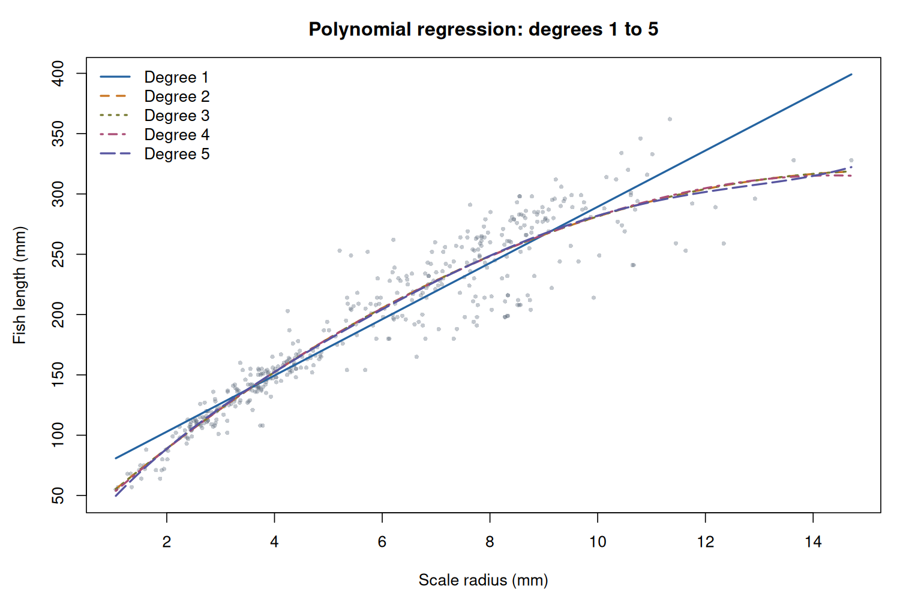
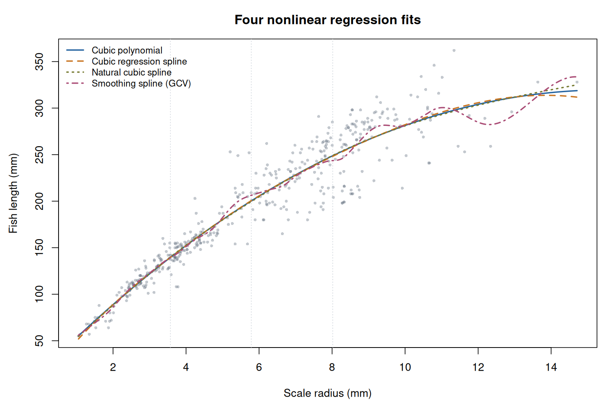
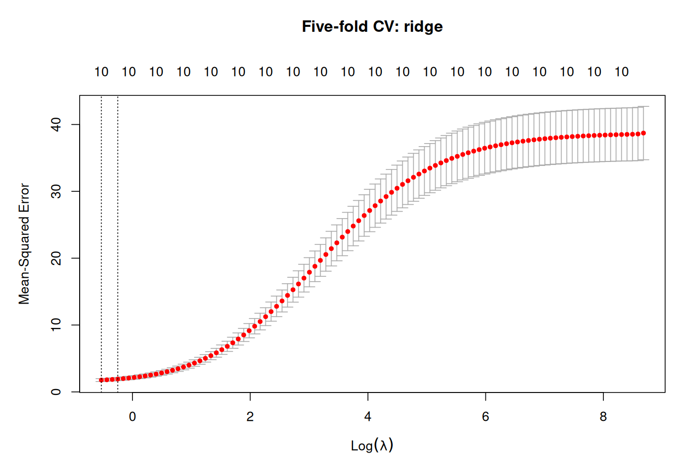
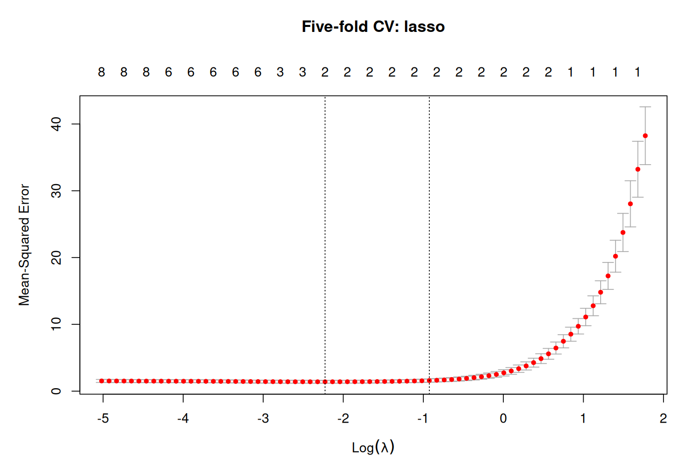
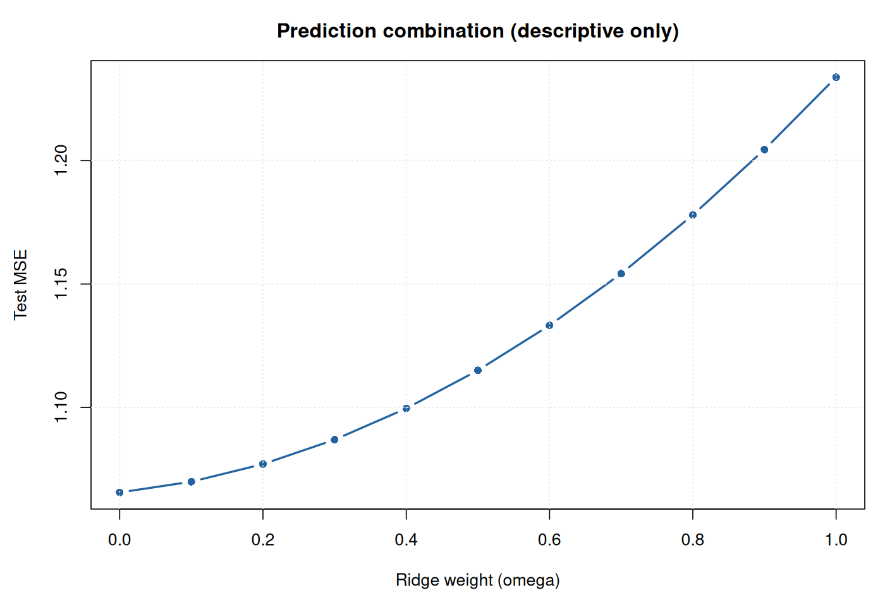
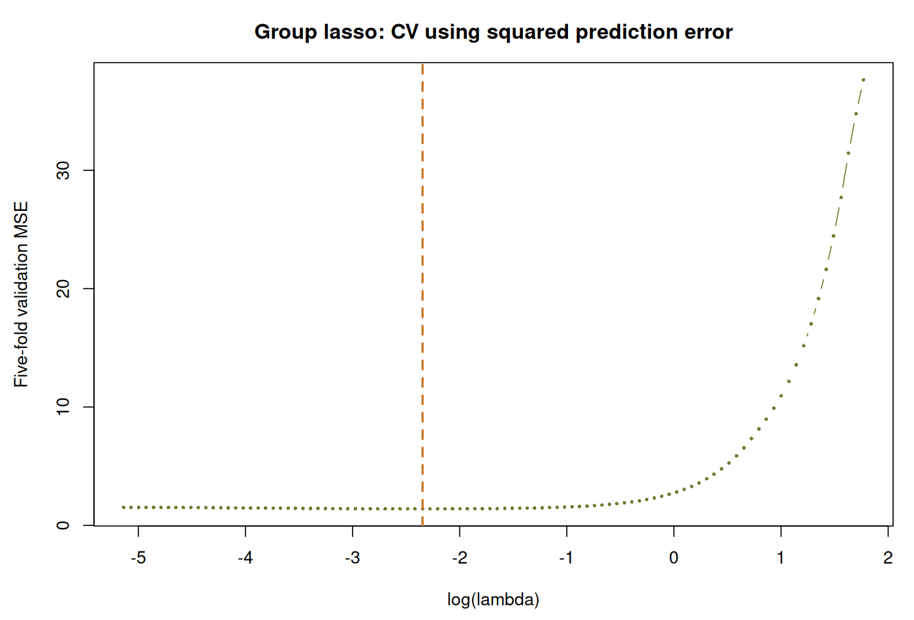

# 高维数据分析第二次作业：答案整理

计算使用所给 CSV 的原始行序，随机种子为 2026。第 1–6、8–9 题模型均含截距，第 7 题按题目定义求解。第 8、9 题采用所给训练/测试划分及五折编号；MSE 为平均平方预测误差。源代码见 [hw2_solution.R](hw2_solution.R)，完整讲解见 [HW2_逐题讲解与代码教学.md](HW2_逐题讲解与代码教学.md)。

## 第 1 题

职称 Asst、Assoc、Prof 的样本数分别为 18、14、20，学位 Masters、PhD 的样本数分别为 34、18。含截距时分别需要 2 个、1 个虚拟变量。

令 $D_A=I(rank=Assoc)$、$D_P=I(rank=Prof)$、$D_D=I(degree=PhD)$。主效应模型为

$$
salary_i=\beta_0+\beta_1D_{A,i}+\beta_2D_{P,i}+\beta_3D_{D,i}+\varepsilon_i.
$$

| 参数 | 估计值 |
| --- | --- |
| (Intercept) | 17536.787712 |
| rankAssoc | 4968.348169 |
| rankProf | 11861.298464 |
| degreePhD | 1043.455297 |

拟合式为

$$
\widehat{salary}=17536.787712+4968.348169D_A+11861.298464D_P+1043.455297D_D.
$$

截距为 Asst、Masters 教师的模型预测年薪。同学位下，Assoc 与 Prof 相比 Asst 的预测年薪分别高约 4968.35、11861.30；同职称下，PhD 相比 Masters 高约 1043.46。改变参照类别只改变参数表达，不改变设计矩阵的列空间，所以拟合值及 RSS 不变。

## 第 2 题

使用原始幂基底 $1,Scale,\ldots,Scale^d$，各阶系数如下：

| 阶数 | β0 | β1 | β2 | β3 | β4 | β5 |
| --- | --- | --- | --- | --- | --- | --- |
| 1 | 56.298601 | 23.306834 | — | — | — | — |
| 2 | 15.323415 | 39.312590 | -1.271043 | — | — | — |
| 3 | 15.218660 | 39.373383 | -1.280816 | 0.000463 | — | — |
| 4 | 11.059775 | 42.763646 | -2.165321 | 0.090412 | -0.003081 | — |
| 5 | -6.631036 | 61.915806 | -9.265923 | 1.243724 | -0.087296 | 0.002253 |

| 阶数 | RSS | 调整R² | BIC |
| --- | --- | --- | --- |
| 1 | 232405.746009 | 0.880787 | 2765.463129 |
| 2 | 189849.057629 | 0.902393 | 2682.757496 |
| 3 | 189848.974147 | 0.902169 | 2688.841802 |
| 4 | 189796.774557 | 0.901970 | 2694.805581 |
| 5 | 189468.525005 | 0.901914 | 2700.130182 |

表中 BIC 为 $n\log(RSS/n)+(d+1)\log n$，省略公共常数。BIC 选择二阶模型：

$$
\widehat{Length}=15.323415+39.312590Scale-1.271043Scale^2.
$$

二阶已经刻画主要弯曲趋势；再增加阶数时曲线主体变化很小，RSS 改善不足以抵消复杂度惩罚。由于低阶模型嵌套于高阶模型，训练 RSS 随阶数增加只能下降或不变，因此不能单凭训练 RSS 选模型。

## 第 3 题

两个回归样条的内部结点为 $(3.571405,5.786000,8.018190)$，边界结点为 $(1.054230,14.709700)$。三次多项式用原始幂基底，回归样条使用 `splines::bs`，自然三次样条使用 `splines::ns`，平滑样条使用 `smooth.spline(cv=FALSE)` 的 GCV。

| 模型 | RSS | 设计矩阵列数（含截距） | 有效自由度 |
| --- | --- | --- | --- |
| Cubic polynomial | 189848.974147 | 4.000000 | 4.000000 |
| Cubic regression spline | 189662.808879 | 7.000000 | 7.000000 |
| Natural cubic spline | 190131.115389 | 5.000000 | 5.000000 |
| Smoothing spline (GCV) | 175888.744519 | — | 18.222135 |

三次回归样条最终设计矩阵含截距 7 列，自然三次样条含截距 5 列。平滑样条的有效自由度约 18.222135，`spar=0.753864`，软件尺度的 $\lambda\approx0.000047$。

三次多项式由一条全局曲线控制；三次回归样条允许结点间局部变化，并保持二阶连续；自然三次样条附加自然边界约束、边界外线性，减少边界不稳定；平滑样条通过曲率惩罚控制灵活性，本次有效自由度较大，训练 RSS 最小。RSS 最小不能说明泛化误差最小，应结合交叉验证等评价。所有 RSS 均在原始 439 条观测上重新计算。

## 第 4 题

对九个自变量使用 $z_{ij}=(x_{ij}-\bar x_j)/s_j$，其中 $s_j$ 为样本标准差。变量单位和尺度不同，标准化可以避免数值尺度较大的变量主导 PCA。载荷取 `prcomp()$rotation` 的单位方向向量，前三个载荷如下：

| 变量 | PC1 | PC2 | PC3 |
| --- | --- | --- | --- |
| Ht | -0.308158 | 0.233999 | -0.447307 |
| Wt | -0.374454 | 0.435332 | -0.229319 |
| BMI | -0.302020 | 0.472037 | 0.036580 |
| RCC | -0.434441 | -0.245059 | 0.047103 |
| WCC | -0.112500 | 0.162510 | 0.744670 |
| Hc | -0.448447 | -0.254465 | 0.042347 |
| Hg | -0.452353 | -0.225034 | 0.052674 |
| Ferr | -0.209822 | 0.058101 | 0.408332 |
| SSF | 0.149861 | 0.572433 | 0.133927 |

| PC | 特征值 | 解释方差（%） | 累计（%） |
| --- | --- | --- | --- |
| PC1 | 3.989226 | 44.324731 | 44.324731 |
| PC2 | 1.924261 | 21.380673 | 65.705405 |
| PC3 | 1.039059 | 11.545105 | 77.250509 |

主成分得分 $t_k=Zv_k$。用前三个得分拟合得到

$$
\widehat{Bfat}=13.507426+1.343100PC1+3.148162PC2+0.904357PC3,
\qquad R^2=0.707764.
$$

前三个主成分累计解释 X 总方差约 77.2505%；回归解释 Y 样本变异约 70.7764%。前者是无监督的自变量信息保留比例，后者衡量对因变量的解释程度，二者并不相同。主成分整体符号翻转不会改变最终预测。

## 第 5 题

$A=sex$ 有 2 类，$B=rank$ 有 3 类，$C=degree$ 有 2 类，总样本数 52。交叉列联表如下：

| 性别 | 职称 | 硕士 | 博士 |
| --- | --- | --- | --- |
| Female | Assoc | 0 | 2 |
| Female | Asst | 7 | 1 |
| Female | Prof | 3 | 1 |
| Male | Assoc | 5 | 7 |
| Male | Asst | 7 | 3 |
| Male | Prof | 12 | 4 |

空单元格为 Female–Assoc–Masters。各模型按实际秩 $q$ 计算：

$$
R^2_{adj}=1-\frac{RSS/(n-q)}{TSS/(n-1)},\quad
AIC=n\log(RSS/n)+2q,\quad BIC=n\log(RSS/n)+q\log n.
$$

| 模型 | 名义列数 | q | RSS | 调整R² | AIC | BIC |
| --- | --- | --- | --- | --- | --- | --- |
| M0 | 1 | 1 | 1785729857.769230 | 0.000000 | 904.296165 | 906.247409 |
| M1 | 5 | 5 | 421015671.088314 | 0.744168 | 837.160719 | 846.916937 |
| M2 | 7 | 7 | 414843941.973153 | 0.736715 | 840.392801 | 854.051507 |
| M3 | 7 | 7 | 393947685.746976 | 0.749977 | 837.705218 | 851.363924 |
| M4 | 6 | 6 | 414047864.429042 | 0.742933 | 838.292918 | 850.000380 |
| M5 | 10 | 10 | 378910403.716710 | 0.742343 | 841.681464 | 861.193901 |
| M6 | 12 | 11 | 361677226.716667 | 0.748063 | 841.260989 | 862.724670 |

M6 名义列数 12、实际秩 11，完整系数不能全部独立识别；在已观测单元格上的拟合值仍唯一，未观测单元格的均值不能由全交互模型唯一识别。M0–M5 本次均满列秩。

调整 $R^2$ 选择 **M3**；AIC 和 BIC 选择 **M1**；无并列最佳。选择不同源于复杂度惩罚方式不同。

## 第 6 题

用 $n\log(RSS/n)+q\log n$ 作为统一 BIC，Sex 为完整分类因子项。

前向路径如下；双向接受路径与其相同，没有发生被接受的删除：

| 操作 | RSS | BIC |
| --- | --- | --- |
| 起始模型 | 7701.103061 | 740.760201 |
| + SSF | 559.088905 | 216.260778 |
| + Sex | 243.996979 | 54.080208 |

后向路径：

| 操作 | RSS | BIC |
| --- | --- | --- |
| 起始模型 | 237.222692 | 90.858734 |
| - WCC | 237.458573 | 85.751225 |
| - Hg | 237.826217 | 80.755460 |
| - RCC | 238.780748 | 76.256310 |
| - Ferr | 239.761938 | 71.776393 |
| - BMI | 241.158203 | 67.641070 |
| - Wt | 241.272714 | 62.428697 |
| - Ht | 241.909072 | 57.652504 |
| - Hc | 243.996979 | 54.080208 |

| 方法 | 最终模型 | BIC |
| --- | --- | --- |
| FS | Bfat ~ SSF + Sex | 54.080208 |
| BE | Bfat ~ SSF + Sex | 54.080208 |
| FS_BE | Bfat ~ SSF + Sex | 54.080208 |

三种方法均得到

$$
\widehat{Bfat}=1.130660+0.157912SSF+2.984386Sex,
\qquad BIC=54.080208.
$$

逐步选择只检查路径附近的增删操作，并不保证找到所有 $2^{10}$ 个变量子集中的全局最优模型。本次结果一致不构成这种保证。

## 第 7 题

$$
X^\top X=2I_2,\qquad X^\top Y=(-5,6)^\top.
$$

OLS 为

$$
\hat\beta^{OLS}=(X^\top X)^{-1}X^\top Y=(-5/2,3)^\top,
\quad\hat\beta_0^{OLS}=3-2(-5/2)+3=11.
$$

岭回归的一阶条件为 $(X^\top X+\lambda I)\hat\beta=X^\top Y$。取 $\lambda=5$：

$$
\hat\beta^{ridge}=(-5/7,6/7)^\top,
\quad\hat\beta_0^{ridge}=3+10/7+6/7=37/7.
$$

正交设计下，令 $a_j=(X^\top Y)_j$，lasso 分别最小化 $b^2-a_jb+5|b|$。若 $a_j>5$，解为 $(a_j-5)/2$；若 $a_j<-5$，解为 $(a_j+5)/2$；若 $|a_j|\le5$，解为 0。因此

$$
\hat\beta_j^{lasso}=\frac{\operatorname{sign}(a_j)(|a_j|-5)_+}{2},
\quad \hat\beta^{lasso}=(0,1/2)^\top,
\quad\hat\beta_0^{lasso}=3+1/2=7/2.
$$

| 方法 | 截距 | β₁ | β₂ |
| --- | --- | --- | --- |
| OLS | 11.000000 | -2.500000 | 3.000000 |
| Ridge | 5.285714 | -0.714286 | 0.857143 |
| Lasso | 3.500000 | 0.000000 | 0.500000 |

岭回归将两个非零斜率均向零收缩，但不作本题中的变量删除；lasso 将第一个斜率精确压为零，体现变量选择能力。

## 第 8 题

使用 R 4.3.3、glmnet 4.1-8，默认 lambda 网格，`standardize=TRUE`、不手动标准化 Y、不惩罚截距，使用给定的 150/52 划分与五折编号，以验证 MSE 最小的 `lambda.min` 选参数。

| 方法 | λ.min | 最小CV MSE | 测试MSE | 非零斜率数 |
| --- | --- | --- | --- | --- |
| Ridge | 0.588932 | 1.764878 | 1.233777 | 10 |
| Lasso | 0.107818 | 1.402127 | 1.065561 | 2 |

原始量纲系数：

| 参数 | Ridge | Lasso |
| --- | --- | --- |
| (Intercept) | 0.996823 | 1.240762 |
| Ht | 0.001249 | 0.000000 |
| Wt | 0.003735 | 0.000000 |
| BMI | 0.125669 | 0.000000 |
| RCC | -0.189196 | 0.000000 |
| WCC | 0.081965 | 0.000000 |
| Hc | 0.008630 | 0.000000 |
| Hg | -0.143355 | 0.000000 |
| Ferr | 0.000763 | 0.000000 |
| SSF | 0.135339 | 0.157284 |
| Sex | 3.487392 | 2.805541 |

Lasso 非零斜率 2 个，为 SSF、Sex；本次测试 MSE 小于岭回归。

组合预测为 $\hat y^{combo}(\omega)=\omega\hat y^{ridge}+(1-\omega)\hat y^{lasso}$，测试结果为：

| ω | 测试MSE |
| --- | --- |
| 0.000000 | 1.065561 |
| 0.100000 | 1.069914 |
| 0.200000 | 1.077038 |
| 0.300000 | 1.086932 |
| 0.400000 | 1.099597 |
| 0.500000 | 1.115034 |
| 0.600000 | 1.133241 |
| 0.700000 | 1.154218 |
| 0.800000 | 1.177967 |
| 0.900000 | 1.204486 |
| 1.000000 | 1.233777 |

在给定权重网格中，测试 MSE 随岭回归权重增加而上升，描述性最小值位于 $\omega=0$，即纯 lasso。若据测试误差来选择权重，测试集就参与了调参，其最小误差不能再作为独立测试验证成绩。应在训练集内部的验证集或折外预测上选择权重，固定后再用测试集作最终评价。

## 第 9 题

使用 `gglasso` **1.6**。变量按题意顺序分为五组，权重分别为 $\sqrt3,\sqrt3,\sqrt2,1,1$。每列包括 Sex 均按完整训练集均值和样本标准差标准化，测试集应用同一变换，Y 保留原量纲。五折编号与第 8 题相同。

模型最小化

$$
\frac1{2n_{tr}}\|y-\beta_0\mathbf1-Z\beta\|_2^2
+\lambda\sum_{g=1}^5\sqrt{p_g}\|\beta_g\|_2.
$$

`loss="ls"`、`pred.loss="L2"`。已用手工折外平方误差核对该版本的 CV 评分，确认为 MSE。

| λ.min | 最小CV MSE | 测试MSE | 保留组 |
| --- | --- | --- | --- |
| 0.095661 | 1.394610 | 1.065165 | 4,5 |

| 参数 | 组 | 标准化量纲系数 |
| --- | --- | --- |
| (Intercept) | — | 13.583667 |
| Ht | 1 | 0.000000 |
| Wt | 1 | 0.000000 |
| BMI | 1 | 0.000000 |
| RCC | 2 | 0.000000 |
| Hc | 2 | 0.000000 |
| Hg | 2 | 0.000000 |
| WCC | 3 | 0.000000 |
| Ferr | 3 | 0.000000 |
| SSF | 4 | 5.093761 |
| Sex | 5 | 1.415376 |

保留第 **4、5 组**（SSF、Sex）；其余组删除。标准化量纲预测式为

$$
\widehat{Bfat}=13.583667+5.093761z_{SSF}+1.415376z_{Sex}.
$$

| 方法 | 测试MSE |
| --- | --- |
| Ridge | 1.233777 |
| Lasso | 1.065561 |
| Group lasso | 1.065165 |

Group lasso 测试 MSE 约 1.065165，与普通 lasso 的 1.065561 极接近，均低于本次岭回归的 1.233777。这一微小差异不能证明稳定优越性。

普通 lasso 的 $L_1$ 惩罚对单个系数进行选择；group lasso 的组 $L_2$ 范数惩罚使整组系数归零，以组为选择单位。本次保留组都是单变量组，因此最终变量集合与普通 lasso 一致；一般情况下，group lasso 可保留包含多个变量的完整组。

## 代码与复现说明

完整源代码在 [hw2_solution.R](hw2_solution.R)。具体软件环境见 `results/sessionInfo.txt`，全部结果表与逐步选择路径在 `results/`，图像在 `figures/`。题目 PDF 实际只有 9 道题，合计 130 分；额外上传的 lakemary.csv、turkey.csv 在这 9 题中未使用。
