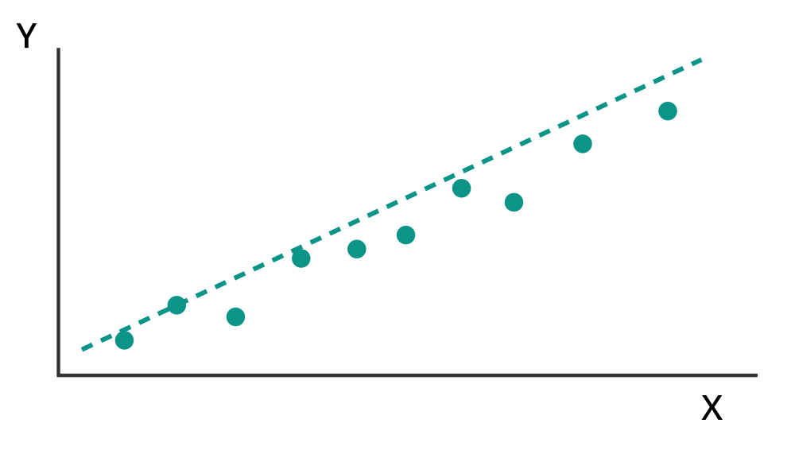
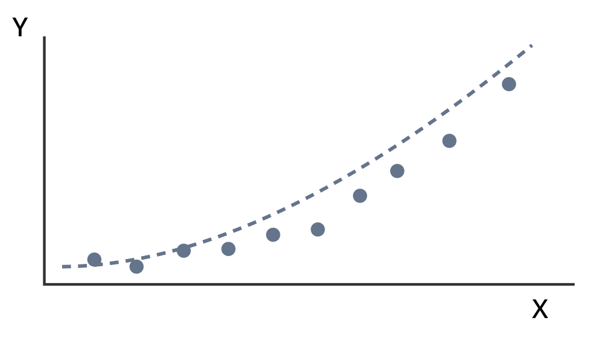
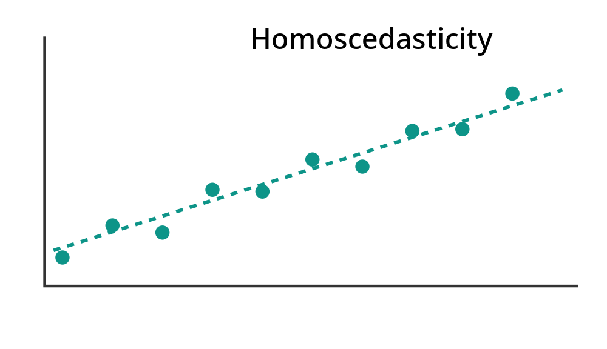
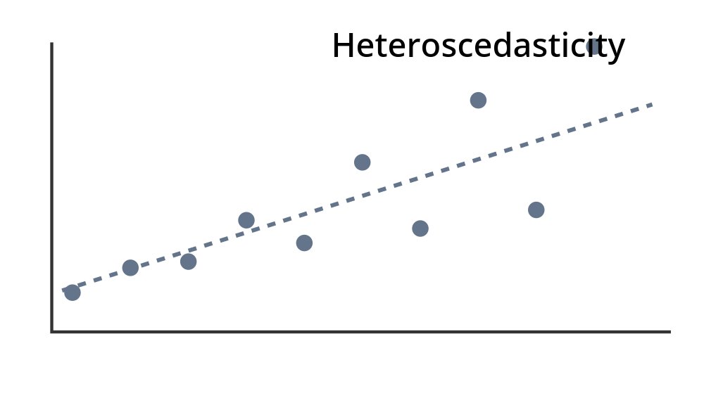
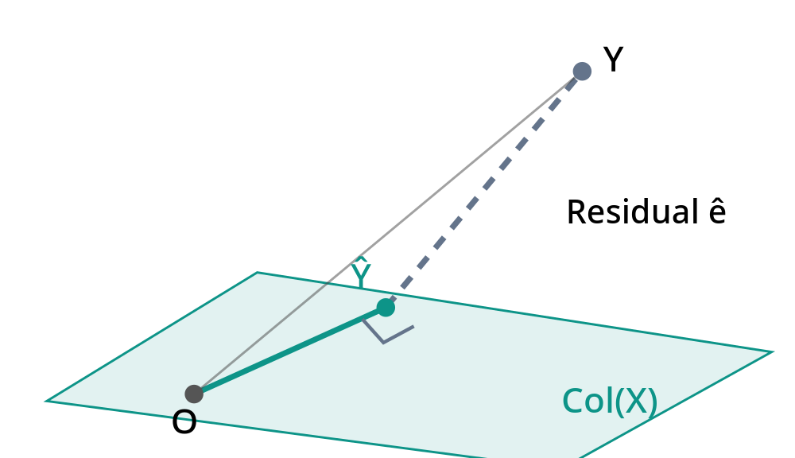
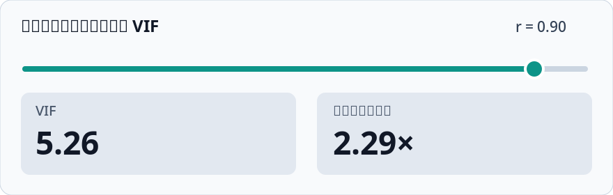

# 高维数据分析 Lecture 1–3：完整讲解与期中考试题解

## 高维数据分析 Lecture 1–2：系统讲解与期中考试复习

这两讲是整个回归分析的基础。你已经学过概率论、微积分和线性代数，因此我们不需要从零介绍这些数学工具，而是重点理解：**回归模型到底在研究什么、为什么这样建立模型、参数如何估计、估计结果为什么具有某些统计性质，以及考试中如何运用这些性质。**

我已经对照了两份讲义和六份考试资料。下面以袁洪松老师的 Lecture 1、Lecture 2 为主，必要时补充讲义中省略的推导，再把模拟题中的对应考点融入讲解。

### 一、先建立两讲的知识主线

这两讲实际上回答了四个递进的问题。

**Lecture 1 · 建立研究问题**

**1. 如何描述 $X$ 与 $Y$ 的关系？**

散点图 → 条件分布 → 均值函数、方差函数

**Lecture 2 · 建立统计模型**

**2. 如何用数学模型描述这种关系？**

简单线性回归 → 正态误差假设

**3. 如何从样本中估计未知参数？**

极大似然估计（MLE）→ 最小二乘估计（OLS）→ 参数抽样分布

**4. 如何判断结果是否可靠、有用？**

标准误 → 置信区间 → 假设检验 → 预测 → $R^2$

这条主线也对应考试的主要计算题：

| 考点 | 主要考查什么 |
|---|---|
| 回归基本概念 | 判断模型设定、随机性、线性关系 |
| OLS 估计 | 根据样本统计量求截距与斜率 |
| 参数估计性质 | 证明无偏性、计算方差与协方差 |
| 区间估计与检验 | 求标准误、置信区间、t 统计量 |
| 模型拟合评价 | 计算 RSS、$R^2$，证明相关关系 |
| 综合推导 | 数据变换、比较估计量的方差 |

六份考试资料中，2023 年的两份样卷、2024 年的样卷及正式考试答案、2026 年的两份样卷均有与这些内容直接对应的题目。部分后续讲次的考点也会用到前两讲的方法，但我们会区分基础内容与拓展内容。

---

## Lecture 1：散点图与回归

讲义对应 Weisberg 教材 Chapter 1，分为三个部分：回归基本概念、散点图、均值函数与方差函数。

### 1. 回归到底在研究什么？

回归（Regression）研究的是：**当自变量 $X$ 发生变化时，因变量 $Y$ 的分布、特别是其平均水平，会怎样变化？**

例如研究学生学习时间和考试成绩：

- $X$：学习时间；
- $Y$：考试成绩。

我们可能发现学习时间越长，成绩通常越高。但学习时间相同的两名学生，成绩未必一样。

这说明我们不是在寻找一个必然成立的函数关系：

$$Y=f(X)$$

而是在研究一个包含随机性的关系。最基本的研究对象是条件分布（Conditional Distribution）：

$$Y\mid X=x$$

也就是：给定学习时间为 $x$，成绩 $Y$ 服从怎样的概率分布？

#### 1.1 两种不同的分类方式

讲义列出了四个英文术语，它们其实来自两个不同的分类维度。

| 分类依据 | 类型 | 含义 |
|---|---|---|
| 自变量 $X$ 的维度 | Simple regression | 一个自变量 |
| 自变量 $X$ 的维度 | Multiple regression | 多个自变量 |
| 因变量 $Y$ 的维度 | Univariate regression | 一个因变量 |
| 因变量 $Y$ 的维度 | Multivariate regression | 多个因变量 |

例如，同时利用学习时间、出勤率和作业成绩预测期末分数，属于多个自变量、单个因变量的回归。

本章所研究的简单线性回归（Simple Linear Regression），就是一个自变量和一个因变量，并且假设其条件均值为线性函数。

### 2. 散点图：为什么先看数据，再选择模型？

假设观测了 $n$ 名学生，得到样本：

$$ (x_1,y_1),\ldots,(x_n,y_n) $$

散点图（Scatterplot）就是将这些观测点画在二维平面中。

| 近似线性关系 | 明显非线性关系 |
|---|---|
|  |  |
| 适合考虑线性均值函数 | 可能需要曲线模型 |

*示意图：散点形状可以帮助判断均值函数的合理形式，并非真实教材数据。*

为什么散点图重要？因为回归模型不是仅仅把数据代入公式，而是需要先确定函数形式是否合理。

观察散点图时，主要关注关系方向、是否近似直线、点在不同 $X$ 位置的分散程度，以及是否存在离群点（Outlier）。

例如，若 $X$ 增大时，$Y$ 先增长很快，后来逐渐稳定，那么直接假设线性关系可能不合适。

讲义第 2 页列出了身高遗传、沸点数据、鱼类生长、天气预测、火鸡生长和燃料消耗等实例，但没有展开它们的原始数据与图形。因此这里只讲这些例子所对应的分析思想，不把未提供的数据特征当成已知事实。

### 3. 均值函数：回归分析最核心的概念

这一部分是 Lecture 1 的重点，也是理解 Lecture 2 的前提。

#### 3.1 为什么研究条件期望？

现实中的 $Y$ 存在随机性，同样的 $X$ 并不总是产生相同的 $Y$。

因此，与其要求 $X$ 精确决定 $Y$，我们不如研究：

> 当 $X=x$ 时，$Y$ 平均会取什么值？

数学上定义均值函数（Mean Function）：

$$\boxed{m(x)=E(Y\mid X=x)}$$

注意，这里研究的是**条件期望**，而不是 $Y$ 的整体期望 $E(Y)$。

例如：

$$E(Y\mid X=2)=70,\qquad E(Y\mid X=4)=80$$

它表示学习 2 小时和 4 小时的学生群体，其平均成绩分别为 70 和 80。

不能将其理解为每个学习 4 小时的学生都一定考 80 分。

#### 3.2 线性均值函数

最简单的假设是：

$$\boxed{E(Y\mid X=x)=\beta_0^*+\beta_1^*x}$$

其中：

$\beta_0^*$：真实截距（Intercept），即 $x=0$ 时的条件均值。

$\beta_1^*$：真实斜率（Slope），即 $x$ 每增加一个单位，条件均值改变多少。

因为：

$$m(x+1)-m(x)=\beta_1^*$$

特别要注意，$\beta_1^*$ 不是说每个人的 $Y$ 都增加相同数量，而是**条件均值**发生相同的变化。

这里的星号 $^*$ 代表真实参数（True Parameter），它的数值未知，但在经典统计模型中被视为一个固定常数。

#### 3.3 线性模型不等于所有关系都必须是直线

Lecture 1 还给出一个火鸡生长的非线性均值函数：

$$E(Y\mid X=x)=\beta_0^*+\beta_1^*(1-e^{-\beta_2^*x})$$

当参数满足 $\beta_1^*>0,\beta_2^*>0$ 时，它描述的是一种逐渐趋于饱和的增长关系。

随着 $x$ 增加，均值继续增加，但增加速度逐渐减慢。

相比之下，线性模型认为每增加一个单位 $x$，均值的变化量始终为 $\beta_1^*$。

讲义还提到了平滑子（Smoother）和无参估计（Nonparametric Estimation）。它们不预先指定某个有限参数的直线或曲线族，而是让数据更灵活地决定估计函数的形状。

所以这些内容之间是并列关系：它们都是研究均值函数的方法，只是对函数形式的假设不同。

### 4. 方差函数：为什么均值还不够？

假设两组学生的平均成绩都是 80 分。

第一组学生普遍在 78–82 分之间，第二组却有人 50 分、有人 100 分。

虽然均值一样，但分布的离散程度明显不同。

这就需要引入方差函数（Variance Function）：

$$\boxed{v(x)=\operatorname{Var}(Y\mid X=x)}$$

它描述给定 $X=x$ 后，$Y$ 围绕其条件均值的波动程度。

Lecture 1 中最常用的假设是：

$$\operatorname{Var}(Y\mid X=x)=\sigma^{*2}$$

即对所有 $x$，条件方差都相同。

这叫同方差性（Homoscedasticity）。若方差随 $x$ 变化，则叫异方差性（Heteroscedasticity）。

| 近似同方差 | 方差随 X 增大 |
|---|---|
|  |  |

#### 4.1 知道均值和方差，是否就确定了整个分布？

不一定。

例如，正态分布和某些离散分布可以具有相同的均值与方差，但具体概率分布仍然不同。

不过，对于正态分布（Normal Distribution），只要确定均值 $\mu$ 和方差 $\sigma^2$，就完全确定了分布：

$$Y\sim N(\mu,\sigma^2)$$

这正是 Lecture 1 最后一道思考题与 Lecture 2 之间的联系。

**Lecture 1 只规定均值函数和方差函数还不够；Lecture 2 进一步假设条件分布是正态分布，从而可以建立一个能够进行参数估计和统计推断的完整模型。**

---

---

## Lecture 2：简单线性回归

这一讲是前两讲的核心，讲义依次介绍模型、最小二乘估计、估计量的性质、区间估计、假设检验、预测和可决系数。

其中最值得掌握的逻辑是：

**估计参数 → 研究估计量的随机性 → 衡量估计误差 → 利用抽样分布进行统计推断。**

### 1. 从均值函数到简单线性回归模型

#### 1.1 模型的完整假设

Lecture 1 中，我们只是假设：

$$E(Y\mid X=x)=\beta_0^*+\beta_1^*x$$

现在为了能够进行统计推断，进一步假设：

$$Y\mid X=x\sim N(\beta_0^*+\beta_1^*x,\sigma^{*2})$$

也就是说，给定 $X=x$，不仅知道 $Y$ 的条件均值，还假设其条件分布为正态分布，并具有相同的方差。

对于 $n$ 个样本，模型可以写成：

$$\boxed{y_i=\beta_0^*+\beta_1^*x_i+e_i,\qquad i=1,\ldots,n}$$

其中：

$$e_i\overset{\mathrm{i.i.d.}}{\sim}N(0,\sigma^{*2})$$

这是简单线性回归模型（Simple Linear Regression Model）。

你可以把它理解为：

$$\underbrace{y_i}_{\text{实际观测}}=\underbrace{\beta_0^*+\beta_1^*x_i}_{\text{系统性部分}}+\underbrace{e_i}_{\text{随机误差}}$$

系统性部分描述条件均值，随机误差描述个体围绕条件均值的波动。

#### 1.2 这里最容易混淆的：哪些是随机的？

这是后面理解无偏性、方差、置信区间和检验的关键。

讲义采用固定设计（Fixed Design）的视角：将观测到的自变量 $x_1,\ldots,x_n$ 视为确定的数。

| 符号 | 含义 | 在重复抽样中是否随机 |
|---|---|---|
| $x_i$ | 第 $i$ 个自变量值 | 固定 |
| $Y_i$ | 第 $i$ 个因变量的随机变量 | 随机 |
| $y_i$ | 实际观察到的 $Y_i$ 数值 | 已观测后固定 |
| $e_i$ | 统计误差 | 随机 |
| $\beta_0^*,\beta_1^*,\sigma^{*2}$ | 真实但未知的参数 | 固定 |
| $\hat\beta_0,\hat\beta_1$ | 用样本计算出的估计量 | 抽样之前随机 |
| $\hat e_i$ | 使用估计参数算出的残差 | 抽样之前随机 |

例如，如果我们有一套固定的学习时间：

$$x=(1,2,3,4,5)$$

真实模型为：

$$Y_i=60+5x_i+e_i$$

每次重复实验，学习时间都不变，但随机误差 $e_i$ 改变，因此观察到的成绩 $Y_i$ 改变，最后计算出的回归直线也会改变。

这就解释了两个重要区别：

- $\beta_1^*$ 是真实斜率，不会随着重复抽样改变。
- $\hat\beta_1$ 是估计量，每次抽样可能不同，因此有自己的概率分布。

**所谓估计量的抽样分布（Sampling Distribution），就是在相同模型下重复抽样，每次重新计算估计量，得到的概率分布。**

如果原始数据的 $X$ 本来是随机的，经典回归理论也常常通过给定整组 $X$ 的值，研究 $Y\mid X$。这与讲义中把 $x_i$ 固定的处理是一致的。

---

### 2. 为什么要使用最小二乘法（OLS）？

我们已经建立模型：

$$y_i=\beta_0^*+\beta_1^*x_i+e_i$$

现在的问题是：真实参数 $\beta_0^*,\beta_1^*$ 不知道，如何利用样本估计？

直观上，我们希望找到一条直线，让所有观测点尽量接近这条直线。

但“接近”需要一个可以优化的数学标准。

#### 2.1 从极大似然估计推导 OLS

讲义并非直接给出 OLS，而是从极大似然估计（Maximum Likelihood Estimation, MLE）出发。

根据正态分布假设：

$$Y_i\sim N(\beta_0+\beta_1x_i,\sigma^2)$$

这里的 $\beta_0,\beta_1,\sigma$ 是我们在优化时尝试的候选参数，不是已经知道的真实参数。

由于样本相互独立，似然函数是密度函数的乘积：

$$L(\beta_0,\beta_1,\sigma)=\prod_{i=1}^n\frac1{\sqrt{2\pi}\sigma}\exp\left(-\frac{(y_i-\beta_0-\beta_1x_i)^2}{2\sigma^2}\right)$$

取对数：

$$\ell(\beta_0,\beta_1,\sigma)=-n\log\sigma-\frac n2\log(2\pi)-\frac1{2\sigma^2}\sum_{i=1}^n(y_i-\beta_0-\beta_1x_i)^2$$

先对 $\sigma$ 求偏导：

$$\frac{\partial\ell}{\partial\sigma}=-\frac n\sigma+\frac1{\sigma^3}\sum_{i=1}^n(y_i-\beta_0-\beta_1x_i)^2$$

令其等于 0：

$$\sigma^2=\frac1n\sum_{i=1}^n(y_i-\beta_0-\beta_1x_i)^2$$

将其代回对数似然函数，就会发现：在非退化情形下，最大化似然等价于最小化残差平方和。

因此，我们得到：

$$\boxed{\min_{\beta_0,\beta_1}\sum_{i=1}^n(y_i-\beta_0-\beta_1x_i)^2}$$

这就是最小二乘法（Ordinary Least Squares, OLS）。

其核心思想是：**选择回归系数，让预测值与实际观测值之间的平方距离之和最小。**

为什么是平方，而不是绝对值？

在这份讲义的推导中，平方形式直接来自正态分布的对数似然函数。除此之外，平方损失还具有可导、凸优化和便于矩阵计算等优点。

不过需要注意：即使误差不服从正态分布，我们仍然可以定义并使用 OLS。正态性主要保证本讲后续的一些精确抽样分布结论。

### 3. OLS 公式怎么推导？为什么回归线一定经过样本中心？

这是重要的考试计算与证明基础。

我们要最小化：

$$f(\beta_0,\beta_1)=\sum_{i=1}^n(y_i-\beta_0-\beta_1x_i)^2$$

#### 第一步：对截距求偏导

$$\frac{\partial f}{\partial\beta_0}=-2\sum_{i=1}^n(y_i-\beta_0-\beta_1x_i)=0$$

整理得到：

$$\sum_i y_i=n\beta_0+\beta_1\sum_i x_i$$

两边除以 $n$：

$$\bar y=\beta_0+\beta_1\bar x$$

因此在最小二乘解处：

$$\boxed{\hat\beta_0=\bar y-\hat\beta_1\bar x}$$

这一公式有一个非常重要的几何含义。

由于拟合回归线是：

$$\hat y=\hat\beta_0+\hat\beta_1x$$

当 $x=\bar x$ 时：

$$\hat y=\bar y-\hat\beta_1\bar x+\hat\beta_1\bar x=\bar y$$

所以：

$$\boxed{\text{带截距的简单 OLS 回归线一定经过 }(\bar x,\bar y)}$$

这不是概率意义上的结论，而是最小二乘优化本身的代数性质。

#### 第二步：对斜率求偏导

$$\frac{\partial f}{\partial\beta_1}=-2\sum_{i=1}^n x_i(y_i-\beta_0-\beta_1x_i)=0$$

将第一步的关系 $\beta_0=\bar y-\beta_1\bar x$ 代入：

$$\sum_{i=1}^n x_i\left[(y_i-\bar y)-\beta_1(x_i-\bar x)\right]=0$$

由于：

$$\sum_i(y_i-\bar y)=0,\qquad\sum_i(x_i-\bar x)=0$$

可以将上式中的 $x_i$ 换成 $x_i-\bar x$，得到：

$$\sum_{i=1}^n(x_i-\bar x)(y_i-\bar y)-\beta_1\sum_{i=1}^n(x_i-\bar x)^2=0$$

定义三个常用统计量：

$$\begin{aligned}SXX&=\sum_{i=1}^n(x_i-\bar x)^2\\SXY&=\sum_{i=1}^n(x_i-\bar x)(y_i-\bar y)\\SYY&=\sum_{i=1}^n(y_i-\bar y)^2\end{aligned}$$

最终：

$$\boxed{\hat\beta_1=\frac{SXY}{SXX},\qquad\hat\beta_0=\bar y-\hat\beta_1\bar x}$$

这里要求 $SXX>0$，也就是至少有两个不同的 $x_i$，否则无法识别斜率。

#### 3.1 怎样直观理解斜率公式？

注意：

$$\hat\beta_1=\frac{\sum_i(x_i-\bar x)(y_i-\bar y)}{\sum_i(x_i-\bar x)^2}$$

分子衡量 $X,Y$ 是否一起高于或低于各自均值，分母衡量 $X$ 自身的变化幅度。

所以：

- $SXY>0$，斜率为正；
- $SXY<0$，斜率为负；
- $SXY=0$，斜率为 0。

但样本斜率为 0，并不等于 $X,Y$ 完全没有关系，它们可能存在非线性关系。

#### 3.2 为什么残差之和一定为 0？

讲义定义拟合值（Fitted Value）：

$$\hat y_i=\hat\beta_0+\hat\beta_1x_i$$

残差（Residual）：

$$\hat e_i=y_i-\hat y_i$$

注意，残差 $\hat e_i$ 不是真实误差 $e_i$。

根据前面的两个一阶条件：

$$\boxed{\sum_{i=1}^n\hat e_i=0}$$

$$\boxed{\sum_{i=1}^n x_i\hat e_i=0}$$

第二个公式表示残差向量与自变量向量正交（Orthogonal）。

这就是最小二乘法的几何本质：把观测向量 $Y$ 投影到由常数项和自变量所张成的空间，而残差向量垂直于这个空间。

因此考试中遇到“所有残差能否均为正数”，直接利用残差之和为 0 即可判断。

---

### 4. 估计量的性质：为什么需要研究无偏性与方差？

我们现在得到了 $\hat\beta_0,\hat\beta_1$。

但这两个估计量会因抽样不同而改变。于是产生两个问题：

1. 估计量平均来看是否等于真实参数？
2. 估计量在重复抽样中波动多大？

第一个问题对应无偏性（Unbiasedness），第二个问题对应估计量的方差（Variance）。

#### 4.1 斜率估计量的分布

首先，将斜率写成：

$$\hat\beta_1=\frac{\sum_i(x_i-\bar x)Y_i}{SXX}$$

代入真实模型：

$$Y_i=\beta_0^*+\beta_1^*x_i+e_i$$

得到：

$$\hat\beta_1=\frac{\sum_i(x_i-\bar x)(\beta_0^*+\beta_1^*x_i+e_i)}{SXX}$$

展开：

$$\hat\beta_1=\beta_0^*\frac{\sum_i(x_i-\bar x)}{SXX}+\beta_1^*\frac{\sum_i(x_i-\bar x)x_i}{SXX}+\frac{\sum_i(x_i-\bar x)e_i}{SXX}$$

根据：

$$\sum_i(x_i-\bar x)=0$$

以及：

$$\sum_i(x_i-\bar x)x_i=SXX$$

得到最重要的表达式：

$$\boxed{\hat\beta_1=\beta_1^*+\frac{\sum_i(x_i-\bar x)e_i}{SXX}}$$

这个式子很值得记住。它告诉我们：

**估计值 = 真实参数 + 由随机误差引起的估计偏差。**

##### 先求期望

因为 $E(e_i)=0$：

$$E(\hat\beta_1)=\beta_1^*+\frac{\sum_i(x_i-\bar x)E(e_i)}{SXX}$$

所以：

$$\boxed{E(\hat\beta_1)=\beta_1^*}$$

即斜率的 OLS 估计量是无偏的。

##### 再求方差

因为 $e_i$ 相互独立、方差都为 $\sigma^{*2}$：

$$\begin{aligned}\operatorname{Var}(\hat\beta_1)&=\frac1{SXX^2}\operatorname{Var}\left(\sum_i(x_i-\bar x)e_i\right)\\&=\frac1{SXX^2}\sum_i(x_i-\bar x)^2\sigma^{*2}\\&=\frac{\sigma^{*2}}{SXX}\end{aligned}$$

这里使用了一个概率论性质：相互独立的随机变量，其线性组合的方差等于各项方差乘以对应系数平方后求和。

由于 $e_i$ 是独立正态随机变量，它们的线性组合仍然服从正态分布。

因此：

$$\boxed{\hat\beta_1\sim N\left(\beta_1^*,\frac{\sigma^{*2}}{SXX}\right)}$$

这是 Lecture 2 最重要的理论结论之一。

#### 4.2 斜率方差的直观含义

$$\operatorname{Var}(\hat\beta_1)=\frac{\sigma^{*2}}{SXX}$$

从公式可以得出两个结论。

第一，误差方差 $\sigma^{*2}$ 越大，估计斜率越不稳定。因为数据点围绕真实回归线波动得越厉害，回归线就越难估准。

第二，$SXX$ 越大，估计斜率越稳定。

这一点很直观：如果所有学生的学习时间都接近 3 小时，那么很难判断学习时间增加 1 小时究竟能提高多少分；如果学习时间从 1 到 10 小时都有充分的观测，那么更容易估计出斜率。

在其他条件相同的情况下，增加样本量通常也会提高 $SXX$，降低斜率估计的方差。

### 5. 截距估计量的分布及其与斜率的关系

根据：

$$\hat\beta_0=\bar Y-\hat\beta_1\bar x$$

以及：

$$\bar Y=\beta_0^*+\beta_1^*\bar x+\bar e$$

可得：

$$\hat\beta_0=\beta_0^*+\bar e-\bar x(\hat\beta_1-\beta_1^*)$$

这里 $\bar e=\frac1n\sum_i e_i$。

由于：

$$E(\bar e)=0,\qquad E(\hat\beta_1-\beta_1^*)=0$$

因此：

$$\boxed{E(\hat\beta_0)=\beta_0^*}$$

所以截距也是无偏估计量。

接下来计算方差。

首先：

$$\operatorname{Var}(\bar e)=\frac{\sigma^{*2}}n$$

同时：

$$\operatorname{Cov}(\bar e,\hat\beta_1-\beta_1^*)=\frac{\sigma^{*2}}{nSXX}\sum_i(x_i-\bar x)=0$$

因此：

$$\begin{aligned}\operatorname{Var}(\hat\beta_0)&=\operatorname{Var}\big(\bar e-\bar x(\hat\beta_1-\beta_1^*)\big)\\&=\frac{\sigma^{*2}}n+\bar x^2\frac{\sigma^{*2}}{SXX}\end{aligned}$$

于是：

$$\boxed{\hat\beta_0\sim N\left(\beta_0^*,\sigma^{*2}\left(\frac1n+\frac{\bar x^2}{SXX}\right)\right)}$$

此外，截距与斜率的协方差为：

$$\begin{aligned}\operatorname{Cov}(\hat\beta_0,\hat\beta_1)&=\operatorname{Cov}(\bar e-\bar x(\hat\beta_1-\beta_1^*),\hat\beta_1)\\&=-\bar x\operatorname{Var}(\hat\beta_1)\end{aligned}$$

所以：

$$\boxed{\operatorname{Cov}(\hat\beta_0,\hat\beta_1)=-\frac{\bar x\sigma^{*2}}{SXX}}$$

这也说明，截距和斜率估计量通常不是独立的。

一个有用的特殊情况是 $\bar x=0$。此时它们的协方差为 0，结合联合正态性可知二者独立。

这也是为什么在回归分析中，对自变量进行中心化（Centering）常常能够简化参数的解释和计算。

---

### 6. 误差方差 $\sigma^{*2}$ 应该怎样估计？

这是考试容易混淆的地方，因为讲义给出了两个不同的估计量。

#### 6.1 残差平方和 RSS

定义：

$$RSS=\sum_{i=1}^n\hat e_i^2=\sum_{i=1}^n(y_i-\hat y_i)^2$$

显然，RSS 衡量样本点与拟合回归线之间的偏离程度。

但是，RSS 本身不是对 $\sigma^{*2}$ 的无偏估计。

讲义的定理 2 指出，在简单线性正态回归中：

$$\boxed{\frac{RSS}{\sigma^{*2}}\sim\chi^2(n-2)}$$

并且 RSS 与 $\hat\beta_0,\hat\beta_1$ 独立。

为什么自由度是 $n-2$，而不是 $n$？

因为我们使用样本估计了两个参数：截距和斜率。

从几何角度看，原来的残差向量有 $n$ 个坐标，却必须满足：

$$\sum_i\hat e_i=0,\qquad\sum_i x_i\hat e_i=0$$

两个独立的线性约束使残差空间维度减少为 $n-2$。

这是残差自由度（Residual Degrees of Freedom）的来源。

#### 6.2 极大似然估计与无偏估计的区别

由前面的 MLE 推导，我们得到：

$$\boxed{\tilde\sigma^2=\frac{RSS}{n}}$$

但由于：

$$E\left(\frac{RSS}{\sigma^{*2}}\right)=n-2$$

所以：

$$E(RSS)=(n-2)\sigma^{*2}$$

进一步：

$$E(\tilde\sigma^2)=\frac{n-2}{n}\sigma^{*2}\ne\sigma^{*2}$$

因此 MLE 方差估计是有偏的，在该模型下平均偏小。

我们改用：

$$\boxed{\hat\sigma^2=\frac{RSS}{n-2}}$$

就有：

$$E(\hat\sigma^2)=\sigma^{*2}$$

所以这是一个无偏估计（Unbiased Estimator）。

| 估计量 | 公式 | 性质 |
|---|---|---|
| 方差的 MLE | $\tilde\sigma^2=RSS/n$ | 有偏 |
| 方差的无偏估计 | $\hat\sigma^2=RSS/(n-2)$ | 无偏 |

考试中，如果没有特殊说明，需要计算回归系数的标准误、置信区间和 t 检验，通常使用第二个。

#### 6.3 标准误（Standard Error）

我们已经知道斜率估计量的真实方差：

$$\operatorname{Var}(\hat\beta_1)=\frac{\sigma^{*2}}{SXX}$$

但是 $\sigma^{*2}$ 未知，无法直接计算这个方差。

所以用 $\hat\sigma^2$ 代替：

$$\boxed{se(\hat\beta_1)=\sqrt{\frac{\hat\sigma^2}{SXX}}}$$

同理：

$$\boxed{se(\hat\beta_0)=\sqrt{\hat\sigma^2\left(\frac1n+\frac{\bar x^2}{SXX}\right)}}$$

标准误本质上是**估计量抽样标准差的估计值**。

它不是 $X$ 的标准差，也不是 $Y$ 的样本标准差，更不是每个残差的绝对大小。

以上结果构成 Lecture 2 第 3 节的主体。

---

### 7. 置信区间：如何量化参数估计的不确定性？

我们得到 $\hat\beta_1$，但它只是一个随机样本产生的估计值。

如果只报告：

$$\hat\beta_1=2$$

我们并不知道它有多准确。

置信区间（Confidence Interval）尝试给出一个区间，使这种构造区间的方法在重复抽样时具有规定的覆盖概率。

#### 7.1 为什么会出现 t 分布？

我们已经证明：

$$\hat\beta_1\sim N\left(\beta_1^*,\frac{\sigma^{*2}}{SXX}\right)$$

标准化可得：

$$Z=\frac{\hat\beta_1-\beta_1^*}{\sigma^*/\sqrt{SXX}}\sim N(0,1)$$

如果 $\sigma^*$ 已知，就可以直接利用标准正态分布。

但实际中 $\sigma^*$ 未知，需要使用 $\hat\sigma$。

根据前面的结论：

$$U=\frac{RSS}{\sigma^{*2}}\sim\chi^2(n-2)$$

而且 $U$ 与 $Z$ 独立。

根据 Student t 分布的定义：

$$\frac{Z}{\sqrt{U/(n-2)}}\sim t(n-2)$$

注意分母：

$$\sqrt{\frac{U}{n-2}}=\sqrt{\frac{RSS}{(n-2)\sigma^{*2}}}=\frac{\hat\sigma}{\sigma^*}$$

代入：

$$\boxed{T=\frac{\hat\beta_1-\beta_1^*}{se(\hat\beta_1)}\sim t(n-2)}$$

这就是为什么这里不是正态分布，而是 t 分布。

#### 7.2 由 t 分布构造置信区间

设 $t_{\alpha/2}(n-2)$ 为自由度 $n-2$ 的 t 分布上 $\alpha/2$ 分位数。

根据 t 分布的对称性：

$$P\left(-t_{\alpha/2}(n-2)\le T\le t_{\alpha/2}(n-2)\right)=1-\alpha$$

将 $T$ 的表达式代入，整理得到：

$$\boxed{CI_{1-\alpha}(\beta_1^*)=\left[\hat\beta_1\pm t_{\alpha/2}(n-2)\,se(\hat\beta_1)\right]}$$

其中 $[a\pm b]$ 表示区间 $[a-b,a+b]$。

对于 95% 置信区间，只需令 $\alpha=0.05$。

考试时建议按固定顺序计算：

$$RSS\ \longrightarrow\ \hat\sigma^2\ \longrightarrow\ se(\hat\beta_1)\ \longrightarrow\ CI$$

这里有一个重要的统计解释：

95% 置信度并不是说在观测完样本以后，固定的真实参数有 95% 概率落入这个具体区间。

它指的是：**如果反复抽样并用相同公式构造区间，长期来看约有 95% 的区间能够覆盖真实参数。**

---

### 8. 假设检验：怎样判断斜率是否显著？

前面是估计真实斜率的大致范围。现在换一个研究问题：

> 是否有足够的统计证据认为，真实斜率与某个指定值不同？

最常见的是检验真实斜率是否为 0：

$$H_0:\beta_1^*=0$$

$$H_1:\beta_1^*\ne0$$

但考试也会给出其他原假设，例如：

$$H_0:\beta_1^*=-1.5$$

我们统一用 $b_1$ 表示原假设给定的数值。

#### 8.1 t 检验统计量

在原假设成立时：

$$\boxed{T=\frac{\hat\beta_1-b_1}{se(\hat\beta_1)}\sim t(n-2)}$$

如何理解这个式子？

分子是估计值与假设值的差异。

分母是估计量的标准误，衡量这种差异相对于抽样波动有多大。

例如，若：

$$\hat\beta_1=2,\quad b_1=0,\quad se=0.1$$

那么：

$$T=\frac{2-0}{0.1}=20$$

估计值与假设值相差 20 个标准误，通常意味着反对原假设的证据很强。

反过来，如果标准误为 10：

$$T=\frac{2}{10}=0.2$$

即使估计值不是 0，也不能认为它与 0 有显著区别。

**因此，样本斜率不等于 0，不代表真实斜率显著不等于 0。**

#### 8.2 双侧 t 检验怎么做？

对于：

$$H_0:\beta_1^*=b_1,\qquad H_1:\beta_1^*\ne b_1$$

在显著水平 $\alpha$ 下，拒绝域为：

$$\boxed{|T|>t_{\alpha/2}(n-2)}$$

等价地，可以计算 p 值：

$$\boxed{p=2P\left(t(n-2)>|T_{\mathrm{obs}}|\right)}$$

当 $p<\alpha$ 时拒绝原假设；否则不拒绝原假设。

这里推荐使用“不拒绝原假设”（Fail to Reject），而不是“证明原假设正确”。

#### 8.3 t 检验和置信区间其实是一回事

对相同的双侧检验和置信水平：

$$\boxed{\text{拒绝 }H_0:\beta_1^*=b_1\iff b_1\notin CI_{1-\alpha}}$$

因为：

$$|\hat\beta_1-b_1|>t_{\alpha/2}(n-2)se(\hat\beta_1)$$

恰好表示 $b_1$ 位于置信区间之外。

例如，95% 置信区间为：

$$[-2.53,-1.47]$$

那么：

- 检验 $\beta_1^*=0$：拒绝原假设。
- 检验 $\beta_1^*=-1.5$：不拒绝原假设。
- 检验 $\beta_1^*=-3$：拒绝原假设。

注意，检验结论取决于你检验的具体数值，而不是机械地判断斜率是否为 0。

---

### 9. 回归预测：预测的是均值还是单个观测？

Lecture 2 第 6 节介绍点预测（Point Prediction）。

对于新的自变量 $x_{\mathrm{new}}$，直接代入拟合回归线：

$$\boxed{\hat y_{\mathrm{new}}=\hat\beta_0+\hat\beta_1x_{\mathrm{new}}}$$

但是这里要区分两种对象。

真实条件均值为：

$$E(Y_{\mathrm{new}}\mid X=x_{\mathrm{new}})=\beta_0^*+\beta_1^*x_{\mathrm{new}}$$

而一个新个体的实际结果为：

$$Y_{\mathrm{new}}=\beta_0^*+\beta_1^*x_{\mathrm{new}}+e_{\mathrm{new}}$$

即使我们把真实回归线估计得非常准确，一个新个体仍然可能因为随机误差而偏离预测值。

因此，**预测条件均值的不确定性**和**预测单个未来观测的不确定性**并不相同。

本讲义只要求掌握点预测公式；均值置信区间和单个观测的预测区间可留到后续需要时进一步学习。

---

### 10. 可决系数 $R^2$：怎样衡量拟合效果？

这是 Lecture 2 的最后一部分，也是高频考试内容。

我们需要先回答一个问题：

> 与什么模型相比，当前回归模型做得更好？

自然的基准模型是只用样本均值预测每个人：

$$\hat y_i=\bar y$$

在这个基准模型下，平方误差之和为：

$$SYY=\sum_{i=1}^n(y_i-\bar y)^2$$

如果使用回归模型进行预测，残差平方和为：

$$RSS=\sum_{i=1}^n(y_i-\hat y_i)^2$$

我们定义回归平方和：

$$SS_{\mathrm{reg}}=SYY-RSS$$

于是：

$$\boxed{R^2=\frac{SS_{\mathrm{reg}}}{SYY}=1-\frac{RSS}{SYY}}$$

#### 10.1 为什么 $SYY=SS_{\mathrm{reg}}+RSS$？

这一关系称为平方和分解。

对于每个样本：

$$y_i-\bar y=(\hat y_i-\bar y)+(y_i-\hat y_i)$$

即：

$$\underbrace{y_i-\bar y}_{\text{总偏差}}=\underbrace{\hat y_i-\bar y}_{\text{拟合解释部分}}+\underbrace{\hat e_i}_{\text{残差部分}}$$

两边平方再求和：

$$\begin{aligned}SYY&=\sum_i(\hat y_i-\bar y)^2+\sum_i\hat e_i^2\\&\quad+2\sum_i(\hat y_i-\bar y)\hat e_i\end{aligned}$$

由于：

$$\hat y_i-\bar y=\hat\beta_1(x_i-\bar x)$$

利用 OLS 残差正交性质：

$$\sum_i(\hat y_i-\bar y)\hat e_i=\hat\beta_1\sum_i(x_i-\bar x)\hat e_i=0$$

所以：

$$\boxed{SYY=SS_{\mathrm{reg}}+RSS}$$

这一公式成立的关键是带截距的 OLS 最小二乘拟合及其正交性质。

#### 10.2 为什么简单线性回归中 $R^2$ 等于相关系数的平方？

这是 2023 年第一份样卷 Problem 3 的原题，值得掌握完整推导。

首先：

$$SS_{\mathrm{reg}}=\sum_i(\hat y_i-\bar y)^2$$

因为：

$$\hat y_i-\bar y=\hat\beta_1(x_i-\bar x)$$

所以：

$$SS_{\mathrm{reg}}=\hat\beta_1^2\sum_i(x_i-\bar x)^2=\hat\beta_1^2SXX$$

代入斜率公式：

$$SS_{\mathrm{reg}}=\frac{SXY^2}{SXX^2}SXX=\frac{SXY^2}{SXX}$$

于是：

$$R^2=\frac{SS_{\mathrm{reg}}}{SYY}=\frac{SXY^2}{SXX\cdot SYY}$$

而样本相关系数（Sample Correlation Coefficient）为：

$$r_{XY}=\frac{SXY}{\sqrt{SXX\cdot SYY}}$$

所以：

$$\boxed{R^2=r_{XY}^2}$$

这就是讲义公式与模拟题考点之间的重要联系。

从中还可以得到：

$$\boxed{RSS=SYY-\frac{SXY^2}{SXX}}$$

以及：

$$\boxed{R^2=\frac{SXY^2}{SXX\cdot SYY}}$$

两个公式在考试中都非常实用。

#### 10.3 三个容易出错的理解

**第一，$R^2$ 越大，表示训练样本的拟合越好，但不一定表示新数据预测越好。**

如果模型不断增加变量，训练 RSS 通常不会增加，$R^2$ 也通常不会下降，但仍有可能过拟合。

**第二，$R^2$ 没有斜率的方向信息。**

因为 $R^2=r_{XY}^2$，正相关和负相关都可能产生较大的 $R^2$。

**第三，在标准的带截距 OLS 回归中，$0\le R^2\le1$。**

但如果采用不带截距的回归或其他特殊定义，这个性质不能不加条件地照搬。

---

### 11. 再将 Lecture 2 串成一条公式链

考试中，绝大部分简单线性回归计算题都可以遵循下面这条流程。

**给定样本统计量**

$$n,\ \bar x,\ \bar y,\ SXX,\ SXY,\ SYY$$

**第 1 步：估计系数**

$$\hat\beta_1=\frac{SXY}{SXX},\qquad\hat\beta_0=\bar y-\hat\beta_1\bar x$$

**第 2 步：计算平方和与方差估计**

$$RSS=SYY-\frac{SXY^2}{SXX},\qquad\hat\sigma^2=\frac{RSS}{n-2}$$

**第 3 步：计算标准误**

$$se(\hat\beta_1)=\sqrt{\frac{\hat\sigma^2}{SXX}}$$

**第 4 步：按题意完成区间估计或检验**

$$CI=\hat\beta_1\pm t_{\alpha/2}(n-2)se(\hat\beta_1)$$

$$T=\frac{\hat\beta_1-b_1}{se(\hat\beta_1)}$$

**第 5 步：计算拟合评价指标**

$$R^2=1-\frac{RSS}{SYY}$$

注意，不是每道题都必须执行全部步骤。比如题目只问斜率，就只需要第 1 步；但如果要求显著性检验，通常需要先完成前 3 步。

接下来用六份考试资料中的实际题目，把这些方法转化为可以直接用于考试的解题能力。

---

## 三、结合模拟题：基础计算题怎样做？

下面不机械地按六份试卷逐题排列，而是将同类题目归纳成通用题型。每个题型选一份有代表性的原题完整讲解，再说明其他年份的变化。

### 题型一：已知统计量，求 OLS、$R^2$ 和 t 检验

*对应：2026 Fall Sample Midterm 1 · Problem 3（15 分）*

#### 原题

在一个简单线性回归中，给定：

$$n=14,\quad SYY=20,\quad SXX=20,\quad SXY=10,\quad RSS=15$$

要求：

1. 求斜率的最小二乘估计量 $\hat\beta_1$。
2. 求可决系数 $R^2$。
3. 在显著水平 $\alpha=0.05$ 下，检验真实斜率 $\beta_1^*$ 是否显著不等于 0。

题目给出 t 分布临界值为 2.45。

#### 解题思路

这道题完全可以套用刚才的公式链：

$$\hat\beta_1\longrightarrow R^2\longrightarrow\hat\sigma^2\longrightarrow se(\hat\beta_1)\longrightarrow T$$

#### 第 1 问：计算斜率

直接使用：

$$\hat\beta_1=\frac{SXY}{SXX}$$

得到：

$$\boxed{\hat\beta_1=\frac{10}{20}=0.5}$$

这表示根据样本拟合结果，$X$ 每增加一个单位，$Y$ 的拟合条件均值增加 0.5 个单位。

#### 第 2 问：计算 $R^2$

使用：

$$R^2=1-\frac{RSS}{SYY}$$

得到：

$$\boxed{R^2=1-\frac{15}{20}=0.25}$$

说明带截距的回归模型解释了样本中 $Y$ 总平方离差的 25%。

这道题还可以利用：

$$R^2=\frac{SXY^2}{SXX\cdot SYY}=\frac{10^2}{20\times20}=0.25$$

两种方法结果一致，也可以用来检查是否算错。

#### 第 3 问：检验真实斜率是否为 0

首先写出假设：

$$H_0:\beta_1^*=0,\qquad H_1:\beta_1^*\ne0$$

计算方差无偏估计：

$$\hat\sigma^2=\frac{RSS}{n-2}=\frac{15}{12}=1.25$$

斜率标准误：

$$se(\hat\beta_1)=\sqrt{\frac{\hat\sigma^2}{SXX}}=\sqrt{\frac{1.25}{20}}=0.25$$

于是：

$$T=\frac{0.5-0}{0.25}=2$$

按题目提供的临界值：

$$|T|=2<2.45$$

故在 5% 显著水平下，不能拒绝 $H_0$。

**考试书写结论：** 没有足够的统计证据认为 $\beta_1^*$ 显著不等于 0。

*注意：样卷给出的 2.45 与标准的 $t_{0.025}(12)\approx2.179$ 不一致。考试应按题目提供的临界值作答；本题使用正确的临界值也不会改变检验结论。*

#### 从这道题总结什么？

这类题最重要的是不要弄混三个量：

$$\hat\sigma^2=\frac{RSS}{n-2}$$

是误差方差的估计；

$$se(\hat\beta_1)=\sqrt{\frac{\hat\sigma^2}{SXX}}$$

是斜率估计量的标准误；

$$T=\frac{\hat\beta_1-b_1}{se(\hat\beta_1)}$$

才是检验统计量。

如果三个步骤能准确区分，这一类题基本就能解决。

---

### 题型二：包含截距、置信区间和非零假设值的综合题

*对应：2023 Fall Sample Midterm 1 · Problem 2（15 分）*

这道题比上一道更完整，非常适合作为考试模板。

#### 原题

在一个简单线性模型中，已知：

$$\begin{aligned}n&=18,\quad\bar x=0.4,\quad\bar y=2.2\\SXX&=4,\quad SXY=-8,\quad SYY=20\\R^2&=0.8\end{aligned}$$

要求：

1. 计算最小二乘估计值 $\hat\beta_0,\hat\beta_1$。
2. 求 $\beta_1^*$ 的 95% 置信区间，已知 $t_{0.025}(16)=2.12$。
3. 检验：

$$H_0:\beta_1^*=-1.5\quad\text{vs}\quad H_1:\beta_1^*\ne-1.5$$

给出拒绝域、p 值表达式及检验结论。

#### 第 1 问：计算两个回归系数

先求斜率：

$$\hat\beta_1=\frac{-8}{4}=-2$$

再求截距：

$$\hat\beta_0=\bar y-\hat\beta_1\bar x=2.2-(-2)\times0.4=3$$

因此：

$$\boxed{\hat y=3-2x}$$

#### 第 2 问：计算 95% 置信区间

题目没有直接给出 RSS，但是给出了 $R^2$。

由：

$$R^2=1-\frac{RSS}{SYY}$$

反推：

$$RSS=SYY(1-R^2)=20(1-0.8)=4$$

然后：

$$\hat\sigma^2=\frac4{18-2}=0.25$$

$$se(\hat\beta_1)=\sqrt{\frac{0.25}{4}}=0.25$$

所以：

$$\begin{aligned}CI_{95\%}&=\hat\beta_1\pm t_{0.025}(16)se(\hat\beta_1)\\&=-2\pm2.12\times0.25\\&=-2\pm0.53\end{aligned}$$

最终：

$$\boxed{CI_{95\%}=[-2.53,-1.47]}$$

#### 第 3 问：检验真实斜率是否为 -1.5

这一问特别容易出现一个错误：直接用 $\hat\beta_1/se$ 计算 t 统计量。

但题目检验的是 $-1.5$，不是 0。

因此必须使用：

$$T=\frac{\hat\beta_1-(-1.5)}{se(\hat\beta_1)}$$

代入：

$$T=\frac{-2+1.5}{0.25}=-2$$

拒绝域为：

$$|T|>t_{0.025}(16)=2.12$$

因为：

$$|-2|=2<2.12$$

所以不能拒绝 $H_0$。

p 值表达式为：

$$\boxed{p=2P(t(16)>2)}$$

也可以用刚才的置信区间判断。

由于：

$$-1.5\in[-2.53,-1.47]$$

所以在 5% 显著水平下，不拒绝 $\beta_1^*=-1.5$。

#### 为什么这道题比上一道更重要？

因为它考查了三种公式之间的连接：

$$R^2\Rightarrow RSS\Rightarrow\hat\sigma^2$$

$$\hat\sigma^2\Rightarrow se\Rightarrow CI$$

$$CI\Longleftrightarrow\text{对应双侧 t 检验的结论}$$

这三条联系，比孤立地记住每个公式更重要。

---

### 题型三：不给 RSS，要求自己推导

*对应：2023 Fall Sample Midterm 2 · Problem 3（16 分）*

#### 原题

在一个简单线性模型中：

$$n=50,\quad\bar x=3.5,\quad\bar y=10$$

$$SXX=9,\quad SXY=18,\quad SYY=48$$

要求计算截距、斜率，检验：

$$H_0:\beta_1^*=1.8$$

以及计算 $R^2$，已知临界值 $t_{0.025}(48)=2.01$。

#### 第 1 步：求最小二乘估计

$$\hat\beta_1=\frac{18}{9}=2$$

$$\hat\beta_0=10-2\times3.5=3$$

得到：

$$\hat y=3+2x$$

#### 第 2 步：求 RSS

题目没有给出 RSS，也没有给出 $R^2$，但我们可以用：

$$RSS=SYY-\frac{SXY^2}{SXX}$$

所以：

$$RSS=48-\frac{18^2}{9}=12$$

#### 第 3 步：完成假设检验

$$\hat\sigma^2=\frac{12}{50-2}=\frac14$$

$$se(\hat\beta_1)=\sqrt{\frac{1/4}{9}}=\frac16$$

于是：

$$T=\frac{2-1.8}{1/6}=1.2$$

由于：

$$1.2<2.01$$

所以在 5% 显著水平下，不拒绝 $H_0$。

#### 第 4 步：计算 $R^2$

$$R^2=1-\frac{12}{48}=0.75$$

最终：

$$\boxed{\hat\beta_0=3,\quad\hat\beta_1=2,\quad RSS=12,\quad R^2=0.75}$$

#### 这道题的关键变化

前三道题表面上给出的数据不同，但本质上是同一道题型。

| 题目 | 计算 RSS 的方法 |
|---|---|
| 2026 样卷 1 · P3 | 直接给出 RSS |
| 2023 样卷 1 · P2 | $RSS=SYY(1-R^2)$ |
| 2023 样卷 2 · P3 | $RSS=SYY-SXY^2/SXX$ |

**你应当掌握的是如何根据已知条件选用等价公式，而不是把不同题目当成完全不同的方法。**

---

### 题型四：判断题和选择题中的概念陷阱

这类题单题分值不高，但覆盖的概念较广，而且特别容易因为漏掉条件而判断错误。

下面选取六份材料中与前两讲直接相关的典型说法。

| 考试说法 | 判断 | 核心依据 |
|---|---|---|
| OLS 简单回归线一定经过 $(\bar x,\bar y)$ | 对 | 带截距时，$\hat\beta_0=\bar y-\hat\beta_1\bar x$ |
| 回归 $Y\sim X_1+X_2$ 的训练 RSS 不大于 $Y\sim X_1$ | 对 | 扩大参数空间不会增大最小值 |
| 增加自变量一定减小预测误差 | 错 | 训练误差与新数据预测误差不同 |
| 简单 OLS 的所有残差都严格大于 0 | 错 | 带截距时 $\sum_i\hat e_i=0$ |
| 样本斜率 $\hat\beta_1\ne0$ 就说明真实线性关系一定成立 | 错 | 估计值非零不等于真实斜率显著非零 |
| $RSS$ 服从自由度 $n-2$ 的卡方分布 | 错 | 应为 $RSS/\sigma^{*2}\sim\chi^2(n-2)$ |
| $R^2$ 总是在 0 和 1 之间 | 有条件 | 标准带截距 OLS 且 $SYY>0$ 时成立 |
| 95% 置信区间包含 0，应当在 5% 水平拒绝斜率为 0 | 错 | 应当不拒绝 |
| 误差有异方差时，普通 OLS 必然变得有偏 | 错 | 只要均值为 0 等条件成立，OLS 仍可无偏，但效率和标准误公式可能受影响 |

这里有三个需要再强调的点。

#### 4.1 为什么加入变量后训练 RSS 不会上升？

假设原来只有：

$$\hat y_i=\beta_0+\beta_1x_{i1}$$

现在增加一个变量：

$$\hat y_i=\beta_0+\beta_1x_{i1}+\beta_2x_{i2}$$

新模型完全可以选择 $\beta_2=0$，从而获得与旧模型相同的拟合值。

既然新模型可以做到不比旧模型差，而且还拥有更多选择，那么它的最小 RSS 不可能更大。

这叫嵌套模型（Nested Models）的性质，后续学习变量选择时会反复使用。

#### 4.2 为什么 $RSS$ 本身不服从标准卡方分布？

我们已经知道：

$$\frac{RSS}{\sigma^{*2}}\sim\chi^2(n-2)$$

因此：

$$RSS\overset d=\sigma^{*2}U,\qquad U\sim\chi^2(n-2)$$

除非特殊情况下 $\sigma^{*2}=1$，否则不能直接把 RSS 当作标准卡方随机变量。

考试中判断分布时，需要非常注意是否漏掉尺度参数。

#### 4.3 为什么增加变量可能导致预测变差？

这是后来偏差—方差权衡（Bias–Variance Tradeoff）的基础。

假设训练样本里存在一些纯随机波动。

复杂模型可能把这些偶然波动也学习进去，使训练 RSS 降低。但新数据不一定包含相同的波动，因此预测误差反而可能变大。

所以：

$$\text{训练 RSS 下降}\not\Rightarrow\text{泛化误差下降}$$

这也是后面需要调整 $R^2$、AIC、BIC、正则化等方法的原因。

---

## 四、结合模拟题：重点证明题与综合推导题

前面的数值计算题主要考查公式使用。下面几类题更有区分度，需要理解公式的数学结构，而不能只靠记忆。

### 题型五：证明简单线性回归的 $R^2=r_{XY}^2$

*对应：2023 Fall Sample Midterm 1 · Problem 3（15 分）*

这是 Lecture 2 中平方和分解的直接应用。

前面已经详细推导过，这里整理成考场上可以使用的证明版本。

已知：

$$\hat\beta_1=\frac{SXY}{SXX},\qquad\hat y_i=\bar y+\hat\beta_1(x_i-\bar x)$$

根据 OLS 的正交性质：

$$SYY=SS_{\mathrm{reg}}+RSS$$

而：

$$\begin{aligned}SS_{\mathrm{reg}}&=\sum_i(\hat y_i-\bar y)^2\\&=\hat\beta_1^2\sum_i(x_i-\bar x)^2\\&=\frac{SXY^2}{SXX}\end{aligned}$$

于是：

$$\begin{aligned}R^2&=1-\frac{RSS}{SYY}\\&=\frac{SS_{\mathrm{reg}}}{SYY}\\&=\frac{SXY^2}{SXX\cdot SYY}\\&=r_{XY}^2\end{aligned}$$

因此：

$$\boxed{R^2=r_{XY}^2}$$

这道证明题的核心并不是最后一个等式，而是知道为什么：

$$SS_{\mathrm{reg}}=\frac{SXY^2}{SXX}$$

只要理解拟合值围绕 $\bar y$ 的偏差为 $\hat\beta_1(x_i-\bar x)$，证明就很自然。

这还可以解释另一道选择题：**交换自变量和因变量后，简单线性回归的斜率数值一般会改变，但斜率符号不会改变（在两种回归均可定义时）。**

因为原来的斜率是：

$$\hat\beta_1^{Y\sim X}=\frac{SXY}{SXX}$$

交换后的斜率是：

$$\hat\beta_1^{X\sim Y}=\frac{SXY}{SYY}$$

分母均为正数，因此两者符号均由 $SXY$ 决定。

---

### 题型六：数据平移、缩放后，OLS 和 $R^2$ 如何变化？

*对应：2024 Fall Sample Midterm · Problem 5（14 分）*

这是比较典型的灵活推导题。

#### 原题

假设最初的模型为：

$$y_i=\beta_0^*+\beta_1^*x_i+e_i$$

通过最小二乘法得到：

$$\hat\beta_0,\hat\beta_1,R^2$$

现在对数据进行变换：

$$y_i'=\frac{y_i-c_1}{d_1},\qquad x_i'=\frac{x_i-c_2}{d_2}$$

其中 $d_1,d_2\ne0$。

重新做最小二乘回归，得到：

$$\hat\beta_0',\hat\beta_1',R'^2$$

要求推导新旧回归系数的关系，并证明：

$$R'^2=R^2$$

#### 第 1 问：推导新的斜率和截距

核心思路是：既然新旧数据之间存在确定的线性变换，那么可以利用原有 OLS 公式直接推导。

先看样本均值：

$$\bar x'=\frac{\bar x-c_2}{d_2},\qquad\bar y'=\frac{\bar y-c_1}{d_1}$$

进一步：

$$\begin{aligned}SXX'&=\sum_i(x_i'-\bar x')^2\\&=\sum_i\left(\frac{x_i-\bar x}{d_2}\right)^2\\&=\frac{SXX}{d_2^2}\end{aligned}$$

类似地：

$$SXY'=\frac{SXY}{d_1d_2}$$

因此：

$$\begin{aligned}\hat\beta_1'&=\frac{SXY'}{SXX'}\\&=\frac{SXY/(d_1d_2)}{SXX/d_2^2}\\&=\frac{d_2}{d_1}\hat\beta_1\end{aligned}$$

得到：

$$\boxed{\hat\beta_1'=\frac{d_2}{d_1}\hat\beta_1}$$

然后利用截距公式：

$$\hat\beta_0'=\bar y'-\hat\beta_1'\bar x'$$

代入：

$$\begin{aligned}\hat\beta_0'&=\frac{\bar y-c_1}{d_1}-\frac{d_2}{d_1}\hat\beta_1\frac{\bar x-c_2}{d_2}\\&=\frac{\bar y-\hat\beta_1\bar x-c_1+c_2\hat\beta_1}{d_1}\end{aligned}$$

因为：

$$\bar y-\hat\beta_1\bar x=\hat\beta_0$$

最终：

$$\boxed{\hat\beta_0'=\frac{\hat\beta_0-c_1+c_2\hat\beta_1}{d_1}}$$

#### 第 2 问：证明 $R'^2=R^2$

这里有一个更简单的方法。

根据：

$$R^2=\frac{SXY^2}{SXX\cdot SYY}$$

我们已经得到：

$$SXY'=\frac{SXY}{d_1d_2},\qquad SXX'=\frac{SXX}{d_2^2}$$

类似地：

$$SYY'=\frac{SYY}{d_1^2}$$

所以：

$$\begin{aligned}R'^2&=\frac{SXY'^2}{SXX'\cdot SYY'}\\&=\frac{SXY^2/(d_1^2d_2^2)}{(SXX/d_2^2)(SYY/d_1^2)}\\&=\frac{SXY^2}{SXX\cdot SYY}\\&=R^2\end{aligned}$$

证毕。

#### 如何理解这个结论？

对 $X,Y$ 做平移或非零倍缩放，只是在改变原点或计量单位，并没有改变样本点之间的线性相关程度。

例如，把收入从“元”换算成“万元”，回归系数的数值会变，但模型的 $R^2$ 不会改变。

**这道题考查的本质是：理解 OLS 公式中的中心化结构，以及 $R^2$ 对非退化仿射变换的不变性。**

---

### 题型七：证明 OLS 比另一个无偏估计量方差更小

*对应：2026 Fall Sample Midterm 2 · Problem 6（15 分），2024 Fall 正式考试 Problem 6*

这道题和 Lecture 2 的“参数估计性质”联系非常紧密，同时用到了你已经学过的柯西—施瓦茨不等式（Cauchy–Schwarz Inequality）。

#### 原题

考虑简单线性模型：

$$y_i=\beta_0^*+\beta_1^*x_i+e_i$$

其中：

$$e_i\overset{\mathrm{i.i.d.}}{\sim}N(0,\sigma^{*2})$$

给定一个函数 $g$，令：

$$z_i=g(x_i),\qquad\bar z=\frac1n\sum_i z_i$$

现在构造一个斜率估计量：

$$\tilde\beta_1=\frac{\sum_i(z_i-\bar z)y_i}{\sum_i(z_i-\bar z)x_i}$$

假设分母不为 0。

要求：

1. 证明 $\tilde\beta_1$ 无偏。
2. 推导它的方差。
3. 证明普通最小二乘估计量的方差不大于它的方差。

#### 先理解题目在研究什么

OLS 的斜率是：

$$\hat\beta_1=\frac{\sum_i(x_i-\bar x)y_i}{SXX}$$

而题目构造的新估计量只是把原来的中心化权重 $x_i-\bar x$，换成了：

$$z_i-\bar z$$

可以理解为：我们采用了另一种给样本加权的方式来估计真实斜率。

题目要说明的是：这种新的估计方式虽然可能同样无偏，但在给定假设下，OLS 的方差不会更大。

#### 第 1 问：证明无偏性

令：

$$D=\sum_i(z_i-\bar z)x_i$$

于是：

$$\tilde\beta_1=\frac{\sum_i(z_i-\bar z)y_i}{D}$$

对两边取期望：

$$\begin{aligned}E(\tilde\beta_1)&=\frac{\sum_i(z_i-\bar z)E(Y_i)}{D}\\&=\frac{\sum_i(z_i-\bar z)(\beta_0^*+\beta_1^*x_i)}{D}\end{aligned}$$

展开：

$$E(\tilde\beta_1)=\beta_0^*\frac{\sum_i(z_i-\bar z)}D+\beta_1^*\frac{\sum_i(z_i-\bar z)x_i}{D}$$

注意：

$$\sum_i(z_i-\bar z)=0$$

而：

$$\sum_i(z_i-\bar z)x_i=D$$

所以：

$$\boxed{E(\tilde\beta_1)=\beta_1^*}$$

无偏性得证。

#### 第 2 问：推导方差

因为：

$$\tilde\beta_1=\frac1D\sum_i(z_i-\bar z)Y_i$$

其中 $D,z_i$ 都是在给定设计下确定的数。

根据 $Y_i$ 独立且 $\operatorname{Var}(Y_i)=\sigma^{*2}$：

$$\begin{aligned}\operatorname{Var}(\tilde\beta_1)&=\frac1{D^2}\sum_i(z_i-\bar z)^2\operatorname{Var}(Y_i)\\&=\frac{\sigma^{*2}\sum_i(z_i-\bar z)^2}{D^2}\end{aligned}$$

即：

$$\boxed{\operatorname{Var}(\tilde\beta_1)=\frac{\sigma^{*2}\sum_i(z_i-\bar z)^2}{\left[\sum_i(z_i-\bar z)x_i\right]^2}}$$

#### 第 3 问：证明 OLS 方差更小

我们需要证明：

$$\operatorname{Var}(\hat\beta_1)\le\operatorname{Var}(\tilde\beta_1)$$

先回顾：

$$\operatorname{Var}(\hat\beta_1)=\frac{\sigma^{*2}}{SXX}$$

另一方面，因为：

$$\sum_i(z_i-\bar z)=0$$

所以：

$$D=\sum_i(z_i-\bar z)(x_i-\bar x)$$

根据柯西—施瓦茨不等式：

$$\left[\sum_i(z_i-\bar z)(x_i-\bar x)\right]^2\le\left[\sum_i(z_i-\bar z)^2\right]\left[\sum_i(x_i-\bar x)^2\right]$$

即：

$$D^2\le\left[\sum_i(z_i-\bar z)^2\right]SXX$$

整理可得：

$$\frac{\sum_i(z_i-\bar z)^2}{D^2}\ge\frac1{SXX}$$

两边乘以 $\sigma^{*2}$：

$$\boxed{\operatorname{Var}(\tilde\beta_1)\ge\frac{\sigma^{*2}}{SXX}=\operatorname{Var}(\hat\beta_1)}$$

证毕。

#### 这一题真正要掌握什么？

不是记住这里专门构造的 $g(x)$，而是掌握一个常见证明套路：

**把估计量写成观测值的线性组合 → 利用模型求期望 → 利用独立性计算方差 → 利用不等式比较方差。**

这种方法非常具有通用性。

---

### 题型八：用矩阵证明 OLS 的最小方差性质

*对应：2026 Fall Sample Midterm 1 · Problem 6（16 分）*

这是前一题更一般化的版本，已经涉及多元线性回归。虽然超出 Lecture 2 的简单线性回归形式，但其数学思想来自刚才学到的无偏性和方差。

你可以先把它作为提高题学习。

考虑：

$$Y=X\beta^*+e$$

满足：

$$E(e)=0,\qquad\operatorname{Cov}(e)=\sigma^{*2}I$$

假设 $X$ 满列秩。OLS 估计量为：

$$\hat\beta=AY,\qquad A=(X^\top X)^{-1}X^\top$$

另有线性估计量：

$$\tilde\beta=\tilde A Y,\qquad\tilde AX=I$$

#### 第一步：证明无偏

$$\begin{aligned}E(\tilde\beta)&=\tilde A E(Y)\\&=\tilde A X\beta^*\\&=\beta^*\end{aligned}$$

同理，$AX=I$，因此：

$$E(\hat\beta)=\beta^*$$

#### 第二步：比较任意参数线性组合

令：

$$u_1=c^\top\hat\beta,\qquad u_2=c^\top\tilde\beta$$

其中 $c$ 为任意固定向量。

定义：

$$B=\tilde A-A$$

因为：

$$BX=\tilde AX-AX=I-I=0$$

所以：

$$u_2-u_1=c^\top BY=c^\top Be$$

同时：

$$u_1=c^\top AX\beta^*+c^\top Ae$$

于是：

$$\operatorname{Cov}(u_1,u_2-u_1)=\sigma^{*2}c^\top AB^\top c$$

但：

$$\begin{aligned}AB^\top&=(X^\top X)^{-1}X^\top B^\top\\&=(X^\top X)^{-1}(BX)^\top\\&=0\end{aligned}$$

因此：

$$\operatorname{Cov}(u_1,u_2-u_1)=0$$

进而：

$$\begin{aligned}\operatorname{Var}(u_2)&=\operatorname{Var}(u_1+(u_2-u_1))\\&=\operatorname{Var}(u_1)+\operatorname{Var}(u_2-u_1)\\&\ge\operatorname{Var}(u_1)\end{aligned}$$

这证明了：

$$\boxed{\operatorname{Var}(c^\top\hat\beta)\le\operatorname{Var}(c^\top\tilde\beta)}$$

这就是 Gauss–Markov 定理所表达的核心性质：在经典同方差、无相关误差等条件下，OLS 是最佳线性无偏估计量（Best Linear Unbiased Estimator, BLUE）。

这里的“最佳”特指在线性无偏估计量类别中具有最小方差，而不是在一切可能的估计方法中都最优。

你会发现，刚才的题型七和题型八本质上研究的是同一件事，只不过一个用标量加权与柯西—施瓦茨不等式证明，一个用矩阵和协方差证明。

---

## 五、其他值得掌握的概念题

模拟题里还有几道与本讲知识关联很强、容易出现混淆的题。

#### 1. 回归 $Y\sim\log X$，当 $X$ 加倍时，$Y$ 增加多少？

2023 年第二份样卷中给出：

$$\hat y=1.4+0.8\log x$$

如果 $x$ 加倍：

$$\begin{aligned}\hat y(2x)-\hat y(x)&=0.8[\log(2x)-\log x]\\&=0.8\log2\end{aligned}$$

所以不是增加 0.8，而是增加 $0.8\log2$。

这说明解释回归系数时，必须先看清模型的均值函数形式。

#### 2. OLS 的残差 $\hat e_i$ 是否服从正态分布？

在 Lecture 2 的正态误差假设下，答案是服从正态分布。

因为：

$$\hat e_i=Y_i-\hat\beta_0-\hat\beta_1x_i$$

而 $\hat\beta_0,\hat\beta_1$ 又是 $Y_1,\ldots,Y_n$ 的线性组合。

所以 $\hat e_i$ 也是联合正态观测值的线性组合，因而服从正态分布（允许退化情形）。

但需要注意，**各个残差通常不相互独立**，因为它们满足残差之和为 0 等约束。

这对应 2023 年第二份样卷 Problem 2 的第 1 小题。

#### 3. t 检验与 $R^2$ 有什么联系？

这里补充一个讲义没有直接列出、但可以从讲义公式推出的结果。

在带截距的简单线性回归中，如果检验：

$$H_0:\beta_1^*=0$$

则：

$$T^2=\frac{\hat\beta_1^2}{\hat\sigma^2/SXX}$$

由于：

$$SS_{\mathrm{reg}}=\hat\beta_1^2SXX$$

所以：

$$\begin{aligned}T^2&=\frac{SS_{\mathrm{reg}}}{RSS/(n-2)}\\&=(n-2)\frac{SS_{\mathrm{reg}}}{RSS}\\&=(n-2)\frac{R^2}{1-R^2}\end{aligned}$$

于是：

$$\boxed{T^2=\frac{(n-2)R^2}{1-R^2}}$$

这里假设 $0<R^2<1$，并采用通常的简单线性正态回归检验。

这表明，检验斜率是否为 0 和衡量简单回归模型的样本拟合程度并不是完全独立的两件事。

但是显著性还取决于样本量 $n$。因此即使 $R^2$ 不大，在样本量非常大时，斜率也可能统计显著。

---

### 最后，把两讲浓缩成六个核心结论

| 知识 | 必须掌握的结论 |
|---|---|
| 模型 | $Y_i=\beta_0^*+\beta_1^*x_i+e_i$ |
| OLS | $\hat\beta_1=SXY/SXX,\quad\hat\beta_0=\bar y-\hat\beta_1\bar x$ |
| 抽样分布 | $\hat\beta_1\sim N(\beta_1^*,\sigma^{*2}/SXX)$ |
| 方差估计 | $\hat\sigma^2=RSS/(n-2)$ |
| 统计推断 | $T=(\hat\beta_1-b_1)/se(\hat\beta_1)\sim t(n-2)$，在 $H_0$ 下 |
| 拟合评价 | $R^2=1-RSS/SYY=SXY^2/(SXX\cdot SYY)$ |

**这两讲最重要的不是记住六个公式，而是理解它们为什么按这个顺序出现：**

我们先用模型描述数据，再用 OLS 估计真实参数；由于估计量会随着样本变化，需要研究它的抽样分布；由于真实误差方差未知，又要估计标准误；最后才能建立置信区间与假设检验，并评价模型的样本拟合效果。

只要这条逻辑主线清楚了，面对模拟题时，就更容易判断题目究竟要你使用哪一部分知识，以及各个计算步骤之间为什么存在联系。

---

## 高维数据分析 Lecture 3：多元线性回归——完整讲解与考试复习

本次以袁洪松老师的 **Lecture 3《多元线性回归》** 为主，结合《Assignment 1 – Solutions》和六份期中考试资料，既讲清知识，也讲清相应题目的识别方法、解题思路和计算步骤。

讲解分为两大部分：首先完整学习讲义，理解每个公式为什么成立；然后集中处理考试中的矩阵计算、置信区间、线性组合、正交设计、遗漏变量、多重共线性和证明题。

## 第一部分：Lecture 3 讲义讲解

### 一、先建立整讲的知识主线

Lecture 2 研究的是一个自变量：

$$Y_i=\beta_0^*+\beta_1^*x_i+e_i$$

Lecture 3 将其推广到 $p$ 个自变量：

$$Y_i=\beta_0^*+\beta_1^*x_{i1}+\cdots+\beta_p^*x_{ip}+e_i$$

**这次真正的新问题，并不是怎样多估计几个系数，而是多个自变量同时存在时，它们之间的关系会怎样影响参数估计和统计推断。**

例如，研究房价时，我们可以同时考虑房屋面积、房间数量、地段和建筑年龄。

一个重要问题是：房屋面积与房间数量本来就高度相关，如果把二者同时放入回归模型，会发生什么？

这正是本讲后半部分多重共线性（Multicollinearity）研究的问题。

按照讲义，整讲的逻辑如下：

**第 1 节 · 多元线性回归：如何估计和检验多个回归系数？**

矩阵模型 → OLS → 抽样分布 → 标准误 → t 检验 → 预测与 $R^2$

**第 2 节 · 中心化：如何简化多元回归的计算？**

消去截距 → 中心化矩阵 → 不带截距的 OLS

**第 3 节 · 多重共线性：多个自变量高度相关会产生什么问题？**

秩与奇异矩阵 → 估计方差膨胀 → VIF、条件数 → 处理方法

**第 4 节 · 加权最小二乘：如果不同样本的误差方差不同怎么办？**

异方差 → OLS 仍可能无偏，但不再最有效 → WLS

**第 5 节 · F 检验（讲义明确标注“不要求”）：如何同时检验多个系数？**

比较完整模型和受约束模型的 RSS

讲义前四节是主要学习范围。第五节只需要理解基本思想，不作为本次复习重点。

---

### 二、多元线性回归：模型与 OLS

#### 2.1 模型设定

讲义假设：

$$Y_i=\beta_0^*+\sum_{j=1}^p\beta_j^*x_{ij}+e_i$$

其中：

$$e_i\overset{\mathrm{i.i.d.}}{\sim}N(0,\sigma^{*2})$$

这意味着给定自变量后：

$$Y_i\sim N\left(\beta_0^*+\sum_{j=1}^p\beta_j^*x_{ij},\sigma^{*2}\right)$$

与 Lecture 2 一样，这里使用固定设计（Fixed Design）的观点：将全部 $x_{ij}$ 看成确定的数，$Y_i$ 的随机性来自 $e_i$。

因此，真实参数 $\beta_j^*$ 是未知但固定的，而估计量 $\hat\beta_j$ 在重复抽样时是随机的。

多元线性回归系数还多了一层解释：

$$\frac{\partial E(Y\mid X_1,\ldots,X_p)}{\partial X_j}=\beta_j^*$$

这表示：**在其他自变量保持不变时，$X_j$ 增加一个单位，$Y$ 的条件均值改变 $\beta_j^*$ 个单位。**

这种解释叫做控制其他变量后的效应（Holding Other Variables Constant）。但单靠回归模型本身，不能进一步断言它必然是因果效应。

#### 2.2 把所有样本写成矩阵

定义：

$$Y=\begin{pmatrix}Y_1\\ \vdots\\Y_n\end{pmatrix},\quad X=\begin{pmatrix}1&x_{11}&\cdots&x_{1p}\\1&x_{21}&\cdots&x_{2p}\\\vdots&\vdots&\ddots&\vdots\\1&x_{n1}&\cdots&x_{np}\end{pmatrix}$$

以及：

$$\beta^*=\begin{pmatrix}\beta_0^*\\\beta_1^*\\\vdots\\\beta_p^*\end{pmatrix},\qquad e=\begin{pmatrix}e_1\\\vdots\\e_n\end{pmatrix}$$

于是：

$$\boxed{Y=X\beta^*+e}$$

这里必须分清楚各个矩阵的维度。

| 矩阵 | 维度 | 含义 |
|---|---|---|
| $Y$ | $n\times1$ | $n$ 个因变量观测值 |
| $X$ | $n\times(p+1)$ | 截距列与 $p$ 列自变量 |
| $\beta^*$ | $(p+1)\times1$ | $p+1$ 个真实参数 |
| $e$ | $n\times1$ | 误差向量 |
| $X^\top X$ | $(p+1)\times(p+1)$ | 用于求 OLS 的矩阵 |

为什么 $X$ 有 $p+1$ 列？

因为 $p$ 只表示自变量个数，并不包含截距。第一列全部为 1，用来估计 $\beta_0^*$。

这直接关系到考试中的自由度：

$$\boxed{\text{残差自由度}=n-p-1}$$

**必须把截距也算进参数数量。**

#### 2.3 OLS 的存在唯一性条件

讲义要求：

$$n>p,\qquad \operatorname{rank}(X)=p+1$$

第二个条件称为满列秩（Full Column Rank）。

原因是我们需要：

$$(X^\top X)^{-1}$$

存在。

事实上：

$$\operatorname{rank}(X^\top X)=\operatorname{rank}(X)$$

所以 $X^\top X$ 可逆当且仅当 $X$ 满列秩。

注意，$n>p$ 只是必要条件，而不是充分条件。即使样本数比参数个数多，自变量也可能完全线性相关。

如果不满列秩，通常并不是最小二乘问题完全没有最优解，而是**标准逆矩阵公式不能使用，且回归系数一般不唯一**。这是对讲义“OLS 无解”表述的更精确理解。

#### 2.4 推导 OLS 公式

我们需要求：

$$\boxed{\hat\beta=\arg\min_\beta\|Y-X\beta\|^2}$$

展开目标函数：

$$\begin{aligned}f(\beta)&=(Y-X\beta)^\top(Y-X\beta)\\&=Y^\top Y-2\beta^\top X^\top Y+\beta^\top X^\top X\beta\end{aligned}$$

对 $\beta$ 求梯度：

$$\nabla_\beta f=-2X^\top Y+2X^\top X\beta$$

令梯度为 0：

$$X^\top X\hat\beta=X^\top Y$$

这是正规方程（Normal Equations）。

在 $X$ 满列秩时：

$$\boxed{\hat\beta=(X^\top X)^{-1}X^\top Y}$$

这是 Lecture 3 最重要的公式之一。

为什么这个驻点一定是最小值？

因为 Hessian 矩阵为：

$$\nabla_\beta^2 f=2X^\top X$$

对任意非零向量 $v$：

$$v^\top X^\top Xv=\|Xv\|^2>0$$

因此 $X^\top X$ 正定，目标函数严格凸，得到的解是唯一全局最小值。

#### 2.5 OLS 的几何含义

虽然讲义把投影的完整几何解释放在最后“不要求”的 F 检验部分，但它实际上也能帮助理解当前的 OLS。

令：

$$P_X=X(X^\top X)^{-1}X^\top$$

则：

$$\hat Y=X\hat\beta=P_XY$$

这意味着 $\hat Y$ 是 $Y$ 在 $X$ 的列空间上的正交投影（Orthogonal Projection）。

*示意图：拟合值位于设计矩阵的列空间，残差垂直于该空间。*

这是因为正规方程等价于：

$$X^\top(Y-X\hat\beta)=0$$

即：

$$\boxed{X^\top\hat e=0}$$

其中：

$$\hat e=Y-\hat Y$$

意思是残差向量与 $X$ 的每一列都正交。

由于第一列是全 1：

$$\sum_{i=1}^n\hat e_i=0$$

又因为每个自变量对应一列：

$$\sum_{i=1}^n x_{ij}\hat e_i=0\qquad(j=1,\ldots,p)$$

于是得到多元回归的重要性质：

$$\boxed{\sum_{i=1}^n\hat Y_i=\sum_{i=1}^nY_i}$$

即：

$$\overline{\hat Y}=\bar Y$$

这也是作业 Problem 1 中简单回归结论的多元推广。

---

### 三、参数估计的性质：从 OLS 公式到抽样分布

现在我们已经会求：

$$\hat\beta=(X^\top X)^{-1}X^\top Y$$

但就像 Lecture 2 一样，计算出估计值之后，我们还需要知道：这个估计量是否无偏？方差是多少？服从什么分布？

#### 3.1 推导估计量的无偏性

首先代入真实模型：

$$Y=X\beta^*+e$$

因此：

$$\begin{aligned}\hat\beta&=(X^\top X)^{-1}X^\top(X\beta^*+e)\\&=(X^\top X)^{-1}X^\top X\beta^*+(X^\top X)^{-1}X^\top e\\&=\beta^*+(X^\top X)^{-1}X^\top e\end{aligned}$$

这个表达式非常重要：

$$\boxed{\hat\beta=\beta^*+(X^\top X)^{-1}X^\top e}$$

它把估计量分解为两部分：真实参数和随机误差带来的估计波动。

接下来取期望：

$$\begin{aligned}E(\hat\beta)&=\beta^*+(X^\top X)^{-1}X^\top E(e)\\&=\beta^*\end{aligned}$$

因为：

$$E(e)=0$$

所以：

$$\boxed{E(\hat\beta)=\beta^*}$$

这说明 OLS 是无偏估计量（Unbiased Estimator）。

这里需要特别理解：**无偏性不是指每一次估计都准确，而是重复抽样时估计量的期望等于真实参数。**

#### 3.2 推导协方差矩阵

由于：

$$\hat\beta-\beta^*=(X^\top X)^{-1}X^\top e$$

我们使用随机向量协方差的性质：

$$\operatorname{Cov}(Ae)=A\operatorname{Cov}(e)A^\top$$

其中 $A$ 是确定矩阵。

所以：

$$\begin{aligned}\operatorname{Cov}(\hat\beta)&=(X^\top X)^{-1}X^\top\operatorname{Cov}(e)X(X^\top X)^{-1}\\&=(X^\top X)^{-1}X^\top(\sigma^{*2}I)X(X^\top X)^{-1}\\&=\sigma^{*2}(X^\top X)^{-1}\end{aligned}$$

于是：

$$\boxed{\operatorname{Cov}(\hat\beta)=\sigma^{*2}(X^\top X)^{-1}}$$

因为 $e$ 服从多元正态分布，而 $\hat\beta$ 是它的仿射变换，因此：

$$\boxed{\hat\beta\sim N_{p+1}\left(\beta^*,\sigma^{*2}(X^\top X)^{-1}\right)}$$

这是讲义的定理 1。

#### 3.3 怎样从协方差矩阵读出每个参数的方差？

为了方便，令：

$$C=(X^\top X)^{-1}$$

并记 $c_{jk}$ 为矩阵中与 $\beta_j,\beta_k$ 对应的元素。注意 $\beta_0$ 是截距，所以实际矩阵位置从第一行第一列开始。

因此：

$$\operatorname{Var}(\hat\beta_j)=\sigma^{*2}c_{jj}$$

而：

$$\operatorname{Cov}(\hat\beta_j,\hat\beta_k)=\sigma^{*2}c_{jk}$$

例如：

$$(X^\top X)^{-1}=\begin{pmatrix}0.4&0.1&-0.2\\0.1&0.6&-0.3\\-0.2&-0.3&0.5\end{pmatrix}$$

若：

$$\sigma^{*2}=4$$

那么：

$$\operatorname{Var}(\hat\beta_1)=4\times0.6=2.4$$

$$\operatorname{Cov}(\hat\beta_1,\hat\beta_2)=4\times(-0.3)=-1.2$$

这里非常重要的一点是：

**矩阵的对角元代表方差，非对角元代表不同回归系数之间的协方差。**

后面遇到“求 $\hat\beta_1+2\hat\beta_2+\hat\beta_3$ 的标准误”时，就必须同时考虑对角元和非对角元，而不能只把各个标准误相加。

---

### 四、误差方差估计与标准误

#### 4.1 为什么残差自由度是 $n-p-1$？

在简单线性回归中，我们估计两个参数：

$$\beta_0,\beta_1$$

所以残差自由度是：

$$n-2$$

在多元线性回归中，需要估计：

$$\beta_0,\beta_1,\ldots,\beta_p$$

一共 $p+1$ 个参数。

在满列秩条件下，拟合空间维度是 $p+1$，因此残差空间维度是：

$$\boxed{n-p-1}$$

讲义的定理 2 指出，在正态误差假设下：

$$\boxed{\frac{RSS}{\sigma^{*2}}\sim\chi^2(n-p-1)}$$

同时，RSS 与 $\hat\beta$ 独立。

由于自由度为 $k$ 的卡方分布期望为 $k$：

$$E(RSS)=(n-p-1)\sigma^{*2}$$

所以误差方差的无偏估计是：

$$\boxed{\hat\sigma^2=\frac{RSS}{n-p-1}}$$

这里必须注意：

$$\frac{RSS}{n}$$

是正态模型下误差方差的极大似然估计（MLE），但通常有偏。

我们进行后续的 t 检验、置信区间时，使用的是无偏估计 $\hat\sigma^2$。

#### 4.2 标准误怎样计算？

已经知道：

$$\operatorname{Var}(\hat\beta_j)=\sigma^{*2}c_{jj}$$

但 $\sigma^{*2}$ 未知，因此用 $\hat\sigma^2$ 代替。

得到估计方差：

$$\widehat{\operatorname{Var}}(\hat\beta_j)=\hat\sigma^2c_{jj}$$

于是标准误（Standard Error）：

$$\boxed{se(\hat\beta_j)=\sqrt{\hat\sigma^2c_{jj}}}$$

你要能够区分三件事：

| 概念 | 公式 | 含义 |
|---|---|---|
| 真实方差 | $\sigma^{*2}c_{jj}$ | 估计量的真实抽样方差 |
| 估计方差 | $\hat\sigma^2c_{jj}$ | 用样本估计抽样方差 |
| 标准误 | $\sqrt{\hat\sigma^2c_{jj}}$ | 估计量抽样标准差的估计 |

标准误越大，意味着参数估计的随机波动越大，估计精度越低。

后面你会发现，多重共线性之所以危险，正是因为它容易导致 $c_{jj}$ 变大，使得标准误变大。

---

### 五、区间估计与假设检验

这一部分与 Lecture 2 的思路基本相同，只是把简单回归的自由度 $n-2$ 替换成 $n-p-1$。

#### 5.1 为什么多元回归仍然使用 t 分布？

我们已经知道：

$$\hat\beta_j\sim N(\beta_j^*,\sigma^{*2}c_{jj})$$

所以：

$$Z=\frac{\hat\beta_j-\beta_j^*}{\sigma^*\sqrt{c_{jj}}}\sim N(0,1)$$

同时：

$$U=\frac{RSS}{\sigma^{*2}}\sim\chi^2(n-p-1)$$

并且二者独立。

于是根据 Student t 分布的定义：

$$\frac{Z}{\sqrt{U/(n-p-1)}}\sim t(n-p-1)$$

而：

$$\sqrt{\frac{U}{n-p-1}}=\frac{\hat\sigma}{\sigma^*}$$

因此：

$$\boxed{\frac{\hat\beta_j-\beta_j^*}{se(\hat\beta_j)}\sim t(n-p-1)}$$

#### 5.2 置信区间

对于置信水平 $1-\alpha$：

$$\boxed{CI_{1-\alpha}(\beta_j^*)=\hat\beta_j\pm t_{\alpha/2}(n-p-1)\,se(\hat\beta_j)}$$

例如，假设：

$$n=54,\quad p=3$$

那么残差自由度为：

$$54-3-1=50$$

95% 置信区间要使用：

$$t_{0.025}(50)$$

而不是 $t_{0.025}(52)$，更不是 $t_{0.025}(54)$。

#### 5.3 假设检验

如果我们要检验：

$$H_0:\beta_j^*=b_j$$

$$H_1:\beta_j^*\ne b_j$$

则使用：

$$\boxed{T=\frac{\hat\beta_j-b_j}{se(\hat\beta_j)}}$$

在原假设成立时：

$$T\sim t(n-p-1)$$

对于双侧检验，拒绝域为：

$$\boxed{|T|>t_{\alpha/2}(n-p-1)}$$

或者计算 p 值：

$$p=2P(t(n-p-1)>|T_{\mathrm{obs}}|)$$

如果 $p<\alpha$，拒绝原假设；否则不拒绝原假设。

最常见的情况是：

$$H_0:\beta_j^*=0$$

此时：

$$T=\frac{\hat\beta_j}{se(\hat\beta_j)}$$

#### 5.4 多元回归中的“显著”到底意味着什么？

这个问题非常重要。

假设：

$$Y=\beta_0^*+\beta_1^*X_1+\beta_2^*X_2+e$$

检验：

$$H_0:\beta_1^*=0$$

考查的是：

**在控制 $X_2$ 的条件下，$X_1$ 是否仍然对 $Y$ 的条件均值具有显著的线性解释作用。**

它不等价于简单检验 $X_1$ 和 $Y$ 的边际相关系数是否为 0。

例如，假设：

- $X_1$ 是房屋面积；
- $X_2$ 是房间数量；
- $Y$ 是房价。

房屋面积可能与房价高度相关，但由于房间数量与面积本身高度相关，在二者同时进入模型后，面积系数未必仍然显著。

原因可能包括多重共线性造成的标准误膨胀，后面会详细解释。

---

### 六、一般线性组合的估计和标准误

这是 Lecture 3 需要特别补充理解的一个考点，因为作业和模拟题都有相应题目。

我们不一定只对单个 $\beta_j^*$ 感兴趣，有时还关心多个系数的组合。

例如：

$$\theta^*=\beta_1^*+2\beta_2^*+\beta_3^*$$

怎么估计它？它的方差是多少？

#### 6.1 使用向量统一表示

对于任意固定向量：

$$c\in\mathbb R^{p+1}$$

考虑参数：

$$\theta^*=c^\top\beta^*$$

自然的估计量为：

$$\boxed{\hat\theta=c^\top\hat\beta}$$

因为：

$$E(\hat\beta)=\beta^*$$

所以：

$$E(c^\top\hat\beta)=c^\top E(\hat\beta)=c^\top\beta^*$$

因此该估计量无偏。

#### 6.2 推导方差

根据随机向量的方差性质：

$$\operatorname{Var}(c^\top\hat\beta)=c^\top\operatorname{Cov}(\hat\beta)c$$

代入：

$$\operatorname{Cov}(\hat\beta)=\sigma^{*2}(X^\top X)^{-1}$$

得到：

$$\boxed{\operatorname{Var}(c^\top\hat\beta)=\sigma^{*2}c^\top(X^\top X)^{-1}c}$$

于是标准误为：

$$\boxed{se(c^\top\hat\beta)=\sqrt{\hat\sigma^2c^\top(X^\top X)^{-1}c}}$$

这是重要的综合计算公式。

例如要计算：

$$se(\hat\beta_1+2\hat\beta_2+\hat\beta_3)$$

若有截距，则对应：

$$c=\begin{pmatrix}0\\1\\2\\1\end{pmatrix}$$

为什么第一个位置为 0？

因为这个线性组合没有包含截距 $\hat\beta_0$。

这一细节在矩阵计算题中非常容易丢分。

---

### 七、预测与 $R^2$

#### 7.1 多元回归预测

对于新样本：

$$x_{\mathrm{new},1},\ldots,x_{\mathrm{new},p}$$

点预测为：

$$\boxed{\hat y_{\mathrm{new}}=\hat\beta_0+\sum_{j=1}^p\hat\beta_jx_{\mathrm{new},j}}$$

如果定义：

$$x_{\mathrm{new}}=\begin{pmatrix}1\\x_{\mathrm{new},1}\\\vdots\\x_{\mathrm{new},p}\end{pmatrix}$$

则：

$$\hat y_{\mathrm{new}}=x_{\mathrm{new}}^\top\hat\beta$$

注意，这与刚才的线性组合完全一样。

因此我们还可以得到预测条件均值的标准误：

$$\boxed{se(\hat y_{\mathrm{new}})=\sqrt{\hat\sigma^2x_{\mathrm{new}}^\top(X^\top X)^{-1}x_{\mathrm{new}}}}$$

这也是为什么作业 Problem 3 会让你计算预测值的标准误——它本质上就是一般线性组合标准误的特殊情况。

需要区分，预测一个新观测值时，它还带有新的随机误差；上述公式衡量的是估计条件均值的不确定性，而非整个新观测值的预测误差。

#### 7.2 多元回归的 $R^2$

与 Lecture 2 一样：

$$SYY=\sum_{i=1}^n(y_i-\bar y)^2$$

$$RSS=\sum_{i=1}^n(y_i-\hat y_i)^2$$

对于带截距的 OLS：

$$SYY=SS_{\mathrm{reg}}+RSS$$

因此：

$$\boxed{R^2=1-\frac{RSS}{SYY}}$$

其中 $SYY>0$。

但有一个重要变化：

在简单线性回归中：

$$R^2=r_{XY}^2$$

在一般多元线性回归中，已经不能简单地写成 $R^2=r_{X_jY}^2$。

因为多元回归使用多个变量共同进行预测，而 $r_{X_jY}$ 仅反映其中一个变量与 $Y$ 的边际相关性。

#### 7.3 为什么增加变量，训练 RSS 一定不会变大？

这是作业 Problem 5 和多份模拟题都考过的基本性质。

假设原模型为：

$$Y\sim X_1$$

新模型为：

$$Y\sim X_1+X_2$$

新模型多出一个参数 $\beta_2$。即使这个变量完全没有用，新模型仍然可以选择：

$$\beta_2=0$$

从而获得与旧模型相同的拟合结果。

因此，扩大参数空间后，最小的残差平方和不可能更大：

$$\boxed{RSS_{\mathrm{new}}\le RSS_{\mathrm{old}}}$$

由于两模型使用同一组 $Y$，故 $SYY$ 相同：

$$\boxed{R_{\mathrm{new}}^2\ge R_{\mathrm{old}}^2}$$

但要注意：

**训练 $R^2$ 提高，不意味着对新数据的预测能力一定提高。**

这就是后面研究过拟合、调整 $R^2$、变量选择和正则化的原因。

---

### 八、中心化（Centering）

这是讲义的第二节。

它不是一种新的回归模型，而是一种对现有回归模型进行等价变换的方法。

核心问题是：

**带截距的多元回归，能不能转化为一个不带截距的回归问题，而且保持所有斜率估计不变？**

答案是可以，只要同时对因变量和各个自变量进行中心化。

#### 8.1 为什么可以先把截距消掉？

考虑原来的 OLS：

$$\min_{\beta_0,\beta_1,\ldots,\beta_p}\sum_{i=1}^n\left(y_i-\beta_0-\sum_{j=1}^p\beta_jx_{ij}\right)^2$$

我们先对截距 $\beta_0$ 求偏导：

$$-2\sum_{i=1}^n\left(y_i-\beta_0-\sum_{j=1}^p\beta_jx_{ij}\right)=0$$

整理：

$$n\beta_0=\sum_i y_i-\sum_{j=1}^p\beta_j\sum_i x_{ij}$$

两边除以 $n$：

$$\boxed{\beta_0=\bar y-\sum_{j=1}^p\beta_j\bar x_j}$$

注意，这里只是根据一阶条件，将截距表示成斜率的函数。

把它代回残差：

$$\begin{aligned}y_i-\beta_0-\sum_j\beta_jx_{ij}&=y_i-\left(\bar y-\sum_j\beta_j\bar x_j\right)-\sum_j\beta_jx_{ij}\\&=(y_i-\bar y)-\sum_j\beta_j(x_{ij}-\bar x_j)\end{aligned}$$

因此原目标函数变成：

$$\min_{\beta_1,\ldots,\beta_p}\sum_{i=1}^n\left[(y_i-\bar y)-\sum_{j=1}^p\beta_j(x_{ij}-\bar x_j)\right]^2$$

这已经不包含截距。

#### 8.2 用中心化矩阵求斜率

定义中心化后的数据：

$$Y_c=\begin{pmatrix}y_1-\bar y\\\vdots\\y_n-\bar y\end{pmatrix}$$

以及：

$$Z_c=\begin{pmatrix}x_{11}-\bar x_1&\cdots&x_{1p}-\bar x_p\\\vdots&\ddots&\vdots\\x_{n1}-\bar x_1&\cdots&x_{np}-\bar x_p\end{pmatrix}$$

注意这里我用 $Z_c$ 表示中心化后的自变量矩阵，避免与前面含截距的 $X$ 混淆。

令：

$$b=(\beta_1,\ldots,\beta_p)^\top$$

则新的目标函数是：

$$\min_b\|Y_c-Z_cb\|^2$$

如果 $Z_c$ 满列秩：

$$\boxed{\hat b=(Z_c^\top Z_c)^{-1}Z_c^\top Y_c}$$

得到斜率后，再恢复截距：

$$\boxed{\hat\beta_0=\bar y-\sum_{j=1}^p\hat\beta_j\bar x_j}$$

**这与直接在原始数据上进行带截距 OLS 得到的全部回归系数完全相同。**

#### 8.3 为什么中心化这么有用？

首先，它可以将截距与斜率的计算分开，降低推导复杂度。

其次，中心化之后，每一列的样本均值都为 0，因此：

$$\mathbf1^\top Z_c=0$$

这意味着截距列与所有中心化自变量列正交。

再次，中心化也使得多元回归中不同变量之间的相关性，更容易通过内积来分析。

例如：

$$Z_{c,1}^\top Z_{c,2}=\sum_i(x_{i1}-\bar x_1)(x_{i2}-\bar x_2)$$

这正是样本协方差的分子。

#### 8.4 中心化与正交（Orthogonality）有什么区别？

这两个概念要严格区分。

中心化表示：

$$\sum_i z_{ij}=0$$

正交表示两个不同变量列满足：

$$z_j^\top z_k=0$$

中心化不意味着不同自变量正交。

但如果自变量既中心化，又两两正交，那么：

$$Z_c^\top Z_c$$

就会成为对角矩阵，OLS 的计算会极其简单。

这正是 **2026 年 Sample Midterm 2 的 Problem 3** 和 **2026 年 Sample Midterm 1 的 Problem 7** 要考查的性质，后面会完整做题。

---

### 九、多重共线性（Multicollinearity）

这是本讲最值得深入理解的新增内容。

前面我们研究的 OLS 都依赖：

$$(X^\top X)^{-1}$$

而多重共线性研究的是：如果 $X$ 的列之间高度相关，这个矩阵会出现什么问题？

#### 9.1 完全共线性：为什么无法唯一估计参数？

假设有两个自变量：

$$X_2=2X_1$$

我们拟合：

$$Y=\beta_0+\beta_1X_1+\beta_2X_2+e$$

代入：

$$Y=\beta_0+(\beta_1+2\beta_2)X_1+e$$

假设样本只能识别出：

$$\beta_1+2\beta_2=5$$

那么：

$$(\beta_1,\beta_2)=(5,0)$$

和：

$$(\beta_1,\beta_2)=(3,1)$$

都会给出完全相同的预测结果。

因此我们只能识别参数的某个线性组合，却无法唯一识别单个参数。

从矩阵角度看，此时 $X$ 的列线性相关：

$$\operatorname{rank}(X)<p+1$$

导致：

$$X^\top X$$

不可逆。

**完全共线性的本质是：数据提供的信息不足以区分不同参数的作用。**

这不是优化算法不够好，而是参数不可识别（Non-identifiability）的问题。

#### 9.2 近似共线性：为什么估计会不稳定？

现在稍微改变条件：

$$X_2=2X_1+\delta$$

其中 $\delta$ 是很小的扰动。

只要没有完全线性相关，矩阵 $X^\top X$ 可能仍然可逆，OLS 也可以得到唯一解。

但是：

$$(X^\top X)^{-1}$$

可能出现很大的元素，进而使回归系数的方差变大。

记 $X^\top X$ 的特征值为：

$$\lambda_1\ge\lambda_2\ge\cdots\ge\lambda_{p+1}>0$$

那么：

$$\operatorname{tr}((X^\top X)^{-1})=\sum_{j=1}^{p+1}\frac1{\lambda_j}$$

如果最小特征值 $\lambda_{p+1}$ 非常接近 0，则：

$$\frac1{\lambda_{p+1}}$$

会非常大。

而 OLS 的协方差矩阵为：

$$\operatorname{Cov}(\hat\beta)=\sigma^{*2}(X^\top X)^{-1}$$

因此：

$$\sum_{j=0}^p\operatorname{Var}(\hat\beta_j)=\sigma^{*2}\operatorname{tr}((X^\top X)^{-1})$$

会变大。

所以至少有一些参数估计量的方差会很大。

这就建立了完整的逻辑：

$$\boxed{\text{自变量近似线性相关}\Rightarrow\text{最小特征值接近 0}\Rightarrow(X^\top X)^{-1}\text{ 不稳定}\Rightarrow\text{系数估计方差增大}}$$

这里有一个细节：不能简单说“所有回归系数的方差一定变大”。不同参数受到的影响可能不同。

#### 9.3 多重共线性在实际结果中表现为什么？

假设你要用面积和房间数量预测房价。

两个变量本身高度相关。

如果一个房屋面积很大，房间数量通常也比较多，那么模型很难明确判断：

“房价高究竟应该归因于面积更大，还是房间更多？”

因此模型在不同样本上可能把解释作用分配给不同变量。

这会带来几个典型现象：

| 现象 | 解释 |
|---|---|
| 回归系数容易大幅变化 | 两个高度相关的变量之间难以分配独立作用 |
| 某些系数标准误很大 | $(X^\top X)^{-1}$ 的相应对角元较大 |
| 单个 t 检验可能不显著 | $\hat\beta_j/se(\hat\beta_j)$ 可能变小 |
| 模型整体 $R^2$ 仍可能很高 | 变量组合依然可以很好地拟合 $Y$ |
| 变量符号可能不稳定 | 数据的轻微改变可能影响单个系数 |

特别需要理解：

**多重共线性主要损害单个系数的可解释性和估计精度，不一定意味着模型的样本预测拟合很差。**

这正是作业 Problem 8 中出现的现象。

---

### 十、方差膨胀因子 VIF：如何判断共线性？

讲义给出一个非常重要的指标：方差膨胀因子（Variance Inflation Factor, VIF）。

#### 10.1 VIF 怎么定义？

为了判断 $X_j$ 是否能被其他自变量解释，我们建立一个辅助回归（Auxiliary Regression）：

$$X_j\sim X_1+\cdots+X_{j-1}+X_{j+1}+\cdots+X_p$$

注意，此处的因变量已经不是原来的 $Y$，而是 $X_j$。

得到这个辅助回归的可决系数：

$$R_{(j)}^2$$

则：

$$\boxed{VIF_j=\frac1{1-R_{(j)}^2}}$$

例如：

$$R_{(j)}^2=0.9$$

说明 $X_j$ 的样本变异有 90% 可以被其他自变量线性解释。

那么：

$$VIF_j=\frac1{1-0.9}=10$$

这表示 $X_j$ 与其他自变量之间存在很强的线性关联。

#### 10.2 为什么叫“方差膨胀”？

这个名称不是随便取的，可以从系数的方差公式推导。

先记：

$$SXX_j=\sum_i(x_{ij}-\bar x_j)^2$$

假设我们把 $X_j$ 对其他自变量做带截距的辅助回归，得到残差向量 $r_j$。

根据投影性质：

$$\|r_j\|^2=SXX_j(1-R_{(j)}^2)$$

在标准同方差线性回归中，可以证明：

$$\operatorname{Var}(\hat\beta_j)=\frac{\sigma^{*2}}{\|r_j\|^2}$$

因此：

$$\begin{aligned}\operatorname{Var}(\hat\beta_j)&=\frac{\sigma^{*2}}{SXX_j(1-R_{(j)}^2)}\\&=\frac{\sigma^{*2}}{SXX_j}\cdot\frac1{1-R_{(j)}^2}\end{aligned}$$

得到：

$$\boxed{\operatorname{Var}(\hat\beta_j)=\frac{\sigma^{*2}}{SXX_j}VIF_j}$$

这个公式说明了 VIF 的真正意义。

如果 $X_j$ 与其他自变量正交：

$$R_{(j)}^2=0$$

那么：

$$VIF_j=1$$

而如果：

$$VIF_j=9$$

在 $\sigma^{*2}$ 和 $SXX_j$ 相同的条件下，其系数方差就是正交情形的 9 倍，标准差则是 3 倍。

#### 10.3 两个自变量时，VIF 和相关系数是什么关系？

如果只有 $X_1,X_2$ 两个自变量，那么辅助回归是简单线性回归。

由 Lecture 2 知道：

$$R_{(1)}^2=r_{X_1X_2}^2$$

因此：

$$\boxed{VIF_1=VIF_2=\frac1{1-r_{X_1X_2}^2}}$$

这给出了一个特别直观的关系。

**两个自变量的相关系数与 VIF**

原互动图默认 $r=0.90$，此时：

$$VIF=\frac1{1-0.9^2}\approx5.26,\qquad\sqrt{VIF}\approx2.29$$

（原回答中的可调节滑块已用静态公式表示。）

你会发现，VIF 不是随着相关系数均匀增加的。

当相关系数非常接近 1 时，VIF 会急剧增大。

#### 10.4 VIF 多大算严重？

讲义给出的经验标准为：

$$VIF_j>10$$

通常意味着比较严重的多重共线性。

有时也采用：

$$VIF_j>5$$

作为较保守的判断标准。

注意：这都是经验阈值，不是严格的数学判定定理。实际分析中还需要结合变量之间的关系、系数稳定性以及研究目标。

---

### 十一、条件数（Condition Number）

讲义还给出了第二种判断共线性的办法。

定义设计矩阵 $X$ 的条件数：

$$\boxed{\kappa(X)=\frac{\sigma_{\max}(X)}{\sigma_{\min}(X)}}$$

其中 $\sigma_{\max}(X)$ 和 $\sigma_{\min}(X)$ 分别为最大、最小奇异值（Singular Value）。

#### 11.1 为什么条件数与多重共线性有关？

根据奇异值分解（SVD）：

$$X=U\Sigma V^\top$$

则：

$$X^\top X=V\Sigma^\top\Sigma V^\top$$

因此 $X^\top X$ 的特征值是 $X$ 的奇异值的平方。

即：

$$\lambda_j(X^\top X)=\sigma_j(X)^2$$

如果某个奇异值接近 0，就说明存在一个方向 $v$，使：

$$Xv\approx0$$

这意味着 $X$ 的各列可以通过某种非零线性组合几乎相互抵消。

也就是自变量近似线性相关。

因此，条件数越大，矩阵越接近奇异，参数估计对数据扰动往往越敏感。

#### 11.2 讲义中的经验判断

| 条件数 | 讲义给出的判断 |
|---|---|
| $\kappa<10$ | 无明显共线性 |
| $10\le\kappa\le30$ | 中等共线性 |
| $\kappa>30$ | 高度共线性 |

需要补充一个实际应用时的重要注意事项：条件数受变量量纲影响很大。

例如，一列用“元”记录收入，另一列用“年龄”记录数值，即使没有严重的实质性共线性，也可能由于尺度差异得到较大的条件数。

所以在实际诊断中，通常需要结合中心化、标准化后的设计矩阵进行分析，不能只看原始条件数。

#### 11.3 多重共线性怎么处理？

讲义列出了两种主要方向。

第一种是删除部分高度相关的自变量，让模型只保留其中一些变量。

第二种是降维（Dimensionality Reduction），例如使用主成分分析（PCA）提取有效信息，再进行建模。

此外，在后续课程中还会学习岭回归（Ridge Regression）。它通过正则化缓解系数不稳定问题，但可能引入偏差。

这里需要特别强调：**不是所有多重共线性都必须通过删变量来处理。**

如果主要目标是解释单个系数，就要特别重视共线性；如果目标是预测，可以综合考虑预测误差、稳定性和泛化性能。

---

### 十二、加权最小二乘（Weighted Least Squares）

这是讲义的第四节。

它主要解决的问题不是自变量之间相关，而是**不同样本的误差方差不同**。

#### 12.1 普通 OLS 假设什么？

在前面的模型中：

$$Y=X\beta^*+e$$

我们假设：

$$\operatorname{Cov}(e)=\sigma^{*2}I$$

这表示所有观测的误差方差都相同：

$$\operatorname{Var}(e_i)=\sigma^{*2}$$

这种性质称为同方差性（Homoscedasticity）。

但现实中可能出现：

$$\operatorname{Var}(e_i)=\sigma_i^{*2}$$

即不同观测具有不同的波动水平。

这叫异方差性（Heteroscedasticity）。

例如，一个企业的营业收入预测误差可能远大于一家小商店的收入预测误差。

把它们看作具有同样的误差精度，可能并不合理。

#### 12.2 有异方差时，OLS 是否仍然无偏？

这是考试考过的一个判断题。

只要：

$$E(e\mid X)=0$$

且 $X$ 满列秩，仍然有：

$$\hat\beta_{\mathrm{OLS}}=\beta^*+(X^\top X)^{-1}X^\top e$$

因此：

$$E(\hat\beta_{\mathrm{OLS}}\mid X)=\beta^*$$

所以：

$$\boxed{\text{异方差本身不导致 OLS 有偏}}$$

但是它会影响 OLS 的方差。

假设：

$$\operatorname{Cov}(e)=\Omega$$

那么：

$$\boxed{\operatorname{Cov}(\hat\beta_{\mathrm{OLS}})=(X^\top X)^{-1}X^\top\Omega X(X^\top X)^{-1}}$$

而不再一般等于：

$$\sigma^{*2}(X^\top X)^{-1}$$

因此在异方差条件下，之前的常规标准误和 t 推断不能不加修改地直接使用。

#### 12.3 WLS 的基本思想

讲义进一步假设：

$$\operatorname{Var}(e_i)=\frac{\sigma^{*2}}{w_i}$$

其中：

$$w_i>0$$

为已知权重。

注意：

$$w_i\text{ 越大}\quad\Longrightarrow\quad\operatorname{Var}(e_i)\text{ 越小}$$

也就是说，权重越大，表示该观测值越精确、越值得信任。

因此，我们希望误差方差小的样本在拟合时发挥更大的作用。

将 OLS 的目标函数：

$$\sum_i(y_i-x_i^\top\beta)^2$$

改为：

$$\boxed{\sum_iw_i(y_i-x_i^\top\beta)^2}$$

其中 $x_i^\top$ 表示设计矩阵的第 $i$ 行，包括截距项。

#### 12.4 推导 WLS 公式

定义权重矩阵：

$$W=\operatorname{diag}(w_1,\ldots,w_n)$$

则目标函数为：

$$f_W(\beta)=(Y-X\beta)^\top W(Y-X\beta)$$

对 $\beta$ 求导：

$$\nabla_\beta f_W=-2X^\top W(Y-X\beta)$$

令梯度为 0：

$$X^\top WX\hat\beta_{\mathrm{WLS}}=X^\top WY$$

因此：

$$\boxed{\hat\beta_{\mathrm{WLS}}=(X^\top WX)^{-1}X^\top WY}$$

前提是 $X^\top WX$ 可逆。

这个公式与 OLS 非常相似，只是在矩阵中增加了权重 $W$。

#### 12.5 为什么 WLS 更合理？

举一个简单的例子。

假设只估计一个共同均值 $\mu$，得到三个观测：

$$y_1=10,\qquad y_2=12,\qquad y_3=20$$

普通 OLS 求出的均值为：

$$\hat\mu_{\mathrm{OLS}}=\frac{10+12+20}{3}=14$$

但如果第三个观测的误差方差是其他两个的 4 倍，那么可以取：

$$w_1=w_2=1,\qquad w_3=\frac14$$

WLS 的估计变为：

$$\hat\mu_{\mathrm{WLS}}=\frac{1\times10+1\times12+\frac14\times20}{1+1+\frac14}=12$$

为什么会发生变化？

因为第三个观测具有更大的随机波动，提供的精确信息较少，所以它被赋予了更小的权重。

在讲义假设的独立误差、正确权重等条件下，WLS 是最佳线性无偏估计量（BLUE）。

这与 OLS 的区别是：

| 方面 | OLS | WLS |
|---|---|---|
| 假设 | 通常假设同方差 | 允许已知形式的异方差 |
| 目标 | $\sum_i e_i^2$ | $\sum_iw_ie_i^2$ |
| 参数估计 | $(X^\top X)^{-1}X^\top Y$ | $(X^\top WX)^{-1}X^\top WY$ |
| 权重 | 所有样本相同 | 按误差精度设置 |
| 无偏性 | 零条件均值下成立 | 正确设定下成立 |

这是 Lecture 3 第四节最重要的知识。

---

### 十三、F 检验（F-test）：只理解基本思想

讲义第 5 节明确写了“不要求”，因此这里不展开完整证明，但需要知道它与前面 OLS 的联系。

#### 13.1 t 检验与 F 检验的区别

前面学习的 t 检验通常检验一个系数：

$$H_0:\beta_j^*=0$$

但有时我们想同时检验多个系数：

$$H_0:\beta_{p-q+1}^*=\cdots=\beta_p^*=0$$

这时就需要考虑多个约束。

F 检验的基本思想是：

**比较完整模型和受约束模型的拟合效果，判断额外加入的变量是否带来了足够显著的 RSS 降低。**

记完整模型的残差平方和为 $RSS_F$，受约束模型为 $RSS_R$，二者相差 $q$ 个参数。

则：

$$\boxed{F=\frac{(RSS_R-RSS_F)/q}{RSS_F/(n-p-1)}}$$

其中 $p$ 是完整模型中的自变量数量。

在适当的正态线性回归假设及原假设成立时：

$$F\sim F(q,n-p-1)$$

直观上，分子衡量每增加一个参数带来的平均 RSS 改善，分母衡量剩余误差的平均平方大小。

如果分子相对很大，就说明增加的变量带来了显著的拟合改善。

#### 13.2 为什么可以比较两个模型的 RSS？

这依赖我们前面学过的正交投影。

受约束模型的参数空间包含在完整模型的参数空间中，所以：

$$RSS_F\le RSS_R$$

讲义第 9 页的图 1，展示了 $Y$ 在两个嵌套空间上的正交投影，以及对应残差向量构成的直角三角形。利用勾股定理，可以得到两个 RSS 之间的平方和分解关系。

讲义第 10 页还将这种比较解释为似然比检验（Likelihood Ratio Test），对应统计量：

$$n\log\left(\frac{RSS_R}{RSS_F}\right)$$

由于这是讲义明确标注不要求的部分，本次只需理解其目的和基本公式，不必专门记忆后面的推导。

---
## 第二部分：模拟题与作业题——按考试题型系统学习

下面开始真正的做题部分。

我把六份试卷和 Assignment 1 中与 Lecture 3 直接相关的题目归纳为几类。先讲最常规的多元回归计算题，再讲正交设计、模型构造和证明题，最后回到多重共线性的实际分析。

### 题型一：给定矩阵，计算 OLS、置信区间、t 检验和 $R^2$

*对应：Assignment 1 · Problem 4（15 分）*

这是 Lecture 3 第 1 节最标准的综合计算题，建议熟练到可以直接独立完成。

#### 原题

假设一个多元线性回归模型中：

$$n=153,\qquad p=2$$

并且：

$$SYY=1067.3,\qquad RSS=600$$

给定：

$$(X^\top X)^{-1}=\begin{pmatrix}4.42654&-1.46&0.36\\-1.46&0.50&-0.20\\0.36&-0.20&0.40\end{pmatrix}$$

以及：

$$X^\top Y=\begin{pmatrix}10679\\34196\\7512\end{pmatrix}$$

要求：

1. 计算 $\hat\beta_1$ 及 $\beta_1^*$ 的 95% 置信区间。
2. 在 1% 显著水平下，检验 $\beta_2^*$ 是否显著非零。
3. 计算 $R^2$。

#### 解题思路

看到题目给出：

$$(X^\top X)^{-1},\quad X^\top Y$$

首先想到：

$$\hat\beta=(X^\top X)^{-1}X^\top Y$$

看到 $RSS,n,p$，想到：

$$\hat\sigma^2=\frac{RSS}{n-p-1}$$

看到置信区间和检验，想到从逆矩阵对角元中读取标准误。

#### 第一步：计算残差自由度与方差估计

因为：

$$n=153,\qquad p=2$$

所以：

$$df=153-2-1=150$$

因此：

$$\boxed{\hat\sigma^2=\frac{600}{150}=4}$$

#### 第二步：计算 $\hat\beta_1$

因为：

$$\hat\beta=(X^\top X)^{-1}X^\top Y$$

而 $\hat\beta_1$ 是参数向量的第二个分量，所以应该取逆矩阵第二行与 $X^\top Y$ 相乘。

$$\begin{aligned}\hat\beta_1&=-1.46(10679)+0.50(34196)-0.20(7512)\\&=4.26\end{aligned}$$

因此：

$$\boxed{\hat\beta_1=4.26}$$

这道题不能只拿矩阵中的某个元素作为参数估计值，必须完成矩阵乘法。

#### 第三步：计算 $\hat\beta_1$ 的标准误

根据：

$$se(\hat\beta_1)=\sqrt{\hat\sigma^2c_{11}}$$

注意这里 $c_{11}$ 对应逆矩阵的第二行第二列，其值为 0.50。

所以：

$$\begin{aligned}se(\hat\beta_1)&=\sqrt{4\times0.50}\\&=\sqrt2\\&\approx1.4142\end{aligned}$$

#### 第四步：构造 95% 置信区间

作业答案给出：

$$t_{0.025}(150)\approx1.975905$$

所以：

$$\begin{aligned}CI_{95\%}&=\hat\beta_1\pm t_{0.025}(150)se(\hat\beta_1)\\&=4.26\pm1.975905\times1.4142\end{aligned}$$

最终：

$$\boxed{CI_{95\%}\approx[1.466,\ 7.054]}$$

由于区间不包含 0，因此相应的双侧 5% 检验会拒绝 $\beta_1^*=0$。

#### 第五步：检验 $\beta_2^*$ 是否显著非零

首先：

$$H_0:\beta_2^*=0$$

$$H_1:\beta_2^*\ne0$$

计算 $\hat\beta_2$，这次要取逆矩阵第三行：

$$\begin{aligned}\hat\beta_2&=0.36(10679)-0.20(34196)+0.40(7512)\\&=10.04\end{aligned}$$

从逆矩阵的第三行第三列读取：

$$c_{22}=0.40$$

因此：

$$se(\hat\beta_2)=\sqrt{4\times0.40}\approx1.2649$$

t 统计量：

$$\boxed{T=\frac{10.04}{1.2649}\approx7.9373}$$

1% 双侧检验对应临界值：

$$t_{0.005}(150)\approx2.609$$

由于：

$$7.9373>2.609$$

因此拒绝原假设，认为 $\beta_2^*$ 在 1% 显著水平下显著非零。

#### 第六步：计算 $R^2$

$$R^2=1-\frac{RSS}{SYY}$$

所以：

$$\boxed{R^2=1-\frac{600}{1067.3}\approx0.4378}$$

该模型解释了样本中约 43.78% 的总平方离差。

#### 这类题的通用步骤

面对这类题目，按照如下顺序最稳妥：

$$\boxed{\begin{aligned}&\text{求 }\hat\beta=(X^\top X)^{-1}X^\top Y\\&\Downarrow\\&\text{计算 }\hat\sigma^2=RSS/(n-p-1)\\&\Downarrow\\&\text{读取 }c_{jj}\text{，求 }se(\hat\beta_j)\\&\Downarrow\\&\text{按题目要求计算 CI 或 t 统计量}\\&\Downarrow\\&\text{计算 }R^2=1-RSS/SYY\end{aligned}}$$

这也直接适用于 2023 年第二份模拟题 Problem 4。

---

### 题型二：求多个回归系数线性组合的标准误

*对应：2023 Fall Sample Midterm 2 · Problem 4（16 分）*

这道题在上一道题的基础上增加了难度：不仅考单个系数，还考多个系数的线性组合。

#### 原题

给定：

$$n=54,\qquad p=3,\qquad RSS=120$$

以及：

$$(X^\top X)^{-1}=\begin{pmatrix}0.04&0.01&-0.02&-0.05\\0.01&0.60&-0.06&-0.50\\-0.02&-0.06&0.21&0.50\\-0.05&-0.50&0.50&2.00\end{pmatrix}$$

$$X^\top Y=\begin{pmatrix}30\\-10\\40\\-14\end{pmatrix}$$

已知：

$$t_{0.025}(50)=2.00$$

要求：

1. 求 $\beta_1^*$ 的 95% 置信区间。
2. 求：

$$se(\hat\beta_1+2\hat\beta_2+\hat\beta_3)$$

#### 第 1 问：置信区间

首先：

$$\hat\beta=(X^\top X)^{-1}X^\top Y$$

进行矩阵乘法，得到：

$$\hat\beta=\begin{pmatrix}1\\-1.1\\1.4\\-4.5\end{pmatrix}$$

所以：

$$\hat\beta_1=-1.1$$

残差自由度：

$$df=54-3-1=50$$

因此：

$$\hat\sigma^2=\frac{120}{50}=2.4$$

逆矩阵中对应 $\beta_1$ 的对角元为：

$$c_{11}=0.60$$

所以：

$$se(\hat\beta_1)=\sqrt{2.4\times0.60}=1.2$$

95% 置信区间：

$$\begin{aligned}CI_{95\%}&=-1.1\pm2.00\times1.2\\&=-1.1\pm2.4\end{aligned}$$

因此：

$$\boxed{CI_{95\%}=[-3.5,1.3]}$$

区间包含 0，因此在 5% 双侧检验中，不能拒绝 $\beta_1^*=0$。

#### 第 2 问：计算线性组合标准误

这是这道题真正的难点。

我们要计算：

$$se(\hat\beta_1+2\hat\beta_2+\hat\beta_3)$$

先把它写成：

$$c^\top\hat\beta$$

其中：

$$c=\begin{pmatrix}0\\1\\2\\1\end{pmatrix}$$

根据讲义推导：

$$se(c^\top\hat\beta)=\sqrt{\hat\sigma^2c^\top(X^\top X)^{-1}c}$$

为了清楚地计算，可以先将矩阵乘法展开。

令：

$$C=(X^\top X)^{-1}$$

因为线性组合中不包含截距，只需要看后三个系数的协方差。

于是：

$$\begin{aligned}c^\top Cc={}&1^2(0.60)+2^2(0.21)+1^2(2.00)\\&+2(1)(2)(-0.06)\\&+2(1)(1)(-0.50)\\&+2(2)(1)(0.50)\end{aligned}$$

每一项为什么这么写？

前三项来自各个估计量的方差，后三项来自不同系数之间的协方差。

这与概率论中的公式完全对应：

$$\operatorname{Var}(aX+bY)=a^2\operatorname{Var}(X)+b^2\operatorname{Var}(Y)+2ab\operatorname{Cov}(X,Y)$$

只是现在有三个随机变量。

计算：

$$\begin{aligned}c^\top Cc&=0.60+0.84+2.00-0.24-1.00+2.00\\&=4.20\end{aligned}$$

因此：

$$\begin{aligned}se(c^\top\hat\beta)&=\sqrt{2.4\times4.2}\\&=\sqrt{10.08}\end{aligned}$$

最终：

$$\boxed{se(\hat\beta_1+2\hat\beta_2+\hat\beta_3)\approx3.175}$$

也可写成：

$$1.2\sqrt7$$

#### 这类题最容易错在哪里？

不能直接写：

$$se(\hat\beta_1)+2se(\hat\beta_2)+se(\hat\beta_3)$$

因为标准差不具有这样的可加性。

也不能只计算：

$$\operatorname{Var}(\hat\beta_1)+4\operatorname{Var}(\hat\beta_2)+\operatorname{Var}(\hat\beta_3)$$

却漏掉协方差。

**最通用、最不容易出错的方法就是先构造系数向量 $c$，再使用矩阵公式。**

$$\boxed{se(c^\top\hat\beta)=\sqrt{\hat\sigma^2c^\top(X^\top X)^{-1}c}}$$

---

### 题型三：正交设计矩阵——为什么有时 OLS 特别容易计算？

*对应：2026 Fall Sample Midterm 2 · Problem 3（14 分），2024 Fall 正式考试 Problem 3*

这一类型的题非常值得学习，因为它同时考查矩阵表示、OLS、正交性和中心化。

#### 原题

给定回归模型：

$$Y_i=\beta_0^*+\beta_1^*x_i+\beta_2^*(3x_i^2-2)+e_i$$

其中：

$$x_1=-1,\qquad x_2=0,\qquad x_3=1$$

因变量观测值分别为：

$$y_1,y_2,y_3$$

要求：

1. 求三个真实参数的最小二乘估计量。
2. 证明当已知 $\beta_2^*=0$，只拟合截距和 $x_i$ 时，$\hat\beta_0,\hat\beta_1$ 不变。

#### 第一步：先识别这是多元线性回归

虽然只有一个原始自变量 $x$，但模型使用了两个不同的特征：

$$x,\qquad3x^2-2$$

所以在设计矩阵中，它们是两列。

因此这里需要估计三个参数：

$$\beta_0,\beta_1,\beta_2$$

#### 第二步：写出设计矩阵

根据 $x_1=-1,x_2=0,x_3=1$：

$$3x_i^2-2=\begin{cases}1,&x_i=-1\\-2,&x_i=0\\1,&x_i=1\end{cases}$$

所以：

$$X=\begin{pmatrix}1&-1&1\\1&0&-2\\1&1&1\end{pmatrix}$$

而：

$$Y=\begin{pmatrix}y_1\\y_2\\y_3\end{pmatrix}$$

#### 第三步：计算 $X^\top X$

我们可以把 $X$ 的三列分别写成：

$$u_0=\begin{pmatrix}1\\1\\1\end{pmatrix},\quad u_1=\begin{pmatrix}-1\\0\\1\end{pmatrix},\quad u_2=\begin{pmatrix}1\\-2\\1\end{pmatrix}$$

计算列向量之间的内积：

$$u_0^\top u_1=-1+0+1=0$$

$$u_0^\top u_2=1-2+1=0$$

$$u_1^\top u_2=-1+0+1=0$$

所以三列两两正交。

因此：

$$X^\top X=\begin{pmatrix}3&0&0\\0&2&0\\0&0&6\end{pmatrix}$$

自然得到：

$$(X^\top X)^{-1}=\begin{pmatrix}1/3&0&0\\0&1/2&0\\0&0&1/6\end{pmatrix}$$

#### 第四步：计算 $X^\top Y$

$$X^\top Y=\begin{pmatrix}y_1+y_2+y_3\\-y_1+y_3\\y_1-2y_2+y_3\end{pmatrix}$$

所以：

$$\hat\beta=(X^\top X)^{-1}X^\top Y$$

得到：

$$\boxed{\begin{aligned}\hat\beta_0&=\frac{y_1+y_2+y_3}{3}\\\hat\beta_1&=\frac{-y_1+y_3}{2}\\\hat\beta_2&=\frac{y_1-2y_2+y_3}{6}\end{aligned}}$$

#### 第五步：证明删除第三列不改变前两个系数

当已知：

$$\beta_2^*=0$$

我们只需要使用前两列：

$$X_{\mathrm{reduced}}=\begin{pmatrix}1&-1\\1&0\\1&1\end{pmatrix}$$

此时：

$$X_{\mathrm{reduced}}^\top X_{\mathrm{reduced}}=\begin{pmatrix}3&0\\0&2\end{pmatrix}$$

所以：

$$\hat\beta_{\mathrm{reduced}}=\begin{pmatrix}(y_1+y_2+y_3)/3\\(-y_1+y_3)/2\end{pmatrix}$$

与完整模型中的 $\hat\beta_0,\hat\beta_1$ 完全相同。

#### 为什么删除变量不会影响其他系数？

这道题的真正关键不是机械计算矩阵，而是：

$$u_2^\top u_0=0,\qquad u_2^\top u_1=0$$

也就是第三个特征列与前两列正交。

因此在 OLS 的正规方程中，第三个系数与前两个系数完全解耦。

即使删除第三个特征，也不会改变前两个系数的估计。

**通用结论：如果新增特征列与已有设计矩阵的全部列正交，那么加入该特征不会改变已有列对应的 OLS 系数。**

这里顺便注意一个特殊情况：

完整模型中：

$$n=3,\qquad p=2$$

因此：

$$n-p-1=0$$

虽然可以唯一求出三个 OLS 系数，但由于残差自由度为 0，不能用讲义的常规公式估计 $\sigma^{*2}$ 并进行通常的 t 检验。

这说明：**OLS 系数可以计算，不代表一定具有足够的残差自由度来进行统计推断。**

---

### 题型四：中心化、标准化、正交条件下如何简化 OLS？

*对应：2026 Fall Sample Midterm 1 · Problem 7 的第 1、2 问（共 10 分）*

#### 原题

给定两个向量：

$$Z_1,Z_2\in\mathbb R^n$$

它们均已中心化、标准化，而且互相正交：

$$\bar z_1=\bar z_2=0$$

$$\|Z_1\|^2=\|Z_2\|^2=1$$

$$Z_1^\top Z_2=0$$

另外 $Y$ 也已经中心化：

$$\bar y=0$$

要求：

1. 证明只用 $Z_1$ 回归时，$R^2=\rho_1^2$，其中 $\rho_1$ 是 $Z_1,Y$ 的样本相关系数。
2. 证明同时用 $Z_1,Z_2$ 回归时：

$$\hat\gamma_1=Z_1^\top Y,\qquad\hat\gamma_2=Z_2^\top Y$$

#### 第 1 问：证明 $R^2=\rho_1^2$

由于 $Z_1,Y$ 均已中心化，因此可以考虑无截距回归：

$$\min_{\gamma_1}\|Y-\gamma_1Z_1\|^2$$

展开：

$$\begin{aligned}f(\gamma_1)&=Y^\top Y-2\gamma_1Z_1^\top Y+\gamma_1^2Z_1^\top Z_1\\&=\|Y\|^2-2\gamma_1Z_1^\top Y+\gamma_1^2\end{aligned}$$

因为：

$$Z_1^\top Z_1=1$$

求导：

$$f'(\gamma_1)=-2Z_1^\top Y+2\gamma_1$$

令其为 0：

$$\boxed{\hat\gamma_1=Z_1^\top Y}$$

代回目标函数：

$$RSS=\|Y\|^2-(Z_1^\top Y)^2$$

因为 $Y$ 已中心化：

$$SYY=\|Y\|^2$$

因此：

$$R^2=1-\frac{RSS}{SYY}=\frac{(Z_1^\top Y)^2}{\|Y\|^2}$$

另一方面：

$$\rho_1=\frac{Z_1^\top Y}{\|Z_1\|\|Y\|}$$

而：

$$\|Z_1\|=1$$

所以：

$$\rho_1^2=\frac{(Z_1^\top Y)^2}{\|Y\|^2}$$

因此：

$$\boxed{R^2=\rho_1^2}$$

#### 第 2 问：证明两个系数的 OLS 解

记设计矩阵：

$$Z=[Z_1\ Z_2]$$

由于：

$$\|Z_1\|^2=\|Z_2\|^2=1,\qquad Z_1^\top Z_2=0$$

所以：

$$Z^\top Z=\begin{pmatrix}1&0\\0&1\end{pmatrix}=I$$

因此：

$$\hat\gamma=(Z^\top Z)^{-1}Z^\top Y=Z^\top Y$$

即：

$$\boxed{\hat\gamma_1=Z_1^\top Y,\qquad\hat\gamma_2=Z_2^\top Y}$$

这道题的关键是：

$$\boxed{Z^\top Z=I}$$

如果设计矩阵的列已经标准化并两两正交，那么 OLS 公式就会简化为：

$$\boxed{\hat\beta=X^\top Y}$$

其中这里的 $X$ 指满足 $X^\top X=I$ 的设计矩阵。

对于只是两两正交、但没有单位标准化的设计矩阵，则：

$$\hat\beta_j=\frac{X_j^\top Y}{\|X_j\|^2}$$

**考试时，看到“中心化、标准化、正交”这几个条件，首先就应该检查 $X^\top X$ 是否为对角矩阵或单位矩阵。**

该题第 3 问涉及岭回归，属于后续正则化内容，本次不额外展开。

---
### 题型五：遗漏变量后，OLS 估计量什么时候仍然无偏？

*对应：2023 Fall Sample Midterm 2 · Problem 6（18 分）*

这是非常重要的综合证明题，考查的正是多元回归中的“控制其他变量”和 OLS 无偏性。

#### 原题

假设真实模型为：

$$Y_i=\beta_1^*x_{i1}+\beta_2^*x_{i2}+\beta_3^*x_{i3}+e_i$$

其中没有截距，并且：

$$e_i\overset{\mathrm{i.i.d.}}{\sim}N(0,\sigma^{*2})$$

现在研究者忽略了第三个变量，只使用前两个变量进行 OLS：

$$\min_{\beta_1,\beta_2}\sum_i(y_i-\beta_1x_{i1}-\beta_2x_{i2})^2$$

记其估计量为：

$$\tilde\beta_1,\tilde\beta_2$$

要求：

1. 如果 $X_1,X_2$ 正交，求出两个估计量。
2. 如果 $X_3$ 也分别与 $X_1,X_2$ 正交，证明两个估计量无偏。
3. 如果 $X_1,X_2$ 不一定正交，但 $X_3$ 与它们均正交，证明估计量仍然无偏。

#### 第 1 问：利用正交条件求 OLS

将两列自变量记为：

$$Z_1=(x_{11},\ldots,x_{n1})^\top$$

$$Z_2=(x_{12},\ldots,x_{n2})^\top$$

条件为：

$$Z_1^\top Z_2=0$$

因为没有截距，所以设计矩阵为：

$$Z=[Z_1\ Z_2]$$

于是：

$$Z^\top Z=\begin{pmatrix}Z_1^\top Z_1&0\\0&Z_2^\top Z_2\end{pmatrix}$$

利用：

$$\tilde\beta=(Z^\top Z)^{-1}Z^\top Y$$

得到：

$$\boxed{\tilde\beta_1=\frac{\sum_i x_{i1}y_i}{\sum_i x_{i1}^2}}$$

$$\boxed{\tilde\beta_2=\frac{\sum_i x_{i2}y_i}{\sum_i x_{i2}^2}}$$

这与我们在题型四中学到的正交设计性质完全相同。

#### 第 2 问：证明无偏性

考虑：

$$\tilde\beta_1=\frac{\sum_i x_{i1}Y_i}{\sum_i x_{i1}^2}$$

代入真实模型：

$$Y_i=\beta_1^*x_{i1}+\beta_2^*x_{i2}+\beta_3^*x_{i3}+e_i$$

得到：

$$\begin{aligned}\tilde\beta_1={}&\beta_1^*+\beta_2^*\frac{\sum_i x_{i1}x_{i2}}{\sum_i x_{i1}^2}\\&+\beta_3^*\frac{\sum_i x_{i1}x_{i3}}{\sum_i x_{i1}^2}+\frac{\sum_i x_{i1}e_i}{\sum_i x_{i1}^2}\end{aligned}$$

题目已知：

$$\sum_i x_{i1}x_{i2}=0$$

$$\sum_i x_{i1}x_{i3}=0$$

因此：

$$\tilde\beta_1=\beta_1^*+\frac{\sum_i x_{i1}e_i}{\sum_i x_{i1}^2}$$

取期望：

$$E(\tilde\beta_1)=\beta_1^*$$

同理：

$$E(\tilde\beta_2)=\beta_2^*$$

所以两个估计量均无偏。

#### 第 3 问：如果 $X_1,X_2$ 不正交怎么办？

这是这道题最重要的地方。

前一问我们利用 $X_1,X_2$ 正交，将两个参数分开计算。

但是如果它们不正交，仍然可以使用矩阵公式。

令：

$$Z=[Z_1\ Z_2],\qquad b^*=\begin{pmatrix}\beta_1^*\\\beta_2^*\end{pmatrix}$$

真实模型为：

$$Y=Zb^*+Z_3\beta_3^*+e$$

研究者忽略第三个变量后的 OLS 为：

$$\tilde b=(Z^\top Z)^{-1}Z^\top Y$$

将真实模型代入：

$$\begin{aligned}\tilde b&=(Z^\top Z)^{-1}Z^\top(Zb^*+Z_3\beta_3^*+e)\\&=b^*+(Z^\top Z)^{-1}Z^\top Z_3\beta_3^*\\&\quad +(Z^\top Z)^{-1}Z^\top e\end{aligned}$$

因此：

$$\boxed{E(\tilde b)=b^*+(Z^\top Z)^{-1}Z^\top Z_3\beta_3^*}$$

这就是遗漏变量偏差（Omitted Variable Bias）的矩阵表达。

由于题目假设：

$$Z_1^\top Z_3=0,\qquad Z_2^\top Z_3=0$$

所以：

$$Z^\top Z_3=\begin{pmatrix}0\\0\end{pmatrix}$$

因此：

$$\boxed{E(\tilde b)=b^*}$$

无偏性得证。

#### 这道题的核心理解

遗漏一个真实变量，是否一定会让保留变量的 OLS 系数有偏？

不一定。

在这道题的固定设计设定下，如果遗漏变量与所有保留的自变量列都正交，那么它不会引入遗漏变量偏差。

反过来，如果遗漏变量与保留变量相关，而且其真实系数非零，就可能使估计量出现偏差。

你可以记住：

$$\boxed{\text{遗漏变量偏差}=(Z^\top Z)^{-1}Z^\top Z_3\beta_3^*}$$

这个公式不只是考试证明工具，也解释了为什么多元回归不能简单用单变量相关性代替。

---

### 题型六：证明 OLS 是最佳线性无偏估计量

*对应：2026 Fall Sample Midterm 1 · Problem 6（16 分），Assignment 1 · Problem 6、7*

这是本讲最有代表性的理论证明题之一。

#### 6.1 首先理解 BLUE 是什么意思

BLUE 是 Best Linear Unbiased Estimator，即最佳线性无偏估计量。

这里的三个关键词分别是：

**Linear**：估计量是观测向量 $Y$ 的线性函数。

**Unbiased**：估计量的期望等于真实参数。

**Best**：在所有线性无偏估计量中，具有最小方差；对于多元参数，这体现为协方差矩阵的半正定序比较。

Gauss–Markov 定理说明，在经典同方差、误差不相关、零条件均值和满列秩等假设下，OLS 具有这一性质。

特别要注意：这个结论实际上不需要正态性。正态性主要用于获得前面精确的正态抽样分布和 t 检验。

#### 6.2 原题

令：

$$A=(X^\top X)^{-1}X^\top$$

因此 OLS 可以写为：

$$\hat\beta=AY$$

现在考虑另外一个估计量：

$$\tilde\beta=\tilde AY$$

其中：

$$\tilde AX=I$$

要求证明 $\tilde\beta$ 无偏，并对任意固定向量 $c$，证明：

$$\operatorname{Var}(c^\top\hat\beta)\le\operatorname{Var}(c^\top\tilde\beta)$$

#### 第一步：证明两个估计量无偏

对于 OLS：

$$AX=(X^\top X)^{-1}X^\top X=I$$

因此：

$$\begin{aligned}E(\hat\beta)&=AE(Y)\\&=AX\beta^*\\&=\beta^*\end{aligned}$$

对于另一个估计量：

$$\begin{aligned}E(\tilde\beta)&=\tilde AE(Y)\\&=\tilde AX\beta^*\\&=\beta^*\end{aligned}$$

所以二者都是无偏估计量。

#### 第二步：构造两种估计量之差

令：

$$B=\tilde A-A$$

由于：

$$\tilde AX=I,\qquad AX=I$$

所以：

$$BX=0$$

进一步：

$$\tilde\beta-\hat\beta=BY$$

代入真实模型：

$$BY=B(X\beta^*+e)$$

由于 $BX=0$：

$$\boxed{\tilde\beta-\hat\beta=Be}$$

于是可以写成：

$$\tilde\beta=\hat\beta+Be$$

这一步很关键：**把任意其他线性无偏估计量表示成 OLS 加上一个额外的随机项。**

#### 第三步：证明两个部分不相关

对任意固定向量 $c$，考虑：

$$u_1=c^\top\hat\beta$$

$$u_2=c^\top\tilde\beta$$

则：

$$u_2=u_1+c^\top Be$$

现在需要证明：

$$\operatorname{Cov}(u_1,c^\top Be)=0$$

因为：

$$\hat\beta=\beta^*+Ae$$

所以：

$$\begin{aligned}\operatorname{Cov}(u_1,c^\top Be)&=\operatorname{Cov}(c^\top Ae,c^\top Be)\\&=\sigma^{*2}c^\top AB^\top c\end{aligned}$$

另一方面：

$$\begin{aligned}AB^\top&=(X^\top X)^{-1}X^\top B^\top\\&=(X^\top X)^{-1}(BX)^\top\\&=0\end{aligned}$$

因此：

$$\boxed{\operatorname{Cov}(u_1,c^\top Be)=0}$$

#### 第四步：比较方差

由于：

$$u_2=u_1+c^\top Be$$

所以：

$$\begin{aligned}\operatorname{Var}(u_2)&=\operatorname{Var}(u_1+c^\top Be)\\&=\operatorname{Var}(u_1)+\operatorname{Var}(c^\top Be)\\&\quad+2\operatorname{Cov}(u_1,c^\top Be)\end{aligned}$$

第三步已经证明协方差为 0，因此：

$$\operatorname{Var}(u_2)=\operatorname{Var}(u_1)+\operatorname{Var}(c^\top Be)$$

因为方差非负：

$$\boxed{\operatorname{Var}(u_2)\ge\operatorname{Var}(u_1)}$$

即：

$$\boxed{\operatorname{Var}(c^\top\hat\beta)\le\operatorname{Var}(c^\top\tilde\beta)}$$

证毕。

#### 这道题真正需要学会的证明方法

这种题可以归纳为：

$$\boxed{\begin{gathered}\text{两种估计量均无偏}\\\Downarrow\\\text{将其他估计量写成 OLS + 额外项}\\\Downarrow\\\text{证明 OLS 与额外项不相关}\\\Downarrow\\\text{方差分解，得到最小方差性质}\end{gathered}}$$

你之前学习概率论时接触过：

$$\operatorname{Var}(A+B)=\operatorname{Var}(A)+\operatorname{Var}(B)+2\operatorname{Cov}(A,B)$$

这里真正困难的部分，不是最后一步，而是怎样利用正规方程对应的结构证明协方差为 0。

这也解释了为什么 OLS 的正交投影性质如此重要。

---

### 题型七：分组回归模型的矩阵构造与系数协方差

*对应：2026 Fall Sample Midterm 2 · Problem 7（14 分），2024 Fall 正式考试 Problem 7*

这是综合程度较高的一类题。

它没有直接给出设计矩阵，而是给出分组模型，需要你自行构造矩阵。

#### 原题

一共有 $2m+n$ 个观测值，分为三组：

$$Y_i=\begin{cases}\theta^*+e_i,&1\le i\le m\\\theta^*+\phi^*+e_i,&m+1\le i\le2m\\\theta^*-2\phi^*+e_i,&2m+1\le i\le2m+n\end{cases}$$

其中：

$$e_i\overset{\mathrm{i.i.d.}}{\sim}N(0,\sigma^{*2})$$

要求：

1. 求 $\theta^*,\phi^*$ 的最小二乘估计量。
2. 证明当 $m=2n$ 时，$\hat\theta,\hat\phi$ 的相关系数为 0。

#### 第一步：识别两个回归参数

虽然题目分成三组，但未知参数只有：

$$\theta^*,\phi^*$$

因此我们可以把模型写成：

$$Y_i=\theta^*+\phi^*z_i+e_i$$

其中：

$$z_i=\begin{cases}0,&1\le i\le m\\1,&m+1\le i\le2m\\-2,&2m+1\le i\le2m+n\end{cases}$$

现在你应该能够看出来，它其实就是一个只有一个自变量 $z_i$、带截距的线性回归。

#### 第二步：构造 $X^\top X$

因为设计矩阵每一行都是：

$$(1,z_i)$$

所以：

$$X^\top X=\begin{pmatrix}\sum_i1&\sum_i z_i\\\sum_i z_i&\sum_i z_i^2\end{pmatrix}$$

计算：

$$\sum_i1=2m+n$$

$$\sum_i z_i=m-2n$$

$$\sum_i z_i^2=m+4n$$

因此：

$$\boxed{X^\top X=\begin{pmatrix}2m+n&m-2n\\m-2n&m+4n\end{pmatrix}}$$

#### 第三步：构造 $X^\top Y$

定义三组样本的因变量之和：

$$S_1=\sum_{i=1}^m y_i$$

$$S_2=\sum_{i=m+1}^{2m}y_i$$

$$S_3=\sum_{i=2m+1}^{2m+n}y_i$$

那么：

$$\sum_i y_i=S_1+S_2+S_3$$

$$\sum_i z_iy_i=S_2-2S_3$$

所以：

$$X^\top Y=\begin{pmatrix}S_1+S_2+S_3\\S_2-2S_3\end{pmatrix}$$

#### 第四步：计算逆矩阵

先计算行列式：

$$\begin{aligned}\det(X^\top X)&=(2m+n)(m+4n)-(m-2n)^2\\&=m(m+13n)\end{aligned}$$

因此：

$$(X^\top X)^{-1}=\frac1{m(m+13n)}\begin{pmatrix}m+4n&2n-m\\2n-m&2m+n\end{pmatrix}$$

进一步：

$$\begin{pmatrix}\hat\theta\\\hat\phi\end{pmatrix}=(X^\top X)^{-1}X^\top Y$$

展开后得到：

$$\boxed{\hat\theta=\frac{(m+4n)S_1+6nS_2+3mS_3}{m(m+13n)}}$$

$$\boxed{\hat\phi=\frac{(2n-m)S_1+(m+3n)S_2-5mS_3}{m(m+13n)}}$$

这与试卷答案一致。

#### 第五步：证明当 $m=2n$ 时相关系数为 0

根据 Lecture 3 定理 1：

$$\operatorname{Cov}\begin{pmatrix}\hat\theta\\\hat\phi\end{pmatrix}=\sigma^{*2}(X^\top X)^{-1}$$

所以 $\hat\theta,\hat\phi$ 的协方差，就是逆矩阵的非对角元素乘以 $\sigma^{*2}$：

$$\boxed{\operatorname{Cov}(\hat\theta,\hat\phi)=\frac{\sigma^{*2}(2n-m)}{m(m+13n)}}$$

当：

$$m=2n$$

时：

$$\operatorname{Cov}(\hat\theta,\hat\phi)=0$$

由于二者方差均为正，所以：

$$\boxed{\operatorname{Corr}(\hat\theta,\hat\phi)=0}$$

证毕。

这道题还提供了一个非常有用的解题技巧。

对于复杂的分组线性模型，如果要求不同回归系数之间的协方差，**未必需要把最终的估计量展开成很长的样本求和表达式**。

只要能建立设计矩阵，就可以直接利用：

$$\operatorname{Cov}(\hat\beta)=\sigma^{*2}(X^\top X)^{-1}$$

读取对应元素。

这往往比直接用随机变量求和计算协方差简单得多。

---

### 题型八：看起来是非线性的模型，怎样转化成多元线性回归？

*对应：2023 Fall Sample Midterm 1 · Problem 4（15 分）*

这道题涉及分段线性函数（Piecewise Linear Function），但是核心方法仍然是 Lecture 3 的设计矩阵与 OLS。

#### 原题

考虑：

$$Y_i=f^*(x_i)+e_i$$

其中：

$$f^*(x)=\beta_0^*+\beta_1^*x+\beta_2^*(x-1)_+$$

这里：

$$(x-1)_+=\max(x-1,0)$$

要求写出分段函数的截距与斜率，并对下列四个样本进行 OLS：

$$(-3,1),\quad(1,1),\quad(2,2),\quad(2,4)$$

最后计算误差方差的无偏估计。

#### 第一步：将函数写成分段形式

当：

$$x\le1$$

时：

$$(x-1)_+=0$$

因此：

$$f^*(x)=\beta_0^*+\beta_1^*x$$

当：

$$x>1$$

时：

$$(x-1)_+=x-1$$

因此：

$$\begin{aligned}f^*(x)&=\beta_0^*+\beta_1^*x+\beta_2^*(x-1)\\&=(\beta_0^*-\beta_2^*)+(\beta_1^*+\beta_2^*)x\end{aligned}$$

所以分段函数为：

$$f^*(x)=\begin{cases}a_1+b_1x,&x\le1\\a_2+b_2x,&x>1\end{cases}$$

其中：

$$\boxed{\begin{aligned}a_1&=\beta_0^*,&b_1&=\beta_1^*\\a_2&=\beta_0^*-\beta_2^*,&b_2&=\beta_1^*+\beta_2^*\end{aligned}}$$

#### 第二步：构造设计矩阵

这道题虽然只有一个原始自变量 $x$，但存在两个特征：

$$x,\qquad(x-1)_+$$

对于四个样本，得到：

$$X=\begin{pmatrix}1&-3&0\\1&1&0\\1&2&1\\1&2&1\end{pmatrix}$$

$$Y=\begin{pmatrix}1\\1\\2\\4\end{pmatrix}$$

计算：

$$X^\top X=\begin{pmatrix}4&2&2\\2&18&4\\2&4&2\end{pmatrix}$$

$$X^\top Y=\begin{pmatrix}8\\10\\6\end{pmatrix}$$

解正规方程：

$$X^\top X\hat\beta=X^\top Y$$

得到：

$$\boxed{\hat\beta=\begin{pmatrix}1\\0\\2\end{pmatrix}}$$

#### 第三步：恢复分段函数

因为：

$$\hat\beta_0=1,\quad\hat\beta_1=0,\quad\hat\beta_2=2$$

所以：

$$\boxed{\hat f(x)=\begin{cases}1,&x\le1\\-1+2x,&x>1\end{cases}}$$

#### 第四步：计算 RSS 与方差估计

四个样本的拟合值分别为：

$$\hat Y=\begin{pmatrix}1\\1\\3\\3\end{pmatrix}$$

所以：

$$\hat e=Y-\hat Y=\begin{pmatrix}0\\0\\-1\\1\end{pmatrix}$$

因此：

$$RSS=0^2+0^2+(-1)^2+1^2=2$$

样本量 $n=4$，有两个自变量特征，即 $p=2$。

所以：

$$\boxed{\hat\sigma^2=\frac{2}{4-2-1}=2}$$

这道题说明：

**只要模型对未知系数是线性的，就可以将不同基函数看作设计矩阵中的不同列，用多元线性回归的方法求解。**

这也解释了为什么多项式回归和某些分段回归仍然可以使用 OLS。

---

### 题型九：实际回归结果为什么会出现高 $R^2$，但部分系数不显著？

*对应：Assignment 1 · Problem 8、Problem 9；2026 Fall Sample Midterm 1 · Problem 2 第 1 小题*

这部分是理解多重共线性最重要的应用。

#### 9.1 作业 Problem 8：Water 数据

作业中使用 BSAAM 作为因变量，使用 OPBPC、OPRC、OPSLAKE 三个自变量进行多元线性回归。

作业第 8 页的散点图矩阵显示，这些变量之间普遍呈现明显的正相关关系。

例如，相关系数矩阵中：

$$r(\text{OPBPC},\text{OPSLAKE})=0.943347$$

$$r(\text{OPBPC},\text{OPRC})=0.864707$$

与此同时：

$$r(\text{BSAAM},\text{OPBPC})=0.885748$$

说明 OPBPC 与因变量在边际上高度正相关。

但是，多元回归的系数结果却是：

| 变量 | Estimate | Std. Error | t | p-value |
|---|---:|---:|---:|---:|
| OPBPC | 40.609 | 502.399 | 0.081 | 0.9360 |
| OPRC | 1867.456 | 647.039 | 2.886 | 0.00633 |
| OPSLAKE | 2353.956 | 771.706 | 3.050 | 0.00410 |

并且：

$$R^2=0.901667$$

这里出现一个值得思考的现象：

**为什么 OPBPC 与 BSAAM 的相关系数高达约 0.886，但多元回归中的 p 值却达到 0.936？**

因为这两个统计量考查的并不是同一件事。

相关系数考查的是：

$$\operatorname{Corr}(\text{OPBPC},\text{BSAAM})$$

而多元回归的 t 检验考查的是：

$$H_0:\beta_{\mathrm{OPBPC}}^*=0$$

即在控制 OPRC 和 OPSLAKE 之后，OPBPC 是否还能提供额外的线性解释信息。

由于三个自变量高度相关，OPBPC 独有的信息可能较少，导致其系数标准误较大。

因此：

$$T=\frac{40.609}{502.399}\approx0.081$$

无法拒绝系数为 0 的原假设。

这恰好对应多重共线性的核心问题：

$$\boxed{\text{边际相关很强}\not\Rightarrow\text{多元回归系数显著}}$$

#### 9.2 作业 Problem 9：Boston 房价数据

这道题更直接涉及 VIF。

作业中使用全部 13 个自变量预测房价中位数 MEDV。

全模型得到：

$$R^2=0.740643$$

经过相关性分析，发现 RAD 和 TAX 的样本相关系数较高：

$$r(\text{RAD},\text{TAX})=0.9102$$

同时计算得到：

$$VIF_{\mathrm{TAX}}=9.0086$$

$$VIF_{\mathrm{RAD}}=7.4845$$

这说明这两个变量存在较强的多重共线性。

作业尝试删除 TAX，结果如下：

| 指标 | 全模型 | 删除 TAX |
|---|---:|---:|
| $R^2$ | 0.740643 | 0.734971 |
| 调整 $R^2$ | 0.733790 | 0.728520 |
| 残差标准误 | 4.7453 | 4.7920 |
| 最大 VIF | 9.0086 | 4.3693 |

你应该从这个结果中理解：

删除 TAX 之后，最大 VIF 从 9.0086 降到 4.3693，说明多重共线性有所减弱。

与此同时，训练 $R^2$ 从 0.740643 降到 0.734971。

这并不矛盾。

因为删除变量缩小了模型的参数空间，训练 RSS 不能因此减小，所以 $R^2$ 可能下降。

但删除变量可能提高单个系数的稳定性，减少解释上的困难。

是否值得删除，还需要根据研究目的和模型的预测表现来判断。

#### 9.3 对应模拟题：加入高度相关变量会怎样？

2026 年第一份模拟题 Problem 2 的第 1 小题：

在多元线性回归中，加入一个与因变量完全不相关、但与其他自变量高度相关的变量，最可能导致什么？

正确答案是 C：

> 原来自变量的系数出现变化，甚至由显著变得不显著。

为什么？

因为新变量进入模型后，原本由其他自变量解释的部分信息可能被重新分配。

同时，共线性可能增加部分回归系数的标准误，使其 t 统计量的绝对值下降。

这里还需要注意一个细节：即使新变量与 $Y$ 的边际相关为 0，也不能直接断言它在多元回归中的系数为 0。回归系数是条件性的，而非简单的边际相关性。

---

### 题型十：异方差与 OLS 无偏性的判断题

*对应：2023 Fall Sample Midterm 2 · Problem 1 第 6 小题*

#### 原题

若在线性回归中：

$$\operatorname{Var}(e_i)=\frac{\sigma^{*2}}{w_i}$$

但是仍然使用普通最小二乘：

$$\hat\beta_{\mathrm{OLS}}=(X^\top X)^{-1}X^\top Y$$

则 $\hat\beta_{\mathrm{OLS}}$ 不再是 $\beta^*$ 的无偏估计。

判断正误。

#### 解答

错误（False）。

原因是无偏性取决于误差的零条件均值：

$$E(e\mid X)=0$$

而不要求误差必须同方差。

因为：

$$\hat\beta_{\mathrm{OLS}}=\beta^*+(X^\top X)^{-1}X^\top e$$

所以：

$$\begin{aligned}E(\hat\beta_{\mathrm{OLS}}\mid X)&=\beta^*+(X^\top X)^{-1}X^\top E(e\mid X)\\&=\beta^*\end{aligned}$$

因此 OLS 仍然无偏。

但标准同方差 OLS 的方差公式不再适用，其最佳线性无偏估计性质也不一定成立。

**要记住的是：无偏性、方差大小和最优性，是三个不同的统计性质。**

---

## 第三部分：其他容易结合 Lecture 3 考查的知识

### 1. 加入无关变量后，OLS 是否仍然无偏？

对应 Assignment 1 · Problem 7。

假设真实模型：

$$Y=X\beta^*+e$$

现在增加 $q$ 个实际上无关的自变量，记新设计矩阵：

$$Z=[X\ X']$$

真实参数可以扩展成：

$$b^*=\begin{pmatrix}\beta^*\\0_q\end{pmatrix}$$

因此：

$$Y=Zb^*+e$$

假设 $Z$ 满列秩，那么：

$$\tilde b=(Z^\top Z)^{-1}Z^\top Y$$

代入：

$$\tilde b=b^*+(Z^\top Z)^{-1}Z^\top e$$

取期望：

$$E(\tilde b)=b^*$$

所以不仅原来系数的估计量依然无偏，新增无关变量对应的系数估计量期望也是 0。

但是：

$$\boxed{\text{无偏}\not\Rightarrow\text{方差小}}$$

加入不必要的变量，仍可能提高估计方差、降低统计检验功效，并导致预测过拟合。

这与刚才讨论的共线性问题相互联系。

### 2. 多元回归中的 $p>n$ 会发生什么？

这在 2024、2026 年模拟题中多次出现。

如果：

$$p+1>n$$

则：

$$\operatorname{rank}(X)\le n<p+1$$

所以：

$$X^\top X$$

必然不可逆。

因此普通 OLS 的唯一系数解不存在。

但要注意，最小二乘目标函数仍然可以有最小值，只是系数往往不唯一。

这也是为什么高维数据分析需要研究正则化方法。

例如后续的岭回归会使用：

$$(X^\top X+\lambda I)^{-1}$$

在合适的正则化设定与 $\lambda>0$ 下，这可以缓解矩阵奇异问题。

具体正则化的推导属于后续讲次，不是本讲的重点。

### 3. 在中心化情况下，何时回归系数互不相关？

根据：

$$\operatorname{Cov}(\hat\beta)=\sigma^{*2}(X^\top X)^{-1}$$

如果所有自变量列已经中心化并两两正交，同时包含截距，那么 $X^\top X$ 是对角矩阵。

因此：

$$(X^\top X)^{-1}$$

也是对角矩阵。

所以不同系数的协方差为 0。

在正态线性回归中，由于估计量联合正态，协方差为 0 还能推出对应估计量相互独立。

但对于一般不服从联合正态分布的随机变量，零协方差不能直接推出独立。

这把本讲的矩阵分析与概率论知识连接了起来。

---

### Lecture 3 核心公式总表

最后将整讲需要熟悉的公式整理在一起。注意以下公式有各自的模型假设，特别是关于方差、正态分布和 t 检验的结论。

| 知识点 | 核心公式 |
|---|---|
| 模型 | $Y=X\beta^*+e$ |
| OLS | $\hat\beta=(X^\top X)^{-1}X^\top Y$ |
| 正规方程 | $X^\top X\hat\beta=X^\top Y$ |
| 残差正交 | $X^\top\hat e=0$ |
| OLS 分布 | $\hat\beta\sim N_{p+1}(\beta^*,\sigma^{*2}(X^\top X)^{-1})$ |
| 无偏性 | $E(\hat\beta)=\beta^*$ |
| 协方差矩阵 | $\operatorname{Cov}(\hat\beta)=\sigma^{*2}(X^\top X)^{-1}$ |
| 残差分布 | $RSS/\sigma^{*2}\sim\chi^2(n-p-1)$ |
| 方差无偏估计 | $\hat\sigma^2=RSS/(n-p-1)$ |
| 标准误 | $se(\hat\beta_j)=\sqrt{\hat\sigma^2c_{jj}}$ |
| 置信区间 | $\hat\beta_j\pm t_{\alpha/2}(n-p-1)se(\hat\beta_j)$ |
| t 检验 | $T=(\hat\beta_j-b_j)/se(\hat\beta_j)$ |
| 线性组合标准误 | $se(c^\top\hat\beta)=\sqrt{\hat\sigma^2c^\top(X^\top X)^{-1}c}$ |
| 预测 | $\hat y_{\mathrm{new}}=x_{\mathrm{new}}^\top\hat\beta$ |
| 拟合评价 | $R^2=1-RSS/SYY$ |
| 中心化截距 | $\hat\beta_0=\bar y-\sum_j\hat\beta_j\bar x_j$ |
| VIF | $VIF_j=1/(1-R_{(j)}^2)$ |
| 条件数 | $\kappa(X)=\sigma_{\max}(X)/\sigma_{\min}(X)$ |
| WLS | $\hat\beta_{\mathrm{WLS}}=(X^\top WX)^{-1}X^\top WY$ |

### 四、最后真正需要理解的四个联系

#### 1. 矩阵 OLS 是简单线性回归的推广

Lecture 2 中：

$$\hat\beta_1=\frac{SXY}{SXX}$$

Lecture 3 中：

$$\hat\beta=(X^\top X)^{-1}X^\top Y$$

它们不是两套互不相干的方法。简单线性回归本来就是多元线性回归在 $p=1$ 时的特殊情况。

#### 2. 参数抽样分布是统计推断的基础

从：

$$\hat\beta=\beta^*+(X^\top X)^{-1}X^\top e$$

可以推出估计量无偏、服从多元正态分布，以及它的协方差矩阵。

进一步结合 RSS 的卡方分布，才能构造 t 检验和置信区间。

所以本讲第一节的逻辑是：

$$\boxed{\text{OLS}\rightarrow\text{抽样分布}\rightarrow\text{标准误}\rightarrow\text{统计推断}}$$

#### 3. 正交性、多重共线性和估计方差研究的是同一个矩阵

如果自变量列正交，那么 $X^\top X$ 接近理想的对角结构，回归系数可以相对独立地估计。

如果自变量之间高度相关，那么 $X^\top X$ 可能接近奇异，导致：

$$\operatorname{Cov}(\hat\beta)=\sigma^{*2}(X^\top X)^{-1}$$

中的部分方差变大。

因此，中心化、正交设计、VIF 和条件数其实都围绕同一个核心问题：

**设计矩阵的结构，怎样决定回归系数能被估计得多准确？**

#### 4. OLS 和 WLS 的区别是误差结构

OLS 基于未加权的平方误差：

$$\|Y-X\beta\|^2$$

WLS 则根据误差精度进行加权：

$$(Y-X\beta)^\top W(Y-X\beta)$$

它们都可以写成矩阵优化问题，区别是如何处理不同观测值的误差方差。

**总结：** Lecture 3 最核心的能力，是能够从一个回归模型正确构造设计矩阵，利用 OLS 得到估计量，再根据 $(X^\top X)^{-1}$ 计算和解释估计量的方差、置信区间及检验结果。更进一步，要能从矩阵的秩、正交性和特征值理解多重共线性，并知道异方差为什么需要 WLS。

这条主线掌握以后，你不仅能完成本讲常规计算题，也能比较有把握地处理试卷中需要独立构造矩阵、证明无偏性、计算线性组合协方差以及讨论估计量最优性的综合题。
