# 高维数据分析 Lecture 4–6：完整讲解与期中考试题解

## 高维数据分析 Lecture 4：复杂自变量——完整讲解与期中考试复习

本讲依据袁洪松老师的 Lecture 4《复杂自变量》，对应 Weisberg 教材 Chapter 5，同时结合六份期中考试资料与 Assignment 2。

这次重点放在**理解数学原理、掌握公式推导、识别考试题型，以及能够独立完成纸笔计算与证明**。你已经明确考试不考代码题，因此不会展开 R 或 Python 的具体操作。作业中需要数据和代码才能得出的数值结果，也不会编造。

### 一、先建立整讲的知识主线

前面 Lecture 1–3 的核心都是线性回归：

$$Y_i=\beta_0^*+\beta_1^*x_{i1}+\cdots+\beta_p^*x_{ip}+e_i$$

但到实际应用时，我们会遇到三个问题。

**第一，自变量不一定是连续数值。**

例如性别、职称、血型、学历都是分类变量（Categorical Variable），不能简单地将类别编码为 1、2、3，再把它当作普通连续变量。

**第二，因变量与自变量的关系不一定是直线。**

例如年龄对收入的影响可能先增大、后趋于平缓。简单的线性均值函数不一定合适，因此需要多项式回归、样条函数等方法。

**第三，自变量可能非常多，而且彼此高度相关。**

例如身高、体重、BMI 等变量具有较强相关性。我们希望提取少数几个新变量，保留原始自变量中尽可能多的信息。这就是主成分分析（PCA）的思路。

所以 Lecture 4 有四部分：

**PART 01 · 分类变量（Categorical Variables）**

虚拟变量 → 参照类别 → 主效应 → 交互效应 → 多因子模型

核心：怎样把类别信息变成可以使用 OLS 的回归模型？

**PART 02 · 多项式回归（Polynomial Regression）**

构造 $x,x^2,x^3,\ldots$ 等特征，用线性回归拟合非线性关系

核心：为什么对 $x$ 非线性的模型仍可能是线性回归？

**PART 03 · 样条函数（Splines）**

分段多项式 → 三次样条 → 自然三次样条 → 平滑样条 → 基函数

核心：怎样在灵活拟合数据的同时避免函数过度波动？

**PART 04 · 主成分分析（Principal Component Analysis, PCA）**

方差最大化 → 特征值分解 → 主成分、载荷、得分 → 方差解释比例

核心：怎样将多个相关变量压缩成少数几个新变量？

需要特别注意前三部分与第四部分的区别：

前三部分主要是在研究**怎样构造更合适的回归自变量**；第四部分 PCA 本身则是一种无监督降维（Unsupervised Dimensionality Reduction）方法，它寻找能够解释自变量自身变异的方向，而不是直接寻找最能预测 $Y$ 的方向。

这是全讲非常重要的概念区别。

---

## 第一部分：分类变量（Categorical Variables）

### 二、单个分类变量：为什么要引入虚拟变量？

#### 2.1 分类变量与连续变量的区别

假设研究大学教师的工资 $Y$，自变量是职称 $F$，包含：

$$F\in\{\text{助教},\text{副教授},\text{教授}\}$$

它有三个水平（Levels）。

即使我们将其编码为：

$$1,2,3$$

也不能直接认为：

$$E(Y\mid F)=\beta_0^*+\beta_1^*F$$

是一个合理的模型。

因为这样隐含：

$$E(Y\mid F=2)-E(Y\mid F=1)=E(Y\mid F=3)-E(Y\mid F=2)$$

也就是助教到副教授、以及副教授到教授之间的平均工资差异必须一样。

但这种等间距假设通常没有依据。

因此，对于讲义所研究的无序分类变量，我们更自然的想法是：**不同类别分别具有自己的条件均值。**

#### 2.2 为每个类别分别设置均值

假设 $F$ 有 $d$ 个类别：

$$F\in\{1,2,\ldots,d\}$$

讲义首先定义：

$$Y_i=\alpha_k^*+e_i,\qquad F_i=k$$

其中：

$$\alpha_k^*=E(Y\mid F=k)$$

表示第 $k$ 类的真实均值。

使用示性函数（Indicator Function）可以统一写为：

$$\boxed{Y_i=\sum_{k=1}^d\alpha_k^*I\{F_i=k\}+e_i}$$

其中：

$$I\{F_i=k\}=\begin{cases}1,&F_i=k\\0,&F_i\ne k\end{cases}$$

例如，样本属于第 2 类时，所有示性函数只有 $I\{F_i=2\}=1$，因此模型自动变为：

$$Y_i=\alpha_2^*+e_i$$

#### 2.3 为什么每个类别的 OLS 估计就是组内均值？

这是 Lecture 4 第一个值得理解的推导。

如果我们要估计所有类别的均值，最小二乘目标函数为：

$$\min_{\alpha_1,\ldots,\alpha_d}\sum_{i=1}^n(Y_i-\alpha_{F_i})^2$$

这个目标可以按照类别分解：

$$\sum_{k=1}^d\sum_{i:F_i=k}(Y_i-\alpha_k)^2$$

不同的 $\alpha_k$ 出现在不同的部分，因此可以分别最小化。

设第 $k$ 类的样本数量为 $n_k>0$，则：

$$\frac{\partial}{\partial\alpha_k}\sum_{i:F_i=k}(Y_i-\alpha_k)^2=-2\sum_{i:F_i=k}(Y_i-\alpha_k)$$

令其为 0：

$$n_k\hat\alpha_k=\sum_{i:F_i=k}Y_i$$

所以：

$$\boxed{\hat\alpha_k=\frac{\sum_{i=1}^nI\{F_i=k\}Y_i}{\sum_{i=1}^nI\{F_i=k\}}}$$

即：

$$\boxed{\hat\alpha_k=\bar Y_k}$$

每个类别的条件均值由该类别内所有样本的平均值估计。

#### 2.4 例子：三个类别的均值

假设有以下数据：

| 类别 | 观测的 $Y$ |
|---|---|
| A | 70、80 |
| B | 85、95 |
| C | 60、70 |

那么：

$$\hat\alpha_A=75,\quad\hat\alpha_B=90,\quad\hat\alpha_C=65$$

我们的拟合模型就是：

$$\hat Y=\begin{cases}75,&F=A\\90,&F=B\\65,&F=C\end{cases}$$

这正是对不同类别分别估计均值。

---

### 三、虚拟变量（Dummy Variables）与参照类别

虽然直接为每个类别设置均值很自然，但为了与此前的线性回归框架统一，讲义引入虚拟变量。

#### 3.1 为什么有 $d$ 个类别，却只引入 $d-1$ 个虚拟变量？

假设 $F$ 有三个类别 A、B、C。

选择 A 为参照类别（Reference Category）。

定义：

$$U_B=I\{F=B\}$$

$$U_C=I\{F=C\}$$

则：

| 类别 | $U_B$ | $U_C$ |
|---|---:|---:|
| A（参照组） | 0 | 0 |
| B | 1 | 0 |
| C | 0 | 1 |

建立回归模型：

$$\boxed{Y_i=\beta_0^*+\beta_B^*U_{iB}+\beta_C^*U_{iC}+e_i}$$

分别代入类别：

当 $F=A$：

$$E(Y\mid A)=\beta_0^*$$

当 $F=B$：

$$E(Y\mid B)=\beta_0^*+\beta_B^*$$

当 $F=C$：

$$E(Y\mid C)=\beta_0^*+\beta_C^*$$

于是：

$$\boxed{\begin{aligned}\beta_0^*&=\alpha_A^*\\\beta_B^*&=\alpha_B^*-\alpha_A^*\\\beta_C^*&=\alpha_C^*-\alpha_A^*\end{aligned}}$$

这揭示了虚拟变量系数的实际含义：

**截距是参照组的均值，其他虚拟变量系数是相应类别与参照组的均值差。**

并不是与总体样本均值 $\bar Y$ 的差。

这正是 2026 年第一份模拟题中的判断题考点。

#### 3.2 接着刚才的数值例子

我们计算得到：

$$\hat\alpha_A=75,\quad\hat\alpha_B=90,\quad\hat\alpha_C=65$$

选 A 为参照组：

$$\hat\beta_0=75$$

$$\hat\beta_B=90-75=15$$

$$\hat\beta_C=65-75=-10$$

因此：

$$\boxed{\hat Y=75+15U_B-10U_C}$$

如果换成 B 为参照组，则：

$$\hat Y=90-15U_A-25U_C$$

你会发现：

虽然参数数值改变了，但对于每个类别的预测均值仍是 75、90、65。

因此：

$$\boxed{\text{改变参照类别，不改变模型拟合值和 RSS}}$$

但每个单独系数的解释、估计值及相应检验可能改变，因为参照的比较对象变了。

这是 Assignment 2 Problem 1 的一个重要考点。

#### 3.3 为什么不能把 $d$ 个虚拟变量和截距同时加入？

假设对 A、B、C 都定义虚拟变量：

$$U_A,\ U_B,\ U_C$$

则对每个样本：

$$U_A+U_B+U_C=1$$

但是模型还有一列截距，其值本来就全部等于 1。

因此：

$$\mathbf1=U_A+U_B+U_C$$

设计矩阵的列线性相关，$X^\top X$ 不可逆。

这叫虚拟变量陷阱（Dummy Variable Trap），本质上就是 Lecture 3 的完全多重共线性。

所以存在两种常见且等价的参数化方式：

| 参数化方式 | 截距 | 虚拟变量数量 |
|---|---|---|
| 参照组编码 | 有 | $d-1$ |
| 全类别示性函数编码 | 无 | $d$ |

只要样本覆盖相关类别，二者都可以表达相同的类别均值。

---

### 四、单个分类变量加连续变量：主效应与交互效应

这是 Lecture 4 分类变量部分最重要的知识，也是六份模拟题中反复出现的内容。

现在假设：

- $X$：连续变量；
- $F$：分类变量；
- $Y$：连续因变量。

例如研究不同性别群体中，收入随工作经验的变化。

我们可能提出三个逐渐复杂的模型：

1. 不同群体共用同一条回归线。
2. 不同群体有不同截距，但斜率相同。
3. 不同群体的截距和斜率都可以不同。

#### 4.1 模型一：只使用连续自变量

$$Y=\beta_0+\beta_1X+e$$

此时完全不区分类别。

因此所有类别都共用：

$$E(Y\mid X=x)=\beta_0+\beta_1x$$

#### 4.2 模型二：主效应模型（Main Effects Model）

先假设分类变量只有 A、B 两类，A 为参照组。

定义：

$$U_B=I\{F=B\}$$

建立：

$$\boxed{Y=\beta_0+\beta_1X+\beta_BU_B+e}$$

对于 A 类：

$$E(Y\mid X=x,F=A)=\beta_0+\beta_1x$$

对于 B 类：

$$E(Y\mid X=x,F=B)=(\beta_0+\beta_B)+\beta_1x$$

因此：

- A、B 两类的斜率都是 $\beta_1$；
- B 类的截距比 A 类高 $\beta_B$。

两条回归线平行。

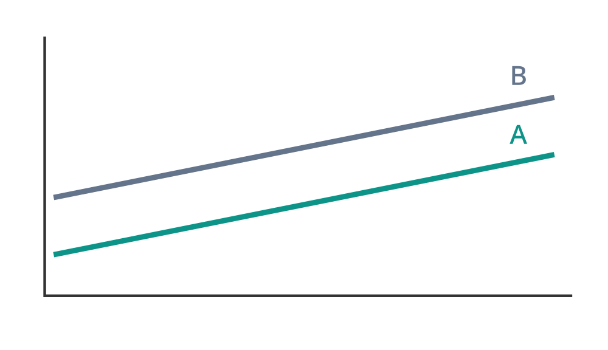

*主效应模型示意图：不同类别截距不同，但斜率相同。*

#### 4.3 模型三：加入交互效应（Interaction Effect）

现在允许两个类别的斜率也不同。

建立：

$$\boxed{Y=\beta_0+\beta_1X+\beta_BU_B+\beta_{XB}XU_B+e}$$

其中：

$$XU_B$$

就是交互项（Interaction Term）。

对于 A 类，因为 $U_B=0$：

$$E(Y\mid X=x,F=A)=\beta_0+\beta_1x$$

对于 B 类，因为 $U_B=1$：

$$\begin{aligned}E(Y\mid X=x,F=B)&=\beta_0+\beta_1x+\beta_B+\beta_{XB}x\\&=(\beta_0+\beta_B)+(\beta_1+\beta_{XB})x\end{aligned}$$

因此：

| 系数 | 含义 |
|---|---|
| $\beta_0$ | A 类截距 |
| $\beta_1$ | A 类斜率 |
| $\beta_B$ | B 类相对于 A 类的截距差 |
| $\beta_{XB}$ | B 类相对于 A 类的斜率差 |

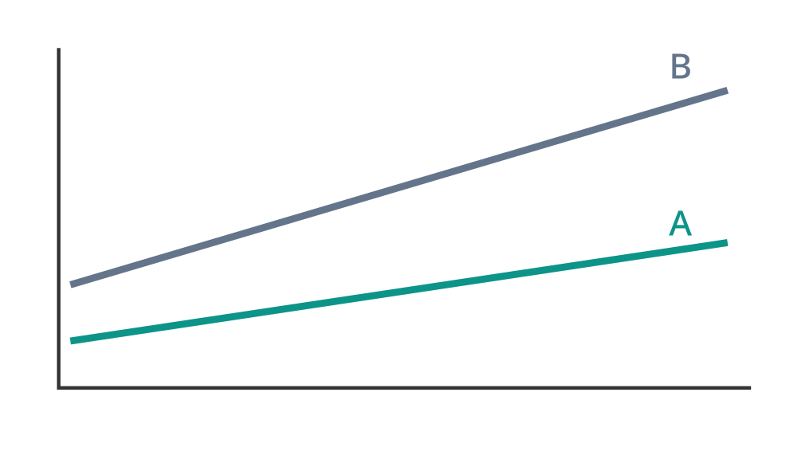

*交互效应模型示意图：不同类别可以同时具有不同的截距和斜率。*

#### 4.4 交互项究竟代表什么？

这是一个必须真正理解的概念。

主效应模型中：

$$E(Y\mid B,x)-E(Y\mid A,x)=\beta_B$$

这个差异不随 $x$ 改变。

但加入交互项后：

$$\boxed{E(Y\mid B,x)-E(Y\mid A,x)=\beta_B+\beta_{XB}x}$$

现在不同类别之间的差异依赖 $x$。

换句话说：

**交互效应表示一个自变量对因变量的影响，会随着另一个自变量的取值而改变。**

这也是为什么不能将 $\beta_B$ 简单理解为 B 类在任何 $x$ 下都比 A 类高多少。加入交互项后，$\beta_B$ 只表示 $x=0$ 时的类别差异。

#### 4.5 推广到 $d$ 个类别

如果 $F$ 有 $d$ 个类别，选第 1 类为参照组，则有 $d-1$ 个虚拟变量。

完整的连续变量与分类变量交互模型为：

$$\boxed{Y_i=\beta_0^*+\beta_1^*x_i+\sum_{k=2}^d\beta_{0k}^*U_{ik}+\sum_{k=2}^d\beta_{1k}^*x_iU_{ik}+e_i}$$

其中：

- $\beta_{0k}^*$ 描述截距差；
- $\beta_{1k}^*$ 描述斜率差。

参数总数为：

$$1+1+(d-1)+(d-1)=2d$$

因为每个类别都能拥有一个独立截距和一个独立斜率，$d$ 个类别一共对应 $2d$ 个参数。

而仅保留主效应时，参数总数为：

$$1+1+(d-1)=d+1$$

这两种参数计数在考试中非常重要。

---

### 五、多个分类变量：主效应、二阶交互和全模型

现在不只有一个分类变量，而是有多个：

$$F_1,\ldots,F_m$$

其中第 $j$ 个分类变量有 $d_j$ 个类别。

讲义将模型划分为：

主效应模型（First-order Model）、二阶模型（Second-order Model）、三阶模型，直至全模型（Full Model）。

#### 5.1 主效应模型

每个分类变量 $F_j$ 需要 $d_j-1$ 个虚拟变量。

因此：

$$\boxed{q_{\mathrm{main}}=1+\sum_{j=1}^m(d_j-1)}$$

这里 $q$ 表示包含截距的参数总数。

例如有三个分类变量：

$$d_1=3,\quad d_2=2,\quad d_3=2$$

那么：

$$q_{\mathrm{main}}=1+2+1+1=5$$

分别对应：

一个截距、$F_1$ 的两个虚拟变量、$F_2$ 的一个虚拟变量、$F_3$ 的一个虚拟变量。

#### 5.2 二阶模型：为什么交互项数量要相乘？

对于两个分类变量 $F_a,F_b$，它们分别有：

$$d_a-1,\qquad d_b-1$$

个虚拟变量。

每个 $F_a$ 虚拟变量都可以与每个 $F_b$ 虚拟变量相乘，构成一个二阶交互项。

所以交互项数量为：

$$\boxed{(d_a-1)(d_b-1)}$$

例如一个变量有 3 个类别，另一个有 2 个类别。

则交互项数为：

$$(3-1)(2-1)=2$$

对于 $m$ 个分类变量，如果包含所有二阶交互项：

$$\boxed{q_{\mathrm{second}}=1+\sum_j(d_j-1)+\sum_{a<b}(d_a-1)(d_b-1)}$$

这是一个常见的考试参数计数公式。

#### 5.3 三阶交互和全模型

同理，三个分类变量 $F_a,F_b,F_c$ 的三阶交互项个数为：

$$(d_a-1)(d_b-1)(d_c-1)$$

如果把全部可能的阶数都加入，则全模型的名义参数总数为：

$$\boxed{q_{\mathrm{full}}=\prod_{j=1}^m d_j}$$

为什么是这个公式？

因为每个分类变量可以选择一个类别，全部类别组合数量就是：

$$d_1d_2\cdots d_m$$

而全模型允许每种类别组合拥有自己的条件均值。

但有一个重要前提：**参数数量不等于实际设计矩阵的秩。**

如果某些类别组合没有任何观测，或者模型列之间存在其他线性相关关系，那么部分参数可能不可识别。

因此在实际数据中，特别是 Assignment 2 Problem 5，应该关注设计矩阵的实际秩（Rank），不能只计算名义参数数目。

#### 5.4 模型公式的表示法

讲义使用 Wilkinson–Rogers 表示法，例如：

$$Y\sim A+B+C$$

表示主效应模型。

$$Y\sim A+B+C+A:B$$

表示主效应加 $A$ 与 $B$ 的二阶交互。

$$Y\sim A+B+C+A:B+A:C+B:C+A:B:C$$

表示三个分类变量的全模型。

这里 `:` 表示交互效应。

理解这种记法是为了阅读试卷中的模型设定，而不需要学习代码语法。

---

## 第二部分：多项式回归（Polynomial Regression）

### 六、为什么普通线性回归不能解决所有问题？

前面我们一直假设：

$$E(Y\mid X=x)=\beta_0^*+\beta_1^*x$$

其均值函数为直线。

但实际关系不一定是直线。例如，年龄与收入之间可能呈现先增长后放缓的趋势。

这时我们希望使用更灵活的函数：

$$E(Y\mid X=x)=f^*(x)$$

最自然的改进就是引入更高次的 $x$。

#### 6.1 一元多项式回归

讲义定义：

$$\boxed{Y_i=\beta_0^*+\beta_1^*x_i+\cdots+\beta_d^*x_i^d+e_i}$$

其中 $d$ 称为多项式次数（Degree）。

例如，二次多项式回归：

$$Y_i=\beta_0^*+\beta_1^*x_i+\beta_2^*x_i^2+e_i$$

三次多项式回归：

$$Y_i=\beta_0^*+\beta_1^*x_i+\beta_2^*x_i^2+\beta_3^*x_i^3+e_i$$

#### 6.2 为什么多项式回归仍然是线性回归？

这是一个非常重要的概念考点。

虽然 $x^2,x^3$ 不是 $x$ 的线性函数，但是模型对未知参数仍然是线性的。

以三次回归为例：

$$Y_i=\beta_0^*+\beta_1^*x_i+\beta_2^*x_i^2+\beta_3^*x_i^3+e_i$$

我们可以将：

$$x_i,\quad x_i^2,\quad x_i^3$$

当成三个新的特征。

于是设计矩阵为：

$$X=\begin{pmatrix}1&x_1&x_1^2&x_1^3\\1&x_2&x_2^2&x_2^3\\\vdots&\vdots&\vdots&\vdots\\1&x_n&x_n^2&x_n^3\end{pmatrix}$$

因此仍然使用：

$$\boxed{\hat\beta=(X^\top X)^{-1}X^\top Y}$$

只要满足相应的满秩条件。

所以：

**线性回归要求的是对未知回归系数线性，而不是对原始自变量线性。**

例如：

$$Y=\beta_0+\beta_1\sin X+\beta_2e^X+e$$

对参数仍然是线性的，可以用 OLS。

但是：

$$Y=\beta_0+e^{\beta_1X}+e$$

一般对未知参数 $\beta_1$ 非线性，不能直接使用普通线性回归的正规方程求解。

#### 6.3 多项式回归如何改变曲线形状？

对于二次模型：

$$f(x)=\beta_0+\beta_1x+\beta_2x^2$$

其导数为：

$$f'(x)=\beta_1+2\beta_2x$$

这意味着斜率不再固定，而是随 $x$ 改变。

其二阶导数为：

$$f''(x)=2\beta_2$$

因此当 $\beta_2>0$ 时，函数向上凸；当 $\beta_2<0$ 时，函数向下凹。

对三次模型：

$$f''(x)=2\beta_2+6\beta_3x$$

曲率可以随 $x$ 改变，能够描述比二次函数更丰富的形状。

这说明多项式回归的优势是：在保留 OLS 计算结构的同时，让均值函数更灵活。

#### 6.4 多个连续变量的二阶模型

讲义还给出多个连续自变量的二阶模型：

$$\boxed{Y_i=\beta_0^*+\sum_{j=1}^m\beta_j^*x_{ij}+\sum_{1\le j\le k\le m}\beta_{jk}^*x_{ij}x_{ik}+e_i}$$

例如有两个连续自变量：

$$X_1,X_2$$

完整二阶模型为：

$$\boxed{Y=\beta_0+\beta_1X_1+\beta_2X_2+\beta_{11}X_1^2+\beta_{12}X_1X_2+\beta_{22}X_2^2+e}$$

这里有两种不同的新特征。

平方项：

$$X_1^2,\ X_2^2$$

用于描述单个变量的非线性影响。

交叉项：

$$X_1X_2$$

用于描述两个变量的交互效应。

例如：

$$E(Y)=\beta_0+\beta_1X_1+\beta_2X_2+\beta_{12}X_1X_2$$

那么：

$$\frac{\partial E(Y)}{\partial X_1}=\beta_1+\beta_{12}X_2$$

说明 $X_1$ 对条件均值的边际影响依赖 $X_2$。

这与前面分类变量和连续变量之间的交互效应具有相同的数学思想。

如果有 $m$ 个连续自变量，包含全部一次和二次项，则参数总数为：

$$\boxed{q=1+m+\frac{m(m+1)}2}$$

其中：

$$\frac{m(m+1)}2$$

是二次项和两两交叉项的总数。

---

### 七、多项式次数越高，模型一定越好吗？

这是多项式回归必须理解的问题。

#### 7.1 训练 RSS 的变化

考虑：

$$M_1:Y\sim X$$

$$M_2:Y\sim X+X^2$$

$$M_3:Y\sim X+X^2+X^3$$

因为：

$$M_1\subset M_2\subset M_3$$

这里的包含指模型函数空间的包含关系，所以：

$$\boxed{RSS_3\le RSS_2\le RSS_1}$$

而对于相同的因变量样本：

$$\boxed{R_3^2\ge R_2^2\ge R_1^2}$$

这直接对应 2023 年第二份模拟题的判断题：

> 在拟合多项式回归时，次数 $d$ 越大，回归的 $R^2$ 越大。

按照非严格单调意义，即 $R^2$ 不会下降，这个判断是正确的。

但不能理解为每增加一次，$R^2$ 必须严格增大。

#### 7.2 为什么训练 RSS 更小，不代表预测更好？

随着次数增加，模型的灵活度提高。

灵活度高的模型不仅能够学习数据中的真实规律，也可能拟合训练样本中的随机波动。

这叫过拟合（Overfitting）。

Lecture 4 第 6 页图 2 专门比较了 2 次、3 次和 8 次多项式。

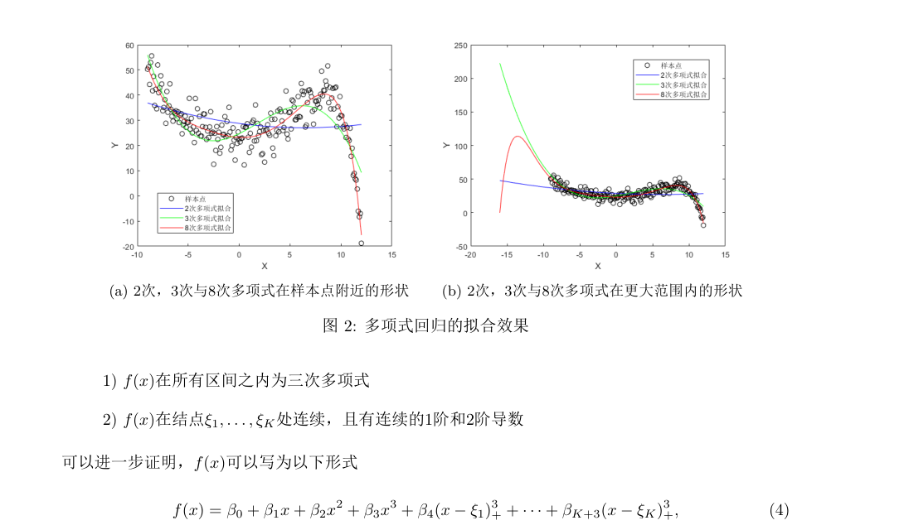

*辅助理解：高阶多项式可能在训练数据附近拟合得更贴合，但在边界和样本外产生明显波动。讲义图 2 特别展示了 8 次多项式在扩大横轴范围后出现的不合理外推。*

这里要区分两个概念：

**拟合（Fitting）**：模型对已观测训练样本的解释程度。

**泛化（Generalization）**：模型对未见过的新样本的预测能力。

高阶模型能够降低训练 RSS，但是不一定降低测试误差。

因此，多项式次数不能只根据训练 RSS 选择。

Assignment 2 Problem 2 要求用 BIC 选择 1–5 阶多项式，其原因就在这里。BIC 属于后续模型选择知识，本讲先理解为什么需要对复杂度进行惩罚。

---

## 第三部分：样条函数（Splines）

### 八、为什么要从多项式回归引入样条？

前面我们希望拟合：

$$Y=f(X)+e$$

但存在两个矛盾的目标。

一方面，希望模型足够灵活，能贴合复杂的数据关系。

另一方面，希望模型不要产生不合理的剧烈波动，尤其是在数据较少的区域或样本范围之外。

高阶多项式的问题是：整个区间都使用同一个多项式。

这意味着某个局部区域出现的数据波动，可能影响整个函数的形状。

因此，一个自然的想法是：

> 不使用一个很高阶的全局多项式，而是将区间划分为几个部分，在每一段使用低阶多项式，并且让它们平滑连接。

这就是样条函数的核心思想。

---

### 九、三次样条（Cubic Spline）

#### 9.1 结点（Knots）是什么？

假设自变量取值范围为：

$$(a,b)$$

选择 $K$ 个内部结点：

$$a<\xi_1<\xi_2<\cdots<\xi_K<b$$

这些结点将区间划分为：

$$(a,\xi_1),\ (\xi_1,\xi_2),\ \ldots,\ (\xi_K,b)$$

一共有 $K+1$ 个子区间。

在每个区间内，我们分别使用三次多项式。

但不能让这些多项式彼此完全独立，否则结点处可能出现跳跃或尖角。

所以还需要加入光滑性条件。

#### 9.2 三次样条需要满足哪些条件？

三次样条要求：

**第一，每一个区间内部都是三次多项式。**

**第二，在结点处，函数本身、一阶导数和二阶导数连续。**

数学表示为：

$$\boxed{f^{(l)}(\xi_k^-)=f^{(l)}(\xi_k^+),\quad l=0,1,2}$$

其中：

$$k=1,\ldots,K$$

$l=0$ 表示函数本身连续，$l=1$ 表示一阶导数连续，$l=2$ 表示二阶导数连续。

直观理解：

- 函数连续：曲线不会断开。
- 一阶导数连续：曲线不会出现突然改变方向的尖角。
- 二阶导数连续：曲率不会突然发生跳跃。

这正是三次样条既灵活又平滑的原因。

#### 9.3 为什么恰好要求到二阶导数连续？

一般的 $d$ 次样条要求在结点处具有 $0$ 到 $d-1$ 阶连续导数。

三次样条 $d=3$，所以要求：

$$0,1,2$$

阶连续。

但不要求三阶导数连续。

如果要求三阶导数也连续，那么相邻两段三次多项式的三阶导数相同，可能进一步限制两段函数的差异，使模型失去部分分段灵活性。

---

### 十、三次样条为什么仍然可以用 OLS？

这是本讲样条部分的数学核心。

讲义给出三次样条的一种表示：

$$\boxed{f(x)=\beta_0+\beta_1x+\beta_2x^2+\beta_3x^3+\sum_{k=1}^K\gamma_k(x-\xi_k)_+^3}$$

其中：

$$(x-\xi)_+=\max(x-\xi,0)$$

因此：

$$(x-\xi)_+^3=\begin{cases}0,&x<\xi\\(x-\xi)^3,&x\ge\xi\end{cases}$$

#### 10.1 为什么引入 $(x-\xi)_+^3$？

先考虑只有一个结点 $\xi$。

构造：

$$f(x)=\beta_0+\beta_1x+\beta_2x^2+\beta_3x^3+\gamma(x-\xi)_+^3$$

当 $x<\xi$：

$$f(x)=\beta_0+\beta_1x+\beta_2x^2+\beta_3x^3$$

当 $x\ge\xi$：

$$f(x)=\beta_0+\beta_1x+\beta_2x^2+\beta_3x^3+\gamma(x-\xi)^3$$

因此，左右两边都是三次多项式，但右边可以通过 $\gamma$ 改变函数形状。

这就实现了“分段灵活”。

#### 10.2 为什么它在结点处能平滑连接？

令：

$$g(x)=(x-\xi)_+^3$$

当 $x<\xi$，$g(x)=0$。

当 $x>\xi$：

$$g'(x)=3(x-\xi)^2$$

$$g''(x)=6(x-\xi)$$

在 $x=\xi$ 时，右侧趋近值分别为：

$$g(\xi^+)=0,\quad g'(\xi^+)=0,\quad g''(\xi^+)=0$$

左侧也都是 0。

所以：

$$g,\quad g',\quad g''$$

在结点处连续。

这说明向一个三次多项式中加入 $(x-\xi)_+^3$，既能改变结点右侧的曲线，又能保持函数到二阶导数的连续性。

这就是截断幂基函数（Truncated Power Basis）构造三次样条的原理。

#### 10.3 怎样构造设计矩阵？

当结点已经确定后：

$$1,\ x,\ x^2,\ x^3,\ (x-\xi_1)_+^3,\ldots,(x-\xi_K)_+^3$$

全部都是已知的基函数。

未知的只有：

$$\beta_0,\beta_1,\beta_2,\beta_3,\gamma_1,\ldots,\gamma_K$$

因此模型对参数是线性的。

定义第 $i$ 个样本的特征向量：

$$\phi(x_i)=\begin{pmatrix}1\\x_i\\x_i^2\\x_i^3\\(x_i-\xi_1)_+^3\\\vdots\\(x_i-\xi_K)_+^3\end{pmatrix}$$

即可构造：

$$X_\phi=\begin{pmatrix}\phi(x_1)^\top\\\vdots\\\phi(x_n)^\top\end{pmatrix}$$

然后使用：

$$\hat\beta=(X_\phi^\top X_\phi)^{-1}X_\phi^\top Y$$

或直接解正规方程。

因此：

**样条函数虽然能够表示复杂的非线性曲线，但固定结点以后，回归系数仍然可以通过线性最小二乘估计。**

#### 10.4 三次样条有多少个参数？

如果有 $K$ 个内部结点，并采用上面的完整截断幂基，那么参数总数为：

$$\boxed{q_{\mathrm{cubic}}=K+4}$$

其中：

$$1,x,x^2,x^3$$

贡献 4 个参数，每个内部结点增加 1 个参数。

这个参数计数对 Assignment 2 Problem 3 很重要。

---

### 十一、自然三次样条（Natural Cubic Spline）

#### 11.1 普通三次样条还有什么问题？

虽然普通三次样条比高阶全局多项式更灵活，但它在边界之外仍然可能保持三次多项式形式。

这可能导致外推时出现非常大的数值。

因此我们进一步要求：

> 在最左侧和最右侧的边界区间外，函数必须是线性的。

这就得到自然三次样条（Natural Cubic Spline）。

#### 11.2 自然三次样条的定义

自然三次样条首先是三次样条，因此仍然满足：

$$f,\quad f',\quad f''$$

在结点处连续。

此外，还加入边界条件：

$$f(x)\text{ 在左边界外为线性函数}$$

$$f(x)\text{ 在右边界外为线性函数}$$

换句话说，在两个边界结点之外：

$$f''(x)=0$$

这可以显著限制样本范围外曲线的弯曲程度。

但也要注意，**自然三次样条只是让边界外的外推变为线性，并不保证外推结果一定符合实际规律。**

#### 11.3 自然三次样条的参数数目

如果有 $K$ 个内部结点，普通三次样条的函数空间维度为：

$$K+4$$

自然三次样条额外施加两个独立边界约束，因此维度减少 2：

$$\boxed{q_{\mathrm{natural}}=K+2}$$

这里的 $K$ 特指内部结点个数，不包含左右边界结点。

因此，当作业给出三个内部结点时：

| 模型 | 名义设计矩阵列数（含截距） |
|---|---:|
| 三次多项式 | 4 |
| 三次回归样条 | $3+4=7$ |
| 自然三次样条 | $3+2=5$ |

这些是相应样条基函数的理论列数；实际数据拟合时仍需检查设计矩阵的秩。

讲义采用另一种结点编号方式：将最小值、最大值也列为边界结点。因此在不同教材中计算参数数目时，务必先看清“结点数”是否包含边界结点。

---

### 十二、怎样选择结点？

讲义给出两种常用方法。

第一种是按照样本分位数（Quantiles）设置。

例如选择三个内部结点：

$$\xi_1=Q_{0.25},\quad\xi_2=Q_{0.50},\quad\xi_3=Q_{0.75}$$

这样结点会根据数据密度分布，通常使不同区间包含的样本数量较均衡。

第二种是均匀结点（Equally Spaced Knots），即在取值区间内按等距离设置结点。

这两种选择的区别在于：

分位数结点根据样本的分布决定位置；均匀结点根据自变量的数值范围决定位置。

结点数量越多，函数可以局部变化的自由度通常越高。

但结点过多也会增加过拟合风险，因此需要选择结点数量，讲义提到可以通过交叉验证（Cross Validation）完成，这将在 Lecture 5 学习。

---

### 十三、平滑样条（Smoothing Spline）

到这里，我们已经知道如何构造三次回归样条。

但是还有一个问题：

**为什么一定要提前指定有限个结点，再使用固定的基函数拟合？**

有没有办法让函数本身自由一些，同时用数学手段约束它不要过度弯曲？

这就是平滑样条的思路。

#### 13.1 从最小二乘到带惩罚的最小二乘

普通函数拟合希望最小化：

$$\sum_{i=1}^n(Y_i-f(x_i))^2$$

如果不对 $f$ 加任何限制，它完全可能通过每个样本点，从而将训练 RSS 降为 0。

但是这种曲线可能非常不平滑。

因此讲义引入一个惩罚项：

$$\boxed{\min_f\left\{\sum_{i=1}^n(Y_i-f(x_i))^2+\lambda\int[f''(x)]^2\,dx\right\}}$$

这里通常在覆盖观测自变量范围的区间上积分，并在适当的函数空间中优化。

这个目标函数由两部分组成。

第一部分：

$$\sum_i(Y_i-f(x_i))^2$$

衡量拟合误差。

第二部分：

$$\int[f''(x)]^2\,dx$$

衡量函数的弯曲程度。

为什么使用二阶导数？

因为一阶导数主要衡量斜率，而二阶导数衡量斜率变化的快慢，也就是曲线的弯曲程度。

例如：

$$f(x)=a+bx$$

则：

$$f''(x)=0$$

惩罚项为 0。

而一条变化剧烈的曲线通常具有较大的二阶导数，从而受到更大的惩罚。

#### 13.2 调节参数 $\lambda$ 的作用

$$\lambda>0$$

叫作平滑参数（Smoothing Parameter）。

**平滑参数的直观作用**

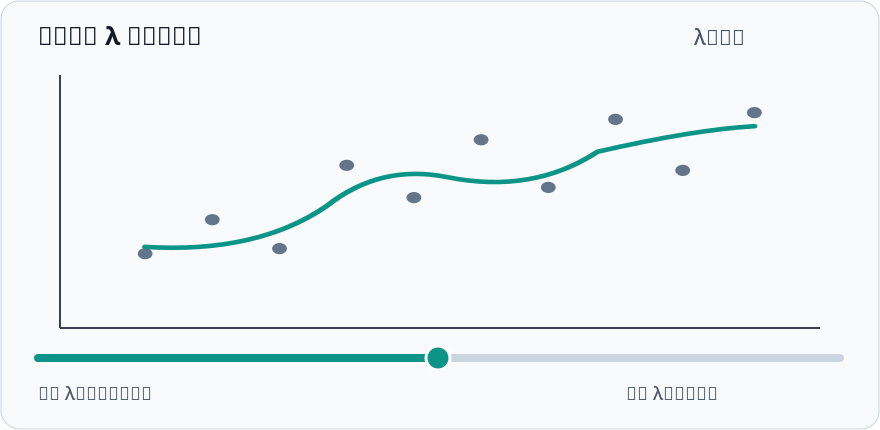

- 较小 λ：偏重拟合样本；
- 较大 λ：偏重光滑。

*原回答包含可交互的 λ 滑块与曲线示意；Markdown 无法保留该交互。*

当 $\lambda$ 较小时，拟合误差占更重要的位置，模型可以更加贴合训练数据。

当 $\lambda$ 较大时，弯曲惩罚更重要，曲线趋向平滑。

在通常的非退化情形下：

$$\lambda\to0$$

时，平滑样条趋向于对不同观测位置进行插值；而：

$$\lambda\to\infty$$

时，曲线趋向于线性最小二乘拟合，因为线性函数的二阶导数为 0。

#### 13.3 为什么平滑样条的解仍然是自然三次样条？

这是讲义给出的一个重要结论：

在适当条件下，上述带惩罚函数优化问题的解，是一个以观测位置为结点的自然三次样条。

其意义非常重要。

我们最初是在一个非常广泛的函数空间中寻找 $f$，并没有预先限定它一定是分段三次多项式。

但是最终最优解却具有自然三次样条结构。

所以这个看似无限维的函数优化问题，可以转化为有限维的计算问题。

讲义并未展开该定理的完整证明，因此现阶段你需要理解其数学思想和结论，不必额外推导变分法证明。

---

### 十四、基函数（Basis Functions）：统一理解多项式与样条

这一小节是 Lecture 4 第 2、3 部分之间的核心联系。

假设我们使用一组已知函数：

$$\phi_1(x),\ldots,\phi_M(x)$$

构造：

$$\boxed{f(x)=\sum_{m=1}^M\beta_m\phi_m(x)}$$

其中基函数 $\phi_m$ 已经确定，未知的是系数 $\beta_m$。

那么：

$$\min_{\beta_1,\ldots,\beta_M}\sum_{i=1}^n\left[Y_i-\sum_{m=1}^M\beta_m\phi_m(x_i)\right]^2$$

就是一个多元线性回归问题。

因为我们可以将：

$$X_{\phi,im}=\phi_m(x_i)$$

视作设计矩阵的第 $i$ 行第 $m$ 列。

因此可以统一理解：

| 方法 | 基函数 |
|---|---|
| 简单线性回归 | $1,x$ |
| 三次多项式回归 | $1,x,x^2,x^3$ |
| 三次回归样条 | $1,x,x^2,x^3,(x-\xi_k)_+^3$ |
| B-样条 | 一组局部支撑的 B-spline 基函数 |

B-样条（B-splines）只是三次样条的另一种基函数表示方式。不同的基可以张成相同的样条函数空间，因此可以表示相同的拟合函数。

**这部分最值得掌握的不是每一种基函数的具体表达式，而是一个统一思想：通过改变特征函数，线性回归可以表达复杂的非线性关系。**

---
## 第四部分：主成分分析（Principal Component Analysis, PCA）

### 十五、为什么需要 PCA？

前面我们学习了两种改造自变量的方法：

分类变量通过虚拟变量编码，多项式和样条通过构造基函数扩充特征。

这些方法通常会增加设计矩阵的列数。

但现在考虑另一个问题：

> 如果原来就有很多自变量，而且它们之间存在大量重复信息，能不能将它们压缩成少数几个新变量？

例如，要描述运动员的身体特征，有：

$$X_1=\text{身高},\quad X_2=\text{体重},\quad X_3=\text{BMI}$$

它们可能高度相关。

如果我们能够找到一个新的变量：

$$Z_1=a_1X_1+a_2X_2+a_3X_3$$

使它尽可能代表这些原始变量的共同变化趋势，那么就有机会减少变量数量。

这就是 PCA 的主要思想。

#### 15.1 PCA 与线性回归的任务不同

PCA 本身没有使用因变量 $Y$。

它只研究：

$$X_1,\ldots,X_p$$

之间的协方差结构。

它希望找到少数几个线性组合，使它们保留原始自变量尽可能多的方差。

所以：

**PCA 所说的“信息量”，在本讲中特指变量的方差，而不是变量对 $Y$ 的预测能力。**

这一点在 Assignment 2 Problem 4 中也被明确要求区分。

---

### 十六、第一个主成分：为什么是最大特征值对应的特征向量？

#### 16.1 定义线性组合

假设有 $p$ 个随机变量：

$$X_1,\ldots,X_p$$

记为随机向量：

$$X=\begin{pmatrix}X_1\\\vdots\\X_p\end{pmatrix}$$

我们希望寻找一个线性组合：

$$Z=a^\top X$$

其中：

$$a=\begin{pmatrix}a_1\\\vdots\\a_p\end{pmatrix}$$

即：

$$Z=a_1X_1+\cdots+a_pX_p$$

我们希望 $Z$ 的方差尽可能大。

#### 16.2 为什么还要加上 $\|a\|=1$？

如果我们只要求：

$$\max_a\operatorname{Var}(a^\top X)$$

那么只要把 $a$ 乘以一个非常大的常数，就可以任意放大方差。

因为：

$$\operatorname{Var}(ca^\top X)=c^2\operatorname{Var}(a^\top X)$$

这样优化问题就没有意义。

因此，需要约束：

$$\boxed{\|a\|^2=a^\top a=1}$$

现在我们寻找的是一个单位方向，而不是通过放大系数来制造巨大方差。

#### 16.3 将优化问题转化为矩阵形式

定义原始自变量的协方差矩阵：

$$\Gamma=\operatorname{Cov}(X)$$

那么：

$$\operatorname{Var}(Z)=\operatorname{Var}(a^\top X)$$

根据随机向量线性组合的方差公式：

$$\operatorname{Var}(a^\top X)=a^\top\Gamma a$$

所以 PCA 的第一个优化问题是：

$$\boxed{\begin{aligned}\max_a\quad&a^\top\Gamma a\\\text{s.t.}\quad&a^\top a=1\end{aligned}}$$

#### 16.4 为什么最优解是特征向量？

这是 PCA 最重要的数学推导。

由于协方差矩阵 $\Gamma$ 是对称半正定矩阵，存在正交特征值分解：

$$\Gamma=U\Lambda U^\top$$

其中：

$$\Lambda=\operatorname{diag}(\lambda_1,\ldots,\lambda_p)$$

并且：

$$\lambda_1\ge\lambda_2\ge\cdots\ge\lambda_p\ge0$$

对应单位特征向量：

$$u_1,\ldots,u_p$$

且：

$$u_j^\top u_k=\begin{cases}1,&j=k\\0,&j\ne k\end{cases}$$

任意单位向量 $a$ 都可以表示为：

$$a=\sum_{j=1}^p c_ju_j$$

因为 $u_j$ 构成标准正交基，所以：

$$\sum_{j=1}^p c_j^2=1$$

于是：

$$\begin{aligned}a^\top\Gamma a&=\left(\sum_jc_ju_j\right)^\top\Gamma\left(\sum_kc_ku_k\right)\\&=\sum_{j=1}^p\lambda_jc_j^2\end{aligned}$$

因为：

$$\lambda_j\le\lambda_1$$

所以：

$$\sum_{j=1}^p\lambda_jc_j^2\le\lambda_1\sum_{j=1}^pc_j^2=\lambda_1$$

当：

$$a=u_1$$

时取得最大值。

因此：

$$\boxed{a_{\mathrm{opt}}=u_1}$$

并且最大方差是：

$$\boxed{\operatorname{Var}(Z_1)=\lambda_1}$$

这里在最大特征值有重数时，最优方向不唯一；可以选择对应最大特征值子空间中的任意单位向量。

这就是 PCA 的根本数学原理。

**协方差矩阵的最大特征值对应方差最大的方向。**

---

### 十七、主成分（Principal Component）与载荷（Loadings）

#### 17.1 第一个主成分

根据刚才的推导：

$$\boxed{Z_1=u_1^\top X=u_{11}X_1+\cdots+u_{p1}X_p}$$

这叫第一个主成分（First Principal Component）。

其中：

$$u_{11},\ldots,u_{p1}$$

叫作第一个主成分的载荷（Loadings）。

所以：

- 主成分 $Z_1$ 是新的随机变量；
- 载荷 $u_1$ 是用于构造这个变量的系数向量；
- 特征值 $\lambda_1$ 是该主成分的方差。

这三个概念不是同一个东西。

#### 17.2 第二个主成分

有了第一个主成分之后，我们希望找到第二个方向，保留剩余的尽可能多的方差。

但不能继续选择 $u_1$，否则得到的还是同样的信息。

所以额外要求：

$$a^\top u_1=0$$

即方向与第一个主成分正交。

因此：

$$\boxed{\begin{aligned}\max_a\quad&a^\top\Gamma a\\\text{s.t.}\quad&a^\top a=1\\&a^\top u_1=0\end{aligned}}$$

最优解为第二大特征值对应的特征向量：

$$a=u_2$$

于是：

$$\boxed{Z_2=u_2^\top X}$$

并且：

$$\operatorname{Var}(Z_2)=\lambda_2$$

以此类推，最多可以构造 $p$ 个主成分：

$$Z_1,\ldots,Z_p$$

它们的方差依次为：

$$\lambda_1,\ldots,\lambda_p$$

#### 17.3 为什么主成分互不相关？

对于两个不同主成分：

$$Z_j=u_j^\top X,\qquad Z_k=u_k^\top X$$

有：

$$\begin{aligned}\operatorname{Cov}(Z_j,Z_k)&=u_j^\top\Gamma u_k\\&=u_j^\top(\lambda_ku_k)\\&=\lambda_ku_j^\top u_k\\&=0\end{aligned}$$

因此：

$$\boxed{\operatorname{Cov}(Z_j,Z_k)=0,\quad j\ne k}$$

注意，这说明不同主成分不相关（Uncorrelated），但不一定相互独立。

只有在进一步满足联合正态等适当条件时，才能从零协方差推出独立。

---

### 十八、PCA 的完整数值例子

这一例子是为了让你真正看懂 PCA 的计算过程，而不只是记住“特征值分解”。

假设只有两个随机变量：

$$X_1,X_2$$

协方差矩阵为：

$$\Gamma=\begin{pmatrix}4&2\\2&4\end{pmatrix}$$

要求找出两个主成分及其方差解释比例。

#### 第一步：计算特征值

解特征方程：

$$\det(\Gamma-\lambda I)=0$$

即：

$$\begin{vmatrix}4-\lambda&2\\2&4-\lambda\end{vmatrix}=0$$

所以：

$$(4-\lambda)^2-4=0$$

得到：

$$\boxed{\lambda_1=6,\qquad\lambda_2=2}$$

#### 第二步：求特征向量

对于：

$$\lambda_1=6$$

有：

$$(\Gamma-6I)u_1=0$$

即：

$$\begin{pmatrix}-2&2\\2&-2\end{pmatrix}\begin{pmatrix}a\\b\end{pmatrix}=0$$

所以：

$$a=b$$

结合：

$$a^2+b^2=1$$

可以取：

$$\boxed{u_1=\frac1{\sqrt2}\begin{pmatrix}1\\1\end{pmatrix}}$$

同理：

$$\boxed{u_2=\frac1{\sqrt2}\begin{pmatrix}1\\-1\end{pmatrix}}$$

#### 第三步：写出主成分

第一个主成分：

$$\boxed{Z_1=\frac{X_1+X_2}{\sqrt2}}$$

第二个主成分：

$$\boxed{Z_2=\frac{X_1-X_2}{\sqrt2}}$$

它们分别对应两个不同的变化方向。

第一个方向是两个变量一起增加或减少。

第二个方向是一个变量增加、另一个变量减少。

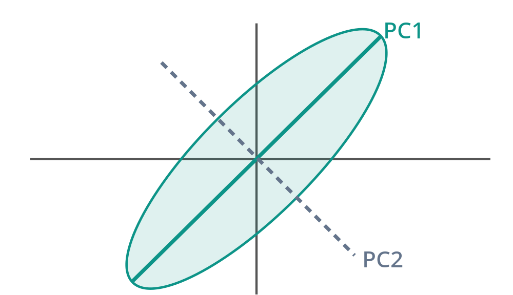

*主成分方向示意图：PC1 沿数据变异最大的方向，PC2 与 PC1 正交。*

#### 第四步：计算方差解释比例

全部方差为：

$$\lambda_1+\lambda_2=6+2=8$$

所以第一主成分解释比例：

$$\boxed{\frac6{6+2}=75\%}$$

第二主成分解释比例：

$$\frac2{6+2}=25\%$$

如果只保留第一主成分，就保留了原始变量总方差的 75%。

这就是 PCA 降维的基本逻辑。

---

### 十九、为什么所有主成分的方差之和等于原始变量的总方差？

这是一个非常重要的理论结论，也是模拟题考点。

我们已经知道：

$$\operatorname{Var}(Z_j)=\lambda_j$$

所以所有主成分的方差之和为：

$$\sum_{j=1}^p\operatorname{Var}(Z_j)=\sum_{j=1}^p\lambda_j$$

根据线性代数中的迹（Trace）性质：

$$\sum_{j=1}^p\lambda_j=\operatorname{tr}(\Gamma)$$

而协方差矩阵的对角元就是原始变量的方差：

$$\Gamma_{jj}=\operatorname{Var}(X_j)$$

因此：

$$\boxed{\sum_{j=1}^p\operatorname{Var}(Z_j)=\sum_{j=1}^p\operatorname{Var}(X_j)}$$

也就是：

**正交变换改变了变量的表示方向，但没有改变总体方差之和。**

#### 19.1 累计方差解释比例

如果只保留前 $q$ 个主成分：

$$Z_1,\ldots,Z_q$$

则累计方差解释比例（Cumulative Proportion of Variance Explained）为：

$$\boxed{PVE(q)=\frac{\sum_{j=1}^q\lambda_j}{\sum_{j=1}^p\lambda_j}}$$

例如，四个特征值为：

$$8,4,2,1$$

总方差：

$$8+4+2+1=15$$

前两个主成分的累计解释比例为：

$$\frac{8+4}{15}=80\%$$

说明如果保留前两个主成分，就保留了原始变量总方差的 80%。

#### 19.2 方差解释比例和回归 $R^2$ 不一样

这是 Assignment 2 Problem 4 的重要问题。

假设前三个主成分解释了自变量方差的 90%。

这并不意味着用它们预测 $Y$ 时：

$$R^2=90\%$$

因为 PCA 只是寻找自变量变化最大的方向，并没有使用 $Y$ 的信息。

某个对 $Y$ 特别重要的方向，可能恰好是原始自变量中方差较小的方向。

所以：

$$\boxed{\text{PCA 的方差解释比例}\ne\text{回归模型的 }R^2}$$

---

### 二十、样本 PCA：载荷与得分有什么区别？

讲义最后讨论怎样对实际观测数据进行 PCA。

#### 20.1 计算样本协方差矩阵

假设有 $n$ 个样本、$p$ 个自变量。

令：

$$\bar x_j=\frac1n\sum_{i=1}^n x_{ij}$$

样本协方差矩阵的元素为：

$$\boxed{\hat\Gamma_{jk}=\frac1{n-1}\sum_{i=1}^n(x_{ij}-\bar x_j)(x_{ik}-\bar x_k)}$$

对：

$$\hat\Gamma$$

进行特征值分解，得到：

$$\hat\lambda_1\ge\cdots\ge\hat\lambda_p$$

及对应单位特征向量：

$$\hat u_1,\ldots,\hat u_p$$

这些特征向量就是估计得到的载荷方向。

#### 20.2 什么是载荷（Loadings）？

例如：

$$\hat u_1=\begin{pmatrix}0.6\\0.8\end{pmatrix}$$

说明第一个主成分按照：

$$Z_1=0.6X_1+0.8X_2$$

的方向构造。

载荷表示不同原始变量在主成分中的权重。

#### 20.3 什么是得分（Scores）？

对于第 $i$ 个样本：

$$x_i=\begin{pmatrix}x_{i1}\\\vdots\\x_{ip}\end{pmatrix}$$

我们可以将其投影到第 $j$ 个主成分方向：

$$\boxed{\hat z_{ij}=\hat u_j^\top(x_i-\bar x)}$$

这就是第 $i$ 个样本在第 $j$ 个主成分上的中心化得分（Score）。

讲义中也使用 $\hat u_j^\top x_i$ 的写法。两种写法相差一个不依赖样本 $i$ 的常数，因此方差和主成分方向不变；实际基于中心化协方差矩阵进行 PCA 时，通常使用中心化后的得分。

你可以这样区分：

| 概念 | 是什么 | 由什么决定 |
|---|---|---|
| Loadings（载荷） | 主成分方向的系数 | 特征向量 |
| Scores（得分） | 每个样本在主成分方向上的坐标 | 样本特征与载荷 |
| Eigenvalue（特征值） | 主成分的方差 | 协方差矩阵 |
| PVE（方差解释比例） | 所选主成分保留的方差比例 | 特征值 |

这是 2026 年第一份模拟题 PCA 选择题中的核心考点。

---

### 二十一、为什么 PCA 有时需要先标准化？

讲义最后指出：

除了对样本协方差矩阵做 PCA，也可以对样本相关系数矩阵做 PCA。

二者之间的联系是：

**对每个原始变量先中心化、再除以样本标准差，然后做协方差矩阵 PCA，等价于对原始数据的相关系数矩阵做 PCA。**

#### 21.1 标准化的公式

对于变量 $X_j$：

$$\boxed{X_j^{\mathrm{std}}=\frac{X_j-\bar X_j}{s_j}}$$

其中 $s_j>0$ 是样本标准差。

这样，每个标准化变量都具有样本均值 0、样本方差 1。

#### 21.2 为什么标准化非常重要？

假设两个变量：

$$X_1=\text{年收入（元）}$$

$$X_2=\text{年龄（岁）}$$

收入的数值可能达到几十万，而年龄通常只有几十。

直接使用协方差矩阵做 PCA，收入的方差可能远远大于年龄的方差，从而主导第一主成分方向。

但这种数值差异有一部分只是计量单位不同造成的。

如果把收入从“元”改成“万元”，主成分方向可能发生很大变化。

这说明基于原始协方差矩阵的 PCA 对变量尺度敏感。

因此，当多个自变量量纲不同、数值尺度差异很大，且我们不希望大尺度变量自动占据主导地位时，通常先标准化。

但也不是所有情况都必须标准化。如果变量本来具有相同单位，并且方差大小具有实际意义，那么保留原始协方差结构也可能更合理。

---
## 第五部分：结合六份模拟题与 Assignment 2，系统掌握考点

下面开始做题部分。

这里不按照六份试卷的原始顺序机械地逐题讲解，而是将相似题目归纳成通用题型。每类题都先介绍题意，再说明识别思路和解题步骤。

### 题型一：分类变量的参照组、虚拟变量与均值解释

*对应：2026 Fall Sample Midterm 1 · Problem 1 第 3 小题；2024 Fall Sample · Problem 1 第 4 小题；Assignment 2 · Problem 1*

#### 1. 2026 年模拟题：虚拟变量系数代表什么？

原题判断：

假设分类变量 $F$ 有 $d$ 个水平，使用 $d-1$ 个虚拟变量进行回归 $Y\sim F$。所有虚拟变量的回归系数都代表该类别与 $Y$ 的总样本均值 $\bar Y$ 的差异。

答案：**错误（False）。**

为什么？

假设第 1 类为参照组：

$$Y_i=\beta_0^*+\sum_{k=2}^d\beta_k^*U_{ik}+e_i$$

则：

$$\beta_0^*=\alpha_1^*$$

$$\beta_k^*=\alpha_k^*-\alpha_1^*$$

所以：

$$\boxed{\beta_k^*=\text{第 }k\text{ 类的均值}-\text{参照组均值}}$$

而不是第 $k$ 类与总体样本均值的差异。

这道题只考一句话，但要真正理解参照组编码才能稳定判断。

#### 2. 2024 年模拟题：自由度是多少？

另一道判断题问：

若 $F$ 有 $d$ 个类别，则回归 $Y\sim F$ 的 t 统计量自由度为 $d$。

答案：**错误（False）。**

因为含截距的模型使用 $d-1$ 个虚拟变量，因此参数总数是：

$$q=1+(d-1)=d$$

残差自由度为：

$$\boxed{df=n-d}$$

所以 t 统计量在相应正态线性回归假设下服从：

$$t(n-d)$$

而不是 $t(d)$。

这里最容易错的原因，就是把“参数数量”和“残差自由度”混为一谈。

---

### 题型二：多分类变量的设计矩阵与参数个数

*对应：2023 Fall Sample Midterm 1 · Problem 6（20 分）*

这道题非常有代表性，适合作为分类变量部分的综合题。

#### 原题

某药物试验有 9 名患者，因变量 $Y$ 为连续型疗效指标。

三个分类自变量分别是：

$$F_1=\text{血型}\in\{A,B,O\}$$

$$F_2=\text{家族病史}\in\{\text{无},\text{有}\}$$

$$F_3=\text{性别}\in\{\text{女},\text{男}\}$$

引入四个虚拟变量：

$$U_{12}=I\{F_1=B\}$$

$$U_{13}=I\{F_1=O\}$$

$$U_{22}=I\{F_2=\text{有}\}$$

$$U_{32}=I\{F_3=\text{男}\}$$

要求构造主效应模型的设计矩阵，判断更复杂模型是否可以唯一估计，并利用回归结果进行预测。

#### 第 1 问：构造主效应设计矩阵

主效应模型为：

$$Y=\beta_0+\beta_1U_{12}+\beta_2U_{13}+\beta_3U_{22}+\beta_4U_{32}+e$$

因此设计矩阵有 5 列。

根据试卷给出的 9 名患者属性，可以得到：

$$X=\begin{pmatrix}1&0&0&0&0\\1&0&0&0&1\\1&1&0&0&0\\1&1&0&0&1\\1&1&0&1&0\\1&1&0&1&1\\1&0&1&0&1\\1&0&1&1&0\\1&0&1&1&0\end{pmatrix}$$

怎么构造这样一个矩阵？

不需要记整张矩阵，方法是先固定列顺序：

$$(1,U_{12},U_{13},U_{22},U_{32})$$

然后对每个样本依次判断虚拟变量是否等于 1。

例如属性为：

$$(B,\text{有},\text{男})$$

则对应：

$$(1,1,0,1,1)$$

而属性为：

$$(A,\text{无},\text{女})$$

则对应：

$$(1,0,0,0,0)$$

第一列始终是截距列。

#### 第 2 问：如果加入全部二阶交互项呢？

题目考虑：

$$Y\sim F_1+F_2+F_3+F_1:F_2+F_1:F_3+F_2:F_3$$

我们先计算参数总数。

主效应参数数目为：

$$q_{\mathrm{main}}=1+(3-1)+(2-1)+(2-1)=5$$

二阶交互项：

$$F_1:F_2:\quad(3-1)(2-1)=2$$

$$F_1:F_3:\quad(3-1)(2-1)=2$$

$$F_2:F_3:\quad(2-1)(2-1)=1$$

所以总参数数目：

$$\boxed{q_{\mathrm{second}}=5+2+2+1=10}$$

但是样本数只有：

$$n=9$$

由于：

$$q>n$$

设计矩阵不可能满列秩，因此无法唯一估计全部回归系数。

#### 第 3 问：三阶全模型至少需要多少样本？

加入三阶交互：

$$F_1:F_2:F_3$$

其参数数目为：

$$(3-1)(2-1)(2-1)=2$$

于是：

$$q_{\mathrm{full}}=10+2=12$$

也可以直接用：

$$\boxed{q_{\mathrm{full}}=3\times2\times2=12}$$

因此至少需要 12 条样本，才有可能让设计矩阵满列秩。

不过要特别注意，这里的“至少 12 条”只是样本量方面的必要条件。

如果某些类别组合没有样本，即使总样本量达到 12，也未必能够识别所有参数。

#### 第 4 问：根据交互模型进行预测

试卷给出了一个包含部分二阶交互项的模型：

$$Y\sim F_1+F_2+F_3+F_1:F_3+F_2:F_3$$

主要估计值如下：

| 系数 | 估计值 |
|---|---:|
| 截距 | 0.56 |
| 血型 B | 0.05 |
| 血型 O | -0.43 |
| 家族病史有 | 0 |
| 男性 | -0.24 |
| 血型 B × 男性 | 0.12 |
| 血型 O × 男性 | 0.53 |
| 家族病史有 × 男性 | 0.20 |

要求比较两个新患者：

患者 1：

$$(A,\text{无},\text{男})$$

患者 2：

$$(B,\text{有},\text{男})$$

**患者 1：**

只有男性虚拟变量为 1，因此：

$$\boxed{\hat y_1=0.56-0.24=0.32}$$

**患者 2：**

因为患者 2 是 B 型血、有家族病史、男性，所以相应的主效应和交互项都要代入。

$$\begin{aligned}\hat y_2&=0.56+0.05+0-0.24+0.12+0.20\\&=0.69\end{aligned}$$

最终：

$$\boxed{\hat y_2=0.69>0.32=\hat y_1}$$

所以患者 2 的预测疗效更高。

#### 这类题的通用思路

先计算每个分类变量的虚拟变量数量，再按照类别构造设计矩阵。遇到交互项时，将对应虚拟变量相乘；遇到参数可识别性问题时，先比较名义参数数量与样本数，再检查是否存在空单元格或列线性相关。

遇到预测题时，一定要把所有适用的主效应和交互项都加进去，而不是只代入单个类别系数。

---

### 题型三：根据回归 Summary 判断主效应与交互效应

*对应：2026 Fall Sample Midterm 2 · Problem 4（16 分）；2024 Fall 正式考试 Problem 4*

这两份资料使用的是基本相同的题目。

#### 原题

有一个连续自变量 $X$，一个分类变量 $F$，包含 A、B 两类，样本量为：

$$n=8$$

分别拟合三个模型：

$$M_1:Y\sim X$$

$$M_2:Y\sim X+F$$

$$M_3:Y\sim X+F+X:F$$

得到：

| 模型 | 变量 | Estimate | Std. Error | p 值 |
|---|---|---:|---:|---:|
| $M_1$ | 截距 | 32.31 | 2.00 | 很小 |
| | X | 14.32 | 0.70 | 很小 |
| $M_2$ | 截距 | 29.66 | 2.04 | 很小 |
| | X | 14.57 | 0.69 | 很小 |
| | B | 3.83 | 0.74 | 0.00177 |
| $M_3$ | 截距 | 30.36 | 2.86 | 很小 |
| | X | 14.33 | 0.98 | 很小 |
| | B | 2.47 | 3.96 | 0.28 |
| | X:B | 0.48 | 1.38 | 0.37 |

三个模型的 $R^2$ 分别为：

$$0.34,\quad0.50,\quad0.64$$

#### 第 1 问：三个模型在截距和斜率上有什么不同？

**模型一：**

$$\hat Y=32.31+14.32X$$

A、B 类共用同一条直线。

**模型二：**

对于 A：

$$\hat Y_A=29.66+14.57X$$

对于 B：

$$\hat Y_B=(29.66+3.83)+14.57X$$

因此：

$$\boxed{\hat Y_B=33.49+14.57X}$$

两条直线截距不同，但斜率相同。

**模型三：**

对于 A：

$$\hat Y_A=30.36+14.33X$$

对于 B：

$$\hat Y_B=(30.36+2.47)+(14.33+0.48)X$$

所以：

$$\boxed{\hat Y_B=32.83+14.81X}$$

此时不同类别具有不同截距和不同斜率。

#### 第 2 问：模型二中 $X$ 的 95% 置信区间

模型二有两个自变量列（$X$ 和 B 的虚拟变量），加上截距共 3 个参数。

因此：

$$df=8-3=5$$

根据置信区间公式：

$$CI=\hat\beta_X\pm t_{0.025}(5)se(\hat\beta_X)$$

代入：

$$\boxed{CI_{95\%}=14.57\pm0.69\,t_{0.025}(5)}$$

这里可以保留 t 分位数符号，符合原题要求。

由于该系数的双侧 p 值明显小于 0.05，因此置信区间不包含 0。

#### 第 3 问：用 t 检验显著性选模型

首先看最复杂的 $M_3$。

交互项：

$$X:B$$

的 p 值为 0.37，大于 0.05。

因此，没有足够证据认为 A、B 两类具有不同斜率。

可以考虑去掉交互项，退回主效应模型 $M_2$。

在 $M_2$ 中，X 和 B 的系数都具有显著性。

因此按照题目采用的逐步显著性准则：

$$\boxed{\text{选择 }M_2}$$

这里也体现了模型层级原则（Hierarchy Principle）：如果保留交互项，通常需要保留相应主效应；如果删除高阶交互项，再重新检查较简单模型。

#### 第 4 问：用调整后的 $R^2$ 选模型

虽然调整后的 $R^2$ 属于后续模型选择知识，但试卷直接给出了相关公式，因此你需要会使用。

$$\boxed{R_{\mathrm{adj}}^2=1-\frac{n-1}{n-k-1}(1-R^2)}$$

其中 $k$ 为模型中的自变量列数，不包括截距。

三个模型分别为：

$$M_1:k=1$$

$$M_2:k=2$$

$$M_3:k=3$$

计算：

$$R_{\mathrm{adj},1}^2=1-\frac76(1-0.34)=0.23$$

$$R_{\mathrm{adj},2}^2=1-\frac75(1-0.50)=0.30$$

$$R_{\mathrm{adj},3}^2=1-\frac74(1-0.64)=0.37$$

因此：

$$\boxed{\text{选择 }M_3}$$

注意：这里按 t 检验选出 $M_2$，按调整 $R^2$ 选出 $M_3$。

这并不矛盾，因为它们采用的模型选择标准不同。

---

### 题型四：分类变量和交互项如何影响参数个数与模型选择？

*对应：2026 Fall Sample Midterm 1 · Problem 4（14 分）*

这道题非常适合训练“先数参数，再代入模型选择公式”的解题习惯。

#### 原题

有一个连续自变量 $X$，一个包含三个类别的分类变量 $F$，样本量：

$$n=10$$

给出四个模型：

| 模型 | 公式 | RSS |
|---|---|---:|
| $M_1$ | $Y\sim1$ | 100 |
| $M_2$ | $Y\sim X$ | 48 |
| $M_3$ | $Y\sim X+F$ | 24 |
| $M_4$ | $Y\sim X+F+X:F$ | 18 |

#### 第一步：正确计算参数总数

由于 $F$ 有三个类别：

$$d-1=2$$

所以 $F$ 对应两个虚拟变量。

模型三：

$$Y\sim X+F$$

参数总数为：

$$q_3=1+1+2=4$$

模型四还包含：

$$X:F$$

交互项数量为：

$$1\times(3-1)=2$$

因此：

$$q_4=4+2=6$$

最终：

| 模型 | 参数总数 $q$ |
|---|---:|
| $M_1$ | 1 |
| $M_2$ | 2 |
| $M_3$ | 4 |
| $M_4$ | 6 |

这一部分就是 Lecture 4 的核心考点。

#### 第二步：计算调整后的 $R^2$

因为只有截距的模型有：

$$RSS_1=SYY=100$$

所以其他模型的 $R^2$ 为：

$$R^2=1-\frac{RSS}{100}$$

可以得到：

| 模型 | $R^2$ | 调整 $R^2$ |
|---|---:|---:|
| $M_1$ | 0 | 0 |
| $M_2$ | 0.52 | 0.46 |
| $M_3$ | 0.76 | 0.64 |
| $M_4$ | 0.82 | 0.595 |

因此按调整 $R^2$：

$$\boxed{\text{选择 }M_3}$$

#### 第三步：根据 AIC 选择

原题给出：

$$\boxed{AIC=n\log(RSS/n)+2q}$$

这里忽略了各模型相同的常数项。

AIC 越小越好。

比较模型 $M_2$ 和 $M_3$：

$$AIC_3<AIC_2$$

等价于：

$$10\log(24/10)+8<10\log(48/10)+4$$

整理：

$$\log(48/24)>\frac4{10}$$

即：

$$\frac{48}{24}>e^{0.4}$$

因为：

$$2>1.5$$

所以 $M_3$ 优于 $M_2$。

再比较 $M_3$ 和 $M_4$：

$$\frac{24}{18}\approx1.33<e^{0.4}\approx1.5$$

因此 $M_4$ 增加两个参数带来的 RSS 改善不足以抵消 AIC 的复杂度惩罚。

所以：

$$\boxed{\text{AIC 也选择 }M_3}$$

这道题的知识连接是：

**Lecture 4 负责告诉你模型究竟包含多少参数；后续模型选择方法则利用这些参数数量和 RSS 比较模型。**

---

### 题型五：样条函数的手算与基函数模型

*对应：2023 Fall Sample Midterm 1 · Problem 4（15 分）*

这道题虽然使用的是一阶截断幂函数，但它与 Lecture 4 样条的基函数思想直接相连。

#### 原题

给定：

$$f^*(x)=\beta_0^*+\beta_1^*x+\beta_2^*(x-1)_+$$

其中：

$$(x-1)_+=\max(x-1,0)$$

样本为：

$$(-3,1),\quad(1,1),\quad(2,2),\quad(2,4)$$

要求把均值函数写成分段线性形式，求 OLS 估计及误差方差的无偏估计。

#### 第一步：写出分段函数

当：

$$x\le1$$

时：

$$(x-1)_+=0$$

因此：

$$f^*(x)=\beta_0^*+\beta_1^*x$$

当：

$$x>1$$

时：

$$(x-1)_+=x-1$$

所以：

$$\begin{aligned}f^*(x)&=\beta_0^*+\beta_1^*x+\beta_2^*(x-1)\\&=(\beta_0^*-\beta_2^*)+(\beta_1^*+\beta_2^*)x\end{aligned}$$

于是：

$$f^*(x)=\begin{cases}a_1+b_1x,&x\le1\\a_2+b_2x,&x>1\end{cases}$$

其中：

$$\boxed{\begin{aligned}a_1&=\beta_0^*,&b_1&=\beta_1^*\\a_2&=\beta_0^*-\beta_2^*,&b_2&=\beta_1^*+\beta_2^*\end{aligned}}$$

#### 第二步：构造设计矩阵

基函数为：

$$1,\quad x,\quad(x-1)_+$$

对于四个样本：

$$X=\begin{pmatrix}1&-3&0\\1&1&0\\1&2&1\\1&2&1\end{pmatrix}$$

$$Y=\begin{pmatrix}1\\1\\2\\4\end{pmatrix}$$

得到：

$$X^\top X=\begin{pmatrix}4&2&2\\2&18&4\\2&4&2\end{pmatrix}$$

以及：

$$X^\top Y=\begin{pmatrix}8\\10\\6\end{pmatrix}$$

由正规方程：

$$X^\top X\hat\beta=X^\top Y$$

得到：

$$\boxed{\hat\beta=\begin{pmatrix}1\\0\\2\end{pmatrix}}$$

因此：

$$\boxed{\hat f(x)=\begin{cases}1,&x\le1\\-1+2x,&x>1\end{cases}}$$

#### 第三步：计算残差平方和

四个样本的拟合值为：

$$\hat Y=\begin{pmatrix}1\\1\\3\\3\end{pmatrix}$$

所以：

$$RSS=(1-1)^2+(1-1)^2+(2-3)^2+(4-3)^2=2$$

这里有三个参数：

$$\beta_0,\beta_1,\beta_2$$

因此：

$$\boxed{\hat\sigma^2=\frac{2}{4-3}=2}$$

#### 这道题和三次样条有什么联系？

这道题使用：

$$(x-\xi)_+$$

构造分段一次函数。

三次样条使用：

$$(x-\xi)_+^3$$

构造分段三次函数。

它们的共同方法是：

**通过截断幂基函数构造分段模型，再将其转化为多元线性回归。**

区别是：这个分段线性函数通常只有函数本身连续，斜率在结点处可以发生跳变；三次样条还要求一阶和二阶导数连续。

这道题学会之后，Lecture 4 中“固定结点后怎样构造三次样条的设计矩阵”就更容易理解。

---

### 题型六：PCA 的基本概念判断与选择

这类题在六份试卷中出现了多次，通常考查定义及性质。

#### 1. 2026 年模拟题：哪些说法正确？

原题选项包括：

A. 主成分是原始变量的线性组合，且各主成分相互正交。

B. 通常需要保留所有特征值大于 0 的主成分。

C. 载荷表示主成分中每个变量的权重。

D. 得分表示每个样本在主成分方向上的值。

题目要求选出错误选项。

答案：

$$\boxed{B}$$

原因是 PCA 主要目的是降维。

如果每个特征值都大于 0，却全部保留所有主成分，就没有减少变量维度。

通常可以根据累计方差解释比例选择前 $q$ 个主成分，不必保留所有正特征值对应的方向。

#### 2. 2023 年模拟题：有 $p$ 个变量，能得到 $p+1$ 个主成分吗？

答案：不能。

因为主成分是 $p$ 维空间中的正交方向。

最多只有 $p$ 个相互正交的非零方向，所以最多构造 $p$ 个主成分。

因此：

$$\boxed{\text{最多有 }p\text{ 个主成分}}$$

若协方差矩阵的秩小于 $p$，则其中一些主成分的方差为 0。

#### 3. 2023 年模拟题：前三个主成分解释超过 50% 的方差，剩余主成分是否不可能解释更多？

答案：正确。

因为：

$$\sum_{j=1}^p\lambda_j$$

等于全部方差。

如果：

$$\frac{\lambda_1+\lambda_2+\lambda_3}{\sum_{j=1}^p\lambda_j}>0.5$$

那么：

$$\frac{\sum_{j=4}^p\lambda_j}{\sum_{j=1}^p\lambda_j}<0.5$$

所以剩余主成分的方差总和小于前三个。

这个判断实际上不需要计算特征向量，只用方差比例的定义即可完成。

#### 4. 哪个量只依赖自变量，不依赖因变量？

2026 年第二份模拟题提出：

A. OLS 估计量。

B. 第一个主成分的载荷。

C. RSS。

D. $R^2$。

答案：

$$\boxed{B}$$

因为 PCA 的载荷来自自变量的协方差矩阵：

$$\Gamma_X$$

而不需要使用因变量 $Y$。

另外三个量都会受到 $Y$ 的影响。

---

### 题型七：PCA 的秩、特征值与噪声

*对应：2024 Fall Sample Midterm · Problem 6（12 分）*

这是本讲 PCA 部分最重要的证明题之一。

#### 原题

假设有 $q$ 维随机向量：

$$W=\begin{pmatrix}W_1\\\vdots\\W_q\end{pmatrix}$$

其协方差矩阵为：

$$\Sigma=\operatorname{Cov}(W)$$

现在通过线性变换构造 $p$ 个变量：

$$X=AW,\qquad A\in\mathbb R^{p\times q}$$

其中：

$$p>q$$

要求：

1. 证明最多只有 $q$ 个非零方差的主成分。
2. 如果进一步加入独立同方差噪声，证明协方差矩阵的特征值如何变化。
3. 推导前 $q$ 个主成分解释的总方差比例。

#### 第 1 问：为什么最多只有 $q$ 个有效主成分？

因为：

$$X=AW$$

所以：

$$\operatorname{Cov}(X)=A\Sigma A^\top$$

根据矩阵秩的性质：

$$\operatorname{rank}(A\Sigma A^\top)\le\operatorname{rank}(A)\le q$$

因此 $p\times p$ 的协方差矩阵最多只有 $q$ 个非零特征值。

而主成分的方差等于对应特征值：

$$\operatorname{Var}(Z_j)=\lambda_j$$

所以：

$$\boxed{\text{最多只有 }q\text{ 个非零方差的主成分}}$$

注意这里严谨的说法是“最多 $q$ 个”，因为如果 $A$ 或 $\Sigma$ 本身不满秩，实际可能更少。

#### 第 2 问：加入噪声后，特征值怎样变化？

现在假设：

$$X=AW+\varepsilon$$

其中：

$$\varepsilon\sim N(0,\tau^2I_p)$$

并且 $\varepsilon$ 与 $W$ 独立。

于是：

$$\boxed{\operatorname{Cov}(X)=A\Sigma A^\top+\tau^2I_p}$$

假设 $A\Sigma A^\top$ 的特征值为：

$$\lambda_1\ge\cdots\ge\lambda_q\ge0$$

其余 $p-q$ 个特征值为 0。

对其中任意特征向量 $u_j$：

$$A\Sigma A^\top u_j=\lambda_j u_j$$

那么：

$$\begin{aligned}(A\Sigma A^\top+\tau^2I_p)u_j&=A\Sigma A^\top u_j+\tau^2u_j\\&=\lambda_ju_j+\tau^2u_j\\&=(\lambda_j+\tau^2)u_j\end{aligned}$$

所以特征向量方向不变，特征值全部增加：

$$\tau^2$$

因此新协方差矩阵的特征值为：

$$\boxed{\lambda_1+\tau^2,\ldots,\lambda_q+\tau^2,\underbrace{\tau^2,\ldots,\tau^2}_{p-q\text{ 个}}}$$

为什么会这样？

因为我们加入的噪声协方差矩阵是：

$$\tau^2I_p$$

它在所有方向上增加相同的方差。

这就是各向同性噪声（Isotropic Noise）的特点。

#### 第 3 问：计算前 $q$ 个主成分的方差解释比例

前 $q$ 个主成分的总方差：

$$\sum_{j=1}^q(\lambda_j+\tau^2)=\sum_{j=1}^q\lambda_j+q\tau^2$$

所有 $p$ 个主成分的总方差：

$$\sum_{j=1}^q\lambda_j+p\tau^2$$

因此：

$$\boxed{PVE(q)=\frac{\sum_{j=1}^q\lambda_j+q\tau^2}{\sum_{j=1}^q\lambda_j+p\tau^2}}$$

证毕。

#### 用数字理解

假设：

$$p=4,\quad q=2$$

原协方差矩阵的四个特征值为：

$$9,4,0,0$$

加入：

$$\tau^2=1$$

的独立同方差噪声后，特征值为：

$$10,5,1,1$$

前两个主成分的累计方差解释比例：

$$\boxed{\frac{10+5}{10+5+1+1}=\frac{15}{17}\approx88.24\%}$$

从这个例子可以看到，噪声会增加所有方向上的方差，使原本低秩的变量系统出现更多非零特征值。

但其中的大部分主要结构仍可能集中在前几个主成分上。

---

### 二、最终应该熟练掌握什么？

**第一优先级：分类变量与交互效应**

会正确选择参照类别，构造虚拟变量设计矩阵；能把含交互项的模型拆成不同类别的回归直线；能计算一阶、二阶和全模型的参数个数；会根据系数表预测和解释组间差异。

**第二优先级：PCA 的数学原理和计算**

理解协方差矩阵、特征值、特征向量与主成分的关系；能够完成简单 PCA 的特征值分解，计算载荷、得分和累计方差解释比例；理解低秩结构和各向同性噪声的特征值变化。

**第三优先级：多项式和样条的建模思想**

理解多项式为什么仍是线性回归；会将分段函数转化为基函数模型；掌握三次样条的连续性条件、自然三次样条边界条件，以及平滑参数对拟合和光滑程度的影响。

### 三、Lecture 4 核心公式总表

| 内容 | 核心结论 |
|---|---|
| 单分类变量 | $d$ 个类别，需要 $d-1$ 个虚拟变量（含截距） |
| 类别系数 | $\beta_k^*=\alpha_k^*-\alpha_1^*$ |
| 主效应模型 | $q=1+\sum_j(d_j-1)$ |
| 两因子交互项数 | $(d_a-1)(d_b-1)$ |
| 分类全模型 | $q=\prod_jd_j$ |
| 多项式回归 | $f(x)=\sum_{j=0}^d\beta_jx^j$ |
| 三次样条 | $f(x)=\sum_{j=0}^3\beta_jx^j+\sum_{k=1}^K\gamma_k(x-\xi_k)_+^3$ |
| 样条光滑性 | $f,f',f''$ 在结点处连续 |
| 自然三次样条 | 边界区间外线性 |
| 平滑样条 | $\min_f\{\sum_i(Y_i-f(x_i))^2+\lambda\int(f''(x))^2dx\}$ |
| PCA 优化 | $\max_{\|a\|=1}a^\top\Gamma a$ |
| 第一个主成分 | $Z_1=u_1^\top X$ |
| 主成分方差 | $\operatorname{Var}(Z_j)=\lambda_j$ |
| PCA 累计解释比例 | $\sum_{j=1}^q\lambda_j/\sum_{j=1}^p\lambda_j$ |

### 五、整讲最重要的数学思想

Lecture 4 看起来包含四个不同主题，但前三部分其实具有一条统一的主线：

$$\boxed{\text{原始自变量}\longrightarrow\text{构造新的特征}\longrightarrow\text{建立线性回归模型}}$$

分类变量通过示性函数构造特征：

$$I\{F=k\}$$

多项式通过：

$$x,x^2,x^3,\ldots$$

构造特征。

样条通过：

$$(x-\xi_k)_+^3$$

等基函数构造特征。

它们最终都可以统一为：

$$Y=X_\phi\beta^*+e$$

然后继续使用 Lecture 3 的 OLS、估计量抽样分布、标准误和假设检验方法。

而 PCA 从另一个方向处理自变量：不再增加特征，而是通过正交线性变换，将原始变量的信息集中到少数几个主成分中。

因此，**Lecture 4 最核心的知识不是四组孤立公式，而是理解怎样根据数据和研究目标，选择合适的自变量表示方式。**

掌握这条主线，再结合上面的虚拟变量预测题、交互项计数题、分段基函数 OLS 题以及 PCA 特征值证明题，就能够覆盖这份讲义及所附考试资料中最直接相关的纸笔考点。

---

## 高维数据分析 Lecture 5：变量选择（Variable Selection）

本讲以袁洪松老师的 Lecture 5《变量选择》为主，结合六份期中考试资料，以及前面提供的 HW1 答案和 HW2 题目。

学习目标有两个：一是理解整讲的统计学思想，尤其是**为什么训练误差小不意味着预测能力强**；二是掌握 Adjusted $R^2$、AIC、BIC、交叉验证和逐步回归的计算与选模型方法，能够独立完成对应的考试计算题、判断题和证明题。

### 一、先把整讲的知识主线建立起来

Lecture 3 解决了一个问题：

> 给定若干自变量，如何用 OLS 估计回归系数？

Lecture 4 进一步讨论：

> 如何通过虚拟变量、多项式、样条等方法构造更复杂的自变量？

但是，这两讲留下了一个问题：

**我们现在有很多候选变量，究竟应该选择哪些变量进入模型？**

例如，预测房价时，有 20 个候选变量。我们可以只用面积，也可以用面积、楼龄和地段，还可以把 20 个变量全部放进去。

我们知道：增加变量以后，OLS 在训练样本上的 RSS 一定不会增大。

那么是不是应该始终选择变量最多的模型？

答案是否定的。因为我们的目标往往不是解释已经观察到的训练样本，而是预测未来的新样本。

Lecture 5 就是围绕这个矛盾展开的。

**第一部分 · 为什么要选择变量？**

偏差—方差权衡（Bias–Variance Tradeoff）

训练误差与预测误差 → PE 分解 → 欠拟合与过拟合

**第二部分 · 怎样评价候选模型？**

四种模型选择准则：Adjusted $R^2$ → AIC → BIC → 交叉验证（CV）

**第三部分 · 怎样高效搜索变量组合？**

逐步回归（Stepwise Regression）：前向选择（FS）→ 后向剔除（BE）→ 双向逐步选择（FS+BE）

三个部分之间是递进关系。

第一部分解释为什么不能直接选训练 RSS 最小的模型；第二部分提供比较模型的标准；第三部分解决候选模型太多、无法全部穷举的问题。

需要特别注意两个不同的概念：

| 问题 | 对应方法 |
|---|---|
| 怎样判断哪个模型更好？ | Adjusted $R^2$、AIC、BIC、CV |
| 怎样找到值得比较的候选模型？ | 全子集搜索、FS、BE、FS+BE |

**模型选择准则（Criterion）与模型搜索算法（Algorithm）不是同一件事。**

这也是理解 Lecture 5 最重要的区别之一。

讲义最后还介绍了 Orthogonal Greedy Algorithm（OGA），但明确标注“不要求”，因此我们只会简要说明它与逐步回归的联系。

---

## 第一部分：偏差—方差权衡（Bias–Variance Tradeoff）

### 二、为什么增加变量后，预测效果不一定更好？

#### 2.1 首先回顾：训练 RSS 为什么一定不会增大？

假设有两个模型：

$$M_1:Y=\beta_0+\beta_1X_1+e$$

$$M_2:Y=\beta_0+\beta_1X_1+\beta_2X_2+e$$

模型 $M_2$ 比 $M_1$ 多一个参数 $\beta_2$。

但 $M_2$ 完全可以令：

$$\beta_2=0$$

此时就退化成 $M_1$。

因此，$M_2$ 的可选参数空间包含了 $M_1$ 的参数空间，所以最小二乘目标函数的最小值满足：

$$\boxed{RSS(M_2)\le RSS(M_1)}$$

对于同一组因变量样本：

$$R^2=1-\frac{RSS}{SYY}$$

所以：

$$\boxed{R^2(M_2)\ge R^2(M_1)}$$

这两个结论说的都是**训练样本上的拟合效果**。

#### 2.2 为什么训练拟合更好，不代表预测更好？

假设真实关系为：

$$Y=f^*(X)+e$$

其中 $f^*$ 是真实均值函数。

如果我们使用一个非常复杂的模型，甚至让它经过每一个训练样本点：

$$\hat f(x_i)=y_i$$

那么：

$$RSS=0$$

但是训练样本中的 $y_i$ 不仅包含真实函数值，还包含随机误差：

$$y_i=f^*(x_i)+e_i$$

模型如果过度贴合训练样本，就可能把随机误差 $e_i$ 也学习进去。

当换一组训练样本时，误差 $e_i$ 会改变，模型拟合出的函数也可能大幅变化。

所以它对新样本的预测未必稳定。

这就是过拟合（Overfitting）。

反过来，如果模型过于简单，连真实关系的基本形状都表达不了，即使更换训练数据，预测结果可能比较稳定，但会系统性偏离真实函数。

这叫欠拟合（Underfitting）。

Lecture 5 接下来用偏差和方差精确描述这两种问题。

---

### 三、预测误差 PE：究竟是对什么取期望？

这部分是整讲最重要的理论基础，也是理解后面所有模型选择准则的前提。

讲义考虑真实模型：

$$Y_i=f^*(x_i)+e_i$$

其中：

$$E(e_i)=0,\qquad\operatorname{Var}(e_i)=\sigma^{*2}$$

现在用训练样本拟合出一个函数：

$$\hat f(x)$$

对于一个新的自变量取值：

$$x_{\mathrm{new}}$$

真实的新观测值为：

$$Y_{\mathrm{new}}=f^*(x_{\mathrm{new}})+e_{\mathrm{new}}$$

而我们的预测值是：

$$\hat Y_{\mathrm{new}}=\hat f(x_{\mathrm{new}})$$

于是讲义定义预测误差（Prediction Error）：

$$\boxed{PE(x_{\mathrm{new}})=E\left[\big(\hat f(x_{\mathrm{new}})-Y_{\mathrm{new}}\big)^2\right]}$$

这里固定 $x_{\mathrm{new}}$，期望考虑两个随机来源：

1. 不同训练样本得到不同的 $\hat f$；
2. 新观测值具有新的随机误差 $e_{\mathrm{new}}$。

这一点非常重要。

#### 3.1 训练数据不是已经观测到了吗？为什么 $\hat f$ 还是随机的？

这个问题可以联系你前面学过的抽样分布（Sampling Distribution）。

假设我们已经观察到一组训练样本，得到：

$$\hat f(x)=2+3x$$

对于这次已经得到的样本，系数 2、3 确实是固定的。

但是统计学研究模型估计的可靠性时，会考虑：

> 如果按照同样的数据生成机制，重新抽取一组训练样本，再拟合一次回归模型，会得到什么结果？

第二次可能得到：

$$\hat f^{(2)}(x)=1.8+3.2x$$

第三次可能得到：

$$\hat f^{(3)}(x)=2.3+2.7x$$

每次重新抽样，拟合函数都可能改变。

因此在重复抽样意义下：

$$\hat f(x_{\mathrm{new}})$$

是一个随机变量。

Lecture 5 讨论的偏差与方差，就是针对这种重复训练过程定义的。

---

### 四、从头推导 Bias–Variance 分解

我们从：

$$PE=E\left[\left(\hat f(x_{\mathrm{new}})-Y_{\mathrm{new}}\right)^2\right]$$

开始。

为简化推导，下面暂时把：

$$\hat f(x_{\mathrm{new}})$$

记为 $\hat f$，把真实均值：

$$f^*(x_{\mathrm{new}})$$

记为 $f^*$。

注意，$f^*$ 是固定数值，而 $\hat f$ 是随机变量。

#### 第一步：代入真实模型

由于：

$$Y_{\mathrm{new}}=f^*+e_{\mathrm{new}}$$

所以：

$$\begin{aligned}PE&=E[(\hat f-f^*-e_{\mathrm{new}})^2]\\&=E[(\hat f-f^*)^2]-2E[(\hat f-f^*)e_{\mathrm{new}}]+E[e_{\mathrm{new}}^2]\end{aligned}$$

假设新误差与训练样本独立，且：

$$E(e_{\mathrm{new}})=0$$

那么：

$$E[(\hat f-f^*)e_{\mathrm{new}}]=0$$

同时：

$$E[e_{\mathrm{new}}^2]=\sigma^{*2}$$

因此：

$$\boxed{PE=E[(\hat f-f^*)^2]+\sigma^{*2}}$$

这里第一项衡量我们估计真实均值函数的误差，第二项是新观测本身带来的随机误差。

#### 第二步：把估计误差拆成两部分

在：

$$\hat f-f^*$$

中加上再减去 $E(\hat f)$：

$$\hat f-f^*=\underbrace{\hat f-E(\hat f)}_{\text{随机波动}}+\underbrace{E(\hat f)-f^*}_{\text{系统性偏离}}$$

将其平方：

$$\begin{aligned}(\hat f-f^*)^2={}&[\hat f-E(\hat f)]^2\\&+[E(\hat f)-f^*]^2\\&+2[\hat f-E(\hat f)][E(\hat f)-f^*]\end{aligned}$$

现在取期望。

第一项：

$$E\left[[\hat f-E(\hat f)]^2\right]=\operatorname{Var}(\hat f)$$

第二项：

$$[E(\hat f)-f^*]^2$$

不再包含随机变量，所以就是它本身。

第三项：

$$\begin{aligned}&E\left[2(\hat f-E(\hat f))(E(\hat f)-f^*)\right]\\&=2(E(\hat f)-f^*)E[\hat f-E(\hat f)]\\&=0\end{aligned}$$

因此：

$$E[(\hat f-f^*)^2]=\operatorname{Var}(\hat f)+[E(\hat f)-f^*]^2$$

最终得到：

$$\boxed{PE(x_{\mathrm{new}})=\underbrace{\operatorname{Var}(\hat f(x_{\mathrm{new}}))}_{\text{方差}}+\underbrace{\left[E\hat f(x_{\mathrm{new}})-f^*(x_{\mathrm{new}})\right]^2}_{\text{偏差平方}}+\underbrace{\sigma^{*2}}_{\text{不可消减误差}}}$$

这就是偏差—方差分解（Bias–Variance Decomposition）。

#### 4.1 三个部分分别意味着什么？

| 组成 | 数学表达 | 直观含义 |
|---|---|---|
| Bias²（偏差平方） | $[E\hat f(x)-f^*(x)]^2$ | 平均预测结果与真实规律有多大系统性偏离 |
| Variance（方差） | $\operatorname{Var}(\hat f(x))$ | 更换训练样本后，模型预测会变化多大 |
| Irreducible Error（不可消减误差） | $\sigma^{*2}$ | 即使知道真实均值函数，也无法预测的新观测随机波动 |

注意，偏差与方差针对的是估计出来的预测函数，而不是原始样本 $Y$ 自身的均值和方差。

#### 4.2 为什么说不可消减误差无法去除？

假设我们已经知道真实函数：

$$\hat f(x)=f^*(x)$$

此时：

$$\operatorname{Bias}^2=0$$

而且预测函数不随训练样本变化：

$$\operatorname{Var}(\hat f(x))=0$$

但对于新的观测：

$$Y_{\mathrm{new}}=f^*(x_{\mathrm{new}})+e_{\mathrm{new}}$$

我们仍然无法提前知道新的随机误差。

因此：

$$\boxed{PE=\sigma^{*2}}$$

所以即使模型完美地恢复真实条件均值，也不代表对单个新观测的预测误差为 0。

---

### 五、模型灵活度怎样影响 Bias 和 Variance？

模型灵活度（Model Flexibility）描述模型能够表达多复杂的函数关系。

例如：

$$M_1:\quad f(x)=\beta_0+\beta_1x$$

只有两个参数。

而：

$$M_2:\quad f(x)=\beta_0+\beta_1x+\cdots+\beta_{10}x^{10}$$

有 11 个参数。

一般来说，后者更灵活。

#### 5.1 灵活度很低时

假设真实关系明显呈曲线形状，但我们强行用直线拟合。

由于函数形式过于简单：

- 即使换一组训练数据，拟合直线可能不会发生特别剧烈的变化；
- 但它始终无法准确表达真实曲线。

因此通常表现为：

$$\text{Bias}^2\text{ 较大，Variance 较小}$$

这就是欠拟合。

#### 5.2 灵活度很高时

如果使用很高阶的多项式，模型可以贴合训练样本中的许多细微变化。

因此：

- 它更容易逼近真实函数；
- 但也可能学到随机误差；
- 换一组训练样本，拟合曲线可能明显改变。

因此通常表现为：

$$\text{Bias}^2\text{ 较小，Variance 较大}$$

这就是过拟合的典型情形。

但要注意，**偏差一定随复杂度严格下降、方差一定严格上升，并不是适用于所有模型与数据分布的普遍定理**。讲义讨论的是经典的、通常出现的变化趋势。

#### 5.3 为什么预测误差往往呈 U 形？

回顾：

$$PE=\operatorname{Bias}^2+\operatorname{Variance}+\sigma^{*2}$$

随着模型越来越灵活，偏差平方一般下降，而方差一般上升。

因此，总预测误差可能先下降、后上升。

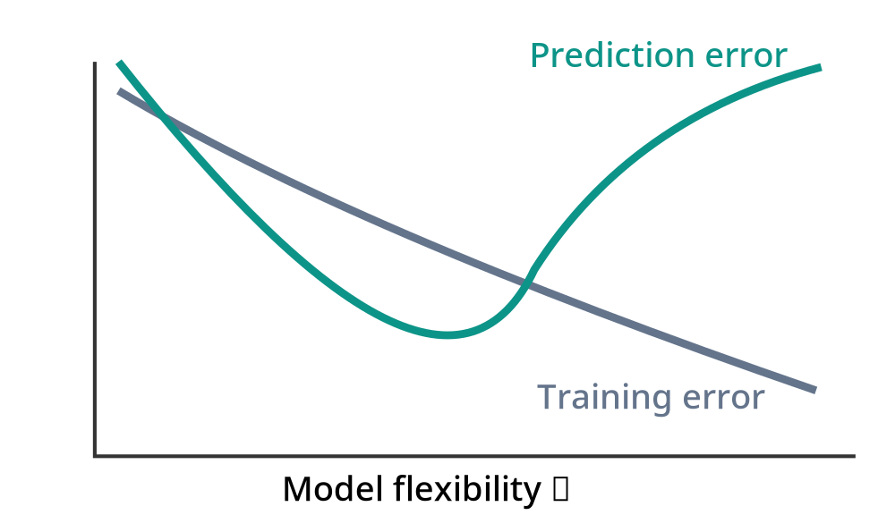

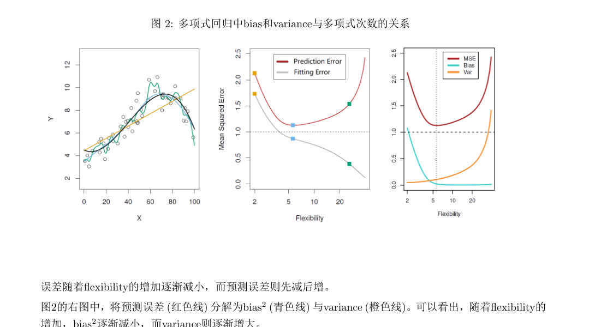

*训练误差随着嵌套模型复杂度增加而不增；预测误差可能在中等复杂度附近达到最小。*

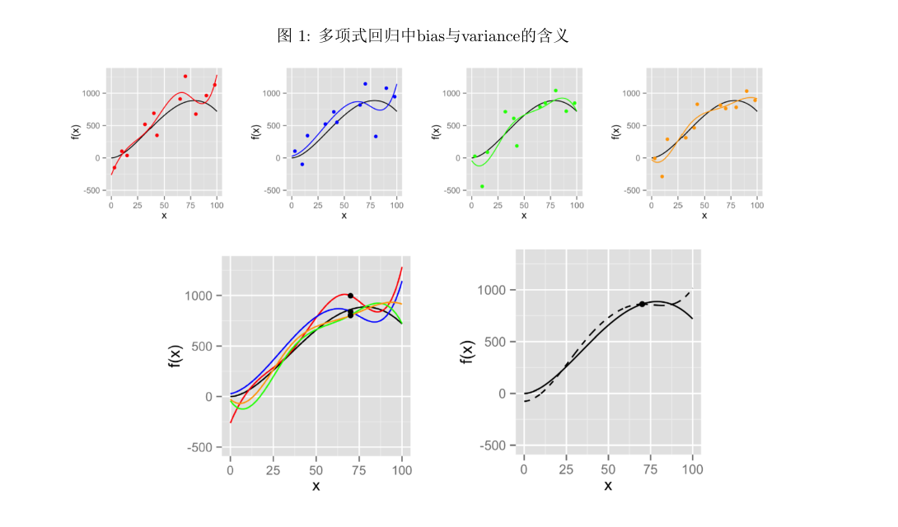

Lecture 5 第 4 页的图 2 正是这种关系：

- 灰色曲线表示训练误差，随着模型灵活度增加而下降；
- 红色曲线表示预测误差，通常先下降后上升；
- 右侧图将预测误差拆成 Bias²、Variance 和不可消减误差。

这是本讲最重要的直觉图。

#### 5.4 考试怎样判断？

2024 年样卷中出现：

> 模型灵活度越高，预测时方差越小，偏差越大。

答案：错误（False）。

方向应当通常相反：

$$\boxed{\text{灵活度增加}\Longrightarrow\begin{cases}\text{Bias}^2\text{ 通常降低}\\\text{Variance 通常升高}\end{cases}}$$

2024 年正式考试和 2026 年第二份样卷又出现：

> 线性回归模型包含的变量越多，预测误差就越小。

答案同样为错误。

因为增加变量只能保证训练 RSS 不增，不能保证新数据的预测误差下降。

---

### 六、既然存在 Bias–Variance Tradeoff，怎样选择模型？

现在我们已经理解：

$$\text{训练 RSS 最小}\not\Rightarrow\text{预测误差最小}$$

那么下一步自然是：

> 怎样在没有真实函数 $f^*$、也不知道真实预测误差 PE 的情况下，比较不同候选模型？

讲义提出四种方法：

$$\boxed{\text{Adjusted }R^2,\quad AIC,\quad BIC,\quad CV}$$

前三种通过拟合误差与模型复杂度之间的平衡来评价模型。

第四种则尝试利用验证数据直接估计新样本预测误差。

这一部分是 Lecture 5 的计算核心，也是六份考试资料中最集中出现的考点。

---

## 第二部分：四种模型选择准则（Model Selection Criteria）

### 七、Adjusted $R^2$：为什么普通 $R^2$ 不够？

#### 7.1 普通 $R^2$ 有什么问题？

在 Lecture 2–3 中：

$$R^2=1-\frac{RSS}{SYY}$$

对于同一个训练数据集，加入自变量后：

$$RSS\text{ 不增}$$

因此：

$$R^2\text{ 不降}$$

这就意味着，如果只看训练 $R^2$，模型越复杂，通常越容易获得更高的分数。

所以它不适合作为单独决定模型复杂度的标准。

#### 7.2 Adjusted $R^2$ 是怎样定义的？

讲义给出：

$$\boxed{R_{\mathrm{adj}}^2=1-\frac{n-1}{n-k-1}(1-R^2)}$$

其中：

- $n$：样本量；
- $k$：模型中的自变量列数，不包含截距；
- $k+1$：需要估计的回归系数数量。

要求残差自由度 $n-k-1>0$。

如果用 $q=k+1$ 表示包含截距的参数数量，则：

$$\boxed{R_{\mathrm{adj}}^2=1-\frac{n-1}{n-q}\frac{RSS}{SYY}}$$

这个形式在考试中更方便，尤其是含有分类变量和交互项的时候。

#### 7.3 为什么这个公式能惩罚复杂模型？

我们已经知道：

$$1-R^2=\frac{RSS}{SYY}$$

代入：

$$\begin{aligned}R_{\mathrm{adj}}^2&=1-\frac{n-1}{n-k-1}\frac{RSS}{SYY}\\&=1-\frac{RSS/(n-k-1)}{SYY/(n-1)}\end{aligned}$$

于是：

$$\boxed{R_{\mathrm{adj}}^2=1-\frac{\hat\sigma^2}{s_Y^2}}$$

其中：

$$\hat\sigma^2=\frac{RSS}{n-k-1}$$

是回归模型的残差方差估计；

$$s_Y^2=\frac{SYY}{n-1}$$

是因变量的样本方差。

这个表达式比原公式更容易理解：

普通 $R^2$ 关注：

$$\frac{RSS}{SYY}$$

而 Adjusted $R^2$ 关注的是：

$$\frac{\text{残差均方}}{\text{因变量样本方差}}$$

当增加变量时，RSS 虽然下降，但残差自由度也下降。

因此：

$$\frac{RSS}{n-k-1}$$

不一定下降。

这就是 Adjusted $R^2$ 对模型复杂度产生惩罚的原因。

#### 7.4 考试怎样选模型？

因为：

$$R_{\mathrm{adj}}^2=1-\frac{n-1}{SYY}\frac{RSS}{n-q}$$

对于使用同一组因变量样本的模型，$n,SYY$ 相同。

因此：

$$\boxed{\max R_{\mathrm{adj}}^2\iff\min\frac{RSS}{n-q}}$$

这是考试非常实用的简化技巧。

**如果题目只给了各模型 RSS 和参数数量，甚至没有给 SYY，也仍然可以比较 Adjusted $R^2$。**

只要比较：

$$\frac{RSS}{n-q}$$

哪个更小即可。

#### 7.5 Adjusted $R^2$ 有哪些性质？

讲义强调两个性质。

**第一：**

$$\boxed{R_{\mathrm{adj}}^2\le R^2}$$

因为：

$$\frac{n-1}{n-k-1}\ge1$$

而：

$$1-R^2\ge0$$

因此 Adjusted $R^2$ 不会超过普通 $R^2$。

**第二：Adjusted $R^2$ 可能为负数。**

例如：

$$n=10,\quad k=2,\quad R^2=0.1$$

则：

$$\begin{aligned}R_{\mathrm{adj}}^2&=1-\frac97(1-0.1)\\&\approx-0.1571\end{aligned}$$

这是完全可能的。

直观上，这表示模型在考虑参数数量带来的自由度损失后，其残差均方甚至大于因变量原始样本方差。

这对应 2023 年第一份模拟题的判断：

> Adjusted $R^2$ 可能为负数，但不会超过 1。

在标准带截距、残差自由度为正的 OLS 情形下，答案为正确。

#### 7.6 为什么增加一个变量，有时 Adjusted $R^2$ 上升，有时下降？

这里补充一个能帮助你理解的推导。

假设原模型参数数量为 $q$，RSS 为 $RSS_R$。

加入一个变量后，参数数量变为 $q+1$，RSS 为 $RSS_F$。

按照 Adjusted $R^2$，新模型更好当且仅当：

$$\frac{RSS_F}{n-q-1}<\frac{RSS_R}{n-q}$$

整理：

$$(n-q)RSS_F<(n-q-1)RSS_R$$

写成：

$$(n-q-1)(RSS_R-RSS_F)>RSS_F$$

所以：

$$\boxed{\frac{RSS_R-RSS_F}{RSS_F/(n-q-1)}>1}$$

左边其实就是经典嵌套回归中，增加一个变量对应的部分 F 统计量，也等于该新增回归系数的 $t^2$（在常规条件下）。

所以对于增加一个参数：

$$\boxed{R_{\mathrm{adj}}^2\text{ 提高}\iff t^2>1}$$

这也解释了为什么按照 Adjusted $R^2$ 选模型，和按照 5% 的 t 检验选模型，可能得到不同结果。

因为 5% 显著性检验要求的临界值通常远大于 1 对应的标准。

---

### 八、AIC：为什么要在拟合误差之外惩罚参数个数？

AIC 全称 Akaike Information Criterion（赤池信息准则）。

#### 8.1 AIC 的基本思想

我们希望模型：

- 尽量拟合数据；
- 但不要使用过多参数。

AIC 将这两个要求写成：

$$\boxed{AIC=-2\log(\text{maximum likelihood})+2\times\text{参数个数}}$$

其中：

$$-2\log(\text{maximum likelihood})$$

可以理解为衡量模型拟合情况的部分。

似然越大，模型对已观测数据的拟合越好，这一项越小。

而：

$$2\times\text{参数个数}$$

惩罚过于复杂的模型。

所以：

$$\boxed{\text{AIC 越小越好}}$$

注意，这不是概率，也不是预测错误率。AIC 主要用于相同数据、可比似然设定下的模型比较。

#### 8.2 为什么在线性回归中会出现 RSS？

讲义从正态线性回归的极大似然出发。

假设：

$$Y_i=\beta_0+\sum_{j=1}^k\beta_jx_{ij}+e_i$$

其中：

$$e_i\overset{\mathrm{i.i.d.}}{\sim}N(0,\sigma^2)$$

对数似然函数为：

$$\ell(\beta,\sigma^2)=-\frac n2\log(2\pi)-\frac n2\log\sigma^2-\frac{RSS(\beta)}{2\sigma^2}$$

对 $\beta$ 最大化，得到 OLS：

$$\hat\beta=\arg\min_\beta RSS(\beta)$$

对 $\sigma^2$ 最大化，得到：

$$\tilde\sigma^2=\frac{RSS}{n}$$

注意这里是 MLE 的 $RSS/n$，不是无偏估计 $RSS/(n-k-1)$。

把它代入：

$$\begin{aligned}\ell_{\max}&=-\frac n2\log(2\pi)-\frac n2\log(RSS/n)-\frac n2\end{aligned}$$

所以：

$$-2\ell_{\max}=n\log(RSS/n)+n\log(2\pi)+n$$

后两项与变量选择无关，因此可以在模型比较时省去。

对于使用 $k$ 个自变量的模型，回归系数一共有 $k+1$ 个。

讲义给出的简化 AIC 为：

$$\boxed{AIC=n\log\left(\frac{RSS}{n}\right)+2(k+1)}$$

注意：严格计算正态模型的完整 AIC 时，还可以将共同估计的误差方差参数计入参数数目，但这只会为这些候选模型共同增加一个常数，不改变模型选择的结论。

#### 8.3 如何理解 AIC 的两部分？

$$AIC=\underbrace{n\log(RSS/n)}_{\text{拟合项}}+\underbrace{2(k+1)}_{\text{复杂度惩罚}}$$

增加变量时：

$$RSS\downarrow$$

所以拟合项倾向于下降。

但同时：

$$k\uparrow$$

所以惩罚项增加。

只有当 RSS 的下降足够明显、足以抵消参数惩罚时，新模型的 AIC 才会更小。

这就是 AIC 解决 Bias–Variance Tradeoff 的基本思路。

---

### 九、BIC：为什么通常比 AIC 更偏好简单模型？

BIC 全称 Bayesian Information Criterion（贝叶斯信息准则）。

讲义给出：

$$\boxed{BIC=n\log\left(\frac{RSS}{n}\right)+(k+1)\log n}$$

它与 AIC 形式非常相似。

唯一直接可见的区别是参数惩罚项。

| 准则 | 拟合项 | 每个参数的惩罚 |
|---|---|---|
| AIC | $n\log(RSS/n)$ | 2 |
| BIC | $n\log(RSS/n)$ | $\log n$ |

其中 $\log$ 表示自然对数。

如果：

$$\log n>2$$

也就是：

$$n>e^2\approx7.39$$

那么 BIC 对每个参数的惩罚就比 AIC 更大。

因此，在使用相同候选模型集合和相同可比拟合项进行全局比较时，BIC 选出的模型通常不会比 AIC 选出的模型参数更多（并列最优时需说明如何处理）。

**BIC 更偏好简单模型，但不是说 BIC 一定选择变量最少的模型。**

如果复杂模型使 RSS 大幅下降，它仍然可能被 BIC 选中。

#### 9.1 一定要能区分 AIC 和 BIC 的方向

两者都是：

$$\boxed{\text{越小越好}}$$

而：

$$R_{\mathrm{adj}}^2$$

是：

$$\boxed{\text{越大越好}}$$

这是最基础、也最容易因粗心而失分的地方。

---

### 十、AIC 与 BIC 的通用比较公式

这部分特别重要，因为模拟题多次考查，而直接套指数不等式往往比计算对数快。

假设比较两个模型。

简单模型：

$$M_R:\quad RSS_R,\quad q_R\text{ 个参数}$$

复杂模型：

$$M_F:\quad RSS_F,\quad q_F\text{ 个参数}$$

其中：

$$q_F>q_R$$

令：

$$\Delta q=q_F-q_R$$

#### 10.1 AIC 什么时候选择复杂模型？

复杂模型更好当且仅当：

$$AIC_F<AIC_R$$

即：

$$n\log(RSS_F/n)+2q_F<n\log(RSS_R/n)+2q_R$$

移项：

$$n\log(RSS_R/RSS_F)>2(q_F-q_R)$$

所以：

$$\boxed{\frac{RSS_R}{RSS_F}>\exp\left(\frac{2\Delta q}{n}\right)}$$

这就是 AIC 的通用比较公式。

#### 10.2 BIC 什么时候选择复杂模型？

同理：

$$BIC_F<BIC_R$$

等价于：

$$n\log(RSS_R/RSS_F)>\Delta q\log n$$

因此：

$$\boxed{\frac{RSS_R}{RSS_F}>\exp\left(\frac{\Delta q\log n}{n}\right)}$$

这就是 BIC 的通用比较公式。

#### 10.3 为什么这个变形特别适合考试？

因为试卷经常不给计算器，只给：

$$e^{0.2}\approx1.22,\qquad e^{0.4}\approx1.49$$

之类的近似值。

你不需要分别计算两个模型的完整 AIC。

只需要判断：

$$\frac{RSS_R}{RSS_F}$$

是否超过指定门槛。

#### 10.4 统一记忆

**两个嵌套模型，复杂模型优于简单模型的条件**

**Adjusted $R^2$**

$$\frac{RSS_F}{n-q_F}<\frac{RSS_R}{n-q_R}$$

**AIC**

$$\frac{RSS_R}{RSS_F}>e^{2\Delta q/n}$$

**BIC**

$$\frac{RSS_R}{RSS_F}>e^{\Delta q\log n/n}$$

这三个比较式就是本讲计算题的核心工具。

需要强调：比较时必须使用相同的因变量数据和可比的模型设定，且 Adjusted $R^2$ 要求模型具有正的残差自由度。

---
### 十一、交叉验证（Cross Validation, CV）

前面的三个准则主要依赖训练数据上的 RSS，并加入一定的复杂度校正。

交叉验证换了一种思路：

> 既然我们关心新样本上的预测能力，就从已有数据中暂时留出一部分，不参与训练，用它来检验模型。

这是交叉验证最重要的思想。

#### 11.1 训练集与验证集有什么区别？

训练集（Training Set）用于估计模型参数。

验证集（Validation Set）用于评价模型对未参与拟合的数据的预测误差，并选择模型或调节参数。

例如有 100 条数据：

- 使用 80 条数据拟合模型；
- 使用剩余 20 条数据计算预测误差。

如果只是进行一次这样的划分，结果可能受具体划分方式影响。

因此进一步使用 k 折交叉验证（k-fold Cross Validation）。

#### 11.2 k 折交叉验证怎样进行？

假设有 $M$ 个候选模型：

$$M_1,\ldots,M_M$$

将全部数据划分为 $K$ 份，通常每份数量大致相同。

注意：这里我用大写 $K$ 表示折数，避免与前面表示自变量数量的 $k$ 混淆。

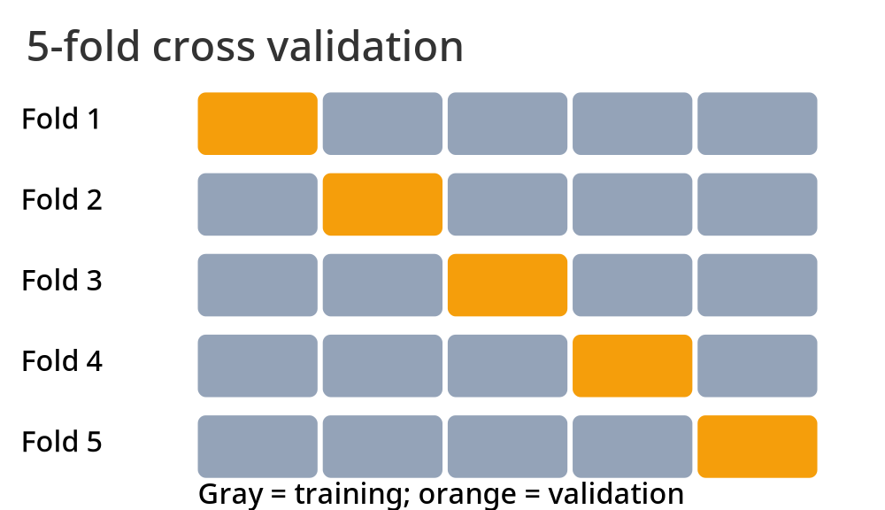

*每次使用其中一折验证，其余四折训练。五次结束后，每条样本都恰好担任过一次验证样本。*

对于某个固定候选模型 $M_m$，每次训练时：

使用其中 $K-1$ 折训练，剩余 1 折验证。

重复 $K$ 次，得到：

$$\widehat{PE}_1(m),\ldots,\widehat{PE}_K(m)$$

然后计算平均预测误差：

$$\boxed{CV(m)=\frac1K\sum_{i=1}^K\widehat{PE}_i(m)}$$

最后选择：

$$\boxed{m^*=\arg\min_{1\le m\le M}CV(m)}$$

也就是选交叉验证预测误差最小的模型。

讲义中的 $K$ 折通常指每折样本量相同或近似相同。如果折的样本数差异明显，直接合并所有验证样本的平方误差、再除以验证样本总数，会得到按样本数加权的整体验证 MSE。

#### 11.3 为什么 CV 能用于选择复杂度？

假设我们考虑：

$$M_1:\text{一次多项式}$$

$$M_2:\text{三次多项式}$$

$$M_3:\text{八次多项式}$$

八次多项式的训练 RSS 可能最小。

但在交叉验证时，它每次都要对没有参与本轮训练的样本进行预测。

如果八次模型过度拟合训练数据中的噪声，那么它在验证样本上的误差可能较大。

于是 CV 就能够在一定程度上识别过拟合问题。

#### 11.4 LOOCV 是什么？

当：

$$K=n$$

时，每次只留出 1 个观测作为验证样本，剩下 $n-1$ 个用于训练。

这叫留一法交叉验证（Leave-One-Out Cross Validation, LOOCV）。

它需要进行 $n$ 次训练或相应的等价计算。

相比之下，5 折、10 折交叉验证计算量通常更低。

讲义指出，常用：

$$K=5\quad\text{或}\quad K=10$$

#### 11.5 CV 选出模型后，接下来怎么办？

这是讲义特别强调的步骤。

假设交叉验证选出：

$$M_3$$

并不意味着最终要直接使用某一折训练得到的 $M_3$ 参数。

正确的过程是：

**先通过 CV 选择模型，然后用所有可用于训练的数据重新拟合这个模型，得到最终参数。**

如果另外保留了独立测试集（Test Set），则测试集不能参与前面的模型选择、参数调节或最终训练，应该只用于最后的泛化评估。

---

### 十二、1 标准误规则（One Standard Error Rule）

这是 Lecture 5 中容易被忽略，但值得掌握的一部分。

#### 12.1 为什么不一定选 CV 最小的模型？

假设三个候选模型：

| 模型 | 灵活度 | CV |
|---|---|---:|
| $M_1$ | 低 | 5.15 |
| $M_2$ | 中 | 5.00 |
| $M_3$ | 高 | 5.10 |

如果只看 CV 最小值，应该选择：

$$M_2$$

但这些 CV 估计值也存在随机波动。

如果 $M_1$ 的 CV 只比最小值高一点点，而且这种差异处于估计不确定性的范围内，那么选择更简单的 $M_1$ 可能更稳妥。

这就是 1 标准误规则的思想。

#### 12.2 先计算 CV 的标准误

根据讲义：

$$CV(m)=\frac1K\sum_{i=1}^K\widehat{PE}_i(m)$$

先计算各折验证误差的样本标准差：

$$\boxed{SD(m)=\sqrt{\frac1{K-1}\sum_{i=1}^K[\widehat{PE}_i(m)-CV(m)]^2}}$$

然后：

$$\boxed{SE(m)=\frac{SD(m)}{\sqrt K}}$$

这是讲义使用的折间标准误估计公式。由于不同折的训练集彼此重叠，严格统计推断中折间误差并不完全独立，因此这里的 SE 更适合用于模型选择的经验性规则，而不是理解为精确置信区间。

#### 12.3 1-SE 规则怎样选模型？

首先找到 CV 最小的模型：

$$m^*=\arg\min_m CV(m)$$

然后计算门槛：

$$\boxed{CV(m^*)+SE(m^*)}$$

在 CV 不超过这一门槛的候选模型中，选择最简单、灵活度最低的模型。

讲义用严格小于号描述候选范围，实际使用时处于边界的模型通常也可按照具体约定处理。

#### 12.4 数值例子

假设最优模型的：

$$CV(m^*)=5.00$$

$$SE(m^*)=0.25$$

于是：

$$\text{门槛}=5.25$$

比较以下三个模型：

| 模型 | 灵活度 | CV | 是否在门槛内 |
|---|---|---:|---|
| $M_1$ | 低 | 5.20 | 是 |
| $M_2$ | 中 | 5.00 | 是 |
| $M_3$ | 高 | 5.10 | 是 |

虽然 $M_2$ 的 CV 最小，但三个模型都在门槛内。

按照 1-SE 规则，选择：

$$\boxed{M_1}$$

因为它在预测误差接近最优的同时，复杂度最低。

#### 12.5 这与 Bias–Variance Tradeoff 有什么联系？

1-SE 规则倾向于在预测误差差异不明显的时候选择简单模型。

它不追求训练数据上的最大拟合程度，而是希望在预测效果和模型稳定性之间取得更稳健的平衡。

Lecture 5 第 8 页图 5 画出了 CV 曲线及标准误区间，图中的浅色区域就是 1-SE 规则允许选择模型的范围。

---

## 第三部分：逐步回归（Stepwise Regression）

### 十三、为什么有了选择准则，还需要搜索算法？

到这里，我们知道怎样比较两个模型：

- Adjusted $R^2$：越大越好；
- AIC：越小越好；
- BIC：越小越好；
- CV：越小越好。

但是还没有解决：

> 有很多候选变量时，到底要比较哪些变量组合？

假设有 $p$ 个候选自变量。

每个变量只有“选择”或“不选择”两种状态，因此可能的子集数量为：

$$\boxed{2^p}$$

例如：

$$p=10\Rightarrow2^{10}=1024$$

$$p=20\Rightarrow2^{20}=1,048,576$$

所以变量数量较大时，完全穷举所有子集的计算成本可能很高。

这就需要逐步回归。

注意，这里的 $2^p$ 是组合数量，不需要通过实际计算器或程序来理解方法。

---

### 十四、前向选择（Forward Selection, FS）

#### 14.1 核心思想

前向选择的思路是：

**从最简单的模型开始，每一步加入一个能够带来最好改进的变量。**

例如候选变量：

$$X_1,X_2,X_3$$

第一步从：

$$Y\sim1$$

也就是只有截距的模型开始。

第二步分别考虑：

$$Y\sim X_1$$

$$Y\sim X_2$$

$$Y\sim X_3$$

比较三个模型，选出当前最优的一个。

假设：

$$Y\sim X_2$$

最好。

下一步只考虑在 $X_2$ 基础上加入其他变量：

$$Y\sim X_2+X_1$$

和：

$$Y\sim X_2+X_3$$

假设第二个更好，则进入：

$$Y\sim X_2+X_3$$

最后考虑是否进一步加入 $X_1$。

#### 14.2 讲义的标准过程

讲义采用的是构造一条前向模型路径，然后从路径中选择最优模型的表述。

因此它通常包括：

1. 从只有截距的模型出发。
2. 每一步在尚未入选的变量中，选择加入后使当前准则最优的变量。
3. 得到一系列不同复杂度的模型。
4. 最后根据模型选择准则，从路径中的模型选出最终模型。

在一些实际算法实现中，也会采用一旦加入变量不能改善准则就提前停止的版本。

这两种执行方式略有不同，但基本思想一致。

#### 14.3 为什么 FS 不等于单独给变量排序？

例如 $X_1$ 单独预测 $Y$ 的效果最好，不代表它在任何模型里都是最有用的变量。

第一步选变量时，比较的是变量与 $Y$ 的边际拟合效果。

但第二步是在已经选入变量的基础上，比较其他变量能够带来的**额外解释信息**。

因此前向选择每一步都需要重新评估候选变量，而不能只根据最初的单变量相关系数排序。

#### 14.4 FS 有什么局限？

最主要的问题是：

**一旦选入某个变量，标准 FS 不会在后续步骤主动将它删除。**

因此，如果某一步选择并不理想，后续路径可能受到影响。

此外，FS 是一种贪心搜索（Greedy Search），它只考虑当前步骤最好的选择，并不保证找到所有变量子集中的全局最优模型。

---

### 十五、后向剔除（Backward Elimination, BE）

后向剔除采用相反的方向。

#### 15.1 核心思想

**先拟合包含全部候选变量的完整模型，然后每一步删除一个最不值得保留的变量。**

例如：

$$Y\sim X_1+X_2+X_3$$

依次比较删除 $X_1$、删除 $X_2$、删除 $X_3$ 后的模型。

保留使得选择准则最优的删除结果。

再继续向下删除。

最终也得到一条由复杂到简单的模型路径。

#### 15.2 BE 与 FS 的区别

| 比较 | FS | BE |
|---|---|---|
| 起点 | 只有截距的模型 | 全部变量的模型 |
| 每步操作 | 加入变量 | 删除变量 |
| 搜索方向 | 简单 → 复杂 | 复杂 → 简单 |
| 是否重新考虑已经做过的决定 | 通常不删除已选变量 | 通常不加回已删变量 |
| 当 $p\ge n$ | 可以从低维子模型开始 | 常规完整 OLS 起点不可唯一估计 |

#### 15.3 为什么 BE 不适用于普通的 $p\ge n$ 高维回归？

因为它要求一开始就拟合全模型：

$$Y\sim X_1+\cdots+X_p$$

带截距时设计矩阵有：

$$p+1$$

列。

如果：

$$p+1>n$$

那么：

$$\operatorname{rank}(X)\le n<p+1$$

所以：

$$X^\top X$$

不可逆，普通 OLS 无法唯一确定所有回归系数。

因此标准 OLS 后向剔除通常要求：

$$\boxed{p<n}$$

并且还需要完整设计矩阵满列秩、具备合适的残差自由度。

而前向选择可以从一个低维模型开始，逐步加入变量；即使总候选变量数 $p>n$，也可以在当前子模型仍可估计的范围内运行。

这直接对应 2024 与 2026 模拟题中的选择题和判断题。

---

### 十六、双向逐步选择（FS+BE）

FS 的问题是选进来的变量不能删。

BE 的问题是删除的变量不能再加入。

因此可以组合二者：

**每一步既考虑加入新变量，也考虑删除当前已有变量，选择使准则改善最多的操作。**

例如：

$$Y\sim X_2$$

下一步可能加入 $X_3$：

$$Y\sim X_2+X_3$$

再下一步可能发现删除 $X_2$ 后模型更好：

$$Y\sim X_3$$

这样就能修正之前的选择。

但要注意：

FS+BE 也不是对所有变量组合进行穷举，仍然是一种局部搜索方法。

因此：

$$\boxed{\text{FS、BE、FS+BE 都不保证找到全子集最优模型}}$$

这也是此前 Assignment 2 Problem 6 要求比较三种方法的主要原因。

---

### 十七、边际性原则（Marginality Principle）

这是讲义逐步回归部分必须掌握的一个约束。

前面 Lecture 4 学过主效应和交互效应。

例如：

$$Y\sim X+F+X:F$$

其中：

$$X:F$$

属于高阶交互项。

边际性原则要求我们在选择模型时保留必要的低阶项。

#### 17.1 前向选择时

如果希望加入交互项：

$$X:F$$

通常必须先有：

$$X,\quad F$$

因此：

$$\boxed{\text{先选主效应，再考虑交互效应}}$$

例如，不能在尚未加入 $X$ 和 $F$ 时，直接把 $X:F$ 作为独立的候选项加入。

#### 17.2 后向剔除时

如果当前模型包含：

$$X+F+X:F$$

则不能在保留 $X:F$ 的情况下，随意删除其必要主效应。

因此：

$$\boxed{\text{先删除高阶项，再考虑删除对应低阶项}}$$

对于三阶交互：

$$A:B:C$$

其对应的二阶交互和主效应，也需要按照层级关系处理。

#### 17.3 为什么要遵循这个原则？

因为保留交互项却删除其构成变量的低阶项，通常会使模型解释依赖变量原点或类别编码方式，产生难以解释甚至不稳定的参数含义。

边际性原则可以让模型具有更合理的层级结构。

讲义分别在 FS、BE 和 FS+BE 中强调了这个原则。

---

### 十八、逐步回归中怎样使用 AIC、BIC、Adjusted $R^2$？

这一点容易被误解。

假设当前模型已有：

$$X_1$$

现在考虑加入 $X_2$ 或 $X_3$。

如果每个候选操作都只增加一个普通连续变量，那么新模型的参数数量相同。

因此在这一步中：

- RSS 最小；
- Adjusted $R^2$ 最大；
- AIC 最小；
- BIC 最小；

通常都会选择同一个新增变量。

因为各模型的复杂度惩罚完全相同。

但是如果候选项的参数数量不同，结论就不一定相同。

例如：

- 加入连续变量 $X$：增加 1 个参数；
- 加入有 4 个类别的分类变量 $F$：增加 3 个虚拟变量参数。

虽然加入 $F$ 可能让 RSS 下降得更多，但其 AIC/BIC 复杂度惩罚也更大。

因此不能只看 RSS。

这正是 2026 年第一份模拟题中“将分类变量整组加入”的细节需要注意的地方。

---

### 十九、OGA：讲义标注“不要求”

讲义最后介绍 Orthogonal Greedy Algorithm（正交贪心算法，OGA）。

它的主要目的，是改善高维条件下逐步回归每一步重新计算 OLS 的成本。

基本思想是利用 Gram–Schmidt 正交化，将新增变量与已有变量张成的空间分离，从而更高效地更新拟合。

讲义进一步介绍了适用于高维变量选择的 HDAIC、HDBIC。

但这些内容明确标注“不要求”，因此本次只需知道其研究动机：

**在候选变量数量很大时，传统逐步回归的计算成本可能很高，OGA 通过正交化简化计算。**

不需要专门背诵 OGA 的迭代公式或 HDIC 的具体惩罚项。

---
## 第四部分：六份模拟题中的 Lecture 5 考点与完整解答

下面进入考试复习部分。

这一讲与前几讲不同，主要计算题不是求 OLS 系数，而是**给出几个候选模型、RSS 和参数数量，让你根据某种准则选择模型，并解释选择原因**。

建议按照下面几个题型掌握，而不是逐份试卷重复做相同的计算。

---

### 题型一：证明只有截距的模型，RSS 等于 SYY

*对应：2023 Fall Sample Midterm 1 · Problem 5 第 1 问（5 分）*

#### 原题

考虑只有截距的线性回归模型：

$$Y_i=\beta_0+e_i$$

证明其最小二乘残差平方和满足：

$$RSS=SYY$$

#### 解题思路

只有截距，说明模型对每个样本的预测值都相同。

因此，最小二乘法实际上就是寻找一个常数，使它到所有观测值的平方距离之和最小。

我们之前学过，这个常数正是样本均值。

#### 完整推导

最小二乘目标函数为：

$$f(\beta_0)=\sum_{i=1}^n(Y_i-\beta_0)^2$$

对 $\beta_0$ 求导：

$$f'(\beta_0)=-2\sum_{i=1}^n(Y_i-\beta_0)$$

令其等于 0：

$$\sum_{i=1}^nY_i-n\hat\beta_0=0$$

所以：

$$\hat\beta_0=\bar Y$$

于是：

$$\begin{aligned}RSS&=\sum_{i=1}^n(Y_i-\hat\beta_0)^2\\&=\sum_{i=1}^n(Y_i-\bar Y)^2\\&=SYY\end{aligned}$$

证毕。

因此：

$$\boxed{RSS_{\text{只有截距}}=SYY}$$

同时：

$$R^2=1-\frac{RSS}{SYY}=0$$

这是后续变量选择题一个非常常用的起点。

如果试卷没有给出 SYY，但是给了只有截距模型的 RSS，那么可以直接将它作为 SYY。

---

### 题型二：Forward Selection + Adjusted $R^2$ + BIC

*对应：2023 Fall Sample Midterm 1 · Problem 5（15 分）*

这是非常标准的 Lecture 5 综合计算题。

#### 原题

假设样本量为：

$$n=10$$

有三个候选变量：

$$X_1,X_2,X_3$$

通过前向选择得到四个模型：

| 模型 | 自变量 | RSS |
|---|---|---:|
| $M_1$ | 只有截距 | 100 |
| $M_2$ | $X_2$ | 40 |
| $M_3$ | $X_2,X_3$ | 28 |
| $M_4$ | $X_2,X_3,X_1$ | 25.2 |

要求：

1. 证明只有截距的模型有 $RSS=SYY$。
2. 根据 Adjusted $R^2$ 选择模型。
3. 根据 BIC 选择模型。

第一问前面已经证明，下面重点分析后两问。

#### 第 2 问：使用 Adjusted $R^2$

因为：

$$RSS(M_1)=SYY=100$$

所以：

$$R^2=1-\frac{RSS}{100}$$

同时：

$$R_{\mathrm{adj}}^2=1-\frac{n-1}{n-k-1}(1-R^2)$$

其中 $k$ 是自变量数量，不包括截距。

**模型 $M_1$：**

$$k=0,\quad R^2=0$$

因此：

$$R_{\mathrm{adj}}^2=0$$

**模型 $M_2$：**

$$k=1,\quad RSS=40$$

$$R^2=1-\frac{40}{100}=0.6$$

$$R_{\mathrm{adj}}^2=1-\frac98(1-0.6)=0.55$$

**模型 $M_3$：**

$$k=2,\quad RSS=28$$

$$R^2=0.72$$

$$R_{\mathrm{adj}}^2=1-\frac97(1-0.72)=0.64$$

**模型 $M_4$：**

$$k=3,\quad RSS=25.2$$

$$R^2=0.748$$

$$R_{\mathrm{adj}}^2=1-\frac96(1-0.748)=0.622$$

整理：

| 模型 | $R^2$ | Adjusted $R^2$ |
|---|---:|---:|
| $M_1$ | 0 | 0 |
| $M_2$ | 0.600 | 0.550 |
| $M_3$ | 0.720 | 0.640 |
| $M_4$ | 0.748 | 0.622 |

由于：

$$\boxed{\max R_{\mathrm{adj}}^2=0.64}$$

因此选择：

$$\boxed{M_3:Y\sim X_2+X_3}$$

注意一个重要现象：

普通 $R^2$ 从 0.72 增加到 0.748，但 Adjusted $R^2$ 从 0.64 下降到 0.622。

这说明增加 $X_1$ 所带来的 RSS 降低，不足以抵消多使用一个参数造成的自由度损失。

#### 第 3 问：使用 BIC

根据讲义：

$$BIC=n\log(RSS/n)+(k+1)\log n$$

由于：

$$n=10$$

对不同模型进行比较。

**比较 $M_1,M_2$：**

$$\frac{RSS_1}{RSS_2}=\frac{100}{40}=2.5$$

两者参数数量相差 1，所以 BIC 选择复杂模型的条件为：

$$\frac{RSS_1}{RSS_2}>e^{\log(10)/10}$$

右侧约为：

$$10^{0.1}\approx1.26$$

显然：

$$2.5>1.26$$

因此 $M_2$ 优于 $M_1$。

**比较 $M_2,M_3$：**

$$\frac{RSS_2}{RSS_3}=\frac{40}{28}\approx1.429$$

由于：

$$1.429>1.26$$

所以 $M_3$ 优于 $M_2$。

**比较 $M_3,M_4$：**

$$\frac{RSS_3}{RSS_4}=\frac{28}{25.2}\approx1.111$$

由于：

$$1.111<1.26$$

因此 $M_4$ 没有带来足够大的拟合改善，BIC 不支持增加 $X_1$。

所以：

$$\boxed{\text{BIC 选择 }M_3}$$

#### 这道题总结

两种准则均选择：

$$\boxed{Y\sim X_2+X_3}$$

这道题非常适合掌握两种通用方法：

$$\boxed{R_{\mathrm{adj}}^2\text{ 比较 }\frac{RSS}{n-k-1}}$$

$$\boxed{BIC\text{ 比较 }\frac{RSS_R}{RSS_F}\text{ 与 }e^{\Delta q\log n/n}}$$

---

### 题型三：候选模型不在同一条 Forward Selection 路径上，怎样使用 AIC？

*对应：2024 Fall Sample Midterm · Problem 3（16 分）*

这道题的重要变化是：三个候选模型并不是只沿着一条前向选择路径依次扩充，而是包括两个不同的单变量模型。

#### 原题

有两个候选自变量：

$$X_1,X_2$$

给定：

$$n=10$$

三个模型的 RSS：

$$RSS(Y\sim X_1)=21$$

$$RSS(Y\sim X_2)=24$$

$$RSS(Y\sim X_1+X_2)=15$$

要求分别用 AIC 和 Adjusted $R^2$ 选择模型。

#### 第一步：先排除明显较差的模型

$Y\sim X_1$ 和 $Y\sim X_2$ 的参数数量相同：

$$q=2$$

但：

$$21<24$$

因此无论使用 AIC 还是 Adjusted $R^2$，$Y\sim X_1$ 都优于 $Y\sim X_2$。

所以可以先排除：

$$Y\sim X_2$$

剩下只需要比较：

$$M_R:Y\sim X_1$$

与：

$$M_F:Y\sim X_1+X_2$$

#### 第 2 问：根据 AIC 选择

两模型参数数量：

$$q_R=2,\qquad q_F=3$$

因此：

$$\Delta q=1$$

使用 AIC 比较公式：

$$\frac{RSS_R}{RSS_F}>e^{2\Delta q/n}$$

代入：

$$\frac{21}{15}=1.4$$

而：

$$e^{2/10}=e^{0.2}\approx1.221$$

因为：

$$1.4>1.221$$

所以：

$$\boxed{\text{AIC 选择 }Y\sim X_1+X_2}$$

#### 第 3 问：根据 Adjusted $R^2$ 选择

题目没有给出 SYY，但我们不需要它。

直接比较：

$$\frac{RSS}{n-q}$$

简单模型：

$$\frac{21}{10-2}=\frac{21}{8}=2.625$$

复杂模型：

$$\frac{15}{10-3}=\frac{15}{7}\approx2.143$$

因为：

$$2.143<2.625$$

所以：

$$\boxed{\text{Adjusted }R^2\text{ 也选择 }Y\sim X_1+X_2}$$

#### 这道题真正的解题方法

遇到多个候选模型，不需要一开始就把每个模型的所有准则都计算出来。

可以先比较参数数目。

如果两个模型参数数目相同，那么 RSS 更小的模型，在本讲使用的这几个基于 RSS 的准则中也会更优。

这样可以减少很多不必要的计算。

---

### 题型四：分类变量整组加入时，参数数量怎样计算？

*对应：2026 Fall Sample Midterm 1 · Problem 4（14 分）*

这道题同时考查 Lecture 4 和 Lecture 5。

它很重要，因为这里每一步不一定只增加一个参数。

#### 原题

假设：

$$n=10$$

有一个连续变量 $X$ 和一个有三个类别的分类变量 $F$。

前向选择得到：

| 模型 | 回归公式 | RSS |
|---|---|---:|
| $M_1$ | $Y\sim1$ | 100 |
| $M_2$ | $Y\sim X$ | 48 |
| $M_3$ | $Y\sim X+F$ | 24 |
| $M_4$ | $Y\sim X+F+X:F$ | 18 |

要求分别使用 Adjusted $R^2$ 和 AIC 选择模型。

#### 第一步：先正确计算参数数量

因为 $F$ 有三个类别，所以需要：

$$3-1=2$$

个虚拟变量。

因此：

$$M_1:q=1$$

$$M_2:q=2$$

$$M_3:q=1+1+2=4$$

对于交互项：

$$X:F$$

因为 $X$ 是一个连续变量，$F$ 有两个虚拟变量，所以交互项增加两个参数。

因此：

$$M_4:q=4+2=6$$

得到：

| 模型 | 参数数 $q$ |
|---|---:|
| $M_1$ | 1 |
| $M_2$ | 2 |
| $M_3$ | 4 |
| $M_4$ | 6 |

这是整道题最容易出错的地方。

不能把一个分类变量 $F$ 机械地算作一个回归系数。

#### 第二步：计算 Adjusted $R^2$

由于只有截距的模型：

$$RSS_1=SYY=100$$

所以：

$$R^2=1-\frac{RSS}{100}$$

使用：

$$R_{\mathrm{adj}}^2=1-\frac{n-1}{n-q}\frac{RSS}{SYY}$$

可以得到：

| 模型 | $q$ | $R^2$ | Adjusted $R^2$ |
|---|---:|---:|---:|
| $M_1$ | 1 | 0 | 0 |
| $M_2$ | 2 | 0.52 | 0.46 |
| $M_3$ | 4 | 0.76 | 0.64 |
| $M_4$ | 6 | 0.82 | 0.595 |

所以：

$$\boxed{\text{Adjusted }R^2\text{ 选择 }M_3}$$

#### 第三步：计算 AIC

公式：

$$AIC=n\log(RSS/n)+2q$$

计算得到：

| 模型 | RSS | $q$ | AIC（约） |
|---|---:|---:|---:|
| $M_1$ | 100 | 1 | 25.026 |
| $M_2$ | 48 | 2 | 19.686 |
| $M_3$ | 24 | 4 | 16.755 |
| $M_4$ | 18 | 6 | 17.878 |

最小值为：

$$AIC_3\approx16.755$$

所以：

$$\boxed{\text{AIC 也选择 }M_3:Y\sim X+F}$$

#### 第四步：用考试更快的比较法

从 $M_2$ 到 $M_3$，增加两个参数：

$$\Delta q=2$$

因此要求：

$$\frac{48}{24}>e^{2\times2/10}$$

即：

$$2>e^{0.4}\approx1.5$$

成立，所以应加入 $F$。

从 $M_3$ 到 $M_4$，也增加两个参数：

$$\frac{24}{18}\approx1.333$$

但：

$$1.333<e^{0.4}\approx1.5$$

所以不应再加入交互项。

最终仍选：

$$\boxed{M_3}$$

这里还有一个值得指出的地方：2026 年第一份样卷的解答，在比较 $M_2$ 与 $M_3$ 之后，有一句“因此选模型(2)”的文字笔误；根据该处的不等式和最后结论，应当是模型 $M_3$。

---

### 题型五：为什么按照 t 检验和 Adjusted $R^2$ 会选出不同模型？

*对应：2024 Fall Midterm Solutions · Problem 4（16 分）；2026 Fall Sample Midterm 2 · Problem 4*

这是很典型的概念综合题。

#### 原题

样本量：

$$n=8$$

一个连续变量 $X$，一个二分类变量 $F$。

拟合三个模型：

$$M_1:Y\sim X$$

$$M_2:Y\sim X+F$$

$$M_3:Y\sim X+F+X:F$$

三个模型的：

$$R^2=0.34,\quad0.50,\quad0.64$$

在模型三中，交互项 $X:F$ 的 p 值为：

$$p=0.37$$

要求比较按 t 检验和 Adjusted $R^2$ 的选择结果。

#### 按 t 检验选择

由于交互项：

$$p=0.37>0.05$$

所以没有足够的证据支持不同类别具有不同斜率。

因此按照题目采用的逐步显著性选择方法，可以删除交互项，选择：

$$\boxed{M_2}$$

#### 按 Adjusted $R^2$ 选择

三个模型的自变量列数分别为：

$$k=1,2,3$$

因此：

$$R_{\mathrm{adj},1}^2=1-\frac76(1-0.34)=0.23$$

$$R_{\mathrm{adj},2}^2=1-\frac75(1-0.50)=0.30$$

$$R_{\mathrm{adj},3}^2=1-\frac74(1-0.64)=0.37$$

所以 Adjusted $R^2$ 选择：

$$\boxed{M_3}$$

#### 为什么不矛盾？

因为两个方法的目标不同。

t 检验关注：

> 有没有足够强的统计证据认为某个特定系数不等于 0？

Adjusted $R^2$ 关注：

> 加入这些参数后，残差均方是否得到足够改善？

从前面推导可知，单个变量带来的 Adjusted $R^2$ 改善与 $t^2>1$ 有关，而双侧 5% t 检验的拒绝门槛通常更高。

因此，一个变量可能不满足 5% 显著性要求，却仍然改善 Adjusted $R^2$。

这正是两种准则得出不同结论的原因。

---

### 题型六：将 AIC 应用于 Logistic 回归

*对应：2024 Fall 正式考试 · Problem 5 第 3 问（5 分）*

这一题的 Logistic 回归分布和链接函数属于后续内容，但是 AIC 的应用属于 Lecture 5，因此可以提前掌握选模型的部分。

题目给出两个模型：

| 模型 | Residual Deviance | 参数数量 |
|---|---:|---:|
| 全模型 | 14.18 | 4 |
| 简化模型 | 18.16 | 3 |

Logistic 回归中的残差偏差（Residual Deviance）定义为：

$$G^2=2(\ell_{\mathrm{sat}}-\hat\ell)$$

其中 $\ell_{\mathrm{sat}}$ 是饱和模型的最大对数似然值。

因为：

$$AIC=-2\hat\ell+2q$$

而：

$$-2\hat\ell=G^2-2\ell_{\mathrm{sat}}$$

如果两个模型使用同一组数据，$\ell_{\mathrm{sat}}$ 相同，因此比较 AIC 等价于比较：

$$\boxed{G^2+2q}$$

对于全模型：

$$14.18+2\times4=22.18$$

对于简化模型：

$$18.16+2\times3=24.16$$

因为：

$$22.18<24.16$$

所以：

$$\boxed{\text{选择全模型}}$$

这道题说明 AIC 不只适用于普通线性回归，而是一种更一般的基于似然的模型选择准则。

但是不同模型的似然必须具有可比性。

---

### 题型七：交叉验证与 1-SE 规则计算

六份模拟题中，交叉验证更多以方法理解和模型选择思想出现；讲义明确给出了 CV 和 1-SE 规则的公式，所以这里补充一个纸笔计算题型。

#### 例题

假设使用 5 折交叉验证选择多项式次数。

对于三次模型，五折验证 MSE 为：

$$4.2,\quad5.1,\quad4.9,\quad5.3,\quad5.5$$

另外，一次模型与二次模型的 CV 值分别为：

$$CV(1)=5.15,\qquad CV(2)=5.10$$

三次模型的 CV 最小。

要求计算三次模型的 CV 和标准误，并用 1-SE 规则选择多项式次数。

#### 第一步：计算 CV

$$\begin{aligned}CV(3)&=\frac{4.2+5.1+4.9+5.3+5.5}{5}\\&=5.0\end{aligned}$$

#### 第二步：计算折间标准差

使用：

$$SD(3)=\sqrt{\frac1{5-1}\sum_{i=1}^5[\widehat{PE}_i(3)-5]^2}$$

于是：

$$\begin{aligned}SD(3)&=\sqrt{\frac{(-0.8)^2+0.1^2+(-0.1)^2+0.3^2+0.5^2}{4}}\\&=\sqrt{\frac14}\\&=0.5\end{aligned}$$

#### 第三步：计算标准误

$$\boxed{SE(3)=\frac{0.5}{\sqrt5}\approx0.224}$$

#### 第四步：计算 1-SE 门槛

$$CV(3)+SE(3)=5.0+0.224=5.224$$

现在：

$$CV(1)=5.15<5.224$$

$$CV(2)=5.10<5.224$$

因此三种模型都处于 1-SE 范围内。

按照 1-SE 规则，需要选择最简单的模型：

$$\boxed{\text{一次多项式}}$$

而如果只使用 CV 最小原则，则选择三次多项式。

这两个结论不同，是因为 1-SE 规则加入了对模型简洁性的偏好。

---

## 第五部分：考试判断题与选择题中的常见陷阱

下面整理六份考试资料中与 Lecture 5 最直接相关的概念。它们不一定都需要完整证明，但要知道判断的数学依据。

| 说法 | 结论 | 核心原因 |
|---|---|---|
| 加入变量后，OLS 训练 RSS 一定不增 | 对 | 嵌套模型的可选参数空间扩大 |
| 加入变量后，预测误差一定下降 | 错 | 预测方差可能增加 |
| 灵活度越高，通常 Bias² 越大、Variance 越小 | 错 | 经典趋势通常相反 |
| Adjusted $R^2$ 可能为负数 | 对 | 存在自由度惩罚 |
| Adjusted $R^2$ 越大越好 | 对 | 本讲的选择准则 |
| AIC、BIC 越大越好 | 错 | 都要求最小化 |
| BIC 在大样本时通常比 AIC 惩罚更强 | 对 | $\log n>2$ |
| AIC 一定比 BIC 选择更少的变量 | 错 | 在相同候选集合和大样本下，一般方向相反 |
| 前向选择不能用于 $p>n$ | 错 | 可以从低维子模型开始 |
| 常规 OLS 后向剔除可以直接从 $p>n$ 全模型开始 | 错 | 完整设计矩阵不满列秩 |
| 逐步回归保证找到所有子集中的最优模型 | 错 | 属于贪心或局部搜索 |
| CV 选择模型后，最终仍可用全部可用训练数据重新拟合 | 对 | 验证用于选择，最终拟合充分利用训练数据 |
| 1-SE 规则一定选择 CV 最小的模型 | 错 | 可能选择误差接近最优的更简单模型 |

#### 特别要理解的两个考试陷阱

**陷阱一：BIC 一定选择更简单的模型吗？**

不一定。

BIC 对复杂模型惩罚更强，并不表示它始终选择变量最少的模型。

例如一个复杂模型使 RSS 大幅下降，那么即使承担较大的惩罚，BIC 仍然可能更小。

只有在比较 AIC 与 BIC 对同一候选模型集合的全局最优选择时，才能利用惩罚系数的大小推导模型复杂度的比较关系。

**陷阱二：前向选择能用于 $p>n$，是不是可以一路增加到所有变量？**

不能。

前向选择可以从只有截距的模型开始，因此不要求一开始估计 $p$ 个斜率。

但如果不断加入变量，最终达到：

$$q>n$$

或者设计矩阵不满秩，仍然不能使用普通 OLS 的唯一逆矩阵公式。

所以，前向选择适用于高维候选变量集，并不意味着每一种高维子模型都可以直接用普通 OLS 唯一估计。

---

---

## 第七部分：Lecture 5 最终复习框架

### 一、四种模型选择准则总结

| 方法 | 核心公式 | 选择方向 | 核心思想 |
|---|---|---|---|
| Adjusted $R^2$ | $1-\frac{n-1}{n-q}\frac{RSS}{SYY}$ | 最大 | 利用残差自由度调整拟合效果 |
| AIC | $n\log(RSS/n)+2q$ | 最小 | 拟合误差 + 参数惩罚 |
| BIC | $n\log(RSS/n)+q\log n$ | 最小 | 更强调复杂度惩罚 |
| CV | $\frac1K\sum_i\widehat{PE}_i$ | 最小 | 使用验证数据估计预测误差 |

其中：

$$q=k+1$$

表示含截距时回归系数的总数量。

对于分类变量、交互项、多项式等复杂特征，应计算实际参数数量或设计矩阵秩，而不是简单地将一个公式项都当作一个参数。

### 二、考试中怎样识别不同题型？

| 题目条件 | 首先想到的方法 |
|---|---|
| 给出 RSS、$n$、变量数，求 Adjusted $R^2$ | 比较 $RSS/(n-q)$ |
| 给出两个模型 RSS，要求 AIC 选模型 | 比较 RSS 比值与 $e^{2\Delta q/n}$ |
| 给出两个模型 RSS，要求 BIC 选模型 | 比较 RSS 比值与 $e^{\Delta q\log n/n}$ |
| 给出多个模型的 RSS 和参数数量 | 先排除参数数相同但 RSS 更大的模型 |
| 给出不同类别、交互项 | 先计算虚拟变量与交互项数量 |
| 给出 K 折预测误差 | 求 CV 平均值 |
| 要求使用 1-SE 规则 | 求最小 CV + 该模型的 SE，再选最简单模型 |
| 给出 FS、BE、FS+BE | 明确起点、每步候选操作及选择准则 |
| 讨论 $p>n$ | 区分前向选择和完整 OLS 后向剔除 |
| 问训练误差与预测误差 | 利用 Bias–Variance 分解解释 |

### 四、整讲最终要掌握的逻辑

Lecture 5 研究变量选择，可以概括为一条完整的推理链：

首先，我们发现增加自变量会改善训练拟合，却不一定改善预测效果。

为了理解这种矛盾，引入预测误差的分解：

$$\boxed{PE=\operatorname{Bias}^2+\operatorname{Variance}+\operatorname{Irreducible\ Error}}$$

由于模型复杂度会影响偏差和方差，需要在二者之间进行权衡。

于是引入：

$$\boxed{\text{Adjusted }R^2,\quad AIC,\quad BIC,\quad CV}$$

这些准则帮助我们比较不同候选模型。

但当候选变量数量增加时，全部子集数量为：

$$2^p$$

无法总是高效穷举，因此进一步使用：

$$\boxed{\text{FS、BE、FS+BE}}$$

来搜索值得比较的变量组合。

**这就是 Lecture 5 的完整主线：**

$$\boxed{\text{为什么不能只看训练 RSS}\rightarrow\text{如何评价模型}\rightarrow\text{如何搜索模型}}$$

从考试准备的角度，这一讲最需要练熟的是三类能力：一是能够准确区分训练误差、预测误差、偏差和方差；二是能够在已知 RSS、样本量、参数数量时正确计算和比较 Adjusted $R^2$、AIC、BIC；三是能够解释 FS、BE、FS+BE 的搜索过程、局限性以及交互项的层级约束。

其中，**2023 Sample 1 Problem 5、2024 Sample Problem 3、2026 Sample 1 Problem 4** 是最值得反复独立完成的三道核心计算题。把它们做熟以后，本讲最主要的模型选择计算考点就基本覆盖了。

---

## 高维数据分析 Lecture 6：正则化方法与高维回归分析

本讲以袁洪松老师的 Lecture 6《正则化方法与高维回归分析》为主，结合六份期中考试资料及此前的作业材料，系统学习正则化（Regularization）的基本思想、数学推导、不同方法的区别，以及对应的纸笔计算题与证明题。

你已经学过 OLS、偏差—方差权衡、矩阵求导和特征值分解，因此这次会将这些知识直接用起来，重点讲清正则化为什么有效、惩罚项怎样改变最优解、为什么某些方法能自动选择变量，以及考试题目如何快速判断和求解。

## 第一部分：整讲的知识主线

### 一、为什么 Lecture 5 之后要研究正则化？

先回顾前两讲。

Lecture 5 研究变量选择（Variable Selection）：有很多候选自变量时，怎样选择其中一部分建立模型？

我们学过：

- Adjusted $R^2$、AIC、BIC、交叉验证：用于评价模型。
- 前向选择（FS）、后向剔除（BE）：用于搜索变量组合。

这些方法的共同特点是：通常需要在不同变量子集之间比较。

例如，原来有 100 个候选变量，我们可能选择其中 10 个，然后在选出的变量上进行 OLS。

但这种思路有两个问题。

**第一，变量数量太多时，搜索变量组合非常困难。**

如果有 $p$ 个候选变量，共有：

$$2^p$$

种可能的子集。

尤其当：

$$p>n$$

时，直接对全部变量进行 OLS，设计矩阵也无法满列秩。

**第二，直接删除变量并不是唯一的控制模型复杂度的方法。**

假设 OLS 得到：

$$\hat\beta_{\mathrm{OLS}}=\begin{pmatrix}5\\3\\0.2\end{pmatrix}$$

我们不一定非要决定每个系数“保留还是删除”。

还可以考虑：

$$\tilde\beta=\begin{pmatrix}4\\2.5\\0.1\end{pmatrix}$$

也就是让系数整体变小。

虽然这种估计可能引入偏差，却可能减少估计量的随机波动，使预测更加稳定。

这就是缩减（Shrinkage）的思想。

Lecture 6 的核心是：**在最小二乘目标函数中增加惩罚项，通过约束回归系数的大小或结构，降低过拟合风险。**

### 二、整讲分为哪些部分？

**第 1 节 · 思想来源：Stein 缩减（Stein Shrinkage）**

为什么允许一点偏差，反而可能降低预测误差？

**第 2.1–2.2 节 · 核心方法：岭回归（Ridge Regression）与 Lasso**

$L_2$ 惩罚 → 系数整体缩减

$L_1$ 惩罚 → 系数缩减并可能变为零

**第 2.3–2.6 节 · 方法扩展：Elastic Net、Adaptive Lasso、Group Lasso、SCAD**

解决强相关变量、差异化惩罚、整组变量选择、Lasso 估计偏差等问题

**第 2.7–2.8 节 · 实际应用：惩罚参数选择与高维回归**

如何通过交叉验证选择 $\lambda,\alpha$，比较不同正则化模型？

这些方法是逐步改进的关系，但不是后面的方法一定在所有场景中优于前面的方法。

| 方法 | 主要解决的问题 |
|---|---|
| Ridge | 系数不稳定、方差较大、多重共线性 |
| Lasso | 在系数缩减的同时自动选择变量 |
| Elastic Net | 缓解 Lasso 在强相关变量下的选择问题 |
| Adaptive Lasso | 对不同系数实施不同强度的 $L_1$ 惩罚 |
| Group Lasso | 以变量组为单位进行选择 |
| SCAD | 缓解 Lasso 对较大真实系数造成的收缩偏差 |

从考试资料看，**Ridge、Lasso 及其正交设计下的公式是最直接、最重要的计算内容**。其他方法主要需要理解目标函数、惩罚性质及方法之间的区别。后面还会专门处理 2024 年样卷 Problem 2、2026 年第一份样卷 Problem 7 和 HW2 Problem 7。

---

## 第二部分：Stein 缩减——为什么有偏估计可能更好？

### 三、先理解一个看起来违反直觉的问题

这部分是讲义的第 1 节。

之前在 Lecture 2–3 中，我们学习过 OLS 的无偏性（Unbiasedness）：

$$E(\hat\beta)=\beta^*$$

无偏性看起来是一个很好的性质。

但是 Lecture 5 告诉我们：

$$\boxed{PE=\operatorname{Bias}^2+\operatorname{Variance}+\operatorname{Irreducible\ Error}}$$

因此，**无偏只是让偏差平方等于零，并不意味着总预测误差最小。**

如果可以通过增加一点偏差，换取方差的大幅降低，那么总预测误差反而可能下降。

讲义先用一个简单的正态均值估计问题说明这一点。

### 四、正态总体均值估计

假设：

$$Y_1,\ldots,Y_n\overset{\mathrm{i.i.d.}}{\sim}N(\mu,1)$$

其中：

$$n>2$$

真实均值 $\mu$ 未知。

我们的任务是根据样本估计 $\mu$，并预测一个新的观测：

$$Y_{\mathrm{new}}=\mu+e_{\mathrm{new}}$$

其中：

$$e_{\mathrm{new}}\sim N(0,1)$$

#### 4.1 最自然的估计量：样本均值

$$\boxed{\hat\mu_0=\bar Y=\frac1n\sum_{i=1}^nY_i}$$

根据概率论：

$$E(\bar Y)=\mu$$

所以无偏。

而：

$$\operatorname{Var}(\bar Y)=\frac1n$$

因此：

$$\begin{aligned}PE(\bar Y)&=\operatorname{Var}(\bar Y)+\operatorname{Bias}^2(\bar Y)+1\\&=\frac1n+0+1\end{aligned}$$

即：

$$\boxed{PE(\bar Y)=1+\frac1n}$$

现在我们要问：能不能得到预测误差更小的估计量？

---

### 五、尝试将样本均值缩减 $c$ 倍

讲义考虑：

$$\boxed{\hat\mu_c=c\bar Y,\qquad0\le c\le1}$$

其中 $c$ 是固定的缩减系数。

例如：

$$c=0.8$$

表示将样本均值缩小到原来的 80%。

#### 5.1 新估计量的方差

根据：

$$\operatorname{Var}(cX)=c^2\operatorname{Var}(X)$$

得到：

$$\boxed{\operatorname{Var}(\hat\mu_c)=\frac{c^2}{n}}$$

由于 $c\le1$，方差不大于原来样本均值的方差。

#### 5.2 新估计量的偏差

因为：

$$E(\hat\mu_c)=c\mu$$

所以：

$$\operatorname{Bias}(\hat\mu_c)=E(\hat\mu_c)-\mu=(c-1)\mu$$

偏差平方：

$$\boxed{\operatorname{Bias}^2(\hat\mu_c)=(1-c)^2\mu^2}$$

这里出现了我们预期的情况：

- $c$ 越小，方差越小；
- 但通常会引入更大的偏差。

#### 5.3 预测误差

因此：

$$\boxed{PE(\hat\mu_c)=\frac{c^2}{n}+(1-c)^2\mu^2+1}$$

我们现在只需要选择 $c$，使这个表达式尽可能小。

#### 5.4 求最优缩减系数

定义：

$$g(c)=\frac{c^2}{n}+(1-c)^2\mu^2+1$$

求导：

$$g'(c)=\frac{2c}{n}-2(1-c)\mu^2$$

令：

$$g'(c)=0$$

则：

$$\frac cn=(1-c)\mu^2$$

整理：

$$c\left(\mu^2+\frac1n\right)=\mu^2$$

所以：

$$\boxed{c^*=\frac{\mu^2}{\mu^2+1/n}}$$

而且：

$$0\le c^*<1$$

对有限 $\mu$ 成立。

因此理论上最优的缩减估计为：

$$\hat\mu_{c^*}=\frac{\mu^2}{\mu^2+1/n}\bar Y$$

其预测误差为：

$$\boxed{PE(\hat\mu_{c^*})=1+\frac{\mu^2}{n\mu^2+1}\le1+\frac1n}$$

这表明：如果可以利用真实 $\mu$ 选择最优 $c$，我们确实能通过引入偏差降低预测误差。

#### 5.5 但这里有一个关键问题

$$c^*=\frac{\mu^2}{\mu^2+1/n}$$

依赖未知真实参数 $\mu$。

所以这个最优系数是一个理论上的 Oracle（知道真实参数的理想选择），不能直接实施。

讲义进一步提出，用：

$$\bar Y^2$$

代替未知的：

$$\mu^2$$

得到：

$$\boxed{\hat\mu_{\mathrm{shrink}}=\frac{\bar Y^2}{\bar Y^2+1/n}\bar Y}$$

这是一个可以从样本计算出来的估计量。

需要注意，代入样本估计以后，缩减系数本身也变成随机量，因此不能直接将前面的固定 $c^*$ 的风险结论照搬过来，宣称这个实际估计量对所有 $\mu$ 都优于样本均值。

讲义使用这一例子主要是为了引出缩减和惩罚的思想。它也不同于经典 James–Stein 定理中关于多个均值参数的统一风险改进结论。

---

### 六、为什么缩减相当于增加惩罚项？

这是 Stein 缩减与后面 Ridge 回归真正的连接点。

原来的样本均值可以写成一个最小二乘问题：

$$\hat\mu_0=\arg\min_\beta\sum_{i=1}^n(Y_i-\beta)^2$$

现在我们考虑增加一个惩罚项：

$$\boxed{\min_\beta\left\{\sum_{i=1}^n(Y_i-\beta)^2+\lambda\beta^2\right\}}$$

其中：

$$\lambda>0$$

对 $\beta$ 求导：

$$-2\sum_i(Y_i-\beta)+2\lambda\beta=0$$

所以：

$$n\beta-\sum_iY_i+\lambda\beta=0$$

即：

$$(n+\lambda)\hat\beta=n\bar Y$$

因此：

$$\boxed{\hat\beta=\frac{n}{n+\lambda}\bar Y}$$

由于：

$$\frac{n}{n+\lambda}<1$$

我们发现，**增加平方惩罚项，会自动将最小二乘估计向 0 缩减。**

这就建立了一条重要联系：

$$\boxed{\text{最小二乘}+\text{平方惩罚}\Longrightarrow\text{缩减估计}}$$

当取讲义中的：

$$\lambda=\frac1{\bar Y^2}$$

时，在 $\bar Y\ne0$ 的情况下：

$$\frac{n}{n+1/\bar Y^2}=\frac{\bar Y^2}{\bar Y^2+1/n}$$

恰好得到前面那个数据驱动的缩减估计。

这就是 Lecture 6 接下来引入岭回归的原因。

---

## 第三部分：岭回归（Ridge Regression）

### 七、岭回归到底在做什么？

讲义第 2.1 节将前面的一维缩减推广到多元线性回归。

假设模型为：

$$Y=X\beta^*+e$$

这里暂时使用中心化后的变量，$X\in\mathbb R^{n\times p}$，因此不需要写截距。

在 Lecture 3 中，普通 OLS 解决：

$$\min_\beta\|Y-X\beta\|_2^2$$

但如果自变量数量较多，或者自变量之间存在严重多重共线性，OLS 可能非常不稳定。

岭回归的想法是：

> 在尽量拟合数据的同时，不允许回归系数变得过大。

因此，它在最小二乘目标函数中加入一个 $L_2$ 惩罚项。

### 八、岭回归的目标函数

讲义首先给出的完整形式为：

$$\boxed{\min_{\beta_0,\beta_1,\ldots,\beta_p}\left\{\sum_{i=1}^n\left(Y_i-\beta_0-\sum_{j=1}^px_{ij}\beta_j\right)^2+\lambda\sum_{j=1}^p\beta_j^2\right\}}$$

其中：

$$\lambda>0$$

称为调节参数（Tuning Parameter），也叫正则化参数（Regularization Parameter）。

#### 8.1 两部分的作用

第一部分：

$$\sum_i(Y_i-\hat Y_i)^2$$

是残差平方和：

$$RSS$$

要求模型尽量拟合数据。

第二部分：

$$\lambda\sum_{j=1}^p\beta_j^2=\lambda\|\beta\|_2^2$$

要求系数尽量不要太大。

这两部分存在权衡。

如果某个系数非常大，就可能帮助减少 RSS，但也会显著增加惩罚。

最终优化算法必须判断：系数变大带来的拟合改善，是否值得付出惩罚代价？

#### 8.2 为什么不惩罚截距？

注意讲义的惩罚项是：

$$\lambda\sum_{j=1}^p\beta_j^2$$

没有包括：

$$\beta_0^2$$

这是一个重要细节。

截距主要控制因变量的整体基准水平。通常我们不希望因为惩罚项，而强迫整体基准均值接近 0。

因此，一般约定：

**岭回归惩罚斜率系数，不惩罚截距。**

这也是为什么讲义首先进行中心化，再推导岭回归的矩阵解。

---

### 九、中心化为什么能消去截距？

这部分与 Lecture 3 第 2 节完全连接。

原目标函数：

$$F(\beta_0,\beta)=\sum_i(Y_i-\beta_0-x_i^\top\beta)^2+\lambda\|\beta\|_2^2$$

由于惩罚项与 $\beta_0$ 无关，对截距求导：

$$\frac{\partial F}{\partial\beta_0}=-2\sum_i(Y_i-\beta_0-x_i^\top\beta)=0$$

整理：

$$\boxed{\beta_0=\bar Y-\sum_{j=1}^p\bar x_j\beta_j}$$

把它代回原目标函数，得到：

$$\sum_i\left[(Y_i-\bar Y)-\sum_j(x_{ij}-\bar x_j)\beta_j\right]^2+\lambda\sum_j\beta_j^2$$

定义：

$$Y_c=(Y_1-\bar Y,\ldots,Y_n-\bar Y)^\top$$

并令 $X_c$ 为所有自变量中心化之后的矩阵。

则：

$$\boxed{\min_\beta\left\{\|Y_c-X_c\beta\|_2^2+\lambda\|\beta\|_2^2\right\}}$$

下面为了保持与讲义一致，直接将中心化后的 $X_c,Y_c$ 记成 $X,Y$。

最后再利用：

$$\boxed{\hat\beta_0=\bar Y-\sum_j\hat\beta_j\bar x_j}$$

恢复截距。

这个步骤在 HW2 Problem 7 的手算题中会实际用到。

---

### 十、岭回归公式怎么推导？

我们现在要解决：

$$\boxed{\min_\beta\left\{\|Y-X\beta\|_2^2+\lambda\|\beta\|_2^2\right\}}$$

#### 第一步：展开目标函数

$$\begin{aligned}F(\beta)&=(Y-X\beta)^\top(Y-X\beta)+\lambda\beta^\top\beta\\&=Y^\top Y-2\beta^\top X^\top Y+\beta^\top X^\top X\beta+\lambda\beta^\top\beta\end{aligned}$$

#### 第二步：对参数向量求梯度

$$\nabla_\beta F=-2X^\top Y+2X^\top X\beta+2\lambda\beta$$

令梯度为 0：

$$X^\top X\beta+\lambda\beta=X^\top Y$$

将左侧合并：

$$(X^\top X+\lambda I)\beta=X^\top Y$$

于是：

$$\boxed{\hat\beta^{\mathrm{ridge}}=(X^\top X+\lambda I)^{-1}X^\top Y}$$

这就是 Lecture 6 的第一个核心估计公式。

#### 10.1 和 OLS 对比

OLS 为：

$$\boxed{\hat\beta^{\mathrm{OLS}}=(X^\top X)^{-1}X^\top Y}$$

岭回归为：

$$\boxed{\hat\beta^{\mathrm{ridge}}=(X^\top X+\lambda I)^{-1}X^\top Y}$$

两者只差：

$$\lambda I$$

但这个差别非常重要。

#### 10.2 为什么 $\lambda I$ 能解决不可逆问题？

因为对于任何非零向量 $v$：

$$\begin{aligned}v^\top(X^\top X+\lambda I)v&=v^\top X^\top Xv+\lambda v^\top v\\&=\|Xv\|^2+\lambda\|v\|^2\end{aligned}$$

由于：

$$\lambda>0$$

所以：

$$v^\top(X^\top X+\lambda I)v>0$$

因此：

$$X^\top X+\lambda I$$

是正定矩阵，必然可逆。

所以：

$$\boxed{\lambda>0\Longrightarrow\text{岭回归存在唯一解，即使 }p>n}$$

这与高维 OLS 有根本区别。

当 $p>n$ 时，普通 OLS 的系数通常无法唯一确定，但正则化可以帮助获得唯一的稳定解。

---

### 十一、为什么岭回归能降低估计方差？

这部分是联系 Lecture 5 的关键。

先在固定设计和同方差误差模型下讨论：

$$Y=X\beta^*+e$$

其中：

$$E(e)=0,\qquad\operatorname{Cov}(e)=\sigma^{*2}I$$

将真实模型代入岭回归：

$$\begin{aligned}\hat\beta^{\mathrm{ridge}}&=(X^\top X+\lambda I)^{-1}X^\top(X\beta^*+e)\\&=(X^\top X+\lambda I)^{-1}X^\top X\beta^*\\&\quad+(X^\top X+\lambda I)^{-1}X^\top e\end{aligned}$$

#### 11.1 岭回归为什么有偏？

取期望：

$$\boxed{E(\hat\beta^{\mathrm{ridge}})=(X^\top X+\lambda I)^{-1}X^\top X\beta^*}$$

而一般来说：

$$(X^\top X+\lambda I)^{-1}X^\top X\ne I$$

所以：

$$E(\hat\beta^{\mathrm{ridge}})\ne\beta^*$$

进一步利用：

$$X^\top X=(X^\top X+\lambda I)-\lambda I$$

得到：

$$\begin{aligned}E(\hat\beta^{\mathrm{ridge}})&=\left[I-\lambda(X^\top X+\lambda I)^{-1}\right]\beta^*\end{aligned}$$

因此偏差为：

$$\boxed{\operatorname{Bias}(\hat\beta^{\mathrm{ridge}})=-\lambda(X^\top X+\lambda I)^{-1}\beta^*}$$

所以岭回归通常是有偏估计量。

但这并不意味着它一定不如 OLS，因为预测误差还取决于方差。

#### 11.2 岭回归的协方差矩阵

从随机部分：

$$(X^\top X+\lambda I)^{-1}X^\top e$$

可以得到：

$$\boxed{\operatorname{Cov}(\hat\beta^{\mathrm{ridge}})=\sigma^{*2}(X^\top X+\lambda I)^{-1}X^\top X(X^\top X+\lambda I)^{-1}}$$

相比之下，满列秩条件下 OLS 的协方差矩阵为：

$$\sigma^{*2}(X^\top X)^{-1}$$

接下来利用特征值就能看清为什么岭回归可以降低方差。

#### 11.3 从特征值角度理解岭回归

假设：

$$X^\top X=V\operatorname{diag}(d_1,\ldots,d_p)V^\top$$

其中：

$$d_j\ge0$$

是 $X^\top X$ 的特征值，$V$ 是正交矩阵。

那么：

$$X^\top X+\lambda I=V\operatorname{diag}(d_j+\lambda)V^\top$$

因此岭回归对每个特征方向的缩减因子为：

$$\boxed{\frac{d_j}{d_j+\lambda}}$$

如果：

$$d_j\gg\lambda$$

则：

$$\frac{d_j}{d_j+\lambda}\approx1$$

这个方向受到的缩减较小。

如果：

$$d_j\ll\lambda$$

则：

$$\frac{d_j}{d_j+\lambda}\approx0$$

这个方向受到的缩减较大。

#### 11.4 这与多重共线性有什么关系？

Lecture 3 告诉我们：

如果自变量之间高度相关，$X^\top X$ 可能存在非常小的特征值。

在 OLS 中，较小的特征值意味着：

$$\frac1{d_j}$$

很大，从而导致相关方向的估计方差非常大。

而岭回归将分母从：

$$d_j$$

变成：

$$d_j+\lambda$$

避免了小特征值引起的剧烈放大。

更具体地，对于 $d_j>0$，OLS 在该特征方向上的系数估计方差为：

$$\frac{\sigma^{*2}}{d_j}$$

岭回归对应的方差为：

$$\frac{\sigma^{*2}d_j}{(d_j+\lambda)^2}$$

由于：

$$\frac{d_j}{(d_j+\lambda)^2}<\frac1{d_j}$$

所以岭回归降低了这个方向上的估计方差。

这就是岭回归缓解多重共线性的本质。

**不是简单地让系数变小，而是对原本估计不稳定的方向施加更强的收缩。**

---

### 十二、正交设计下，岭回归为什么特别简单？

这部分是考试高频计算题的基础。

讲义考虑一个理想情况：

$$X^\top X=I$$

这意味着自变量各列的欧氏范数都是 1，且不同列之间两两正交。

此时：

$$\hat\beta^{\mathrm{OLS}}=X^\top Y$$

而岭回归：

$$\begin{aligned}\hat\beta^{\mathrm{ridge}}&=(I+\lambda I)^{-1}X^\top Y\\&=\frac1{1+\lambda}X^\top Y\end{aligned}$$

所以：

$$\boxed{\hat\beta_j^{\mathrm{ridge}}=\frac{\hat\beta_j^{\mathrm{OLS}}}{1+\lambda}}$$

即所有斜率系数都按照相同比例缩减。

#### 12.1 数值例子

假设：

$$\hat\beta^{\mathrm{OLS}}=\begin{pmatrix}4\\-2\\0.5\end{pmatrix}$$

若：

$$\lambda=1$$

则：

$$\hat\beta^{\mathrm{ridge}}=\frac12\begin{pmatrix}4\\-2\\0.5\end{pmatrix}=\begin{pmatrix}2\\-1\\0.25\end{pmatrix}$$

如果：

$$\lambda=3$$

则：

$$\hat\beta^{\mathrm{ridge}}=\frac14\begin{pmatrix}4\\-2\\0.5\end{pmatrix}=\begin{pmatrix}1\\-0.5\\0.125\end{pmatrix}$$

所以：

$$\boxed{\lambda\uparrow\Longrightarrow|\hat\beta_j^{\mathrm{ridge}}|\downarrow}$$

在正交设计且本讲目标函数的约定下，这是一个严格明确的结论。

#### 12.2 岭回归会把系数直接压成 0 吗？

当：

$$\lambda>0$$

且有限时：

$$\hat\beta_j^{\mathrm{ridge}}=\frac{\hat\beta_j^{\mathrm{OLS}}}{1+\lambda}$$

如果原来的 OLS 系数不是 0，那么岭回归只是把它缩小，一般不会让它恰好等于 0。

所以 Ridge 主要起到：

$$\boxed{\text{系数缩减，而不是稀疏变量选择}}$$

的作用。

这就是下一节引入 Lasso 的原因。

---

## 第四部分：Lasso——为什么 $L_1$ 惩罚能选择变量？

### 十三、Lasso 与 Ridge 的核心区别

岭回归的惩罚项是：

$$\lambda\sum_j\beta_j^2$$

也就是 $L_2$ 平方惩罚。

Lasso 使用的是：

$$\lambda\sum_j|\beta_j|$$

也就是 $L_1$ 惩罚。

它们看起来只差平方与绝对值，但优化解的性质不同。

讲义使用的 Lasso 目标函数为：

$$\boxed{\min_{\beta_0,\beta}\left\{\frac12\sum_{i=1}^n(Y_i-\beta_0-x_i^\top\beta)^2+\lambda\sum_{j=1}^p|\beta_j|\right\}}$$

Lasso 的全称是：

*Least Absolute Shrinkage and Selection Operator*。

它同时具有两个作用：

- Shrinkage：将系数缩小。
- Selection：将部分系数直接变为 0，从而选择变量。

注意讲义的目标函数约定：

**Ridge 的平方误差项前面没有 $1/2$，Lasso 的平方误差项前面有 $1/2$。**

这会影响正则化参数的数值尺度。做题时应先看清原题给出的目标函数，不能不加检查地套用不同教材的公式。

---

### 十四、Lasso 的约束形式：为什么与 $L_1$ 球有关？

中心化之后，Lasso 的目标为：

$$\boxed{\min_\beta\left\{\frac12\|Y-X\beta\|_2^2+\lambda\|\beta\|_1\right\}}$$

其中：

$$\|\beta\|_1=\sum_{j=1}^p|\beta_j|$$

讲义还给出对应的约束优化形式：

$$\boxed{\begin{aligned}\min_\beta\quad&\frac12\|Y-X\beta\|_2^2\\\text{s.t.}\quad&\|\beta\|_1\le s\end{aligned}}$$

这里的 $s$ 可以理解为回归系数绝对值总量的预算。

$s$ 越小，对系数的限制通常越强。

在适当的凸优化条件下，惩罚形式和约束形式可以通过选取相应的 $\lambda,s$ 建立对应关系。

#### 14.1 两个参数时，约束区域是什么形状？

假设：

$$p=2$$

那么：

$$\|\beta\|_1\le s$$

等价于：

$$|\beta_1|+|\beta_2|\le s$$

在二维平面中，这是一个菱形区域。

而 Ridge 对应：

$$\beta_1^2+\beta_2^2\le t$$

是一个圆形区域。

| Lasso：菱形 | Ridge：圆形 |
|---|---|
| 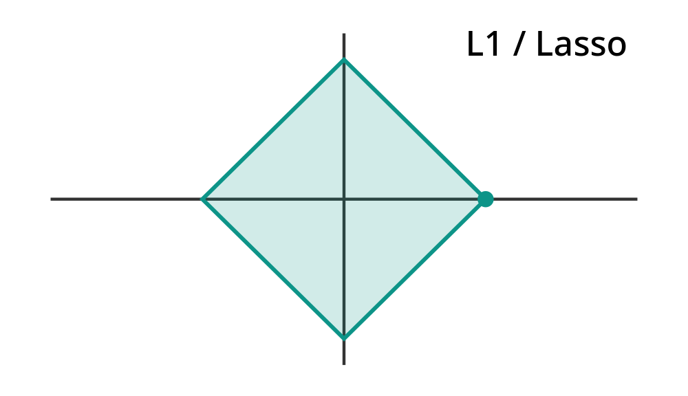 | 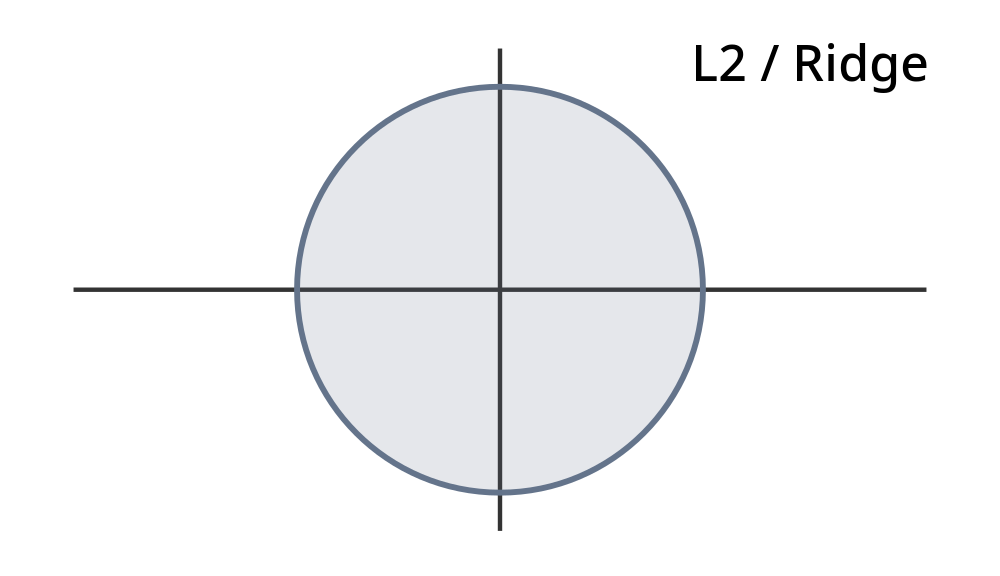 |
| 存在尖角，容易出现零系数 | 边界光滑，通常只缩减系数 |

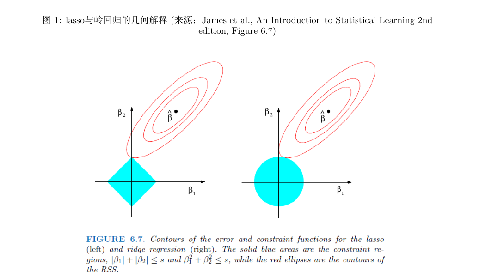

#### 14.2 为什么 Lasso 的菱形会产生零系数？

最小二乘损失的等值线通常是一组椭圆。

我们希望找到最小的椭圆，使其与允许的约束区域接触。

Lasso 的菱形有尖角，并且这些尖角位于坐标轴上。

因此，最优解较容易落在尖角处。

如果落在：

$$(\beta_1,0)$$

就意味着：

$$\beta_2=0$$

所以相应变量被删除。

相比之下，Ridge 的圆形边界光滑，最优解一般不会恰好落在坐标轴上。

这是讲义第 4 页图 1 要表达的几何直觉。

但几何图形只是帮助理解。接下来我们用数学推导说明，为什么 Lasso 的系数会变成 0。

---

### 十五、正交设计下，Lasso 的软阈值公式怎么推导？

这是本讲最重要的证明之一，也直接对应 2024 年模拟题的手算部分。

假设：

$$X^\top X=I$$

我们已经知道：

$$\hat\beta^{\mathrm{OLS}}=X^\top Y$$

为了简化，记：

$$z_j=\hat\beta_j^{\mathrm{OLS}}$$

Lasso 目标为：

$$G(\beta)=\frac12\|Y-X\beta\|^2+\lambda\sum_j|\beta_j|$$

#### 15.1 第一步：展开目标函数

$$\begin{aligned}G(\beta)&=\frac12(Y^\top Y-2\beta^\top X^\top Y+\beta^\top X^\top X\beta)+\lambda\sum_j|\beta_j|\\&=\frac12Y^\top Y-\sum_jz_j\beta_j+\frac12\sum_j\beta_j^2+\lambda\sum_j|\beta_j|\end{aligned}$$

由于不同 $\beta_j$ 之间没有交叉项，我们可以对每个系数分别优化。

对于第 $j$ 个系数，忽略不影响最小值的常数，得到：

$$\boxed{\min_{\beta_j}\left\{\frac12(\beta_j-z_j)^2+\lambda|\beta_j|\right\}}$$

原来一个多元优化问题，被分解成了若干个一元优化问题。

这里最重要的条件就是：

$$X^\top X=I$$

#### 15.2 第二步：考虑 $\beta_j>0$

因为：

$$|\beta_j|=\beta_j$$

目标函数变为：

$$g(\beta_j)=\frac12(\beta_j-z_j)^2+\lambda\beta_j$$

求导：

$$g'(\beta_j)=\beta_j-z_j+\lambda$$

令其为 0：

$$\beta_j=z_j-\lambda$$

但我们假设：

$$\beta_j>0$$

所以必须满足：

$$z_j>\lambda$$

因此：

$$\boxed{\hat\beta_j=z_j-\lambda,\qquad z_j>\lambda}$$

#### 15.3 第三步：考虑 $\beta_j<0$

此时：

$$|\beta_j|=-\beta_j$$

所以：

$$g(\beta_j)=\frac12(\beta_j-z_j)^2-\lambda\beta_j$$

求导：

$$g'(\beta_j)=\beta_j-z_j-\lambda$$

令其为 0：

$$\beta_j=z_j+\lambda$$

因为：

$$\beta_j<0$$

所以：

$$z_j<-\lambda$$

因此：

$$\boxed{\hat\beta_j=z_j+\lambda,\qquad z_j<-\lambda}$$

#### 15.4 第四步：如果 $|z_j|\le\lambda$ 呢？

这时最优解为：

$$\boxed{\hat\beta_j=0}$$

为什么？

因为绝对值函数在 0 处不可导，但它的次梯度（Subgradient）为：

$$\partial|\beta_j|\big|_{\beta_j=0}=[-1,1]$$

因此在 0 处满足最优性条件：

$$0\in-z_j+\lambda[-1,1]$$

当且仅当：

$$|z_j|\le\lambda$$

成立。

这就从数学上解释了为什么 Lasso 可以将系数压到 0。

#### 15.5 最终得到软阈值（Soft Thresholding）

综合三种情况：

$$\boxed{\hat\beta_j^{\mathrm{lasso}}=\begin{cases}z_j-\lambda,&z_j>\lambda\\0,&|z_j|\le\lambda\\z_j+\lambda,&z_j<-\lambda\end{cases}}$$

也可以统一写为：

$$\boxed{\hat\beta_j^{\mathrm{lasso}}=\operatorname{sign}(z_j)(|z_j|-\lambda)_+}$$

其中：

$$z_j=\hat\beta_j^{\mathrm{OLS}}$$

并且：

$$(a)_+=\max(a,0)$$

因此：

$$\boxed{\hat\beta_j^{\mathrm{lasso}}=\operatorname{sign}(\hat\beta_j^{\mathrm{OLS}})\left(|\hat\beta_j^{\mathrm{OLS}}|-\lambda\right)_+}$$

这就是 Lecture 6 的第二个核心估计公式。

---

### 十六、Ridge 与 Lasso 的缩减方式对比

在：

$$X^\top X=I$$

且使用讲义的目标函数约定时：

Ridge：

$$\boxed{\hat\beta_j^{\mathrm{ridge}}=\frac{\hat\beta_j^{\mathrm{OLS}}}{1+\lambda}}$$

Lasso：

$$\boxed{\hat\beta_j^{\mathrm{lasso}}=\operatorname{sign}(\hat\beta_j^{\mathrm{OLS}})\left(|\hat\beta_j^{\mathrm{OLS}}|-\lambda\right)_+}$$

两者的缩减方式不同。

#### 16.1 Ridge：比例缩减

例如：

$$\hat\beta_j^{\mathrm{OLS}}=5,\qquad\lambda=2$$

则：

$$\hat\beta_j^{\mathrm{ridge}}=\frac5{1+2}=\frac53$$

#### 16.2 Lasso：减去固定阈值

相同条件下：

$$\hat\beta_j^{\mathrm{lasso}}=5-2=3$$

如果：

$$\hat\beta_j^{\mathrm{OLS}}=1$$

则：

$$\hat\beta_j^{\mathrm{ridge}}=\frac13$$

但：

$$\hat\beta_j^{\mathrm{lasso}}=0$$

这说明：

- Ridge 对大小不同的系数按相同比例缩减；
- Lasso 对系数绝对值施加阈值，较小的系数可能被直接删除。

#### 16.3 交互演示：改变 $\lambda$，观察两种方法

**单位正交设计下的系数缩减**

原表格允许交互调整 $\lambda$，在初始 $\lambda=1$ 下，固定 OLS 系数为 $4,-2,0.5$，结果如下：

| 系数 | OLS | Ridge | Lasso |
|---|---:|---:|---:|
| $\beta_1$ | 4.00 | 2.00 | 3.00 |
| $\beta_2$ | -2.00 | -1.00 | -1.00 |
| $\beta_3$ | 0.50 | 0.25 | 0.00 |

*这里固定 OLS 系数为 $4,-2,0.5$，假设 $X^\top X=I$。调整 λ，观察 Ridge 的连续比例缩减和 Lasso 的零系数出现。*

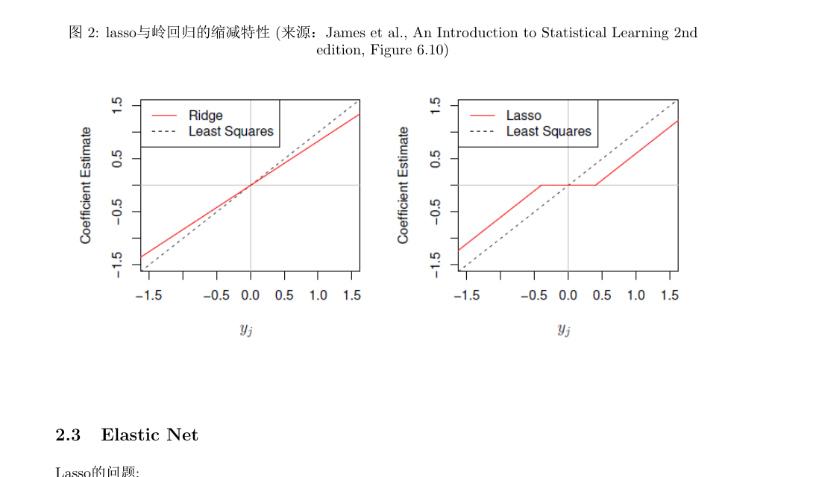

#### 16.4 两种方法的比较

| 特征 | Ridge | Lasso |
|---|---|---|
| 惩罚类型 | $L_2$ 平方 | $L_1$ |
| 是否缩减系数 | 是 | 是 |
| 是否可产生精确零系数 | 通常不可以 | 可以 |
| 是否自动选择变量 | 通常不可以 | 可以 |
| 多重共线性 | 可以缓解 | 可以处理，但变量选择可能不稳定 |
| $p>n$ | $\lambda>0$ 时有唯一解 | 有最优解，但系数解未必唯一 |
| 估计量是否一般无偏 | 否 | 否 |

这里需要补充一个重要区别。

Ridge 的目标函数在 $\lambda>0$ 时严格凸，因此系数解唯一。

Lasso 的目标函数是凸的，但不一定严格凸。尤其在 $p>n$ 且自变量高度相关时，系数解可能不唯一，不过最小目标值是确定的。

---

### 十七、考试中特别容易出错：正交不等于单位正交

前面的公式：

$$\hat\beta_j^{\mathrm{ridge}}=\frac{\hat\beta_j^{\mathrm{OLS}}}{1+\lambda}$$

以及：

$$\hat\beta_j^{\mathrm{lasso}}=\operatorname{sign}(\hat\beta_j^{\mathrm{OLS}})(|\hat\beta_j^{\mathrm{OLS}}|-\lambda)_+$$

都要求：

$$X^\top X=I$$

如果只是列与列正交，但每列的平方范数不是 1，那么不能直接套这两个公式。

假设：

$$X^\top X=\operatorname{diag}(d_1,\ldots,d_p)$$

其中：

$$d_j=\|X_j\|^2>0$$

记：

$$z_j=X_j^\top Y$$

则 OLS：

$$\boxed{\hat\beta_j^{\mathrm{OLS}}=\frac{z_j}{d_j}}$$

Ridge：

$$\boxed{\hat\beta_j^{\mathrm{ridge}}=\frac{z_j}{d_j+\lambda}}$$

Lasso：

$$\boxed{\hat\beta_j^{\mathrm{lasso}}=\frac{\operatorname{sign}(z_j)(|z_j|-\lambda)_+}{d_j}}$$

这三条公式非常重要。

后面的 HW2 Problem 7 就属于这种情况：

$$X^\top X=2I$$

而不是：

$$X^\top X=I$$

所以一定要先检查设计矩阵的列平方范数。

---
## 第五部分：Elastic Net——把 Ridge 与 Lasso 结合起来

### 十八、为什么有了 Lasso，还需要 Elastic Net？

讲义第 2.3 节首先指出 Lasso 的几个局限。

其中最重要的一点是：

**当多个自变量高度相关时，Lasso 的变量选择可能不稳定。**

假设：

$$X_1\approx X_2$$

且二者都包含对 $Y$ 有用的信息。

由于它们能够提供近似相同的预测作用，Lasso 可能只选择其中一个变量，把另一个系数压成 0。

例如，可能得到：

$$\hat\beta_1=2,\qquad\hat\beta_2=0$$

但换一组训练样本后，也可能得到：

$$\hat\beta_1=0,\qquad\hat\beta_2=2.1$$

虽然模型预测效果可能接近，但变量选择结果发生了变化。

对于需要解释哪些变量重要的研究，这可能是一个问题。

Lasso 在高维情形下还存在变量选择数量的限制：在一般位置、非退化等条件下，Lasso 的一个稀疏解通常至多有 $n$ 个非零系数。更严谨地说，在一般情形下可以找到这样的最优解，而不能把它理解为所有可能的 Lasso 最优解都必然遵守同一非零数量上限。

Elastic Net 就是为了缓解这些问题而引入的。

### 十九、Elastic Net 的目标函数

讲义给出：

$$
\boxed{
\min_\beta
\left\{
\frac12\|Y-X\beta\|_2^2
+
\lambda\left[
\alpha\|\beta\|_1
+\frac{1-\alpha}{2}\|\beta\|_2^2
\right]
\right\}
}
$$

其中通常取：

$$\lambda\ge0,\qquad0\le\alpha\le1$$

两个参数的作用不同。

$\lambda$ 控制总体惩罚强度。

$\alpha$ 控制 $L_1$ 与 $L_2$ 惩罚之间的比例。

具体来说：

当：

$$\alpha=1$$

时：

$$
\min_\beta
\left\{
\frac12\|Y-X\beta\|^2+\lambda\|\beta\|_1
\right\}
$$

就是 Lasso。

当：

$$\alpha=0$$

时：

$$
\min_\beta
\left\{
\frac12\|Y-X\beta\|^2+\frac\lambda2\|\beta\|_2^2
\right\}
$$

与本讲约定的 Ridge 目标函数等价（整体乘以 2 不改变最优解）。

因此：

$$\boxed{\text{Elastic Net}=\text{Lasso 惩罚}+\text{Ridge 惩罚}}$$

但它并不是简单地把两个已经拟合好的模型的系数平均，而是在一个统一的优化目标中同时加入两类惩罚。

---

### 二十、正交设计下 Elastic Net 的解怎么推导？

讲义也给出了正交设计：

$$X^\top X=I$$

时的解析公式。

记：

$$z_j=\hat\beta_j^{\mathrm{OLS}}$$

因为各变量正交，目标函数可以分解成一元优化问题：

$$
\min_{\beta_j}
\left\{
\frac12(\beta_j-z_j)^2
+\lambda\alpha|\beta_j|
+\frac{\lambda(1-\alpha)}2\beta_j^2
\right\}
$$

把二次项合并：

$$
\begin{aligned}
g(\beta_j)
={}&\frac{1+\lambda(1-\alpha)}2\beta_j^2\\
&-z_j\beta_j+\lambda\alpha|\beta_j|
+\text{常数}
\end{aligned}
$$

与前面 Lasso 的分段求导方法一样。

假设：

$$\beta_j>0$$

那么：

$$
g'(\beta_j)
=[1+\lambda(1-\alpha)]\beta_j-z_j+\lambda\alpha
$$

令其为 0：

$$\beta_j=\frac{z_j-\lambda\alpha}{1+\lambda(1-\alpha)}$$

需要满足：

$$z_j>\lambda\alpha$$

负数情况类似。

最终得到：

$$
\boxed{
\hat\beta_j^{\mathrm{EN}}
=
\frac{
\operatorname{sign}(z_j)(|z_j|-\lambda\alpha)_+
}{
1+\lambda(1-\alpha)
}
}
$$

其中：

$$z_j=\hat\beta_j^{\mathrm{OLS}}$$

#### 20.1 这个公式应该怎样理解？

它实际上包含两个连续步骤。

第一步：

$$\operatorname{sign}(z_j)(|z_j|-\lambda\alpha)_+$$

先进行类似 Lasso 的软阈值操作。

第二步：

$$\frac1{1+\lambda(1-\alpha)}$$

再进行类似 Ridge 的比例缩减。

所以：

$$\boxed{\text{Elastic Net}=\text{软阈值选择}+\text{进一步缩减}}$$

这就解释了它为什么既能选择变量，又可以利用 $L_2$ 惩罚缓解强相关自变量的系数不稳定问题。

#### 20.2 简单数值例子

假设：

$$z_j=3,\quad\lambda=2,\quad\alpha=0.5$$

先计算软阈值：

$$\lambda\alpha=1$$

所以分子：

$$3-1=2$$

分母：

$$1+\lambda(1-\alpha)=1+2(0.5)=2$$

因此：

$$\boxed{\hat\beta_j^{\mathrm{EN}}=1}$$

如果：

$$z_j=0.8$$

因为：

$$0.8<\lambda\alpha=1$$

所以：

$$\boxed{\hat\beta_j^{\mathrm{EN}}=0}$$

#### 20.3 Elastic Net 与 Lasso 的区别

Elastic Net 并不意味着保留所有相关变量，但它的 $L_2$ 部分通常会鼓励高度相关的变量具有较接近的系数，这称为分组效应（Grouping Effect）。

讲义第 7 页图 5 就是通过系数路径比较 Lasso 和 Elastic Net 在相关变量上的选择表现。

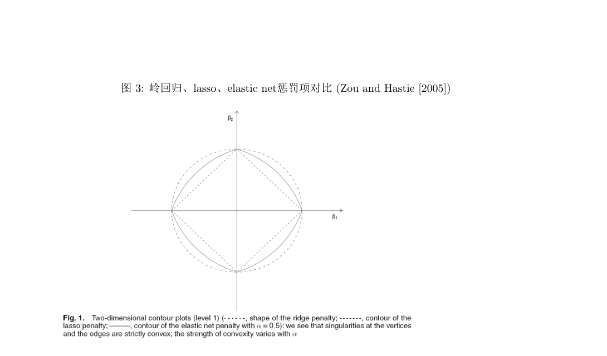

---

## 第六部分：其他正则化方法

下面是讲义第 2.4–2.6 节。

这三部分不需要像 Ridge、Lasso 那样把所有复杂公式都作为必背对象，但应该理解：

1. 前面的方法有什么不足；
2. 新方法如何修改惩罚项；
3. 修改以后解决了什么问题。

### 二十一、Adaptive Lasso：为什么不同变量应该受到不同惩罚？

普通 Lasso 使用：

$$\lambda\sum_{j=1}^p|\beta_j|$$

因此每个系数都受到相同形式和强度的 $L_1$ 惩罚。

但我们可能希望：

- 对明显重要、初步估计较大的变量，施加较小惩罚；
- 对初步估计接近 0 的变量，施加较大惩罚。

这就是 Adaptive Lasso（自适应 Lasso）的思路。

#### 21.1 Adaptive Lasso 的目标函数

$$
\boxed{
\min_\beta
\left\{
\frac12\|Y-X\beta\|_2^2
+
\lambda\sum_{j=1}^pw_j|\beta_j|
\right\}
}
$$

其中：

$$w_j>0$$

是不同变量对应的惩罚权重。

如果：

$$w_j=1$$

就退化为普通 Lasso。

#### 21.2 如何选择惩罚权重？

讲义提出利用先导估计量（Pilot Estimator）：

$$\tilde\beta_j$$

定义：

$$\boxed{w_j=\frac1{|\tilde\beta_j|^\gamma},\qquad\gamma>0}$$

在先导估计非零时，这个公式可以直接使用；实际处理零系数时需要特殊约定或稳定化措施。

这个公式具有很清楚的含义。

若：

$$|\tilde\beta_j|\text{ 很大}$$

则：

$$w_j\text{ 很小}$$

因此对应变量受到较弱惩罚。

若：

$$|\tilde\beta_j|\text{ 很小}$$

则：

$$w_j\text{ 很大}$$

因此更容易将其系数压缩至 0。

#### 21.3 和普通 Lasso 有什么区别？

普通 Lasso 对所有变量采用统一的惩罚强度。

Adaptive Lasso 根据初步估计结果，对不同变量实施不同的惩罚。

因此可以理解为：

$$\boxed{\text{Lasso：统一惩罚}\quad\longrightarrow\quad\text{Adaptive Lasso：差异化惩罚}}$$

讲义还讨论了一种理想化形式：如果直接用当前未知系数 $\beta_j$ 构造权重，就会出现类似：

$$|\beta_j|^{1-\gamma}$$

的非凸惩罚。

但真正的 Adaptive Lasso 使用的是预先得到、随后固定的先导估计所构造的权重。此时目标函数仍然是加权 $L_1$ 的凸优化问题。

不能将两者混为一谈。

---

### 二十二、Group Lasso：为什么需要整组选变量？

普通 Lasso 通常以单个系数为单位进行选择。

但有时变量具有自然的分组结构。

例如 Lecture 4 中，一个有四个类别的分类变量 $F$ 会对应三个虚拟变量：

$$U_2,U_3,U_4$$

如果使用普通 Lasso，它可能得到：

$$
(\hat\beta_2,\hat\beta_3,\hat\beta_4)=(1.2,0,-0.5)
$$

意味着只保留部分虚拟变量。

但在某些研究中，我们希望把一个分类变量视为整体：

> 要么把它对应的三个虚拟变量全部作为一个组保留，要么将整个分类变量从模型中删除。

这就是 Group Lasso（组 Lasso）要解决的问题。

#### 22.1 Group Lasso 的目标函数

假设将回归系数分为 $L$ 组：

$$\beta=(\beta_{(1)}^\top,\ldots,\beta_{(L)}^\top)^\top$$

那么可以考虑：

$$
\boxed{
\min_\beta
\left\{
\frac12\|Y-X\beta\|_2^2
+
\lambda\sum_{\ell=1}^Lw_\ell\|\beta_{(\ell)}\|_2
\right\}
}
$$

其中：

$$w_\ell>0$$

通常可以与组的大小有关，例如：

$$w_\ell=\sqrt{p_\ell}$$

其中 $p_\ell$ 是第 $\ell$ 组变量的数量。

讲义给出了更一般的组范数形式，这里写的是最常用的 $L_2$ 组范数形式。

#### 22.2 为什么组内使用 $L_2$，组间又可以产生稀疏性？

注意惩罚项：

$$\sum_{\ell=1}^L\|\beta_{(\ell)}\|_2$$

每一组内部采用 $L_2$ 范数。

但组范数之间是求和的，类似 Lasso 对单个系数绝对值求和。

因此优化时可以将整组系数向量压为：

$$\beta_{(\ell)}=0$$

实现组稀疏性（Group Sparsity）。

这意味着：

$$\boxed{\text{普通 Lasso：按变量选择}}$$

$$\boxed{\text{Group Lasso：按变量组选择}}$$

但要注意，选中一组并不意味着该组内部每个系数在所有情况下都必须严格非零；核心性质是可以将整组同时压为零。

#### 22.3 对应 HW2 Problem 9

前面作业将十个自变量分为五组，例如：

| 组 | 变量 |
|---|---|
| 身体尺寸 | Ht、Wt、BMI |
| 红细胞相关 | RCC、Hc、Hg |
| 其他血液指标 | WCC、Ferr |
| 皮褶厚度 | SSF |
| 性别 | Sex |

要求使用 Group Lasso 进行组选择。

这一题的理论核心就是：

普通 Lasso 可以单独选择变量，而 Group Lasso 根据预设的组结构进行选择。

例如，可以保留“身体尺寸”整组，同时删除“其他血液指标”整组。

---

### 二十三、SCAD：为什么 Lasso 对大系数的惩罚可能过强？

Lasso 的惩罚是：

$$\lambda|\beta_j|$$

对于非零系数，其惩罚函数对绝对值的导数始终是：

$$\lambda$$

这意味着，即使某个回归系数已经很大，Lasso 仍然不断施加相同的边际惩罚。

因此它可能对较大的真实系数产生较明显的收缩偏差。

SCAD（Smoothly Clipped Absolute Deviation）就是为了缓解这个问题而提出的。

#### 23.1 SCAD 的目标函数

$$
\boxed{
\min_\beta
\left\{
\frac12\|Y-X\beta\|_2^2
+
\sum_{j=1}^pf_\lambda(|\beta_j|)
\right\}
}
$$

其中 $f_\lambda$ 是非凸惩罚函数。

讲义通过惩罚函数的导数定义 SCAD：

$$
\boxed{
f_\lambda'(\theta)=
\begin{cases}
\lambda,&0\le\theta\le\lambda\\[3pt]
\dfrac{a\lambda-\theta}{a-1},&\lambda<\theta\le a\lambda\\[6pt]
0,&\theta>a\lambda
\end{cases}
}
$$

其中：

$$a>2$$

#### 23.2 怎样理解这个惩罚？

SCAD 将系数的绝对值大致分为三个区域。

**系数很小时：**

$$|\beta_j|\le\lambda$$

惩罚的边际强度为 $\lambda$，类似 Lasso。

因此小系数仍可能被压到 0。

**系数处于中等范围时：**

$$\lambda<|\beta_j|\le a\lambda$$

惩罚的边际强度逐渐降低。

**系数足够大时：**

$$|\beta_j|>a\lambda$$

惩罚的边际强度变为 0。

这意味着 SCAD 不再强迫很大的系数继续向 0 缩减。

因此：

$$\boxed{\text{SCAD：保留小系数稀疏选择能力，同时减少大系数的收缩偏差}}$$

#### 23.3 正交设计下 SCAD 的解

讲义还给出了一个重要性质。

当：

$$X^\top X=I$$

并记：

$$z_j=\hat\beta_j^{\mathrm{OLS}}$$

时，SCAD 的解呈分段形式：

$$
\hat\beta_j^{\mathrm{SCAD}}
=
\begin{cases}
0,&|z_j|\le\lambda\\[3pt]
\operatorname{sign}(z_j)(|z_j|-\lambda),&\lambda<|z_j|\le2\lambda\\[3pt]
\dfrac{(a-1)z_j-a\lambda\operatorname{sign}(z_j)}{a-2},&2\lambda<|z_j|\le a\lambda\\[7pt]
z_j,&|z_j|>a\lambda
\end{cases}
$$

最重要的是最后一段：

$$\boxed{|z_j|>a\lambda\Longrightarrow\hat\beta_j^{\mathrm{SCAD}}=z_j}$$

即对足够大的 OLS 系数，SCAD 不再进行缩减。

相比之下，Lasso 仍然会减去 $\lambda$。

这就是 SCAD 进行偏差修正的主要特点。

#### 23.4 SCAD 的代价是什么？

SCAD 的惩罚函数不是凸函数（Non-convex Penalty）。

因此它的优化问题通常比 Ridge、Lasso 更困难，可能存在多个局部最优点。

所以 SCAD 不是无条件优于 Lasso，而是在某些统计目标下通过增加优化复杂度来改善估计偏差。

---

## 第七部分：惩罚参数怎样选择？

### 二十四、交叉验证（Cross Validation）

这部分与 Lecture 5 直接连接。

现在我们已经有多个正则化方法，但需要决定：

$$\lambda$$

具体取多大。

如果：

$$\lambda=0$$

惩罚项消失，通常退化为无正则化的最小二乘目标。

如果：

$$\lambda\text{ 很大}$$

惩罚非常强，系数可能被大幅缩减，甚至大量变为 0。

因此，$\lambda$ 太小可能不足以抑制过拟合，太大又可能导致欠拟合。

这就是新的偏差—方差权衡。

#### 24.1 一个参数时

假设候选：

$$\lambda_1,\ldots,\lambda_M$$

对于每一个 $\lambda_m$，使用交叉验证计算：

$$CV(\lambda_m)$$

最后选择：

$$\boxed{\lambda^*=\arg\min_{\lambda_m}CV(\lambda_m)}$$

也可以使用 Lecture 5 的 1 标准误规则（One Standard Error Rule）。

#### 24.2 Elastic Net 有两个参数怎么办？

Elastic Net 需要同时选择：

$$\lambda,\alpha$$

可以准备两个候选集合：

$$\{\lambda_1,\ldots,\lambda_M\}$$

$$\{\alpha_1,\ldots,\alpha_L\}$$

对每个参数组合计算：

$$CV(\lambda_m,\alpha_\ell)$$

然后选择：

$$
\boxed{
(\lambda^*,\alpha^*)
=
\arg\min_{\lambda_m,\alpha_\ell}CV(\lambda_m,\alpha_\ell)
}
$$

这里：

- $\lambda$ 决定总体惩罚强度；
- $\alpha$ 决定 $L_1$ 与 $L_2$ 的混合比例。

#### 24.3 标准化为什么重要？

这是 Lecture 6 很实用、也容易考查的概念。

假设两个自变量：

$$X_1=\text{收入（元）}$$

$$X_2=\text{年龄（岁）}$$

收入可能取值几十万，而年龄只有几十。

由于正则化直接惩罚回归系数数值：

$$\sum_j\beta_j^2\quad\text{或}\quad\sum_j|\beta_j|$$

如果变量单位差异很大，那么系数的数值尺度也会受到单位影响。

同样的实际预测作用，采用不同计量单位可能对应不同大小的系数，从而受到不同惩罚。

因此正则化前通常先对自变量进行标准化：

$$\boxed{Z_j=\frac{X_j-\bar X_j}{s_j}}$$

使变量处于可比较的尺度上。

最终如果需要报告原始量纲上的回归系数，再将标准化后的系数转换回去。

#### 24.4 为什么不能使用测试集选择 $\lambda$？

如果在测试集上尝试很多 $\lambda$，然后选择测试 MSE 最小的那个参数，测试集实际上已经参与了调参。

因此不能再将这一最小测试误差视为独立的最终泛化评价。

合理流程是：

$$\boxed{\text{训练数据}\rightarrow\text{交叉验证选择 }\lambda\rightarrow\text{最终拟合}\rightarrow\text{独立测试集评价}}$$

如果交叉验证涉及标准化，均值和标准差也应当只从每一折的训练数据计算，再应用于对应验证折，避免数据泄漏。

讲义最后的 Hitters Data、Crime Data 作为高维回归分析示例，主要指向配套 R 程序，没有在 PDF 中给出完整数值结果。由于你考试不考代码，这里只需要掌握方法选择和解释，不需要记忆软件输出。

---
## 第八部分：六份模拟题中的核心计算题

这一部分是本讲最重要的考试训练。

我会重点讲三道代表性的原题：

- 2024 Fall Sample Midterm · Problem 2：正交设计下的 OLS、置信区间和 Lasso。
- 2026 Fall Sample Midterm 1 · Problem 7：非正交自变量下的岭回归推导。
- HW2 Problem 7：同一道题同时手算 OLS、Ridge、Lasso，并恢复截距。

这三道题分别覆盖了本讲最重要的三种计算方式。

---

### 题型一：正交设计下，求 OLS、置信区间和 Lasso

**对应：2024 Fall Sample Midterm · Problem 2（20 分）**

这是非常典型的综合计算题，建议完整掌握。

#### 原题

考虑一个多元线性回归，样本量为：

$$n=8$$

自变量数量为：

$$p=3$$

题目给出 8 条样本，三个自变量的值均为 $\pm1/\sqrt8$，同时满足列均值为 0、列与列相互正交。

要求：

1. 求 OLS 估计量 $\hat\beta$。
2. 求 $\beta_1^*$ 的 95% 置信区间。
3. 在 Lasso 惩罚参数 $\lambda=2$ 时，求 Lasso 估计量。

题目给出：

$$t_{0.025}(4)=2.78$$

#### 第一步：先检查设计矩阵结构

这是整道题最重要的识别步骤。

因为三个自变量的样本均值都是 0，并且彼此正交，而每列的平方范数为：

$$8\times\left(\frac1{\sqrt8}\right)^2=1$$

因此，包含截距的设计矩阵满足：

$$
X^\top X=
\begin{pmatrix}
8&0&0&0\\
0&1&0&0\\
0&0&1&0\\
0&0&0&1
\end{pmatrix}
$$

注意第一列是截距，所以第一行第一列为 8，而不是 1。

由题目数据计算：

$$
X^\top Y=
\begin{pmatrix}
0\\
\sqrt2\\
-2\sqrt2\\
\sqrt2
\end{pmatrix}
$$

#### 第 1 问：求 OLS

使用：

$$\hat\beta=(X^\top X)^{-1}X^\top Y$$

因为：

$$
(X^\top X)^{-1}=
\begin{pmatrix}
1/8&0&0&0\\
0&1&0&0\\
0&0&1&0\\
0&0&0&1
\end{pmatrix}
$$

所以：

$$
\boxed{
\hat\beta^{\mathrm{OLS}}=
\begin{pmatrix}
0\\\sqrt2\\-2\sqrt2\\\sqrt2
\end{pmatrix}
}
$$

也就是：

$$\hat\beta_0=0$$

$$\hat\beta_1=\sqrt2,\quad\hat\beta_2=-2\sqrt2,\quad\hat\beta_3=\sqrt2$$

#### 第 2 问：求 95% 置信区间

这部分需要联系 Lecture 3。

根据原题数据，可以求得拟合值：

$$\hat Y=(0,-1,2,1,-1,-2,1,0)^\top$$

因此：

$$RSS=\|Y-\hat Y\|^2=8$$

残差自由度：

$$n-p-1=8-3-1=4$$

所以：

$$\hat\sigma^2=\frac84=2$$

根据 Lecture 3：

$$\operatorname{Cov}(\hat\beta)=\sigma^{*2}(X^\top X)^{-1}$$

我们用：

$$\hat\sigma^2=2$$

估计协方差矩阵：

$$
\widehat{\operatorname{Cov}}(\hat\beta)=
\begin{pmatrix}
1/4&0&0&0\\
0&2&0&0\\
0&0&2&0\\
0&0&0&2
\end{pmatrix}
$$

因此：

$$se(\hat\beta_1)=\sqrt2$$

95% 置信区间：

$$
\begin{aligned}
CI_{95\%}
&=\hat\beta_1\pm t_{0.025}(4)se(\hat\beta_1)\\
&=\sqrt2\pm2.78\sqrt2
\end{aligned}
$$

最终：

$$\boxed{CI_{95\%}=[-1.78\sqrt2,\ 3.78\sqrt2]}$$

#### 第 3 问：求 $\lambda=2$ 的 Lasso

这是真正属于 Lecture 6 的部分。

由于三个斜率对应的自变量已经中心化、单位正交：

$$X_c^\top X_c=I$$

因此直接使用软阈值公式：

$$
\hat\beta_j^{\mathrm{lasso}}
=\operatorname{sign}(\hat\beta_j^{\mathrm{OLS}})
\left(|\hat\beta_j^{\mathrm{OLS}}|-2\right)_+
$$

分别计算。

**第一个斜率：**

$$\hat\beta_1^{\mathrm{OLS}}=\sqrt2$$

因为：

$$\sqrt2<2$$

所以：

$$\boxed{\hat\beta_1^{\mathrm{lasso}}=0}$$

**第二个斜率：**

$$\hat\beta_2^{\mathrm{OLS}}=-2\sqrt2$$

因为：

$$2\sqrt2>2$$

所以：

$$
\begin{aligned}
\hat\beta_2^{\mathrm{lasso}}
&=-\left(2\sqrt2-2\right)\\
&=2-2\sqrt2
\end{aligned}
$$

**第三个斜率：**

$$\hat\beta_3^{\mathrm{OLS}}=\sqrt2$$

同理：

$$\boxed{\hat\beta_3^{\mathrm{lasso}}=0}$$

因为 $\bar Y=0$ 且所有自变量均值为 0，不惩罚的截距仍然为 0。

最终：

$$
\boxed{
\hat\beta^{\mathrm{lasso}}=
\begin{pmatrix}
0\\0\\2-2\sqrt2\\0
\end{pmatrix}
}
$$

#### 这道题真正需要掌握的内容

这道题的前三问看起来涉及不同知识，但逻辑非常紧密。

首先：

$$X^\top X$$

是对角矩阵，所以 OLS 容易计算。

接着利用：

$$(X^\top X)^{-1}$$

计算标准误和置信区间。

最后，因为自变量已经单位正交，Lasso 可以对每个 OLS 系数直接进行软阈值处理。

因此：

$$\boxed{\text{正交设计}\Rightarrow\text{OLS 简化}\Rightarrow\text{Lasso 分量独立求解}}$$

这就是这道题最值得理解的数学结构。

---

### 题型二：非正交设计下，怎样求岭回归？

**对应：2026 Fall Sample Midterm 1 · Problem 7（15 分）**

这道题的第 3 问是 Lecture 6 的直接考点，同时需要利用前两问建立的正交性结论。

#### 原题

假设有两个已经中心化、标准化且相互正交的向量：

$$Z_1,Z_2\in\mathbb R^n$$

满足：

$$Z_1^\top Z_1=1$$

$$Z_2^\top Z_2=1$$

$$Z_1^\top Z_2=0$$

另外 $Y$ 也已中心化。

题目先给出：

$$\hat\gamma_1=Z_1^\top Y$$

$$\hat\gamma_2=Z_2^\top Y$$

然后重新定义两个自变量：

$$\boxed{X_1=Z_1,\qquad X_2=Z_1+Z_2}$$

使用岭回归：

$$
\boxed{
\min_{\beta_1,\beta_2}
\left\{
\|Y-\beta_1X_1-\beta_2X_2\|^2
+\lambda(\beta_1^2+\beta_2^2)
\right\}
}
$$

要求将岭回归解表示为：

$$\hat\gamma_1,\hat\gamma_2,\lambda$$

的函数。

#### 先讲解题思路

这道题设置了一个很有意思的变化。

最初的：

$$Z_1,Z_2$$

是正交的。

但重新定义：

$$X_1=Z_1,\qquad X_2=Z_1+Z_2$$

以后：

$$X_1^\top X_2=Z_1^\top(Z_1+Z_2)=1$$

所以新变量：

$$X_1,X_2$$

不再正交。

因此，不能直接使用：

$$\hat\beta_j^{\mathrm{ridge}}=\frac{\hat\beta_j^{\mathrm{OLS}}}{1+\lambda}$$

而必须使用矩阵公式：

$$\boxed{\hat\beta^{\mathrm{ridge}}=(X^\top X+\lambda I)^{-1}X^\top Y}$$

#### 第一步：计算 $X^\top X$

因为：

$$X=[X_1\ X_2]$$

所以：

$$
X^\top X=
\begin{pmatrix}
X_1^\top X_1&X_1^\top X_2\\
X_2^\top X_1&X_2^\top X_2
\end{pmatrix}
$$

分别计算：

$$X_1^\top X_1=Z_1^\top Z_1=1$$

$$X_1^\top X_2=Z_1^\top(Z_1+Z_2)=1$$

$$
\begin{aligned}
X_2^\top X_2
&=(Z_1+Z_2)^\top(Z_1+Z_2)\\
&=1+2(0)+1\\
&=2
\end{aligned}
$$

因此：

$$
\boxed{
X^\top X=
\begin{pmatrix}
1&1\\1&2
\end{pmatrix}
}
$$

#### 第二步：计算 $X^\top Y$

$$
X^\top Y=
\begin{pmatrix}
X_1^\top Y\\X_2^\top Y
\end{pmatrix}
$$

第一个分量：

$$X_1^\top Y=Z_1^\top Y=\hat\gamma_1$$

第二个分量：

$$
\begin{aligned}
X_2^\top Y
&=(Z_1+Z_2)^\top Y\\
&=\hat\gamma_1+\hat\gamma_2
\end{aligned}
$$

因此：

$$
\boxed{
X^\top Y=
\begin{pmatrix}
\hat\gamma_1\\
\hat\gamma_1+\hat\gamma_2
\end{pmatrix}
}
$$

#### 第三步：构造岭回归矩阵

$$
X^\top X+\lambda I=
\begin{pmatrix}
1+\lambda&1\\
1&2+\lambda
\end{pmatrix}
$$

它的行列式为：

$$
\begin{aligned}
D
&=(1+\lambda)(2+\lambda)-1\\
&=\lambda^2+3\lambda+1
\end{aligned}
$$

因此：

$$
\boxed{
(X^\top X+\lambda I)^{-1}
=\frac1{\lambda^2+3\lambda+1}
\begin{pmatrix}
2+\lambda&-1\\
-1&1+\lambda
\end{pmatrix}
}
$$

#### 第四步：矩阵相乘

$$
\hat\beta^{\mathrm{ridge}}
=\frac1{\lambda^2+3\lambda+1}
\begin{pmatrix}
2+\lambda&-1\\
-1&1+\lambda
\end{pmatrix}
\begin{pmatrix}
\hat\gamma_1\\
\hat\gamma_1+\hat\gamma_2
\end{pmatrix}
$$

计算第一个分量：

$$
\begin{aligned}
\hat\beta_1^{\mathrm{ridge}}
&=\frac{(2+\lambda)\hat\gamma_1-(\hat\gamma_1+\hat\gamma_2)}
{\lambda^2+3\lambda+1}\\
&=\frac{(1+\lambda)\hat\gamma_1-\hat\gamma_2}
{\lambda^2+3\lambda+1}
\end{aligned}
$$

第二个分量：

$$
\begin{aligned}
\hat\beta_2^{\mathrm{ridge}}
&=\frac{-\hat\gamma_1+(1+\lambda)(\hat\gamma_1+\hat\gamma_2)}
{\lambda^2+3\lambda+1}\\
&=\frac{\lambda\hat\gamma_1+(1+\lambda)\hat\gamma_2}
{\lambda^2+3\lambda+1}
\end{aligned}
$$

最终：

$$\boxed{\hat\beta_1^{\mathrm{ridge}}=\frac{(1+\lambda)\hat\gamma_1-\hat\gamma_2}{\lambda^2+3\lambda+1}}$$

$$\boxed{\hat\beta_2^{\mathrm{ridge}}=\frac{\lambda\hat\gamma_1+(1+\lambda)\hat\gamma_2}{\lambda^2+3\lambda+1}}$$

#### 第五步：检查结果是否合理

这是做矩阵计算题的一个好习惯。

当：

$$\lambda=0$$

时应退化为 OLS：

$$\hat\beta_1=\hat\gamma_1-\hat\gamma_2$$

$$\hat\beta_2=\hat\gamma_2$$

代入模型：

$$
\begin{aligned}
\hat Y
&=\hat\beta_1X_1+\hat\beta_2X_2\\
&=(\hat\gamma_1-\hat\gamma_2)Z_1
+\hat\gamma_2(Z_1+Z_2)\\
&=\hat\gamma_1Z_1+\hat\gamma_2Z_2
\end{aligned}
$$

正好恢复对 $Z_1,Z_2$ 的正交 OLS 拟合。

而当：

$$\lambda\to\infty$$

时，两个系数都趋于 0，也符合强正则化时的缩减性质。

#### 这道题总结

只要题目中的自变量不再单位正交，就不要机械使用简单缩减公式。

先计算：

$$X^\top X$$

以及：

$$X^\top Y$$

再利用：

$$\hat\beta^{\mathrm{ridge}}=(X^\top X+\lambda I)^{-1}X^\top Y$$

求解。

如果矩阵只有 $2\times2$，通常可以直接求逆；也可以列正规方程组逐步求解。

---
### 题型三：同时手算 OLS、Ridge、Lasso

**对应：Assignment 2 · Problem 7（10 分）**

这是前面提供的作业中与 Lecture 6 联系最紧密的一道题。

它结合了中心化、矩阵 OLS、岭回归、Lasso、截距恢复，以及两种正则化方法的比较。

#### 原题

已知：

$$n=5,\qquad p=2$$

原始变量均值为：

$$\bar x_1=2,\qquad\bar x_2=-1,\qquad\bar y=3$$

中心化后的数据为：

$$
X=
\begin{pmatrix}
-1&0\\
0&-1\\
0&0\\
0&1\\
1&0
\end{pmatrix}
$$

$$
Y=
\begin{pmatrix}
3\\-4\\1\\2\\-2
\end{pmatrix}
$$

题目规定：

$$\lambda=5$$

并分别求解：

OLS：

$$\min_\beta\frac12\|Y-X\beta\|^2$$

Ridge：

$$
\min_\beta
\left\{
\frac12\|Y-X\beta\|^2
+\frac\lambda2\|\beta\|_2^2
\right\}
$$

Lasso：

$$
\min_\beta
\left\{
\frac12\|Y-X\beta\|^2
+\lambda\|\beta\|_1
\right\}
$$

最后使用：

$$\hat\beta_0=\bar y-\hat\beta_1\bar x_1-\hat\beta_2\bar x_2$$

恢复各自的截距。

#### 第一步：计算 $X^\top X$ 和 $X^\top Y$

先计算：

$$
X^\top X=
\begin{pmatrix}
2&0\\
0&2
\end{pmatrix}
=2I
$$

由于两个自变量列正交，但每列的平方范数为 2，所以这里并不是单位正交。

接着：

$$
X^\top Y
=
\begin{pmatrix}
-1(3)+1(-2)\\
-1(-4)+1(2)
\end{pmatrix}
=
\begin{pmatrix}
-5\\6
\end{pmatrix}
$$

因此：

$$
\boxed{
X^\top X=2I,\qquad
X^\top Y=
\begin{pmatrix}
-5\\6
\end{pmatrix}
}
$$

#### 第 1 问：计算 OLS

$$\hat\beta^{\mathrm{OLS}}=(X^\top X)^{-1}X^\top Y$$

所以：

$$
\hat\beta^{\mathrm{OLS}}
=
\frac12
\begin{pmatrix}
-5\\6
\end{pmatrix}
$$

得到：

$$\boxed{\hat\beta_1^{\mathrm{OLS}}=-\frac52,\qquad\hat\beta_2^{\mathrm{OLS}}=3}$$

恢复截距：

$$
\begin{aligned}
\hat\beta_0^{\mathrm{OLS}}
&=3-\left(-\frac52\right)(2)-3(-1)\\
&=3+5+3\\
&=11
\end{aligned}
$$

因此完整 OLS 回归方程：

$$\boxed{\hat y_{\mathrm{OLS}}=11-\frac52x_1+3x_2}$$

#### 第 2 问：计算 Ridge

注意，题目中 Ridge 的目标是：

$$\frac12\|Y-X\beta\|^2+\frac\lambda2\|\beta\|^2$$

对 $\beta$ 求导，得到：

$$(X^\top X+\lambda I)\beta=X^\top Y$$

所以：

$$
\hat\beta^{\mathrm{ridge}}
=(2I+5I)^{-1}
\begin{pmatrix}
-5\\6
\end{pmatrix}
$$

得到：

$$
\boxed{
\hat\beta^{\mathrm{ridge}}
=
\begin{pmatrix}
-5/7\\6/7
\end{pmatrix}
}
$$

恢复截距：

$$
\begin{aligned}
\hat\beta_0^{\mathrm{ridge}}
&=3-2\left(-\frac57\right)-\left(-\frac67\right)\\
&=3+\frac{10}{7}+\frac67\\
&=\frac{37}{7}
\end{aligned}
$$

因此：

$$\boxed{\hat y_{\mathrm{ridge}}=\frac{37}{7}-\frac57x_1+\frac67x_2}$$

#### 第 3 问：计算 Lasso

由于：

$$X^\top X=2I$$

所以不能直接对 OLS 系数使用阈值 5，而应该使用一般正交公式：

$$
\boxed{
\hat\beta_j^{\mathrm{lasso}}
=\frac{\operatorname{sign}(z_j)(|z_j|-\lambda)_+}{d_j}
}
$$

其中：

$$z_j=X_j^\top Y$$

$$d_j=X_j^\top X_j$$

本题：

$$d_1=d_2=2$$

而：

$$z_1=-5,\qquad z_2=6$$

因此第一个系数：

$$
\hat\beta_1^{\mathrm{lasso}}
=\frac{\operatorname{sign}(-5)(5-5)_+}{2}
=0
$$

第二个系数：

$$\hat\beta_2^{\mathrm{lasso}}=\frac{6-5}{2}=\frac12$$

所以：

$$
\boxed{
\hat\beta^{\mathrm{lasso}}
=
\begin{pmatrix}
0\\1/2
\end{pmatrix}
}
$$

恢复截距：

$$
\begin{aligned}
\hat\beta_0^{\mathrm{lasso}}
&=3-0(2)-\frac12(-1)\\
&=\frac72
\end{aligned}
$$

最终：

$$\boxed{\hat y_{\mathrm{lasso}}=\frac72+\frac12x_2}$$

可以看到，Lasso 将 $X_1$ 的回归系数直接压成了 0，相当于删除该变量。

#### 三种方法的最终比较

| 参数 | OLS | Ridge | Lasso |
|---|---:|---:|---:|
| $\hat\beta_0$ | 11 | $37/7$ | $7/2$ |
| $\hat\beta_1$ | $-5/2$ | $-5/7$ | 0 |
| $\hat\beta_2$ | 3 | $6/7$ | $1/2$ |
| 非零斜率数量 | 2 | 2 | 1 |

#### 为什么这道作业特别重要？

因为它容易出现两个错误。

第一，忘记：

$$X^\top X=2I$$

不是单位矩阵，于是错误地将 Lasso 系数写成：

$$\operatorname{sign}(\hat\beta_j^{\mathrm{OLS}})(|\hat\beta_j^{\mathrm{OLS}}|-5)_+$$

第二，计算完斜率以后忘记恢复截距。

实际上，**即使截距没有直接受到惩罚，正则化改变了斜率以后，恢复出来的原始量纲截距也可能改变。**

因为：

$$\hat\beta_0=\bar y-\sum_j\hat\beta_j\bar x_j$$

所以斜率变化会影响截距数值。

这道题把 Lecture 3 的中心化方法与 Lecture 6 的 Ridge、Lasso 完整连接起来。

---

## 第九部分：判断题、选择题与证明题的考点归纳

### 二十五、Ridge 和 Lasso 的典型判断题

#### 题目一：Ridge 的 $\lambda$ 越大，预测方差越大，偏差平方越小？

**对应：2024 Fall 正式考试 Problem 1 第 3 小题；2026 Fall Sample Midterm 2 Problem 1 第 3 小题**

原题：

> 在线性回归的岭回归方法中，tuning parameter $\lambda$ 越大，则预测时方差越大，偏差平方越小。

答案：**错误（False）。**

因为正则化惩罚越强，参数估计越不容易受到训练样本随机波动的影响。

在常见条件下：

$$
\lambda\uparrow
\quad\Longrightarrow\quad
\begin{cases}
\text{Variance}\downarrow\\
\text{Bias}^2\uparrow
\end{cases}
$$

对于固定设计下 Ridge 的典型正交或特征方向分析，可以直接从公式看出这一点。

例如：

$$\hat\beta_j^{\mathrm{ridge}}=\frac{\hat\beta_j^{\mathrm{OLS}}}{1+\lambda}$$

若原来的：

$$\hat\beta_j^{\mathrm{OLS}}\sim N(\beta_j^*,\sigma^{*2})$$

则：

$$E(\hat\beta_j^{\mathrm{ridge}})=\frac{\beta_j^*}{1+\lambda}$$

其偏差：

$$\operatorname{Bias}=-\frac{\lambda}{1+\lambda}\beta_j^*$$

而方差：

$$\operatorname{Var}(\hat\beta_j^{\mathrm{ridge}})=\frac{\sigma^{*2}}{(1+\lambda)^2}$$

所以：

$$
\boxed{
\operatorname{Bias}^2
=\frac{\lambda^2}{(1+\lambda)^2}(\beta_j^*)^2
}
$$

$$
\boxed{
\operatorname{Var}
=\frac{\sigma^{*2}}{(1+\lambda)^2}
}
$$

可以看出，随着 $\lambda$ 增大，方差降低，而偏差平方增大或保持为零。

这里讨论的是典型特征方向或单个参数的结果，不能脱离条件断言任意预测点上的偏差平方都必须严格单调增加。

---

#### 题目二：对 $p>n$ 的数据，Ridge 是否有解？

**对应：2023 Fall Sample Midterm 1 · Problem 1 第 9 小题**

原题：

> 对 $p>n$ 的数据，只要 $\lambda>0$，岭回归就有解。

答案：**正确（True）。**

证明非常直接。

Ridge 的矩阵为：

$$X^\top X+\lambda I$$

对于任意非零向量 $v$：

$$v^\top(X^\top X+\lambda I)v=\|Xv\|^2+\lambda\|v\|^2>0$$

所以该矩阵正定、可逆。

因此：

$$\boxed{\hat\beta^{\mathrm{ridge}}=(X^\top X+\lambda I)^{-1}X^\top Y}$$

始终存在唯一解。

这个结论是理解 Ridge 如何处理高维数据的重要基础。

---

#### 题目三：Lasso 会将 OLS 绝对值较大的系数直接压成 0？

**对应：2023 Fall Sample Midterm 1 · Problem 1 第 10 小题**

答案：**错误（False）。**

在单位正交设计下：

$$
\hat\beta_j^{\mathrm{lasso}}
=\operatorname{sign}(\hat\beta_j^{\mathrm{OLS}})
(|\hat\beta_j^{\mathrm{OLS}}|-\lambda)_+
$$

因此：

$$|\hat\beta_j^{\mathrm{OLS}}|\le\lambda$$

的系数会被压为 0。

而绝对值较大的系数通常仍然保留，只是绝对值变小。

所以在这一特殊情形下，Lasso 优先将绝对值较小的 OLS 系数压成 0。

注意：如果自变量不正交，就不能简单地对每个 OLS 系数独立使用这个阈值规则。

---

#### 题目四：Lasso 系数的绝对值一定小于 Ridge 系数的绝对值？

**对应：2026 Fall Sample Midterm 1 · Problem 2 第 3 小题**

题目问关于 Lasso 和 Ridge 哪个说法错误。

其中错误选项 D 是：

> 对于每一个自变量，Lasso 生成的回归系数绝对值一定比 Ridge 小。

为什么错误？

我们只需要构造一个反例。

假设：

$$X^\top X=I$$

并且：

$$\hat\beta_j^{\mathrm{OLS}}=4,\qquad\lambda=1$$

Ridge：

$$\hat\beta_j^{\mathrm{ridge}}=\frac4{1+1}=2$$

Lasso：

$$\hat\beta_j^{\mathrm{lasso}}=4-1=3$$

于是：

$$
\boxed{
|\hat\beta_j^{\mathrm{lasso}}|=3>2=|\hat\beta_j^{\mathrm{ridge}}|
}
$$

因此不能认为 Lasso 的每个系数都一定比 Ridge 更小。

它们采用不同的收缩方式。

Lasso 更容易产生精确零系数，但这不意味着所有非零系数的绝对值都小于 Ridge。

这是非常容易出错的概念。

---

#### 题目五：Lasso 的 $\lambda$ 越大，选出的变量越少？

**对应：2024 Fall Sample Midterm · Problem 1 第 7 小题**

原题判断：

> 对于线性回归的 Lasso 方法，随着 tuning parameter $\lambda$ 的增加，选出的变量个数会逐渐减少。

试卷给出的答案是：**正确（True）。**

在讲义重点研究的单位正交设计下，确实如此。

因为：

$$\hat\beta_j^{\mathrm{lasso}}\ne0\iff|\hat\beta_j^{\mathrm{OLS}}|>\lambda$$

随着 $\lambda$ 增大，越来越多的系数达不到阈值，因此非零系数数量不增。

不过这里有一个更严格的数学细节。

对于一般的高度相关设计矩阵，Lasso 的活跃变量集合（Active Set）可能在正则化路径上发生退出和重新进入，因此**非零系数的个数并不在所有一般情形下严格单调**。

真正具有更一般单调性质的是最优解的 $L_1$ 范数：随着 $\lambda$ 增大，惩罚对应的 $\|\hat\beta\|_1$ 不增。

考试时按照讲义与该样卷的简化框架，判断为 True；理解理论时需要知道它的适用背景。

---

#### 题目六：Ridge、Lasso、Elastic Net 有什么区别？

这是最常见的综合性选择题。

| 问题 | Ridge | Lasso | Elastic Net |
|---|---|---|---|
| 使用什么惩罚？ | $L_2^2$ | $L_1$ | $L_1+L_2^2$ |
| 是否引入偏差？ | 通常是 | 通常是 | 通常是 |
| 是否产生零系数？ | 通常不会 | 可以 | 可以 |
| 能否用于 $p>n$？ | 可以 | 可以 | 可以 |
| 是否适合强相关变量？ | 缓解系数不稳定 | 选择可能不稳定 | 有分组效应 |
| 是否能够变量选择？ | 通常不直接选择 | 可以 | 可以 |

你需要特别区分：

$$\boxed{\text{有偏估计}\ne\text{不好的估计}}$$

Ridge、Lasso 和 Elastic Net 都可能通过主动引入偏差，降低预测方差或提高预测稳定性。

---

### 二十六、一道补充证明题：Lasso 为什么不能直接对任意 OLS 系数做软阈值？

前面的软阈值公式都依赖：

$$X^\top X=I$$

那么一般情况下应该怎么办？

这部分是从讲义公式进一步推导出来的通用解题方法。

考虑：

$$
\min_\beta
\left\{
\frac12\|Y-X\beta\|^2+\lambda\|\beta\|_1
\right\}
$$

定义残差：

$$r=Y-X\beta$$

对于第 $j$ 个系数，最优性条件是：

$$0\in-X_j^\top r+\lambda\partial|\beta_j|$$

也就是：

$$X_j^\top r\in\lambda\partial|\beta_j|$$

因此：

当：

$$\hat\beta_j>0$$

时：

$$X_j^\top\hat r=\lambda$$

当：

$$\hat\beta_j<0$$

时：

$$X_j^\top\hat r=-\lambda$$

当：

$$\hat\beta_j=0$$

时：

$$\boxed{|X_j^\top\hat r|\le\lambda}$$

这些就是 Lasso 的 KKT 最优性条件。

为什么一般情况下不能直接软阈值 OLS？

因为：

$$\hat r=Y-X\hat\beta$$

包含了所有变量对应的系数。

如果自变量之间不正交，那么不同 $\hat\beta_j$ 之间存在耦合。

所以一般情况下需要联合求解，而不能逐个系数独立计算。

只有当：

$$X^\top X=I$$

或更一般地 $X^\top X$ 为对角矩阵时，优化目标才能按系数分解，从而直接得到软阈值公式。

这条结论能够帮助你快速判断考试题目究竟适合使用解析公式，还是应该先列出矩阵或最优性条件。

---

### 二十八、Lecture 6 的核心公式总表

| 知识点            | 关键公式                                                                               |
| -------------- | ---------------------------------------------------------------------------------- |
| Stein 缩减       | $\hat\mu_c=c\bar Y$                                                                |
| 缩减后的 PE        | $c^2/n+(1-c)^2\mu^2+1$                                                             |
| 最优理论缩减         | $c^*=\mu^2/(\mu^2+1/n)$                                                            |
| Ridge 目标       | $\|Y-X\beta\|^2+\lambda\|\beta\|_2^2$                                              |
| Ridge 解        | $(X^\top X+\lambda I)^{-1}X^\top Y$                                                |
| 单位正交 Ridge     | $\hat\beta_j^{\mathrm{OLS}}/(1+\lambda)$                                           |
| Lasso 目标       | $\frac12\|Y-X\beta\|^2+\lambda\|\beta\|_1$                                         |
| 单位正交 Lasso     | $\operatorname{sign}(z_j)(\|z_j\|-\lambda)_+$                                      |
| 一般正交 Lasso     | $\operatorname{sign}(z_j)(\|z_j\|-\lambda)_+/d_j$                                  |
| Elastic Net    | $\frac12\|Y-X\beta\|^2+\lambda[\alpha\|\beta\|_1+\frac{1-\alpha}{2}\|\beta\|_2^2]$ |
| 单位正交 EN        | $\operatorname{sign}(z_j)(\|z_j\|-\lambda\alpha)_+/[1+\lambda(1-\alpha)]$          |
| Adaptive Lasso | $\frac12\|Y-X\beta\|^2+\lambda\sum_jw_j\|\beta_j\|$                                |
| Group Lasso    | $\frac12\|Y-X\beta\|^2+\lambda\sum_\ell w_\ell\|\beta_{(\ell)}\|_2$                |
| SCAD           | 小系数强惩罚，大系数逐渐降低惩罚                                                                   |
| 参数选择           | $\lambda^*=\arg\min_\lambda CV(\lambda)$                                           |

其中：

$$z_j=X_j^\top Y$$

对于单位正交设计：

$$z_j=\hat\beta_j^{\mathrm{OLS}}$$

而一般正交设计还需要：

$$d_j=X_j^\top X_j$$

在考场上，一定要先检查 $X^\top X$ 的结构，再决定使用哪条公式。

---
---

### 三十、Lecture 6 最后要建立的整体理解

从 Lecture 5 到 Lecture 6，可以用一条非常清楚的逻辑连接起来。

Lecture 5 告诉我们：

$$\boxed{\text{模型越复杂}\not\Rightarrow\text{预测误差越小}}$$

因为：

$$PE=\operatorname{Bias}^2+\operatorname{Variance}+\sigma^{*2}$$

为了改善预测，我们需要控制模型的复杂度。

Lecture 5 通过选择变量子集来控制复杂度。

Lecture 6 则提出另一种思路：**不一定要直接删除变量，可以对回归系数进行惩罚和缩减。**

首先通过 Stein 缩减看到：

$$\text{适当引入偏差}\longrightarrow\text{可能降低方差及总预测误差}$$

再通过 Ridge：

$$\text{平方惩罚}\longrightarrow\text{连续缩减系数，缓解共线性和高方差}$$

进一步通过 Lasso：

$$\text{绝对值惩罚}\longrightarrow\text{部分系数变成零，实现变量选择}$$

最后根据不同的实际需求，形成 Elastic Net、Adaptive Lasso、Group Lasso、SCAD 等扩展方法。

整讲最重要的数学结构是：

$$\boxed{\text{最小二乘损失}+\text{不同形式的惩罚项}\longrightarrow\text{不同的系数收缩与变量选择性质}}$$

对于考试，你应当重点做到三件事：

**第一，看到目标函数，能够识别是哪一种正则化方法，并说明惩罚项会产生什么作用。**

**第二，看到正交性条件，立即检查 $X^\top X$ 是 $I$、$dI$ 还是一般矩阵，再选择相应的求解方法。**

**第三，能独立完成 2024 Fall Sample Problem 2、2026 Fall Sample 1 Problem 7、HW2 Problem 7 这三道核心计算题。**

这三道题分别训练单位正交 Lasso、非正交 Ridge 和完整的 OLS/Ridge/Lasso 比较，构成这讲最重要的手算题型闭环。
