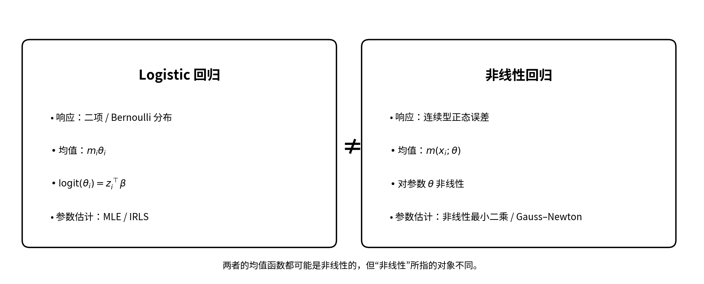
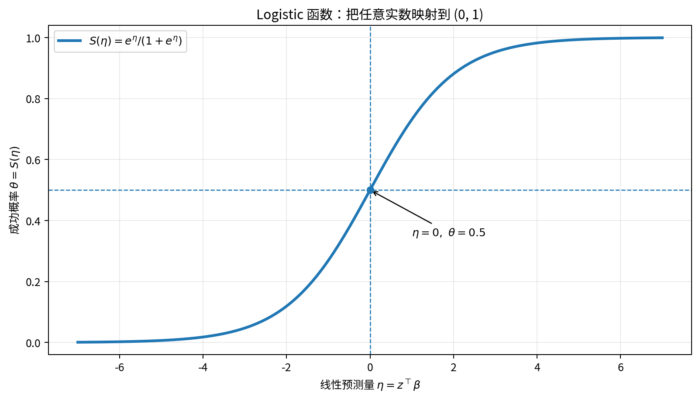
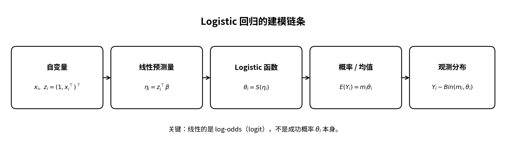
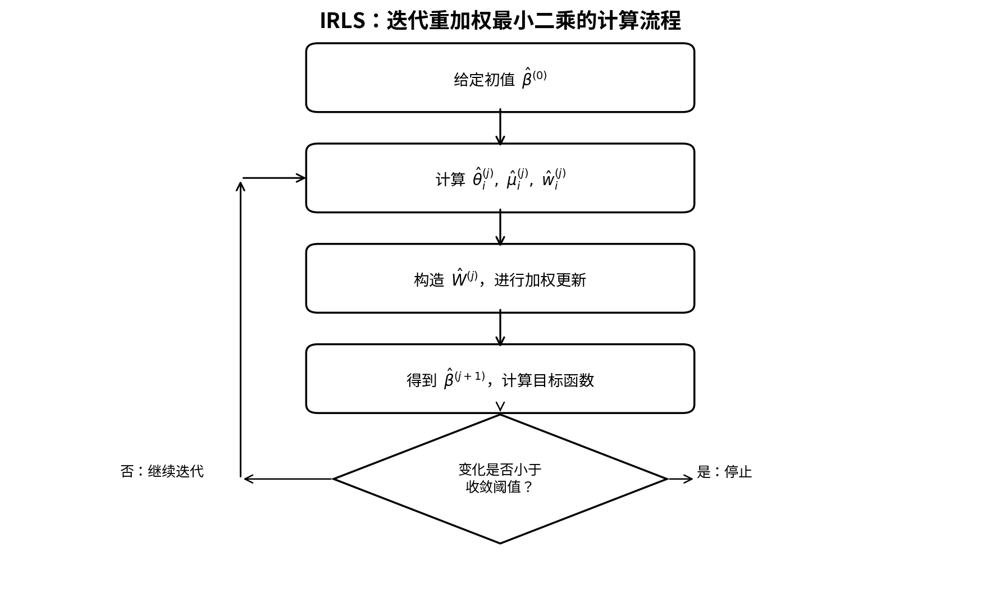
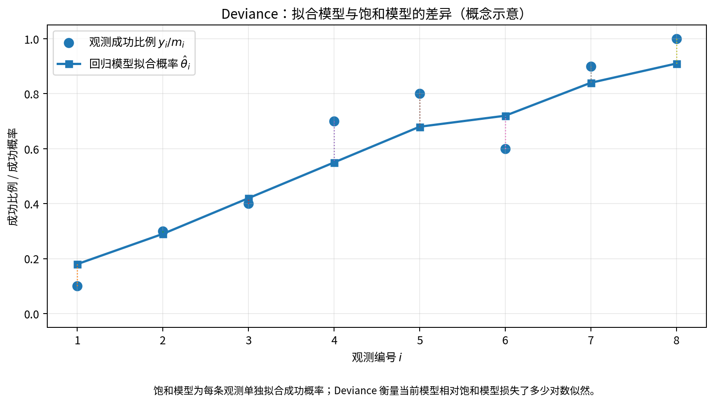
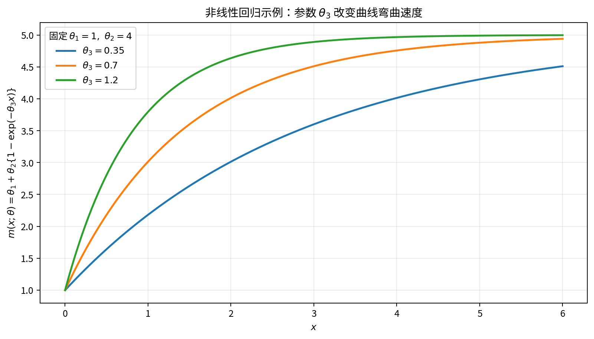
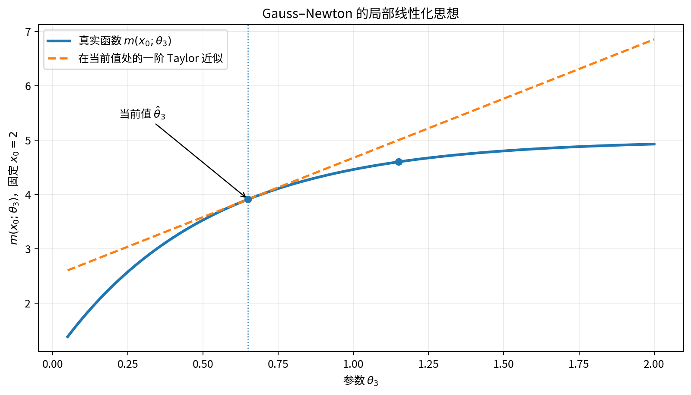

# 高维数据分析 Lecture 7：Logistic 回归与非线性回归

> **课程依据**：袁洪松《高维数据分析》第七讲，Weisberg 教材 Sections 12.1、12.2、11.1–11.3。  
> **组织方式**：紧跟讲义的「1 Logistic 回归 → 2 广义线性模型（不要求）→ 3 非线性回归」顺序，先讲思路，再逐步说明关键数学推导。  
> **题目部分**：最后单独整理你提供的 2023、2024、2026 年样卷中与 Lecture 7 直接相关的考点，包含完整的解题路线。  
> **导入 Obsidian**：本文件应位于 `lecture07` 文件夹内，与 `Lecture7_配图` 文件夹同级。使用下方“复制完整 Markdown”按钮，切勿通过渲染后的富文本“全选复制”，以免数学符号被二次转义。

***

## 0. 先建立第七讲的主线

### 0.1 从前六讲到第七讲：究竟扩展了什么？

前面 Lecture 1–6 主要讨论的是连续型响应变量，典型模型为：

$$
Y_i=\beta_0^*+\sum_{j=1}^p x_{ij}\beta_j^*+e_i,
\qquad e_i\overset{\mathrm{i.i.d.}}{\sim}N(0,\sigma^{*2}).
$$

其特点是：**条件均值关于未知系数是线性的**，在经典正态线性回归下可以得到普通最小二乘的显式解。

但现实中会遇到两种不同的新情况。

**情况 A：响应变量不是连续的。** 例如一个人是否购买商品，或某一批顾客中有多少人购买。此时 $Y_i$ 是 0–1 变量或成功次数，不适合直接用正态线性回归来描述。我们需要：

$$
Y_i\sim\operatorname{Bin}\{m_i,\theta^*(x_i)\},
$$

并研究成功概率 $\theta^*(x_i)$ 如何随自变量变化。这就是 **Logistic 回归（Logistic Regression）**。

**情况 B：$Y_i$ 仍是连续的，但均值函数对未知参数本身是非线性的。** 例如：

$$
Y_i=\theta_1^*+\theta_2^*\{1-\exp(-\theta_3^*x_i)\}+e_i.
$$

此时不能直接用普通矩阵 OLS 的逆矩阵公式求出所有参数，需要借助局部近似与迭代。这就是本讲的 **非线性回归（Nonlinear Regression）**。

### 0.2 最重要的区别：两个模型各自“非线性”在哪里？

| 方面       | Logistic 回归             | 非线性回归                 |
| -------- | ----------------------- | --------------------- |
| 响应 $Y_i$ | 二项计数、Bernoulli 变量       | 连续型，讲义假设正态加性误差        |
| 关键关系     | 成功概率是线性预测量的 Logistic 函数 | 均值函数对未知参数本身非线性        |
| 优化目标     | 负对数似然 $f(\beta)$        | 非线性残差平方和 $f(\theta)$  |
| 参数估计方法   | 极大似然与 IRLS              | 非线性最小二乘与 Gauss–Newton |
| 主要拟合指标   | Deviance                | RSS                   |
| 统计推断     | 大样本近似正态                 | 局部线性化后的近似分布           |

**整讲要记住的两句话**：

1. Logistic 回归的**成功概率并不是自变量的线性函数**，而是 *log-odds* 与自变量的线性组合相等。
2. 非线性回归的关键不只是曲线弯不弯，而是**未知参数是否以线性的形式进入均值函数**。

***

# 第一部分：Logistic 回归

## 1. 模型设定：从二项分布到 Logistic 函数（讲义 1.1）

### 1.1 为什么从二项分布（Binomial Distribution）开始？

设一次观测包含 $m$ 次独立试验，各次成功概率均为 $\theta$，$Y$ 表示成功的次数，则：

$$
\boxed{Y\sim\operatorname{Bin}(m,\theta)}.
$$

其概率质量函数为：

$$
\boxed{
P(Y=j)=\binom mj\theta^j(1-\theta)^{m-j},
\qquad j=0,1,\ldots,m.
}
$$

期望与方差为：

$$
\boxed{E(Y)=m\theta,\qquad \operatorname{Var}(Y)=m\theta(1-\theta).}
$$

当 $m=1$ 时，$Y$ 只有 0 和 1 两种取值：

$$
Y\sim\operatorname{Bernoulli}(\theta),\qquad
P(Y=1)=\theta,\quad P(Y=0)=1-\theta.
$$

所以：**二分类 Logistic 回归只是讲义中二项回归在 $m_i=1$ 时的特殊情况**。讲义从二项分布出发，比只介绍 0–1 分类更一般。

这里尤其不要混淆：

- $m_i$ 是第 $i$ 条观测对应的**试验次数**，在模型中视为已知；
- $Y_i$ 是第 $i$ 条观测中的**成功次数**，可能取 $0,1,\ldots,m_i$；
- $\theta^*(x_i)$ 是每次试验的**成功概率**，取值必须介于 0 和 1；
- $E(Y_i)=m_i\theta^*(x_i)$ 是**平均成功次数**，不一定小于 1。

### 1.2 建模的第一步：把自变量组合成一个线性预测量

讲义设：

$$
x_i=(x_{i1},\ldots,x_{ip})^\top,
\qquad
z_i=(1,x_{i1},\ldots,x_{ip})^\top,
$$

$$
\beta^*=(\beta_0^*,\beta_1^*,\ldots,\beta_p^*)^\top.
$$

定义**线性预测量（Linear Predictor）**：

$$
\boxed{z_i^\top\beta^*=\beta_0^*+\sum_{j=1}^p x_{ij}\beta_j^*.}
$$

但这里有问题：$z_i^\top\beta^*$ 可以是任意实数，而 $\theta^*(x_i)$ 必须在 0 和 1 之间。

因此讲义引入一个把实数映射到 $(0,1)$ 的函数 $K$：

$$
\boxed{\theta^*(x_i)=K(z_i^\top\beta^*).}
$$

讲义将 $K$ 叫作 **kernel mean function**，将其逆函数 $K^{-1}$ 叫作 **link function（连接函数）**。

### 1.3 Logistic 函数为什么适合描述概率？

讲义选择：

$$
\boxed{S(t)=\frac{e^t}{1+e^t}=\frac{1}{1+e^{-t}}.}
$$

于是 Logistic 回归模型为：

$$
\boxed{
Y_i\sim\operatorname{Bin}\{m_i,\theta^*(x_i)\},
\qquad
\theta^*(x_i)=\frac{e^{z_i^\top\beta^*}}{1+e^{z_i^\top\beta^*}}.
}
$$

从图上看出：

- 若 $z_i^\top\beta^*=0$，则 $\theta^*(x_i)=0.5$；
- 若 $z_i^\top\beta^*$ 很大，成功概率接近 1；
- 若 $z_i^\top\beta^*$ 很小，成功概率接近 0；
- 无论线性预测量取多少，成功概率都不会超出 $(0,1)$。

**直觉**：线性预测量首先表达“偏向成功还是失败的程度”，Logistic 函数再把这一程度压缩到概率区间。

### 1.4 Odds、Logit、Probability：三个极容易混淆的概念

由 Logistic 函数：

$$
\theta=\frac{e^t}{1+e^t}
$$

可得：

$$
1-\theta=\frac1{1+e^t},
\qquad
\frac{\theta}{1-\theta}=e^t.
$$

定义成功优势比（Odds of Success）为：

$$
\boxed{\operatorname{odds}=\frac{\theta}{1-\theta}.}
$$

再次取自然对数，就得到 **Logit 函数**：

$$
\boxed{
\operatorname{logit}(\theta)
=\log\frac{\theta}{1-\theta}
=t.
}
$$

代回回归模型：

$$
\boxed{
\log\frac{\theta^*(x_i)}{1-\theta^*(x_i)}
=z_i^\top\beta^*.
}
$$

这才是 Logistic 回归的**线性关系**：线性的是 **log-odds**，不是概率本身，更不是 odds 本身。

> Odds 示意：成功概率 0.2、0.5、0.8 时，Odds 分别为 0.25、1、4。

例子：

| 成功概率 $\theta$ | 失败概率 $1-\theta$ | Odds $\theta/(1-\theta)$ | Logit |
| --- | --- | --- | --- |
| $0.2$ | $0.8$ | $0.25$ | $\log 0.25$ |
| $0.5$ | $0.5$ | $1$ | $0$ |
| $0.8$ | $0.2$ | $4$ | $\log 4$ |

因此，如果成功概率从 0.2 增加到 0.8，Odds 从 0.25 增加到 4，并不是只增加了 0.6。

### 1.5 Logistic 回归系数究竟怎样解释？

设：

$$
\log\frac{\theta(x)}{1-\theta(x)}
=\beta_0+\beta_1x.
$$

当 $x$ 增加 1 时，log-odds 增加 $\beta_1$：

$$
\operatorname{logit}\{\theta(x+1)\}
-\operatorname{logit}\{\theta(x)\}=\beta_1.
$$

对两侧取指数，得到：

$$
\boxed{
\frac{\operatorname{odds}(x+1)}{\operatorname{odds}(x)}=e^{\beta_1}.
}
$$

所以固定其他自变量时，$x$ 增加 1 个单位，其成功 Odds **乘以** $e^{\beta_1}$。

- $\beta_1>0$：Odds 增加，成功概率也随之增加；
- $\beta_1<0$：Odds 减少，成功概率也随之减少；
- $\beta_1=0$：其他变量固定时，该变量不改变模型中的 log-odds。

**不能写成**“$x$ 增加 1 时成功概率增加 $\beta_1$”或“成功概率乘以 $e^{\beta_1}$”。这是相关模拟题常见的设问方式。

对于连续变量，概率变化率为：

$$
\frac{\partial\theta(x)}{\partial x_j}
=\beta_j\theta(x)\{1-\theta(x)\}.
$$

这进一步说明：即使 $\beta_j$ 固定，对概率的边际影响也会随着当前成功概率改变。

***

## 2. 参数估计：从似然函数到 IRLS（讲义 1.2）

### 2.1 为什么不再直接使用 OLS？

在 Lecture 2–3，正态线性模型的最大似然估计可以转化为最小化残差平方和。

本讲的 $Y_i$ 却服从二项分布，因此应该从二项分布的概率质量函数建立似然（Likelihood），再最大化似然。**似然估计的原则没有变，改变的是数据分布和相应的损失函数。**

### 2.2 写出二项 Logistic 回归的似然函数

因为不同观测独立：

$$
\boxed{
L(\beta)=\prod_{i=1}^n
\binom{m_i}{y_i}
\theta(x_i)^{y_i}
\{1-\theta(x_i)\}^{m_i-y_i}.
}
$$

这里 $\theta(x_i)=S(z_i^\top\beta)$；现在的 $\beta$ 是我们正在尝试优化的候选参数，而不是已知真实值。

取对数：

$$
\begin{aligned}
l(\beta)
=\sum_{i=1}^n\bigg[
&\log\binom{m_i}{y_i}
+y_i\log\theta(x_i)\\
&+(m_i-y_i)\log\{1-\theta(x_i)\}
\bigg].
\end{aligned}
$$

利用：

$$
\log\theta(x_i)=z_i^\top\beta-\log\{1+e^{z_i^\top\beta}\},
$$

$$
\log\{1-\theta(x_i)\}=-\log\{1+e^{z_i^\top\beta}\},
$$

整理得到讲义中的对数似然：

$$
\boxed{
l(\beta)=\sum_{i=1}^n
\left[
\log\binom{m_i}{y_i}
+y_i(z_i^\top\beta)
-m_i\log\{1+e^{z_i^\top\beta}\}
\right].
}
$$

第一项 $\log\binom{m_i}{y_i}$ 不含 $\beta$，因此最大化 $l(\beta)$ 等价于最小化：

$$
\boxed{
f(\beta)=\sum_{i=1}^n
\left[
m_i\log\{1+e^{z_i^\top\beta}\}
-y_i z_i^\top\beta
\right].
}
$$

当 $m_i=1$，上式就是 Bernoulli Logistic 回归的负对数似然，与常见的二分类交叉熵损失（Binary Cross-Entropy）对应。

### 2.3 关键导数：为什么会出现 $\theta(1-\theta)$？

令：

$$
t=z_i^\top\beta,\qquad \theta=S(t)=\frac{e^t}{1+e^t}.
$$

对 Logistic 函数求导：

$$
\begin{aligned}
S'(t)
&=\frac{e^t(1+e^t)-e^t e^t}{(1+e^t)^2}\\
&=\frac{e^t}{(1+e^t)^2}\\
&=S(t)\{1-S(t)\}.
\end{aligned}
$$

所以：

$$
\boxed{S'(t)=\theta(1-\theta).}
$$

又因为 $t=z_i^\top\beta$，根据链式法则：

$$
\frac{\partial\theta(x_i)}{\partial\beta}
=\theta(x_i)\{1-\theta(x_i)\}z_i.
$$

在负对数似然中：

$$
\frac{\partial}{\partial\beta}
\log\{1+e^{z_i^\top\beta}\}
=\theta(x_i)z_i.
$$

因此其梯度（Gradient）为：

$$
\boxed{
\nabla f(\beta)=\sum_{i=1}^n
\{m_i\theta(x_i)-y_i\}z_i.
}
$$

再求导得到 Hessian 矩阵：

$$
\boxed{
\nabla^2f(\beta)=\sum_{i=1}^n
m_i\theta(x_i)\{1-\theta(x_i)\}z_i z_i^\top.
}
$$

观察 Hessian 的系数：

$$
m_i\theta(x_i)\{1-\theta(x_i)\}
=\operatorname{Var}(Y_i\mid x_i).
$$

**所以 Logistic 回归的二阶曲率与二项响应的条件方差直接相关**。这就是 IRLS 使用权重 $w_i$ 的数学来源。

> IRLS 权重图解：权重 $w_i=m_i\theta_i(1-\theta_i)$ 在 $\theta_i=0.5$ 时最大，在两端趋于 0。（未提供对应 PNG。）

> 图中的 $\theta(1-\theta)$ 是单次 Bernoulli 试验的方差；一般二项观测还需要乘以试验次数 $m_i$。

### 2.4 把梯度与 Hessian 变成讲义中的矩阵表达

讲义记：

$$
X=\begin{pmatrix}
z_1^\top\\z_2^\top\\\vdots\\z_n^\top
\end{pmatrix}
\in\mathbb R^{n\times(p+1)},
\qquad
Y=\begin{pmatrix}y_1\\y_2\\\vdots\\y_n\end{pmatrix}.
$$

在当前参数估计 $\hat\beta$ 处：

$$
\hat\theta_i=\frac{e^{z_i^\top\hat\beta}}{1+e^{z_i^\top\hat\beta}},
\qquad
\hat\mu_i=m_i\hat\theta_i,
$$

$$
\boxed{\hat w_i=m_i\hat\theta_i(1-\hat\theta_i).}
$$

令：

$$
\hat\mu=(\hat\mu_1,\ldots,\hat\mu_n)^\top,
\qquad
\hat W=\operatorname{diag}(\hat w_1,\ldots,\hat w_n).
$$

于是：

$$
\boxed{\nabla f(\hat\beta)=X^\top(\hat\mu-Y)},
$$

$$
\boxed{\nabla^2 f(\hat\beta)=X^\top\hat W X}.
$$

这与 Lecture 3 的加权最小二乘矩阵 $X^\top WX$ 形式相似，**但这里的权重是随当前模型概率重新计算的，不是事先给定不变的权重**。

### 2.5 为什么不直接解 $\nabla f(\beta)=0$？

因为 $\theta(x_i)=S(z_i^\top\beta)$ 非线性依赖 $\beta$，所以：

$$
X^\top(\mu(\beta)-Y)=0
$$

通常不是一个简单的线性方程组。

讲义用在当前点 $\hat\beta$ 附近的二阶 Taylor 展开来近似 $f(\beta)$：

$$
\begin{aligned}
f(\beta)\approx{}
&f(\hat\beta)
+\nabla f(\hat\beta)^\top(\beta-\hat\beta)\\
&+\frac12(\beta-\hat\beta)^\top
\nabla^2f(\hat\beta)(\beta-\hat\beta).
\end{aligned}
$$

设本次参数修正量为：

$$
\Delta\beta=\beta-\hat\beta.
$$

使上述二次近似最小，其一阶条件为：

$$
\nabla f(\hat\beta)+\nabla^2f(\hat\beta)\Delta\beta=0.
$$

因此：

$$
\begin{aligned}
\Delta\beta
&=-\{\nabla^2f(\hat\beta)\}^{-1}\nabla f(\hat\beta)\\
&=(X^\top\hat W X)^{-1}X^\top(Y-\hat\mu).
\end{aligned}
$$

这一步把非线性优化转化为一次可计算的矩阵更新。

### 2.6 IRLS：迭代重加权最小二乘算法

讲义得到更新：

$$
\boxed{
\hat\beta'=\hat\beta+
(X^\top\hat W X)^{-1}X^\top(Y-\hat\mu).
}
$$

把每次迭代标上 $j$：

$$
\boxed{
\hat\beta^{(j+1)}=
\hat\beta^{(j)}+
\{X^\top\hat W^{(j)}X\}^{-1}
X^\top\{Y-\hat\mu^{(j)}\}.
}
$$

理解公式时只需抓住三个环节：

1. **当前预测**：从 $\hat\beta^{(j)}$ 得到每个样本的 $\hat\theta_i^{(j)}$，从而得到 $\hat\mu_i^{(j)}$；
2. **重新计算权重**：$\hat w_i^{(j)}=m_i\hat\theta_i^{(j)}(1-\hat\theta_i^{(j)})$；
3. **修正参数**：使用当前的梯度和 Hessian，求出 $\hat\beta^{(j+1)}$。

直到目标函数变化很小，或者满足预设的其他收敛条件。

**为什么叫“重加权最小二乘”？**

讲义展示的是更新公式。进一步把二次近似配方（这是为理解算法补充的等价表达），可定义工作响应：

$$
Y^{\mathrm{work}}
=X\hat\beta+\hat W^{-1}(Y-\hat\mu).
$$

然后最小化以下加权平方和：

$$
\min_\beta
\{Y^{\mathrm{work}}-X\beta\}^\top
\hat W
\{Y^{\mathrm{work}}-X\beta\}.
$$

由其正规方程可以重新得到同一个 IRLS 更新。

这说明 IRLS 不是“每轮对原来的 0–1 变量做普通 OLS”，而是**每次以当前参数为中心，构造新的工作响应和权重，再解一个局部加权最小二乘问题**。

### 2.7 辅助算例：手算一次 IRLS 更新（新编，帮助理解讲义）

为了避免一开始就计算复杂的高维矩阵，取四条 Bernoulli 观测：

| $i$ | $x_i$ | $y_i$ |
| --- | ---: | ---: |
| 1 | $-1$ | $0$ |
| 2 | $0$ | $1$ |
| 3 | $1$ | $0$ |
| 4 | $2$ | $1$ |

假设带截距的 Logistic 模型：

$$
\log\frac{\theta(x_i)}{1-\theta(x_i)}
=\beta_0+\beta_1x_i,
\qquad m_i=1.
$$

设计矩阵：

$$
X=\begin{pmatrix}
1&-1\\1&0\\1&1\\1&2
\end{pmatrix},
\qquad
Y=\begin{pmatrix}0\\1\\0\\1\end{pmatrix}.
$$

**第一步：给定初值**

$$
\hat\beta^{(0)}=\begin{pmatrix}0\\0\end{pmatrix}.
$$

此时每条样本的线性预测量均为 0，所以：

$$
\hat\theta_i^{(0)}=0.5,
\qquad
\hat\mu_i^{(0)}=0.5,
\qquad
\hat w_i^{(0)}=0.25.
$$

**第二步：计算梯度修正项和 Hessian**

$$
Y-\hat\mu^{(0)}=\begin{pmatrix}-.5\\.5\\-.5\\.5\end{pmatrix},
\qquad
X^\top(Y-\hat\mu^{(0)})=
\begin{pmatrix}0\\1\end{pmatrix}.
$$

$$
X^\top\hat W^{(0)}X
=\frac14\begin{pmatrix}4&2\\2&6\end{pmatrix}
=\begin{pmatrix}1&.5\\.5&1.5\end{pmatrix}.
$$

**第三步：求一次参数更新**

$$
\begin{aligned}
\hat\beta^{(1)}
&=\begin{pmatrix}0\\0\end{pmatrix}
+\begin{pmatrix}1&.5\\.5&1.5\end{pmatrix}^{-1}
\begin{pmatrix}0\\1\end{pmatrix}\\
&=\begin{pmatrix}-.4\\.8\end{pmatrix}.
\end{aligned}
$$

因此第一轮更新后：

$$
\boxed{\hat\beta_0^{(1)}=-0.4,\qquad\hat\beta_1^{(1)}=0.8.}
$$

若再迭代，应重新计算四条样本的成功概率和权重，**不能继续使用第一次的 $\hat W^{(0)}$**。

### 2.8 IRLS 为什么能利用凸性？适用条件是什么？

由 Hessian：

$$
\nabla^2f(\beta)=
\sum_i m_i\theta_i(1-\theta_i)z_i z_i^\top
$$

可知，对任意向量 $v$：

$$
v^\top\nabla^2f(\beta)v
=\sum_i m_i\theta_i(1-\theta_i)(z_i^\top v)^2\ge0.
$$

因此负对数似然是凸函数。若设计矩阵满足适当的满秩和正权重条件，局部 Hessian 还可以正定。

**讲义中的表述**：由于 $f(\beta)$ 是凸函数，IRLS 收敛至全局最优解。按照讲义的考试框架，应当理解 Logistic 的凸目标与一般非线性最小二乘的非凸目标之间的区别。

**补充的严格条件**：凸性保证任何*存在的局部极小点*都是全局极小点，但单凭凸性不能无条件保证未经步长控制的 Newton/IRLS 迭代从任意初值都收敛。特别是完全分离（complete separation）情形下，有限的极大似然解可能不存在。讲义没有展开这些数值细节，学习本讲时不需把它们当成主要计算考点。

***

## 3. Logistic 回归的统计推断（讲义 1.3）

### 3.1 为什么和普通线性回归的方差公式不同？

Lecture 3 的正态同方差线性回归使用：

$$
\operatorname{Cov}(\hat\beta)
=\sigma^{*2}(X^\top X)^{-1}.
$$

Logistic 回归中，每条观测的二项分布方差为：

$$
w_i^*=m_i\theta^*(x_i)\{1-\theta^*(x_i)\}.
$$

所以不同样本的方差一般不同，而且与成功概率有关；在参数估计中，信息矩阵自然出现 $X^\top W^*X$。

### 3.2 估计量的近似分布

在真实参数 $\beta^*$ 附近做 Taylor 展开，记：

$$
\mu_i^*=m_i\theta^*(x_i),
\qquad
W^*=\operatorname{diag}(w_1^*,\ldots,w_n^*).
$$

讲义得到局部近似：

$$
\boxed{
\hat\beta\approx
\beta^*+(X^\top W^*X)^{-1}X^\top(Y-\mu^*).
}
$$

因为 $E(Y-\mu^*)=0$，讲义据此说明估计量渐进无偏；再结合 $\operatorname{Cov}(Y)=W^*$，得到：

$$
\boxed{
\operatorname{Cov}(\hat\beta)
\approx (X^\top W^*X)^{-1}.
}
$$

实际中用拟合后的 $\hat W$ 代替未知的 $W^*$：

$$
\boxed{
\widehat{\operatorname{Cov}}(\hat\beta)
=(X^\top\hat W X)^{-1}.
}
$$

这里是**大样本近似**，不能与正态线性回归中精确的 $t$ 分布结论混为一谈。

### 3.3 标准误、置信区间与假设检验

如果 $c_{jj}$ 表示 $(X^\top\hat W X)^{-1}$ 中与 $\beta_j$ 对应的对角元素（按讲义约定 $j=0$ 是截距），则：

$$
\boxed{se(\hat\beta_j)=\sqrt{c_{jj}}.}
$$

在大样本常规近似中，$\hat\beta_j$ 的双侧 $(1-\alpha)$ 置信区间为：

$$
\boxed{
\hat\beta_j\pm z_{\alpha/2}\,se(\hat\beta_j).
}
$$

这里 $z_{\alpha/2}$ 表示标准正态分布上侧 $\alpha/2$ 分位数。95% 置信区间常用约 $1.96$；讲义只说明推断形式与线性回归类似，没有要求必须使用新的记号。

检验：

$$
H_0:\beta_j^*=b_0,
\qquad H_1:\beta_j^*\ne b_0
$$

时，近似 Wald 统计量为：

$$
\boxed{
Z=\frac{\hat\beta_j-b_0}{se(\hat\beta_j)}.
}
$$

双侧 $p$ 值：

$$
\boxed{p=2\{1-\Phi(\lvert Z\rvert)\}.}
$$

其中 $\Phi$ 是标准正态分布的分布函数。

**与 Lecture 2–3 的区别**：

- 线性回归中，标准误通常包含额外估计的 $\hat\sigma^2$；
- Logistic 回归中，二项方差已经由 $m_i\theta_i(1-\theta_i)$ 确定，所以标准误直接从 $(X^\top\hat W X)^{-1}$ 的对角元开根号；
- Logistic 回归实际输出多用 $z$ 检验（渐近正态），而不是把 OLS 的残差自由度精确 $t$ 分布直接套过来。

### 3.4 对 Odds Ratio 的推断

若 $\beta_j$ 对应连续变量增加一个单位的 log-odds 变化，那么 Odds Ratio 为：

$$
OR_j=e^{\beta_j}.
$$

如果 $\beta_j$ 的 95% 置信区间为：

$$
[\hat\beta_j-1.96\,se(\hat\beta_j),
\ \hat\beta_j+1.96\,se(\hat\beta_j)],
$$

对端点指数变换，就得到 Odds Ratio 的近似置信区间：

$$
\boxed{
[\,e^{\hat\beta_j-1.96\,se},\ e^{\hat\beta_j+1.96\,se}\,].
}
$$

这属于由讲义 Odds 和系数区间自然延伸出的应用方法，帮助你读懂回归 Summary。

***

## 4. Deviance：Logistic 回归怎样衡量模型拟合？（讲义 1.4）

### 4.1 为什么不能只照搬线性回归的 RSS？

线性回归常用残差平方和 $RSS$ 衡量拟合。

但 Logistic 回归的响应服从二项分布，方差与 $\theta_i$ 有关，因此讲义采用基于对数似然的指标：**Deviance（偏差）**。

思路是：把实际拟合模型与一个极其灵活、对每条样本都能单独设置成功概率的**饱和模型（Saturated Model）**比较。

### 4.2 什么是饱和模型？

当前模型给出：

$$
\hat\theta_i=\frac{e^{z_i^\top\hat\beta}}{1+e^{z_i^\top\hat\beta}},
\qquad
\hat y_i=m_i\hat\theta_i.
$$

饱和模型允许第 $i$ 条观测有自己的概率参数，所以它的最大似然估计为：

$$
\boxed{\hat\theta_i^{\,s}=\frac{y_i}{m_i}.}
$$

于是饱和模型在每条样本上都能使拟合成功次数与观测成功次数一致：

$$
m_i\hat\theta_i^{\,s}=y_i.
$$

这不表示它预测未来一定最好，而只是说它在训练样本上拥有很大的拟合自由度。

### 4.3 Deviance 的定义及公式

令：

- $\hat l=l(\hat\beta)$：当前 Logistic 回归的最大对数似然；
- $l^s$：饱和模型的最大对数似然。

讲义定义：

$$
\boxed{G^2=2(l^s-\hat l).}
$$

展开得到：

$$
\boxed{
G^2=2\sum_{i=1}^n\left[
y_i\log\frac{y_i}{\hat y_i}
+(m_i-y_i)\log\frac{m_i-y_i}{m_i-\hat y_i}
\right].
}
$$

其中当分子为 0 时，约定对应的 $0\log0$ 型项按极限等于 0。

因为饱和模型的最大似然至少与当前模型一样大：

$$
l^s\ge\hat l,
$$

所以：

$$
G^2\ge0.
$$

并且**对于同一数据集**：

$$
\boxed{G^2\text{ 越小，模型在训练数据上的拟合越好。}}
$$

### 4.4 Null Deviance、Residual Deviance 与自由度

回归 Summary 经常出现：

- **Null Deviance**：只有截距的 Logistic 模型相对饱和模型的 Deviance；
- **Residual Deviance**：当前包含所选自变量的模型相对饱和模型的 Deviance。

在具有 $n$ 条聚合二项观测、满列秩且包含截距与 $p$ 个自变量列时，通常报告：

$$
\boxed{\text{Null Deviance 的自由度}=n-1,}
$$

$$
\boxed{\text{Residual Deviance 的自由度}=n-p-1.}
$$

如果加入因子和交互项，要按照**设计矩阵的实际参数数量**而不是公式中单词的数量计数。

讲义陈述在 $n$ 充分大时有近似：

$$
G^2\approx\chi^2(n-p-1).
$$

**补充适用条件**：这类卡方拟合优度近似还依赖合适的分组、计数规模和正则条件。特别是对大量单条 Bernoulli 观测直接使用残差 Deviance 的卡方近似时，不能仅凭 $n$ 大就保证近似可靠。考试按讲义要求掌握公式与含义即可。

### 4.5 Deviance 怎样与 AIC 连接？

Lecture 5 学过：

$$
AIC=-2\hat l+2(\text{参数个数}).
$$

又因为：

$$
G^2=2(l^s-\hat l),
$$

所以：

$$
AIC=G^2+2(\text{参数个数})-2l^s.
$$

同一组数据的饱和模型 $l^s$ 固定，因而：

$$
\boxed{
\text{用 AIC 比较 Logistic 模型，等价于比较}
\quad G^2+2(\text{参数个数}).
}
$$

**注意**：Deviance 越小不等于 AIC 一定越小；复杂模型也会承担更大的参数惩罚。

***

## 5. Logistic 回归怎样用于分类？（讲义 1.5）

### 5.1 二分类：概率预测与类别预测要分开

当 $m_i=1$ 时：

$$
Y_i\sim\operatorname{Bernoulli}\{\theta^*(x_i)\},
\qquad
Y_i\in\{0,1\}.
$$

模型先预测概率：

$$
\hat\theta(x)=P(Y=1\mid x;\hat\beta).
$$

如果最终需要一个分类标签，还需设定阈值 $c$：

$$
\hat Y=\begin{cases}
1,&\hat\theta(x)>c,\\
0,&\hat\theta(x)\le c.
\end{cases}
$$

常见的 $c=0.5$ 只是一个默认选择；当漏判与误判成本不同，阈值可以调整。

- 更怕漏掉正类：可以降低阈值，通常提高 Recall（召回率），但增加误报；
- 更怕误报和无效投入：可以提高阈值，使预测更保守，但可能漏掉更多正类。

### 5.2 加入分类自变量与交互效应

讲义在统计推断部分还写到，一个连续自变量 $X$ 和一个有 $L$ 类的分类自变量 $F$，可建立：

$$
Y\sim X+F+X:F.
$$

以第 1 类为参照组，对其他 $L-1$ 类定义虚拟变量 $U_{ij}$。线性预测量为：

$$
\boxed{
\eta_i=\beta_0+\beta_1x_i+
\sum_{j=2}^L\beta_{0j}U_{ij}
+\sum_{j=2}^L\beta_{1j}U_{ij}x_i.
}
$$

注意：这里每一组都可能有不同的 **logit 截距与 logit 斜率**。解释完 $\eta_i$ 后，还必须使用 $S(\eta_i)$ 才能得到成功概率。

> 分类交互图解：不同组别的线性预测量截距和斜率可以不同，概率曲线随之不同。（未提供对应 PNG。）

针对二分类因子，记 $U=I\{F=B\}$，则：

$$
\eta_A(x)=\beta_0+\beta_1x,
$$

$$
\eta_B(x)=(\beta_0+\beta_F)+(\beta_1+\beta_{XF})x.
$$

因此：

$$
\boxed{
\eta_B(x)-\eta_A(x)=\beta_F+\beta_{XF}x.
}
$$

这意味着给定相同 $x$ 时，B 类相对 A 类的 **Odds Ratio** 为：

$$
\boxed{
\frac{\operatorname{odds}_B(x)}{\operatorname{odds}_A(x)}
=\exp(\beta_F+\beta_{XF}x).
}
$$

若没有交互项，这个比值与 $x$ 无关；若有交互项，这个比值会随 $x$ 改变。

### 5.3 多分类 Logistic（Multinomial Logistic）

讲义还将 0–1 Logistic 推广至 $d$ 个类别。选择第 1 类为参照类，设 $k=2,\ldots,d$ 对应参数 $\beta^{*(k)}$。

第 1 类的概率：

$$
\boxed{
\theta^{*(1)}(x_i)
=\frac{1}{1+\sum_{\ell=2}^d \exp(z_i^\top\beta^{*(\ell)})}.
}
$$

第 $k$ 类的概率：

$$
\boxed{
\theta^{*(k)}(x_i)
=\frac{\exp(z_i^\top\beta^{*(k)})}{
1+\sum_{\ell=2}^d \exp(z_i^\top\beta^{*(\ell)})},
\quad k=2,\ldots,d.
}
$$

这样所有类别的概率非负，且：

$$
\sum_{k=1}^d\theta^{*(k)}(x_i)=1.
$$

理解即可：这相当于为多个类别建立相对参照类的线性预测量，再将它们转换成总和为 1 的概率。讲义没有给出多项 Logistic 的独立手算推导大题。

***

# 第二部分：广义线性模型（讲义第 2 节，标注“不要求”）

## 6. 用一分钟把 GLM 放在正确的位置

讲义将广义线性模型（Generalized Linear Model, GLM）作为一个更一般的回归框架：响应变量服从指数分布类中的分布，其均值通过连接函数与线性预测量关联。

讲义给出的指数分布类形式为：

$$
f(y;\eta,\phi)
=\exp\left\{\frac{y\eta-b(\eta)}{a(\phi)}+h(y,\phi)\right\}.
$$

其中：

$$
E(Y)=b'(\eta),
\qquad
\operatorname{Var}(Y)=a(\phi)b''(\eta).
$$

如果用连接函数 $g$ 满足：

$$
g\{E(Y_i)\}=z_i^\top\beta^*,
$$

就进入 GLM 的典型框架。

几个熟悉的例子：

| 模型 | 分布 | 均值与线性预测量 |
| --- | --- | --- |
| 普通线性回归 | 正态分布 | $E(Y_i)=z_i^\top\beta^*$ |
| Logistic 回归 | 二项分布 | $\theta_i=S(z_i^\top\beta^*)$ |
| Poisson 回归 | Poisson 分布 | $E(Y_i)=\exp(z_i^\top\beta^*)$ |

**讲义明确标注本节不要求**。因此不必背指数分布类中 $a,b,h$ 的逐个构造，也不必在这一部分投入大量证明时间。只需理解：Logistic 回归并不是孤立方法，而是 GLM 的一个重要特例。

***
# 第三部分：非线性回归（讲义第 3 节）

## 7. 非线性模型的设定（讲义 3.1）

### 7.1 先分清两类曲线模型

前面 Lecture 4 学过多项式回归：

$$
Y_i=\beta_0^*+\beta_1^*x_i+\beta_2^*x_i^2+e_i.
$$

它虽然对 $x_i$ 呈曲线关系，但如果把 $x_i^2$ 作为设计矩阵中的新列，那么未知参数仍然线性出现；所以可以使用普通线性回归方法。

这一讲重点讨论：**均值函数不能简单表示成“固定基函数乘未知系数”的线性组合**。例如下面讲义给出的形式：

$$
\boxed{
m(x;\theta^*)
=\theta_1^*+\theta_2^*\{1-\exp(-\theta_3^*x)\}.
}
$$

虽然可以把 $1-e^{-\theta_3x}$ 看成函数，但它本身还包含未知参数 $\theta_3$，因此不能事先当成固定的设计矩阵列。

这就是本讲需要进行迭代优化的原因。

### 7.2 讲义的模型与符号

记：

$$
x_i=(x_{i1},\ldots,x_{ip})^\top,
\qquad
\theta^*=(\theta_1^*,\ldots,\theta_k^*)^\top.
$$

讲义的非线性回归模型是：

$$
\boxed{
Y_i=m(x_i;\theta^*)+e_i,
\qquad i=1,\ldots,n,
}
$$

$$
\boxed{
e_1,\ldots,e_n\overset{\mathrm{i.i.d.}}{\sim}N(0,\sigma^{*2}).
}
$$

这里应分清：

- $p$ 是每个样本原始自变量向量的维数；
- $k$ 是未知参数 $\theta^*$ 的维数；
- $p$ 和 $k$ **不要求相等**；
- $m(x_i;\theta^*)$ 是条件均值函数；
- $e_i$ 是加性正态误差。

对于刚才的例子，原始自变量只有一个 $x$，所以 $p=1$，但未知参数有三个，所以 $k=3$。

### 7.3 用讲义中的“逐渐饱和”模型理解三个参数

考虑：

$$
m(x;\theta)=\theta_1+\theta_2\{1-e^{-\theta_3x}\}.
$$

在 $x\ge0$ 且 $\theta_2,\theta_3>0$ 时：

- $\theta_1$：$x=0$ 时的起点，因为 $m(0;\theta)=\theta_1$；
- $\theta_2$：相对于起点的饱和增加量，因为 $x\to\infty$ 时 $m(x;\theta)\to\theta_1+\theta_2$；
- $\theta_3$：靠近饱和水平的速度，越大则越快趋近平台。

所以这个模型特别适合描述某些“先增长、后趋于稳定”的现象，而不需要使用可能在边界剧烈波动的高阶多项式。

***

## 8. 非线性参数估计：Gauss–Newton（讲义 3.2）

### 8.1 从最大似然到最小二乘

由于误差服从独立正态分布，给定参数 $\theta$ 的对数似然与残差平方和相差常数和正比例因子。

因此讲义使用非线性最小二乘目标：

$$
\boxed{
\min_\theta f(\theta)
=\min_\theta\sum_{i=1}^n\{y_i-m(x_i;\theta)\}^2.
}
$$

与 Lecture 3 不同，这里的 $m(x_i;\theta)$ 对未知参数一般是非线性的。即使对 $\theta$ 求导并令其为 0，也通常得不到可以直接求逆的线性正规方程。

**Gauss–Newton 的想法不是一次把整个非线性函数解出来，而是每次只在当前参数附近做一个可求解的线性近似。**

### 8.2 什么叫“在参数附近”做 Taylor 展开？

假设当前有一个参数估计 $\hat\theta$。我们希望求得更好的 $\theta$，因此研究参数修正：

$$
\theta-\hat\theta.
$$

对每个样本的均值函数关于**参数向量**做一阶 Taylor 展开：

$$
\boxed{
m(x_i;\theta)
\approx m(x_i;\hat\theta)
+u_i(\hat\theta)^\top(\theta-\hat\theta).
}
$$

其中：

$$
\boxed{
u_i(\hat\theta)=
\left.\frac{\partial m(x_i;\theta)}{\partial\theta}\right|_{\theta=\hat\theta}
\in\mathbb R^k.
}
$$

这里的 $u_i$ 是关于未知参数的**梯度向量（Gradient Vector）**，不是对自变量 $x_i$ 的导数。

直观上，这个向量告诉我们：**如果每个参数分别发生一个小变化，当前样本的预测均值会怎样变化？**

例如：

$$
\theta=\begin{pmatrix}\theta_1\\\theta_2\\\theta_3\end{pmatrix},
\quad
u_i(\hat\theta)=
\begin{pmatrix}
\partial m/\partial\theta_1\\
\partial m/\partial\theta_2\\
\partial m/\partial\theta_3
\end{pmatrix}_{\theta=\hat\theta}.
$$

> 图示的是**固定 $x$，改变参数 $\theta_3$** 时，对参数方向进行的一阶 Taylor 近似；并不是给 $x$ 求切线。

### 8.3 Working Residual 与梯度矩阵 $U(\hat\theta)$

讲义定义当前残差（Working Residual）：

$$
\boxed{\hat e_i=y_i-m(x_i;\hat\theta).}
$$

并把梯度向量按行排列：

$$
\boxed{
U(\hat\theta)=
\begin{pmatrix}
u_1(\hat\theta)^\top\\
\vdots\\
u_n(\hat\theta)^\top
\end{pmatrix}\in\mathbb R^{n\times k}.
}
$$

同时：

$$
\hat e=(\hat e_1,\ldots,\hat e_n)^\top.
$$

代入 Taylor 近似，残差可以近似写为：

$$
\begin{aligned}
y_i-m(x_i;\theta)
&\approx y_i-m(x_i;\hat\theta)
-u_i(\hat\theta)^\top(\theta-\hat\theta)\\
&=\hat e_i-u_i(\hat\theta)^\top(\theta-\hat\theta).
\end{aligned}
$$

因此：

$$
\boxed{
f(\theta)\approx
\left\lVert\hat e-U(\hat\theta)(\theta-\hat\theta)\right\rVert_2^2.
}
$$

到这一步，**原来的非线性问题已在当前参数附近变成一个关于修正量 $\theta-\hat\theta$ 的线性最小二乘问题**。

### 8.4 推导 Gauss–Newton 更新公式

把本次修正量记为：

$$
\Delta\theta=\theta-\hat\theta.
$$

我们需要近似求解：

$$
\min_{\Delta\theta}
\left\lVert\hat e-U(\hat\theta)\Delta\theta\right\rVert_2^2.
$$

这就是 Lecture 3 的标准 OLS 形式，把“响应”换成 $\hat e$，把“设计矩阵”换成 $U(\hat\theta)$。

若 $U(\hat\theta)$ 满列秩，则正规方程为：

$$
U(\hat\theta)^\top U(\hat\theta)\Delta\theta
=U(\hat\theta)^\top\hat e.
$$

所以：

$$
\Delta\theta
=\{U(\hat\theta)^\top U(\hat\theta)\}^{-1}
U(\hat\theta)^\top\hat e.
$$

加入当前估计，得到讲义中的更新：

$$
\boxed{
\hat\theta'
=\hat\theta+
\{U(\hat\theta)^\top U(\hat\theta)\}^{-1}
U(\hat\theta)^\top\hat e.
}
$$

写成迭代形式：

$$
\boxed{
\hat\theta^{(j+1)}
=\hat\theta^{(j)}+
\{U(\hat\theta^{(j)})^\top U(\hat\theta^{(j)})\}^{-1}
U(\hat\theta^{(j)})^\top\hat e^{(j)}.
}
$$

这个式子与 Logistic 的 IRLS 很像，但有重要区别：

- **IRLS**：用二项分布的概率计算权重，局部二次近似由 Hessian $X^\top\hat W X$ 确定；
- **Gauss–Newton**：用非线性均值函数对参数的梯度矩阵 $U$ 做线性化，局部最小二乘矩阵是 $U^\top U$。

### 8.5 讲义示例：如何求 $u_i(\theta)$？

考虑：

$$
m(x;\theta)=\theta_1+\theta_2\{1-e^{-\theta_3x}\}.
$$

依次对三个参数求偏导：

$$
\frac{\partial m(x;\theta)}{\partial\theta_1}=1,
$$

$$
\frac{\partial m(x;\theta)}{\partial\theta_2}
=1-e^{-\theta_3x},
$$

$$
\frac{\partial m(x;\theta)}{\partial\theta_3}
=\theta_2x e^{-\theta_3x}.
$$

最后一式使用链式法则：

$$
\frac{\partial}{\partial\theta_3}(-e^{-\theta_3x})
=x e^{-\theta_3x}.
$$

因此：

$$
\boxed{
u_i(\theta)=
\begin{pmatrix}
1\\
1-e^{-\theta_3x_i}\\
\theta_2x_i e^{-\theta_3x_i}
\end{pmatrix}.
}
$$

对 $n$ 条样本，按行写出梯度矩阵：

$$
\boxed{
U(\theta)=\begin{pmatrix}
1&1-e^{-\theta_3x_1}&\theta_2x_1 e^{-\theta_3x_1}\\
\vdots&\vdots&\vdots\\
1&1-e^{-\theta_3x_n}&\theta_2x_n e^{-\theta_3x_n}
\end{pmatrix}.
}
$$

**考题遇到一个新的非线性函数时，最重要的第一步就是正确计算各参数的偏导，而不是直接求导自变量 $x$。**

### 8.6 辅助算例：手算一次 Gauss–Newton 更新（新编）

为了把公式变成具体步骤，考虑另一个简单的非线性均值模型：

$$
m(x;\theta)=\theta_1 e^{\theta_2x},
\qquad
\theta=(\theta_1,\theta_2)^\top.
$$

三个样本为：

$$
(x_1,y_1)=(0,1),\quad
(x_2,y_2)=(1,1.3),\quad
(x_3,y_3)=(2,1.7).
$$

给定当前初值：

$$
\hat\theta^{(0)}=(1,0)^\top.
$$

**第一步：构造梯度向量。**

$$
\frac{\partial m}{\partial\theta_1}=e^{\theta_2x},
\qquad
\frac{\partial m}{\partial\theta_2}
=\theta_1x e^{\theta_2x}.
$$

所以：

$$
u_i(\theta)=
\begin{pmatrix}e^{\theta_2x_i}\\\theta_1x_i e^{\theta_2x_i}\end{pmatrix}.
$$

在 $\hat\theta^{(0)}=(1,0)^\top$ 处：

$$
U(\hat\theta^{(0)})=
\begin{pmatrix}1&0\\1&1\\1&2\end{pmatrix}.
$$

**第二步：计算当前残差。**

因为当前均值函数为 $m(x;(1,0))=1$：

$$
\hat e^{(0)}=
\begin{pmatrix}1-1\\1.3-1\\1.7-1\end{pmatrix}
=\begin{pmatrix}0\\0.3\\0.7\end{pmatrix}.
$$

**第三步：计算正规方程中的两个矩阵。**

$$
U^\top U=
\begin{pmatrix}3&3\\3&5\end{pmatrix},
\qquad
U^\top\hat e^{(0)}=
\begin{pmatrix}1\\1.7\end{pmatrix}.
$$

二阶矩阵求逆：

$$
(U^\top U)^{-1}
=\frac16\begin{pmatrix}5&-3\\-3&3\end{pmatrix}.
$$

**第四步：求参数修正。**

$$
\begin{aligned}
\Delta\theta
&=\frac16
\begin{pmatrix}5&-3\\-3&3\end{pmatrix}
\begin{pmatrix}1\\1.7\end{pmatrix}\\
&=\begin{pmatrix}-1/60\\7/20\end{pmatrix}.
\end{aligned}
$$

因此：

$$
\boxed{
\hat\theta^{(1)}
=\hat\theta^{(0)}+\Delta\theta
=\begin{pmatrix}59/60\\7/20\end{pmatrix}.
}
$$

也就是：

$$
\hat\theta_1^{(1)}\approx0.9833,
\qquad
\hat\theta_2^{(1)}=0.35.
$$

这一轮只是**一次更新**，并不等于已经找到最终最小值。如果要继续迭代，就必须在新的 $\hat\theta^{(1)}$ 下重新计算 $U(\hat\theta^{(1)})$ 和残差，而不能一直使用初始矩阵。

### 8.7 Gauss–Newton 为什么不一定收敛到全局最优？

普通 OLS 的目标是一个关于系数的凸二次函数，正常满秩时只有一个全局最小值。

非线性回归的目标：

$$
f(\theta)=\sum_i\{y_i-m(x_i;\theta)\}^2
$$

一般不是凸函数。不同初值可能引导算法走向不同的局部区域。

讲义特别提醒两个问题：

1. 均值函数的参数梯度 $u_i(\hat\theta)$ 可能不容易计算；
2. 初值很重要，选得不好可能陷入局部最优。

更严格地说，Gauss–Newton 还可能因为 $U^\top U$ 奇异、修正步长过大等原因遇到数值问题；这些属于对讲义的补充说明。

因此，如果选择题说：“Gauss–Newton 总能保证收敛到全局最优解”，结论是 **False（错误）**。

***

## 9. 非线性回归的统计推断（讲义 3.3）

### 9.1 为什么仍可以得到近似正态分布？

虽然均值函数对参数非线性，但如果最终估计 $\hat\theta$ 足够接近真实参数 $\theta^*$，就可以在 $\theta^*$ 附近进行一阶线性化。

讲义得到：

$$
\boxed{
\hat\theta
\approx\theta^*
+\{U(\theta^*)^\top U(\theta^*)\}^{-1}
U(\theta^*)^\top e.
}
$$

这里右侧是正态误差向量 $e$ 的线性变换，因此得到近似的正态分布：

$$
\boxed{
\hat\theta\ \overset{\cdot}{\sim}\
N_k\!\left(
\theta^*,
\sigma^{*2}\{U(\theta^*)^\top U(\theta^*)\}^{-1}
\right).
}
$$

**与 Lecture 3 的 OLS 结论的联系**：

$$
\operatorname{Cov}(\hat\beta_{\mathrm{OLS}})
=\sigma^{*2}(X^\top X)^{-1}
$$

与：

$$
\operatorname{Cov}(\hat\theta)
\approx\sigma^{*2}(U^\top U)^{-1}
$$

形式相似，但后者是在非线性均值函数附近的**局部线性近似**，不是有限样本下的精确 OLS 分布。

### 9.2 误差方差怎样估计？

在拟合得到的 $\hat\theta$ 处，计算：

$$
f(\hat\theta)=\sum_{i=1}^n\{y_i-m(x_i;\hat\theta)\}^2.
$$

讲义给出：

$$
\boxed{
\hat\sigma^2=\frac{f(\hat\theta)}{n-k}.
}
$$

其中 $k$ 是**非线性模型未知参数向量的维数**。这与 Lecture 3 的 $n-p-1$ 并不矛盾，关键是看实际估计了多少个参数。

### 9.3 协方差矩阵与标准误

将真实参数处的 $U(\theta^*)$ 用拟合处的 $U(\hat\theta)$ 替代：

$$
\boxed{
\widehat{\operatorname{Cov}}(\hat\theta)
=\hat\sigma^2
\{U(\hat\theta)^\top U(\hat\theta)\}^{-1}.
}
$$

如果 $c_{jj}$ 是矩阵 $\{U(\hat\theta)^\top U(\hat\theta)\}^{-1}$ 的第 $j$ 个对角元素，则：

$$
\boxed{
se(\hat\theta_j)=\hat\sigma\sqrt{c_{jj}}.
}
$$

这个公式与 Logistic 回归标准误最值得区分：

- **Logistic**：$se(\hat\beta_j)=\sqrt{c_{jj}}$，$c_{jj}$ 来自 $(X^\top\hat W X)^{-1}$；
- **非线性正态回归**：$se(\hat\theta_j)=\hat\sigma\sqrt{c_{jj}}$，$c_{jj}$ 来自 $(U^\top U)^{-1}$。

### 9.4 近似置信区间与检验

讲义说可以按与线性回归类似的形式构造近似置信区间与检验。

例如 $\theta_j^*$ 的近似 $(1-\alpha)$ 置信区间可写为：

$$
\boxed{
\hat\theta_j
\pm t_{\alpha/2}(n-k)\,se(\hat\theta_j).
}
$$

检验 $H_0:\theta_j^*=b_0$ 时，可用近似统计量：

$$
\boxed{
T=\frac{\hat\theta_j-b_0}{se(\hat\theta_j)}.
}
$$

**注意适用条件**：这里主要依赖大样本或局部线性化近似，不能像标准正态线性回归那样无条件断言这个统计量在有限样本下精确服从 $t(n-k)$。若采用大样本 Wald 正态近似，也可使用相应的标准正态分位数。

***

# 第四部分：两种回归方法之间的联系与区别

## 10. 为什么都要用“当前点近似—更新—重复”？

本讲最重要的方法论不是背两种复杂的矩阵公式，而是理解它们各自怎样将难求解的问题转化成局部容易求解的问题。

### 10.1 Logistic 回归：把负对数似然局部近似成二次函数

当前参数为 $\hat\beta$ 时：

$$
\boxed{
\text{梯度}=X^\top(\hat\mu-Y),
\qquad
\text{Hessian}=X^\top\hat W X.
}
$$

于是 Newton/IRLS 更新为：

$$
\boxed{
\hat\beta'
=\hat\beta+(X^\top\hat W X)^{-1}X^\top(Y-\hat\mu).
}
$$

### 10.2 非线性回归：把均值函数局部近似成线性函数

当前参数为 $\hat\theta$ 时：

$$
m(x_i;\theta)
\approx m(x_i;\hat\theta)+u_i(\hat\theta)^\top(\theta-\hat\theta).
$$

于是 Gauss–Newton 更新为：

$$
\boxed{
\hat\theta'
=\hat\theta+
(U^\top U)^{-1}U^\top\hat e.
}
$$

### 10.3 三个本质不同之处

| 比较 | IRLS | Gauss–Newton |
| --- | --- | --- |
| 为什么需要迭代 | Logistic 似然的一阶条件是非线性的 | 非线性均值函数没有一般 OLS 显式解 |
| 局部近似对象 | 负对数似然目标函数 | 均值函数 $m(x_i;\theta)$ |
| 核心矩阵 | $X^\top\hat W X$ | $U^\top U$ |
| 随参数变化的量 | 成功概率、工作均值、权重 | 均值函数导数矩阵、残差 |
| 一般优化性质 | 负对数似然凸（需满足数值正则条件） | 最小二乘目标可能非凸 |

***
# 第五部分：对应模拟题考点与解题步骤

> 本部分将你提供的 2024 和 2026 年样卷中，与第七讲直接对应的题目提炼为通用题型。先介绍**题目在考什么**，再把代表性题目完整算一遍。题解中会区分讲义内的公式和为解题补充的技巧。  
> 2023 年两份样卷主要考 Lecture 1–6；Logistic 与 Gauss–Newton 在 2024、2026 的相关题中更直接出现。

## 11. 题型一：给 Logistic 系数，求新样本的成功概率

### 11.1 怎样识别这类题？

题目一般会给出：

- Logistic 模型，例如 $Y\sim X+F+X:F$；
- 回归结果表中的系数 Estimate；
- 某个新样本的连续变量与分类变量取值；
- 要求给出 $P(Y=1)$。

**通用步骤**：

1. 明确因子参照类别，把新样本对应的虚拟变量设为 0 或 1；
2. 把适用的**主效应和交互项系数**都代入，先求线性预测量 $\hat\eta$；
3. 最后使用 $\hat\theta=e^{\hat\eta}/(1+e^{\hat\eta})$；
4. 检查输出是否介于 0 和 1。不要把 $\hat\eta$ 误当概率。

### 11.2 对应原题：2026 Sample Midterm 1 · Problem 5（第 1 问）

设购买行为 $Y\in\{0,1\}$，收入 $X$ 为连续变量，性别 $A$ 为女性 F、男性 M，使用女性作为参照组。模型为：

$$
Y\sim X+A+X:A.
$$

给出的系数为：

| 系数 | Estimate |
| --- | ---: |
| 截距 | $1.55$ |
| $X$ | $0.47$ |
| 男性 M | $-1.66$ |
| $X:\mathrm M$ | $0.35$ |

题目询问收入 $x_{\mathrm{new}}=1.5$ 的女性用户的购买概率。

**第一步：代入类别。** 女性是参照组，所以男性虚拟变量为 0，交互项也为 0。

**第二步：计算线性预测量。**

$$
\hat\eta_{\mathrm{new}}=1.55+0.47\times1.5=2.255.
$$

**第三步：转换为概率。**

$$
\boxed{
\hat\theta(x_{\mathrm{new}})
=\frac{e^{2.255}}{1+e^{2.255}}
\approx0.905.
}
$$

所以该用户的预测购买概率约为 90.5%。

**易错点**：如果新用户是男性，就要同时添加男性主效应 $-1.66$ 和交互项 $0.35x$；如果是女性，则二者都应为零。

***

## 12. 题型二：比较分类群体的 Odds 或 Odds Ratio

### 12.1 通用解题方法

假设只有 A、B 两类，A 为参照组：

$$
\hat\eta_A(x)=\hat\beta_0+\hat\beta_1x,
$$

$$
\hat\eta_B(x)
=\hat\beta_0+\hat\beta_1x+
\hat\beta_F+\hat\beta_{XF}x.
$$

由于：

$$
\operatorname{odds}(x)=e^{\hat\eta(x)},
$$

因此：

$$
\boxed{
\frac{\operatorname{odds}_B(x)}{\operatorname{odds}_A(x)}
=e^{\hat\beta_F+\hat\beta_{XF}x}.
}
$$

**通用步骤**：先写两组 $\hat\eta$，再作差，最后指数化。不要先把两组概率求出来再简单相除，因为题目比较的通常是 Odds，不是 Probability。

### 12.2 对应原题：2026 Sample Midterm 1 · Problem 5（第 2 问）

沿用上一题的模型，当 $x=1$：

$$
\hat\eta_{\mathrm M}(1)-\hat\eta_{\mathrm F}(1)
=-1.66+0.35=-1.31.
$$

所以男性相对于女性的购买 Odds Ratio 是：

$$
\boxed{
\frac{\operatorname{odds}_{\mathrm M}(1)}
{\operatorname{odds}_{\mathrm F}(1)}
=e^{-1.31}\approx0.270.
}
$$

意思是：在同一收入水平 $x=1$ 下，男性模型预测的购买 Odds 约为女性的 0.27 倍。

**如果删除交互项，得到主效应模型**：

$$
\eta_{\mathrm M}(x)-\eta_{\mathrm F}(x)=\beta_{\mathrm M},
$$

所以两组 Odds Ratio 不再随收入变化，而是一个常数 $e^{\beta_{\mathrm M}}$。

原样卷参考解答将 $-1.66$ 保持不变进行形式比较，写出 $e^{-1.66}$；如果题目真的要求**重新拟合**不含交互项的模型，则系数一般会改变，不能仅凭完整模型中的 $-1.66$ 确定新的主效应模型的数值 Odds Ratio。这是区分“去掉公式中的一项”和“重新估计较简单模型”的重要细节。

***

## 13. 题型三：由回归 Summary 求标准误、检验、置信区间

### 13.1 先识别 Summary 的四列

| 列名 | 含义 | 对应关系 |
| --- | --- | --- |
| Estimate | 系数估计 | $\hat\beta_j$ |
| Std. Error | 标准误 | $se(\hat\beta_j)$ |
| z value | 渐近检验统计量 | $\hat\beta_j/se(\hat\beta_j)$（检验 0） |
| Pr(> z) 或 Pr(> $\lvert z\rvert$) | p 值 | 常规双侧值 $2\{1-\Phi(\lvert z\rvert)\}$ |

**通用步骤**：

1. 缺少 z 值：`Estimate ÷ Std. Error`；
2. 缺少标准误：`Estimate ÷ z value`，得到的标准误必须取正数；
3. 缺少 p 值：使用标准正态双侧尾概率；
4. 需要 95% CI：使用 $\hat\beta_j\pm1.96\,se(\hat\beta_j)$；
5. 若检验非零值 $b_0$，必须用 $(\hat\beta_j-b_0)/se$，而不是直接用 Summary 中检验 0 的 z 值。

### 13.2 对应原题：2026 Sample Midterm 2 · Problem 5（第 1 问）

给出部分 Logistic 结果：

| 变量 | Estimate | Std. Error | z value |
| --- | ---: | ---: | ---: |
| 截距 | $-15.55$ | $7.29$ | $-2.13$ |
| $X_1$ | $-0.59$ | $0.36$ | (a) |
| $X_2$ | $0.56$ | $0.33$ | $1.70$ |
| $X_3$ | $1.96$ | (b) | $2.23$ |

要求求出 (a)、(b) 及 $X_3$ 的双侧 p 值 (c)。

**(a) z 值：**

$$
\boxed{(a)=\frac{-0.59}{0.36}\approx-1.639.}
$$

**(b) 标准误：**

$$
\boxed{(b)=\frac{1.96}{2.23}\approx0.879.}
$$

**(c) 双侧 p 值：**

$$
\boxed{(c)=2\{1-\Phi(2.23)\}\approx0.0258.}
$$

这里的 $\Phi$ 是标准正态分布的累积分布函数。如果题目允许只列式，不必手算 $\Phi$ 的数值。

**注意**：Logistic Summary 通常使用大样本 $z$ 检验；不要不加判断地代入线性回归的 $t(n-p-1)$ 公式。

***

## 14. 题型四：已知希望达到的成功概率，反求自变量取值

### 14.1 通用方法

题目给出目标概率 $\theta_0$，要求某个连续变量 $x_j$ 取多少，才能使预测成功概率达到 $\theta_0$。

不要直接解复杂的指数分式，先作 Logit 变换：

$$
\frac{e^\eta}{1+e^\eta}=\theta_0
\quad\Longleftrightarrow\quad
\eta=\log\frac{\theta_0}{1-\theta_0}.
$$

如果：

$$
\eta=\beta_0+\sum_{k=1}^p\beta_k x_k,
$$

且只需要求 $x_j$，则：

$$
\boxed{
x_j
=\frac{\displaystyle\log\frac{\theta_0}{1-\theta_0}
-\beta_0-\sum_{k\ne j}\beta_kx_k}{\beta_j},
\qquad \beta_j\ne0.
}
$$

如果有分类交互项，先确定类别，合并对应的常数项与斜率，再用相同方法解方程。

### 14.2 对应原题：2026 Sample Midterm 2 · Problem 5（第 2 问）

沿用上一题的系数，设：

$$
x_1=5,\qquad x_2=25,
$$

希望：

$$
\theta=0.4.
$$

线性预测量为：

$$
\eta=-15.55-0.59(5)+0.56(25)+1.96x_3.
$$

目标概率对应的 Logit：

$$
\eta=\log\frac{0.4}{0.6}=\log\frac23.
$$

因此：

$$
\boxed{
x_3=
\frac{\displaystyle\log\frac23+15.55+0.59\times5-0.56\times25}
{1.96}
\approx2.09.
}
$$

**最容易错的地方**是把 $0.4$ 直接等于线性预测量，而不是等于 Logistic 函数的输出。

***

## 15. 题型五：根据 Deviance 和参数数量使用 AIC 选模型

### 15.1 通用步骤

给两个使用同一数据拟合的 Logistic 模型：

1. 找到它们的 Residual Deviance；
2. 数清楚各模型含截距在内的实际估计参数数量；
3. 计算 `Residual Deviance + 2 × 参数数量`；
4. 取结果较小的模型；
5. 明确说明此方法考虑了模型复杂度，并不是只比较 Deviance 本身。

### 15.2 对应原题：2026 Sample Midterm 2 · Problem 5（第 3 问）

完整模型为 $Y\sim X_1+X_2+X_3$，包含截距共 4 个参数：

$$
\text{Residual Deviance}_{\mathrm{full}}=14.18.
$$

简化模型为 $Y\sim X_2+X_3$，包含截距共 3 个参数：

$$
\text{Residual Deviance}_{\mathrm{reduced}}=18.16.
$$

比较：

$$
\begin{aligned}
AIC_{\mathrm{full}}\text{（去共同常数）}
&=14.18+2\times4=22.18,\\
AIC_{\mathrm{reduced}}\text{（去共同常数）}
&=18.16+2\times3=24.16.
\end{aligned}
$$

由于：

$$
22.18<24.16,
$$

所以选择**完整模型**。

这道题与 Lecture 5 的 AIC 基本思想相同，但 Logistic 模型没有直接套用正态线性回归的 $n\log(RSS/n)$ 形式，而是使用其对数似然或 Deviance。

***

## 16. 题型六：响应标签翻转之后，Logistic 系数怎样变化？

对应 **2024 Fall Sample Midterm · Problem 4 第 3 问**。

原来 $Y=1$ 表示成功，现在重新定义 $Y'=1-Y$，即把成功和失败互换。

若原模型：

$$
P(Y=1\mid x)=S(z^\top\beta),
$$

那么：

$$
P(Y'=1\mid x)=1-S(z^\top\beta).
$$

利用 Logistic 函数恒等式：

$$
\boxed{1-S(t)=S(-t).}
$$

所以：

$$
P(Y'=1\mid x)=S(-z^\top\beta)=S(z^\top(-\beta)).
$$

因此，采用同一设计矩阵、模型包含相同的列且存在有限极大似然解时：

$$
\boxed{\hat\beta'=-\hat\beta.}
$$

**考试证明步骤**：写出 $1-S(t)=S(-t)$，再说明标签翻转把每个成功概率换成原失败概率，于是所有线性预测系数变号。即使模型包含分类变量与交互项，它们也同样变号。

***

## 17. 题型七：识别“可以转化为线性回归”的模型

对应 **2026 Sample Midterm 2 · Problem 2 第 3 小题**。

题目让你判断哪个表面上有指数、对数的回归模型可以直接转化为线性模型。

重要的解题判断不是看有没有 $\log$ 或 $\exp$，而是问：**能否通过合法的参数变换，把未知参数改写为线性系数？**

原题中的正确形式为：

$$
Y_i=\theta_1^*+\exp(\theta_2^*+\log x_i)+e_i,
\qquad x_i>0.
$$

由于：

$$
\exp(\theta_2^*+\log x_i)
=e^{\theta_2^*}x_i,
$$

令：

$$
\gamma^*=e^{\theta_2^*}>0,
$$

得到：

$$
\boxed{Y_i=\theta_1^*+\gamma^*x_i+e_i.}
$$

这就是对新系数 $(\theta_1^*,\gamma^*)$ 线性的模型。

**补充细节**：由于 $\gamma^*>0$，严格等价的参数化存在正斜率约束；不能因此无条件把原模型与允许任何正负斜率的无约束 OLS 完全视作同一个参数空间。

另一方面，如果是：

$$
Y_i=\theta_1^*+\exp(\theta_2^*\log x_i)+e_i
=\theta_1^*+x_i^{\theta_2^*}+e_i,
$$

则未知参数 $\theta_2^*$ 仍出现在指数中，一般不能直接按照固定设计矩阵的普通线性回归处理。

***

## 18. 题型八：Gauss–Newton 正误判断与手算一轮更新

### 18.1 判断题

2024 年、2026 年样卷均出现过类似判断：

> “非线性回归的 Gauss–Newton 方法一定收敛到全局最优解。”

答案：**False**。

解题理由：一般非线性最小二乘损失不保证凸，算法受初值影响，可能停在局部最优，还可能遇到数值不稳定问题。

### 18.2 如果要求对一个新模型写出 Gauss–Newton 更新

**通用步骤**：

1. 看清参数向量 $\theta=(\theta_1,\ldots,\theta_k)^\top$ 有几个未知参数；
2. 按每个参数求 $\partial m(x_i;\theta)/\partial\theta_j$，组成 $u_i(\theta)$；
3. 用所有样本组成矩阵 $U(\hat\theta)$；
4. 计算当前残差 $\hat e_i=y_i-m(x_i;\hat\theta)$；
5. 计算 $U^\top U$ 和 $U^\top\hat e$；
6. 解正规方程 $(U^\top U)\Delta\theta=U^\top\hat e$；
7. 用 $\hat\theta'=\hat\theta+\Delta\theta$ 更新，检查新旧目标函数并判断是否继续。

如果题目只问“写出一次更新公式”，不要求你把目标函数完整求解；最关键的评分点通常是**梯度算对、残差方向算对、矩阵维度与更新符号算对**。

### 18.3 如果要求近似参数标准误

先求：

$$
\hat\sigma^2=\frac{f(\hat\theta)}{n-k},
$$

然后：

$$
\widehat{\operatorname{Cov}}(\hat\theta)
=\hat\sigma^2(U^\top U)^{-1},
$$

取对应对角元 $c_{jj}$：

$$
\boxed{se(\hat\theta_j)=\hat\sigma\sqrt{c_{jj}}.}
$$

不要把 Logistic 的 $(X^\top\hat W X)^{-1}$ 直接套到这里，也不要忘记非线性正态回归里需要的 $\hat\sigma$ 因子。

***

# 第六部分：整讲公式索引与复习顺序

## 19. 核心公式（与讲义对应）

### 19.1 Logistic 回归

**模型：**

$$
Y_i\sim\operatorname{Bin}\{m_i,\theta^*(x_i)\},\qquad
\theta^*(x_i)=\frac{e^{z_i^\top\beta^*}}{1+e^{z_i^\top\beta^*}}.
$$

**Logit 与 Odds：**

$$
\operatorname{logit}(\theta)=\log\frac\theta{1-\theta},
\qquad
\operatorname{odds}=\frac\theta{1-\theta}.
$$

**负对数似然（去常数）：**

$$
f(\beta)=\sum_{i=1}^n
\left[m_i\log\{1+e^{z_i^\top\beta}\}-y_i z_i^\top\beta\right].
$$

**梯度与 Hessian：**

$$
\nabla f(\beta)=X^\top(\mu-Y),
\qquad
\nabla^2f(\beta)=X^\top W X.
$$

**IRLS：**

$$
\boxed{
\hat\beta^{(j+1)}=\hat\beta^{(j)}
+\{X^\top\hat W^{(j)}X\}^{-1}
X^\top\{Y-\hat\mu^{(j)}\}.
}
$$

**标准误与 Deviance：**

$$
se(\hat\beta_j)=\sqrt{c_{jj}},
\quad c_{jj}\text{ 来自 }(X^\top\hat W X)^{-1};
\qquad
G^2=2(l^s-\hat l).
$$

### 19.2 非线性回归

**模型和目标：**

$$
Y_i=m(x_i;\theta^*)+e_i,
\qquad
f(\theta)=\sum_{i=1}^n\{y_i-m(x_i;\theta)\}^2.
$$

**梯度、残差与 Taylor 线性化：**

$$
u_i(\hat\theta)=
\left.\frac{\partial m(x_i;\theta)}{\partial\theta}\right|_{\theta=\hat\theta},
\quad
\hat e_i=y_i-m(x_i;\hat\theta),
$$

$$
f(\theta)\approx
\left\lVert\hat e-U(\hat\theta)(\theta-\hat\theta)\right\rVert_2^2.
$$

**Gauss–Newton：**

$$
\boxed{
\hat\theta^{(j+1)}=\hat\theta^{(j)}
+\{U(\hat\theta^{(j)})^\top U(\hat\theta^{(j)})\}^{-1}
U(\hat\theta^{(j)})^\top\hat e^{(j)}.
}
$$

**近似协方差与标准误：**

$$
\hat\sigma^2=\frac{f(\hat\theta)}{n-k},
\qquad
\widehat{\operatorname{Cov}}(\hat\theta)
=\hat\sigma^2\{U(\hat\theta)^\top U(\hat\theta)\}^{-1},
$$

$$
se(\hat\theta_j)=\hat\sigma\sqrt{c_{jj}}.
$$

***

## 20. 考前应该按照什么顺序复习？

| 复习顺序 | 内容 | 掌握标准 |
| --- | --- | --- |
| 1 | 二项分布、Logistic、Odds、Logit | 能写模型，能解释系数与 Odds Ratio |
| 2 | Logistic 概率计算与分类交互 | 能根据 Summary 计算任意新样本概率及组间 Odds 比 |
| 3 | 似然、梯度、Hessian、IRLS | 知道更新式从哪里来，并能手算简单一轮 |
| 4 | Logistic 近似检验、Deviance、AIC | 能补 Summary 数值、反求自变量、比较模型 |
| 5 | 非线性回归与 Gauss–Newton | 能对参数求梯度、构造 $U$、列更新方程 |
| 6 | 非线性近似标准误、方法比较 | 能判断适用条件，区别 $W$ 与 $U$ |

### 最后检查五个易混点

1. **Probability 不是 Odds**：$\theta$ 与 $\theta/(1-\theta)$ 不能混用。
2. **Logistic 系数不是概率增加量**：$\beta_j$ 改变 log-odds，$e^{\beta_j}$ 是对应 Odds 倍数。
3. **Logistic 的权重是反复更新的**：IRLS 不等于对原始二项观测做一次固定 WLS。
4. **非线性回归中要对参数求导**：构造 $U$ 用 $\partial m/\partial\theta$，不是 $\partial m/\partial x$。
5. **两种标准误不能直接互换**：Logistic 取 $(X^\top\hat W X)^{-1}$ 的对角元开根号；非线性正态回归还需乘 $\hat\sigma$。

***

## 附：图示与课程资料说明

本笔记的数学模型和章节顺序以你上传的 Lecture 7 讲义为依据，来源包括：

- 《高维数据分析》第七讲：Logistic 与非线性回归，讲义第 1–6 页与第 9–11 页；
- 第 2 节广义线性模型：讲义第 6–8 页，**明确标注“不要求”**；
- 模拟题部分：2026 Sample Midterm 1 Problem 5、2026 Sample Midterm 2 Problem 2/5、2024 Sample Midterm 的 Logistic 与 Gauss–Newton 相关题。

图中数值、IRLS 单步示例和 Gauss–Newton 单步示例属于**专门为教学构造的辅助例子**，不是讲义原始数据或实验结果。其余标注为“补充”的数学适用条件，是为避免在理解中把近似结论误读成无条件成立。