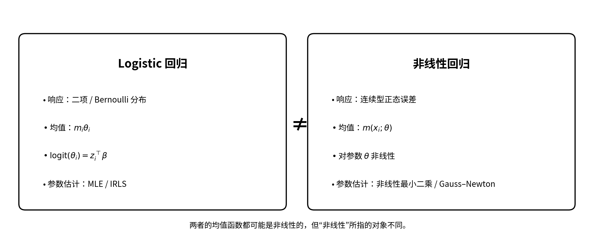
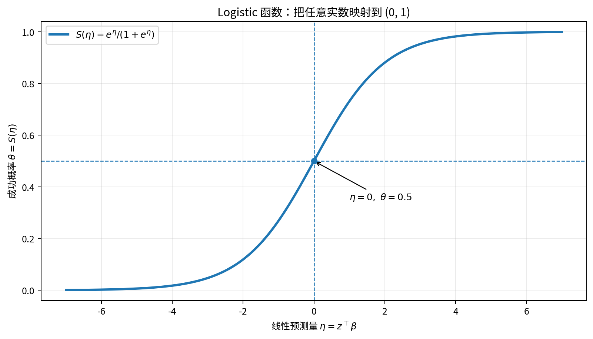
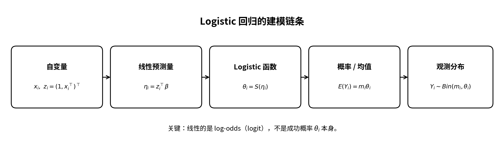
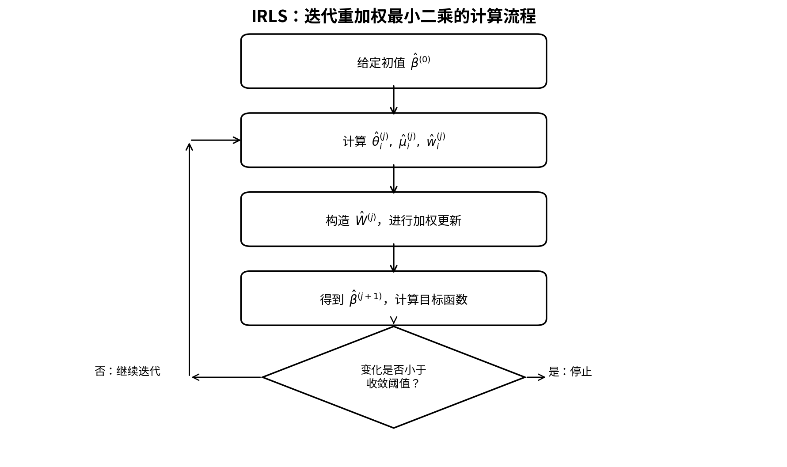
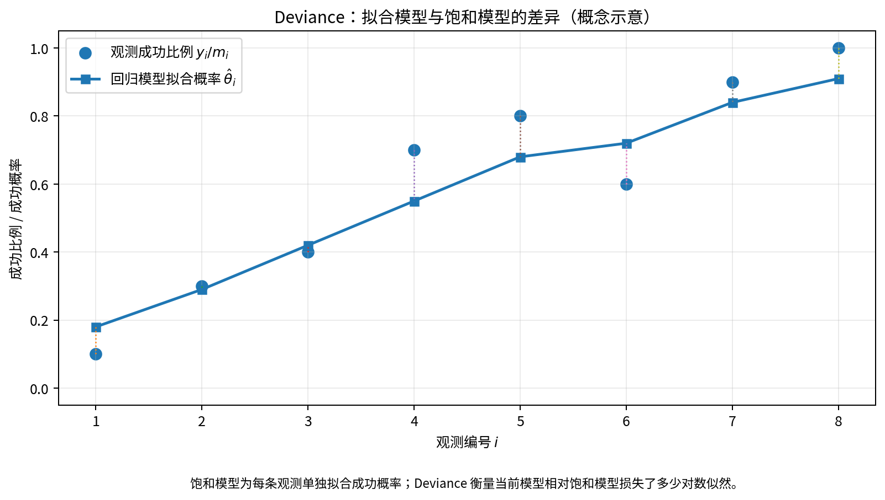
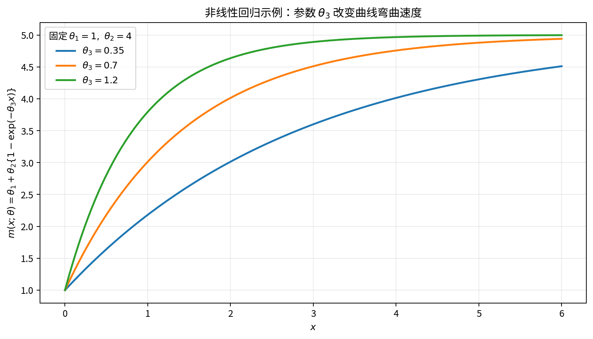
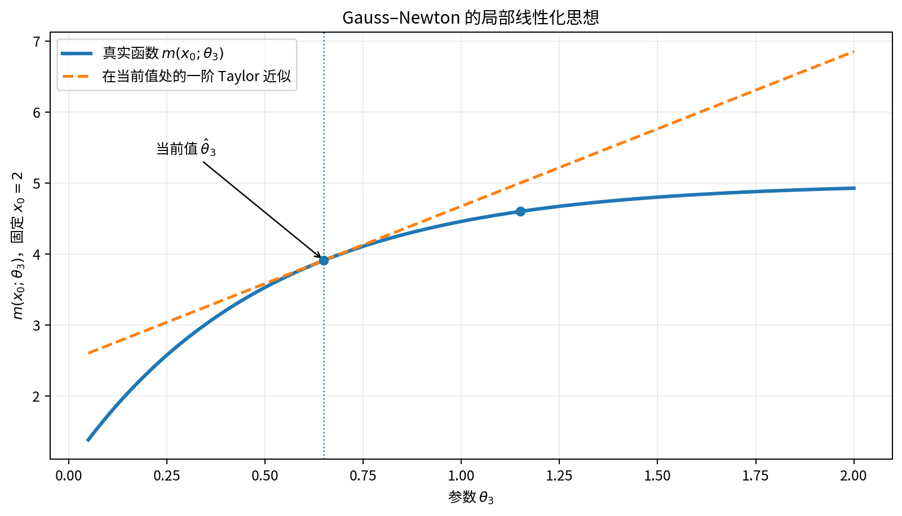

# 高维数据分析 Lecture 7：Logistic 回归与非线性回归

> 依据：袁洪松《高维数据分析》第七讲讲义。以讲义的章节顺序、符号和公式为主，补充必要的直观解释与学习辅助图。  
> 本讲分为两条主线：**Logistic 回归**和**非线性回归**。讲义第 2 节“广义线性模型”明确标注为“不要求”，这里只作定位，不展开推导。

---

# 一、整讲知识主线

前六讲主要研究连续型因变量的线性回归，以及变量选择、正则化等问题。第七讲进一步处理两类不同的数据结构：

1. **因变量是计数或成功次数**：例如 \(Y_i\) 表示 \(m_i\) 次试验中成功的次数。这时使用二项分布，并通过 Logistic 函数描述成功概率如何依赖自变量。
2. **均值函数对未知参数本身是非线性的**：例如 \(m(x;\theta)=\theta_1+\theta_2\{1-\exp(-\theta_3x)\}\)。这时通常没有 OLS 那样的显式解，需要使用 Gauss–Newton 迭代算法。

整讲的结构：

- **第一条主线：Logistic 回归**
  - 二项分布与 Logistic 模型设定
  - 似然函数与参数估计
  - IRLS（迭代重加权最小二乘）
  - 参数的近似分布、标准误与置信区间
  - Deviance（偏差）与模型拟合
  - 二分类和多分类
- **第二条主线：非线性回归**
  - 非线性模型的定义
  - 非线性最小二乘与 Taylor 线性化
  - Gauss–Newton 迭代
  - 参数的近似分布与统计推断

## 1.1 两种“非线性”不要混淆

Logistic 回归的成功概率是 Logistic 函数，因此 \(\theta^*(x_i)\) 对线性预测量呈非线性；但它的 **logit** 与自变量仍然是线性关系：

\[
\log\frac{\theta^*(x_i)}{1-\theta^*(x_i)}
=z_i^\top\beta^*.
\]

非线性回归则是指均值函数 \(m(x_i;\theta^*)\) 对未知参数向量 \(\theta^*\) 本身是非线性的。

例如，普通多项式回归

\[
E(Y_i\mid x_i)=\beta_0+\beta_1x_i+\beta_2x_i^2
\]

虽然对 \(x_i\) 是曲线关系，但对参数 \(\beta_0,\beta_1,\beta_2\) 仍然是线性的，因此它属于线性回归框架，而不是本讲第 3 节的非线性回归。

---

# 二、Logistic 回归（Logistic Regression）

## 2.1 为什么需要 Logistic 回归？

普通线性回归常用：

\[
Y_i=\beta_0^*+\sum_{j=1}^p x_{ij}\beta_j^*+e_i.
\]

但如果 \(Y_i\) 表示成功次数或 0-1 结果，就会遇到两个问题：

- \(Y_i\) 不是连续型正态响应，而是非负整数或 0-1 变量；
- 如果直接把线性回归的拟合值当作成功概率，拟合值可能小于 0 或大于 1，不符合概率的取值范围。

Logistic 回归的思路是：**让自变量的线性组合决定一个实数，再通过 Logistic 函数把它转换成合法的成功概率。**

## 2.2 二项分布与 Bernoulli 分布

假设一次观测包含 \(m\) 次相互独立的试验，每次成功概率为 \(\theta\)。成功总次数记为 \(Y\)，则：

\[
Y\sim\operatorname{Bin}(m,\theta).
\]

概率质量函数（Probability Mass Function）：

\[
P(Y=j)=\binom mj\theta^j(1-\theta)^{m-j},
\qquad 0\le j\le m.
\]

期望与方差：

\[
\boxed{E(Y)=m\theta,\qquad
\operatorname{Var}(Y)=m\theta(1-\theta).}
\]

当 \(m=1\) 时，二项分布退化为 Bernoulli 分布：

\[
Y\sim\operatorname{Bernoulli}(\theta),\qquad Y\in\{0,1\}.
\]

因此，Bernoulli 分布可以看成只有一次试验的二项分布。

## 2.3 Logistic 回归的模型设定

对第 \(i\) 个样本，记：

\[
x_i=(x_{i1},\ldots,x_{ip})^\top,
\]

并定义：

\[
z_i=(1,x_{i1},\ldots,x_{ip})^\top.
\]

讲义假设：

\[
\boxed{
Y_i\sim\operatorname{Bin}\{m_i,\theta^*(x_i)\}
}
\]

其中 \(m_i\) 已知，成功概率由自变量决定：

\[
\boxed{
\theta^*(x_i)=K(z_i^\top\beta^*).
}
\]

这里：

- \(\beta^*=(\beta_0^*,\beta_1^*,\ldots,\beta_p^*)^\top\)：真实参数向量；
- \(z_i^\top\beta^*=\beta_0^*+\sum_{j=1}^p x_{ij}\beta_j^*\)：**线性预测量（Linear Predictor）**；
- \(K(\cdot)\)：**核均值函数（Kernel Mean Function）**；
- \(K^{-1}(\cdot)\)：**连接函数（Link Function）**。

讲义选择 Logistic 函数：

\[
\boxed{
S(t)=\frac{e^t}{1+e^t}.
}
\]

于是：

\[
\boxed{
\theta^*(x_i)
=
\frac{\exp(z_i^\top\beta^*)}
{1+\exp(z_i^\top\beta^*)}.
}
\]

### 需要真正理解的三个关系

**第一，线性预测量不等于成功概率。**

\[
\eta_i=z_i^\top\beta^*\in\mathbb R
\]

可以取任意实数；而：

\[
\theta^*(x_i)=S(\eta_i)\in(0,1).
\]

Logistic 函数负责将实数映射到合法概率范围。

**第二，Logit 是 Logistic 函数的反函数。**

由：

\[
\theta=\frac{e^\eta}{1+e^\eta}
\]

可得：

\[
1-\theta=\frac1{1+e^\eta},
\]

所以：

\[
\frac{\theta}{1-\theta}=e^\eta.
\]

两边取对数：

\[
\boxed{
\operatorname{logit}(\theta)
=\log\frac{\theta}{1-\theta}
=\eta.
}
\]

因此 Logistic 回归也可以写成：

\[
\boxed{
\log\frac{\theta^*(x_i)}{1-\theta^*(x_i)}
=z_i^\top\beta^*.
}
\]

**第三，Odds 与 Probability 不一样。**

\[
\boxed{\operatorname{odds}=\frac{\theta}{1-\theta}.}
\]

Odds 是成功概率与失败概率之比，不是成功概率本身。

由 Logistic 回归公式：

\[
\operatorname{odds}_i=e^{z_i^\top\beta^*}.
\]

因此，系数 \(\beta_j^*\) 对应的是 log-odds 的变化，而不是概率的直接变化。固定其他变量时，\(x_j\) 增加 1 个单位，odds 乘以 \(e^{\beta_j^*}\)。

### Logistic 回归的建模链条

## 2.4 Logistic 回归的参数估计：最大似然法

Logistic 回归通常没有像普通线性回归那样的显式 OLS 解。讲义采用**最大似然估计（Maximum Likelihood Estimation, MLE）**。

### （1）似然函数

因为：

\[
Y_i\sim\operatorname{Bin}\{m_i,\theta(x_i)\},
\]

所以：

\[
P(Y_i=y_i)
=
\binom{m_i}{y_i}
\theta(x_i)^{y_i}
\{1-\theta(x_i)\}^{m_i-y_i}.
\]

假设不同样本独立，则似然函数为：

\[
\boxed{
L(\beta)=
\prod_{i=1}^n
\binom{m_i}{y_i}
\theta(x_i)^{y_i}
\{1-\theta(x_i)\}^{m_i-y_i}.
}
\]

### （2）对数似然函数

取对数：

\[
\begin{aligned}
l(\beta)
=\sum_{i=1}^n\bigg[
&\log\binom{m_i}{y_i}
+y_i\log\theta(x_i)\\
&+(m_i-y_i)\log\{1-\theta(x_i)\}
\bigg].
\end{aligned}
\]

利用 Logistic 模型：

\[
\log\frac{\theta(x_i)}{1-\theta(x_i)}
=z_i^\top\beta,
\]

以及：

\[
\log\{1-\theta(x_i)\}
=-\log\{1+\exp(z_i^\top\beta)\},
\]

可将对数似然写为：

\[
\boxed{
l(\beta)=
\sum_{i=1}^n
\left[
\log\binom{m_i}{y_i}
+y_i z_i^\top\beta
-m_i\log\{1+\exp(z_i^\top\beta)\}
\right].
}
\]

### （3）转化为最小化问题

最大化 \(l(\beta)\)，等价于最小化去掉常数项后的负对数似然：

\[
\boxed{
f(\beta)=
\sum_{i=1}^n
\left[
m_i\log\{1+\exp(z_i^\top\beta)\}
-y_i z_i^\top\beta
\right].
}
\]

这里的目标函数不是普通线性回归的 RSS，而是 Logistic 回归对应的负对数似然。

## 2.5 为什么需要 IRLS？

对 \(f(\beta)\) 求梯度和 Hessian，可以得到：

\[
\boxed{
\nabla f(\beta)
=
\sum_{i=1}^n
\{m_i\theta(x_i)-y_i\}z_i
}
\]

以及：

\[
\boxed{
\nabla^2 f(\beta)
=
\sum_{i=1}^n
m_i\theta(x_i)\{1-\theta(x_i)\}
z_i z_i^\top.
}
\]

令：

\[
\mu_i=m_i\theta(x_i),
\qquad
w_i=m_i\theta(x_i)\{1-\theta(x_i)\}.
\]

这里：

- \(\mu_i\)：二项分布的均值；
- \(w_i\)：二项分布的方差。

将所有 \(z_i^\top\) 组成设计矩阵 \(X\)，将 \(\mu_i\) 组成向量 \(\mu\)，将 \(w_i\) 组成对角矩阵 \(W\)，则：

\[
\boxed{
\nabla f(\beta)=X^\top(\mu-Y),
\qquad
\nabla^2 f(\beta)=X^\top W X.
}
\]

为什么不能直接解一个方程得到 \(\hat\beta\)？

因为：

\[
\theta(x_i)=S(z_i^\top\beta)
\]

本身依赖 \(\beta\)，梯度方程是非线性的，通常没有显式解。

因此讲义使用 Newton 型迭代方法，将当前估计附近的目标函数近似为二次函数，再计算下一步更新。

### IRLS 更新公式

给定当前估计 \(\hat\beta^{(j)}\)，计算：

\[
\hat\theta_i^{(j)}
=
\frac{\exp(z_i^\top\hat\beta^{(j)})}
{1+\exp(z_i^\top\hat\beta^{(j)})},
\]

\[
\hat\mu_i^{(j)}=m_i\hat\theta_i^{(j)},
\]

\[
\hat w_i^{(j)}
=m_i\hat\theta_i^{(j)}
\{1-\hat\theta_i^{(j)}\}.
\]

将这些量组成 \(\hat\mu^{(j)}\) 和 \(\hat W^{(j)}\)，则：

\[
\boxed{
\hat\beta^{(j+1)}
=
\hat\beta^{(j)}
+
\{X^\top\hat W^{(j)}X\}^{-1}
X^\top\{Y-\hat\mu^{(j)}\}.
}
\]

### 公式中的每一部分是什么意思？

- \(Y-\hat\mu^{(j)}\)：当前模型的残差，即观测成功次数减去当前拟合成功次数；
- \(\hat W^{(j)}\)：当前估计下的方差权重矩阵；
- \(X^\top\hat W^{(j)}X\)：当前目标函数的 Hessian；
- 逆 Hessian 乘以梯度修正量：得到下一步参数更新。

它叫**迭代重加权最小二乘（Iteratively Reweighted Least Squares, IRLS）**，因为每次迭代都会根据当前成功概率重新计算权重，再更新回归参数。

### IRLS 算法步骤

1. 选择初值 \(\hat\beta^{(0)}\)，计算 \(f(\hat\beta^{(0)})\)。
2. 对当前迭代值计算 \(\hat\theta_i^{(j)}\)、\(\hat\mu_i^{(j)}\)、\(\hat w_i^{(j)}\)。
3. 构造 \(\hat W^{(j)}\)，利用更新公式求出 \(\hat\beta^{(j+1)}\)。
4. 重新计算目标函数 \(f(\hat\beta^{(j+1)})\)。
5. 如果目标函数变化小于给定收敛阈值 \(\epsilon>0\)，则停止；否则继续迭代。

讲义指出，\(f(\beta)\) 是凸函数，因此 IRLS 收敛到全局最优解。矩阵更新公式要求相应的 \(X^\top\hat W X\) 可计算、可逆。

## 2.6 Logistic 回归的统计推断

普通线性回归中，我们利用：

\[
\operatorname{Cov}(\hat\beta)
=
\sigma^{*2}(X^\top X)^{-1}.
\]

Logistic 回归也能得到类似的近似协方差矩阵，但权重矩阵发生变化。

在真实参数 \(\beta^*\) 处定义：

\[
\mu_i^*=m_i\theta^*(x_i),
\]

\[
w_i^*=m_i\theta^*(x_i)\{1-\theta^*(x_i)\}.
\]

将 \(w_i^*\) 组成矩阵 \(W^*\)。

在样本量较大、估计量接近真实参数时，讲义得到：

\[
\boxed{
\hat\beta
\approx
\beta^*+
(X^\top W^*X)^{-1}X^\top(Y-\mu^*).
}
\]

由此得到渐进分布：

\[
\boxed{
\hat\beta
\overset{\cdot}{\sim}
N_{p+1}
\left(
\beta^*,
(X^\top W^*X)^{-1}
\right).
}
\]

因此，\(\hat\beta\) 是渐进无偏的，协方差矩阵近似为：

\[
\boxed{
\operatorname{Cov}(\hat\beta)
\approx
(X^\top W^*X)^{-1}.
}
\]

实际计算中，未知的 \(W^*\) 用估计得到的 \(\hat W\) 替代：

\[
\boxed{
\widehat{\operatorname{Cov}}(\hat\beta)
=
(X^\top\hat W X)^{-1}.
}
\]

如果 \(c_{jj}\) 表示该矩阵的第 \(j+1\) 个对角元（\(0\le j\le p\)），则：

\[
\boxed{
se(\hat\beta_j)=\sqrt{c_{jj}}.
}
\]

### 置信区间与假设检验

由于这里使用的是大样本近似正态分布，系数的近似置信区间和检验方法与线性回归类似。

例如检验：

\[
H_0:\beta_j^*=0,
\qquad
H_1:\beta_j^*\ne0.
\]

近似统计量：

\[
\boxed{
Z=\frac{\hat\beta_j}{se(\hat\beta_j)}.
}
\]

大样本双侧检验在显著性水平 \(\alpha\) 下的拒绝域为：

\[
\boxed{
|Z|>z_{\alpha/2}.
}
\]

若原假设为：

\[
H_0:\beta_j^*=b_0,
\]

则将分子改为 \(\hat\beta_j-b_0\)。

### Logistic 回归与线性回归标准误的区别

| 内容 | 普通线性回归 | Logistic 回归 |
|---|---|---|
| 误差结构 | 正态误差 | 二项 / Bernoulli |
| 参数估计 | OLS | 最大似然估计 |
| 协方差矩阵 | \(\hat\sigma^2(X^\top X)^{-1}\) | \((X^\top\hat W X)^{-1}\) |
| 标准误 | 对角元乘 \(\hat\sigma^2\) 后开根号 | 对角元直接开根号 |
| 分布推断 | 正态误差下可得到精确 t 分布 | 大样本近似正态 |

## 2.7 Logistic 回归中的分类自变量与交互项

Logistic 回归也可以加入分类自变量。

假设：

- \(X\)：连续变量；
- \(F\)：具有 \(L\) 个类别的分类变量。

引入 \(L-1\) 个虚拟变量：

\[
U_2,\ldots,U_L.
\]

若考虑主效应与交互效应：

\[
Y\sim X+F+X:F,
\]

则线性预测量为：

\[
\boxed{
\eta_i
=
\beta_0+\beta_1x_i
+\sum_{j=2}^L\beta_{0j}U_{ij}
+\sum_{j=2}^L\beta_{1j}U_{ij}x_i.
}
\]

再通过 Logistic 函数得到：

\[
\theta(x_i)=S(\eta_i).
\]

解释方法与 Lecture 4 的线性交互模型类似：

- \(\beta_{0j}\)：类别 \(j\) 相对于参照组的 log-odds 截距差；
- \(\beta_{1j}\)：类别 \(j\) 相对于参照组的 log-odds 斜率差。

区别在于这里解释的是 log-odds，而不是连续因变量的条件均值。

## 2.8 Deviance：怎样评价 Logistic 回归的拟合效果？

线性回归中，我们常用：

\[
RSS=\sum_{i=1}^n(y_i-\hat y_i)^2
\]

衡量拟合误差。

Logistic 回归使用 **Deviance（偏差）**。

首先，令：

\[
\hat\theta_i=\theta(x_i;\hat\beta)
\]

并定义模型拟合出的平均成功次数：

\[
\hat y_i=m_i\hat\theta_i.
\]

### （1）当前拟合模型的对数似然

将估计参数代入，得到：

\[
\hat l=l(\hat\beta).
\]

### （2）饱和模型（Saturated Model）

饱和模型允许每一条观测都单独拥有一个成功概率。

对于第 \(i\) 条数据，其成功概率的最优估计为：

\[
\boxed{
\hat\theta_i^{\,s}=\frac{y_i}{m_i}.
}
\]

相应的对数似然记为：

\[
l_s.
\]

### （3）Deviance 定义

讲义定义：

\[
\boxed{
G^2=2(l_s-\hat l).
}
\]

展开得到：

\[
\boxed{
G^2=
2\sum_{i=1}^n
\left[
y_i\log\frac{y_i}{\hat y_i}
+
(m_i-y_i)
\log\frac{m_i-y_i}{m_i-\hat y_i}
\right].
}
\]

如果某一项的系数为 0，对应的 \(0\log 0\) 按极限取 0。

### （4）怎样解释 Deviance？

饱和模型对每条观测都可以单独拟合，因此它代表一个极其灵活的参照模型。

当前 Logistic 回归的 Deviance 衡量当前模型相对于饱和模型损失了多少对数似然。

因此：

\[
\boxed{G^2\text{ 越小，模型拟合得越好。}}
\]

讲义还指出，当 \(n\) 充分大时：

\[
\boxed{
G^2\approx\chi^2(n-p-1).
}
\]

这里的自由度按讲义给出的公式使用。

**注意：Deviance 越小代表拟合得更好，但比较不同复杂度模型时，不能只看 Deviance，还需要考虑模型参数数量。** 例如前面 Lecture 5 的 AIC 就会同时考虑拟合和参数惩罚。

## 2.9 分类问题：二分类与多分类

### 二分类（Binary Classification）

当：

\[
m_i=1
\]

时：

\[
Y_i\in\{0,1\}.
\]

可以将 \(Y_i=0\) 和 \(Y_i=1\) 看作两个类别。

Logistic 回归先给出：

\[
\hat\theta(x_i)=P(Y_i=1\mid x_i).
\]

如果需要将概率转换成类别，实际分类任务中通常还需要设定一个判别阈值。例如默认阈值为 0.5：

\[
\hat Y_i=
\begin{cases}
1,&\hat\theta(x_i)>0.5,\\
0,&\hat\theta(x_i)\le0.5.
\end{cases}
\]

这个阈值是分类决策规则，不是 Logistic 回归模型本身的必然定义；实际应用中可以根据漏判、误判的代价调整。

### 多分类（Multinomial Logistic Regression）

如果因变量有 \(d\) 个类别：

\[
Y_i\in\{1,\ldots,d\},
\]

讲义选择第 1 类作为参照类别。

对于 \(k=2,\ldots,d\)，定义参数向量：

\[
\beta^{*(k)}.
\]

则：

\[
\boxed{
\theta^{*(1)}(x_i)
=
\frac{1}{
1+\sum_{\ell=2}^d\exp(z_i^\top\beta^{*(\ell)})
}
}
\]

对于 \(k=2,\ldots,d\)：

\[
\boxed{
\theta^{*(k)}(x_i)
=
\frac{\exp(z_i^\top\beta^{*(k)})}{
1+\sum_{\ell=2}^d\exp(z_i^\top\beta^{*(\ell)})
}.
}
\]

其中：

\[
\sum_{k=1}^d\theta^{*(k)}(x_i)=1.
\]

这就是多项 Logistic 回归的基本形式。讲义指出，可以将每个 \(Y_i\) 看作一个多项分布观测，通过最大化多项分布的似然函数估计参数。

---

# 三、广义线性模型（Generalized Linear Model）

> **讲义明确标注：本节不要求。** 这里仅帮助理解 Logistic 回归在更大模型体系中的位置，不展开指数分布类的推导。

广义线性模型（GLM）将响应变量的分布和均值函数联系起来。

讲义的基本设定为：

\[
E(Y_i)=b'(\eta_i)=g^{-1}(z_i^\top\beta^*),
\]

其中 \(g(\cdot)\) 是 link function。

几个典型例子：

| 模型 | 响应分布 | 均值与线性预测量的关系 |
|---|---|---|
| 线性回归 | 正态分布 | \(E(Y_i)=z_i^\top\beta^*\) |
| Logistic 回归 | 二项分布 | \(\theta_i=S(z_i^\top\beta^*)\) |
| Poisson 回归 | Poisson 分布 | \(\lambda_i=\exp(z_i^\top\beta^*)\) |

Logistic 回归是 GLM 的一种特殊形式。

本讲若以掌握必需知识为目标，重点掌握前面的 Logistic 模型、IRLS、统计推断和 Deviance 即可。

---

# 四、非线性回归（Nonlinear Regression）

## 4.1 什么是非线性回归？

讲义给出的模型为：

\[
\boxed{
Y_i=m(x_i;\theta^*)+e_i,
\qquad i=1,\ldots,n,
}
\]

其中：

\[
e_1,\ldots,e_n\overset{\mathrm{i.i.d.}}{\sim}
N(0,\sigma^{*2}).
\]

这里：

- \(x_i=(x_{i1},\ldots,x_{ip})^\top\)：自变量向量；
- \(m(x_i;\theta^*)\)：非线性均值函数；
- \(\theta^*=(\theta_1^*,\ldots,\theta_k^*)^\top\)：\(k\) 维真实参数；
- \(e_i\)：随机误差。

最重要的是：

**非线性回归指均值函数对未知参数 \(\theta^*\) 是非线性的。**

例如：

\[
\boxed{
m(x;\theta^*)
=
\theta_1^*+\theta_2^*\{1-\exp(-\theta_3^*x)\}.
}
\]

这是讲义给出的典型模型。

当 \(\theta_3^*\) 改变时，曲线趋近平台的速度发生变化。

### 为什么它不是普通线性回归？

普通线性回归要求：

\[
m(x;\beta)=\beta_0+\beta_1x_1+\cdots+\beta_px_p.
\]

参数以线性方式出现。

而在非线性模型中：

\[
\exp(-\theta_3^*x)
\]

使参数 \(\theta_3^*\) 进入指数函数，因此不再是对参数的线性表达。

## 4.2 参数估计：为什么使用非线性最小二乘？

在正态误差假设下，最大似然估计可以转化为最小化残差平方和：

\[
\boxed{
\min_\theta f(\theta)
=
\sum_{i=1}^n
\{y_i-m(x_i;\theta)\}^2.
}
\]

与普通线性回归相比，主要区别是：

\[
\boxed{
\hat\theta
\text{ 通常没有显式解。}
}
\]

因此需要使用数值优化方法。

讲义采用 **Gauss–Newton 法**。

## 4.3 Gauss–Newton 的核心思想：局部线性化

普通线性回归可以直接求解正规方程。

非线性回归无法直接这样做，于是考虑：

> 在当前参数估计值附近，把非线性均值函数近似成一个线性函数，再用最小二乘法求一个修正量。

设当前估计值为：

\[
\hat\theta.
\]

对：

\[
m(x_i;\theta)
\]

在 \(\hat\theta\) 附近进行一阶 Taylor 展开：

\[
\boxed{
m(x_i;\theta)
\approx
m(x_i;\hat\theta)
+
u_i(\hat\theta)^\top(\theta-\hat\theta),
}
\]

其中：

\[
\boxed{
u_i(\hat\theta)
=
\left.
\frac{\partial m(x_i;\theta)}{\partial\theta}
\right|_{\theta=\hat\theta}
\in\mathbb R^k.
}
\]

这里的 \(u_i\) 是均值函数对参数的梯度向量。

定义当前残差：

\[
\boxed{
\hat e_i=y_i-m(x_i;\hat\theta).
}
\]

将所有 \(u_i^\top\) 组成矩阵：

\[
U(\hat\theta)=
\begin{pmatrix}
u_1(\hat\theta)^\top\\
\vdots\\
u_n(\hat\theta)^\top
\end{pmatrix}
\in\mathbb R^{n\times k}.
\]

再令：

\[
\hat e=
(\hat e_1,\ldots,\hat e_n)^\top.
\]

那么原来的非线性最小二乘目标，在当前参数附近近似为：

\[
\boxed{
f(\theta)
\approx
\left\|
\hat e-U(\hat\theta)(\theta-\hat\theta)
\right\|_2^2.
}
\]

注意：右边已经是一个关于参数修正量 \(\theta-\hat\theta\) 的线性最小二乘问题。

## 4.4 Gauss–Newton 更新公式

对刚才的近似最小二乘问题求解，得到：

\[
\boxed{
\hat\theta'
=
\hat\theta+
\{U(\hat\theta)^\top U(\hat\theta)\}^{-1}
U(\hat\theta)^\top\hat e.
}
\]

这里：

- \(\hat\theta\)：当前参数估计；
- \(\hat e\)：当前残差向量；
- \(U(\hat\theta)\)：当前均值函数对参数的梯度矩阵；
- 第二项：本次迭代对参数进行的修正。

这个公式和 OLS 公式很像：

\[
\hat\beta=(X^\top X)^{-1}X^\top Y.
\]

区别是：

| 普通 OLS | Gauss–Newton |
|---|---|
| 设计矩阵 \(X\) 固定 | \(U(\hat\theta)\) 随当前参数变化 |
| 响应向量 \(Y\) | 当前残差 \(\hat e\) |
| 直接得到解 | 得到一次参数修正 |
| 一般有显式解 | 需要反复迭代 |

## 4.5 用讲义中的模型构造 \(U(\hat\theta)\)

这是学习 Gauss–Newton 最重要的实际技能。

考虑：

\[
m(x;\theta)
=
\theta_1+\theta_2\{1-\exp(-\theta_3x)\}.
\]

参数向量：

\[
\theta=(\theta_1,\theta_2,\theta_3)^\top.
\]

分别对三个参数求偏导。

第一项：

\[
\frac{\partial m}{\partial\theta_1}=1.
\]

第二项：

\[
\frac{\partial m}{\partial\theta_2}
=
1-\exp(-\theta_3x).
\]

第三项：

\[
\frac{\partial m}{\partial\theta_3}
=
\theta_2x\exp(-\theta_3x).
\]

因此：

\[
\boxed{
u_i(\theta)=
\begin{pmatrix}
1\\
1-\exp(-\theta_3x_i)\\
\theta_2x_i\exp(-\theta_3x_i)
\end{pmatrix}.
}
\]

于是：

\[
\boxed{
U(\theta)=
\begin{pmatrix}
1&1-e^{-\theta_3x_1}&\theta_2x_1e^{-\theta_3x_1}\\
\vdots&\vdots&\vdots\\
1&1-e^{-\theta_3x_n}&\theta_2x_ne^{-\theta_3x_n}
\end{pmatrix}.
}
\]

这就是一道典型的纸笔构造题：先求偏导，再把每个样本对应的梯度向量按行排列。

## 4.6 Gauss–Newton 算法步骤

1. 选择初始参数值 \(\hat\theta^{(0)}\)，计算 \(f(\hat\theta^{(0)})\)。
2. 计算每个样本的梯度向量 \(u_i(\hat\theta^{(j)})\)。
3. 构造矩阵 \(U(\hat\theta^{(j)})\)。
4. 计算当前残差：

   \[
   \hat e_i^{(j)}
   =
   y_i-m(x_i;\hat\theta^{(j)}).
   \]

5. 更新参数：

   \[
   \boxed{
   \hat\theta^{(j+1)}
   =
   \hat\theta^{(j)}
   +
   \{U_j^\top U_j\}^{-1}U_j^\top\hat e^{(j)}.
   }
   \]

6. 重新计算目标函数。如果：

   \[
   |f(\hat\theta^{(j+1)})-f(\hat\theta^{(j)})|
   <\epsilon,
   \]

   则停止；否则继续迭代。

### Gauss–Newton 的两个主要问题

讲义明确指出：

1. 梯度 \(u_i(\hat\theta)\) 在某些问题中难以计算，可能需要复杂的数值方法。
2. 初始值选择很重要，若选择不当，容易陷入局部最优。

因此：

\[
\boxed{
\text{Gauss–Newton 不保证总能收敛到全局最优解。}
}
\]

这一点与 Logistic 回归的 IRLS 要区分：讲义对 Logistic 的负对数似然给出了凸性结论，而一般非线性回归的最小二乘目标不一定是凸函数。

## 4.7 非线性回归的统计推断

与 Logistic 回归不同，非线性回归仍然使用正态加性误差：

\[
Y_i=m(x_i;\theta^*)+e_i,
\qquad
e_i\overset{\mathrm{i.i.d.}}{\sim}N(0,\sigma^{*2}).
\]

在真实参数 \(\theta^*\) 附近进行 Taylor 展开：

\[
m(x_i;\theta)
\approx
m(x_i;\theta^*)
+
u_i(\theta^*)^\top(\theta-\theta^*).
\]

将其代入最小二乘目标，可以得到局部线性近似：

\[
\|\ e-U(\theta^*)(\theta-\theta^*)\ \|_2^2.
\]

如果 Gauss–Newton 收敛，且估计值充分接近真实参数（讲义指出该条件在 \(n\) 较大时可以成立），则：

\[
\boxed{
\hat\theta
\approx
\theta^*
+
\{U(\theta^*)^\top U(\theta^*)\}^{-1}
U(\theta^*)^\top e.
}
\]

因此：

\[
\boxed{
\hat\theta
\overset{\cdot}{\sim}
N_k\left(
\theta^*,
\sigma^{*2}
\{U(\theta^*)^\top U(\theta^*)\}^{-1}
\right).
}
\]

### （1）估计误差方差

讲义给出：

\[
\boxed{
\hat\sigma^2=
\frac{f(\hat\theta)}{n-k}.
}
\]

其中 \(k\) 是参数向量 \(\theta\) 的维数。

### （2）估计协方差矩阵

用估计值替代真实参数：

\[
\boxed{
\widehat{\operatorname{Cov}}(\hat\theta)
=
\hat\sigma^2
\{U(\hat\theta)^\top U(\hat\theta)\}^{-1}.
}
\]

### （3）标准误

若 \(c_{jj}\) 表示：

\[
\{U(\hat\theta)^\top U(\hat\theta)\}^{-1}
\]

的第 \(j\) 个对角元，则：

\[
\boxed{
se(\hat\theta_j)=\hat\sigma\sqrt{c_{jj}}.
}

随后按线性回归的形式构造近似置信区间，例如：

\[
\boxed{
\hat\theta_j
\pm
t_{\alpha/2}(n-k)\,\hat\sigma\sqrt{c_{jj}}.
}
\]

这里使用讲义给出的残差方差估计 \(\hat\sigma^2=f(\hat\theta)/(n-k)\)，并按照讲义所说的线性回归 t 检验形式进行近似推断。
\]

随后即可按照线性回归的形式构造近似置信区间和检验。对大样本近似正态推断，常用：

\[
\boxed{
\hat\beta_j\pm z_{\alpha/2}\,se(\hat\beta_j)
}
\]

检验 \(H_0:\beta_j^*=b_0\) 时，使用：

\[
\boxed{
Z=\frac{\hat\beta_j-b_0}{se(\hat\beta_j)}
}
\]

并按标准正态分布确定近似拒绝域。

---

# 五、Logistic 回归与非线性回归：重点对比

这是整讲最值得反复区分的一张表。

| 对比内容 | Logistic 回归 | 非线性回归 |
|---|---|---|
| 因变量 | 成功次数 / 0-1 结果 | 连续型 |
| 分布假设 | 二项分布 | 正态加性误差 |
| 均值函数 | \(m_i\theta(x_i)\) | \(m(x_i;\theta)\) |
| 线性预测结构 | logit 与 \(z_i^\top\beta^*\) 线性相关 | 均值函数对参数非线性 |
| 参数估计 | 最大似然估计 | 非线性最小二乘 |
| 计算算法 | IRLS | Gauss–Newton |
| 核心迭代量 | \(X^\top\hat W X\) | \(U(\hat\theta)^\top U(\hat\theta)\) |
| 误差方差 | 由二项分布决定 | \(\sigma^{*2}\) |
| 参数协方差估计 | \((X^\top\hat W X)^{-1}\) | \(\hat\sigma^2\{U^\top U\}^{-1}\) |
| 模型拟合评价 | Deviance | RSS / 非线性最小二乘目标 |

最核心的区别可以记成：

\[
\boxed{
\text{Logistic：分布改变，成功概率通过 Link Function 建模。}
}
\]

\[
\boxed{
\text{非线性回归：均值函数对未知参数非线性，需要数值迭代求解。}
}
\]

---

# 六、本讲核心公式汇总

## 6.1 Logistic 回归

| 内容 | 必要公式 |
|---|---|
| 二项分布期望 | \(E(Y_i)=m_i\theta_i\) |
| 二项分布方差 | \(\operatorname{Var}(Y_i)=m_i\theta_i(1-\theta_i)\) |
| Logistic 函数 | \(S(t)=e^t/(1+e^t)\) |
| 成功概率 | \(\theta^*(x_i)=S(z_i^\top\beta^*)\) |
| Odds | \(\theta/(1-\theta)\) |
| Logit | \(\log\{\theta/(1-\theta)\}=z_i^\top\beta^*\) |
| 负对数似然 | \(f(\beta)=\sum_i[m_i\log\{1+e^{z_i^\top\beta}\}-y_i z_i^\top\beta]\) |
| 梯度 | \(\nabla f(\beta)=X^\top(\mu-Y)\) |
| Hessian | \(\nabla^2 f(\beta)=X^\top W X\) |
| 权重 | \(w_i=m_i\theta_i(1-\theta_i)\) |
| IRLS 更新 | \(\hat\beta^{(j+1)}=\hat\beta^{(j)}+(X^\top\hat W^{(j)}X)^{-1}X^\top(Y-\hat\mu^{(j)})\) |
| 近似协方差 | \((X^\top\hat W X)^{-1}\) |
| 标准误 | \(se(\hat\beta_j)=\sqrt{c_{jj}}\) |
| Deviance | \(G^2=2(l_s-\hat l)\) |

## 6.2 非线性回归

| 内容 | 必要公式 |
|---|---|
| 非线性模型 | \(Y_i=m(x_i;\theta^*)+e_i\) |
| 正态误差 | \(e_i\overset{\mathrm{i.i.d.}}{\sim}N(0,\sigma^{*2})\) |
| 最小二乘目标 | \(f(\theta)=\sum_i\{y_i-m(x_i;\theta)\}^2\) |
| 梯度向量 | \(u_i(\hat\theta)=\partial m(x_i;\theta)/\partial\theta|_{\hat\theta}\) |
| 当前残差 | \(\hat e_i=y_i-m(x_i;\hat\theta)\) |
| 梯度矩阵 | \(U(\hat\theta)\)，每行是 \(u_i(\hat\theta)^\top\) |
| Gauss–Newton 更新 | \(\hat\theta'=\hat\theta+(U^\top U)^{-1}U^\top\hat e\) |
| 误差方差估计 | \(\hat\sigma^2=f(\hat\theta)/(n-k)\) |
| 近似协方差 | \(\hat\sigma^2(U^\top U)^{-1}\) |
| 标准误 | \(se(\hat\theta_j)=\hat\sigma\sqrt{c_{jj}}\) |

---

# 七、学习本讲时应当真正掌握的内容

## 7.1 Logistic 回归

- 能够从二项分布写出模型设定。
- 能够区分成功概率、Odds、Logit 和线性预测量。
- 熟练使用 Logistic 函数及其反函数。
- 理解似然函数、对数似然和负对数似然之间的关系。
- 认识梯度、Hessian、权重矩阵 \(W\) 的含义。
- 能够读懂并解释 IRLS 更新公式。
- 理解 Logistic 回归系数的近似分布、协方差矩阵和标准误。
- 能够解释 Deviance，以及为什么它越小表示拟合越好。
- 能够构造含分类变量和交互项的 Logistic 模型。

## 7.2 非线性回归

- 能够区分普通线性回归与非线性回归。
- 能够从正态误差假设写出非线性最小二乘目标函数。
- 能够对均值函数关于参数求偏导，构造 \(u_i(\hat\theta)\) 和 \(U(\hat\theta)\)。
- 熟悉 Gauss–Newton 更新公式及每一项的含义。
- 理解初始值和局部最优问题。
- 能够写出非线性参数估计量的近似分布、协方差矩阵及标准误。

**本讲最重要的两条公式是：**

\[
\boxed{
\hat\beta^{(j+1)}
=
\hat\beta^{(j)}
+
(X^\top\hat W^{(j)}X)^{-1}
X^\top(Y-\hat\mu^{(j)})
}
\]

以及：

\[
\boxed{
\hat\theta^{(j+1)}
=
\hat\theta^{(j)}
+
\{U(\hat\theta^{(j)})^\top U(\hat\theta^{(j)})\}^{-1}
U(\hat\theta^{(j)})^\top\hat e^{(j)}.
}
\]

前者是 Logistic 回归的 IRLS，后者是非线性回归的 Gauss–Newton。它们都采用“当前估计—局部近似—计算修正—继续迭代”的思想，但对应的模型、权重和统计假设不同。
