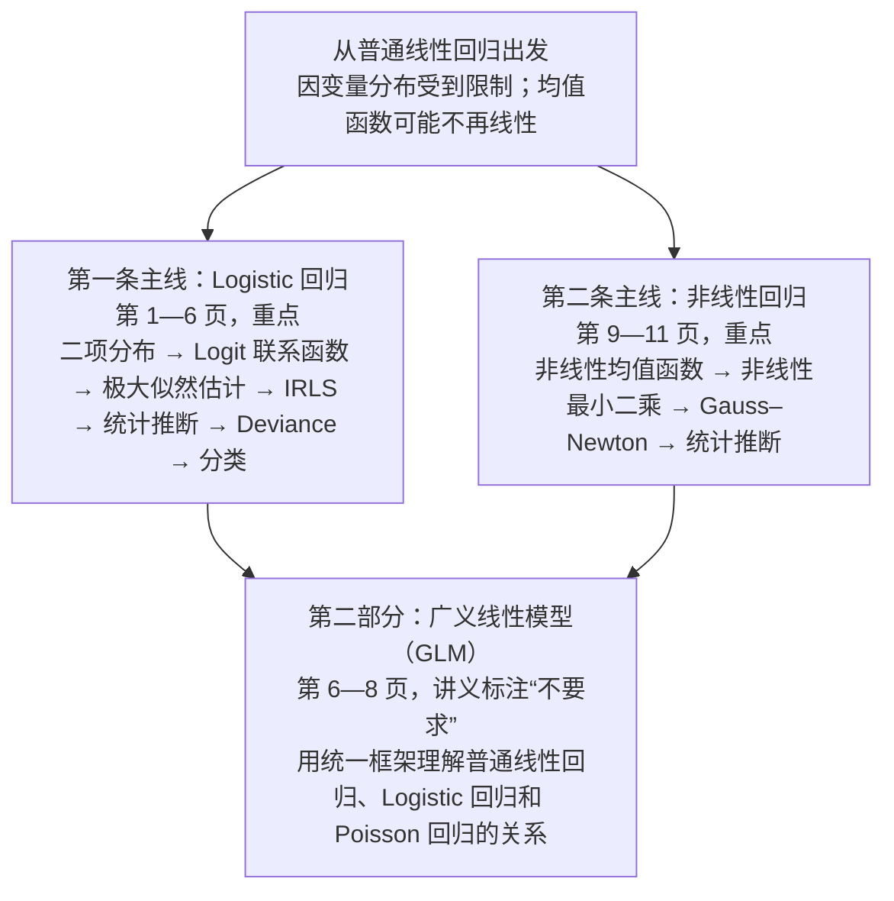
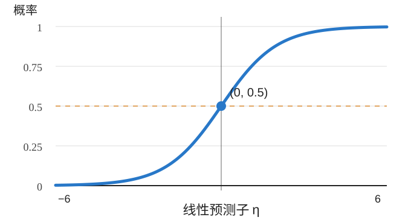
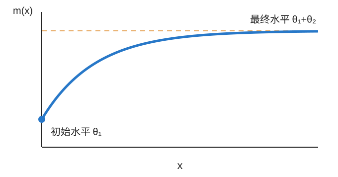

# 第七讲：Logistic 回归与非线性回归

这一讲主要研究两个问题：

1. **如果因变量不再是连续的正态变量，而是成功次数、是否发生某事件这样的数据，应该怎样建立回归模型？**
2. **如果因变量的均值与参数之间不是线性关系，普通最小二乘法不能直接求解时，应该怎么办？**

前一个问题引出 **Logistic 回归（Logistic Regression）**，后一个问题引出 **非线性回归（Nonlinear Regression）**。

两者虽然都涉及非线性关系，但建模思路并不相同。这是理解本讲最重要的切入点。

## 一、先建立整讲的知识主线

讲义分成三大部分，其中第二部分“广义线性模型”明确标注了“不要求”。

我们先对比两种模型。

普通线性回归：

$$
Y_i=z_i^\top\beta^*+\varepsilon_i,
\qquad \varepsilon_i\sim N(0,\sigma^2)
$$

Logistic 回归：

$$
Y_i\sim\operatorname{Bernoulli}(p_i),
\qquad
p_i=\frac{e^{z_i^\top\beta^*}}{1+e^{z_i^\top\beta^*}}
$$

非线性回归：

$$
Y_i=m(x_i;\theta^*)+\varepsilon_i,
\qquad \varepsilon_i\sim N(0,\sigma^{*2})
$$

关键区别是：

- **Logistic 回归**：主要改变因变量的条件分布和均值与自变量之间的联系方式，不再假设响应变量服从正态分布。
- **非线性回归**：仍然可以假设误差服从正态分布，但把原来的线性均值函数换成更一般的非线性函数。

两者都需要数值优化算法求解参数，但采用不同的优化方法。

接下来按讲义顺序详细展开。

---

## 二、Logistic 回归：如何对成功次数建模？（第1—2页）

### 1. 为什么不能直接用普通线性回归？

假设我们想研究：用户是否会点击广告。

因变量：

$$
Y_i=
\begin{cases}
1,&\text{用户点击}\\
0,&\text{用户未点击}
\end{cases}
$$

如果用普通线性回归：

$$
E(Y_i\mid x_i)=\beta_0+\beta_1x_i
$$

会遇到两个问题。

首先，因为 $Y_i$ 只可能取 0 或 1：

$$
E(Y_i\mid x_i)=P(Y_i=1\mid x_i)
$$

也就是说，线性回归给出的条件均值实际上代表点击概率。

但线性函数可能大于 1，也可能小于 0，不符合概率的取值范围。

其次，普通线性回归通常假设误差具有恒定方差。但 Bernoulli 随机变量满足：

$$
\operatorname{Var}(Y_i\mid x_i)=p_i(1-p_i)
$$

方差会随着成功概率发生变化。

因此，我们需要一种专门描述概率的回归模型。

### 2. 从 Bernoulli 分布推广到二项分布

讲义首先考虑更一般的情况。

假设第 $i$ 条观测包含 $m_i$ 次独立试验，每次试验成功的概率为 $\theta^*(x_i)$，则：

$$
Y_i\mid x_i\sim\operatorname{Bin}(m_i,\theta^*(x_i))
$$

它的概率质量函数为：

$$
P(Y_i=y_i\mid x_i)
=
\binom{m_i}{y_i}
\theta^*(x_i)^{y_i}
[1-\theta^*(x_i)]^{m_i-y_i}
$$

其中：

$$
E(Y_i\mid x_i)=m_i\theta^*(x_i)
$$

$$
\operatorname{Var}(Y_i\mid x_i)
=m_i\theta^*(x_i)[1-\theta^*(x_i)]
$$

这里要区分两个量：

$Y_i$ 表示成功次数，而 $\theta^*(x_i)$ 表示单次试验的成功概率。

例如，某个广告对一类用户展示 10 次，其中点击 3 次，我们记录：

$$
m_i=10,\qquad y_i=3
$$

模型的目标不是直接把 $3$ 当作成功概率，而是根据用户特征 $x_i$，估计其点击概率。

当 $m_i=1$ 时，二项分布就退化为 Bernoulli 分布，成为最常见的二分类情形。

### 3. 如何让成功概率依赖于解释变量？

普通线性回归通过：

$$
\beta_0^*+\sum_{j=1}^p x_{ij}\beta_j^*
$$

将解释变量与条件均值联系起来。

Logistic 回归也保留了这部分线性结构。

定义：

$$
z_i=(1,x_{i1},\ldots,x_{ip})^\top
$$

$$
\beta^*=(\beta_0^*,\beta_1^*,\ldots,\beta_p^*)^\top
$$

于是：

$$
\eta_i=z_i^\top\beta^*
$$

称为线性预测子（Linear Predictor）。

但是，我们不能直接把 $\eta_i$ 当成概率，因为它可以取任意实数。

因此需要一个函数：

$$
K:\mathbb R\to(0,1)
$$

把线性预测子转换成合法概率。

讲义称 $K$ 为均值函数（Kernel Mean Function），并把它的逆函数称为联系函数（Link Function）。

Logistic 回归选择 Logistic 函数：

$$
S(t)=\frac{e^t}{1+e^t}
=\frac1{1+e^{-t}}
$$

从而：

$$
\boxed{
\theta^*(x_i)
=S(z_i^\top\beta^*)
=\frac{\exp(z_i^\top\beta^*)}
{1+\exp(z_i^\top\beta^*)}
}
$$

> Logistic 函数：输入可以是任意实数，输出始终在 0 与 1 之间。

当 $\eta_i$ 很大时，成功概率接近 1；当 $\eta_i$ 很小时，成功概率接近 0；当 $\eta_i=0$ 时，成功概率恰好等于 0.5。

这就解决了普通线性回归预测概率可能超出 $[0,1]$ 的问题。

### 4. 为什么需要 Logit 联系函数？

现在有了：

$$
\theta=\frac{e^\eta}{1+e^\eta}
$$

将它变形：

$$
\theta(1+e^\eta)=e^\eta
$$

于是：

$$
\theta=(1-\theta)e^\eta
$$

因此：

$$
\frac{\theta}{1-\theta}=e^\eta
$$

两边取对数：

$$
\boxed{
\log\frac{\theta}{1-\theta}=\eta
}
$$

其中：

$$
\frac{\theta}{1-\theta}
$$

称为优势（Odds），也常称为成功比。

$$
\log\frac{\theta}{1-\theta}
$$

称为 Logit 函数。

因此 Logistic 回归还有一个完全等价的表达形式：

$$
\boxed{
\log\frac{\theta^*(x_i)}
{1-\theta^*(x_i)}
=z_i^\top\beta^*
}
$$

这个形式比 Logistic 函数的形式更适合解释回归系数。

### 5. Logistic 回归系数应该怎样解释？

假设只有一个解释变量：

$$
\log\frac{p}{1-p}
=\beta_0+\beta_1x
$$

当 $x$ 增加 1 时：

$$
\log\frac{p_1}{1-p_1}
-\log\frac{p_0}{1-p_0}
=\beta_1
$$

整理：

$$
\frac{p_1/(1-p_1)}{p_0/(1-p_0)}
=e^{\beta_1}
$$

这就是优势比（Odds Ratio, OR）。

$$
\boxed{OR=e^{\beta_1}}
$$

例如：

$$
\beta_1=\log2
$$

那么：

$$
OR=2
$$

说明 $x$ 增加一个单位，成功的 Odds 变为原来的 2 倍。

但是注意：

**Odds 翻倍，不等于成功概率翻倍。**

例如成功概率从 $0.25$ 出发，原来的 Odds 为：

$$
\frac{0.25}{0.75}=\frac13
$$

翻倍后：

$$
\mathrm{Odds}=\frac23
$$

对应概率为：

$$
p=\frac{2/3}{1+2/3}=0.4
$$

所以成功概率从 $0.25$ 变成 $0.4$，而不是 $0.5$。

这说明 Logistic 回归的系数直接描述的是对数 Odds 的变化，而不是概率本身的固定增量。

### 6. 本节需要明确的三种量

| 概念 | 符号 | 含义 |
|---|---|---|
| 线性预测子 | $\eta_i=z_i^\top\beta^*$ | 解释变量的线性组合 |
| 成功概率 | $\theta^*(x_i)=S(\eta_i)$ | 转换后的概率 |
| 条件均值 | $E(Y_i\mid x_i)=m_i\theta^*(x_i)$ | 预期成功次数 |

这三者不能混淆。

尤其在 $m_i>1$ 时，成功概率与成功次数的期望并不相同。

---

## 三、Logistic 回归怎样训练：从极大似然到损失函数（第2页）

这是本讲第一个重要推导。

### 1. 为什么不再直接使用普通最小二乘法？

由于 $Y_i$ 服从二项分布，我们已经知道每个观测值的概率分布。

因此，一个自然的想法是：

**选择一组参数 $\beta$，让已经观察到的数据出现的概率尽可能大。**

这就是极大似然估计（Maximum Likelihood Estimation, MLE）。

为简化记号，令：

$$
\theta_i(\beta)=S(z_i^\top\beta)
$$

注意，$\theta_i(\beta)$ 是给定候选参数 $\beta$ 后模型计算出的概率，而 $\theta^*(x_i)$ 是真实参数对应的概率。

### 2. 写出似然函数

假设各观测条件独立，且：

$$
Y_i\mid x_i\sim\operatorname{Bin}(m_i,\theta_i)
$$

则整个样本的似然函数为：

$$
L(\beta)=
\prod_{i=1}^n
\binom{m_i}{y_i}
\theta_i^{y_i}(1-\theta_i)^{m_i-y_i}
$$

直接对乘积求优化比较麻烦，因此取对数：

$$
\ell(\beta)
=\sum_{i=1}^n
\left[
\log\binom{m_i}{y_i}
+y_i\log\theta_i
+(m_i-y_i)\log(1-\theta_i)
\right]
$$

利用 Logit 关系：

$$
\log\frac{\theta_i}{1-\theta_i}
=z_i^\top\beta
$$

就有：

$$
\begin{aligned}
\ell(\beta)
=\sum_{i=1}^n\bigg[
&\log\binom{m_i}{y_i}\\
&+y_i z_i^\top\beta\\
&+m_i\log(1-\theta_i)
\bigg]
\end{aligned}
$$

又因为：

$$
1-\theta_i=\frac1{1+e^{z_i^\top\beta}}
$$

所以：

$$
\log(1-\theta_i)
=-\log(1+e^{z_i^\top\beta})
$$

最后得到：

$$
\ell(\beta)
=
\sum_{i=1}^n
\left[
\log\binom{m_i}{y_i}
+y_i z_i^\top\beta
-m_i\log(1+e^{z_i^\top\beta})
\right]
$$

### 3. 从最大化似然得到优化目标

我们想最大化 $\ell(\beta)$，等价于最小化负对数似然。

又因为：

$$
\log\binom{m_i}{y_i}
$$

与 $\beta$ 无关，可以从优化目标中去掉。

最终得到：

$$
\boxed{
f(\beta)=
\sum_{i=1}^n
\left[
m_i\log(1+e^{z_i^\top\beta})
-y_i z_i^\top\beta
\right]
}
$$

于是：

$$
\boxed{
\hat\beta=\arg\min_\beta f(\beta)
}
$$

这是讲义第 2 页的最终结果。

### 4. 它与机器学习中的交叉熵是什么关系？

当 $m_i=1$，每个 $y_i$ 只能取 0 或 1。

负对数似然就变成：

$$
-\ell(\beta)
=
-\sum_{i=1}^n
\left[
y_i\log p_i+
(1-y_i)\log(1-p_i)
\right]
$$

这里省略了与参数无关的常数。

这正是二分类交叉熵（Binary Cross-Entropy），也叫 Log Loss。

所以：

**统计学中的 Logistic 回归极大似然估计，与机器学习中最小化二分类交叉熵，本质上是同一件事。**

两种表述只是研究角度不同。

统计学从概率分布与似然函数出发，机器学习通常从可优化的损失函数出发。

接下来有了损失函数，我们需要解决怎样求出 $\hat\beta$ 的问题。

---
## 四、IRLS：为什么 Logistic 回归需要迭代求解？（第3—4页）

### 1. Logistic 回归为什么没有 OLS 那样的显式解？

回忆普通线性回归：

$$
\hat\beta^{\mathrm{OLS}}
=(X^\top X)^{-1}X^\top Y
$$

之所以能直接求解，是因为最小二乘损失是参数的二次函数，其一阶导数是线性的。

但 Logistic 回归的损失函数包含：

$$
\log(1+e^{z_i^\top\beta})
$$

它虽然是凸函数，但不是二次函数。令梯度为零以后，一般不能直接把 $\beta$ 解出来。

这就需要数值优化算法。

讲义采用的是迭代加权最小二乘法（Iteratively Reweighted Least Squares, IRLS），本质上是把 Newton 方法应用到 Logistic 回归。

核心思路是：

**每次在当前参数附近，用一个容易优化的二次函数近似原来的损失函数，先求出下一步应该怎样移动，再重复这个过程。**

### 2. 第一步：求梯度

我们已经得到：

$$
f(\beta)=
\sum_{i=1}^n
\left[
m_i\log(1+e^{z_i^\top\beta})
-y_i z_i^\top\beta
\right]
$$

对 $\beta$ 求梯度。

注意：

$$
\frac{\partial}{\partial\beta}
\log(1+e^{z_i^\top\beta})
=
\frac{e^{z_i^\top\beta}}
{1+e^{z_i^\top\beta}}z_i
$$

其中：

$$
\frac{e^{z_i^\top\beta}}
{1+e^{z_i^\top\beta}}
=\theta_i(\beta)
$$

于是：

$$
\boxed{
\nabla f(\beta)
=
\sum_{i=1}^n
[m_i\theta_i(\beta)-y_i]z_i
}
$$

定义：

$$
\mu_i(\beta)=m_i\theta_i(\beta)
$$

即第 $i$ 条数据的模型预测均值。

那么：

$$
\nabla f(\beta)
=
\sum_{i=1}^n[\mu_i(\beta)-y_i]z_i
$$

这个形式很好理解。

当模型预测的成功次数和真实成功次数不一致时，它们的差异会推动参数调整。

进一步定义矩阵：

$$
X=
\begin{pmatrix}
z_1^\top\\
\vdots\\
z_n^\top
\end{pmatrix},
\qquad
Y=
\begin{pmatrix}
y_1\\
\vdots\\
y_n
\end{pmatrix}
$$

这里讲义重新用 $X$ 表示包含截距列的设计矩阵，所以 $X\in\mathbb R^{n\times(p+1)}$。

令：

$$
\mu(\beta)=
\begin{pmatrix}
\mu_1(\beta)\\
\vdots\\
\mu_n(\beta)
\end{pmatrix}
$$

则：

$$
\boxed{
\nabla f(\beta)=X^\top[\mu(\beta)-Y]
}
$$

### 3. 第二步：求 Hessian 矩阵

再对梯度求导。

因为：

$$
\theta_i(\beta)=S(z_i^\top\beta)
$$

而 Logistic 函数满足：

$$
S'(t)=S(t)[1-S(t)]
$$

所以：

$$
\nabla_\beta\theta_i(\beta)
=
\theta_i(\beta)[1-\theta_i(\beta)]z_i
$$

因此：

$$
\nabla^2f(\beta)
=
\sum_{i=1}^n
m_i\theta_i(\beta)[1-\theta_i(\beta)]
z_i z_i^\top
$$

令：

$$
w_i(\beta)
=m_i\theta_i(\beta)[1-\theta_i(\beta)]
$$

注意到，这恰好是：

$$
\operatorname{Var}(Y_i\mid x_i;\beta)
$$

也就是说，Logistic 回归的 Hessian 中自然出现了二项分布的方差。

构造对角矩阵：

$$
W(\beta)
=
\operatorname{diag}(w_1(\beta),\ldots,w_n(\beta))
$$

于是：

$$
\boxed{
\nabla^2f(\beta)=X^\top W(\beta)X
}
$$

到这里，就得到了讲义中的两个关键矩阵公式：

$$
\boxed{
\begin{aligned}
\nabla f(\beta)&=-X^\top(Y-\mu),\\
\nabla^2f(\beta)&=X^\top WX
\end{aligned}
}
$$

### 4. 第三步：Taylor 展开得到迭代公式

假设当前参数估计为 $\hat\beta$。

令：

$$
\delta=\beta-\hat\beta
$$

在 $\hat\beta$ 附近对损失函数做二阶 Taylor 展开：

$$
f(\hat\beta+\delta)
\approx
f(\hat\beta)
+\nabla f(\hat\beta)^\top\delta
+\frac12\delta^\top\nabla^2f(\hat\beta)\delta
$$

我们想找到使右边最小的 $\delta$。

对 $\delta$ 求导：

$$
\nabla f(\hat\beta)
+\nabla^2f(\hat\beta)\delta=0
$$

因此：

$$
\delta
=
-[\nabla^2f(\hat\beta)]^{-1}
\nabla f(\hat\beta)
$$

将梯度和 Hessian 代入：

$$
\delta
=
(X^\top WX)^{-1}X^\top(Y-\hat\mu)
$$

所以新参数为：

$$
\boxed{
\hat\beta_{\mathrm{new}}
=
\hat\beta+
(X^\top WX)^{-1}X^\top(Y-\hat\mu)
}
$$

注意右边的 $W$ 和 $\hat\mu$ 都是根据当前估计 $\hat\beta$ 计算的。

这就是讲义第 4 页的 IRLS 迭代公式。

### 5. 为什么叫“迭代加权最小二乘”？

上面的公式看上去是 Newton 迭代，为什么名字里却有 Least Squares？

我们可以把它重新整理成加权最小二乘形式。

在当前 $\hat\beta$ 处，定义工作响应（Working Response）：

$$
T=X\hat\beta+W^{-1}(Y-\hat\mu)
$$

那么下一次迭代可以等价地写成：

$$
\hat\beta_{\mathrm{new}}
=
\arg\min_\beta
(T-X\beta)^\top W(T-X\beta)
$$

其中 $W$ 是当前这次迭代的权重矩阵。

这个最小二乘问题的解为：

$$
(X^\top WX)^{-1}X^\top WT
$$

把 $T$ 代进去：

$$
\begin{aligned}
\hat\beta_{\mathrm{new}}
&=(X^\top WX)^{-1}
X^\top W[X\hat\beta+W^{-1}(Y-\hat\mu)]\\
&=\hat\beta+(X^\top WX)^{-1}X^\top(Y-\hat\mu)
\end{aligned}
$$

与前面的 Newton 更新公式完全一致。

这就是 IRLS 名字的来源。

每次先计算新的概率和权重，再求解一个新的加权最小二乘问题。

### 6. 用一个简单例子理解迭代

假设只有截距，没有其他解释变量。

观察 10 次试验，其中成功 7 次：

$$
m=10,\qquad y=7
$$

此时：

$$
p=S(\beta)
$$

真实的极大似然估计应该满足：

$$
\hat p=0.7
$$

因此最终参数为：

$$
\hat\beta=\log\frac{0.7}{0.3}\approx0.847
$$

现在假设我们不知道这个答案，从：

$$
\beta^{(0)}=0
$$

开始迭代。

第一次：

$$
p^{(0)}=S(0)=0.5
$$

因此：

$$
\mu^{(0)}=10(0.5)=5
$$

$$
w^{(0)}=10(0.5)(0.5)=2.5
$$

在只有截距的情况下，更新公式简化为：

$$
\beta^{(1)}
=\beta^{(0)}+\frac{y-\mu^{(0)}}{w^{(0)}}
$$

所以：

$$
\beta^{(1)}=0+\frac{7-5}{2.5}=0.8
$$

第一次迭代后：

$$
p^{(1)}=S(0.8)\approx0.690
$$

已经接近正确答案 $0.7$。

再迭代一次：

$$
\beta^{(2)}\approx0.847
$$

就非常接近理论最优值了。

这个例子展示了 IRLS 的本质：反复用局部二次近似来更新参数，而不是直接解出一个封闭形式的答案。

### 7. IRLS 有哪些需要注意的条件？

讲义指出 Logistic 回归的负对数似然是凸函数。

这确实可以从 Hessian 看出来：

$$
v^\top\nabla^2f(\beta)v
=
(Xv)^\top W(Xv)\ge0
$$

因此 Hessian 半正定，$f(\beta)$ 是凸函数。

这意味着不存在非全局的局部极小值。

但这里需要对讲义的一句话作一点限定：**凸性本身并不能保证未经步长控制的 Newton 迭代从任意初始值都收敛。**

此外，如果存在完全分离（Complete Separation），即某个线性分类边界能够将两类样本完全分开，那么无惩罚的 Logistic 回归可能不存在有限的极大似然估计。

而当 $X^\top WX$ 不可逆时，也不能直接使用讲义中的逆矩阵公式。

这些都是算法应用时的重要条件。

---

## 五、Logistic 回归的统计推断（第4—5页）

前面解决的是：怎样求出参数估计 $\hat\beta$。

但是统计学通常还要进一步回答：

估计值是否可靠？标准误有多大？某个变量的系数是否显著不为零？

所以需要研究 $\hat\beta$ 的抽样分布（Sampling Distribution）。

### 1. 先分清真实参数与估计量

这里统一保留讲义中的符号。

$\beta^*$ 是固定但未知的真实参数。

$\hat\beta$ 是利用随机样本算出来的估计量，因此在重复抽样意义下是随机的。

对于给定的设计矩阵 $X$，我们研究的是：

$$
\hat\beta\mid X
$$

的抽样分布。

推断时通常把 $X$ 当作固定的设计条件，仅讨论因变量 $Y$ 的随机性。

### 2. 为什么又要做 Taylor 展开？

IRLS 推导时，我们在当前估计点附近展开，是为了寻找优化算法的下一步。

现在我们的目的不同。

我们在真实参数 $\beta^*$ 附近展开，是为了研究估计误差：

$$
\hat\beta-\beta^*
$$

的分布。

极大似然估计通常满足：

$$
\nabla f(\hat\beta)=0
$$

在 $\beta^*$ 附近对梯度做一阶 Taylor 展开：

$$
0
\approx
\nabla f(\beta^*)
+\nabla^2f(\beta^*)(\hat\beta-\beta^*)
$$

因此：

$$
\hat\beta-\beta^*
\approx
-[\nabla^2f(\beta^*)]^{-1}\nabla f(\beta^*)
$$

在真实参数处，定义：

$$
\mu_i^*=m_i\theta^*(x_i)
$$

$$
w_i^*=m_i\theta^*(x_i)[1-\theta^*(x_i)]
$$

以及：

$$
W^*=\operatorname{diag}(w_1^*,\ldots,w_n^*)
$$

代入后得到：

$$
\boxed{
\hat\beta
\approx
\beta^*+
(X^\top W^*X)^{-1}X^\top(Y-\mu^*)
}
$$

这里的 $\mu^*$ 是由 $\mu_i^*$ 组成的向量。

### 3. 怎样求估计量的期望与方差？

因为：

$$
E(Y\mid X)=\mu^*
$$

所以：

$$
E(Y-\mu^*\mid X)=0
$$

从而一阶近似下：

$$
E(\hat\beta\mid X)\approx\beta^*
$$

这说明估计量具有渐近无偏的性质。

接下来计算协方差。

由于各条观测独立：

$$
\operatorname{Cov}(Y\mid X)=W^*
$$

于是：

$$
\begin{aligned}
\operatorname{Cov}(\hat\beta\mid X)
&\approx
(X^\top W^*X)^{-1}X^\top
W^*X(X^\top W^*X)^{-1}\\
&=(X^\top W^*X)^{-1}
\end{aligned}
$$

因此：

$$
\boxed{
\operatorname{Cov}(\hat\beta\mid X)
\approx(X^\top W^*X)^{-1}
}
$$

实际中真实参数未知，我们用拟合后的权重矩阵 $\hat W$ 替代 $W^*$：

$$
\boxed{
\widehat{\operatorname{Cov}}(\hat\beta)
=(X^\top\hat WX)^{-1}
}
$$

### 4. 怎样得到标准误与置信区间？

设：

$$
C=(X^\top\hat WX)^{-1}
$$

若 $C_{j+1,j+1}$ 为系数 $\hat\beta_j$ 对应的对角元，那么：

$$
\boxed{
se(\hat\beta_j)=\sqrt{C_{j+1,j+1}}
}
$$

这里下标加 1 是因为参数向量的第一个元素是截距 $\beta_0$。

利用极大似然估计的渐近正态性，可以构建近似 95% 置信区间：

$$
\boxed{
\hat\beta_j\pm1.96\,se(\hat\beta_j)
}
$$

也可以对假设：

$$
H_0:\beta_j^*=0
$$

构建 Wald 检验统计量：

$$
Z=\frac{\hat\beta_j}{se(\hat\beta_j)}
$$

在常规大样本条件下，零假设成立时近似服从标准正态分布。

讲义将这一部分与线性回归的 t 检验类比，但 Logistic 回归的通常做法是使用渐近正态的 Wald $z$ 检验，而不是直接套用普通线性回归的有限样本 t 分布结论。

此外，由于：

$$
OR=e^{\beta_j}
$$

对系数置信区间的两个端点取指数，还可以得到对应优势比的近似置信区间。

这也是 Logistic 回归在应用统计中常用的解释方式。

### 5. 分类变量和交互项

讲义第 5 页还指出，Logistic 回归可以包含分类自变量和交互项。

例如，一个连续变量 $X$ 和一个具有 $L$ 个类别的分类变量 $F$，可以建立：

$$
Y\sim X+F+X:F
$$

其线性预测子为：

$$
\eta_i=
\beta_0+\beta_1x_i
+\sum_{j=2}^L\beta_{0j}u_{ij}
+\sum_{j=2}^L\beta_{1j}u_{ij}x_i
$$

其中 $u_{ij}$ 为虚拟变量。

这里与普通线性回归非常相似：主效应和交互项都进入线性预测子，只是最后通过 Logistic 函数转成概率。

因此，交互项系数表示某个解释变量对对数 Odds 的影响如何随类别变化，而不是直接表示概率的固定增量。

---
## 六、Deviance：怎样评价 Logistic 回归的拟合效果？（第5—6页）

前面用极大似然估计训练 Logistic 回归，现在要研究另一个问题：

**模型拟合得究竟好不好？**

在线性回归中，我们经常使用残差平方和（RSS）衡量拟合误差。

但是 Logistic 回归的数据服从二项分布，直接照搬 RSS 并不自然。因此讲义引入了偏差统计量（Deviance）。

### 1. 先引入饱和模型

这是理解 Deviance 最重要的一步。

假设第 $i$ 条观测中有 $m_i$ 次试验，观察到 $y_i$ 次成功。

普通 Logistic 回归不允许每条观测随意拥有一个独立的成功概率，而是要求所有概率都由共同参数 $\beta$ 决定：

$$
\hat\theta_i=S(z_i^\top\hat\beta)
$$

如果现在不施加这个限制，允许第 $i$ 条观测单独估计一个成功概率，那么它的极大似然估计自然是：

$$
\hat\theta_i^{\,s}=\frac{y_i}{m_i}
$$

例如，某条数据观察到 10 次试验、7 次成功，那么单独拟合这一条数据，最合适的成功概率就是 $0.7$。

这种对每条观测都单独拟合参数的模型，叫做饱和模型（Saturated Model）。

饱和模型的自由度更高，它在训练数据上的最大似然值不会低于我们拟合的 Logistic 回归。

### 2. Deviance 的定义

设：

$$
\ell_s
$$

是饱和模型的最大对数似然值。

$$
\hat\ell=\ell(\hat\beta)
$$

是 Logistic 回归的最大对数似然值。

那么：

$$
\boxed{
D=2(\ell_s-\hat\ell)
}
$$

就是 Deviance。

为什么这样定义？

因为饱和模型代表给定数据能够达到的最大拟合灵活度，我们希望衡量当前模型与它还有多大差距。

如果两个模型的最大对数似然值接近，说明当前模型已经能够较好地解释观察数据。

如果差距很大，则说明当前模型没有充分拟合这些观测。

因此，在同一批数据上：

$$
\boxed{
D\text{ 越小，样本内拟合越好}
}
$$

### 3. Deviance 的具体公式从哪里来？

在 Logistic 回归下，第 $i$ 条数据的拟合均值为：

$$
\hat\mu_i=m_i\hat\theta_i
$$

把饱和模型和当前模型的对数似然相减，二项式系数对应的常数项会抵消。

可以得到：

$$
\boxed{
D=2\sum_{i=1}^n
\left[
y_i\log\frac{y_i}{\hat\mu_i}
+(m_i-y_i)\log\frac{m_i-y_i}{m_i-\hat\mu_i}
\right]
}
$$

其中出现 $0\log0$ 形式时，按极限取该项为零。

这个公式虽然看起来复杂，但不需要逐项死记。

你只需要理解：

它通过**比较实际观察的成功比例与模型预测的成功概率**，来衡量模型相对于饱和模型的拟合损失。

当 $m_i=1$ 时，它实际上就与二分类交叉熵直接相关：

$$
D=-2\sum_{i=1}^n
[y_i\log\hat p_i+(1-y_i)\log(1-\hat p_i)]
$$

因为此时饱和模型的对数似然值为零。

所以 Deviance 与我们前面用于训练 Logistic 回归的交叉熵，并不是毫无关系的新概念，而是建立在同一套似然框架上的。

### 4. Deviance 如何用于统计检验？

讲义给出了一个近似结论：

$$
D\overset{\text{approx}}{\sim}
\chi^2(n-p-1)
$$

其中 $p+1$ 是包含截距的参数个数。

这个结论可用于考察模型拟合是否明显不足。

但需要补充适用条件：这种 Pearson 型或 Deviance 型的卡方近似，在具有充分组内试验次数的分组二项数据等常规条件下才比较合理。对于每条观测都是单次 Bernoulli 试验的情形，不能仅凭 $n$ 很大，就认为上述卡方近似一定准确。

另外，Deviance 越小只说明训练样本上的拟合越好，不代表测试集预测一定越好。

增加模型复杂度通常可以减少样本内 Deviance，因此真正评价泛化能力时，仍然需要考虑模型复杂度和样本外表现。

---

## 七、Logistic 回归怎样用于分类？（第6页）

### 1. 二分类实际上是 Logistic 回归的特殊情形

讲义最初讨论：

$$
Y_i\sim\operatorname{Bin}(m_i,\theta_i)
$$

当：

$$
m_i=1
$$

时：

$$
Y_i\sim\operatorname{Bernoulli}(\theta_i)
$$

只能取两个值：

$$
Y_i\in\{0,1\}
$$

如果把它们理解成两个类别，就得到了二分类（Binary Classification）。

例如预测用户是否点击广告、交易是否欺诈等。

需要注意：

**Logistic 回归首先预测的是概率，而不是直接输出类别。**

它给出的结果是：

$$
\hat p_i=S(z_i^\top\hat\beta)
$$

之后才根据阈值进行分类。

如果取阈值 $0.5$：

$$
\hat Y_i=
\begin{cases}
1,&\hat p_i\ge0.5,\\
0,&\hat p_i<0.5
\end{cases}
$$

由于 Logistic 函数严格单调，并且：

$$
S(0)=0.5
$$

因此：

$$
\hat p_i\ge0.5
\iff z_i^\top\hat\beta\ge0
$$

于是，尽管 Logistic 概率函数是非线性的，但其默认二分类决策边界仍然是：

$$
\boxed{
z_i^\top\hat\beta=0
}
$$

这就是为什么 Logistic 回归通常被视为线性分类器。

这里的“线性”是指模型对给定特征的线性预测子，以及相应的线性决策边界，而不是指概率函数本身是线性的。

### 2. 怎样推广到多分类？

讲义接下来考虑 $d$ 个类别。

此时每条观测属于其中一个类别：

$$
Y_i\in\{1,\ldots,d\}
$$

以类别 1 作为参考类别（Reference Class）。

对于其他类别：

$$
\eta_{ik}=z_i^\top\beta^{*(k)},
\qquad k=2,\ldots,d
$$

定义：

$$
\boxed{
P(Y_i=1\mid x_i)
=
\frac1{1+\sum_{\ell=2}^d e^{\eta_{i\ell}}}
}
$$

而对于 $k=2,\ldots,d$：

$$
\boxed{
P(Y_i=k\mid x_i)
=
\frac{e^{\eta_{ik}}}
{1+\sum_{\ell=2}^d e^{\eta_{i\ell}}}
}
$$

这就是以第一类为基准的多项 Logistic 回归（Multinomial Logistic Regression），对应机器学习中常见的 Softmax 分类模型。

为什么分母要把所有类别的指数项加起来？

因为模型必须保证每个类别的概率非负，并且所有类别的概率之和为 1。

将上面的式子相除，还可以得到：

$$
\log\frac{P(Y_i=k\mid x_i)}
{P(Y_i=1\mid x_i)}
=z_i^\top\beta^{*(k)}
$$

所以多分类 Logistic 回归，本质上仍然是让**类别之间的对数概率比**由线性预测子决定。

从二分类到多分类，核心思想并没有发生变化。

---

## 八、广义线性模型 GLM：把不同回归模型统一起来（第6—8页，不要求）

这一部分讲义标注了“不要求”，因此重点理解框架，不必在首次学习时记忆每个分布的指数族展开。

### 1. 为什么需要广义线性模型？

到目前为止，我们学习过普通线性回归和 Logistic 回归。

它们看起来差异很大，但实际上具有相似结构。

普通线性回归假设：

$$
E(Y_i\mid x_i)=z_i^\top\beta^*
$$

Logistic 回归假设：

$$
\operatorname{logit}\left(P(Y_i=1\mid x_i)\right)
=z_i^\top\beta^*
$$

可以发现，两者都通过一个函数，将响应变量的分布参数或均值与线性预测子联系起来。

广义线性模型（Generalized Linear Model, GLM）就是把这种共同结构抽象出来。

### 2. 广义线性模型的三个要素

第一个要素是随机成分：因变量服从某个指数分布族（Exponential Family）中的分布。

讲义给出了指数分布族的一般形式：

$$
f(y;\eta,\phi)
=
\exp\left[
\frac{y\eta-b(\eta)}{a(\phi)}
+h(y,\phi)
\right]
$$

它可以推出：

$$
E(Y)=b'(\eta)
$$

$$
\operatorname{Var}(Y)=a(\phi)b''(\eta)
$$

第二个要素是线性预测子：

$$
z_i^\top\beta^*
$$

第三个要素是联系函数（Link Function），把均值或分布参数与线性预测子联系起来。

对于条件均值 $\mu_i=E(Y_i\mid x_i)$，常见形式为：

$$
\boxed{
g(\mu_i)=z_i^\top\beta^*
}
$$

当这个联系函数使得指数族中的自然参数 $\eta_i$ 恰好等于 $z_i^\top\beta^*$ 时，就称为典范联系函数（Canonical Link）。

### 3. 三种常见回归模型之间的联系

| 模型 | 因变量分布 | 核心关系 | 联系函数 |
|---|---|---|---|
| 普通线性回归 | 正态分布 | $\mu_i=z_i^\top\beta^*$ | Identity |
| Logistic 回归 | Bernoulli / 二项分布 | $\operatorname{logit}(p_i)=z_i^\top\beta^*$ | Logit |
| Poisson 回归 | Poisson 分布 | $\log\lambda_i=z_i^\top\beta^*$ | Log |

其中 Poisson 回归（Poisson Regression）适合对事件发生次数进行建模。

假设：

$$
Y_i\mid x_i\sim\operatorname{Poisson}(\lambda_i)
$$

因为：

$$
E(Y_i\mid x_i)=\lambda_i>0
$$

我们可以使用对数联系：

$$
\log\lambda_i=z_i^\top\beta^*
$$

因此：

$$
\boxed{
\lambda_i=\exp(z_i^\top\beta^*)
}
$$

这样无论线性预测子取什么值，预测出的事件平均发生次数都严格大于零。

这和 Logistic 回归使用 Logistic 函数把预测结果限制在 $(0,1)$ 内，体现了同一种思想。

对于分组二项数据 $Y_i\sim\operatorname{Bin}(m_i,p_i)$，还需要注意：Logit 联系的是成功概率 $p_i=\mu_i/m_i$，即：

$$
\operatorname{logit}(\mu_i/m_i)=z_i^\top\beta^*
$$

不能在 $m_i>1$ 时直接把 $\operatorname{logit}(\mu_i)$ 当作一般形式。

这部分最重要的认识是：

**广义线性模型并不是某一种具体的回归算法，而是一类利用分布假设、线性预测子和联系函数来建模的统计框架。**

其中普通线性回归、Logistic 回归和 Poisson 回归都是具体成员。

---
## 九、非线性回归：如果均值函数不是线性的怎么办？（第9页）

现在进入本讲第二条主要知识线。

前面的 Logistic 回归主要改变了因变量的条件分布。

非线性回归则回到正态误差模型，但允许条件均值具有更复杂的形式。

### 1. 非线性回归的模型设定

普通线性回归的模型是：

$$
Y_i=z_i^\top\beta^*+\varepsilon_i
$$

现在将线性函数换成更一般的均值函数：

$$
\boxed{
Y_i=m(x_i;\theta^*)+\varepsilon_i
}
$$

其中：

$$
\varepsilon_i\overset{i.i.d.}{\sim}
N(0,\sigma^{*2})
$$

$$
\theta^*=(\theta_1^*,\ldots,\theta_k^*)^\top
$$

是未知的 $k$ 维参数向量。

于是：

$$
E(Y_i\mid x_i)=m(x_i;\theta^*)
$$

$$
\operatorname{Var}(Y_i\mid x_i)=\sigma^{*2}
$$

注意，这里仍然是加性正态误差模型，只不过条件均值不再局限于参数的线性组合。

### 2. 如何理解讲义中的非线性均值函数？

讲义给出了一个具体例子：

$$
\boxed{
m(x;\theta^*)
=
\theta_1^*
+\theta_2^*[1-\exp(-\theta_3^*x)]
}
$$

这里自变量只有一个 $x$，但未知参数有三个：

$$
\theta^*=(\theta_1^*,\theta_2^*,\theta_3^*)^\top
$$

假设 $\theta_2^*>0,\theta_3^*>0$。

当 $x=0$ 时：

$$
m(0;\theta^*)=\theta_1^*
$$

因此 $\theta_1^*$ 是初始水平。

当 $x\to+\infty$ 时：

$$
\exp(-\theta_3^*x)\to0
$$

所以：

$$
m(x;\theta^*)\to\theta_1^*+\theta_2^*
$$

因此 $\theta_2^*$ 描述了相对于初始水平的最终增量。

而 $\theta_3^*$ 控制函数接近最终水平的速度。

> 讲义非线性均值函数的示意图。取正参数时，均值从初始水平逐渐趋于某个上限。

这种形式可以用于描述具有饱和趋势的增长过程。

### 3. 怎样判断模型是不是非线性回归？

这里有一个非常容易混淆的概念。

考虑：

$$
Y=\beta_0+\beta_1x+\beta_2x^2+\varepsilon
$$

虽然这个函数关于 $x$ 是非线性的，但它仍然属于**线性回归模型**。

为什么？

因为待估参数：

$$
\beta_0,\beta_1,\beta_2
$$

都是线性进入模型的。

只需要把：

$$
z=(1,x,x^2)^\top
$$

作为新的特征向量，就可以写成：

$$
Y=z^\top\beta+\varepsilon
$$

因此依然能够直接使用 OLS。

但是讲义中的：

$$
m(x;\theta)
=\theta_1+\theta_2(1-e^{-\theta_3x})
$$

不一样。

因为 $\theta_3$ 出现在指数函数内部，无法直接整理成对所有未知参数均为线性的形式。

所以本讲后半部分真正需要处理的是：

**均值函数对待估参数的非线性，导致普通最小二乘法无法直接得到显式解。**

---

## 十、Gauss–Newton：非线性回归怎样估计参数？（第9—10页）

### 1. 为什么仍然可以使用最小二乘法？

我们已经假设：

$$
Y_i=m(x_i;\theta^*)+\varepsilon_i
$$

且：

$$
\varepsilon_i\overset{i.i.d.}{\sim}N(0,\sigma^{*2})
$$

因此，在给定 $x_i$ 的情况下：

$$
Y_i\sim N(m(x_i;\theta^*),\sigma^{*2})
$$

根据正态分布的似然函数，可以得到参数估计问题等价于：

$$
\boxed{
\hat\theta=
\arg\min_\theta
\sum_{i=1}^n
[y_i-m(x_i;\theta)]^2
}
$$

记：

$$
f(\theta)=\sum_{i=1}^n[y_i-m(x_i;\theta)]^2
$$

这叫非线性最小二乘（Nonlinear Least Squares, NLS）。

它和普通最小二乘的目标非常相似，只是里面的均值函数换成了 $m(x_i;\theta)$。

问题在于，当 $m$ 对参数非线性时，通常不能像 OLS 那样直接求出矩阵形式的显式解。

因此需要一种迭代优化方法。

讲义使用 Gauss–Newton 方法。

### 2. 核心想法：把非线性函数局部近似成线性函数

假设当前参数估计是：

$$
\hat\theta
$$

如果我们在它附近稍微调整参数：

$$
\theta=\hat\theta+\delta
$$

那么可以对均值函数进行一阶 Taylor 展开：

$$
m(x_i;\theta)
\approx
m(x_i;\hat\theta)
+
u_i(\hat\theta)^\top\delta
$$

其中：

$$
\boxed{
u_i(\hat\theta)
=
\left.
\frac{\partial m(x_i;\theta)}
{\partial\theta}
\right|_{\theta=\hat\theta}
}
$$

是均值函数关于参数的梯度向量。

为什么这里使用一阶展开就够了？

因为 Gauss–Newton 的目的，是把非线性均值函数临时变成参数增量 $\delta$ 的线性函数。

一旦均值函数对 $\delta$ 线性，残差平方和就变成了关于 $\delta$ 的二次函数，可以像普通最小二乘那样求解。

### 3. 梯度向量应该怎样计算？

仍然使用讲义的例子：

$$
m(x_i;\theta)
=
\theta_1+\theta_2[1-\exp(-\theta_3x_i)]
$$

因为 $\theta$ 有三个分量，所以：

$$
u_i(\theta)\in\mathbb R^3
$$

分别求偏导：

$$
\frac{\partial m}{\partial\theta_1}=1
$$

$$
\frac{\partial m}{\partial\theta_2}
=1-e^{-\theta_3x_i}
$$

$$
\frac{\partial m}{\partial\theta_3}
=\theta_2x_i e^{-\theta_3x_i}
$$

因此：

$$
\boxed{
u_i(\theta)=
\begin{pmatrix}
1\\
1-e^{-\theta_3x_i}\\
\theta_2x_i e^{-\theta_3x_i}
\end{pmatrix}
}
$$

这就是 Gauss–Newton 算法需要计算的局部梯度。

### 4. 如何把问题转化成最小二乘？

定义当前残差（Working Residual）：

$$
\hat e_i=y_i-m(x_i;\hat\theta)
$$

利用 Taylor 展开：

$$
\begin{aligned}
y_i-m(x_i;\theta)
&\approx
y_i-m(x_i;\hat\theta)
-u_i(\hat\theta)^\top\delta\\
&=\hat e_i-u_i(\hat\theta)^\top\delta
\end{aligned}
$$

所以原来的目标函数可以近似为：

$$
f(\hat\theta+\delta)
\approx
\sum_{i=1}^n
[\hat e_i-u_i(\hat\theta)^\top\delta]^2
$$

现在定义：

$$
\hat e=
\begin{pmatrix}
\hat e_1\\
\vdots\\
\hat e_n
\end{pmatrix}
$$

以及矩阵：

$$
U(\hat\theta)=
\begin{pmatrix}
u_1(\hat\theta)^\top\\
\vdots\\
u_n(\hat\theta)^\top
\end{pmatrix}
\in\mathbb R^{n\times k}
$$

注意 $U$ 不是原始的解释变量矩阵，而是均值函数关于参数的 Jacobian 矩阵（Jacobian Matrix）。

于是：

$$
\boxed{
f(\hat\theta+\delta)
\approx
\|\hat e-U(\hat\theta)\delta\|_2^2
}
$$

这已经是一个标准的线性最小二乘问题。

### 5. 推导 Gauss–Newton 更新公式

为了让推导更简洁，记：

$$
U=U(\hat\theta)
$$

优化目标：

$$
\min_\delta\|\hat e-U\delta\|_2^2
$$

对 $\delta$ 求导：

$$
-2U^\top(\hat e-U\delta)=0
$$

整理：

$$
U^\top U\delta=U^\top\hat e
$$

当 $U^\top U$ 可逆时：

$$
\delta=(U^\top U)^{-1}U^\top\hat e
$$

于是：

$$
\boxed{
\hat\theta_{\mathrm{new}}
=
\hat\theta+
[U(\hat\theta)^\top U(\hat\theta)]^{-1}
U(\hat\theta)^\top\hat e
}
$$

这就是讲义第 10 页的 Gauss–Newton 更新公式。

它的逻辑其实并不复杂。

我们面对一个无法直接求解的非线性最小二乘问题，就在当前估计点附近建立一个线性近似；随后解这个近似问题，得到新的参数，再重新进行线性化。

因此：

$$
\boxed{
\text{非线性问题}
\rightarrow
\text{局部线性化}
\rightarrow
\text{线性最小二乘}
\rightarrow
\text{更新参数}
}
$$

不断重复，直到满足收敛条件。

### 6. Gauss–Newton 和真正的 Newton 方法有什么区别？

这是理解算法原理的一个补充。

令：

$$
e_i(\theta)=y_i-m(x_i;\theta)
$$

那么：

$$
f(\theta)=\sum_i e_i(\theta)^2
$$

可以得到梯度：

$$
\nabla f(\theta)=-2U(\theta)^\top e(\theta)
$$

而完整 Hessian 为：

$$
\nabla^2f(\theta)
=
2U(\theta)^\top U(\theta)
-2\sum_{i=1}^n
e_i(\theta)\nabla^2_\theta m(x_i;\theta)
$$

Gauss–Newton 方法使用近似：

$$
\boxed{
\nabla^2f(\theta)
\approx2U(\theta)^\top U(\theta)
}
$$

也就是忽略残差乘以均值函数二阶导数的那一项。

在残差较小等情况下，这种近似可能比较合理。

因此可以把 Gauss–Newton 理解为：**针对非线性最小二乘问题设计的一种近似 Newton 方法。**

它不需要完整计算均值函数的二阶导数，是一个重要优势。

### 7. Gauss–Newton 的局限性

讲义指出，这个算法可能面临两个问题。

一个是梯度难以计算。若均值函数较复杂，求出每个参数方向的导数可能比较繁琐。

另一个是初始值较重要。因为非线性最小二乘的目标函数不一定是凸函数，不同的初始值可能使算法收敛到不同的局部最优解。

此外，如果 Jacobian 矩阵列之间存在线性相关性，$U^\top U$ 可能不可逆或者数值不稳定。

因此，Gauss–Newton 不具有像满秩 OLS 那样一次求解就获得唯一全局最优解的保证。

---

## 十一、非线性回归的统计推断（第10—11页）

这一部分和前面的 Logistic 回归统计推断有相似的思路：

在真实参数附近进行 Taylor 展开，研究估计误差的分布。

### 1. 在真实参数附近展开

真实模型为：

$$
Y_i=m(x_i;\theta^*)+\varepsilon_i
$$

假设估计量 $\hat\theta$ 已经足够接近真实参数 $\theta^*$。

对均值函数进行 Taylor 展开：

$$
m(x_i;\hat\theta)
\approx
m(x_i;\theta^*)
+u_i(\theta^*)^\top(\hat\theta-\theta^*)
$$

于是：

$$
\begin{aligned}
Y_i-m(x_i;\hat\theta)
&\approx
m(x_i;\theta^*)+\varepsilon_i\\
&\quad-m(x_i;\theta^*)\\
&\quad-u_i(\theta^*)^\top(\hat\theta-\theta^*)\\
&=\varepsilon_i-u_i(\theta^*)^\top(\hat\theta-\theta^*)
\end{aligned}
$$

因此：

$$
f(\theta)
\approx
\|\varepsilon-U(\theta^*)(\theta-\theta^*)\|_2^2
$$

这里：

$$
\varepsilon=(\varepsilon_1,\ldots,\varepsilon_n)^\top
$$

表示真实误差组成的随机向量。

### 2. 求出估计误差的近似表达式

和刚才的最小二乘推导一样，近似最优解满足：

$$
U(\theta^*)^\top U(\theta^*)
(\hat\theta-\theta^*)
=
U(\theta^*)^\top\varepsilon
$$

所以：

$$
\boxed{
\hat\theta
\approx
\theta^*
+
[U(\theta^*)^\top U(\theta^*)]^{-1}
U(\theta^*)^\top\varepsilon
}
$$

注意右边的随机性来自哪里。

$\theta^*$ 是固定的真实参数。

给定 $X$ 时，$U(\theta^*)$ 也是固定矩阵。

只有：

$$
\varepsilon
$$

是随机向量。

因此，$\hat\theta$ 的近似随机性完全由误差项决定。

### 3. 求估计量的近似分布

因为：

$$
\varepsilon\sim N(0,\sigma^{*2}I)
$$

而：

$$
\hat\theta-\theta^*
\approx
[U^\top U]^{-1}U^\top\varepsilon
$$

是正态向量的线性变换，所以：

$$
\boxed{
\hat\theta
\overset{\text{approx}}{\sim}
N\left(
\theta^*,
\sigma^{*2}
[U(\theta^*)^\top U(\theta^*)]^{-1}
\right)
}
$$

这是本节最重要的结论。

需要强调，它是利用局部线性化获得的近似分布，并不是所有有限样本非线性最小二乘估计量的精确分布。

### 4. 标准误怎么计算？

真实的 $\sigma^{*2}$ 和 $\theta^*$ 都未知，需要用估计值代替。

讲义使用：

$$
\boxed{
\hat\sigma^2
=
\frac{f(\hat\theta)}{n-k}
}
$$

其中 $n$ 是观测数量，$k$ 是待估参数数量，并要求 $n>k$。

再令：

$$
C=[U(\hat\theta)^\top U(\hat\theta)]^{-1}
$$

得到协方差估计：

$$
\boxed{
\widehat{\operatorname{Cov}}(\hat\theta)
=
\hat\sigma^2 C
}
$$

假设 $c_{jj}$ 是 $C$ 的第 $j$ 个对角元，那么：

$$
\boxed{
se(\hat\theta_j)
=\hat\sigma\sqrt{c_{jj}}
}
$$

这就可以进一步构建参数的近似置信区间和显著性检验。

到这里，非线性回归也形成了一套与普通线性回归相似的统计分析流程。

---

## 十二、最重要的联系：IRLS 与 Gauss–Newton 有什么共同点？

学完两部分后，可能会有一个疑问：

为什么 Logistic 回归和非线性回归最终都得到了类似：

$$
\text{新参数}
=
\text{旧参数}+\text{一个矩阵计算出的修正量}
$$

的公式？

答案是：**它们都采用局部近似，把当前难以直接求解的优化问题转化为较容易的最小二乘型问题。**

但两种方法线性化的对象不同。

| 比较维度 | Logistic 回归 IRLS | 非线性回归 Gauss–Newton |
|---|---|---|
| 因变量分布 | 二项分布 | 正态分布 |
| 优化目标 | 负对数似然 | 残差平方和 |
| 局部近似 | 对损失函数进行二阶 Taylor 展开 | 对均值函数进行一阶 Taylor 展开 |
| 主要矩阵 | $X^\top WX$ | $U^\top U$ |
| 更新依据 | 当前拟合均值与真实成功次数之差 | 当前预测残差 |
| 核心困难 | 损失函数非二次 | 均值函数对参数非线性 |

把两个更新公式放在一起看：

Logistic 回归：

$$
\boxed{
\beta^{(j+1)}
=
\beta^{(j)}
+
(X^\top W^{(j)}X)^{-1}
X^\top(Y-\mu^{(j)})
}
$$

非线性回归：

$$
\boxed{
\theta^{(j+1)}
=
\theta^{(j)}
+
[U(\theta^{(j)})^\top U(\theta^{(j)})]^{-1}
U(\theta^{(j)})^\top e^{(j)}
}
$$

虽然形式相似，但不能把 $W$ 和 $U$ 混为一谈。

Logistic 回归的 $W$ 是根据当前成功概率计算的方差权重矩阵。

非线性回归的 $U$ 则表示均值函数关于未知参数的梯度矩阵。

这个区别非常重要。

### 与上一讲正则化方法的联系

上一讲研究了高维回归中 $p\ge n$ 或变量高度相关造成的矩阵不可逆问题。

本讲两个算法也都涉及矩阵求逆：

$$
(X^\top WX)^{-1}
$$

以及：

$$
(U^\top U)^{-1}
$$

当参数维度过高、变量或梯度方向线性相关时，同样可能出现不稳定或者不可逆的情况。

这说明上一讲的正则化思想不仅局限于普通线性回归，还可以进一步应用到 Logistic 回归和某些非线性模型中。只是第七讲的 PDF 本身没有展开相应的正则化算法。

---

## 十三、本讲最后需要掌握的知识

这 11 页讲义可以压缩成下面的复习框架。

| 知识部分 | 最重要的内容 | 建议掌握程度 |
|---|---|---|
| Logistic 模型 | 二项分布、Logistic 函数、Logit、Odds | 理解并会解释 |
| 极大似然估计 | 从二项似然推导负对数似然 | **掌握推导** |
| IRLS | 梯度、Hessian、Newton 更新公式 | **重点掌握** |
| Logistic 推断 | $(X^\top WX)^{-1}$、标准误、近似检验 | 理解来源并会使用 |
| Deviance | 饱和模型、似然差、拟合评价 | 理解定义和含义 |
| 二分类与多分类 | Logistic 分类、Softmax | 掌握基本模型 |
| 广义线性模型 | 指数族、联系函数、三种常见 GLM | 了解，讲义不要求 |
| 非线性回归 | 非线性均值函数、非线性最小二乘 | 理解模型 |
| Gauss–Newton | 均值函数 Taylor 展开、Jacobian、更新公式 | **重点掌握** |
| 非线性回归推断 | 估计量近似正态分布、协方差、标准误 | 理解推导 |

最后把本讲浓缩成两句话：

**Logistic 回归：** 从二项分布出发，利用 Logistic 函数将线性预测子映射为成功概率，通过极大似然估计建立损失函数，再通过 IRLS 求解参数。

**非线性回归：** 从正态误差的非线性均值模型出发，通过最小化残差平方和估计参数，再通过 Gauss–Newton 的局部线性化进行迭代求解。

两部分的统计推断也具有同一条逻辑：**在真实参数附近做 Taylor 展开，将估计误差近似表示为随机误差的线性变换，再计算其协方差和标准误。**

这就是第七讲最值得在脑中建立的整体结构。
