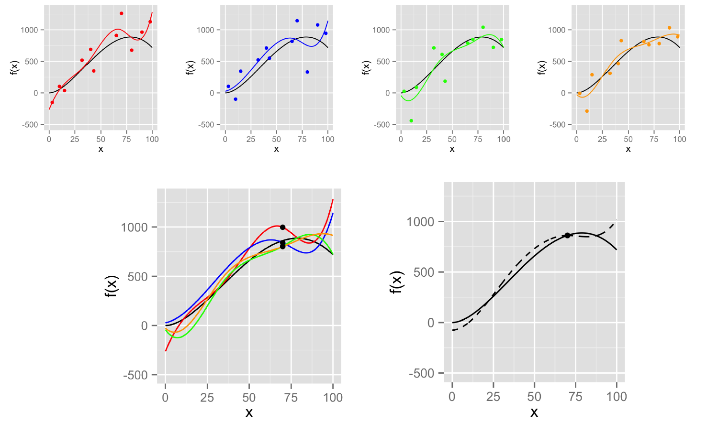
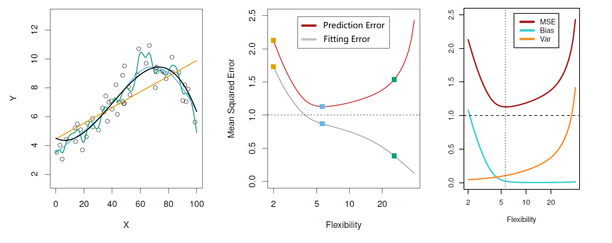
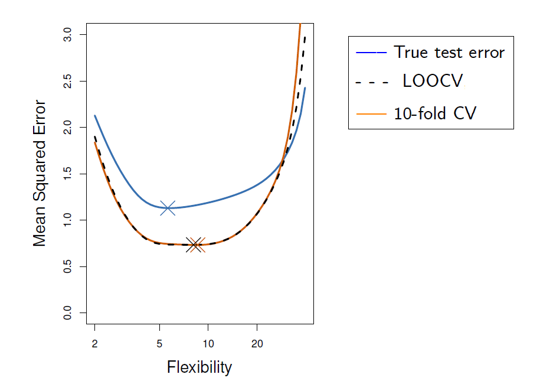
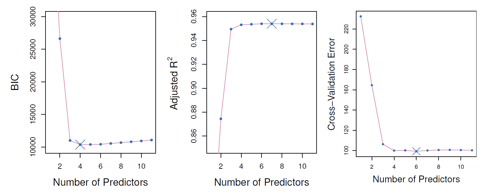
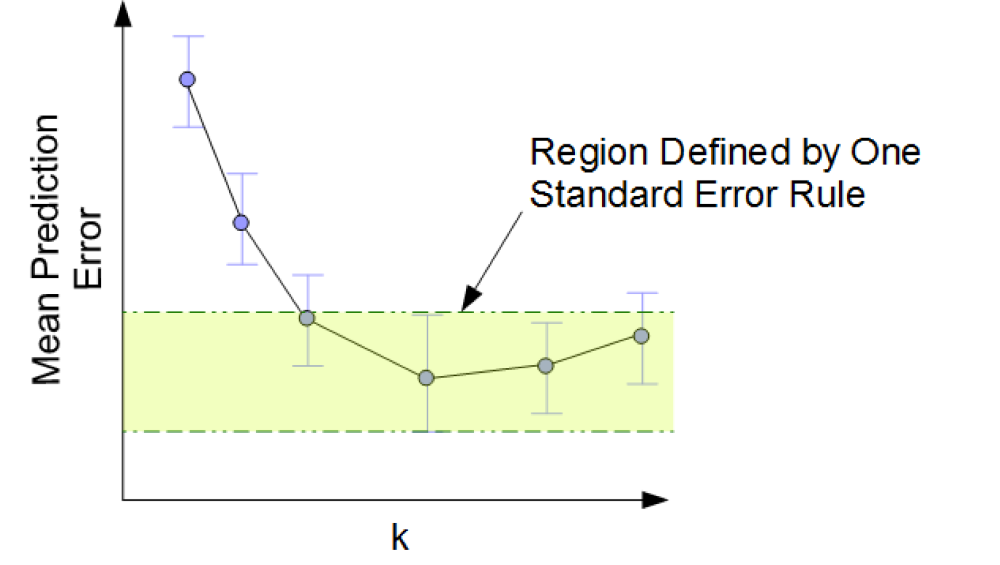
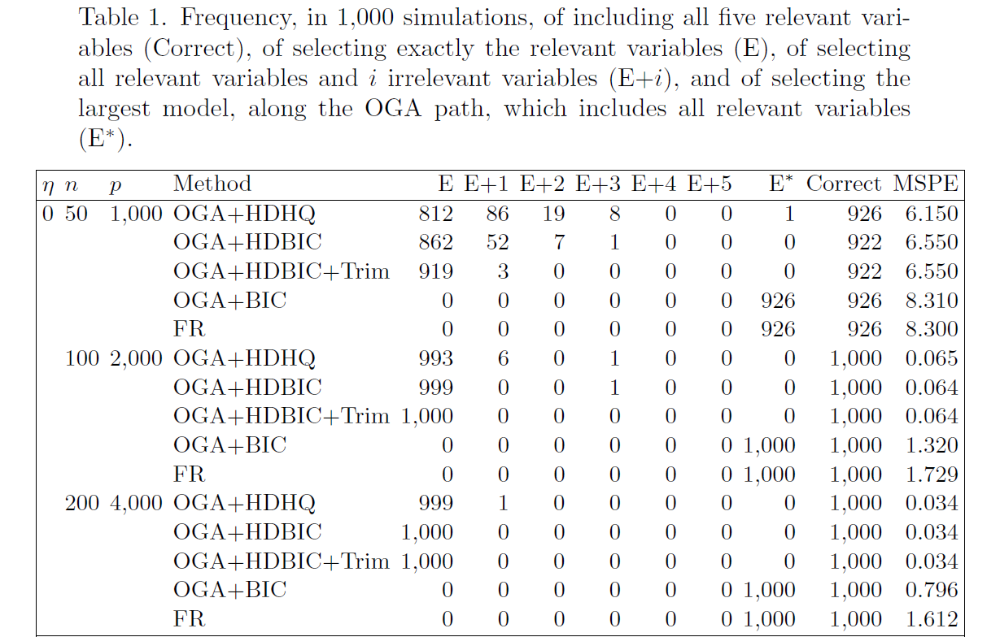
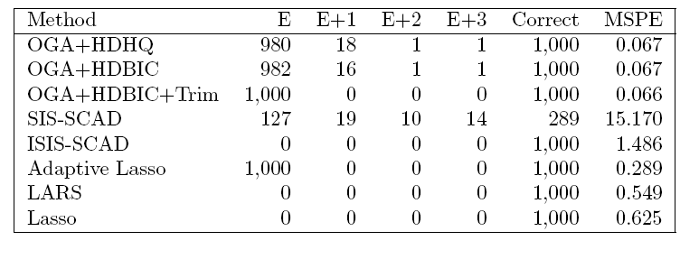

# 第五讲 变量选择（Variable Selection）

> [!abstract] 本讲要回答什么问题？
> 给定许多可能影响 $Y$ 的自变量，究竟**应该选哪些变量进入回归模型**？我们不只希望模型解释已有数据，还希望它能预测未来数据。因此，不能单看残差平方和（RSS）是否最小，而要同时考虑**拟合误差与模型复杂度**。
>
> 讲义的主线是：**为什么不能全部选入（Bias–Variance Tradeoff）→ 用什么标准比较模型（Model Selection Criteria）→ 怎样找到变量组合（Stepwise Regression）**。最后的 OGA 是计算效率方面的拓展，讲义标注「不要求」。

## 一、先建立全章框架：选择变量是在解决什么问题？

假设我们用多个变量预测一个结果，例如通过访问量、广告投入、气温等因素预测销售额。把所有候选变量都放进回归中，往往会让**训练集拟合得更好**；但多加的变量可能仅仅拟合了这批样本里的偶然噪声，换一批数据后预测就不稳定。

本讲实际上分成三个层次：

| 层次       | 要回答的问题                 | 对应知识                            |     |
| -------- | ---------------------- | ------------------------------- | --- |
| **理解问题** | 为什么训练得越好，不代表预测得越好？     | 偏差—方差权衡（Bias–Variance Tradeoff） |     |
| **评价模型** | 假设已有若干候选模型，哪一个更合适？     | 调整 $R^2$、AIC、BIC、交叉验证（CV）       |     |
| **寻找模型** | 一共有很多变量，怎样找到值得评价的变量组合？ | 向前选择、向后剔除、双向逐步回归                |     |

这三层不是三种彼此替代的方法：**偏差—方差权衡提供理论动机，模型选择准则提供评分标准，逐步回归提供搜索路径。** 一个常见的实际流程是「逐步回归产生一串候选模型 → 使用 AIC、BIC 或 CV 选出其中一个 → 用全部可用训练数据重新拟合最终模型」。

### 1.1 讲义的数学设定

讲义假定数据来自真实线性模型：

$$
y_i=\beta_0^*+\sum_{j=1}^{p^*}x_{ij}\beta_j^*+e_i,
\qquad i=1,\ldots,n,
$$

其中 $\operatorname{Var}(e_i)=\sigma^{*2}$。这里通常还需要假定 $\mathbb E(e_i\mid\boldsymbol x_i)=0$；在推导后面的预测误差时，还会用到新误差与训练数据之间的独立性。

- $n$：训练样本数；$p$：手头可选择的**候选自变量总数**。
- $p^*$：真实模型里发挥作用的变量数。讲义写成前 $p^*$ 个变量，实际上是方便表示；一般并不知道哪些变量真实有用。
- $\beta_0^*,\beta_1^*,\ldots,\beta_{p^*}^*$：真实、固定但未知的参数。上标 $*$ 表示**真实值**，不是乘方。
- $x_{ij}$：第 $i$ 个样本的第 $j$ 个自变量值；$e_i$：该样本的随机噪声。
- $\boldsymbol x_i=(x_{i1},\ldots,x_{ip})^\top$：第 $i$ 个样本的全部候选特征。

真实的条件均值函数记为

$$
f^*(\boldsymbol x_i)=\beta_0^*+\sum_{j=1}^{p^*}x_{ij}\beta_j^*,
\qquad y_i=f^*(\boldsymbol x_i)+e_i.
$$

我们的任务不是直接求出已知的 $p^*$——事实上它未知——而是根据数据确定一个适宜的变量子集 $S\subseteq\{1,\ldots,p\}$，并估计该子集对应的回归系数。

### 1.2 哪些符号是固定的，哪些是随机的？

这部分对理解后面的期望 $\mathbb E$ 非常关键。按照讲义讨论预测误差时常用的**固定设计视角**，我们把训练自变量 $\boldsymbol x_1,\ldots,\boldsymbol x_n$ 和待预测的 $\boldsymbol x_{\mathrm{new}}$ 暂时视为固定值：

| 对象 | 在这种分析中的角色 | 为什么 |
| --- | --- | --- |
| $f^*,\beta_j^*,\sigma^{*2}$ | 固定但未知 | 它们描述真实数据生成机制 |
| $\boldsymbol x_i,\boldsymbol x_{\mathrm{new}}$ | 条件于其取值后固定 | 研究在指定自变量位置的预测 |
| $e_i,y_i$ | 随机 | 样本误差随机，因此响应值随机 |
| $\hat\beta_j,\hat f$ | 随机 | 换一批训练响应值，估计出的参数和函数通常会变 |
| $e_{\mathrm{new}},y_{\mathrm{new}}$ | 随机 | 未来观测还包含新的随机噪声 |
| $\hat y_{\mathrm{new}}=\hat f(\boldsymbol x_{\mathrm{new}})$ | 随机 | 预测值取决于随机训练数据得到的 $\hat f$ |

> [!note] 注意两种不同的「固定」
> 一次实际建模完成后，已经算出来的 $\hat\beta$ 和 $\hat f$ 可以当作确定的数值来使用；但是在分析**反复抽取训练样本会发生什么**时，$\hat\beta$、$\hat f$ 是随机的。这正是预测方差出现的原因。如果把自变量本身也视为随机变量，可以先条件于 $\boldsymbol x_{\mathrm{new}}$ 推导，再对新自变量的分布取期望。

## 二、为什么不能只追求最小 RSS？——偏差与方差

### 2.1 样本内拟合与样本外预测是不同的目标

回顾普通最小二乘法（Ordinary Least Squares, OLS）：在给定变量子集 $S$ 后，我们寻找使残差平方和最小的系数：

$$
\operatorname{RSS}=\sum_{i=1}^{n}(y_i-\hat y_i)^2,
\qquad \hat y_i=\hat f(\boldsymbol x_i).
$$

含截距模型的决定系数为

$$
R^2=1-\frac{\operatorname{RSS}}{\operatorname{TSS}},
\qquad \operatorname{TSS}=\sum_{i=1}^n(y_i-\bar y)^2.
$$

**为什么加入变量后，训练 RSS 不会增大？** 因为旧模型仍然是新模型允许的一种特殊情况：新加入变量的系数可以取 $0$。新模型是在更大的参数集合中求最小值，所以其最小 RSS 不可能比旧模型更大。由于 TSS 对同一份数据固定，$R^2$ 也不会下降。

但这些结论都只针对**已知的训练样本**。如果某个变量碰巧与训练集噪声相关，把它加进去能降低 RSS，却不保证它能预测下一批样本。这就是过拟合（Overfitting）的基本原因。

### 2.2 PE 的定义：把评估对象换成「新样本」

对于新观测到的自变量 $\boldsymbol x_{\mathrm{new}}$，真实响应为

$$
y_{\mathrm{new}}=f^*(\boldsymbol x_{\mathrm{new}})+e_{\mathrm{new}},
$$

而我们根据训练数据给出的预测为

$$
\hat y_{\mathrm{new}}=\hat f(\boldsymbol x_{\mathrm{new}}).
$$

讲义定义预测误差（Prediction Error, PE）：

$$
\boxed{\operatorname{PE}=\mathbb E\!\left[(\hat y_{\mathrm{new}}-y_{\mathrm{new}})^2\right]}.
$$

这里的期望包含**训练数据带来的估计波动**与**新观测的随机误差**，并不是对已经固定的一次预测机械地重复平方。

理解这个定义的关键是：$\operatorname{RSS}$ 比较「模型与参与拟合的数据」；$\operatorname{PE}$ 比较「模型与未参与拟合的新观测」。我们真正关心的通常是后者。

### 2.3 为什么 PE 可以拆成 Bias² + Variance + 噪声？

从定义出发，代入 $y_{\mathrm{new}}$：

$$
\begin{aligned}
\operatorname{PE}
&=\mathbb E\!\left[
  \left(\hat f(\boldsymbol x_{\mathrm{new}})
  -f^*(\boldsymbol x_{\mathrm{new}})-e_{\mathrm{new}}\right)^2
\right]\\
&=\mathbb E\!\left[
  \left(\hat f(\boldsymbol x_{\mathrm{new}})
  -f^*(\boldsymbol x_{\mathrm{new}})\right)^2
\right]+\sigma^{*2}.
\end{aligned}
$$

第二个等号成立，是因为新误差均值为 $0$、方差为 $\sigma^{*2}$，并且它与根据训练数据得到的 $\hat f$ 独立，于是展开平方后的交叉项期望为 $0$。

接下来令 $Z=\hat f(\boldsymbol x_{\mathrm{new}})$、$a=f^*(\boldsymbol x_{\mathrm{new}})$。使用恒等式

$$
\begin{aligned}
\mathbb E[(Z-a)^2]
&=\mathbb E\!\left[((Z-\mathbb EZ)+(\mathbb EZ-a))^2\right]\\
&=\underbrace{\mathbb E[(Z-\mathbb EZ)^2]}_{\operatorname{Var}(Z)}
+\underbrace{(\mathbb EZ-a)^2}_{\text{Bias}^2}.
\end{aligned}
$$

中间的交叉项之所以消失，是因为 $\mathbb E(Z-\mathbb EZ)=0$。代回原来的函数，就得到全讲最重要的公式：

$$
\boxed{
\operatorname{PE}
=\underbrace{\left[\mathbb E\hat f(\boldsymbol x_{\mathrm{new}})-f^*(\boldsymbol x_{\mathrm{new}})\right]^2}_{\text{偏差平方（Bias}^2\text{）}}
+\underbrace{\operatorname{Var}\!\left[\hat f(\boldsymbol x_{\mathrm{new}})\right]}_{\text{方差（Variance）}}
+\underbrace{\sigma^{*2}}_{\text{不可消减误差}}
}.
$$

三项含义必须区分：

| 项 | 直观解释 | 可能因为什么变大？ |
| --- | --- | --- |
| **Bias²（偏差平方）** | 反复训练得到的**平均预测**，离真实均值函数有多远 | 模型过于简单，无法表达真实关系 |
| **Variance（方差）** | 换一份训练样本，预测结果会波动多少 | 模型太灵活，对样本偶然性敏感 |
| **Irreducible Error（不可消减误差）** | 即便知道 $f^*$，新观测中仍存在的噪声 | 数据生成过程本身的随机性 |

特别注意：**Bias 不是「某一次预测的误差」，Variance 也不是「残差方差」**。这里衡量的是在固定 $\boldsymbol x_{\mathrm{new}}$ 处，**训练程序反复执行时所产生的预测分布**。

### 2.4 为什么模型复杂度会产生权衡？

可以把模型灵活度（Model Flexibility）理解为它允许函数变得多复杂。例如，在多项式回归中，次数 $d$ 越大，模型通常越灵活：

$$
\hat f_d(x)=\hat\beta_0+\hat\beta_1x+\cdots+\hat\beta_dx^d.
$$

- **次数过低**：即使换许多批数据，模型都只能画出差不多的简单曲线；预测比较稳定，但如果真实关系有明显弯曲，就会持续偏离真实函数——**高 Bias、低 Variance**。
- **次数适中**：能表达主要规律，又不至于追着随机噪声跑，因而可能取得最小 PE。
- **次数过高**：模型能把训练样本的微小起伏也拟合进去；换一批数据曲线可能大变——**低 Bias、高 Variance**。

下面两张图对应讲义第 3–4 页：

*图 1：上方四幅图给出四次重新抽样后的拟合曲线；下方把曲线叠在一起，并比较平均拟合函数与真实函数。注意：单次拟合曲线会变，才需要讨论 Variance。*

*图 2：左图比较不同复杂度的曲线；中图显示训练误差常随复杂度下降，但测试误差可能呈 U 型；右图解释 U 型的来源——Bias² 通常下降，而 Variance 通常上升。*

「复杂度越高，Bias 越低、Variance 越高」是这一类设置的**典型趋势**，不是对任意数据、任意模型都严格单调的数学定理。真正的目标是让**三项之和**尽量小，而不是单独追求某一项极小。

### 2.5 PE 与以前见过的 RSS、MSE、$\hat\sigma^2$ 有何区别？

它们之所以容易混淆，是因为都出现了「残差或误差的平方」。关键要看**平方的对象是谁，以及在哪里评价**：

| 统计量 | 公式 | 在衡量什么 |
| --- | --- | --- |
| $\operatorname{RSS}$ | $\sum_{i=1}^n(y_i-\hat y_i)^2$ | 训练样本的残差平方和 |
| 训练 MSE | $\operatorname{RSS}/n$ | 训练样本的平均残差平方（本讲图中 Fitting Error 的尺度） |
| $\hat\sigma^2$（OLS 常用无偏估计） | $\operatorname{RSS}/(n-k-1)$ | 在线性模型假设成立时，对噪声方差 $\sigma^{*2}$ 的估计 |
| $\operatorname{PE}$ | $\mathbb E[(\hat y_{\mathrm{new}}-y_{\mathrm{new}})^2]$ | 理论上的样本外预测均方误差 |
| $\operatorname{CV}(m)$ | 各验证折的平均预测平方误差 | 用已有数据近似评估候选模型的样本外预测能力 |

因此，**$\operatorname{RSS}/n$ 不等于 PE**；$\hat\sigma^2$ 估计的是噪声的方差，也不等于完整的 PE。即使不可消减误差很小，模型的偏差和估计波动依然可能造成较大的预测误差。

## 三、模型选择准则：怎样给候选模型评分？

有了偏差—方差权衡，我们知道需要避免只顾训练拟合。但是理论上的 PE 通常算不出来：**真实 $f^*$ 不知道，未来的数据也没有出现。** 所以讲义引入四种可实际操作的模型选择准则。

先统一符号：在本节谈回归模型时，$k$ 表示**当前模型用了多少个自变量**（不含截距），满足 $k<n-1$；同一数据集的样本量为 $n$。下文介绍交叉验证时，为避免混淆，另用大写 $K$ 表示**交叉验证折数**；讲义在两个情境中都使用了小写 $k$。

### 3.1 Adjusted $R^2$：为什么要对 $R^2$ 修正？

前面已经说明，多加变量几乎总能改善训练 RSS，因此直接比较 $R^2$ 会偏爱更复杂的模型。调整决定系数（Adjusted $R^2$）把剩余自由度纳入考虑：

$$
\boxed{R_{\mathrm{adj}}^2=1-\frac{n-1}{n-k-1}(1-R^2)}.
$$

代入 $1-R^2=\operatorname{RSS}/\operatorname{TSS}$，可以把它改写成更容易理解的形式：

$$
R_{\mathrm{adj}}^2
=1-\frac{\operatorname{RSS}/(n-k-1)}{\operatorname{TSS}/(n-1)}.
$$

这个表达式揭示了它的动机：原来的 $R^2$ 比的是两种**平方和**，调整后的 $R^2$ 比的是考虑自由度后的两种**均方**。

为什么是 $n-k-1$？因为含截距的模型估计了 $k$ 个斜率和 $1$ 个截距，共消耗 $k+1$ 个参数自由度；而 $\operatorname{TSS}$ 围绕样本均值计算，因此对应 $n-1$ 个自由度。

加一个变量时，分子 RSS 可能下降，但分母的自由度也会减小。因此 $R_{\mathrm{adj}}^2$ **可能增加也可能下降**。

**使用规则：选 $R_{\mathrm{adj}}^2$ 最大的模型。** 讲义还强调

$$
R_{\mathrm{adj}}^2\le R^2,\qquad R_{\mathrm{adj}}^2\le1,
$$

且调整 $R^2$ 可以为负。

> [!tip] 记忆方法
> 普通 $R^2$：模型能解释多少波动？调整 $R^2$：在考虑「用了多少个参数」之后，还能解释多少波动？它是一种**带复杂度修正的拟合优度指标**，不等同于直接计算样本外 PE。

### 3.2 AIC：把「拟合好」和「变量少」放在一个公式里

Akaike 信息准则（Akaike Information Criterion, AIC）的基本思想是

$$
\operatorname{AIC}=-2\log(\text{最大似然值})+2\times\text{参数个数}.
$$

**为什么会有两个部分？** 最大似然项衡量数据在模型下有多「合理」，越大越好，所以取负号；参数惩罚项则阻止通过不断加变量来换取微小的拟合改善。

在线性回归中，如果进一步假设误差独立同分布且 $e_i\sim N(0,\sigma^2)$，其对数似然函数为

$$
\ell(\boldsymbol\beta,\sigma^2)
=-\frac n2\log(2\pi)-\frac n2\log(\sigma^2)
-\frac{\operatorname{RSS}(\boldsymbol\beta)}{2\sigma^2}.
$$

对 $\boldsymbol\beta$ 最大化似然相当于最小化 RSS；再对 $\sigma^2$ 最大化，得到**最大似然方差估计**

$$
\hat\sigma_{\mathrm{MLE}}^2=\frac{\operatorname{RSS}}n.
$$

注意这里是 $\operatorname{RSS}/n$，而不是前面 OLS 常用的无偏估计 $\operatorname{RSS}/(n-k-1)$。将最大似然估计代入，得到

$$
\ell_{\max}
=-\frac n2\log(2\pi)-\frac n2\log\left(\frac{\operatorname{RSS}}n\right)-\frac n2.
$$

AIC 的目标是**比较同一份数据上的模型**，所以可以删去对所有候选模型都相同的常数项。由此得到讲义使用的公式：

$$
\boxed{\operatorname{AIC}=n\log\left(\frac{\operatorname{RSS}}n\right)+2(k+1)}.
$$

- 第一项：RSS 越小，拟合越好，AIC 越小。
- 第二项：变量越多（加上截距共 $k+1$ 个回归系数），惩罚越大。
- **选择规则：AIC 越小越好。** 绝对值本身没有独立含义，比较不同模型的差值才有意义。

> [!note] 为什么一般 AIC 要算全部参数，讲义却只有 $2(k+1)$？
> 如果把共同估计的误差方差 $\sigma^2$ 也计算进去，完整参数数目是 $k+2$，惩罚为 $2(k+2)$。但其中多出的 $2$ 对所有候选模型相同，可以在**只比较模型优劣**时删掉；所以讲义写 $2(k+1)$ 完全可以用于这里的排序。类似地，对数似然中的 $n\log(2\pi)+n$ 也被统一删去了。**不要把这些省略后的 AIC 数值与其他软件保留常数的数值直接比较。**

### 3.3 BIC：为什么在 AIC 之外还需要另一套惩罚？

贝叶斯信息准则（Bayesian Information Criterion, BIC）把参数数目的惩罚改为随样本量 $n$ 增长：

$$
\boxed{\operatorname{BIC}=n\log\left(\frac{\operatorname{RSS}}n\right)+(k+1)\log n}.
$$

这里采用与讲义一致的、删除了公共常数的比较形式。

AIC 和 BIC 的**拟合项完全相同**，唯一的区别是每增加一个自变量，复杂度惩罚分别增加：

$$
\underbrace{2}_{\text{AIC}}
\qquad\text{与}\qquad
\underbrace{\log n}_{\text{BIC}}.
$$

当 $\log n>2$（即 $n>e^2$）时，BIC 的惩罚更重；在相同候选模型集合、相同数据及同一拟合项下，BIC 选中的模型通常更简洁，讲义指出其变量个数不会超过 AIC 所选模型（若出现并列最优，需要明确如何打破并列）。

**选择规则：BIC 越小越好。** 直观上，AIC 与 BIC 都试图阻止无意义的复杂化，但 BIC 对加入新变量更谨慎。

### 3.4 用一组数据理解 Adjusted $R^2$、AIC 和 BIC 的取舍

假设有 $n=100$ 个样本，总平方和 $\operatorname{TSS}=300$，目前比较下面三个**示意性候选模型**：

| 模型 | 自变量个数 $k$ | RSS | $R_{\mathrm{adj}}^2$（越大越好） | AIC（越小越好） | BIC（越小越好） |
| --- | ---: | ---: | ---: | ---: | ---: |
| A | 1 | 120 | 0.5959 | 22.232 | 27.442 |
| B | 2 | 100 | 0.6598 | 6.000 | **13.816** |
| C | 3 | 97 | **0.6666** | **4.954** | 15.375 |

这些数值按前述讲义公式计算，**不是讲义的实验数据**。观察 B 和 C：从两个变量变为三个变量，RSS 只从 $100$ 降到 $97$。这个小幅改善足以弥补 AIC 的额外惩罚，却不足以弥补 BIC 更大的额外惩罚。因此：

- Adjusted $R^2$ 和 AIC 在这个例子里选 C；
- BIC 选更简单的 B。

这并不说明谁算错了，而是**不同准则对复杂度的权衡不同**。如果更关心新数据上的实际预测表现，可以继续考察交叉验证。

### 3.5 交叉验证（CV）：不猜测 PE，直接模拟新数据预测

前面三种准则都从训练拟合程度出发，再加上某种惩罚。交叉验证（Cross-Validation, CV）采用更直接的想法：**故意留出一部分现有数据不用来拟合模型，看看模型能否预测它。**

讲义假设有 $M$ 个候选模型，使用 $K$ 折交叉验证（$K$-fold CV）：

1. 将全部数据分为 $K$ 份，尽量让每份样本数接近。
2. 对固定模型 $m$，取第 $i$ 份作为验证集 $V_i$，其余 $K-1$ 份作为训练集。
3. 在训练集重新拟合该模型，得到 $\hat f_m^{(-i)}$，再用它预测**未参与这次拟合**的 $V_i$。记录第 $i$ 折的验证均方误差：

$$
\widehat{\operatorname{PE}}_i(m)
=\frac{1}{|V_i|}\sum_{j\in V_i}
\left(y_j-\hat f_m^{(-i)}(\boldsymbol x_j)\right)^2.
$$

4. 轮流验证所有 $K$ 份，得到

$$
\boxed{\operatorname{CV}(m)=\frac1K\sum_{i=1}^{K}\widehat{\operatorname{PE}}_i(m)}.
$$

5. 对每一个候选模型重复上述过程，选择

$$
\boxed{m^*=\underset{1\le m\le M}{\arg\min}\;\operatorname{CV}(m)}.
$$

讲义通常取 $K=5$ 或 $K=10$。当 $K=n$、每次只留出一个样本时，称为留一交叉验证（Leave-One-Out CV, LOOCV）。上面的简单平均形式默认各折大小相同或接近；如折数差异明显，更自然的是按各折验证样本数加权。

*图 3（讲义第 6 页）：蓝线是真正的样本外测试误差，黑线是 LOOCV，橙线是 10-fold CV。CV 曲线未必与真正测试误差曲线重合，但其最低点常能找到预测效果接近最优的复杂度。*

**为什么 CV 能帮助估计 PE？** 因为验证折里的 $y_j$ 不参与训练 $\hat f_m^{(-i)}$，比直接用训练集计算 RSS 更接近「模型遇到新数据」的情况。当然，验证集仍只是一份有限样本，所以 CV 值也有随机波动。

> [!important] 选择模型和训练最终模型是两个阶段
> 在本讲的使用流程里，CV 用于**比较和选择候选模型**，并不产生一套可以直接拿来部署的统一回归系数。选出 $m^*$ 之后，应当**用全部可用训练数据重新拟合 $m^*$**。如果还有独立测试集，测试集应留到模型选择完成后再进行最终评价。
>
> 如果「筛选变量」本身也是数据驱动的步骤，那么在用 CV 评估完整建模流程时，筛选必须在每一折的训练部分独立完成；不能先用全部数据筛完变量，再声称验证折完全独立。这属于数据泄漏（Data Leakage），是实际应用中很容易犯的错误。

### 3.6 1 标准误规则（One-Standard-Error Rule）：更复杂不一定值得

有时几个相邻模型的 CV 值几乎相同。假设一个复杂模型的 CV 均值是 $1.10$，一个更简单模型的 CV 均值是 $1.13$；由于 CV 本身在不同折之间波动，后者未必存在值得在意的实际劣势。

因此讲义介绍 **1 标准误规则**：先找到 CV 最低的模型，再容忍一个标准误范围内的预测误差变化，从中选择**最不复杂的模型**。

先计算各折误差的样本标准差：

$$
\operatorname{SD}(m)
=\sqrt{\frac{1}{K-1}\sum_{i=1}^{K}
\left[\widehat{\operatorname{PE}}_i(m)-\operatorname{CV}(m)\right]^2}.
$$

再按讲义的公式计算 CV 均值的标准误（Standard Error, SE）：

$$
\operatorname{SE}(m)=\frac{\operatorname{SD}(m)}{\sqrt K}.
$$

设 $m^*$ 是 CV 最小的模型，先建立允许的误差上界：

$$
T=\operatorname{CV}(m^*)+\operatorname{SE}(m^*).
$$

然后在所有满足

$$
\operatorname{CV}(m)<T
$$

的模型中，选择灵活度（Flexibility）最小的一个，记为 $m^*_{\mathrm{1se}}$。

**注意，标准误用的是 CV 最优模型 $m^*$ 的 $\operatorname{SE}(m^*)$，不是每个候选模型自己的 SE。** 例如 $\operatorname{CV}(m^*)=1.10,\ \operatorname{SE}(m^*)=0.05$，则门槛为 $1.15$；如果更简单模型的 CV 为 $1.13$，就可以优先选择它。

*图 4（讲义第 7 页）：三种准则随变量数变化的方向、最佳点可能不同。注意 BIC、CV 要最小化，而 Adjusted $R^2$ 要最大化。*

*图 5（讲义第 8 页）：最低点对应最小 CV，但高亮区间里的模型都位于允许的误差范围内；应选其中复杂度最小的模型。*

注意：讲义用 $\operatorname{SD}/\sqrt K$ 给出一个简便的 SE 估计，实际交叉验证各折的误差因为训练集重叠，并非严格独立。**1-SE 是偏向简洁模型的经验性选择规则，不等价于正式的显著性检验。**

### 3.7 四种准则的整体对照

| 准则 | 判断方向 | 主要依据 | 核心思想 |
| --- | --- | --- | --- |
| Adjusted $R^2$ | **最大** | 训练 RSS + 自由度修正 | 修正加变量导致 $R^2$ 虚高的问题 |
| AIC | **最小** | 极大似然 + $2$ 倍参数惩罚 | 拟合与复杂度折中 |
| BIC | **最小** | 极大似然 + $\log n$ 倍参数惩罚 | 样本量较大时更保守地控制复杂度 |
| CV | **最小** | 留出数据上的预测误差 | 尽量直接估计样本外预测能力 |

**共同点**：都是为了在过度简单与过度复杂之间做选择。**关键区别**：前三个依赖拟合优度加修正或惩罚；CV 通过未参与本折拟合的数据来评价预测效果。它们并不能保证总是选出同一个模型。

## 四、逐步回归：变量组合很多时，怎么找模型？

前面的准则回答了「两个已给定的模型怎么比较」。但如果有 $p$ 个候选变量，每个变量要么选择要么不选择，理论上共有 $2^p$ 个子集（含空集）。当 $p$ 较大时，逐一拟合比较的成本很高。

逐步回归（Stepwise Regression）换了一个思路：**不要穷举所有子集，每一步只做一次局部的加变量或删变量决策**，形成一条候选模型路径，再从这条路径上挑出评分最好的模型。

### 4.1 向前选择（Forward Selection, FS）

向前选择从最简单的「只有截距」模型开始：

$$
S_0=\varnothing,
\qquad \hat y_i=\hat\beta_0.
$$

每一步考察所有尚未入选的变量，将其中一个加入当前模型：

1. 假设现在已经选了变量集合 $S_{m-1}$。
2. 对每个 $j\notin S_{m-1}$，尝试拟合加入 $x_j$ 后的模型，并计算 RSS、AIC、BIC 或 $-R_{\mathrm{adj}}^2$。
3. 选出在本轮**最好的一个变量** $j_m$，令 $S_m=S_{m-1}\cup\{j_m\}$。
4. 重复，得到从 0 个变量到最多 $M$ 个变量的一条模型路径；再按照指定的模型选择准则，从路径上的 $M+1$ 个模型中选最终模型。

如果这一步比较的是加入**一个**变量后的候选模型，则它们的变量数相同，因此 AIC/BIC 的惩罚项也相同，按 RSS 最小来选择本轮加入哪个变量通常会得到相同的结果；**但沿整条路径比较不同变量数时，就不能只看 RSS。**

举个最小例子：候选变量是 $x_1,x_2,x_3$。开始只有截距，假设单独加入 $x_2$ 能使 RSS 降得最多，那么第一步选择 $x_2$；第二步再比较 $\{x_2,x_1\}$ 与 $\{x_2,x_3\}$，选较好的一个。最终可能在「只有 $x_2$」「$x_2+x_1$」「$x_2+x_1+x_3$」中，按 BIC 选择第一个或第二个，而不必把整条路径走到底的模型当作最终答案。

### 4.2 向后剔除（Backward Elimination, BE）

向后剔除方向相反：先拟合包括全部 $p$ 个变量的模型，再逐个删除。

1. 初始 $S_0=\{1,\ldots,p\}$，拟合全模型。
2. 每一步尝试删除一个已入选变量，比较各删除方案的准则值，选择删除后模型最好的一个变量 $j_m$。
3. 令 $S_m=S_{m-1}\setminus\{j_m\}$，形成从复杂到简单的模型路径。
4. 从路径上的模型中选择 AIC、BIC 或 $-R_{\mathrm{adj}}^2$ 最小的模型。

如果同一轮所有候选模型都只是「删掉一个变量」，它们的参数数目相同，因此按 RSS 最小来决定删谁，相当于删除**使 RSS 增加最少**的那个变量。

**适用条件**：讲义要求 $p<n$，因为一开始必须能够拟合包含全部变量的 OLS 模型；更精确地说，还需要设计矩阵满列秩。特别是在 $p\ge n$ 的高维情形中，完整 OLS 系数通常无法唯一确定，不能直接按这种方式实施 BE。

### 4.3 双向逐步回归（FS+BE）

FS 的局限是：一个变量一旦加入就不能删；BE 的局限是：一个变量一旦删除就不能重新加入。双向法允许两种动作：

$$
S_m=S_{m-1}\cup\{j\}
\quad\text{或}\quad
S_m=S_{m-1}\setminus\{j\}.
$$

每一步同时考虑「加入一个未入选变量」和「删去一个已入选变量」，比较操作后的 AIC、BIC 或 $-R_{\mathrm{adj}}^2$，选择本轮最好的操作，再从形成的候选模型路径中选最终模型。

**为什么在 FS+BE 中更需要 AIC/BIC 这样的惩罚准则？** 因为加入变量与删除变量产生的模型大小不同，如果只比较训练 RSS，新增变量几乎总能让 RSS 不增，算法会偏向一直加变量，很难体现复杂度权衡。带惩罚的准则能真正比较两类动作。

实践中的双向搜索还应设置终止规则或避免反复在两个模型之间来回切换；讲义这里展示的是核心搜索思想，并未指定某一种软件实现的全部停止细节。

### 4.4 三种逐步法的区别与共同局限

| 方法 | 从哪里开始 | 每步能做什么 | 最重要的特点 |
| --- | --- | --- | --- |
| FS | 只有截距 | 加入 1 个变量 | 能从空模型出发；加入后不能撤回 |
| BE | 全部变量 | 删除 1 个变量 | 必须先能拟合全模型；删掉后不能撤回 |
| FS+BE | 某个初始模型 | 加入或删除 1 个变量 | 更灵活，但需要规范搜索与停止规则 |

> [!warning] 逐步法不等于穷举最优解
> 逐步法是一类贪心搜索（Greedy Search）：每一步只看眼前哪个动作最好，不一定找到所有 $2^p$ 个变量子集中的全局最优解。尤其当变量之间高度相关时，「第一步看起来最好」的变量组合未必能带来最好的最终预测。**模型选择准则决定如何评分；搜索算法决定你究竟看到了哪些模型。**

### 4.5 边际性原则（Marginality Principle）：为什么不能随意选高阶项？

讲义特别强调，如果模型中除了主效应（Main Effect）还可能有高阶项，逐步搜索要遵循**边际性原则**：

- **加入高阶项之前**，先把相应低阶项放进模型。例如考虑 $x^2$ 时，先保留 $x$；考虑交互项 $x_1x_2$ 时，先保留 $x_1$ 与 $x_2$。
- **删除低阶项之前**，先删除依赖于它的高阶项。例如还留着 $x_1x_2$ 时，不应直接删掉 $x_1$ 的主效应。

这样做是为了保持模型结构的层级完整性，避免高阶关系在缺少基础项的情况下变得难以解释。它是讲义在讨论带高阶项的逐步变量选择时采用的建模约束，而不是说每一个可能的统计模型都绝对不允许例外。

讲义在 **Weisberg Section 10.2.2 Highway Accidents** 处引用了一段 R 程序作示例，但这份 PDF 没有附程序代码；因此笔记不凭空补写「讲义原版 R 实现」。

## 五、选学：Orthogonal Greedy Algorithm（OGA，讲义标注「不要求」）

> [!note] 本节的学习定位
> 这一部分不是新的模型评价准则，而是对前面「逐步找变量」的**计算过程**进行改进。若只按课堂要求掌握主干，知道「用正交化减少反复 OLS 计算，并配合高维信息准则」即可；以下推导帮助理解它为什么能做到这一点。

### 5.1 动机：普通 FS 为什么计算量大？

在 FS 的每一步，要把每一个尚未选择的变量分别加入已有模型，重复拟合很多次 OLS。如果 $p$ 很大，这会非常昂贵。

OGA（Orthogonal Greedy Algorithm）利用 Gram–Schmidt 正交化（Gram–Schmidt Orthogonalization）：把每次新进入的变量中，**已经能由之前入选变量解释的部分先去掉**，只保留「真正新增的方向」。这样就可以通过向量投影更新残差，而不必每次都显式求一个新的 $\left(X^\top X\right)^{-1}$。

### 5.2 正交化为什么能简化回归？

为了不让截距干扰讨论，先把响应向量和各候选变量列中心化。记第 $j$ 个候选变量在所有样本上的列向量为 $\boldsymbol X_j$，当前残差向量为 $\boldsymbol e^{(m-1)}$。

假设已经选出互相正交的方向 $\boldsymbol u_1,\ldots,\boldsymbol u_{m-1}$。新选中的变量 $\boldsymbol X_{j_m}$ 可以拆成

$$
\boldsymbol X_{j_m}
=\underbrace{\operatorname{Proj}_{\operatorname{span}(\boldsymbol u_1,\ldots,\boldsymbol u_{m-1})}(\boldsymbol X_{j_m})}_{\text{已有变量已经能表示的部分}}
+\underbrace{\boldsymbol u_m}_{\text{新增的正交方向}}.
$$

因为这些 $\boldsymbol u_t$ 两两正交，计算新增方向只需要内积：

$$
\boxed{
\boldsymbol u_m
=\boldsymbol X_{j_m}-\sum_{t=1}^{m-1}
\frac{\boldsymbol X_{j_m}^\top\boldsymbol u_t}{\boldsymbol u_t^\top\boldsymbol u_t}\boldsymbol u_t
}.
$$

然后从旧残差中减去其在新方向上的投影：

$$
\boxed{
\boldsymbol e^{(m)}
=\boldsymbol e^{(m-1)}
-\frac{(\boldsymbol e^{(m-1)})^\top\boldsymbol u_m}{\boldsymbol u_m^\top\boldsymbol u_m}\boldsymbol u_m
}.
$$

这两步的含义分别是：**先去掉变量中与旧变量重复的信息，再从残差中去掉这个新增方向能解释的信息。**

那么该选哪个变量？对每个尚未入选的变量都考察它的新增正交方向 $\boldsymbol u_j$；把它加入模型后，RSS 的下降量为

$$
\Delta\operatorname{RSS}_j
=\frac{\left[(\boldsymbol e^{(m-1)})^\top\boldsymbol u_j\right]^2}{\boldsymbol u_j^\top\boldsymbol u_j},
$$

所以选择使 $\Delta\operatorname{RSS}_j$ 最大的候选变量即可（新增方向为零的变量不提供额外信息）。这与讲义所说的「每一步加入使 RSS 最小的变量」一致。

完整过程：从仅有截距的模型和初始残差出发，每步选择一个变量、正交化、更新残差与已选变量集合 $J^{(m)}$，最终再用模型选择准则确定沿途哪个模型最好。其核心是**用连续投影代替反复求解完整 OLS**，而不是更改「每步降低 RSS」的目标。

### 5.3 HDAIC 与 HDBIC：为什么高维时惩罚要更强？

当候选变量非常多时，仅靠普通 AIC/BIC 的惩罚可能难以充分约束模型大小。讲义介绍高维信息准则（High-Dimensional Information Criteria, HDIC）：

$$
\boxed{\operatorname{HDAIC}=n\log\left(\frac{\operatorname{RSS}}n\right)+ck\log p},
$$

$$
\boxed{\operatorname{HDBIC}=n\log\left(\frac{\operatorname{RSS}}n\right)+k\log p\log n}.
$$

其中 $p$ 是**候选变量总数**，$k$ 是**当前选入的变量数**，$c$ 是惩罚系数；讲义没有进一步规定其具体取值。注意这里的惩罚项包含 $\log p$，从而能够随着候选变量池规模扩大而加强对选入变量数目的约束。

*图 6（讲义第 10 页）：Ing and Lai（2011）的模拟表格比较不同算法在包含相关变量、额外纳入无关变量和预测误差等方面的表现。这里应把它理解为该论文给定实验条件下的证据，而非 OGA 在所有数据上必然最优。*

*图 7（讲义第 11 页）：给出了 OGA 与正则化方法的进一步模拟比较。*

## 六、把全讲连起来：拿到一组数据到底怎么做？

假设你要通过若干候选因素预测销售额，可以按下面的逻辑组织完整思考，而不必把四种准则和三种逐步法看成互不关联的知识点。

**第一步，明确目标和候选变量。** 如果目标是预测未来销售额，就不能仅以训练 $R^2$ 高为唯一标准；先区分样本量 $n$、候选变量数 $p$，确认是否有高阶项和交互项。

**第二步，确定怎样寻找候选模型。** 如果变量数很少，可以比较较多子集；变量数较多时可使用 FS、BE 或 FS+BE 产生模型路径。若 $p\ge n$，不能直接依赖需要先拟合完整 OLS 的经典 BE；高维 OGA 是讲义提到的选学方向。

**第三步，确定模型的评价依据。** 在训练样本上可比较 Adjusted $R^2$、AIC、BIC；更直接关注样本外预测时，可使用 CV。需要强调简洁性时可用 1-SE 规则。**不要把「搜索时局部最好」与「最终模型最好」混为一谈。**

**第四步，确定最终模型并重新拟合。** 如果使用 CV 选出了变量组合或复杂度，就在完整的可用训练数据上重新估计最终参数，再对真正未见过的数据做预测。最终模型仍需要考虑解释性、实际业务约束以及数据是否发生分布变化；讲义主要讨论的是统计意义下的选择方法。

## 七、复习时抓住这些重点

### 7.1 必须会解释的三个关系

**关系一：RSS 与 PE。** 加入自变量使训练 RSS 不增，但 PE 可能先下降再上升；原因是 PE 除了 Bias² 还包含预测方差及不可消减误差。

**关系二：AIC、BIC、Adjusted $R^2$ 与 CV。** 前三者依赖拟合与复杂度修正（或惩罚）；CV 模拟未见数据上的预测。Adjusted $R^2$ 越大越好，其他三个越小越好。BIC 通常比 AIC 更保守。

**关系三：评价准则与搜索算法。** AIC、BIC、CV 等负责「评价哪一个模型更好」；FS、BE、FS+BE 负责「从庞大的变量子集中找到哪些模型来比较」。只有把两者结合，变量选择任务才完整。

### 7.2 典型题目应该怎样判断？

| 题目问法 | 识别后首先想到 |
| --- | --- |
| 「为什么加变量 $R^2$ 变大，却可能预测变差？」 | 训练 RSS 单调不增，但 PE = Bias² + Variance + 噪声 |
| 「要求从 Bias 与 Variance 分解 PE」 | 先代入 $y_{\mathrm{new}}=f^*(x_{\mathrm{new}})+e_{\mathrm{new}}$，再加减 $\mathbb E\hat f(x_{\mathrm{new}})$ |
| 「给定 RSS、$n$、$k$ 比较模型」 | 按要求计算 Adjusted $R^2$、AIC、BIC，并特别注意最大/最小方向 |
| 「解释为什么 BIC 更倾向变量少」 | 比较每新增变量的惩罚 $\log n$ 与 $2$ |
| 「给定若干折验证误差选择复杂度」 | 先算 CV 均值；如要求 1-SE，再算最优模型的 SE 并找最简单的合格模型 |
| 「给出一组变量，描述逐步选择过程」 | 明确从空模型还是全模型出发、每步加还是删、路径结束后按什么准则选最终模型 |
| 「出现 $x^2$ 或 $x_1x_2$ 应注意什么？」 | 边际性原则：先保留对应主效应，再考虑高阶项 |

### 7.3 最后用一段话复述本章

变量选择不是想办法让训练集的残差尽可能小，而是要选择**既能表达主要规律、又不过度依赖样本噪声**的模型。偏差—方差分解解释了过于简单和过于复杂为什么都可能损害预测；Adjusted $R^2$、AIC、BIC、CV 提供不同的模型比较标准；向前、向后和双向逐步回归则解决「变量组合太多，如何高效寻找候选模型」的问题。OGA 与高维信息准则是在变量很多时进一步改进计算和复杂度控制的选学内容。

---

**资料对应**：上海财经大学《高维数据分析》第五讲《变量选择》，讲义第 1–11 页；课本对应 Weisberg *Applied Linear Regression* Chapter 10。文中标明「示意」的数值例子及若干实现提醒用于帮助理解，并非原讲义原有数据；所附图 1–7 直接取自该讲义。涉及逐步回归的 Highway Accidents R 程序未包含在本 PDF 中。
