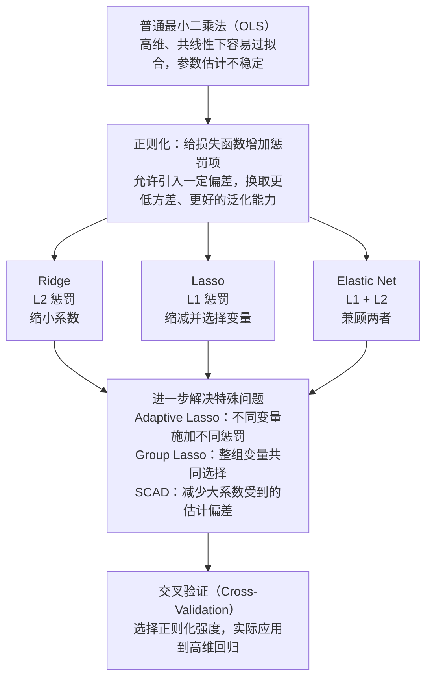
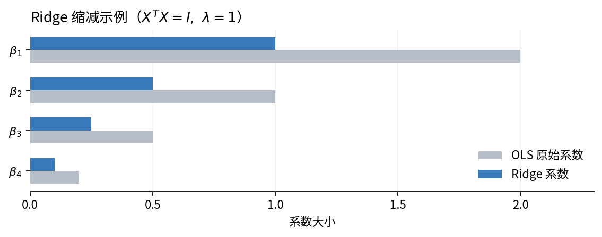
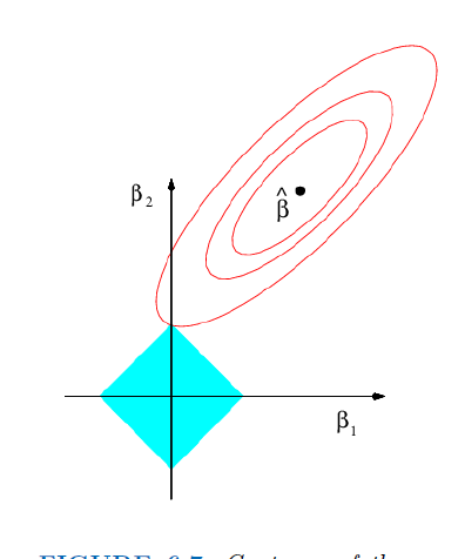
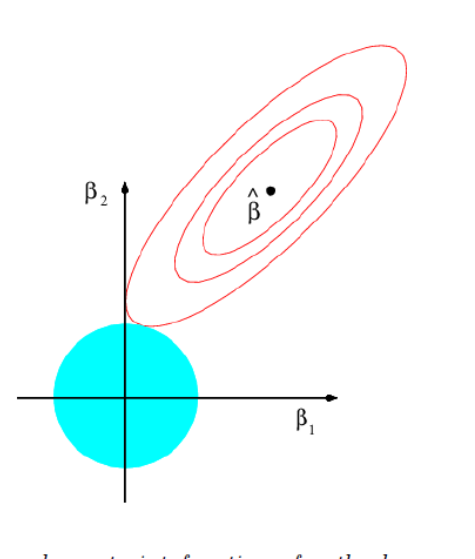
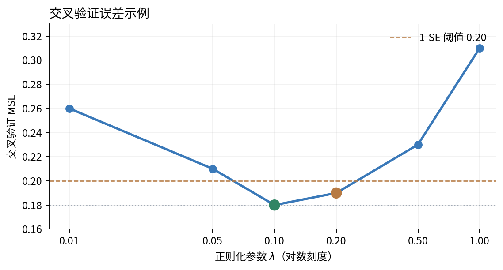
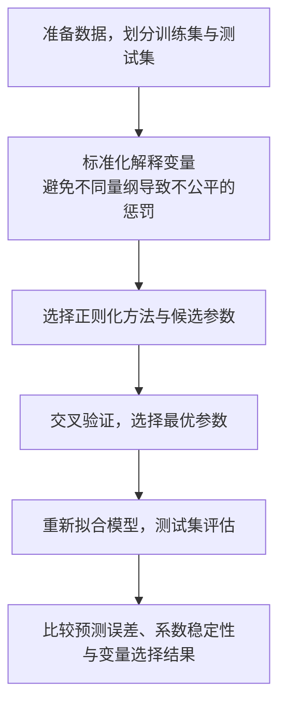

# 第六讲：正则化方法与高维回归分析

这份讲义的核心是**正则化（Regularization）**，包括 Ridge、Lasso、Elastic Net、Adaptive Lasso、Group Lasso 和 SCAD。

虽然讲义介绍了很多方法，但它们不是互不相关的六种算法，而是围绕一个共同问题展开：

**在高维数据中，为什么普通最小二乘法可能不够好？我们能否通过适当限制回归系数，让模型预测得更准确，甚至自动筛选重要变量？**

我会以讲义为主，先把最重要的三个方法讲透，再解释其他方法分别解决什么问题。

## 一、先建立整讲的知识框架

### 1. 本讲的逻辑主线

这里需要区分两个目标：

- **预测（Prediction）**：希望模型在新数据上预测得准确。
- **变量选择（Variable Selection）**：希望知道哪些变量重要，把不必要的回归系数设为零。

Ridge 主要解决第一个问题，Lasso 同时尝试解决两个问题，后续方法则进一步改进变量选择效果、处理变量之间的相关性或减小估计偏差。

### 2. 为什么高维数据需要正则化？

先回忆线性回归：

$$
Y=X\beta+\varepsilon
$$

其中 $X\in\mathbb R^{n\times p}$，$n$ 是样本量，$p$ 是解释变量个数。

普通最小二乘法（Ordinary Least Squares, OLS）求解：

$$
\hat\beta^{\mathrm{OLS}}
=\arg\min_\beta\|Y-X\beta\|_2^2
$$

当 $X$ 列满秩时：

$$
\hat\beta^{\mathrm{OLS}}
=(X^\top X)^{-1}X^\top Y
$$

但高维情况下有两个突出问题。

**第一个是解的稳定性。**

当 $p\ge n$ 时，$X^\top X$ 必然不可逆。即使 $p<n$，如果变量之间高度相关，$X^\top X$ 也可能接近奇异，使得参数估计对数据中的微小扰动非常敏感。

**第二个是过拟合。**

OLS 只考虑怎样让训练误差尽可能小，没有直接限制模型复杂度。随着变量数量增加，模型可能把噪声也拟合进去，导致训练误差小而测试误差大。

于是产生一个想法：

能不能允许回归系数稍微偏离真实值，换取参数估计更加稳定、预测误差更小？

这就引出了讲义第一页的 Stein 缩减思想。

---

## 二、Stein 缩减：为什么有偏估计可能更好？（第1—2页）

### 1. 从最简单的正态均值估计出发

假设：

$$
Y_1,\ldots,Y_n\overset{i.i.d.}{\sim}N(\mu,1)
$$

我们希望利用已有样本，预测一个新的观测值：

$$
Y_{\mathrm{new}}=\mu+\varepsilon_{\mathrm{new}},
\qquad \varepsilon_{\mathrm{new}}\sim N(0,1)
$$

最自然的估计量是样本均值：

$$
\hat\mu=\bar Y=\frac1n\sum_{i=1}^nY_i
$$

它具有：

$$
E(\bar Y)=\mu,\qquad
\operatorname{Var}(\bar Y)=\frac1n
$$

也就是说，样本均值无偏，而且随着样本量增加，方差减小。

但我们现在关心的不只是参数是否无偏，而是**预测一个新样本时的均方误差**。

### 2. 预测误差为什么等于方差 + 偏差平方 + 不可约误差？

定义预测误差（Prediction Error, PE）：

$$
PE(\hat\mu)=E[(Y_{\mathrm{new}}-\hat\mu)^2]
$$

将新观测值表示为 $\mu+\varepsilon_{\mathrm{new}}$：

$$
\begin{aligned}
PE(\hat\mu)
&=E[(\mu+\varepsilon_{\mathrm{new}}-\hat\mu)^2]\\
&=E[(\hat\mu-\mu)^2]+E[\varepsilon_{\mathrm{new}}^2]\\
&\quad-2E[(\hat\mu-\mu)\varepsilon_{\mathrm{new}}]
\end{aligned}
$$

由于新观测的噪声独立于用于估计 $\hat\mu$ 的训练样本，且噪声均值为零，交叉项为零。

再利用均方误差分解：

$$
E[(\hat\mu-\mu)^2]
=\operatorname{Var}(\hat\mu)
+[E(\hat\mu)-\mu]^2
$$

所以：

$$
\boxed{
PE(\hat\mu)
=\operatorname{Var}(\hat\mu)
+\operatorname{Bias}(\hat\mu)^2+1
}
$$

其中最后的 $1$ 是不可约误差（Irreducible Error），来自新样本自身的随机噪声。

对于样本均值：

$$
PE(\bar Y)=\frac1n+1
$$

### 3. 为什么故意引入偏差？

考虑将样本均值缩小：

$$
\hat\mu_c=c\bar Y,\qquad 0\le c\le1
$$

其中 $c$ 称为缩减系数（Shrinkage Factor）。

例如，原来估计是 $10$，取 $c=0.8$，新的估计就是 $8$。

缩小以后：

$$
E(\hat\mu_c)=c\mu
$$

所以：

$$
\operatorname{Bias}(\hat\mu_c)
=(c-1)\mu
$$

同时：

$$
\operatorname{Var}(\hat\mu_c)=\frac{c^2}{n}
$$

代回预测误差公式：

$$
\boxed{
PE(\hat\mu_c)
=\frac{c^2}{n}+(1-c)^2\mu^2+1
}
$$

观察这个式子：

- $c$ 越小，方差 $\frac{c^2}{n}$ 越小。
- $c$ 越小，通常偏差平方 $(1-c)^2\mu^2$ 越大。

因此，缩减实际上是在进行一种权衡：

**牺牲一点无偏性，可能换来更大幅度的方差下降。**

我们甚至可以求出理论最优的 $c$。

对 $c$ 求导：

$$
\frac{\partial PE}{\partial c}
=\frac{2c}{n}-2(1-c)\mu^2
$$

令其为零：

$$
\frac cn=(1-c)\mu^2
$$

得到：

$$
\boxed{
c^*=\frac{\mu^2}{\mu^2+1/n}
}
$$

有两个重要结论：

当 $\mu$ 接近零时，$c^*$ 较小，应该更大程度地缩减；当 $|\mu|$ 较大时，$c^*$ 接近 $1$，不应该缩减太多。

但是，这个最优系数包含未知的 $\mu$，实际中不能直接使用。讲义接着用 $\bar Y^2$ 替代 $\mu^2$，得到一个数据驱动的缩减规则。

需要注意：上面的预测误差公式假设 $c$ 是固定常数。如果 $c$ 本身由样本计算而来，就不能直接套用同一个公式断言预测误差必然下降。

### 4. 从缩减自然引出正则化

讲义接下来提出：

$$
\min_{\beta}\left\{
\|Y-\beta\mathbf1_n\|_2^2+\lambda\beta^2
\right\}
$$

这里：

$$
\|Y-\beta\mathbf1_n\|_2^2
=\sum_{i=1}^n(Y_i-\beta)^2
$$

是原来的最小二乘损失。

而新增加的：

$$
\lambda\beta^2
$$

称为惩罚项（Penalty Term）。

为什么增加这个惩罚项就会缩小估计量？

对 $\beta$ 求导：

$$
-2\sum_{i=1}^n(Y_i-\beta)+2\lambda\beta=0
$$

整理：

$$
n\bar Y-n\beta=\lambda\beta
$$

因此：

$$
\boxed{
\hat\beta=\frac{n}{n+\lambda}\bar Y
}
$$

因为：

$$
0<\frac{n}{n+\lambda}<1\qquad(\lambda>0)
$$

所以新估计就是把原来的样本均值乘以一个小于 $1$ 的系数。

这说明了一件非常重要的事情：

**通过在损失函数中惩罚过大的参数，可以自动实现参数缩减。**

顺便说明，讲义将这个例子放在 Stein 缩减标题下，是为了引出缩减思想。严格的 James–Stein 估计改进结论涉及至少三维的正态均值向量，不能将这里的一维例子理解为缩减估计在任何情况下都优于样本均值。

---

## 三、岭回归 Ridge：将缩减推广到多元线性回归（第2—3页）

### 1. 岭回归究竟做了什么？

前面只有一个待估计参数 $\mu$。

现在回到多元线性回归，有 $p$ 个回归系数。

OLS 的目标是：

$$
\min_\beta\|Y-X\beta\|_2^2
$$

我们希望每个回归系数都不要过大，因此增加一个惩罚项：

$$
\boxed{
\min_\beta
\left\{
\|Y-X\beta\|_2^2+\lambda\|\beta\|_2^2
\right\}
}
$$

其中：

$$
\|\beta\|_2^2=\sum_{j=1}^p\beta_j^2
$$

这就是岭回归（Ridge Regression），也叫 L2 正则化（L2 Regularization）。

这里的 $\lambda\ge0$ 是调节参数（Tuning Parameter）。

如果 $\lambda=0$，就是 OLS。

如果 $\lambda$ 很大，大系数受到的惩罚也很大，模型就会倾向于使用更小的回归系数。

但要注意：**岭回归是缩小系数，而不是直接删除变量。**

### 2. 为什么不惩罚截距？

讲义最初使用的完整目标函数是：

$$
\min_{\beta_0,\beta}
\left\{
\sum_{i=1}^n
(y_i-\beta_0-x_i^\top\beta)^2
+\lambda\sum_{j=1}^p\beta_j^2
\right\}
$$

其中只惩罚斜率系数，不惩罚 $\beta_0$。

原因在于，截距代表响应变量的整体基准水平，而不是我们希望限制的变量效应。

例如，把所有 $y_i$ 增加 $100$，合理的结果应该是截距增加 $100$，而各个变量的斜率不发生变化。

不惩罚截距有助于保证这种性质。

对 $\beta_0$ 求导并令其为零：

$$
\sum_{i=1}^n(y_i-\beta_0-x_i^\top\beta)=0
$$

解得：

$$
\boxed{
\beta_0=\bar y-\sum_{j=1}^p\bar x_j\beta_j
}
$$

把它代回原目标函数，就等价于先将 $Y$ 和 $X$ 的每一列中心化（Centering），再对斜率做无截距回归。

所以后面讲义直接使用：

$$
\|Y-X\beta\|_2^2+\lambda\|\beta\|_2^2
$$

这里的 $X,Y$ 都理解为中心化后的数据。

### 3. 岭回归的解怎么推导？

这是本讲第一个需要掌握的核心推导。

令：

$$
F(\beta)
=(Y-X\beta)^\top(Y-X\beta)
+\lambda\beta^\top\beta
$$

利用矩阵求导：

$$
\nabla_\beta F
=-2X^\top(Y-X\beta)+2\lambda\beta
$$

令梯度为零：

$$
-2X^\top Y+2X^\top X\beta+2\lambda\beta=0
$$

整理得：

$$
(X^\top X+\lambda I)\beta=X^\top Y
$$

所以：

$$
\boxed{
\hat\beta^{\mathrm{ridge}}
=(X^\top X+\lambda I)^{-1}X^\top Y
}
$$

与 OLS 比较：

$$
\hat\beta^{\mathrm{OLS}}
=(X^\top X)^{-1}X^\top Y
$$

两者最大的区别，就是岭回归在 $X^\top X$ 上增加了：

$$
\lambda I
$$

### 4. 为什么加上 $\lambda I$ 能让估计稳定？

从线性代数角度看，$X^\top X$ 是半正定矩阵。

假设它的特征值是：

$$
d_1,\ldots,d_p\ge0
$$

那么：

$$
X^\top X+\lambda I
$$

的特征值就变成：

$$
d_1+\lambda,\ldots,d_p+\lambda
$$

当 $\lambda>0$ 时，这些特征值全部严格大于零，因此矩阵一定可逆。

这也解释了讲义中的结论：

**即使 $p>n$，岭回归仍然能够得到唯一的参数解。**

更深一层的直觉是：原来某些特征值可能特别接近零，OLS 求逆会放大相关方向上的随机噪声；岭回归把这些特征值整体增加 $\lambda$，就减轻了噪声放大的问题。

因此，Ridge 特别适合处理高度共线性（Multicollinearity）。

### 5. 为什么说岭回归是对 OLS 的缩减？

讲义考虑一个理想化情形：

$$
X^\top X=I
$$

即所有解释变量的列向量都具有单位长度，并且彼此正交。

这时：

$$
\hat\beta^{\mathrm{OLS}}=X^\top Y
$$

而：

$$
\begin{aligned}
\hat\beta^{\mathrm{ridge}}
&=(I+\lambda I)^{-1}X^\top Y\\
&=\frac1{1+\lambda}X^\top Y
\end{aligned}
$$

所以：

$$
\boxed{
\hat\beta^{\mathrm{ridge}}
=\frac1{1+\lambda}\hat\beta^{\mathrm{OLS}}
}
$$

这就把 Ridge 和前面的 Stein 缩减思想联系起来了。

在这个理想化情况下，每一个 OLS 系数都乘以相同的缩减比例。

**岭回归系数如何随 $\lambda$ 缩小？**

正则化强度 $\lambda$（原讲解为可拖动滑块，以下为静态对应）：

| 原始 OLS 系数 | $\lambda=0$ | $\lambda=1$ | $\lambda=2$ | $\lambda=5$ |
|---|---:|---:|---:|---:|
| $\beta_1=2$ | 2.00 | 1.00 | 0.67 | 0.33 |
| $\beta_2=1$ | 1.00 | 0.50 | 0.33 | 0.17 |
| $\beta_3=0.5$ | 0.50 | 0.25 | 0.17 | 0.08 |
| $\beta_4=0.2$ | 0.20 | 0.10 | 0.07 | 0.03 |

灰色：OLS 原始系数　蓝色：Ridge 系数

假设 $X^\top X=I$，原始 OLS 系数分别为 2、1、0.5、0.2。调整 $\lambda$ 可观察等比例缩减。

真实数据里 $X^\top X$ 一般不等于 $I$，所以不能直接对每个 OLS 系数乘相同比例。但是如果把 $X^\top X$ 进行特征分解，仍然可以证明：**Ridge 在不同特征方向上施加不同程度的缩减，尤其会更强地缩减那些估计不稳定的方向。**

### 6. 岭回归的局限

虽然 Ridge 可以让回归系数变小，但 L2 惩罚是光滑的，通常不会主动把一个非零系数恰好压到零。

例如，系数可能由：

$$
(2,\ 0.5,\ 0.1)
$$

缩减为：

$$
(1.3,\ 0.32,\ 0.06)
$$

尽管第三个变量影响已经很小，但它仍然保留在模型中。

因此，Ridge 能改善预测稳定性，却不能有效产生稀疏模型（Sparse Model）。

这就自然引出了下一个方法：Lasso。

## 四、Lasso：为什么 L1 正则化可以实现变量选择？（第3—5页）

这是本讲的另一个核心，也是理解后面几种方法的基础。

### 1. Lasso 和 Ridge 有什么区别？

Ridge 使用 L2 惩罚：

$$
\lambda\sum_{j=1}^p\beta_j^2
$$

Lasso（Least Absolute Shrinkage and Selection Operator）则使用 L1 惩罚：

$$
\boxed{
\min_\beta
\left\{
\frac12\|Y-X\beta\|_2^2+\lambda\|\beta\|_1
\right\}
}
$$

其中：

$$
\|\beta\|_1=\sum_{j=1}^p|\beta_j|
$$

看上去只是把平方换成了绝对值，但产生了一个重要区别：

**Lasso 不仅能缩小系数，还能够让部分系数恰好等于零。**

假设有 100 个解释变量，Lasso 可能最终得到只有 8 个非零系数的模型。这等价于同时进行了系数估计与变量选择。

为什么换成绝对值就能产生这样的效果？

可以从两个角度理解。

### 2. 几何解释：为什么 Lasso 更容易得到零系数？

讲义第 4 页的图 1 非常重要。

Lasso 的优化问题可以等价地写成约束形式：

$$
\min_\beta\frac12\|Y-X\beta\|_2^2
$$

满足：

$$
\|\beta\|_1\le s
$$

其中 $s$ 是允许回归系数使用的总配额。

当 $p=2$ 时：

$$
|\beta_1|+|\beta_2|\le s
$$

对应的是菱形区域。

而 Ridge 的 L2 约束：

$$
\beta_1^2+\beta_2^2\le s
$$

对应的是圆形区域。

| Lasso：菱形约束 | Ridge：圆形约束 |
|:---:|:---:|
|  |  |
| 角点位于坐标轴上，容易产生零系数 | 边界光滑，通常产生非零系数 |

上面对应讲义第 4 页图 1 的几何思想。

回想一下约束优化的含义：我们要找到最小的一条残差平方和等值线，使它与允许的参数区域接触。

对 Lasso 来说，允许区域是菱形，尖角刚好落在坐标轴上。最优解很容易出现在角点，例如：

$$
(\hat\beta_1,\hat\beta_2)=(0,1)
$$

这就意味着第一个变量被删除了。

但 Ridge 的圆形区域边界是光滑的，接触点通常不会恰好位于坐标轴上。

因此，Lasso 容易得到稀疏解。

不过，这只是二维几何直觉。接下来可以通过解析解，真正看清为什么小系数会被设为零。

### 3. Lasso 的软阈值解（Soft Thresholding）

讲义使用和 Ridge 相同的理想化条件：

$$
X^\top X=I
$$

于是：

$$
\hat\beta^{\mathrm{OLS}}=X^\top Y
$$

从 Lasso 的目标函数出发：

$$
F(\beta)=\frac12\|Y-X\beta\|_2^2+\lambda\|\beta\|_1
$$

展开平方项：

$$
\begin{aligned}
F(\beta)
&=\frac12Y^\top Y-\beta^\top X^\top Y\\
&\quad+\frac12\beta^\top X^\top X\beta
+\lambda\sum_j|\beta_j|
\end{aligned}
$$

由于 $X^\top X=I$，且 $X^\top Y=\hat\beta^{\mathrm{OLS}}$，所以：

$$
F(\beta)
=\text{常数}+
\sum_{j=1}^p
\left[
\frac12(\beta_j-\hat\beta_j^{\mathrm{OLS}})^2
+\lambda|\beta_j|
\right]
$$

这个变形很关键。

**原来需要同时优化 $p$ 个参数，现在可以把每个参数单独优化。**

令：

$$
z=\hat\beta_j^{\mathrm{OLS}}
$$

我们只需研究：

$$
\min_\beta
\left\{
\frac12(\beta-z)^2+\lambda|\beta|
\right\}
$$

现在分情况讨论。

当 $\beta>0$ 时，$|\beta|=\beta$，所以：

$$
F'(\beta)=\beta-z+\lambda
$$

令导数为零：

$$
\beta=z-\lambda
$$

它必须满足 $\beta>0$，因此要求 $z>\lambda$。

当 $\beta<0$ 时，$|\beta|=-\beta$，所以：

$$
F'(\beta)=\beta-z-\lambda
$$

得到：

$$
\beta=z+\lambda
$$

它必须满足 $z<-\lambda$。

最后，当 $\beta=0$ 时，绝对值函数不可导。但可以用次梯度（Subgradient）判断是否达到最优。

因为：

$$
\partial|\beta|\big|_{\beta=0}=[-1,1]
$$

所以 $\beta=0$ 最优当且仅当：

$$
0\in-z+\lambda[-1,1]
$$

也就是：

$$
|z|\le\lambda
$$

把三种情况合在一起：

$$
\boxed{
\hat\beta_j^{\mathrm{Lasso}}
=
\operatorname{sign}(\hat\beta_j^{\mathrm{OLS}})
\left(|\hat\beta_j^{\mathrm{OLS}}|-\lambda\right)_+
}
$$

这里：

$$
(a)_+=\max(a,0)
$$

这就是软阈值函数（Soft-Thresholding Function）。

### 4. 软阈值究竟意味着什么？

比如 OLS 得到三个系数：

$$
\hat\beta^{\mathrm{OLS}}=(1.2,\ 0.3,\ -0.8)
$$

设：

$$
\lambda=0.5
$$

那么 Lasso 估计为：

$$
\hat\beta^{\mathrm{Lasso}}=(0.7,\ 0,\ -0.3)
$$

可以看到，中间那个系数因为绝对值小于 $\lambda$，直接被压到零。

**交互演示：Lasso 的软阈值操作**

调整 $\lambda$（原讲解为可拖动滑块，以下保留对应关系）：

| 变量 | OLS | Lasso（$\lambda=0$） | Lasso（$\lambda=0.5$） | Lasso（$\lambda=1.0$） | $\lambda=0.5$ 时的结果 |
|---|---:|---:|---:|---:|---|
| $\beta_1$ | 1.20 | 1.20 | 0.70 | 0.20 | 保留 |
| $\beta_2$ | 0.30 | 0.30 | 0.00 | 0.00 | 被删除 |
| $\beta_3$ | -0.80 | -0.80 | -0.30 | 0.00 | 保留 |

假设设计矩阵的列标准正交。随着 $\lambda$ 增大，更多系数变成零。

由此可以理解 Lasso 的两个特点。

第一，$\lambda$ 越大，越多变量被删除，模型越稀疏。

第二，即使一个变量没有被删除，它的系数绝对值也会减少 $\lambda$。

第二点意味着：Lasso 在筛选变量的同时，也会对比较重要的变量产生缩减偏差。

这会成为后续 Adaptive Lasso 和 SCAD 的改进动机。

需要记住，这个逐个变量的软阈值公式是在 $X^\top X=I$ 的特殊条件下成立的。一般情况下变量相关，Lasso 仍可产生稀疏解，但不能直接对所有 OLS 系数分别使用该公式。

---

## 五、Elastic Net：为什么把 L1 和 L2 结合起来？（第5—7页）

### 1. Lasso 在高维数据中还有什么问题？

假设我们希望用以下变量预测房价：

房屋面积、卧室数量、客厅面积、建筑总面积。

这些变量之间可能存在高度相关性。

Lasso 有时会从一组高度相关的变量中选择少数几个，而将其他变量设为零。

但这种选择不一定稳定。换一批训练数据，原来选中面积的模型可能改为选择卧室数量。

此外，在 $p>n$ 的情况下，Lasso 通常存在非零系数个数至多为 $n$ 的稀疏最优解；在一般位置等常见条件下，这也限制了所选变量数量。讲义把它概括为“最多只能选出 $n$ 个变量”。

因此，Lasso 虽然能够进行变量选择，但面对高度相关的变量群时，可能无法充分利用这些变量所携带的信息。

### 2. Elastic Net 的目标函数

Elastic Net（弹性网络）把 L1 和 L2 惩罚结合起来：

$$
\boxed{
\min_\beta
\left\{
\frac12\|Y-X\beta\|_2^2+
\lambda\left[
\alpha\|\beta\|_1+
\frac{1-\alpha}{2}\|\beta\|_2^2
\right]
\right\}
}
$$

其中：

$$
\lambda\ge0,\qquad 0\le\alpha\le1
$$

$\lambda$ 决定正则化的整体强度。

$\alpha$ 决定 L1 和 L2 的相对权重。

当 $\alpha=1$，就变成 Lasso；当 $\alpha=0$，则变成适当重新定标后的 Ridge。

因此 Elastic Net 是 Ridge 和 Lasso 的组合，而不是完全独立的一种正则化思想。

### 3. 为什么 Elastic Net 能兼顾两者？

L1 惩罚负责产生稀疏性。

L2 惩罚则有助于稳定系数估计，特别是对高度相关的变量起作用。

可以看一个简单例子。

假设两个解释变量完全相同：

$$
X_1=X_2
$$

那么：

$$
\beta_1X_1+\beta_2X_2
=(\beta_1+\beta_2)X_1
$$

只要 $\beta_1+\beta_2$ 相同，模型预测就相同。

例如：

$$
(\beta_1,\beta_2)=(2,0)
$$

和：

$$
(\beta_1,\beta_2)=(1,1)
$$

产生相同的预测。

假设系数都非负，这两种方案的 L1 惩罚均为：

$$
|\beta_1|+|\beta_2|=2
$$

但 L2 惩罚不同：

$$
2^2+0^2=4
$$

而：

$$
1^2+1^2=2
$$

所以 L2 惩罚更倾向于把影响分摊给两个高度相关的变量。

这解释了 Elastic Net 的分组效应（Grouping Effect）：它倾向于让高度相关的解释变量具有相近系数，而不是任意只保留其中一个。

这里的分组效应不等于严格的整组变量选择。真正要求一组变量同时选入或剔除，还要用后面的 Group Lasso。

### 4. Elastic Net 的解析解

讲义继续在：

$$
X^\top X=I
$$

的条件下推导。

令：

$$
z_j=\hat\beta_j^{\mathrm{OLS}}
$$

则单个变量对应的优化问题为：

$$
\min_{\beta_j}
\left\{
\frac12(\beta_j-z_j)^2+
\lambda\alpha|\beta_j|+
\frac{\lambda(1-\alpha)}2\beta_j^2
\right\}
$$

和 Lasso 一样分正负讨论。

例如，当 $\beta_j>0$ 时：

$$
\beta_j-z_j+\lambda\alpha+
\lambda(1-\alpha)\beta_j=0
$$

整理：

$$
[1+\lambda(1-\alpha)]\beta_j
=z_j-\lambda\alpha
$$

所以：

$$
\beta_j
=\frac{z_j-\lambda\alpha}
{1+\lambda(1-\alpha)}
$$

结合其他情况，得到：

$$
\boxed{
\hat\beta_j^{\mathrm{EN}}
=
\frac{
\operatorname{sign}(z_j)(|z_j|-\lambda\alpha)_+
}
{1+\lambda(1-\alpha)}
}
$$

观察这个公式可以发现：

分子部分与 Lasso 一样，执行软阈值操作；分母部分来自 Ridge，对剩下的非零系数进一步缩减。

所以 Elastic Net 的解析解可以概括为：

**先通过 L1 惩罚决定哪些变量保留，再通过 L2 惩罚进一步稳定保留变量的系数。**

这个解释对应讲义第 6 页图 4 的缩减特征。

---

## 六、后三种方法：分别对 Lasso 做什么改进？（第7—10页）

Ridge、Lasso 和 Elastic Net 是本讲最基础的三个方法。

接下来介绍的 Adaptive Lasso、Group Lasso 和 SCAD，可以看作针对普通 Lasso 的不同局限提出的改进。

需要注意，它们不是简单的逐代升级，而是解决不同问题。

### 1. Adaptive Lasso：为什么不同变量要受到不同惩罚？

普通 Lasso 的惩罚是：

$$
\lambda\sum_{j=1}^p|\beta_j|
$$

这相当于对所有变量使用同样的惩罚强度。

但是，一个真实影响很大的变量和一个影响很小的变量，是否应该受到相同程度的惩罚？

Adaptive Lasso（自适应 Lasso）的思路是：**先对每个变量的重要程度作一个初步估计，再据此设置不同的惩罚权重。**

目标函数：

$$
\boxed{
\min_\beta
\left\{
\frac12\|Y-X\beta\|_2^2+
\lambda\sum_{j=1}^pw_j|\beta_j|
\right\}
}
$$

其中 $w_j>0$ 为权重。

常用形式：

$$
w_j=\frac1{|\tilde\beta_j|^\gamma},
\qquad \gamma>0
$$

$\tilde\beta_j$ 是事先计算好的先导估计量（Pilot Estimate），不是当前正在优化的 $\beta_j$。

假设 $\gamma=1$。

如果初步估计某个变量的系数是 $2$，那么：

$$
w_j=\frac12
$$

这个变量受到较小惩罚。

如果另一个变量的初步估计只有 $0.1$，那么：

$$
w_j=10
$$

该变量受到很大惩罚，更容易被压缩到零。

因此：

$$
\boxed{
\text{初步估计越重要}\ \Longrightarrow\
\text{惩罚越小}
}
$$

这样既希望保留重要变量，也希望减少对其系数的过度缩减。

讲义提到，$n>p$ 时可以使用 OLS 作为先导估计；$n\le p$ 时则给出了使用单变量回归斜率的方法。实际使用中也可以考虑 Ridge 等其他先导估计。若某个先导估计恰好为零，通常需要在分母中加入很小的正数以避免权重无穷大。

还有一处值得注意：讲义第 7 页先从形式上讨论 $w_j=1/|\beta_j|^\gamma$，得到非凸惩罚 $|\beta_j|^{1-\gamma}$。但真正的 Adaptive Lasso 是将权重建立在预先固定的 $\tilde\beta_j$ 上。两者不能混为一谈，固定正权重的 Adaptive Lasso 目标仍然是凸的。

### 2. Group Lasso：为什么要整组选择变量？

假设有一个类别变量“地区”，包含四个类别。

在回归中，我们可能使用三个虚拟变量（Dummy Variables）表示它。

但这三个虚拟变量实际上属于同一个原始特征。

使用普通 Lasso 时，可能出现：

$$
(\hat\beta_1,\hat\beta_2,\hat\beta_3)
=(0.5,0,0)
$$

也就是只保留了其中一个虚拟变量。

然而，如果研究目标是决定是否保留“地区”这个因素，我们可能希望这三个变量作为一组被选择或者删除。

这就引出了 Group Lasso。

假设将所有变量分为 $L$ 组，令 $\beta_{G_\ell}$ 为第 $\ell$ 组变量对应的系数向量。

常见的 Group Lasso 目标是：

$$
\boxed{
\min_\beta
\left\{
\frac12\|Y-X\beta\|_2^2+
\lambda\sum_{\ell=1}^L
\|\beta_{G_\ell}\|_2
\right\}
}
$$

为什么这里使用组内 L2 范数，而不是 L1 范数？

关键是它把整组系数当成一个整体：

$$
\|\beta_{G_\ell}\|_2
=\sqrt{\sum_{j\in G_\ell}\beta_j^2}
$$

惩罚项是多个组范数之和，相当于**组内 L2、组间 L1** 的结构。

L1 的稀疏性作用在组这一层级上，因此可能让某个组的全部系数同时为零。

但在保留的组内部，并不要求每个系数都非零，也不主动追求组内稀疏。

**普通 Lasso 与 Group Lasso 的变量选择方式**

| Lasso | Group Lasso |
|:---:|:---:|
| ✓　✗　✓ | ✓　✓　✓ |
| 同组变量可能只保留部分 | 整组被保留，或整组被删除 |

示意图展示组级选择机制，不表示被选中组的每个系数必然非零。

所以 Group Lasso 特别适合存在已知分组结构的数据，比如类别变量的虚拟变量、同一特征的一组基函数等。

### 3. SCAD：为什么 Lasso 对大系数的惩罚可能太强？

现在再回忆一下 Lasso 的软阈值解。

如果某个 OLS 系数等于 $10$，且 $\lambda=2$，那么 Lasso 将其缩减为：

$$
10-2=8
$$

如果 OLS 系数等于 $3$，则 Lasso 缩减为：

$$
3-2=1
$$

这意味着 Lasso 对所有保留下来的系数，在标准正交条件下都会进行绝对量为 $\lambda$ 的缩减。

但如果一个变量的真实影响非常大，我们可能不希望继续明显压低它的估计值。

SCAD（Smoothly Clipped Absolute Deviation）就是为了缓解这个问题而提出的。

SCAD 的目标函数：

$$
\boxed{
\min_\beta
\left\{
\frac12\|Y-X\beta\|_2^2+
\sum_{j=1}^pf_\lambda(|\beta_j|)
\right\}
}
$$

它不再使用简单的 $\lambda|\beta_j|$，而是设计一个特殊的惩罚函数 $f_\lambda$。

讲义给出了惩罚函数的导数：

$$
f_\lambda'(\theta)=
\begin{cases}
\lambda,&0\le\theta\le\lambda,\\[4pt]
\dfrac{(a\lambda-\theta)_+}{a-1},
&\theta>\lambda,
\end{cases}
$$

其中 $a>2$。

理解这个公式，可以把系数分成三个区域。

**系数较小时**，惩罚函数的斜率为 $\lambda$，和 Lasso 一样。目的是把不重要的变量压到零。

**系数中等时**，惩罚函数的斜率逐渐减小。系数越大，额外增加一点系数所受到的惩罚越弱。

**系数足够大时**，即 $\theta>a\lambda$，惩罚函数的导数变为零。此时继续增大系数不会增加惩罚。

这就是 SCAD 最核心的设计：

**小系数强惩罚，大系数弱惩罚，足够大的系数不再额外惩罚。**

### 4. SCAD 的解与 Lasso 有什么区别？

讲义第 10 页进一步给出了正交设计下的解。令：

$$
z_j=\hat\beta_j^{\mathrm{OLS}}
$$

则：

$$
\hat\beta_j^{\mathrm{SCAD}}
=
\begin{cases}
0,&|z_j|\le\lambda,\\[4pt]
\operatorname{sign}(z_j)(|z_j|-\lambda),
&\lambda<|z_j|\le2\lambda,\\[6pt]
\dfrac{(a-1)z_j-a\lambda\operatorname{sign}(z_j)}
{a-2},
&2\lambda<|z_j|\le a\lambda,\\[8pt]
z_j,&|z_j|>a\lambda.
\end{cases}
$$

不需要机械记忆四段公式，重点是理解不同区间的作用。

第一段把小系数直接置零。

第二段和 Lasso 一样，执行软阈值缩减。

第三段逐渐减少缩减量，让估计值向原始 OLS 系数靠近。

第四段则完全保留 OLS 系数，不再缩减。

所以讲义第 10 页图 9 中，SCAD 的系数估计曲线在大系数区域逐渐回到 $y=x$ 直线上，而 Lasso 的曲线仍然偏离这条直线。

但是 SCAD 也有代价：**惩罚函数不是凸函数（Non-convex）**。

这会导致优化问题更难求解，可能存在多个局部最优解，因此不能简单认为 SCAD 一定优于 Lasso。

---

## 七、六种正则化方法的比较

到这里，所有方法的关系就清楚了。

| 方法 | 核心思想 | 主要作用 |
|---|---|---|
| **Ridge** | L2 惩罚 | 缩减系数，稳定预测 |
| **Lasso** | L1 惩罚 | 缩减系数，产生稀疏解 |
| **Elastic Net** | L1 + L2 | 变量选择，同时处理高度相关的变量 |
| **Adaptive Lasso** | 加权 L1 | 根据初步估计实施差异化惩罚 |
| **Group Lasso** | 组间 L1、组内 L2 | 整组变量选择 |
| **SCAD** | 非凸惩罚 | 保留稀疏性，减小大系数的缩减偏差 |

尤其需要区分下面这两组方法。

Elastic Net 和 Group Lasso 都能处理变量之间的联系，但 Elastic Net 倾向于让相关变量具有相近系数，Group Lasso 则利用事先已知的分组结构决定是否保留整个变量组。

Adaptive Lasso 和 SCAD 都希望改善普通 Lasso 的估计偏差，但前者通过先导估计设置不同的固定权重，后者通过非凸惩罚函数改变不同系数受到的惩罚强度。

---

## 八、正则化参数怎么选？交叉验证（第10页）

前面所有正则化方法都有一个共同问题：

如何确定 $\lambda$？

如果 $\lambda$ 太小，正则化作用不明显，模型可能过拟合。

如果 $\lambda$ 太大，回归系数过度缩减，模型可能欠拟合（Underfitting）。

这就是一个典型的偏差—方差权衡。

### 1. K 折交叉验证

讲义使用交叉验证（Cross-Validation, CV）选择调节参数。

例如使用 5 折交叉验证。

将训练数据划分为 5 份。给定一个 $\lambda$，每次使用其中 4 份训练模型，再用剩下 1 份计算验证误差。

重复 5 次后取平均：

$$
CV(\lambda)
=\frac15\sum_{k=1}^5MSE_k(\lambda)
$$

然后对多个候选值重复这一过程：

$$
\lambda_1,\lambda_2,\ldots,\lambda_M
$$

最终选择：

$$
\boxed{
\lambda^*
=\arg\min_{\lambda_m}CV(\lambda_m)
}
$$

这称为最小 CV 规则（Minimum CV Rule）。

实际操作中，需要在每一折的训练部分计算标准化参数，再把相同变换应用于对应的验证部分，避免信息泄漏。

### 2. 什么是 1 标准误规则？

讲义还提到了 1 标准误规则（One-Standard-Error Rule）。

它不一定选择 CV 误差绝对最小的模型，而是希望在预测效果相近的情况下，优先选择更简单的模型。

假设不同 $\lambda$ 下的交叉验证结果如下：

**交叉验证误差示例**（示意数据，非讲义实验结果）

| $\lambda$ | CV MSE |
|---:|---:|
| 0.01 | 0.26 |
| 0.05 | 0.21 |
| 0.10 | 0.18 |
| 0.20 | 0.19 |
| 0.50 | 0.23 |
| 1.00 | 0.31 |

按最小 CV 规则，会选择：

$$
\lambda=0.10
$$

但假设最小 CV 误差对应的标准误为 $0.02$，那么 1-SE 规则允许选择满足：

$$
CV(\lambda)\le0.18+0.02=0.20
$$

的模型。

在这个范围内，选择正则化更强的：

$$
\lambda=0.20
$$

对于 Lasso，这通常意味着更少的非零系数，从而得到更简单的模型。

### 3. Elastic Net 有两个参数怎么办？

Elastic Net 同时需要选择：

$$
(\lambda,\alpha)
$$

因此可以构建二维参数网格，对每一组参数计算交叉验证误差：

$$
CV(\lambda_m,\alpha_\ell)
$$

再选择误差最小的参数组合：

$$
\boxed{
(\lambda^*,\alpha^*)
=\arg\min_{\lambda,\alpha}CV(\lambda,\alpha)
}
$$

本质上和只有一个参数时完全相同，只是参数搜索空间从一维变成了二维。

---

## 九、真实高维回归分析应该怎么做？（第10页）

讲义最后的 2.8 节列出了 Hitters Data 和 Crime Data 两个案例，但具体分析过程、代码和结果都放在配套 R 程序中，PDF 本身没有展开，因此无法仅依据讲义复现其具体结果。

不过，无论用 R 还是 Python，实际应用这些正则化方法的基本流程都相似：

这里强调一个容易忽略的细节：正则化通常需要先标准化解释变量。

例如，假设一个解释变量以“元”为单位，另一个以“万元”为单位。虽然它们可能表示相同的经济信息，但回归系数的数值量级不同。

Ridge 和 Lasso 都直接惩罚系数的数值大小，如果不标准化，就可能给不同量纲的变量施加不公平的惩罚。

标准化后，正则化才更容易体现我们希望比较的变量效应，而不是单纯受测量单位影响。

---

## 十、本讲最后应该掌握什么？

复习时，可以把全部内容压缩成三条主线。

**第一条：为什么需要正则化？**

OLS 在高维或高度共线性情况下可能不稳定。正则化通过增加惩罚项缩减参数，用适当的偏差换取方差下降，希望改善样本外预测效果。

**第二条：不同惩罚函数怎样改变参数估计？**

Ridge 的 L2 惩罚让系数连续缩小；Lasso 的 L1 惩罚可以让系数精确变为零；Elastic Net 混合两者。Adaptive Lasso、Group Lasso 和 SCAD 则分别针对惩罚权重、分组选择和大系数估计偏差进行改进。

**第三条：如何把方法用于真实数据？**

先进行适当的数据预处理，再通过交叉验证选择正则化参数，最后使用独立测试集评估预测效果，同时根据研究目标检查变量选择结果。

从掌握程度来看，建议把精力主要放在 **Stein 缩减的偏差—方差思想、Ridge 的矩阵解、Lasso 的软阈值推导，以及 Elastic Net 的组合逻辑** 上。这几部分构成整讲的数学基础。

后三种方法重点理解为什么提出、惩罚项如何改变、相对 Lasso 解决了什么问题即可；SCAD 的分段解析解可以理解其机制，不必一开始就机械记忆全部区间。

如果能回答“为什么 Ridge 让估计更稳定”“为什么 Lasso 能把系数压到零”“为什么 Elastic Net 适合相关变量”“为什么 SCAD 对大系数偏差更小”这四个问题，就已经掌握了本讲最核心的内容。
